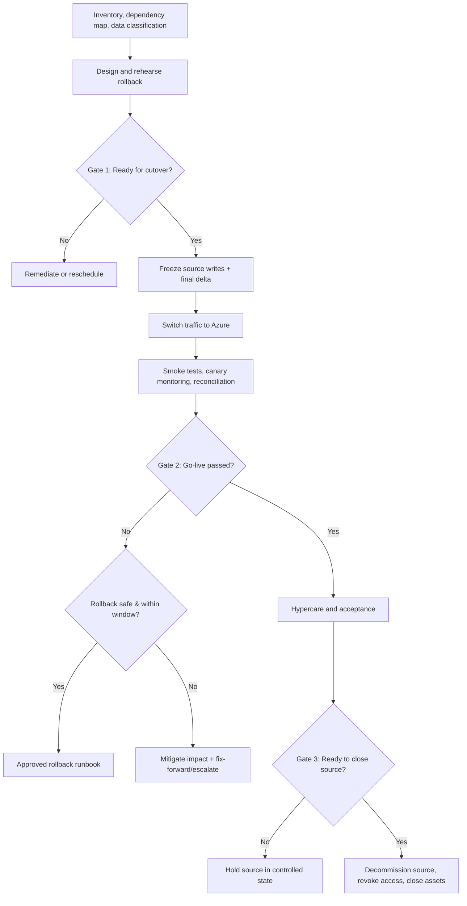
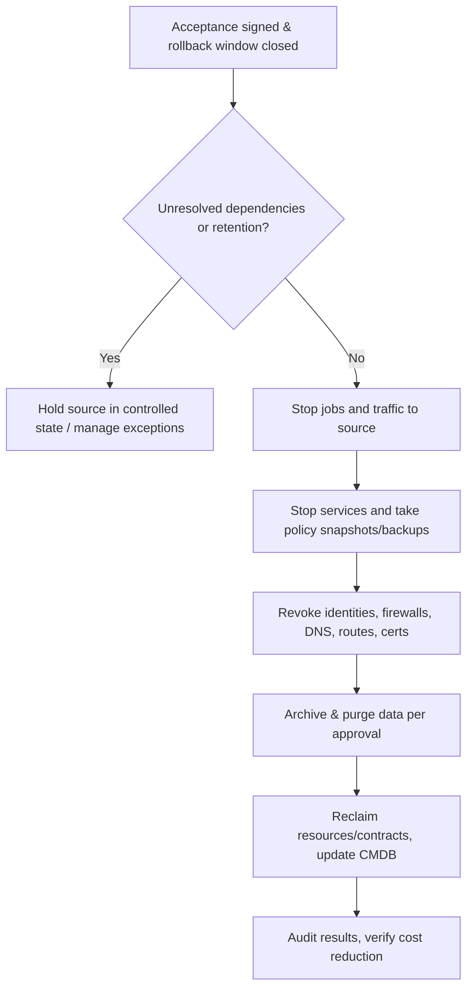

# Planning Rollback, Acceptance, and Source System Decommissioning

## 1. Learning Objectives and Scenario

Migrating a system to Microsoft Azure does not end when a virtual machine boots or data lands in Azure Storage. A migration succeeds only when **users can work properly on the new system**, data has been reconciled, permissions and security meet requirements, stakeholders **sign off acceptance**, and the source system is shut down **only after it is no longer needed for rollback, reconciliation, or compliance**.

In the **Hybrid Cloud and Migration to Azure** chapter of the `CLOUD_PROVIDERS_AZURE` module, this lesson provides an end-to-end process for three related yet distinct activities: **rollback planning**, **target system acceptance**, and **source system decommissioning**. Examples tie back to subscriptions, resource groups, Microsoft Entra ID, virtual networks, compute, storage, databases, monitoring, protection, and cost control for an Azure application architecture.

After this lesson, you will be able to:

- Distinguish migration rollback from disaster recovery, failback, and **fix-forward**.
- Identify **points of no easy return** once DNS, transactional data, database schemas, or access permissions change.
- Write a rollback runbook with triggers, decision deadlines, approvers, execution order, and post-rollback verification.
- Define acceptance criteria covering **data integrity, business functionality, performance, security, backup/restore, operations, and cost**.
- Design the **hypercare/stabilization** window, source freezing, and an auditable decommissioning workflow.
- Assess when **not to delete the source** due to legal, retention, dependency, or incomplete recovery gaps.

**Running scenario:** A business migrates `Shop API` from on-premises VMs and a database to Azure App Service/VMs, Azure SQL, and Azure Storage. Before cutover, baseline data was copied; post-cutover, new orders arrive in Azure. If users hit payment failures or data mismatches, the team must decide whether to **roll back to source** or **fix forward in Azure** without losing orders. Only after a period of stable operation does the team consider shutting down legacy VMs, service accounts, and on-premises links.

> **Core principle:** rollback is feasible only when there is a **verified path back** and a way to preserve **new data written on the target**. A source VM still powered on is not proof that the application can revert safely.

## 2. Definitions and Responsibility Boundaries

| Concept | Meaning | Key Prerequisite |
|---|---|---|
| **Cutover** | Shifting live traffic/business authority to Azure | Accurate config, baseline + delta data, go-live approval |
| **Migration rollback** | Returning to the pre-cutover serving configuration when migration fails criteria | Path back, data, and dependencies remain compatible |
| **Failback** | Moving workloads back to their original or designated site after failover | Depends on replication/DR tooling and data state |
| **Fix-forward** | Fixing issues directly in Azure to keep the new architecture running | Lower risk than reverting; requires approval and recovery plan |
| **Hypercare / stabilization** | Intensive post-cutover monitoring period | SLOs, incidents, data checks, monitoring, backups, ownership |
| **Acceptance** | Confirming the new system meets business and technical criteria | Test evidence and formal sign-off |
| **Decommission** | Controlled shutdown and retirement of the source system | Past rollback need, retention, legal, security; documented |

**Rollback is not backup**: a backup is one input for recovery, whereas rollback spans routing, identity, applications, database schemas, secrets, DNS, certificates, batch jobs, partner integrations, and post-cutover writes. **Azure Site Recovery** or migration tools assist replication/failover in specific scenarios, yet cannot automatically undo all application changes or transactions just because Azure holds backups.

### 2.1. RPO and RTO in Migration

- **RPO (Recovery Point Objective)** bounds acceptable data loss measured in time. Near-zero RPO after go-live requires tested continuous sync or change-capture mechanisms capable of reversing; daily backups cannot meet this.
- **RTO (Recovery Time Objective)** bounds service restoration time once rollback is triggered. RTO covers detection, approval, traffic switching, restoring data consistency, and business validation.
- **Rollback decision window** is the time allowed to decide before data divergence or complexity outgrows safe reversal. This is not necessarily equal to RTO.
- **Business impact** includes paused orders, failed transactions, financial discrepancies, affected users, and security exposure—it cannot be measured by uptime alone.

For example, suppose a team sets a **60-minute rollback RTO** while the source database was locked against writes prior to cutover. If 500 new orders have already been written in Azure with **no verified reverse-write path**, flipping DNS in 5 minutes does not achieve a 60-minute zero-loss rollback. The team must **pause transaction intake**, evaluate reverse synchronization or switch to an approved fix-forward/recovery plan.

## 3. Prerequisite: Know Exactly What You Are Migrating

A rollback plan lacking an **inventory** routinely misses dependencies: overnight jobs still running on source, partners calling legacy IPs, unsynced files, or the new app relying on secrets absent from source.

### 3.1. Minimum Inventory

| Category | Information to Collect | `Shop API` Example |
|---|---|---|
| Application | Owner, version, endpoints, critical transactions | `Shop API` checkout, catalog, fulfillment |
| Compute | Target VM/container/service, sizing, scaling, startup | App Service, worker VMs |
| Database | Engine/schema, source data, CDC/replication, transaction logs | On-prem SQL → suitable Azure SQL |
| Files/objects | File shares, Blob containers, ACL checks, manifests | 60 TB images and documents |
| Networking | DNS, TTLs, proxies, IPs, NSGs, VPN/ExpressRoute, routes | `shop.example.com`, private endpoints |
| Identity | AD/Entra ID, Managed Identities, service accounts, RBAC | App reads secrets from Key Vault |
| External integrations | Payments, email, ERP, webhooks, batches, schedulers | Payment gateway callbacks |
| Protection | Backups, restore tests, encryption, monitoring, DR | Recovery points at source/target |
| Financial | Subscription, resource group, tags, legacy contracts | `rg-shop-prod`, cost center `shop` |
| Operations | Alerts, dashboards, on-call, incident channels, escalation | Operations/SRE |

Never rely solely on architecture diagrams: inspect **actual live configs**, network flows, and scheduled jobs. Record exact subscription names, resource groups, tenant IDs, and endpoints so nobody attempts a rollback against the wrong environment.

### 3.2. Enforcing the Single Authoritative Writer

During migration, define **one authoritative system permitted to accept writes** per dataset:

| Phase | Authorized Writer | Other System | Notes |
|---|---|---|---|
| Before T0 | On-premises | Azure receives baseline data | Capture changes via CDC/journal/snapshot diff as needed |
| During final freeze | Business writes paused | Both in staging/sync mode | Apply final delta and reconcile |
| After go-live | Azure | Source read-only/standby per plan | Prevent legacy jobs from writing accidentally |
| Upon approved rollback | **Freeze writes at target** first | Source reopens writes only after sync/verification | Prevents split-brain |

**Never enable concurrent writes at both source and target** without a multi-master architecture and tested conflict resolution approved upfront. Bidirectional sync is not default behavior in Azure SQL, Azure Storage, Azure Migrate, or Data Box. Reversing post-cutover changes may require specialized tooling and explicit handling of transactions, deletes, and identity columns.

### 3.3. Who Holds Decision Authority?

| Role | Decisions / Deliverables |
|---|---|
| **Migration lead** | Coordinates timeline, checkpoints, and runbook execution |
| **Business owner / product owner** | Business criteria, tolerable data loss, go/no-go sign-off |
| **Database / data owner** | CDC, snapshots/backups, reconciliation, consistency, reverse writes |
| **Application owner** | Binary/config compatibility, rollback release, smoke tests |
| **Network / DNS owner** | DNS, routing, load balancers, private connectivity |
| **Security / compliance** | Permissions, encryption, logging, retention, disposal approval |
| **Operations / SRE** | Monitoring, incident on-call, incident commander, hypercare |
| **FinOps / asset owner** | Dual-run spend, retiring resources and valid licenses |

No single individual may unilaterally flip DNS, reopen source writes, or delete target services before data owners agree on the recovery point.

## 4. Decision Gates Across the Migration Lifecycle



This is a **decision flowchart**, not an automated failback engine. Every gate needs a checklist, evidence, named approvers, and timestamps; never treat a green Azure Monitor chart as complete acceptance.

## 5. Designing the Rollback Plan Before Cutover

### 5.1. Defining Scope and Reversal Options

Every workload needs an explicit answer: revert to the **original source**, recover to an **alternate store**, or declare safe rollback infeasible once new writes occur? Pick the exact strategy:

- **Traffic rollback:** route users back to source when data remains compatible and source is ready. Not synonymous with database rollback.
- **Application rollback:** redeploy the prior app version in Azure or on-prem if schemas, secrets, and APIs remain backward-compatible.
- **Data rollback / reverse migration:** move new target data back to source or restore a chosen recovery point; difficult or impossible if source cannot accept new schemas/transactions.
- **Fix-forward:** fix defects on Azure, preserving new data and avoiding complex reversal. Suitable when fixes stay within business impact limits, with formal approval and monitoring.

**Pre-decide the strategy** rather than forcing on-call staff to improvise during a live incident.

### 5.2. Workload-Specific Rollback Matrix

| Workload | What Must Stay at Source | Feasible Rollback Options | Key Risks |
|---|---|---|---|
| **VM / application server** | Image, version, config, system/service accounts, routes | Boot or route traffic back to verified source VMs | Changed data dependencies and endpoints |
| **Transactional database** | Tested backup/restore, compatible schema, transaction/change logs, DB roles | Rehearsed supported reverse sync; otherwise consider fix-forward | Post-cutover Azure transactions absent from source |
| **Azure Blob / file share** | Manifest, name/ACL mappings, snapshots/changelog, retained source | Controlled reverse delta per object/version or dataset restore | Edits/deletes/renames, ACLs, accidental overwrites, ordering |
| **App Service / AKS** | Artifact versions, Helm/manifests/configs, secret refs, target env | Version rollback or canary routing if data permits | Non-backward-compatible schemas, config drift |
| **DNS / Front Door / LB** | Records, TTLs, certs, health probes, source backends | Repoint backends/routing accounting for cache expiry | Resolver caches, long-lived connections, client caches |
| **Identity / secrets** | Entra ID/AD links, service principals, certs, source roles | Restore policies/credentials via controlled procedure | Lost permissions, live tokens, key rotation impact |
| **Network connectivity** | VPN/ExpressRoute, firewalls, allowlists, NAT, private DNS | Restore tested routes, rules, and endpoints | Asymmetric routing, misresolved private endpoints |
| **Batches & partner integrations** | Schedulers, webhooks/callbacks, queue offsets, idempotency keys | Re-enable the right workers and endpoints post-check | Duplicate order/notification processing |

Never rely on VM snapshots alone to restore a **transaction-consistent database**; use database-aware backups/replication. On Azure managed databases, PITR/backups are **service-level recovery tools**, not automatic reverse-migration pipelines back to on-premises engines.

### 5.3. Rollback Gate: Triggers and Approval Authority

Write a quantitative trigger table pairing technical metrics with business impact:

| Illustrative Trigger | Severity | Decision Action |
|---|---|---|
| Checkout drops orders or payment transactions fail reconciliation | Critical | Freeze writes/checkout immediately to cap divergence; incident commander + business/data owners decide rollback vs. fix-forward |
| HTTP 5xx > 5% for 10 minutes on critical routes | Severe | Capture traces; trigger rollback if data path is safe and within window |
| Azure SQL or Storage unreachable due to RBAC/private DNS | Severe | Assess rapid fix vs. blast radius; roll back per trigger/go-no-go rules |
| Checkout p95 > 3× baseline sustained, breaching SLO | User-impacting | Controlled intervention; decide per pre-agreed thresholds |
| Minor batch fails while core transactions pass | Manageable | Fix-forward/stay on target; do not blindly roll back whole system |

**Percentages and durations are templates**; replace them with real SLOs, SLAs, and system tolerances. Add a hard timebox: *if Gate 2 has not passed by T+30 minutes, leadership must make a formal logged decision* rather than letting the rollback window expire unnoticed.

### 5.4. The Point of No Easy Return

A **point of no easy return** arises once changes cannot revert within acceptable RPO/RTO: breaking database schema migrations, new transactions existing only in Azure, unjournaled file deletes/renames, revoked tokens/keys, released source IPs, or decommissioned source VMs/contracts.

Before reaching that point:

1. Keep the source environment **bootable yet write-isolated**.
2. Keep pre-cutover backups verified with tested restores and accessible keys.
3. Prove reverse-write/change capture supports the **exact schema and business rules**; otherwise publish rollback limits openly.
4. Close the “rollback window” via **signed decision**, never silently by neglect.
5. Beyond this point, follow pre-designed fix-forward incident playbooks or DR rather than promising “just flip DNS back.”

## 6. Rehearsing Rollback Before Production

An untested runbook is merely a hypothesis. Rehearse in a **representative test environment** with synthetic data and critical flows:

1. **Provision source–target pair** and measurable test data covering inserts, updates, deletes, and files with metadata.
2. **Rehearse cutover:** freeze source, apply delta, shift partial traffic, record timings, job IDs, and metrics.
3. **Inject controlled faults:** simulate dependency timeouts, broken private DNS, or bad deployments in lab (never break production).
4. **Execute rollback decision:** freeze Azure writes first; test reverse-syncing new transactions if supported.
5. **Restore source and routing:** verify DNS, backends, certificates, firewalls, service accounts, and queue workers without creating dual writers.
6. **Reconcile business state:** order counts, monetary totals, payment states, files, and events; catch duplicates or gaps.
7. **Measure real timings:** compare detection + decision + restore + validation time against RTO, and any data gap against RPO.
8. **Capture lessons learned:** missing roles/permissions, unsuitable TTLs, broken reverse sync, steps needing automation.

**Rehearsal pass criteria** require more than “HTTP 200”: data must reconcile cleanly and prove source can safely resume writes.

## 7. Time-Bound Cutover and Rollback Runbook

### 7.1. T−7 Days to T−1 Hour

| Suggested Mark | Action | Owner | Evidence / Stop Condition |
|---|---|---|---|
| T−7 days | Verify inventory, dependencies, permissions; confirm all owners | Migration lead | Signed system & dependency list |
| T−5 days | Rehearse restore/rollback; check backups and schema compatibility | Data/app owner | Rehearsal report, RTO/RPO met |
| T−3 days | Verify DNS, certificates, Azure RBAC, Key Vault, connectivity, monitoring | Network/security | Security & connectivity checklist |
| T−2 days | Baseline p95/errors, traffic, capacity, data metrics | SRE/data owner | Dashboards and manifests |
| T−1 day | Lock schedule, blackout, staffing, incident bridge, change freeze | Business/migration lead | Pre-cutover go/no-go minutes |
| T−1 hour | Confirm source bootable, fresh backup, delta tool, rollback readiness | Data/operations | Gate 1: cleared for cutover |

Real timelines vary by system; marks are illustrative, not Azure commitments. High-risk actions require formal change approval.

### 7.2. T0 Phase: Transitioning to Azure

1. **Announce change window open** and confirm business owner, DBA, network owner, and SRE are on the bridge.
2. **Set source read-only or freeze writes** via app/DB controls; stop queue consumers and cron jobs that could duplicate writes.
3. **Record data checkpoints:** snapshot IDs, transaction LSN/offsets where applicable, object versions/manifests, UTC timestamp, and backup results.
4. **Run final delta**, inspect error logs, and reconcile record counts plus business control totals (amounts, statuses, counts) across source/target.
5. **Switch routing**: DNS/Front Door/Application Gateway/load balancer or config toggle; keep legacy paths recoverable during the window.
6. **Run business smoke tests** on Azure: login, product search, test order creation, image reads, callback/queue checks, cleanup of test data if permitted.
7. **Monitor canary** and dependencies; verify the app writes strictly to **one authoritative data store**.
8. **Log Gate 2 decision**: proceed on Azure, investigate/fix-forward, or roll back—with approver and evidence.

**Never lower DNS TTL and assume instant cutover**: resolvers, clients, SDKs, long-lived TCP connections, and service caches may stick to old paths. You may need backend health adjustments, traffic routing controls, and per-client verification. Lower TTL **ahead** of cutover per DNS constraints.

### 7.3. T+N Phase: Executing Approved Rollback

Safe sequencing depends on workload, yet minimum checklist includes:

1. **Incident commander announces rollback**, citing reason, timestamp, impact scope, RPO/RTO, and business approver.
2. **Halt new Azure writes** via appropriate app mechanisms: maintenance mode, pausing workers, queue consumers, cron, and payment intake as needed. Avoid abruptly severing in-flight transactions.
3. **Capture Azure state:** backups/snapshots/recovery points, transaction logs, change events, offsets, and manifests. Preserve forensic evidence.
4. **Assess post-cutover writes:** which transactions exist only in Azure? Does a tested reverse sync exist? Do record IDs diverge or collide?
5. **Reverse-sync or reconcile** using approved methods; never blindly overwrite a diverged source database. If data loss limits cannot be met, **halt rollback** and escalate to the business owner for fix-forward/alternate recovery.
6. **Bring source up cleanly**, verifying configs, certificates, permissions, data, dependencies, write readiness, and scheduler states.
7. **Switch traffic back to source** via routing/backends/DNS per runbook; watch client caches and network paths.
8. **Reopen source writes only after confirming single writer**; keep Azure write-locked for investigation to prevent split-brain.
9. **Post-rollback smoke tests and reconciliation**: checkout, transaction totals, payment links, queue replay, callbacks, files/images, and permissions.
10. **Log outcome and notify** users/partners; retain Azure data per retention and incident evidence policies—do not delete prematurely.

A **failed rollback** requires immediate escalation and a follow-up plan—never retry blindly if retries risk duplicate writes or data loss.

### 7.4. Decision Control Board

| Field | Example Incident Entry |
|---|---|
| Migration ID / change ticket | `MIG-SHOP-2026-XXX` |
| UTC timestamps | T0, detection time, decision deadline |
| Write state | Source read-only; Azure writing / writes frozen |
| Source recovery point | Snapshot/backup ID and restore verification |
| New data at target | Transaction count / manifest / event offsets |
| RPO/RTO | Target vs. current estimate |
| Strategy | Rollback / fix-forward / invoke DR |
| Approvals | Business owner + data owner + incident commander |
| Execution steps | Runbook link and per-step operators |
| Verification | Smoke test outcomes, reconciliation report |

## 8. Acceptance Criteria: Technical and Business

**Acceptance** is a gated assessment backed by archived evidence, not merely “we saw no errors.” Separate two stages: **Go-live gate** (safe to serve traffic) and **Final acceptance** (ready for operational handover and hypercare exit).

### 8.1. Sample Acceptance Matrix

| Criteria Group | Verification Method | Evidence | Sign-Off Owner |
|---|---|---|---|
| **Core business flows** | Ordering, payments, sample refunds, lookups, report exports | UAT cases, order IDs, and outputs | Product/QA/Finance |
| **Data integrity** | Record counts, business totals, checksums/manifests, errors/gaps | Source–target reconciliation report, approved exceptions | Data owner |
| **Transaction consistency** | ID reconciliation, statuses, logs, duplicates, event ordering | Transaction reconciliation report | DBA/Finance |
| **Performance** | p50/p95/p99, throughput, 5xx, dependencies, peak load | Comparison against time-matched baseline/SLO | SRE/Product |
| **Availability** | Health probes, canary, representative fail/restart tests | Test logs, dashboards, incident logs | Operations |
| **Security** | Entra ID, RBAC, secret access, TLS, private networking, logging | Security checklist and closed findings | Security |
| **Backup and restore** | Backup policies/instances, test restore, keys/permissions | Recovery points and restore test proof | Data/SRE |
| **Operations** | Alerts, dashboards, runbooks, ownership, on-call, quotas | Handover sign-off and drill results | Operations |
| **Cost and governance** | Subscriptions/RGs/tags, budgets, unretired legacy resources | Cost report and inventory | FinOps/Platform |
| **External integrations** | Payments, ERP, email, webhooks, batches, IP allowlists | Integration tests and partner confirmation | Integration owner |

Security, data, and payment tests **must never be traded off for a high overall pass rate**. If 99/100 tests pass while “accurate payment recording” fails, Gate 2 remains **NO-GO**.

### 8.2. Example Quantitative Thresholds and Limits

The `Shop API` team might set illustrative targets:

- **Checkout** success rate meets signed SLO; zero missing/duplicated transactions in critical reconciliation samples.
- Checkout p95 stays within an agreed delta over the **approved baseline** across a defined observation window.
- Zero critical/high security findings lacking approved exceptions.
- At least one **test restore** of critical target data verified readable by the application.
- Payment/webhook/queue integrations execute **idempotently** with reconciliation evidence.
- Missing/divergent data stays below enterprise thresholds; critical ledgers must achieve **exact match**.

No single set of numbers fits every system. Success rates, measurement windows, and test scopes must be approved **prior to migration** so criteria are never watered down after hitting errors.

## 9. Gathering Acceptance Evidence on Azure

### 9.1. Confirming Subscriptions, Resources, and Topology

The commands below are **read-only** examples within an authorized subscription:

```bash
az login
SUBSCRIPTION_ID="<subscription-id>"
RG_NAME="rg-shop-prod"

az account set --subscription "$SUBSCRIPTION_ID"
az account show --query '{name:name,id:id,tenantId:tenantId}' --output table

# Inspect resources deployed into the target resource group.
az resource list \
  --resource-group "$RG_NAME" \
  --query '[].{name:name,type:type,location:location}' \
  --output table

# Inspect live private endpoints if used by the architecture.
az network private-endpoint list \
  --resource-group "$RG_NAME" \
  --output table
```

Seeing `Succeeded/Running` resources does not prove business logic or data accuracy. Reconcile against expected inventory and verify resource IDs, regions, SKUs, certificates, networking, and permissions per workload.

### 9.2. Observing Requests with Application Insights

If using **workspace-based Application Insights** backed by Log Analytics, query with Kusto Query Language (KQL):

```kusto
AppRequests
| where TimeGenerated >= ago(2h)
| summarize
    count_requests = count(),
    failures = countif(Success == false),
    p50_ms = percentile(DurationMs, 50),
    p95_ms = percentile(DurationMs, 95),
    p99_ms = percentile(DurationMs, 99)
  by AppRoleName, bin(TimeGenerated, 5m)
| extend error_rate_pct = 100.0 * failures / count_requests
| order by TimeGenerated asc
```

For slow or failing **dependencies**:

```kusto
AppDependencies
| where TimeGenerated >= ago(2h)
| summarize
    calls = count(),
    failures = countif(Success == false),
    p95_ms = percentile(DurationMs, 95)
  by AppRoleName, Target, Type
| order by p95_ms desc
```

Table/column schemas differ in classic Application Insights or custom telemetry pipelines; check your live workspace. Sampling, missing instrumentation, or low traffic can skew percentiles/totals. Compare **before-and-after charts for the exact same service, timezone, and duration**, annotated with release version.

### 9.3. Data Reconciliation

Example for Azure Blob Storage with appropriate **Storage Blob Data Reader** permission:

```bash
STORAGE_ACCOUNT="<storage-account-name>"
CONTAINER="product-images"
BLOB_NAME="products/sample-001.jpg"

az storage blob show \
  --account-name "$STORAGE_ACCOUNT" \
  --container-name "$CONTAINER" \
  --name "$BLOB_NAME" \
  --auth-mode login \
  --query '{name:name,size:properties.contentLength,etag:properties.etag}' \
  --output json
```

Compare `size` against the manifest for the **exact same data version**. **An ETag is not a content SHA-256 checksum** and cannot replace hashing/read verification when detecting content drift. For Azure SQL, run read-only queries and DBA-approved business control totals; row counts alone fail when offsetting inserts/deletes or incomplete transactions occur. Never paste real sensitive records or tokens into tickets.

### 9.4. Acceptance Report Template

```text
Migration: Shop API / change ticket: <id>
Source: <site/on-prem system>
Destination: <Azure subscription/resource group/service>
Cutover UTC: <timestamp>
Test evidence version / release: <commit-or-artifact-id>

Functional: <pass/fail, critical cases>
Data reconciliation: <counts, business totals, exceptions>
Security: <critical findings, approval>
Performance: <baseline, p95/p99, errors, sampling period>
Backups: <policy, recent recovery point, restore test>
Operations: <alert/on-call/runbook/ownership>
Known issues: <id, severity, owner, due date>
Decision: ACCEPT / CONDITIONAL ACCEPT / REJECT
Approvers: <business/data/security/operations>
```

**Conditional accept** must list every exception, remediation deadline, owner, and accepted risk. Never abuse it to wave through broken transaction integrity or unacceptable security holes.

## 10. Hypercare and Closing the Rollback Window

After cutover, maintain an **elevated observation period** spanning key business cycles: peak hours, overnight jobs, month-end close, billing runs, and partner syncs. Duration may be days or weeks depending on the system—**Azure imposes no universal fixed day count**.

### 10.1. Daily Monitoring Signals

| Group | Daily Check | Why |
|---|---|---|
| Customer experience | Checkout success, meaningful 4xx/5xx, p95/p99 | Measures live user experience |
| Data | Transaction reconciliation, missing/duplicate rows, sync lag | Detects post-go-live drift |
| Orders & batches | Queue age, failed jobs, dead-letter messages, webhook retries | Catches issues surfacing hours/days later |
| Capacity | CPU/memory, disk I/O, SQL DTU/vCore/log I/O, storage transactions | Validates sizing and quotas |
| Connectivity | Private DNS, VNet paths, gateways, partner callbacks, TLS certs | Ensures integrations remain alive |
| Protection | Backup success, restore tests, alerts, Azure Activity Log | Ensures working recovery paths |
| Cost | Azure Cost Management actuals/forecast, dual-running resources | Tracks parallel-run burn |

When defects appear, log **severity, impact, data pointers, root-cause candidates, fix plan, and deadline**; close hypercare only once critical issues are resolved or formally excepted.

### 10.2. Rollback Closure Gate

Before ending rollback capability to source, confirm agreement that:

1. **Zero unprotected target transactions** remain dependent on reversing to source; Azure data has required backups/restores and DR.
2. **All representative business cycles have passed** with zero unresolved Sev1/Sev2 migration issues or clear approved exceptions.
3. **Integrations and scheduled jobs run cleanly** on Azure; source is no longer acting as a silent writer.
4. **Operational runbooks, on-call rotations, and docs** are handed over to steady-state owners.
5. **Business owner, data owner, security, and operations** have signed final acceptance and closed the rollback window.
6. **Data retention and regulatory obligations** have approved archival destinations prior to tearing down legacy infra.

Never jump straight from “rollback window closed” to “wipe source immediately.” You can hold source **read-only, network-isolated, compute stopped, with verified backups** throughout the approved retention period.

## 11. Decommissioning Source Systems: From Service Stop to Asset Disposal

### 11.1. Decommissioning Is Its Own Project

The goal is retiring resources **no longer needed**—cutting costs and attack surface—without losing regulated data or breaking hidden dependencies. Decommissioning spans **applications, compute, data, networking, identity, security, operations, contracts, and physical hardware**.



### 11.2. Ordered Execution Checklist

| Step | Action | Mandatory Evidence |
|---|---|---|
| 1 | Signed decommission decision, exact asset list, zero rollback dependency | Change approval, migration acceptance |
| 2 | Final **dependency sweep**: API callbacks, batches, cron, file shares, DNS, IP allowlists, monitoring, firewalls | Traffic/logs and team confirmations |
| 3 | Stop source workloads: schedulers, batches, ETLs, queue consumers, webhook listeners; ensure zero writers | Job logs, drain state, reconciliation |
| 4 | Hold source data **read-only or snapshotted** per retention/legal hold | Backup IDs, restore tests, retention plan |
| 5 | Reroute/retire network paths: DNS, backend pools, firewalls/NAT, unused VPN/ExpressRoute | Network change ticket and monitoring |
| 6 | Revoke/rotate **obsolete** credentials, service principals, certs, access keys, and RBAC | Secret rotation log, identity audit |
| 7 | Detach source monitoring/alerts from primary ops **after** confirming audit log archival | Alert updates, policy-compliant log archive |
| 8 | Power down source VM/app/DB servers per schedule; watch for dependency errors during soak window | Shutdown record, on-call sign-off |
| 9 | Confirm backups/archives exist and restore as required; sanitize media/disks per policy | Retention proof, backup test |
| 10 | Delete/retire source resources and contracts/licenses once **formally approved** | Disposal certificate, procurement record |
| 11 | Update CMDB, runbooks, network diagrams, DR, business continuity, and owners | Updated documentation |
| 12 | Reconcile on-prem/Azure bills post-decommission to verify zero orphaned spend | FinOps report and owner sign-off |

This is a **logical sequence**, not an automated deletion script. Different steps may require separate change windows and approvers. In particular, **deleting resource groups/VMs/disks, tearing down VPNs, or revoking encryption keys** can render data unrecoverable—never execute without archival sign-off and restore tests.

### 11.3. Distinguishing Stop, Hold, Archive, and Delete

- **Stop / service disabled:** source apps stop serving, yet resources and data may remain. A stopped VM does not zero out all charges; disks, backups, and licenses can continue billing.
- **Read-only / isolated:** retains source for reconciliation/retention with writes blocked and tight access controls; requires an owner and review date.
- **Archive:** preserves data/backups under retention, legal hold, encryption, and restore verification; verify location, keys, and access control.
- **Delete / sanitize:** purges unneeded copies per data retention/disposal policy; for physical hardware, follow proper media sanitization standards and archive certificates.

In Azure, never leave old source resources sitting “just in case” indefinitely—they accrue **security debt, config drift, and cost**. Conversely, never delete source immediately after go-live without formal acceptance.

### 11.4. Protecting Records and Sensitive Data

Never store passwords, connection strings, or private keys inside migration reports. Store manifests, dashboards, logs, restore results, shipping records, and acceptance sign-offs in repositories with **RBAC, encryption, retention, and auditing**. Legal holds, regulatory mandates, or contracts may **override decommissioning schedules**.

For secrets shared across source and Azure, coordinate rotation carefully: rotating too early breaks rollback or partner integrations; rotating too late leaves excess access open. Record **who, when, exact scope, and post-rotation tests**.

## 12. Transition and Decommissioning Costs

Supporting safe rollback often requires maintaining **two systems** briefly in parallel. That overlap is intentional insurance, not always waste:

| Cost | Potential Sources | When It Drops |
|---|---|---|
| On-premises system | VM hosts, storage, licenses, backups, power, networking | After shutdown and hardware/contract closure |
| Azure production | App Service/VM, SQL, Storage, private endpoints, logging | Ongoing steady-state cost; optimize by load |
| Sync and connectivity | VPN/ExpressRoute, data transfer, migration tooling | Once delta/rollback needs end and approved |
| Dual protection | Backups, snapshots, archives, DR | Per post-acceptance retention and DR policy |
| Hypercare | On-call staff, testing, reporting, remediation | Once operational handover completes |

Hypothetical example: a transition month costs 10 cost units/day on-prem, 14 units/day in Azure, and 2 units/day for connectivity. Running 14 days in parallel:

```text
Hypothetical transition cost = (10 + 14 + 2) × 14 = 364 units

If extended by 7 more days:
Additional hypothetical cost = (10 + 14 + 2) × 7 = 182 units
```

These are **not current Azure prices**; the math frames the trade-off between holding the source and **risking premature deletion**. In real reporting, separate fixed vs. variable costs, prepaid contracts, labor, and currency. In Azure Cost Management, match scope, cost type, and period; remember resource groups/tags do not cover all on-prem or enterprise contract charges. Budgets only alert—they do not automatically halt billing.

## 13. Common Incidents and How to Handle Them

| Issue | Root Cause | Remediation |
|---|---|---|
| “Flip DNS back and rollback is done” | New data exists only in Azure; client caches still point to target | Freeze writes, reconcile data, verify live routing before reopening source |
| Cannot restore on-prem DB | Target schema incompatible or reverse migration unbuilt | Test reverse path beforehand; consider fix-forward if rollback loses data |
| Duplicate checkouts post-rollback | Workers/queue consumers active in both source and target | Enforce single writer, idempotency, offsets, transaction reconciliation |
| UAT passes yet night batch fails | Only daytime flows were tested | Extend hypercare across full batch and close cycles |
| Row counts match yet ledger differs | Offsetting inserts/deletes or mismatched values/states | Check checksums, business totals, IDs, and approved snapshots |
| Green monitoring while users fail | Missing instrumentation/E2E tests or mis-scoped alerts | Add synthetic tests, App Insights, logs, and business probes |
| Source shutdown breaks partner webhooks | Legacy endpoints/IPs still allowlisted or registered | Audit integrations, migrate routing, and test live callbacks |
| Early credential revocation breaks rollback | Source keys/certs/service accounts rotated/deleted prematurely | Tie secret rotation to the rollback-closure gate |
| Source deleted during legal hold | Retention/compliance skipped | Pause decommission, review policies, preserve evidence |
| VM powered off yet bill barely drops | Disks, storage, backups, licenses, and links still active | Audit active meters/contracts with owners |
| Failure on Azure yet rollback misses window | Unrealistic RTO, unrehearsed runbook, or slow reverse sync | Evaluate fix-forward/load shedding, communicate impact, refine plan |

## 14. Practice Exercise: Preparing a Complete Runbook for Shop API

### Exercise A — Defining Rollback Boundaries

`Shop API` runs an `orders` database on Azure, images in Blob, payment callbacks, and worker queues. At T+20 minutes post-cutover, 600 new orders are written in Azure while source is read-only.

1. Can you simply point DNS back to source without data loss? Why or why not?
2. List all data needing reverse sync: orders, payments, event queues, sent emails, modified files/images.
3. Without tested reverse replication, would you recommend rollback or fix-forward? State exact criteria and required approvers.
4. Design the **write-freeze and reconciliation** steps to avoid duplicate orders.
5. Set a decision deadline, ticketing steps, customer communication plan, and recovery completion criteria.

### Exercise B — Authoring the Acceptance Matrix

Select at least eight criteria groups from Section 8. For each, specify:

- Test name and test dataset.
- Quantitative/qualitative target agreed prior to cutover.
- Measurement tools (Azure Monitor, App Insights, Azure SQL, Azure Storage, app logs, smoke tests).
- Evidence location, sign-off owner, and **NO-GO** triggers.

**Example:** checkout must both return HTTP 200 and persist an order with matching ID, accurate total, and zero duplicate charges; checking HTTP status alone is insufficient.

### Exercise C — Source Decommissioning Decision

After 10 days of hypercare, p95 and error rates meet SLOs, yet a month-end batch has not run and Azure backups still lack a restore test. The sponsor wants to shut down the entire source today.

1. Has the rollback-closure gate passed? Which evidence is missing?
2. Can the source be placed into a temporary read-only/isolated hold, and what risks remain?
3. Who must sign off before purging data or revoking IPs/secrets?
4. If contracts mandate 7-year transaction log retention, what archives and keys must remain without keeping source VMs running?
5. Design a plan to cut dual-run spend while preserving compliance.

### Exercise D — Tabletop Drill

Role-play migration lead, DBA, SRE, security, and business owner. Simulate a private DNS outage 15 minutes after cutover with 200 transactions already written in Azure. Run the decision drill, log the timeline, distinguish a network defect suited for fix-forward from a mandatory rollback condition, and present post-remediation acceptance evidence.

**Completion criteria:** learners produce a runbook with triggers/owners/gates/time windows, demonstrate understanding of post-cutover data, never assume DNS rollback fixes DB divergence, design UAT/technical acceptance evidence, state complete decommissioning prerequisites, and include compliant retention and cost-reduction steps.

**Self-Assessment Questions:**

1. How does migration rollback differ from Azure backups or Azure Site Recovery?
2. Why does having a running source VM not prove transactional rollback is safe?
3. What errors does enforcing a “single writer” prevent during cutover and rollback?
4. Why cannot an Azure Blob `ETag` serve as a file's SHA-256 checksum?
5. Which business cycles beyond daytime HTTP traffic must hypercare cover?
6. What conditions can block decommissioning even after Azure SLOs pass?
7. When is fix-forward safer than rolling back?
8. Why does powering off source VMs not necessarily drop source costs to zero?

## 15. Short Pre-Sign-Off Checklists

**Before cutover**

- [ ] Workload/dependency catalog complete; all owners confirmed.
- [ ] Source remains available; backups and restore tests passed; credentials not yet revoked.
- [ ] Rollback/reverse-data scenario rehearsed and aligned with RPO/RTO.
- [ ] Delta sync/freeze/single-writer documented; DNS and routing have paths back.
- [ ] Go/no-go criteria, decision deadline, incident bridge, and approvers finalized.

**Before final acceptance**

- [ ] Critical business flows, data reconciliation, permissions, and integrations meet thresholds.
- [ ] Azure monitoring, backups, restores, DR, and on-call are operational.
- [ ] Hypercare covered required jobs and business cycles; exceptions have owners.
- [ ] Business/data/security/operations sign off acceptance and close the rollback window.

**Before decommissioning**

- [ ] Zero remaining source dependencies or rollback needs.
- [ ] Regulated data, audit logs, and encryption keys archived and verified restorable.
- [ ] Writers/jobs stopped; networking and secrets handled under change approval.
- [ ] Asset disposal record, CMDB/doc updates, and cost reconciliation completed.

## 16. References

- Microsoft Learn — [Azure Migrate documentation](https://learn.microsoft.com/azure/migrate/).
- Microsoft Learn — [Azure Site Recovery documentation](https://learn.microsoft.com/azure/site-recovery/).
- Microsoft Learn — [Azure Backup documentation](https://learn.microsoft.com/azure/backup/).
- Microsoft Learn — [Azure Well-Architected Framework: Reliability](https://learn.microsoft.com/azure/well-architected/reliability/).
- Microsoft Learn — [Azure Monitor overview](https://learn.microsoft.com/azure/azure-monitor/overview).
- Microsoft Learn — [Azure Storage data protection](https://learn.microsoft.com/azure/storage/blobs/data-protection-overview).
- Microsoft Learn — [Azure DNS overview](https://learn.microsoft.com/azure/dns/dns-overview).
- Microsoft Learn — [Azure Cost Management overview](https://learn.microsoft.com/azure/cost-management-billing/costs/overview-cost-management).

Failback, replication, backup/restore capabilities, migration limits, and workload support **vary by service, version, and configuration**. In real projects, verify exact product documentation while upholding the core principles: **rollback must preserve data; acceptance requires evidence; decommissioning the source requires formal approval, retention compliance, and dependency clearance**.
