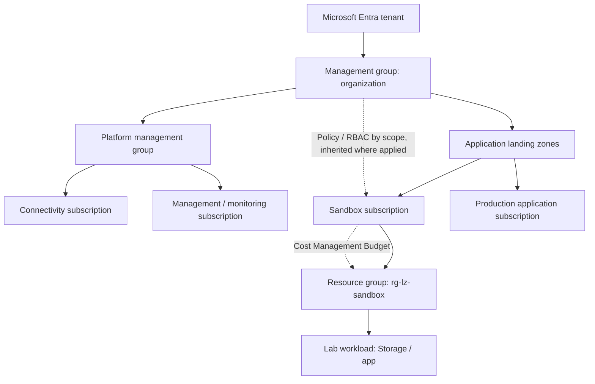
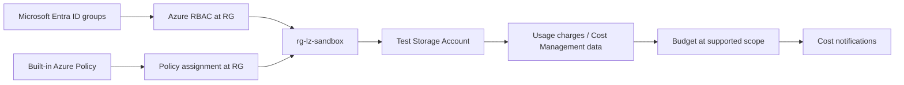

# Landing Zone Lab with Policy, Budget, and RBAC

## 1. Objectives of the Capstone Lab

In the **Architecture and Capstone Labs** chapter of the **CLOUD_PROVIDERS_AZURE** module, we bring together **subscriptions, resource groups, Microsoft Entra ID, Azure RBAC, networking, compute, storage, Azure Policy, monitoring, and cost** to prepare an application deployment environment that is governable from day one.

Suppose a development team building an e-commerce service wants to spin up a test environment on Azure. If they simply create a VM or Storage Account and start coding, they will quickly run into issues: resources created in disallowed regions, unclear ownership, overly broad deployer permissions, budget overruns without alerts, and missing audit evidence.

An **Azure landing zone** is an Azure environment designed and prepared around governance, security, resource organization, connectivity, operations, and cost principles so workloads can be deployed consistently. A landing zone is not a single service or a single button; it is a set of choices across **tenant/subscription structure, identity, policy, access control, networking, monitoring, and lifecycle management**.

In this lab, learners create a **mini landing zone inside a sandbox subscription** to practice three mandatory control pillars:

1. **Policy:** allow resource deployment only in approved locations and require governance metadata.
2. **Access control (RBAC):** use Microsoft Entra ID groups and Azure RBAC by role at the proper scope.
3. **Budget:** configure a budget, alert thresholds, and a way to verify consumption.

After this lesson, you can interpret a landing zone model, design governance scopes, practice with Azure CLI/Portal, test allowed and denied scenarios, present acceptance evidence, and clean up the environment safely.

> **Important boundary:** a mini landing zone using a resource group for learning **is not equivalent** to a production Azure landing zone under the Cloud Adoption Framework, which typically spans multiple subscriptions, management groups, and centralized networking/monitoring platforms. Assigning policies, roles, and budgets may require separate administrative permissions; if your account only has Reader access, complete the design and verification parts without attempting privilege escalation.

## 2. Enterprise-Scale Landing Zone Model

A landing zone design typically separates:

- **Platform landing zones:** subscriptions dedicated to shared foundation services such as identity, connectivity, and management/security monitoring. Examples include VPN/ExpressRoute, Azure Firewall, hub VNets, DNS, logging, and shared services.
- **Application landing zones:** subscriptions running applications/workloads; placed under the appropriate management group and inheriting standardized policy, RBAC, networking, and observability.
- **Management group hierarchy:** governs multiple subscriptions and assigns Azure Policy/Azure RBAC at appropriate scopes so configurations are inherited.
- **Governance and lifecycle:** naming conventions, tags, budgets, ownership, subscription vending, changes via IaC, and decommissioning processes.



This diagram illustrates organizational relationships, **not a mandatory template with exact names/branches**. In practice, a platform may require separate management groups for sandbox, decommissioned, online/corp, region, or compliance. Do not create or modify management groups in a corporate tenant for an exercise.

### 2.1. Four Scopes to Distinguish

| Scope | Purpose | Example in this lab |
| --- | --- | --- |
| **Management group** | Governs a set of subscriptions; policies and RBAC can inherit downward | Architectural context only, **do not modify live** in lab |
| **Subscription** | Billing boundary and many limits/quotas, where workloads run and costs are managed | Designated sandbox subscription |
| **Resource group** | Logical group of resources sharing a lifecycle and management permissions | `rg-lz-sandbox` |
| **Resource** | A specific service instance such as a Storage Account, VNet, or VM | Sample Storage Account used to test policy |

**Azure Policy**, **Azure RBAC**, and **Cost Management Budget** all operate at scopes, but via different mechanisms. Policy evaluates resource configuration, RBAC determines which identity can perform which actions, and budgets track spend and send alerts based on service capabilities. A budget cannot replace a policy or a role assignment.

### 2.2. Scope of the Lab Mini Landing Zone



To minimize required privileges, we **do not create new subscriptions**, **do not alter tenant-wide policies**, and **do not deploy production workloads**. An authorized administrator performs the steps requiring Azure Policy, RBAC, and Cost Management privileges; learners use the sandbox subscription to validate.

## 3. Exit Criteria and Required Permissions

Before making changes, agree on the lab deliverables:

| Area | Pass criteria | Evidence to retain |
| --- | --- | --- |
| Structure | Lab RG in the right subscription/region, with tags | Resource ID, Azure Portal/CLI output |
| Azure Policy | Location and metadata policies assigned at the right scope | Policy assignment ID, parameters, compliance |
| Positive test | Compliant resource (valid region/tags) can be created by authorized identity | Deployment result and resource config |
| Negative test | Non-compliant resource (wrong region/missing metadata) is blocked by active policy | Error code, denying assignment |
| Azure RBAC | Readers can only read; deployers can only create/edit within assigned scope | Role assignments and allowed/denied test outputs |
| Budget | Budget/alerts attached to right scope or filter, with contact owner | Budget ID, amount, period, thresholds, recipients |
| Observability | Activity Log available and spend/compliance tracked | Screenshots or timestamped reports |
| Cleanup | Only owner-approved lab resources removed | Before/after inventory and change record |

### 3.1. Account and System Prerequisites

You need:

- An active **sandbox Azure subscription** with no shared production resources inside the lab RG.
- Permissions to create resource groups and test workloads in the subscription; separate admin assistance for policy/role/budget operations if needed.
- Azure CLI and compatible Bicep tooling or Azure Portal; a Microsoft Entra ID login to the right tenant.
- At least one **Entra ID group for readers** and one group for deployers to practice RBAC. Do not put real user IDs into documentation.
- A FinOps/owner contact channel for budget notifications and an escalation plan when thresholds are crossed.
- Agreement on lab cost limits, deployment region, and resource lifetime.

**Separation of duties:** creating role assignments typically requires roles with permissions such as **Role Based Access Control Administrator**, **User Access Administrator**, or Owner at the target scope; creating policy assignments requires `Microsoft.Authorization/policyAssignments/write` and related actions; managing budgets requires appropriate Cost Management/Consumption permissions. **Contributor at a resource group does not inherently permit granting role assignments.** Never elevate your own privileges just to complete a lab.

### 3.2. Assumed Variable Set

| Variable in guide | Illustrative value | Rule |
| --- | --- | --- |
| `SUBSCRIPTION_ID` | `<SANDBOX_SUBSCRIPTION_ID>` | Never use a production subscription |
| `RG` | `rg-lz-sandbox` | Dedicated name, not shared with other workloads |
| `LOCATION` | `southeastasia` | Only use a region where required services are supported |
| `READER_GROUP_OBJECT_ID` | `<ENTRA_GROUP_OBJECT_ID>` | Object ID, **not display name** |
| `DEPLOYER_GROUP_OBJECT_ID` | `<ENTRA_GROUP_OBJECT_ID>` | Approved deployer group |
| `FINOPS_EMAIL` | `<APPROVED_FINOPS_EMAIL>` | Organization-approved address, no fake emails |
| `MONTHLY_BUDGET` | `100 USD` (example) | Illustrative amount, not real exercise pricing |

In the code blocks below, **Bash** commands use shell variables. If running in PowerShell, variable declaration and referencing syntax differ; do not paste `$VAR` expressions verbatim into PowerShell.

## 4. Step 1 — Identify Scope and Create the Resource Group

First, verify the tenant, subscription, and executor permissions. Run in a Bash shell authenticated with Azure CLI:

```bash
az login

az account list --output table
az account set --subscription "<SANDBOX_SUBSCRIPTION_ID>"

az account show \
  --query "{subscription:id,tenant:tenantId,name:name}" \
  --output json
```

**Stop if the subscription or tenant is wrong.** Using a dedicated sandbox subscription matters more than finishing fast, because policy and RBAC changes can affect others.

Once authorized to create the RG, run:

```bash
RG="rg-lz-sandbox"
LOCATION="southeastasia"

az group create \
  --name "$RG" \
  --location "$LOCATION" \
  --tags environment=sandbox owner=platform-team \
         costCenter=training managedBy=landing-zone-lab

RG_ID="$(az group show --name "$RG" --query id --output tsv)"
echo "$RG_ID"

az group show \
  --name "$RG" \
  --query "{id:id,location:location,tags:tags}" \
  --output json
```

Save `RG_ID` in the format `/subscriptions/<id>/resourceGroups/rg-lz-sandbox`. Tags on an RG serve classification, **and do not automatically guarantee** child resources inherit tags; configure Azure Policy or resource-level IaC for consistent enforcement.

**Checkpoint:** RG is in the right subscription, location, and has tags. If an existing subscription-level Azure Policy blocks RG creation or restricts regions, do not disable the policy: record the error code and notify the administrator.

## 5. Step 2 — Build Azure Policy Guardrails

### 5.1. How Does Azure Policy Differ from Azure RBAC?

- **Azure Policy**: defines which resource types or configurations are allowed or must be evaluated; common effects include `deny`, `audit`, `modify`, and `deployIfNotExists`.
- **Azure RBAC**: defines which identity can perform which actions at which scope.
- A user with Contributor on an RG **can still be denied by policy** when creating a non-compliant resource.
- A policy-compliant resource **still cannot be created** if the identity lacks Azure RBAC permissions.
- `audit` does not block like `deny`; compliance status may lag due to asynchronous evaluation.

A suitable guardrail set for the lab includes:

1. **Allowed locations:** restrict workloads to approved regions (e.g., `southeastasia`); verify exceptions for global resources and the selected policy definition.
2. **Require tag on resources:** enforce `costCenter` on applicable resource types, depending on the specific built-in definition/effect.

**Note:** Built-in policy **Allowed locations** differs from **Allowed locations for resource groups**. The first controls resource locations per its rule/fields; the second targets RG locations. In this lab, the RG is created before assigning policies to the RG; we test the policy on a Storage Account inside the RG.

### 5.2. Find Policy Definitions by Display Name

Authorized users can browse built-in policies in Azure Portal under **Policy → Definitions**. Using Azure CLI, run:

```bash
az policy definition list \
  --query "[?displayName=='Allowed locations'].{name:name,id:id}" \
  --output table

az policy definition list \
  --query "[?displayName=='Require a tag on resources'].{name:name,id:id}" \
  --output table
```

Obtain the **exact definition ID** from the live environment; do not guess GUIDs or pick a similarly named definition. Review the rule, mode, parameters, effect, metadata, and assignment scope. If the organization already enforces an equivalent policy at subscription/management group level, **do not create redundant duplicate assignments**.

### 5.3. Assign the Allowed Locations Policy at the Resource Group

The following example assumes the organization allows the lab to create policy assignments on the RG and the built-in policy uses parameter `listOfAllowedLocations`. Replace the definition ID with the one just queried:

```bash
POLICY_ID="<ALLOWED_LOCATIONS_POLICY_DEFINITION_ID>"
POLICY_ASSIGNMENT="lz-lab-allowed-locations"

az policy assignment create \
  --name "$POLICY_ASSIGNMENT" \
  --display-name "Landing zone lab allowed locations" \
  --scope "$RG_ID" \
  --policy "$POLICY_ID" \
  --params '{"listOfAllowedLocations":{"value":["southeastasia"]}}'

az policy assignment show \
  --name "$POLICY_ASSIGNMENT" \
  --scope "$RG_ID" \
  --output json
```

This step **does not** create a resource in another region; it establishes the rule Azure Policy evaluates on matching requests. Policy evaluation has propagation latency; after assigning, verify assignment status and allow sufficient time per service behavior before testing.

**If permission errors occur:** inspect the deployer principal's actions/scope. Do not arbitrarily change a Reader role to Owner. Ask an administrator with policy permissions to apply the assignment in the proper sandbox RG.

### 5.4. Policy Requiring a Resource Tag

In Azure Portal **Policy → Assignments**, you can assign built-in **Require a tag on resources** at the lab RG with parameter `tagName=costCenter` if the definition and effect are suitable. Before assigning:

- Verify the built-in policy targets the expected **resource scope** and parameters.
- Check exempt or excluded resources; do not apply blindly to special resources that do not support tags if the rule is unsuitable.
- Confirm the effect is `deny` if the lab goal is blocking untagged resource creation.
- If choosing `modify` to auto-append tags, understand managed identity/remediation permissions and the difference between create/update versus existing resources.

Example comparison:

| Resource | Region | `costCenter` tag | Expected result under both deny policies |
| --- | --- | --- | --- |
| Storage A | `southeastasia` | `training` | Passes the described guardrails |
| Storage B | `eastus` | `training` | Blocked by location restriction |
| Storage C | `southeastasia` | Missing | Blocked by tag policy if definition applies |
| Supported global resource | `global` | Per rule | Inspect the actual policy rule/exceptions; do not guess |

**Assigning a policy does not make all existing resources compliant immediately.** Pre-existing resources can continue running while noncompliant; the policy effect and remediation determine behavior. Read actual results in Azure Policy Compliance.

## 6. Step 3 — Access Control with Microsoft Entra Groups and Azure RBAC

### 6.1. Designing Groups by Duty

Separate at minimum:

| Group / role | Scope | Illustrative Azure role | Intended permissions |
| --- | --- | --- | --- |
| `grp-lz-readers` | `rg-lz-sandbox` | **Reader** | View inventory and resource configuration |
| `grp-lz-deployers` | `rg-lz-sandbox` | **Contributor** in lab | Create/modify lab workloads, cannot assign roles |
| `grp-lz-governance` | Appropriate governance scope, granted by platform team | Role with policy/role assignment permissions | Govern policies and RBAC with review |
| `grp-lz-finops` | Subscription/budget scope | Appropriate Cost Management/Consumption permissions | Create/view budgets, monitor cost and alerts |

**Contributor is a broad role for lab use**; production often requires custom roles restricting resource types/actions. The **Reader** role does not grant access to all data-plane contents: reading blobs in Storage requires separate data roles/permissions, and reading Key Vault secrets requires dedicated permissions.

### 6.2. Assigning Reader and Contributor at the Right RG

An administrator authorized to assign roles uses the **object IDs of Entra groups**, never personal accounts in documentation:

```bash
READER_GROUP_OBJECT_ID="<READER_GROUP_OBJECT_ID>"
DEPLOYER_GROUP_OBJECT_ID="<DEPLOYER_GROUP_OBJECT_ID>"

az role assignment create \
  --assignee-object-id "$READER_GROUP_OBJECT_ID" \
  --assignee-principal-type Group \
  --role "Reader" \
  --scope "$RG_ID"

az role assignment create \
  --assignee-object-id "$DEPLOYER_GROUP_OBJECT_ID" \
  --assignee-principal-type Group \
  --role "Contributor" \
  --scope "$RG_ID"
```

Inspect role assignments at and inherited onto the scope:

```bash
az role assignment list \
  --scope "$RG_ID" \
  --include-inherited \
  --output table
```

**Key takeaway:** roles from subscription/management group scopes can be **inherited**. A Reader group member might still hold write permissions from another assignment elsewhere. Therefore, to prove "cannot deploy," test using a test identity that truly **has no inherited write roles or other group memberships**, and record the test identity's trace.

### 6.3. RBAC Acceptance Matrix

| Activity | Reader-only | Deployer (Contributor at RG) | Governance admin |
| --- | --- | --- | --- |
| View RG and resources | Usually allowed | Allowed | Per admin's role |
| Create Storage Account in RG | Denied | Allowed if compliant with policy/quota | Depends on role and scope |
| Create resource in disallowed location | No write permission | **Policy can deny** despite Contributor | Policy applies unless exempted |
| Create role assignment | Denied | **Denied under standard Contributor** | Requires role assignment permissions |
| Modify Azure Policy assignment | Denied | Denied by default | Requires policy assignment permissions |
| Read/write blob data | Not automatic | Not automatic from control-plane Contributor | Requires separate data-plane permission |
| Create budget | Denied by default | Denied by default | Requires Cost/Consumption permissions |

In this lab, an action failing with `403 AuthorizationFailed` is fundamentally different from failing with `RequestDisallowedByPolicy`. Record the error code and check action/scope before troubleshooting.

## 7. Step 4 — Configuring Budgets and Cost Alerts

### 7.1. What Can an Azure Budget Do?

**Azure Cost Management Budget** tracks cost/usage across supported scopes and periods and sends notifications at configured thresholds. Budgets help:

- Detect higher-than-expected spending.
- Notify FinOps, workload owners, or Action Groups where features/scopes support it.
- Compare actual spend against thresholds and forecasted alerts when data/configuration allows.
- Trigger approval workflows for budget adjustments, rightsizing, or lab shutdown.

**A budget is not a hard spending cap.** Exceeding a budget **does not automatically block** Azure Resource Manager from creating resources or shut down a subscription. Cost data updates with latency; a resource can keep incurring charges before an alert fires and a human acts. Stopping resources on alert requires a dedicated workflow with guardrails and authorization.

### 7.2. Creating a Budget in Azure Portal

An authorized budget administrator goes to **Cost Management + Billing → Cost Management → Budgets** (exact navigation varies by account type/scope) and:

1. Selects the **sandbox subscription** and an organization-approved budget scope; if supported, selects resource group scope or creates a subscription budget with a **Resource group filter for `rg-lz-sandbox`**.
2. Selects `Monthly` reset period and valid start/end dates; avoid expired date ranges.
3. Enters a descriptive name like `budget-lz-sandbox-monthly` and an illustrative amount such as **100 USD/month**. This is a learning threshold, not a verified Azure quote.
4. Configures **Actual cost 80%** and **Actual cost 100%** alerts; consider a **Forecasted cost 100%** alert where scope and features support it.
5. Enters **organization-approved owner/FinOps email addresses**, optionally integrating an Action Group per operational procedures.
6. Saves the budget and verifies currency, amount, time grain, filter, dates, recipients, and alert responders.
7. Records the budget ID or configuration details in the acceptance report.

Do not use fake emails or non-recipient addresses; never use training-doc placeholder emails as production contacts.

### 7.3. Threshold Response Tiers

| Condition | Team response | Automated impact |
| --- | --- | --- |
| Actual ≥ 80% budget | FinOps notifies owner, checks trend/spikes, reviews lab resources | **Notification only**, does not stop resources |
| Actual ≥ 100% budget | Escalate, identify cost drivers, consider stopping non-critical workloads | Per approved runbook if configured |
| Forecast ≥ 100% budget | Proactively adjust config/resources or request budget increase | Forecast accuracy not guaranteed on all subscriptions |
| Cost data not yet updated | Mark status unverified, supplement with Activity Log/usage | Never assume spend is safe just because no alert appeared |

**Cost Management does not update charges per second.** Do not test a budget by deliberately overspending. Validate through proper configuration, recipient confirmation, and organization-approved test workflows.

## 8. Step 5 — Creating a Test Workload with Bicep and Previewing Changes

To demonstrate all three governance layers working together, use a simple Storage Account tagged with `costCenter`. This is a **lab workload**, not every component required in a production landing zone.

### 8.1. `storage.bicep` File in a Dedicated Practice Directory

The Bicep template below deploys at **resource group scope**:

```bicep
targetScope = 'resourceGroup'

@description('Storage Account name must be 3-24 lowercase alphanumeric characters and globally unique on Azure.')
param storageName string

@description('Allowed region for the lab; Azure Policy will validate it.')
param location string = resourceGroup().location

@allowed([
  'sandbox'
  'dev'
])
param environment string = 'sandbox'

resource storage 'Microsoft.Storage/storageAccounts@2023-05-01' = {
  name: storageName
  location: location
  tags: {
    environment: environment
    owner: 'platform-team'
    costCenter: 'training'
    managedBy: 'landing-zone-lab'
  }
  sku: {
    name: 'Standard_LRS'
  }
  kind: 'StorageV2'
  properties: {
    supportsHttpsTrafficOnly: true
    minimumTlsVersion: 'TLS1_2'
    allowBlobPublicAccess: false
    allowSharedKeyAccess: false
  }
}

output storageAccountId string = storage.id
```

**Design choices explained:**

- `storageName` must be **globally unique across Azure**, lowercase/numeric, 3–24 characters; name collisions fail deployment for reasons unrelated to policy.
- `location` is passed in as a parameter to test policy. We **do not lock the region with `@allowed`** in this example so you can observe the difference between Bicep validation and Azure-side policy enforcement.
- `costCenter=training` satisfies the required tag policy when configured properly.
- HTTPS/TLS and public blob access settings form part of a secure baseline, **not full networking/private endpoint configuration** of a production workload.
- Creating a Storage Account can incur charges; never assume an empty resource is completely free.

### 8.2. Validate and What-If Before Deploying

Assuming you saved the code to `storage.bicep` on your lab machine and logged into the right subscription:

```bash
STORAGE_NAME="<GLOBALLY_UNIQUE_LOWERCASE_STORAGE_NAME>"

az bicep build --file storage.bicep

az deployment group validate \
  --resource-group "$RG" \
  --template-file storage.bicep \
  --parameters storageName="$STORAGE_NAME" location="southeastasia"

az deployment group what-if \
  --resource-group "$RG" \
  --template-file storage.bicep \
  --parameters storageName="$STORAGE_NAME" location="southeastasia"
```

- **Build** checks syntax and types at the Bicep layer.
- **Validate** checks inputs and some deployment conditions, but does not replace all live checks when the Azure Resource Provider processes the request.
- **What-if** previews expected creates/updates/deletes based on ARM's evaluation; it is a **prediction**, not an absolute guarantee that deployment will succeed.
- Subscription or management-group policies can still apply even if the lab only assigns policies at the RG.

Once a reviewer confirms scope, tags, region, SKU, and risk, the authorized deployer runs:

```bash
az deployment group create \
  --name "lz-sandbox-storage" \
  --resource-group "$RG" \
  --template-file storage.bicep \
  --parameters storageName="$STORAGE_NAME" location="southeastasia"

az deployment group show \
  --name "lz-sandbox-storage" \
  --resource-group "$RG" \
  --query "properties.provisioningState" \
  --output tsv
```

**Do not proceed if validate/what-if reports permission errors or policy violations.** If deployment succeeds, inspect the actual Storage Account: region, tags, TLS, public access, and resource ID; do not rely solely on `Succeeded`.

## 9. Step 6 — Testing All Three Control Layers

A thorough lab requires scoped **positive tests** and **negative tests**, rather than just Portal screenshots.

### 9.1. Policy Test: Location

Using `storage.bicep`, you can run a **validate/what-if-only** input test in the sandbox:

```bash
az deployment group validate \
  --resource-group "$RG" \
  --template-file storage.bicep \
  --parameters storageName="$STORAGE_NAME" location="eastus"
```

If an Allowed locations policy with `deny` is active for Storage Accounts, attempting to create/update in a disallowed region should be rejected, e.g., with `RequestDisallowedByPolicy`. **If validate does not catch it**, do not conclude the policy is inactive: policy enforcement occurs on actual deployment requests and compliance evaluation under Azure conditions. Only test policy denial using an approved lab identity/target under supervision; never use production to verify deny behavior.

**Do not test by changing the location of a Storage Account that already holds data.** Azure Storage Accounts do not support a simple "move region" property change; test creation using a **new Storage Account name** in the lab scope, or use appropriate validation/test workflows.

### 9.2. Policy Test: Required Tag

Create a **separate lab test Bicep file** omitting the `costCenter` tag (or targeting a new non-existent resource) and run validate first. If "Require a tag on resources" with `deny` is properly assigned, Azure can block the operation. Record the assignment ID, resource ID, and error details.

Do not confuse a successful Bicep build with policy compliance: Bicep checks code syntax; policy depends on assignments/effects at the target scope. If the policy uses `audit`, deployment succeeds and the resource is flagged noncompliant later.

### 9.3. Azure RBAC Test

Use two test identities with **known effective permissions**:

| Persona | Test | Expected result |
| --- | --- | --- |
| Reader-only | `az group show` or view Storage Account | Readable if effective permissions allow |
| Reader-only | Create Storage Account in lab RG | Blocked for missing write permission (`AuthorizationFailed`/403), even with compliant config |
| Deployer | Deploy compliant Storage in `southeastasia` | Allowed unless blocked by quota/policy/other controls |
| Deployer | Create resource in policy-denied location | Denied by policy if assignment is active |
| Deployer | Create a new role assignment | Standard Contributor **lacks permission** to grant roles |
| Governance admin | Read/assign policy within delegated scope | Depends on actual role; do not assume Owner |

If a Reader test user can still create resources, **do not immediately conclude RBAC is broken**; check for inherited subscription roles, other group memberships, PIM-activated roles, or the wrong test identity.

### 9.4. Budget Test

Do not intentionally incur charges to exceed the budget. Confirm:

- Scope/filter matches `rg-lz-sandbox` or the target subscription.
- Currency, amount, start date, and time grain are correct.
- Actual 80%/100% and forecast (if enabled) thresholds are configured.
- Recipient emails / Action Groups are confirmed by the owner.
- An alert responder and weekly cost-review routine are assigned.

**A budget does not block an ARM deployment command**; to block expensive SKUs or disallowed regions, use Azure Policy, approvals, or other preventative controls.

## 10. Observing Status, Auditing, and Measuring Compliance

### 10.1. Azure Policy Compliance

In **Azure Policy → Compliance**, filter to the lab scope and assignments; inspect resource compliance per policy. Results can lag after deployment; if no state appears yet, verify assignment/scope, Policy Insights read permissions, and evaluation timing.

Do not treat an **empty** query result as proof of "compliant." Resources may not exist yet, evaluation may be pending, or your account may lack query permissions.

### 10.2. Azure Activity Log and RBAC Audit

Activity Log shows which user/principal issued requests for RG creation, policy assignments, role assignments, or deployments, along with timestamps and status codes. For policy or permission changes, link **change ticket → approver → resource scope → execution → outcome**.

### 10.3. Cost Management and Budgets

Track charges by `resourceGroup`, tags, service type, and usage. Seeing no cost data immediately after resource creation is normal; ingestion and billing pipelines have latency. An 80% budget alert does not guarantee spend safety if resources consume rapidly or cost data lags.

### 10.4. Sample Acceptance Checklist

| ID | Check | Result to record | Pass when |
| --- | --- | --- | --- |
| `LZ-01` | RG in right subscription, region, tags | Resource ID, output | Correct scope |
| `LZ-02` | Location policy assignment | ID, scope, parameters, effect | Right rule and scope |
| `LZ-03` | Tag policy assignment | ID, tagName, effect | Right rule, evaluable |
| `LZ-04` | Reader role | Group object ID, assignment scope | Reader has no unintended write access |
| `LZ-05` | Deployer role | Group object ID, assignment scope | Has lab access, cannot assign roles |
| `LZ-06` | Budget | Scope/filter, amount, period, contact | Notifications configured accurately |
| `LZ-07` | IaC deployment | Commit/template, what-if, deployment result | Compliant resource, all tags present |
| `LZ-08` | Negative policy test | Assignment/error code | Policy failure matches expected cause |
| `LZ-09` | Negative RBAC test | Principal/action/scope/error | Auth failure matches expected cause |
| `LZ-10` | Cleanup | Before/after inventory, approvals | No unintended lab resources remain |

Do not include client secrets, access tokens, connection strings, or sensitive user lists in the acceptance report. Group object IDs, resource IDs, and notification emails should also be stored in an access-controlled internal repository.

## 11. Common Errors and Troubleshooting

| Symptom | Possible cause | Proper resolution |
| --- | --- | --- |
| `AuthorizationFailed`/403 creating RG | Caller lacks subscription permissions | Verify principal/scope; ask admin for least-privilege access |
| Cannot create policy assignment | Missing `policyAssignments/write` or wrong scope | Check policy admin role and RG scope |
| Cannot create role assignment | Contributor lacks role-granting permission | Use an identity authorized for RBAC management at scope |
| `RequestDisallowedByPolicy` creating Storage | Location/tag violation or inherited policy | Inspect definition/assignment, fix IaC; never disable policy blindly |
| Storage Account name already taken | Name must be globally unique on Azure with strict rules | Pick a new valid name and re-run validate/what-if |
| What-if PASSES but create fails | Provider/quota/policy/runtime differs from preview | Inspect deployment operations and Azure Activity Log |
| Policy compliance empty/stale | Evaluation delay, missing Policy Insights rights, or wrong scope | Check assignment, permissions, and evaluation timestamp |
| Reader can still create resources | Inherited role/other group or wrong active identity | Check effective access, group membership, and PIM |
| Budget sends no email | Wrong scope/recipient/threshold, zero usage, or delay | Verify budget config, alert conditions, and delivery path |
| Budget exceeded yet Azure still creates VMs | Budget is alerting only, not a hard spending cap | Trigger FinOps workflow, policies/approvals, or approved automation |
| Cost rises despite few resources | Storage/network/logs/retention or prior workloads | Inspect Cost Analysis by resource/meter and date |
| Cleanup deletes wrong resources | RG contained non-lab resources | Inventory and confirm ownership before deleting |

Classify the error before acting: **syntax/IaC**, **RBAC**, **Azure Policy**, **provider/quota**, **budget/cost data**, or **unsynchronized data**. Never elevate to Owner or disable policies just to bypass an error you do not understand.

## 12. Environment Cleanup and Safe Teardown

Lab resources can incur ongoing charges. Before cleanup:

1. List all resources inside `rg-lz-sandbox` and confirm **it contains no non-lab workloads**.
2. Save permitted evidence and verify data/backup/retention needs.
3. Confirm owners of resources and any policy/role/budget scopes created by the lab.
4. Remove assignments or budgets **only if created exclusively for the lab**; never delete shared policies or budgets.
5. If the RG is strictly dedicated and approved, delete the RG via Portal/CLI; this **destroys all resources in the RG** and may be irreversible.
6. Periodically review Cost Analysis/Resource Graph to ensure no unexpected charges remain.

Example **read-only** inventory commands before cleanup:

```bash
az resource list \
  --resource-group "$RG" \
  --query "[].{name:name,type:type,id:id}" \
  --output table

az role assignment list \
  --scope "$RG_ID" \
  --output table

az policy assignment list \
  --scope "$RG_ID" \
  --output table
```

If the RG is truly **lab-only**, the owner confirmed, and no data needs retention, a final cleanup step can be:

```bash
# DESTRUCTIVE COMMAND: run only after inventory and approval.
az group delete --name "$RG" --yes
```

This command is not a blanket cleanup instruction for every subscription; it can delete shared data and resources if you target the wrong RG. **Subscription-level budgets** or assignments outside the RG scope may require separate removal by an authorized administrator; deleting an RG does not automatically clean up external configurations. After the lab, notify the administrator to clean up any temporary RBAC/policy artifacts if they remain.

## 13. Upgrading a Mini Landing Zone Toward Production

When scaling from a lab to a real environment, address capabilities missing from the mini landing zone:

| Capability | Done in mini lab | Needed for production |
| --- | --- | --- |
| Organization | One subscription and RG | Management groups, platform/application subscriptions, subscription vending |
| Identity | Sample Entra groups + RBAC | PIM, Conditional Access, access reviews, identity lifecycle, break-glass |
| Policy | Location and tags | Security baselines, encryption, network, allowed SKUs, diagnostic settings, drift/exception management |
| Connectivity | Full networking not deployed | Hub-spoke/vWAN, DNS, private endpoints, egress filtering, hybrid connectivity |
| Security | Minimal storage properties | Defender for Cloud, SIEM, Key Vault, logging, and incident response |
| Observability | Activity Log and compliance | Azure Monitor/Log Analytics, alert routing, backups, and operational dashboards |
| Cost | Budget and email thresholds | Chargeback/showback, forecasts, rightsizing, tagging compliance, and automated review |
| IaC | Small Bicep workload | Versioned platform modules, pipelines, approvals, what-if, CI tests |
| Reliability | No real DR | Multi-zone/region where needed, RTO/RPO, backups, failover drills |
| Lifecycle | Manual lab cleanup | Governance for provisioning, upgrades, exceptions, decommissioning |

A strong landing zone keeps change permissions and costs **accountable**. Never dump every workload into one RG or one shared Contributor group merely for convenience.

## 14. Practice Exercises and Review Questions

### 14.1. Submission Requirements

The student team receives a sandbox subscription and the brief: "Allow test Storage Account deployments in Southeast Asia, require the `costCenter` tag, separate reader and deployer groups, and track a 100 USD/month budget with 80% and 100% alerts."

Submit:

1. Scope diagram from subscription to RG showing policy, role assignments, and budget placement.
2. Resource ID and tags of `rg-lz-sandbox`.
3. Policy assignment names/IDs, parameters, and actual effects.
4. Role assignments by group object IDs, plus an explanation of how Reader and Contributor differ.
5. Screenshot or description of budget configuration: scope/filter, period, thresholds, and owner.
6. Valid Bicep file, validate/what-if output, and approved deployment result.
7. Negative test evidence: showing an Azure Policy error differs from an Azure RBAC error.
8. Acceptance table covering `LZ-01` through `LZ-10` and a cleanup plan.

If lacking permission to assign policies/roles/budgets, students can **draft manifests and documentation awaiting admin application**, execute permitted read steps, and state clearly which tests could not be run; never claim PASS for unverified actions.

### 14.2. Four Scenarios You Must Be Able to Explain

**Scenario A:** The deployer group holds Contributor on the RG, yet creating a Storage Account in `eastus` is denied.  
**Explanation:** RBAC permits write actions in the RG, but Azure Policy at that scope can `deny` a disallowed location. Fix by changing the region or requesting an approved exemption—do not blindly escalate permissions.

**Scenario B:** A Reader account can list resources, yet cannot create a compliant Storage Account.  
**Explanation:** Reader lacks write actions; a policy-compliant resource still requires sufficient Azure RBAC. If Reader unexpectedly succeeds, inspect inherited roles/other groups and the active identity.

**Scenario C:** The subscription has a 100 USD budget, yet actual spend exceeds 100 USD.  
**Explanation:** Budgets send notifications; **they do not enforce hard spend cutoffs**. Monitor usage, follow the runbook, and configure policies/approvals/guarded auto-remediation if stricter controls are required.

**Scenario D:** Azure Policy is assigned, yet the Compliance page does not list the resource.  
**Explanation:** evaluation data may be delayed, the scope may be wrong, or the identity lacks permission to read results. Never conclude compliance just because no record appears.

## 15. Self-Check Questions

**1. How does a landing zone differ from a resource group?**  
A landing zone is a holistic design giving workloads a foundation of governance, identity, networking, observability, security, and cost management. An RG is just one resource organization scope; a mini lab in an RG cannot replace a production landing zone.

**2. How do Azure Policy and Azure RBAC differ?**  
RBAC governs who can perform which actions at which scope. Policy evaluates resource configurations/requirements based on assignments and effects. A request must satisfy all applicable control layers.

**3. Why not assign Owner at the subscription level to every developer?**  
Owner grants sweeping permissions including access management. Least privilege and separation of duties limit blast radius, prevent unintended privilege grants, and keep audits clear.

**4. Does a 100 USD budget guarantee Azure stops billing at 100 USD?**  
No. A budget is a tracking/alerting tool, not a hard billing cutoff.

**5. Does tagging an RG guarantee Storage Accounts inside automatically inherit that tag?**  
No. Tags can be applied directly in IaC or enforced/added via Azure Policy with an appropriate effect; they do not inherit automatically by default.

**6. Does a `NoChange` what-if result mean all policies and quotas have been checked?**  
No. What-if is a preview; deployment also depends on roles, providers, runtime policy evaluation, quotas, and live state when the request executes.

**7. Does a policy assignment on one RG block resources in another RG in the same subscription?**  
Not via that specific assignment. Policies are scoped; other assignments at subscription or management group scope can still apply.

**8. Can you clean up the lab by deleting the RG without further checks?**  
No. Deleting an RG deletes all workloads/data inside it; always inventory first, confirm ownership, and check for policies/roles/budgets outside the RG.

## 16. Recommended Official Documentation

- Microsoft Learn — **Cloud Adoption Framework: Azure landing zones** and **Design areas**: enterprise-scale architecture, platform/application landing zones, subscription vending.
- Microsoft Learn — **Management groups**, **Resource groups**, and **Azure Resource Manager scope**.
- Microsoft Learn — **Azure Policy overview**, **Built-in policy definitions**, **Assign a policy**, and **Compliance data**.
- Microsoft Learn — **Azure RBAC overview**, **Assign Azure roles using Azure CLI**, and **Check access to Azure resources**.
- Microsoft Learn — **Cost Management Budgets**, **Create budgets**, and **Cost Analysis**.
- Microsoft Learn — **Azure Bicep overview** and **ARM deployment what-if**.
- Microsoft Learn — **Azure Activity Log** and **Azure Well-Architected Framework**: Security, Operational Excellence, Reliability, Cost Optimization.

Before applying to a real tenant or subscription, verify Azure CLI syntax, policy definition IDs, effects/parameters, admin permissions, and budget scopes against the live environment. **The lab succeeds when you prove guardrails work properly, costs are tracked, and permissions are bounded — not merely when a resource gets created.**
