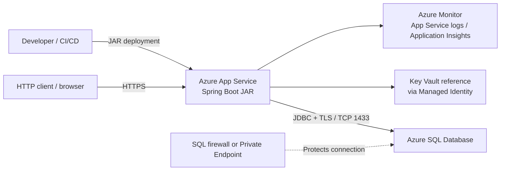
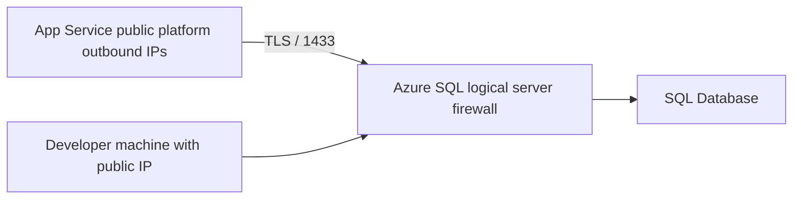
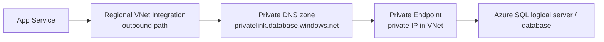
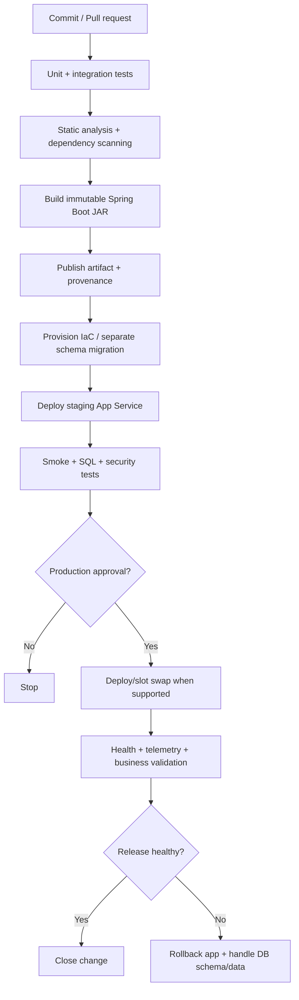

# Spring Boot Application Lab on App Service with Azure SQL

## 1. Capstone Problem: Moving the Orders API from a Developer Machine to Azure

You are tasked with building a small Java API to store a list of order-processing work items. The application runs fine on a laptop, but the product team wants to expose the API over the Internet, persist data reliably, monitor service health, and prepare for higher load. Instead of managing Java servers manually, we deploy **Spring Boot on Azure App Service** and store data in **Azure SQL Database**.

This lesson belongs to the **Architecture and Capstone Labs** chapter in the Microsoft Azure track. It combines knowledge across **subscriptions, resource groups, Microsoft Entra ID, virtual networking, compute, storage, and data**, through deployment, monitoring, security, and cost management. It is an end-to-end lab: write the code, configure the database, deploy to App Service, verify, and clean up the environment.

### Deliverables

- A Java 21 Spring Boot REST API with two business endpoints: list and create `work_items`.
- An Azure SQL Database containing the `dbo.work_items` table; the application account holds only the appropriate read/write permissions.
- An Azure App Service on Linux with a supported Java runtime running the Spring Boot JAR file.
- SQL connection configuration via **App Service application settings**, with no password hardcoded in Git; plus guidance on protecting it with Azure Key Vault references.
- A health endpoint, logs, and post-deployment functional verification tests.
- An acceptance criteria table, security/networking plan, and safe lab teardown steps to avoid ongoing charges.

### Learning Objectives

After this lesson, you can:

1. Explain the roles of an App Service plan, web app, Azure SQL logical server, database, firewall, identity, and Key Vault.
2. Build a Spring Boot application with JDBC access to Azure SQL using SQL parameterization and input validation.
3. Package a JAR with Maven, deploy it to App Service, and manage configuration using environment variables.
4. Distinguish between SQL connectivity via **public endpoint + IP allowlist** in the lab versus **VNet Integration + Private Endpoint + Private DNS** for stricter environments.
5. Use managed identity and Key Vault references to reduce secret exposure risk; understand the path to passwordless database authentication.
6. Verify health, logs, HTTP behavior, SQL data, networking, permissions, and cost after deployment.
7. Plan scaling with autoscale, connection pools, database sizing, monitoring, backups, and rollback.

> **Note:** this guide describes creating resources that can **incur Azure charges**. All commands are reference documentation for learners to run in an authorized lab subscription; **do not run in production without approval**. SKU names, runtimes, Portal UI, and regional feature availability must be checked against current documentation. This lesson does not provision live resources itself.

## 2. Architecture, Boundaries, and Request Flow



**App Service** is a PaaS platform for running web apps and APIs. The **App Service plan** determines the compute tier, size, worker count, scaling characteristics, and compute billing. The **Web app** holds runtime settings, app settings, deployments, and hostnames. Multiple web apps can share one App Service plan; never assume each app gets its own dedicated VM.

**Azure SQL Database** is a PaaS database engine. A **logical SQL server** provides the `<server>.database.windows.net` hostname along with admin, network, and authentication settings; the **database** lives inside the logical server. Do not confuse an Azure SQL logical server with an Azure VM running SQL Server.

**Key Vault** holds the secret when using SQL authentication for the lab. The web app's **managed identity** retrieves the secret without embedding Key Vault access credentials in code. This is a lab pattern using a SQL password; in production systems, evaluate **Microsoft Entra authentication with managed identity directly to Azure SQL**, once driver support, features, and permission workflows are verified.

**Azure Monitor/Application Insights** helps track requests, exceptions, logs, and dependencies. App Service platform logs and Spring Boot application logs are distinct data sources; enable the right diagnostics and configure retention/cost.

### Lab Scope Boundaries

| In scope | Out of scope or overview only |
| --- | --- |
| Simple Spring Boot REST API | Full commercial application with complex business domain |
| JDBC via Microsoft SQL Server driver | Complex ORM, distributed transactions |
| SQL schema pre-created by an admin account | Multi-environment production schema migration pipelines |
| Dedicated app SQL auth + Key Vault | Full live demo of passwordless Entra SQL |
| Single web app and single database in one region | Multi-region active-active architecture |
| Manual verification and CI/CD design | Building a live pipeline in GitHub/Azure DevOps |

## 3. Preparing Accounts, Runtime, and Tooling

### 3.1. Required Tools

| Component | Requirement and purpose |
| --- | --- |
| JDK | Java 21 LTS locally and a compatible App Service runtime |
| Maven | Build JAR, run tests, manage dependencies |
| IDE/editor | IntelliJ IDEA, VS Code, or suitable editor |
| Azure CLI | Sign in, create App Service, deploy JAR, inspect metadata |
| SQL client | Azure Data Studio, `sqlcmd`, SSMS, or a client capable of running T-SQL |
| Azure subscription | Permissions to create resource groups, App Service, SQL, Key Vault, and scoped role assignments |
| HTTP client | `curl` or REST API testing tool |

Local check:

```bash
java -version
mvn -version
az version
az login
az account show --query "{id:id,name:name,tenantId:tenantId}" --output table
```

Commands in this lesson use **Bash** (Linux/macOS/WSL/Azure Cloud Shell). In Windows PowerShell, environment variable syntax, line continuations, and quoting differ; do not paste Bash commands verbatim into PowerShell.

### 3.2. Choosing a Region and Checking Availability

Assume:

```bash
RG="rg-orders-spring-lab"
LOCATION="southeastasia"
PLAN="asp-orders-spring-lab"
APP="<globally-unique-web-app-name>"
SQL_SERVER="<unique-sql-logical-server-name>"
SQL_DB="orderslab"
KV="<unique-key-vault-name>"
```

Values in `<...>` must be replaced with valid real names; App Service hostnames, SQL logical servers, and Key Vaults have specific naming/availability rules. **Never use these strings as passwords or production resource names.**

The region shown is an example. Verify that the Linux Java runtime, App Service SKU, Azure SQL service tier, and Key Vault are available in your region/subscription. Options vary and may be subject to quota.

### 3.3. Permissions and Budget

Prepare:

1. A dedicated lab subscription and resource group.
2. Resource creation rights, role assignment permissions for managed identity if using Key Vault RBAC, and SQL admin rights to create database users.
3. Cost budget/alerts; an App Service plan and Azure SQL can still incur charges with zero HTTP traffic.
4. A SQL application account **separate** from the SQL server administrator.
5. Network decision: the lab uses a restricted IP allowlist; production should prioritize private networking when required.

## 4. Outlining the Spring Boot Project Structure

We build an `orders-lab` application using `spring-boot-starter-web`, `spring-boot-starter-jdbc`, Bean Validation, and Spring Boot Actuator. We use **JdbcTemplate** instead of Hibernate/JPA so learners clearly see SQL statements and database permissions. The schema is pre-created, and the application only holds `SELECT` and `INSERT`.

```text
orders-lab/
├── pom.xml
└── src/
    └── main/
        ├── java/
        │   └── com/example/orders/
        │       ├── OrdersApplication.java
        │       └── WorkItemController.java
        └── resources/
            └── application.yml
```

This is a **self-contained illustrative structure** you can create from scratch; it does not depend on any existing repository. The snippets below provide the full minimal files.

## 5. Creating `pom.xml`: Spring Boot, JDBC, and Actuator

This example selects Spring Boot 3.5 with Java 21. **`3.5.6` is an illustrative version—check your organization's support and security-update policy before deploying**, not a rigid version lock for the lesson.

```xml
<?xml version="1.0" encoding="UTF-8"?>
<project xmlns="http://maven.apache.org/POM/4.0.0"
         xmlns:xsi="http://www.w3.org/2001/XMLSchema-instance"
         xsi:schemaLocation="http://maven.apache.org/POM/4.0.0
                             https://maven.apache.org/xsd/maven-4.0.0.xsd">
  <modelVersion>4.0.0</modelVersion>

  <parent>
    <groupId>org.springframework.boot</groupId>
    <artifactId>spring-boot-starter-parent</artifactId>
    <version>3.5.6</version>
    <relativePath/>
  </parent>

  <groupId>com.example</groupId>
  <artifactId>orders-lab</artifactId>
  <version>0.0.1-SNAPSHOT</version>
  <name>orders-lab</name>
  <description>Spring Boot App Service + Azure SQL laboratory</description>

  <properties>
    <java.version>21</java.version>
  </properties>

  <dependencies>
    <dependency>
      <groupId>org.springframework.boot</groupId>
      <artifactId>spring-boot-starter-web</artifactId>
    </dependency>
    <dependency>
      <groupId>org.springframework.boot</groupId>
      <artifactId>spring-boot-starter-jdbc</artifactId>
    </dependency>
    <dependency>
      <groupId>org.springframework.boot</groupId>
      <artifactId>spring-boot-starter-validation</artifactId>
    </dependency>
    <dependency>
      <groupId>org.springframework.boot</groupId>
      <artifactId>spring-boot-starter-actuator</artifactId>
    </dependency>
    <dependency>
      <groupId>com.microsoft.sqlserver</groupId>
      <artifactId>mssql-jdbc</artifactId>
      <scope>runtime</scope>
    </dependency>
    <dependency>
      <groupId>org.springframework.boot</groupId>
      <artifactId>spring-boot-starter-test</artifactId>
      <scope>test</scope>
    </dependency>
  </dependencies>

  <build>
    <plugins>
      <plugin>
        <groupId>org.springframework.boot</groupId>
        <artifactId>spring-boot-maven-plugin</artifactId>
      </plugin>
    </plugins>
  </build>
</project>
```

The Spring Boot parent manages compatible dependency versions via its BOM, including JDBC drivers. When changing Spring Boot versions or Java runtimes, verify `mssql-jdbc` resolves properly and supports the authentication method chosen by the project. **Never embed Azure SQL passwords or JDBC URLs in `pom.xml`.**

## 6. Writing the Minimal REST API Application

Create `src/main/java/com/example/orders/OrdersApplication.java`:

```java
package com.example.orders;

import org.springframework.boot.SpringApplication;
import org.springframework.boot.autoconfigure.SpringBootApplication;

@SpringBootApplication
public class OrdersApplication {
    public static void main(String[] args) {
        SpringApplication.run(OrdersApplication.class, args);
    }
}
```

Create `src/main/java/com/example/orders/WorkItemController.java`:

```java
package com.example.orders;

import jakarta.validation.Valid;
import jakarta.validation.constraints.NotBlank;
import jakarta.validation.constraints.Size;
import java.net.URI;
import java.sql.ResultSet;
import java.sql.SQLException;
import java.time.LocalDateTime;
import java.util.List;
import java.util.Optional;
import org.springframework.http.ResponseEntity;
import org.springframework.jdbc.core.JdbcTemplate;
import org.springframework.jdbc.core.RowMapper;
import org.springframework.web.bind.annotation.GetMapping;
import org.springframework.web.bind.annotation.PathVariable;
import org.springframework.web.bind.annotation.PostMapping;
import org.springframework.web.bind.annotation.RequestBody;
import org.springframework.web.bind.annotation.RequestMapping;
import org.springframework.web.bind.annotation.RestController;

@RestController
@RequestMapping("/api/work-items")
public class WorkItemController {

    public record CreateWorkItem(
            @NotBlank @Size(max = 200) String title) {}

    // createdUtc receives UTC values from the DATETIME2 column; LocalDateTime
    // follows UTC by convention here rather than carrying a time-zone offset.
    public record WorkItem(
            long id, String title, String state, LocalDateTime createdUtc) {}

    private static final RowMapper<WorkItem> MAPPER =
            (rs, rowNum) -> mapWorkItem(rs);

    private final JdbcTemplate jdbc;

    public WorkItemController(JdbcTemplate jdbc) {
        this.jdbc = jdbc;
    }

    private static WorkItem mapWorkItem(ResultSet rs) throws SQLException {
        return new WorkItem(
                rs.getLong("id"),
                rs.getString("title"),
                rs.getString("state"),
                rs.getObject("created_utc", LocalDateTime.class));
    }

    @GetMapping
    public List<WorkItem> list() {
        return jdbc.query(
                "SELECT TOP (100) id, title, state, created_utc "
                + "FROM dbo.work_items ORDER BY id DESC",
                MAPPER);
    }

    @GetMapping("/{id}")
    public ResponseEntity<WorkItem> find(@PathVariable long id) {
        List<WorkItem> rows = jdbc.query(
                "SELECT id, title, state, created_utc "
                + "FROM dbo.work_items WHERE id = ?",
                MAPPER, id);
        Optional<WorkItem> item = rows.stream().findFirst();
        return item.map(ResponseEntity::ok)
                .orElseGet(() -> ResponseEntity.notFound().build());
    }

    @PostMapping
    public ResponseEntity<WorkItem> create(
            @Valid @RequestBody CreateWorkItem request) {
        Long id = jdbc.queryForObject(
                "INSERT INTO dbo.work_items (title) "
                + "OUTPUT INSERTED.id VALUES (?)",
                Long.class, request.title().trim());
        if (id == null) {
            throw new IllegalStateException("SQL did not return inserted ID");
        }
        List<WorkItem> rows = jdbc.query(
                "SELECT id, title, state, created_utc "
                + "FROM dbo.work_items WHERE id = ?",
                MAPPER, id);
        if (rows.isEmpty()) {
            throw new IllegalStateException("Inserted item not found");
        }
        return ResponseEntity
                .created(URI.create("/api/work-items/" + id))
                .body(rows.get(0));
    }
}
```

### Code Analysis

- `JdbcTemplate` uses `?` placeholders and separate parameters, **never concatenating input directly into SQL**, preventing SQL injection in these queries.
- Bean Validation ensures `title` is non-blank and at most 200 characters; Spring maps validation errors into appropriate error responses.
- `GET` limits results to 100 rows to avoid accidentally reading the entire table. Real applications require pagination/cursors, authorization, and query filtering.
- `POST` returns `201 Created` with a `Location` header. When a client retries a request after a timeout, **add an idempotency key** to prevent creating duplicate work items.
- The lab lacks user authentication; **do not expose these read/write endpoints to public production** without Entra ID/OAuth2, authorization, rate limiting, and auditing.
- `DATETIME2` carries no time zone. The lab stores UTC values by convention via `SYSUTCDATETIME()`; real systems must clearly define temporal types, serialization, and offsets.

## 7. Configuring `application.yml` and the Connection Pool

Create `src/main/resources/application.yml`:

```yaml
spring:
  application:
    name: orders-lab
  datasource:
    url: ${SPRING_DATASOURCE_URL}
    username: ${SPRING_DATASOURCE_USERNAME}
    password: ${SPRING_DATASOURCE_PASSWORD}
    hikari:
      maximum-pool-size: ${DB_POOL_MAX:5}
      minimum-idle: 1
      connection-timeout: 30000
  sql:
    init:
      mode: never

management:
  endpoints:
    web:
      exposure:
        include: health,info
  endpoint:
    health:
      show-details: never
  health:
    probes:
      enabled: true

server:
  port: ${PORT:8080}
```

Sample JDBC URL:

```text
jdbc:sqlserver://<sql-server>.database.windows.net:1433;databaseName=orderslab;encrypt=true;trustServerCertificate=false;loginTimeout=30
```

Meaning of each part:

| Part | Purpose |
| --- | --- |
| `databaseName=orderslab` | Connects to the target database, avoiding accidental `master` usage |
| `encrypt=true` | Enables SQL connection encryption |
| `trustServerCertificate=false` | Enforces server certificate verification |
| `loginTimeout=30` | Sets driver initial connection attempt timeout |
| `maximum-pool-size=5` | Caps maximum DB connections per application instance |

**Never set `encrypt=false` or `trustServerCertificate=true` as a quick fix for TLS errors.** Verify the FQDN, trust chain, DNS, proxy, and JDBC driver configuration instead.

### Why Not Use `ddl-auto=update`?

The lab uses `JdbcTemplate` and a separately created schema. This separates:

- **Schema migration**: DBA/CI migration tooling holding `CREATE/ALTER` permissions under controlled workflow.
- **Runtime app**: reading and writing only permitted tables.

As a project grows, add Flyway or Liquibase to your pipeline and run schema migrations **before** deploying application versions that depend on the new schema. Never grant `db_owner` to the runtime account just so Spring can auto-create tables.

## 8. Creating the Azure SQL Logical Server and Database

### Step 1 — Select Azure SQL Database Configuration

In **Azure Portal → Azure SQL → SQL databases** (or equivalent), create:

1. Lab subscription and resource group.
2. Database name `orderslab`.
3. A new SQL logical server with a globally unique name and appropriate region.
4. Authentication model. The lab demonstrates **SQL authentication**, but never uses the SQL administrator as the runtime user.
5. Sufficient compute/service tier for the lab, modest storage, and default service backup configuration.
6. Network access per Section 9; avoid opening overly broad access.

**Free/promotional/trial tiers, SKU names, and limits are subject to change.** Check the Pricing Calculator before provisioning. An Azure SQL logical server is not a SQL Server VM; billing primarily comes from the configured database/compute/storage.

### Step 2 — Create the Schema with an Approved Admin Account

Connect to the **`orderslab` database** (not `master`) using an approved SQL client. Run:

```sql
CREATE TABLE dbo.work_items (
    id BIGINT IDENTITY(1,1) NOT NULL
        CONSTRAINT PK_work_items PRIMARY KEY,
    title NVARCHAR(200) NOT NULL,
    state NVARCHAR(20) NOT NULL
        CONSTRAINT DF_work_items_state DEFAULT N'OPEN',
    created_utc DATETIME2(3) NOT NULL
        CONSTRAINT DF_work_items_created_utc DEFAULT SYSUTCDATETIME()
);
```

`SYSUTCDATETIME()` records UTC timestamps; `IDENTITY` only generates an incrementing key and **does not prevent duplicate business retries**. In the lab, create the table once; if it already exists, inspect the schema before altering and never drop populated tables carelessly.

### Step 3 — Create a Dedicated SQL Login for the Application

For the **lab SQL authentication** path:

```sql
-- Run in the master database with an account permitted to create logins.
CREATE LOGIN orders_app_login
WITH PASSWORD = '<strong-password-delivered-via-secure-channel>';
```

Switch your SQL client connection to the `orderslab` database:

```sql
-- Run in the orderslab database.
CREATE USER orders_app_user FOR LOGIN orders_app_login;

-- Grant only the permissions required by the two lab endpoints:
GRANT SELECT, INSERT ON OBJECT::dbo.work_items TO orders_app_user;
```

**Never commit real passwords to Git, issues, screenshots, or public CI/CD scripts.** The snippet above uses a placeholder for instruction; in real operations, use a secret manager, DBA accounts, and an audit trail. A dedicated app SQL login is safer than using the privileged SQL administrator, though it still requires password lifecycle management and rotation.

If your organization **disallows SQL authentication**, configure a Microsoft Entra administrator and external-provider users per official guidance; see Section 16 for the passwordless path.

### Step 4 — Verify from the SQL Client

```sql
SELECT DB_NAME() AS current_database;

SELECT
    name, type_desc
FROM sys.database_principals
WHERE name = N'orders_app_user';

SELECT TOP (10)
    id, title, state, created_utc
FROM dbo.work_items
ORDER BY id DESC;
```

Ensure the client is connected to `orderslab` with the expected permissions. If no rows exist yet, an empty result set is valid.

## 9. Designing Connectivity from App Service to Azure SQL

There are two models to understand clearly. **Do not create overly permissive firewall rules just to make the lab work.**

### Option A — Public Endpoint with SQL Firewall Allowlist (Lab)



In this model, the SQL logical server allows public network access by policy, but the firewall permits only **authorized App Service outbound IPs and developer IPs**. App Service can have multiple outbound IPs, and possible IP ranges can change when scaling plans, changing SKUs, or during platform updates. Read-only command to inspect current IPs:

```bash
az webapp show \
  --resource-group "$RG" \
  --name "$APP" \
  --query "{outbound:outboundIpAddresses,possible:possibleOutboundIpAddresses}" \
  --output json
```

Once you have the real IPs, explicitly add firewall rules for those addresses in Azure Portal or via admin commands. **Never enable the `0.0.0.0` "Allow Azure services and resources to access this server" rule as a catch-all fix**, because it can allow access from Azure resources outside your application.

When your laptop's IP changes, local SQL client access may stop working; avoid opening unnecessarily large IP ranges.

### Option B — VNet Integration + SQL Private Endpoint (Recommended for Network Isolation)



Required configuration:

1. An App Service plan/tier supporting **Regional VNet Integration**; choose an appropriately delegated subnet for outbound integration.
2. VNet/subnet and network security/routing permitting the app to reach Azure SQL's private IP.
3. Create a **Private Endpoint for the SQL logical server** in a suitable subnet and verify the private endpoint connection state.
4. Create/link the **Private DNS zone `privatelink.database.windows.net`** according to your DNS architecture; the standard `<server>.database.windows.net` hostname must resolve to the private IP from the app environment.
5. If policy requires, disable public network access on the SQL logical server once the private path is verified.
6. Test DNS, network routing, and authentication from App Service—do not stop at checking that the Private Endpoint exists.

**App Service Regional VNet Integration handles outbound traffic; it does not automatically make web app inbound traffic private.** If private inbound is required, evaluate a **Private Endpoint for App Service** and separate API publishing options. App Service and Azure SQL use two distinct Private Endpoint resources for different directions.

The application continues using the standard SQL hostname in its JDBC URL and enforces TLS verification. **Never change the SQL JDBC hostname to a private IP** and disable certificate checks.

## 10. Provisioning the App Service Plan and Web App

### Step 1 — Create the Resource Group

```bash
az group create \
  --name "$RG" \
  --location "$LOCATION"
```

### Step 2 — List Available Linux Java Runtimes

```bash
az webapp list-runtimes --os linux
```

From the output, choose a **Java 21 / Java SE** runtime supported in your region/plan. Exact `--runtime` strings can vary by CLI and service versions; for example, some environments use `JAVA:21-java21`. **Do not copy a runtime string just because it appeared in old documentation**: verify it from the command above.

### Step 3 — Create a Linux App Service Plan

```bash
az appservice plan create \
  --resource-group "$RG" \
  --name "$PLAN" \
  --location "$LOCATION" \
  --sku B1 \
  --is-linux
```

`B1` is merely a common lab SKU; **it can incur charges even when the web app receives no traffic**. Features such as scaling, VNet Integration, Always On, Health Check, or zone deployment depend on tier/OS/feature availability, so verify requirements before creating.

### Step 4 — Create the Web App with the Verified Runtime

```bash
# Use the matching value from list-runtimes output, for example:
RUNTIME="JAVA:21-java21"

az webapp create \
  --resource-group "$RG" \
  --plan "$PLAN" \
  --name "$APP" \
  --runtime "$RUNTIME"
```

The web app receives a default hostname in the form `https://<app>.azurewebsites.net` under current platform naming conventions. App Service Linux runs the **Spring Boot executable JAR** per the selected runtime; check startup logs if Java version or startup command mismatches occur.

### Step 5 — Verify the Created Resource

```bash
az webapp show \
  --resource-group "$RG" \
  --name "$APP" \
  --query "{name:name,location:location,state:state,host:defaultHostName}" \
  --output table
```

`state=Running` in the control plane does not prove the Java app can reach the database. Complete configuration, deployment, and functional tests.

## 11. Managing the SQL Password with App Service Key Vault References

For lab SQL authentication, **never store passwords in `application.yml` or embed plaintext secrets in documentation commands**. A common pattern is storing the password in Azure Key Vault and setting the application setting to a **Key Vault reference**; Spring Boot receives the resolved secret as an environment variable.

### 11.1. Create and Prepare Key Vault

Create a vault via Azure Portal or approved IaC, choosing the appropriate region and permission model. Add a secret named e.g. `orders-sql-password` holding the password for **`orders_app_login`**. Never use the SQL administrator password as the runtime secret.

This lab omits an `az keyvault secret set --value "<password>"` command so learners do not accidentally persist plaintext secrets in shell history or logs. Enter the secret through an organization-approved secure channel.

### 11.2. Enable System-Assigned Managed Identity for App Service

```bash
PRINCIPAL_ID="$(az webapp identity assign \
  --resource-group "$RG" \
  --name "$APP" \
  --query principalId \
  --output tsv)"

echo "Managed identity object ID assigned."
```

A system-assigned managed identity is tied to the web app's lifecycle. It enables App Service to read secrets per Azure role/access policy, **but does not automatically create SQL users or grant database permissions**.

### 11.3. Grant Least-Privilege Secret Read Access

If Key Vault uses the **Azure RBAC permission model**, an authorized role administrator can run:

```bash
VAULT_ID="$(az keyvault show \
  --name "$KV" \
  --query id \
  --output tsv)"

az role assignment create \
  --assignee-object-id "$PRINCIPAL_ID" \
  --assignee-principal-type ServicePrincipal \
  --role "Key Vault Secrets User" \
  --scope "$VAULT_ID"
```

In systems with many secrets, scoping to a **specific secret** or dedicating a vault per application further restricts access. **If the vault uses the access policy model**, permissions work differently; do not mix role assignments with access policies expecting automatic resolution. Check Key Vault firewalls/private endpoints and role propagation time when troubleshooting.

### 11.4. Configure Application Settings

Obtain the **Secret URI** from Key Vault via an approved channel (e.g., Portal or CLI metadata):

```bash
SECRET_URI="$(az keyvault secret show \
  --vault-name "$KV" \
  --name orders-sql-password \
  --query id \
  --output tsv)"

SQL_JDBC_URL="jdbc:sqlserver://${SQL_SERVER}.database.windows.net:1433;databaseName=${SQL_DB};encrypt=true;trustServerCertificate=false;loginTimeout=30"

az webapp config appsettings set \
  --resource-group "$RG" \
  --name "$APP" \
  --settings \
  "SPRING_DATASOURCE_URL=$SQL_JDBC_URL" \
  "SPRING_DATASOURCE_USERNAME=orders_app_login" \
  "SPRING_DATASOURCE_PASSWORD=@Microsoft.KeyVault(SecretUri=$SECRET_URI)" \
  "DB_POOL_MAX=5"
```

Above, the CLI caller needs permission to read the secret's metadata. `SECRET_URI` may include a version; Key Vault reference auto-refresh/rotation depends on the reference format and platform behavior. **Do not assume rotating a secret updates active JDBC connections seamlessly**: plan secret rotation, configuration refresh, connection pool recycling, and testing.

**Never print full app settings or JDBC connection strings containing sensitive details to CI logs.** In this example, the JDBC URL omits the password but still exposes the hostname and database name; govern logs per internal policy.

### 11.5. Verify Key Vault Reference Resolution

In Azure Portal, check **App Service → Environment variables / Configuration** and the Key Vault reference status shown in the UI. If App Service fails to resolve the secret, check:

- Managed identity is enabled and matches the expected principal.
- Secret `get` permission is granted under the active permission model.
- Secret URI and vault name are exact.
- Network path from App Service to Key Vault; vaults with private endpoints need proper VNet/DNS integration.
- Newly assigned roles have had enough time to propagate.

An unresolved Key Vault reference can cause Spring to receive the literal reference string instead of a valid password or fail to get the expected value. **Test the live SQL connection**, not just whether the app setting saved.

## 12. Running Spring Boot Locally

Before deploying, from the project directory:

```bash
mvn clean package
```

Maven needs access to an organization-approved dependency repository. If `mssql-jdbc` fails to resolve, check the BOM/repositories, network, Java version, and Maven settings. Do not resolve it by dropping unverified JARs into the project folder.

### Setting Up a Safe Local Environment

Supply variables from a private terminal/IDE secret store; illustrative example:

```bash
export SPRING_DATASOURCE_URL="jdbc:sqlserver://<sql-server>.database.windows.net:1433;databaseName=orderslab;encrypt=true;trustServerCertificate=false;loginTimeout=30"
export SPRING_DATASOURCE_USERNAME="orders_app_login"

# Read password interactively without echoing characters in Bash.
read -rs -p "SQL app password: " SPRING_DATASOURCE_PASSWORD
echo
export SPRING_DATASOURCE_PASSWORD

mvn spring-boot:run
```

`read -rs` is purely a lab terminal technique; the password still lives temporarily in the process environment. In CI/CD or real environments, use a dedicated secret store or managed identity. **Never place passwords in a `.env` file that could be committed**, and clear variables/close the terminal when finished.

When running locally, the SQL firewall must permit your developer machine's public IP or an approved private path. If connections time out, do not assume username/password is wrong; first inspect DNS, TCP 1433, public/private routing, and firewall rules.

### Calling the Endpoints

```bash
curl -i http://localhost:8080/actuator/health

curl -i http://localhost:8080/api/work-items

curl -i -X POST http://localhost:8080/api/work-items \
  -H "Content-Type: application/json" \
  -d '{"title":"Verify Azure SQL connection"}'

curl -i http://localhost:8080/api/work-items/1
```

In a fresh lab, the first ID is typically `1`, **but never assume that in an environment with existing data**. Read the `Location` header or `id` from the `201 Created` response and query the real ID.

If `GET /actuator/health` returns `DOWN` due to the `db` indicator, resolve the database connection issue before deploying. Actuator health does not replace business-level transaction testing.

## 13. Building the JAR and Deploying to App Service

### 13.1. Verify the JAR

```bash
mvn -DskipTests package
```

With the `pom.xml` in Section 5, the artifact path will look like:

```text
target/orders-lab-0.0.1-SNAPSHOT.jar
```

In a lab you may use `-DskipTests` after already running tests, but production pipelines should never skip unit/integration/security tests just to deploy faster.

### 13.2. Deploy the JAR to App Service

```bash
az webapp deploy \
  --resource-group "$RG" \
  --name "$APP" \
  --src-path target/orders-lab-0.0.1-SNAPSHOT.jar \
  --type jar
```

This command deploys the **built JAR artifact**; it does not create the database or schema, grant SQL permissions, or modify the SQL firewall. On App Service Java SE, the platform launches the app using the supported runtime/packaging. If App Service fails to recognize the JAR or port, inspect deployment/startup logs and runtime configuration before blindly changing the Java version.

### 13.3. Check Deployment Status and Logs

```bash
az webapp show \
  --resource-group "$RG" \
  --name "$APP" \
  --query "{state:state,host:defaultHostName}" \
  --output table

# After enabling appropriate App Service logging:
az webapp log tail \
  --resource-group "$RG" \
  --name "$APP"
```

Some log streams require enabling **App Service logs** or Application Insights first; log collection differs across Linux runtimes and deployment methods. Never treat an empty log stream as proof that the application is healthy.

### 13.4. Call the API on Azure

```bash
BASE="https://${APP}.azurewebsites.net"

curl -i "$BASE/actuator/health"
curl -i "$BASE/api/work-items"

curl -i -X POST "$BASE/api/work-items" \
  -H "Content-Type: application/json" \
  -d '{"title":"Test order from Azure App Service"}'
```

**These endpoints currently lack application authentication.** Use them only in a temporary lab or properly secured network; before public production release, design Entra ID/OAuth2, API access policies, abuse protection, and sensitive-data checks.

## 14. Interpreting Common Initial Deployment Errors

| Symptom | Likely cause | How to verify |
| --- | --- | --- |
| `az webapp create` reports invalid runtime | Runtime string unsupported by tier/region | Run `az webapp list-runtimes --os linux`, check current support |
| App Service returns 502/503 after deploy | Java failed to start or is not listening on expected port | Inspect startup logs, Java version, `PORT`, JAR packaging |
| `/actuator/health` reports `DOWN` | DB health contributor cannot connect | Check exceptions, DNS/firewall/TLS/auth |
| SQL JDBC connection timeout | Firewall, routing, Private DNS, TCP 1433 | Test network path and SQL server networking |
| SQL login failed | Password, username, database user, secret reference | Test SQL login with client, check Key Vault reference status |
| `The server was not found or was not accessible` | Wrong hostname or DNS | Use FQDN `<server>.database.windows.net`, verify DNS resolution |
| TLS/PKIX validation failure | Certificate chain, proxy, wrong hostname | Keep `trustServerCertificate=false`, fix trust/DNS/proxy |
| SQL error `Invalid object name` | Schema not created or wrong database | Run `SELECT DB_NAME()`, verify `dbo.work_items` |
| SQL permission denied | App user lacks `SELECT/INSERT` | Check `GRANT` statements in the target database |
| `POST` returns 400 | Blank `title`, >200 chars, malformed JSON | Inspect validation response and payload |
| `POST` returns 500 | SQL schema/permissions/pool or unhandled exception | Inspect application logs and SQL diagnostics |
| Request timeouts after scaling | SQL connection pool/sizing mismatch | Measure pool usage, instance count, query latency, DB limits |
| No app logs visible | Logging disabled or wrong workspace | Check App Service logging and DCR/diagnostic settings |
| Data disappears after restart | App points to another DB, H2 in-memory, or local files | Confirm Azure SQL `databaseName` and query DB directly |

To prevent data leaks, log **HTTP status, trace ID, timestamp, operation name, and error code**, never SQL passwords, full connection strings with secrets, access tokens, or order payloads.

## 15. Monitoring App Service, Azure SQL, and User Experience

### 15.1. Metrics to Track

| Component | SLI/metric | Why it matters |
| --- | --- | --- |
| App Service | HTTP 2xx/4xx/5xx, RPS, response time | Tracks API quality |
| Java/JVM | Heap, GC, CPU, threads, connection pool | Identifies resource pressure |
| Azure SQL | CPU/vCore/DTU utilization, sessions, storage, deadlocks, query duration | Detects DB bottlenecks |
| Network | SQL connect failures, DNS resolution, TCP timeouts | Separates network issues from SQL login issues |
| Application | `POST` success, duplicate detection, business error rate | Verifies real business behavior |
| Security | Login failures, identity/secret access errors | Alerts on permission and config issues |
| Cost | App Service plan, SQL compute/storage, logs, outbound | Controls budget |

### 15.2. App Service Health Check

With Spring Boot Actuator, the standard probe path is:

```text
/actuator/health
```

In Azure Portal, configure **App Service → Health check** (when supported by tier) with the appropriate path. Requirements:

- Return `200` when the application can serve traffic.
- Configure health indicators intentionally, including database connectivity checks.
- Do not enable `show-details=always` publicly, as it can leak system internals.
- Remember App Service Health Check assesses instance health; **it does not replace synthetic business transaction tests**.

If the `db` health indicator marks every instance unhealthy during brief database maintenance, design readiness/liveness carefully around SLOs and retries. Do not simply strip out all dependency checks just to keep dashboards green.

### 15.3. Application Insights and Correlation

Enable telemetry using the supported method for your current Java/Spring Boot/App Service version (e.g., approved instrumentation agent, Azure Monitor OpenTelemetry Distro, or supported integration). Observe:

- HTTP requests and response codes.
- Exceptions and stack traces with sensitive data masked.
- SQL dependency duration and failure rates.
- Trace/correlation IDs spanning API, backend, and database.
- Deployment timestamps to compare before and after releases.

Example KQL on the `requests` table when telemetry uses the corresponding Application Insights schema:

```kusto
requests
| where timestamp >= ago(1h)
| summarize
    Total = count(),
    Failures = countif(success == false)
    by bin(timestamp, 5m), cloud_RoleName
| extend FailureRatePct =
    iff(Total == 0, 0.0, 100.0 * todouble(Failures) / Total)
| order by timestamp asc
```

In workspace-based Application Insights, tables and columns may instead be `AppRequests`, `TimeGenerated`, `Success`, and `AppRoleName`. **Run KQL only after checking the actual schema.** Never draw conclusions from an empty chart; verify the agent, sampling, and retention.

### 15.4. Alert Design

Set baseline-informed thresholds: elevated HTTP 5xx rates over several minutes, rising p95 latency, sustained Azure SQL resource pressure, or database health failures. Route Action Groups to on-call with a runbook link, resource ID, region, and start time. Alerts should not rely solely on overall CPU, since SQL connection failures can occur while CPU remains low.

## 16. Security Upgrade: Microsoft Entra and Managed Identity with Azure SQL

The lab uses a SQL username/password in Key Vault to make connection mechanics clear. For production, an important design pattern is **passwordless authentication** via **system-assigned or user-assigned managed identity** paired with Azure SQL Microsoft Entra authentication, when supported by the JDBC driver version and environment.

### 16.1. Required Steps

1. Enable App Service managed identity (Section 11).
2. Configure a **Microsoft Entra administrator** on the SQL logical server per approved security procedures.
3. In the `orderslab` database, an authorized admin creates a **contained database user from the Microsoft Entra principal** representing the app identity and grants appropriate permissions.
4. Configure the Microsoft JDBC driver/Spring datasource to acquire tokens via managed identity using a supported method.
5. Remove `SPRING_DATASOURCE_USERNAME` and `SPRING_DATASOURCE_PASSWORD` from the SQL auth setup once the token flow is verified.
6. Verify database connectivity and permissions, token refresh/rotation, app restarts, and log behavior.

Illustrative SQL executed in the **`orderslab` database** by a valid Microsoft Entra admin:

```sql
-- Replace <managed-identity-name> with the verified principal.
CREATE USER [<managed-identity-name>] FROM EXTERNAL PROVIDER;

GRANT SELECT, INSERT ON OBJECT::dbo.work_items
TO [<managed-identity-name>];
```

Principal names, object IDs, and how Azure SQL resolves Microsoft Entra identities can require extra care, especially with duplicate display names or cross-tenant setups. Never assume the App Service name is automatically a valid database username without verifying the actual identity and testing.

### 16.2. JDBC Authentication with Managed Identity

Microsoft JDBC Driver for SQL Server supports Microsoft Entra/Managed Identity modes in compatible versions, such as `ActiveDirectoryMSI` or `ActiveDirectoryManagedIdentity` depending on driver version. An **illustrative** JDBC URL might look like:

```text
jdbc:sqlserver://<sql-server>.database.windows.net:1433;databaseName=orderslab;encrypt=true;trustServerCertificate=false;authentication=ActiveDirectoryMSI
```

**Do not switch to this URL merely by copying it**: verify the JDBC driver version, required driver dependencies, cloud environment, system-assigned vs. user-assigned identity, how user/client IDs are passed per the driver contract, and Azure SQL permissions. For user-assigned identities, the client ID must be specified per the JDBC driver's exact contract. Avoid mixing SQL password settings and token mode ambiguously.

When using an Azure SQL Private Endpoint, DNS/VNet routing and Entra authorization **must still be configured properly**: managed identity cannot bypass SQL firewalls or fix broken network paths.

### 16.3. Comparing Identity Types

| Identity | Used for | Notes |
| --- | --- | --- |
| App Service managed identity | Web app reading Key Vault, authenticating to Azure SQL via Entra | Must be granted access per target service |
| SQL login | Password-based SQL connection in lab | Never use SQL admin at runtime |
| Microsoft Entra database principal | User granted SELECT/INSERT in Azure SQL | SQL permissions are separate from Azure RBAC |
| Developer CLI identity | Creating/managing Azure resources and running lab | Does not automatically grant data access in Azure SQL |
| GitHub Actions/Azure DevOps identity | CI/CD deployment | Prefer OIDC/workload identity federation and least-privilege RBAC |

## 17. Connection Pool Management, Scaling, and Data Incidents

### 17.1. Pools Multiply Across App Service Instances

Spring Boot uses HikariCP when `spring-boot-starter-jdbc` and compatible runtime libraries are present. Suppose:

```text
DB_POOL_MAX = 5
App Service instances = 3
Max application DB connections (approx.) = 3 × 5 = 15
```

This is an application-side cap per instance, not a guarantee Azure SQL always has 15 free sessions. The database also serves admin sessions, background jobs, and other systems. If `DB_POOL_MAX` is too high, scaling out can exceed the SQL service tier's session limit; if too low, requests queue and p95 climbs.

### 17.2. Essential Practices

- Size pools against maximum instance count and database limits; never allow unbounded scale-out.
- Measure connection acquisition time, active/idle connections, SQL query duration, and timeouts.
- Optimize indexes and transaction boundaries; avoid holding DB connections open while awaiting external HTTP calls.
- Use **bounded** retries, backoff, and idempotency for retryable operations; never blindly retry `POST`.
- For high-reliability writes, use transactions/outbox patterns and appropriate duplicate handling.
- Scaling up/down or changing service tiers can cause brief disconnects; design connection resilience and maintenance windows.

### 17.3. Schema Migrations in CI/CD

When adding a `priority` column to `dbo.work_items`, do not rely on a SQL admin running manual scripts on every release. Use Flyway/Liquibase:

1. Author versioned migrations, review them, and test on staging.
2. Verify backward compatibility across old/new application versions (expand-and-contract).
3. Execute migrations using an identity with DDL rights inside an approved pipeline.
4. Deploy the new JAR only after the migration succeeds.
5. Watch SQL logs and health; prepare rollback plans for both the application **and** schema/data.

Never grant the runtime API `db_owner` simply because the pipeline hasn't separated migration steps yet.

## 18. Reliability: Azure SQL, App Service, and DR Planning

A single App Service web app and Azure SQL Database in one region is a simple lab topology. For production, evaluate:

| Component | Architectural decision |
| --- | --- |
| App Service | Minimum instance count, zone redundancy where supported by tier/region, autoscale, deployment slots if available |
| Azure SQL | Service tier, HA/zone redundancy, backup retention, restore, and geo-replication/failover groups if DR requires |
| Network | Private Endpoint, DNS, VNet Integration, firewall, redundant connectivity |
| Identity | Managed identity, Entra admin, secret rotation, break-glass |
| Observability | Application Insights, Azure Monitor Alerts, SQL monitoring |
| Release | Deployment slots, health checks, smoke tests, rollback artifacts |
| Data | PITR, backups, restore rehearsals, schema migration plan |

**Deployment slot swaps** can reduce release risk when supported by the tier, but they do not roll back modified database schemas or data. Rollback strategies must account for schema compatibility and post-deploy transactions.

If an entire Azure region suffers a major outage, App Service does not automatically move the database to another region. Build an explicit **regional DR** plan covering compute, Azure SQL, DNS/traffic routing, credentials, and dependencies. Backups provide a safety net, not an automatic substitute for fast failover.

## 19. Post-Deployment Testing and Acceptance

### Acceptance Matrix

| Check | How to measure | Pass criteria |
| --- | --- | --- |
| App Service running | Portal/CLI and startup logs | JAR boots cleanly |
| HTTPS endpoint | `curl` to default hostname | Valid certificate, expected status |
| Health | `/actuator/health` | 200/UP per design criteria |
| GET items | `GET /api/work-items` | JSON list, no SQL errors |
| POST item | Request with valid `title` | 201, Location header, and SQL row |
| Invalid input | Empty `title` or >200 chars | 400, no row inserted |
| SQL data consistency | Query `orderslab` database | Record created via API exists |
| Least privilege | App user has SELECT/INSERT but no DDL | DDL blocked for app user |
| Secret | Password absent from Git/logs | Key Vault reference resolved |
| Network | SQL connects via firewall/private path | No unnecessary Azure-wide open rule |
| Monitoring | Logs and trace/correlation active | Operations team can investigate issues |
| Cost | Estimate, budget, and owner assigned | App Service plan/SQL not left forgotten |

### Direct Data Verification in SQL

```sql
SELECT TOP (20)
    id, title, state, created_utc
FROM dbo.work_items
ORDER BY id DESC;

SELECT COUNT(*) AS total_items
FROM dbo.work_items;
```

Confirm the active **databaseName** so you do not inspect the wrong database. If the API returns 201 yet no row appears, verify the SQL host, database, transaction commit, and environment.

### Post-Deploy Observation Log

Measure at minimum:

```text
Deployment start/end time (UTC): [timestamp]
JAR/version/build commit:          [value]
App Service instance count:       [count]
Azure SQL database/service tier:  [value]
GET success and p95 latency:      [result]
POST success and SQL row ID:      [result]
Validation error returns 400:     [PASS/FAIL]
Actuator health:                 [PASS/FAIL]
Logs/trace correlation:          [PASS/FAIL]
Key Vault reference:             [resolved/unresolved]
SQL connection network path:     [public allowlist/private]
Rollback artifact:               [build reference]
Owner/approver:                   [team]
```

## 20. Safe Release Practices and Scalable CI/CD

A production pipeline should include these stages:



- Use **OIDC/workload identity federation** or supported secure pipeline identities, avoiding long-lived Azure service principal secrets.
- Deploy pinned artifact versions or immutable digests rather than untraceable `latest` builds.
- Separate app deployment identity, schema migration identity, and runtime identity.
- Prevent pipelines from printing SQL passwords, full app settings, or production data.
- Enforce quality gates on HTTP error rate, database health, telemetry, and business actions.
- Use canary/slot swaps per tier support and keep application versions database-compatible.

## 21. Cost Analysis and Lab Teardown

### Primary Cost Drivers

| Area | Meters to check |
| --- | --- |
| App Service plan | Tier, instance count, uptime, and deployment region |
| Azure SQL Database | Compute tier/size, storage, backup/HA/DR depending on configuration |
| Azure Key Vault | Secret/key operations and applicable tier/features |
| Logs/Application Insights | Ingestion, retention, and alerting |
| Network | VNet components, private endpoints, outbound egress, and gateways if used |
| Storage/deployment | Artifact storage, backups/snapshots if incurred |

For lab exercises only, avoid large production SKUs or leaving resources running 24/7 after completion. Use the [Azure Pricing Calculator](https://azure.microsoft.com/pricing/calculator/) before provisioning; afterward monitor via Azure Cost Management and budget alerts.

### Safe Cleanup

**Only delete a dedicated lab resource group that you created and that holds no shared resources**, after confirming no data needs retention and saving learning evidence:

```bash
# Check resource names and list first.
az resource list \
  --resource-group "$RG" \
  --query "[].{name:name,type:type}" \
  --output table

# Execute only after the owner confirms the RG is strictly lab-only.
az group delete \
  --name "$RG" \
  --yes
```

Deleting a resource group is a **destructive operation**; never run it if the group holds shared SQL databases, Key Vaults, or VNets. Some services enforce soft-delete/purge protection, and resources or charges outside the RG must be checked separately. After cleanup, verify billing/Cost Management to confirm no lab resources continue accruing charges.

## 22. Guided Lab: Completing the Capstone

**Goal:** build from scratch a Spring Boot REST API backed by Azure SQL, deploy the JAR to Azure App Service, verify before and after deployment, and document the report. If you lack an approved subscription, complete the code, design, and runbook sections and stop before provisioning resources.

### Phase A — Design and Preparation

1. Choose subscription, resource group, region, App Service plan, Java runtime, SQL tier, and cost owner.
2. Choose network path: SQL public endpoint with tight IP allowlist for lab; specify the Private Endpoint plan for production.
3. Choose authentication: least-privilege SQL app login for lab with password in Key Vault; outline the migration plan to Entra managed identity for the database.
4. Build a `resource → role → owner → cost meter` table and acceptance criteria.

### Phase B — Coding and Local Testing

1. Create `pom.xml`, `OrdersApplication.java`, `WorkItemController.java`, and `application.yml` from Sections 4–7.
2. Create `dbo.work_items` as SQL admin, and create the runtime SQL login/user with `SELECT, INSERT`.
3. Provide local environment variables safely and run `mvn clean package` and `mvn spring-boot:run`.
4. Verify health, GET, valid POST, invalid POST, and SQL records. Record the returned ID.

### Phase C — Azure Deployment

1. Create the resource group, App Service plan, and Linux/Java web app.
2. Enable the web app's managed identity and configure a Key Vault reference for `SPRING_DATASOURCE_PASSWORD`.
3. Set App Service application settings with the right JDBC URL host/database; verify secret permissions.
4. Configure SQL networking per architecture; verify live connectivity.
5. Deploy the JAR via `az webapp deploy --type jar`; inspect deployment and startup logs.
6. Test HTTPS endpoints, health, GET/POST; confirm records in Azure SQL.

### Phase D — Operations and Failure Handling

1. Create a basic dashboard/alert for HTTP 5xx, latency, and SQL dependency errors.
2. Intentionally send a blank `title` in the lab to verify 400 validation—do not induce SQL errors in production.
3. Document troubleshooting steps for an unresolved Key Vault reference or SQL firewall blocking TCP 1433.
4. Calculate maximum connection pool demand when App Service scales from 1 to 3 instances.
5. Write a JAR rollback and schema rollback plan for incompatible releases.

### Phase E — Handover, Evidence Capture, and Cleanup

```text
Lab ID: AZ-SPRING-SQL-003
Date/UTC: [timestamp]
Git commit/build artifact: [identifier]
Java/Spring Boot version: [values]
Azure subscription + RG: [values]
App Service plan + runtime: [values]
Azure SQL database + tier: [values]
SQL network path: public allowlist / Private Endpoint
Authentication: SQL app login + Key Vault / Entra managed identity
Key Vault reference status: [resolved/unresolved]
Health endpoint result: [HTTP status]
GET work-items result: [HTTP status + count]
POST work-item result: [HTTP 201 + id]
Invalid POST result: [HTTP 400]
SQL data verification: [query result]
Monitoring/log evidence: [links/timestamps]
Estimated monthly cost: [amount or TBD]
Known issues: [list]
Production-readiness gaps: [list]
Reviewer/approval: [team]
Lab resources cleaned: [YES/NO]
```

### Grading Rubric

| Criterion | Meets bar when |
| --- | --- |
| Spring Boot code | JAR builds cleanly and classes/routes match spec |
| SQL schema | `dbo.work_items` exists and data persists |
| SQL access | App does not use SQL admin and lacks DDL privileges |
| Configuration | No secrets hardcoded in source/repository |
| Azure deploy | Java web app created and correct artifact deployed |
| Connectivity | JDBC connects over TLS with proper firewall/private DNS |
| Validation | GET/POST endpoints work and invalid payloads return 400 |
| Observability | Health, logs, and alerting scenarios in place |
| Identity | Managed identity/Key Vault verified or passwordless plan provided |
| Security | Explicitly documents lack of public endpoint auth in lab |
| Reliability | Connection pool, backup, and scale/rollback strategy covered |
| Cost | Cost estimate and scoped cleanup completed |

## 23. Self-Check Questions

1. How do an App Service plan and a web app differ? If you stop just the web app, do plan charges automatically stop?
2. How does an Azure SQL logical server differ from Azure SQL Database and a VM running SQL Server?
3. Why should the JDBC URL use the SQL FQDN with `encrypt=true;trustServerCertificate=false`?
4. Once a web app has a managed identity, can it immediately read Key Vault secrets? What else is required?
5. Why should you never use the SQL server administrator as the runtime user?
6. What operations does `GRANT SELECT, INSERT ON dbo.work_items` restrict compared to `db_owner`?
7. If App Service runs 3 instances and each HikariCP pool max is 5, what is the maximum total DB connections from the app?
8. Why shouldn't a public SQL firewall enable the broad `0.0.0.0` rule just to make the lab work?
9. Do App Service VNet Integration and a SQL Private Endpoint serve the same inbound/outbound direction?
10. When using a SQL Private Endpoint, should the JDBC URL switch to the private IP or keep the standard SQL hostname?
11. Does Spring Boot Actuator health returning UP prove `POST /api/work-items` works functionally?
12. Why does `JdbcTemplate` with `?` placeholders protect against a class of SQL injection?
13. Why can a `POST` returning 201 still cause duplicate records if a client retries after timing out?
14. When a Key Vault reference is unresolved, in what order do you inspect identity, RBAC, and networking?
15. Why do `Login failed` and `connection timed out` usually point to different root-cause categories?
16. Why does `application.yml` reference environment variables instead of storing passwords directly?
17. When upgrading Spring Boot or the JDBC driver, which areas require regression testing?
18. Should the application be granted table-creation rights just to avoid running Flyway/Liquibase in the pipeline?
19. Does a deployment slot rollback automatically roll back Azure SQL data or schema changes?
20. Which costs still accrue when the lab receives zero HTTP requests?
21. Why must the sample API not be published directly to public production as-is?
22. Under what conditions is it safe to delete a lab resource group without impacting other resources?

**Hints:** (1) plan is compute, web app is config/deployment; stopping the app does not stop plan billing by default; (2) logical server manages host/policy, database holds data, SQL VM is IaaS; (3) enforces TLS encryption and server identity verification; (4) needs secret permissions, network path, and proper identity setup; (5) limits blast radius; (6) disallows DDL and access to other tables via this grant; (7) 15; (8) opens broad access from across Azure; (9) no: App Service VNet Integration is outbound, SQL PE is private inbound to SQL; (10) keep the FQDN; (11) no; (12) parameters stay separate from SQL syntax; (13) needs idempotency; (14) identity, role/access policy, secret URI, and Private DNS/firewall; (15) authentication vs. network connectivity; (16) prevents secret leakage and decouples config; (17) JDBC, TLS, auth, schema, dependencies, port, health; (18) no, separate duties; (19) no; (20) App Service plan, SQL compute/storage, logs, and supporting infrastructure; (21) lacks auth/authorization/rate limiting; (22) dedicated RG confirmed by owner with no shared resources.

## 24. Summary and Reference Documentation

Deploying Spring Boot to Azure App Service with Azure SQL Database is a capstone exercise tying together **Java code**, **PaaS compute**, **databases**, **networking**, **managed identity/Key Vault**, **monitoring**, **scalability**, and **cost**. A successful deployment means more than seeing App Service report `Running`—you must prove the API returns valid responses, SQL persists records, secrets resolve properly, connectivity is secured, and logs support incident investigation.

Practice sequence to remember:

**Write API → create schema and least-privilege SQL user → configure JDBC via environment variables → provision App Service/SQL networking → deploy JAR → test HTTP and data → enable monitoring/budget → assess security/DR → clean up lab.**

For production, extend this lab with **Microsoft Entra managed identity directly to Azure SQL, Private Endpoints, CI/CD schema migrations, API authentication/authorization, deployment slots, controlled autoscale, backup/restore testing, and a regional DR plan**.

Official resources to check current runtimes, drivers, CLI commands, networking, and features:

- [Microsoft Learn — Java on Azure App Service](https://learn.microsoft.com/azure/app-service/configure-language-java)
- [Microsoft Learn — Deploy files to Azure App Service](https://learn.microsoft.com/azure/app-service/deploy-zip)
- [Microsoft Learn — App Service application settings](https://learn.microsoft.com/azure/app-service/configure-common)
- [Microsoft Learn — Key Vault references for App Service](https://learn.microsoft.com/azure/app-service/app-service-key-vault-references)
- [Microsoft Learn — App Service VNet Integration](https://learn.microsoft.com/azure/app-service/overview-vnet-integration)
- [Microsoft Learn — Private Endpoint for Azure SQL Database](https://learn.microsoft.com/azure/azure-sql/database/private-endpoint-overview)
- [Microsoft Learn — Microsoft Entra authentication for Azure SQL](https://learn.microsoft.com/azure/azure-sql/database/authentication-aad-overview)
- [Microsoft Learn — Microsoft JDBC Driver for SQL Server](https://learn.microsoft.com/sql/connect/jdbc/overview-of-the-jdbc-driver)
- [Microsoft Learn — Azure Monitor for App Service](https://learn.microsoft.com/azure/app-service/monitor-app-service)
- [Microsoft Learn — Azure Pricing Calculator](https://azure.microsoft.com/pricing/calculator/)
