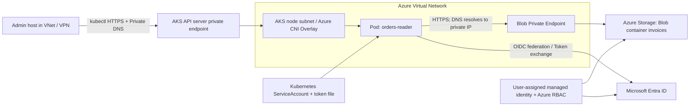

# AKS Platform Lab with Private Networking and Workload Identity

> **Chapter:** Architecture and Capstone Labs  
> **Module:** `CLOUD_PROVIDERS_AZURE` — mastering the Microsoft Azure ecosystem from subscriptions, resource groups, and Microsoft Entra ID to virtual networking, compute, storage, and data; deploying, monitoring, securing, and controlling costs of application architectures on Azure.

## Learning Objectives

Upon completing this lab, learners can:

1. Explain how an **AKS private cluster** protects access to the **Kubernetes API server**, and distinguish it from the node subnet, private workloads, and outbound traffic.
2. Design an **Azure Virtual Network (VNet)**, subnets, **Private DNS** resolution, administrative access paths, and egress for an AKS platform.
3. Deploy AKS with **OIDC issuer** and **Microsoft Entra Workload ID** enabled, without storing client secrets or service principal passwords in Pods.
4. Link a **Kubernetes ServiceAccount** to a **user-assigned managed identity** using a **federated identity credential**, then grant least-privilege data-plane Azure RBAC.
5. Verify a Pod acquires tokens via OIDC federation and accesses **Azure Blob Storage** over a **Private Endpoint**.
6. Troubleshoot DNS, networking, permissions, federation, and webhook errors; observe costs, security, safe change rollouts, and lab cleanup.

## 1. Capstone Problem Statement

An application team runs an `orders-api` service on AKS. The API needs to read sample invoices from Azure Blob Storage. The security team specifies these requirements:

- The Kubernetes API server **must not be publicly exposed on the Internet**.
- Nodes, Pods, and application data stores must reside in controlled subnets/boundaries; the storage service must not require a public data endpoint.
- Pods receive Azure authorization to read objects via **Microsoft Entra Workload ID**, **without** using storage account keys or client secrets.
- Only workloads with the designated identity may read the `invoices` container.
- Administrators use a management host on a private network or approved connectivity path to run `kubectl`.
- End-to-end verification, fault detection, and safe lab teardown must exist to avoid ongoing charges.

This is an **architecture lab**, not merely running a single `az aks create` command. Success means the **management path**, **data path**, and **identity acquisition path** are all correct and independently verified.

### Target Architecture



This diagram shows logical relationships. **The OIDC issuer is the AKS component issuing ServiceAccount tokens**, while **Microsoft Entra ID** validates the federated credential and exchanges that token for an Azure resource access token. Connectivity to Entra endpoints and required dependencies must still be designed.

## 2. Distinguishing Four "Private" and Identity Layers

| Concept | What does it protect? | Does NOT imply |
|---|---|---|
| **Private AKS cluster** | Kubernetes API server is accessed via private endpoint/private network path per config | Every Pod and service lacks public access |
| **Node subnet / Azure CNI** | Node and Pod IPs/routing, internal workload addressing | All egress automatically routes through Azure Firewall |
| **Private Endpoint + Private DNS** | Accesses a PaaS service over a private IP in the VNet | Automatically grants data permissions to Pods |
| **Workload Identity + Azure RBAC** | Controls which Pod/ServiceAccount can obtain tokens and perform Azure actions | Private networking, DNS, firewalls, or Kubernetes RBAC |

For example, if a Pod holds a valid Blob token but DNS still returns a public IP while Storage blocks public networks → **access fails at networking**. Conversely, if the Pod reaches the private IP but lacks `Storage Blob Data Reader` → **access fails on permissions**.

### Control Plane, Data Plane, and Egress

- **Kubernetes control plane:** `kubectl` path, kube-apiserver, resource management. A private cluster restricts the API endpoint at the network layer.
- **Application/data plane:** HTTP between Pods and databases/storage, ingress/egress. Requires separate design of subnets, Private Link, ingress controllers, and network policies.
- **Egress to Azure dependencies:** nodes may need to pull images, fetch tokens, and communicate with operational endpoints and Azure services. A private API **does not mean an air-gapped cluster**; never block all outbound traffic without a supported alternative design.
- **Azure RBAC vs. Kubernetes RBAC:** two separate authorization domains. Azure roles on a managed identity govern Azure resources only; ServiceAccounts/Roles/RoleBindings or Azure RBAC for Kubernetes Authorization (if enabled) govern Kubernetes API permissions.

## 3. Preparation and Lab Assumptions

To avoid touching production accidentally, all examples use:

| Variable | Illustrative value | Notes |
|---|---|---|
| Resource group | `rg-aks-private-lab` | Newly created, dedicated to this lab |
| Region | `southeastasia` | Must support required SKUs/features at runtime |
| VNet | `vnet-aks-lab`, `10.42.0.0/16` | Non-overlapping with on-prem/VPN/peered VNets |
| Node subnet | `snet-aks`, `10.42.0.0/22` | Sized for nodes and growth |
| Private Endpoint subnet | `snet-private-endpoints`, `10.42.8.0/24` | Separated from node subnet for governance |
| AKS cluster | `aks-private-lab` | Private API; no public endpoint created for apps |
| AKS managed identity | `id-aks-control` | Dedicated to infrastructure control plane |
| Workload identity | `id-invoices-reader` | Dedicated to the Blob-reading Pod |
| Namespace/ServiceAccount | `orders` / `invoices-reader` | Must match federated credential |
| Storage account | `stakslabexample01` | **Must be replaced with a globally unique Azure name** |
| Blob container | `invoices` | Contains dummy test data only |
| Pod CIDR (Overlay) | `10.244.0.0/16` | Non-overlapping with routed networks |

**Prerequisites:** Azure CLI with required AKS extensions/features, `kubectl`, an authorized account, and sufficient compute/network quota for the lab. CLI, AKS versions, and flag defaults evolve; verify `az version`, `az aks create --help`, and `az identity federated-credential create --help` before applying.

### Cost and Permission Scope

Commands in this guide are **execution templates for a lab subscription**, not pre-executed steps. Creating AKS, VM nodes, storage, NAT/public outbound, Private Endpoints, private DNS, and an admin host incurs charges. Run only when authorized with a budget and scheduled cleanup. The deployer needs permissions to create resources, create role assignments where required, and manage Kubernetes objects; avoid granting subscription-wide Owner when narrower permissions suffice.

## 4. Step 1 — Prepare the Subscription and VNet

Run in **Bash/Azure Cloud Shell** to provision the Azure infrastructure. Cloud Shell can provision the cluster via Azure APIs, **but normally sits outside your VNet and cannot reach the private kube-apiserver directly**. Subsequent `kubectl` commands must run from an admin machine with DNS and routing to the private API.

```bash
# Update subscription and storage account before running.
SUBSCRIPTION_ID="<subscription-id>"
RG="rg-aks-private-lab"
LOCATION="southeastasia"
VNET="vnet-aks-lab"
AKS="aks-private-lab"
AKS_SUBNET="snet-aks"
PE_SUBNET="snet-private-endpoints"

az login
az account set --subscription "$SUBSCRIPTION_ID"
az account show --query "{id:id,name:name}" --output table

az group create --name "$RG" --location "$LOCATION"

az network vnet create \
  --resource-group "$RG" \
  --name "$VNET" \
  --location "$LOCATION" \
  --address-prefixes 10.42.0.0/16 \
  --subnet-name "$AKS_SUBNET" \
  --subnet-prefixes 10.42.0.0/22

az network vnet subnet create \
  --resource-group "$RG" \
  --vnet-name "$VNET" \
  --name "$PE_SUBNET" \
  --address-prefixes 10.42.8.0/24

AKS_SUBNET_ID=$(az network vnet subnet show \
  --resource-group "$RG" --vnet-name "$VNET" \
  --name "$AKS_SUBNET" --query id --output tsv)

VNET_ID=$(az network vnet show \
  --resource-group "$RG" --name "$VNET" \
  --query id --output tsv)
```

**IP design:** Azure CNI Overlay uses a private Pod range (`10.244.0.0/16` in this example), while nodes draw IPs from `snet-aks`. With Overlay, verify no overlap across the pod CIDR, VNet, service CIDR, VPNs, and peered/on-prem networks. Overlay **does not** replace network policies; controlling Pod-to-Pod or egress traffic requires configuring an AKS-supported network policy engine.

Depending on your environment, you may also need NSGs, UDRs, a firewall, NAT Gateway, DNS resolver, and an admin subnet. These are **not** automatically built into a production architecture by the sample commands above.

## 5. Step 2 — Create a Managed Identity for the AKS Control Plane

This identity lets AKS manage required infrastructure resources. **Never use it as the application identity for `orders-api`.**

```bash
az identity create \
  --resource-group "$RG" \
  --name id-aks-control \
  --location "$LOCATION"

AKS_CONTROL_ID=$(az identity show \
  --resource-group "$RG" --name id-aks-control \
  --query id --output tsv)

AKS_CONTROL_PRINCIPAL=$(az identity show \
  --resource-group "$RG" --name id-aks-control \
  --query principalId --output tsv)

# Grant network operations scoped to the node subnet.
az role assignment create \
  --assignee-object-id "$AKS_CONTROL_PRINCIPAL" \
  --assignee-principal-type ServicePrincipal \
  --role "Network Contributor" \
  --scope "$AKS_SUBNET_ID"
```

Role assignments require Azure RBAC write permission such as `Microsoft.Authorization/roleAssignments/write` at the target scope. Assignments can take time to propagate. In real environments using custom Private DNS, custom routes/firewalls, or shared infrastructure, evaluate additional roles per AKS deployment guidance rather than granting broad subscription-wide rights.

## 6. Step 3 — Create an AKS Private Cluster with OIDC Issuer and Workload Identity

```bash
az aks create \
  --resource-group "$RG" \
  --name "$AKS" \
  --location "$LOCATION" \
  --enable-managed-identity \
  --assign-identity "$AKS_CONTROL_ID" \
  --enable-private-cluster \
  --enable-oidc-issuer \
  --enable-workload-identity \
  --network-plugin azure \
  --network-plugin-mode overlay \
  --pod-cidr 10.244.0.0/16 \
  --vnet-subnet-id "$AKS_SUBNET_ID" \
  --node-count 2 \
  --node-vm-size Standard_D2s_v5 \
  --generate-ssh-keys
```

**Meaning of key flags:**

| Flag | Effect |
|---|---|
| `--enable-private-cluster` | Enables private API server mode using private endpoint/DNS per AKS deployment |
| `--enable-oidc-issuer` | Creates an OIDC issuer for ServiceAccount tokens used in federation |
| `--enable-workload-identity` | Enables Microsoft Entra Workload ID support on the cluster |
| `--enable-managed-identity --assign-identity` | Assigns the user-assigned identity to the AKS control plane |
| `--network-plugin azure --network-plugin-mode overlay` | Selects Azure CNI Overlay for Pod networking |
| `--vnet-subnet-id` | Places nodes in the prepared subnet |
| `--node-count 2` | Two worker nodes for lab use, **not** sufficient to prove end-to-end HA |

This is a **minimal governance template**, not a production configuration meeting all security standards. Depending on policy, production AKS also requires Entra integration, Azure RBAC/Kubernetes RBAC, disabling local admin accounts where supported, network policies, Azure Policy, image security, autoscaling, availability zones, backups, logging, and controlled egress.

**Important note on outbound:** unless another egress type is configured, AKS may default to **load balancer outbound** as supported by the version, routing outbound traffic through public IPs. A private-API cluster **does not** imply "no public outbound." To use Azure Firewall/NAT/UDR and FQDN filtering, design `outbound-type`, routes, SNAT, DNS, and required endpoints per AKS documentation for your version. Never block all Azure dependencies arbitrarily.

### Post-Creation Verification

```bash
az aks show \
  --resource-group "$RG" \
  --name "$AKS" \
  --query "{name:name,privateFqdn:privateFqdn,privateCluster:apiServerAccessProfile.enablePrivateCluster,oidc:oidcIssuerProfile.issuerUrl,wi:securityProfile.workloadIdentity.enabled}" \
  --output json

OIDC_ISSUER=$(az aks show \
  --resource-group "$RG" --name "$AKS" \
  --query "oidcIssuerProfile.issuerUrl" \
  --output tsv)

printf 'OIDC issuer: %s\n' "$OIDC_ISSUER"
```

AKS private DNS can be AKS-managed or use a custom zone depending on configuration. When AKS manages the zone, you may see a Private DNS resource inside the AKS-managed **node resource group**. Never manually edit or delete AKS-managed resources just to tweak a DNS record.

## 7. Step 4 — Access the Kubernetes API from a Private Network

An AKS private cluster requires an **admin machine / jumpbox / runner** with routing and DNS to the private API. This can be an Azure VM in the VNet, a peered network, or an on-premises host via properly configured VPN/ExpressRoute. Azure Bastion can broker admin sessions to that VM when deployed properly; it does not magically put Cloud Shell inside your VNet.

On an **authorized admin host with Azure CLI/kubectl and valid network connectivity**:

```bash
az account set --subscription "<subscription-id>"

az aks get-credentials \
  --resource-group rg-aks-private-lab \
  --name aks-private-lab

kubectl cluster-info
kubectl get nodes -o wide
kubectl get namespaces
```

If Microsoft Entra authentication/Azure RBAC is enabled on the cluster, sign in to the right tenant with an appropriate Kubernetes role. **`az aks get-credentials` succeeding only proves kubeconfig retrieval**, not that DNS and API connectivity work; `kubectl get nodes` actually tests API reachability and authorization.

### Layer-by-Layer Network Checks

| Check | Expected outcome |
|---|---|
| Resolve `privateFqdn` from admin host | Returns private IP or expected private AKS DNS chain |
| Route/TCP to API endpoint | Traverses valid VPN/peering/VNet and allowed by NSG/firewall |
| `kubectl get nodes` | API responds, principal is authenticated and authorized in Kubernetes |
| Test from a host without private connectivity | **Cannot** reach the private API; do not treat this as a cluster bug |
| Check application inbound | No public Service/Ingress exists unless explicitly created |

`az aks command invoke` can run administrative commands from Azure in supported setups, **but it is not equivalent** to having private network `kubectl` access for admins. Run commands require separate access control and auditing; the capstone goal remains validating DNS/routing from a real private admin path.

## 8. Step 5 — Create Storage Account and Sample Data

To demonstrate both network isolation and identity, we use Blob Storage. **Storage Account names must be globally unique across Azure**, lowercase alphanumeric only, 3–24 characters long. Replace `STORAGE` with an unused valid name.

```bash
STORAGE="stakslabexample01"
CONTAINER="invoices"

az storage account create \
  --resource-group "$RG" \
  --name "$STORAGE" \
  --location "$LOCATION" \
  --sku Standard_LRS \
  --kind StorageV2 \
  --allow-blob-public-access false

STORAGE_ID=$(az storage account show \
  --resource-group "$RG" \
  --name "$STORAGE" \
  --query id --output tsv)

# The caller running this command needs data-plane rights to create containers.
az storage container create \
  --account-name "$STORAGE" \
  --name "$CONTAINER" \
  --auth-mode login

# Sample data prepared locally, containing no real customer info.
# Example: upload from a pre-created /tmp/invoice-lab.txt file.
az storage blob upload \
  --account-name "$STORAGE" \
  --container-name "$CONTAINER" \
  --name invoice-lab.txt \
  --file /tmp/invoice-lab.txt \
  --auth-mode login \
  --overwrite false
```

`az storage account create` succeeding does not automatically grant **Storage Blob Data Contributor** to the caller: Azure management-plane `Contributor` and Storage **data-plane RBAC** are distinct permission scopes. The account creating containers/uploading blobs must hold the appropriate data role. Never use storage account keys to "work around" missing data-plane RBAC.

**Why upload sample data before disabling public network access?** If you run Azure CLI from Cloud Shell outside the VNet and disable public Storage access first, data-plane commands like `container create`/`blob upload` will be blocked at the network layer even with valid RBAC. Seed lab data over an allowed path before disabling public access, or run from inside the VNet.

## 9. Step 6 — Private Endpoint and Private DNS for Blob

### 9.1. Create the Private Endpoint

```bash
az network private-endpoint create \
  --resource-group "$RG" \
  --name pe-invoices-blob \
  --location "$LOCATION" \
  --vnet-name "$VNET" \
  --subnet "$PE_SUBNET" \
  --private-connection-resource-id "$STORAGE_ID" \
  --group-id blob \
  --connection-name conn-invoices-blob
```

The Private Endpoint creates a network interface with a private IP in `snet-private-endpoints`. The endpoint alone **is not enough**: DNS must resolve `<account>.blob.core.windows.net` to that private IP via the corresponding CNAME/Private DNS setup.

### 9.2. Create and Link the Private DNS Zone

```bash
BLOB_ZONE="privatelink.blob.core.windows.net"

az network private-dns zone create \
  --resource-group "$RG" \
  --name "$BLOB_ZONE"

az network private-dns link vnet create \
  --resource-group "$RG" \
  --zone-name "$BLOB_ZONE" \
  --name link-blob-aks-vnet \
  --virtual-network "$VNET_ID" \
  --registration-enabled false

az network private-endpoint dns-zone-group create \
  --resource-group "$RG" \
  --endpoint-name pe-invoices-blob \
  --name zonegroup-blob \
  --private-dns-zone "$BLOB_ZONE" \
  --zone-name blob
```

The zone `privatelink.blob.core.windows.net` is specifically for the `blob` subresource. Azure Files, DFS/ADLS, Queue, and Table each use different subresources and DNS zones—**never** reuse the Blob zone for other services.

If the VNet uses custom DNS, configure an appropriate forwarder/resolver so private endpoint names resolve properly. Linking a Private DNS zone solves only the Azure VNet side; on-prem DNS, peering, or custom resolvers must be verified separately.

### 9.3. Disable Public Access After Verifying Private Connectivity

Once the endpoint/DNS are configured and private access is verified, you can set:

```bash
az storage account update \
  --resource-group "$RG" \
  --name "$STORAGE" \
  --public-network-access Disabled
```

**Warning:** this alters data-plane reachability. Run it only after confirming the private path from management and application hosts; management-plane Azure commands may still succeed while data-plane commands from Cloud Shell are blocked. If DNS or routing is misconfigured, Pods cannot read data even with a completely valid Workload Identity.

## 10. Step 7 — Create a User-Assigned Managed Identity for the Pod

This identity is **distinct** from `id-aks-control` in Step 5. It represents the workload, not the cluster.

```bash
az identity create \
  --resource-group "$RG" \
  --name id-invoices-reader \
  --location "$LOCATION"

APP_CLIENT_ID=$(az identity show \
  --resource-group "$RG" --name id-invoices-reader \
  --query clientId --output tsv)

APP_PRINCIPAL_ID=$(az identity show \
  --resource-group "$RG" --name id-invoices-reader \
  --query principalId --output tsv)

# Grant Blob read access scoped strictly to the invoices container.
CONTAINER_SCOPE="$STORAGE_ID/blobServices/default/containers/$CONTAINER"

az role assignment create \
  --assignee-object-id "$APP_PRINCIPAL_ID" \
  --assignee-principal-type ServicePrincipal \
  --role "Storage Blob Data Reader" \
  --scope "$CONTAINER_SCOPE"
```

**Least privilege:** because the Pod only needs to read files, `Storage Blob Data Reader` at container scope is far better than `Contributor` on the entire Storage Account or subscription. If the app needs writes, pick a tailored data-plane role and tight scope rather than over-privileging.

Azure RBAC takes time to propagate. If a Pod with a brand-new identity receives 403, check the **token, network path, and scoped role** plus propagation delay before widening permissions.

## 11. Step 8 — Federated Credential Linking the ServiceAccount

### 11.1. How Does OIDC Trust Work?

AKS issues a projected ServiceAccount token signed by the cluster's issuer. **Microsoft Entra ID** uses a **federated identity credential (FIC)** on the user-assigned managed identity to verify three critical claims:

| Field | Value in this lab | Purpose |
|---|---|---|
| `issuer` | URL from `oidcIssuerProfile.issuerUrl` of the exact AKS cluster | Trusts tokens only from that issuer |
| `subject` | `system:serviceaccount:orders:invoices-reader` | Trusts only the ServiceAccount in the exact namespace/name |
| `audiences` | `api://AzureADTokenExchange` | Constrains token exchange purpose |

**A single character typo in namespace, ServiceAccount, issuer, or audience causes token exchange to fail.** Never use overly broad subjects or share one high-privilege identity across unrelated apps.

### 11.2. Create the Federated Credential

```bash
az identity federated-credential create \
  --resource-group "$RG" \
  --identity-name id-invoices-reader \
  --name fic-orders-invoices \
  --issuer "$OIDC_ISSUER" \
  --subject "system:serviceaccount:orders:invoices-reader" \
  --audiences "api://AzureADTokenExchange"

az identity federated-credential list \
  --resource-group "$RG" \
  --identity-name id-invoices-reader \
  --output table
```

An FIC does not create a long-lived secret; it configures a **trust relationship**. The app later exchanges the Pod's projected token for an Entra access token. A Pod does not magically run with the Azure identity just because an FIC exists: it also needs the **ServiceAccount annotation**, **Pod label**, mutating webhook support, and a workload-identity-aware SDK/client.

## 12. Step 9 — Kubernetes ServiceAccount, Pod, and Token Exchange

Run these steps using `kubectl` **from an admin host with connectivity to the private AKS API** (Section 7), not from Cloud Shell outside the VNet.

### 12.1. Namespace and ServiceAccount

Create `orders-identity.yaml` in your lab directory:

```yaml
apiVersion: v1
kind: Namespace
metadata:
  name: orders
---
apiVersion: v1
kind: ServiceAccount
metadata:
  name: invoices-reader
  namespace: orders
  annotations:
    azure.workload.identity/client-id: "REPLACE_WITH_APP_CLIENT_ID"
```

Replace `REPLACE_WITH_APP_CLIENT_ID` with `APP_CLIENT_ID` from the identity, **not** the object ID/principal ID. If the cluster belongs to a different tenant than the identity's default, configure tenant ID per supported guidance and verify trust; this lab assumes the same tenant.

Apply it:

```bash
kubectl apply -f orders-identity.yaml
kubectl -n orders get serviceaccount invoices-reader -o yaml
```

### 12.2. Test Pod Acquiring an Azure Token and Reading Blob

To avoid writing a whole new application just for the lab, you can use a **team-approved** container image bundling a compatible Azure CLI. Below is a one-shot Job manifest; replace the image and tag with a vetted image whose `az login` supports `--federated-token`.

Create `blob-reader-job.yaml`:

```yaml
apiVersion: batch/v1
kind: Job
metadata:
  name: verify-blob-identity
  namespace: orders
spec:
  backoffLimit: 1
  template:
    metadata:
      labels:
        azure.workload.identity/use: "true"
    spec:
      serviceAccountName: invoices-reader
      restartPolicy: Never
      containers:
        - name: verify
          image: "REPLACE_WITH_APPROVED_AZURE_CLI_IMAGE"
          command: ["/bin/sh", "-c"]
          env:
            - name: STORAGE_ACCOUNT
              value: "REPLACE_WITH_STORAGE_ACCOUNT_NAME"
            - name: BLOB_CONTAINER
              value: "invoices"
          args:
            - |
              set -eu
              test -n "$AZURE_CLIENT_ID"
              test -n "$AZURE_TENANT_ID"
              test -f "$AZURE_FEDERATED_TOKEN_FILE"
              az login --service-principal \
                --username "$AZURE_CLIENT_ID" \
                --tenant "$AZURE_TENANT_ID" \
                --federated-token "$(cat "$AZURE_FEDERATED_TOKEN_FILE")" \
                --allow-no-subscriptions >/dev/null
              az storage blob list \
                --account-name "$STORAGE_ACCOUNT" \
                --container-name "$BLOB_CONTAINER" \
                --auth-mode login \
                --query "[].name" \
                --output tsv
```

**Why is the label mandatory?** `azure.workload.identity/use: "true"` in **Pod template `metadata.labels`** triggers the workload identity mutating webhook to inject the required environment variables and token volume. The ServiceAccount annotation supplies the **client ID**. Both must match, and Workload Identity must be enabled on the cluster.

**Never print tokens in logs.** The script verifies the token file exists and passes it for token exchange without printing its contents. Azure CLI `az login` works as a proof of concept; production applications should use a supported **Azure Identity SDK** for automatic token management instead of shelling out to `az login`.

The Job is meaningful only after replacing placeholders and ensuring image pull access and network paths to Blob/Entra. Never put client secrets or storage keys in YAML. In production, pin image digests, enforce pod security controls, and restrict ServiceAccount rights.

### 12.3. Run and Observe

```bash
kubectl apply -f blob-reader-job.yaml
kubectl -n orders get jobs,pods
kubectl -n orders wait --for=condition=complete job/verify-blob-identity --timeout=300s
kubectl -n orders logs job/verify-blob-identity
```

**Expected result:** logs list `invoice-lab.txt` without exposing any client secret or account key. Also verify the Storage Private Endpoint resolves to a private IP and blobs are non-public. Job `Complete` only proves the script exited cleanly; inspect the output and run negative tests.

If the Job fails, inspect `kubectl -n orders describe pod <pod-name>`, events, Azure identity/FIC, RBAC, and networking rather than granting broader permissions. After editing a ServiceAccount annotation or Pod label, **create a new Job/Pod** so the webhook re-injects configuration; existing Pods will not pick up updated token projections automatically.

### 12.4. Python SDK in a Real Application

In an app using `azure-identity` and `azure-storage-blob`, identity acquisition is automatic:

```python
import os
from azure.identity import DefaultAzureCredential
from azure.storage.blob import BlobServiceClient

account = os.environ["STORAGE_ACCOUNT"]
container = os.environ.get("BLOB_CONTAINER", "invoices")

credential = DefaultAzureCredential()
service = BlobServiceClient(
    account_url=f"https://{account}.blob.core.windows.net",
    credential=credential,
)

for blob in service.get_container_client(container).list_blobs():
    print(blob.name)
```

SDK versions supporting Workload Identity automatically read `AZURE_CLIENT_ID`, `AZURE_TENANT_ID`, and `AZURE_FEDERATED_TOKEN_FILE` injected by the webhook. When multiple credential sources exist, verify `DefaultAzureCredential`'s chain; if you want to enforce one exact mechanism, use `WorkloadIdentityCredential` to eliminate unwanted fallbacks. Production images must pin/audit dependencies and never log secrets.

## 13. Step 10 — Verifying Networking and Identity Together

Three groups of checks should be executed independently to isolate root causes accurately:

| Check layer | Command / target | Expected result |
|---|---|---|
| Kubernetes API | `kubectl get nodes` from private admin host | API reachable, nodes listed |
| Pod DNS | Resolve `<account>.blob.core.windows.net` inside Pod | Returns Private Endpoint's private IP |
| Pod HTTPS | TCP/443 connectivity to Blob via resolved DNS | Not blocked by NSG/firewall/route |
| Workload token projection | `AZURE_FEDERATED_TOKEN_FILE` inside Pod | File present, contents never logged |
| Entra token exchange | Azure SDK or `az login --federated-token` | Valid access token issued |
| Azure RBAC data-plane | List blobs using reader identity | Reads only the granted `invoices` container |
| Public network denial | Data-plane access from outside allowed VNet | Denied by network; no public fallback open |
| Kubernetes permissions | Test an API verb under assigned RBAC | No unintended cluster-admin privileges |

**Never treat "can read blob" as sole proof that traffic takes the private path.** If Storage still allows public endpoints or DNS returns a public IP, the test can pass for the wrong reason. Conversely, never treat "DNS resolves to a private IP" as proof that Workload Identity works.

### Checking DNS from a Pod

On a Pod containing `nslookup` or an equivalent DNS tool:

```bash
# Run inside an approved test Pod with DNS utilities.
nslookup stakslabexample01.blob.core.windows.net
```

The account name must match your actual `STORAGE` variable. If the app Pod lacks DNS tools, use an approved **diagnostic Pod** under equivalent network policies; do not install debug utilities into production images.

Private DNS may return a CNAME chain pointing to a `privatelink.blob.core.windows.net` record. Confirm the **final resolved address is the Private Endpoint's private IP** as seen from the AKS network.

### Controlled Negative Testing

A valuable permission check: create **another ServiceAccount** with no FIC or Azure role and verify a Pod using it cannot read Blob via workload identity. Never rely solely on portal screenshots to claim isolation. **Never** simulate negative tests by stripping roles from production apps or opening Storage to public traffic.

## 14. Layer-by-Layer Troubleshooting

| Symptom | Root-cause area | Evidence-based remediation |
|---|---|---|
| `kubectl` times out from Cloud Shell | API is private; Cloud Shell lacks route/DNS to VNet | Run from an approved jumpbox/VPN/peered network, check private DNS |
| `az aks get-credentials` works yet `kubectl` fails | Kubeconfig fetched, but private DNS/route/RBAC broken | Verify FQDN resolution, TCP/443, Azure/Kubernetes RBAC |
| Nodes `NotReady` or image pull fails | DNS, outbound/FQDN, route/firewall, quota, or CNI | Check node events, AKS dependencies, egress, and registry |
| Pod lacks `AZURE_FEDERATED_TOKEN_FILE` | Missing Pod label, SA annotation, webhook, or stale Pod | Check `azure.workload.identity/use`, webhook, and ServiceAccount |
| Token exchange issuer/subject error | FIC has wrong OIDC issuer, namespace/SA, or audience | Compare all three values exactly against live cluster issuer |
| Token exchange works yet Blob returns 403 | Data-plane RBAC wrong identity/scope or still propagating | Check `principalId`, container scope, `Storage Blob Data Reader`, and delay |
| Blob request times out / network denied | Private Endpoint/DNS misconfigured, public disabled, firewall/NSG/route | Resolve DNS from Pod, check PE state and network path |
| Blob DNS resolves to public IP | Private DNS zone not linked or custom DNS not forwarding | Check `privatelink.blob.core.windows.net` and VNet/custom DNS |
| Pod cannot read Blob despite valid FIC | Missing Entra outbound, unsupported SDK/CLI, or wrong role | Separate token acquisition step from data access step |
| Pod stuck in `ImagePullBackOff` | Registry unreachable, wrong image/tag, or missing pull identity | Check private registry, outbound path, and `imagePullSecret`/managed identity |
| Role assignment hits `AuthorizationFailed` | Caller lacks RBAC management rights | Ask an authorized admin at scope; never elevate subscription-wide |
| Ingress/Service accidentally public | Default public `LoadBalancer`/Ingress or wrong annotations | Inspect service annotations, frontend IPs, and policy before deploy |
| Costs higher than expected | VM nodes, Private Endpoint, egress, LB, logs, idle resources | Check Cost Analysis by RG, cleanup schedule, and budget alerts |

### Layered Triage Sequence

1. **Control plane:** does the cluster have a private API, valid OIDC issuer, and Workload Identity enabled? Can the admin host reach the API?
2. **Kubernetes:** is the Pod scheduled, DNS working, webhook injecting the token, and ServiceAccount configured?
3. **Microsoft Entra:** do issuer + subject + audience match the FIC, and does the identity match `clientId`?
4. **Azure resource authorization:** is the right data role assigned at the right scope and propagated?
5. **Data network:** does the Blob hostname resolve to the private IP, does HTTPS traverse the PE, and is public access disabled?
6. **Application:** are container/blob names accurate, SDK versions supported, and query logic bug-free?

Avoid changing DNS, RBAC, and identity simultaneously in a single test; otherwise you will not know which change fixed the issue.

## 15. Production Hardening Gaps to Address

This lab proves core principles; it is **not** a complete production blueprint.

### Networking and Ingress/Egress

- Decide whether to use **hub-spoke**, Azure Firewall/UDR, NAT Gateway, and centralized DNS.
- With custom DNS and on-prem networks, design Azure DNS Private Resolver / conditional forwarders appropriately.
- Distinguish a private Kubernetes API from **private application ingress**. For internal-only apps, choose an internal load balancer/ingress controller and verify service annotations. Never deploy `type: LoadBalancer` assuming it automatically allocates a private IP.
- Enforce network policies (Azure CNI powered by Cilium or another AKS-supported engine) to restrict Pod-to-Pod and namespace traffic.
- Verify required outbound paths for image registries, OIDC/token exchange, control-plane dependencies, monitoring, and patching; never assume "private" means offline.

### Identity and Permissions

- Separate AKS control identity, kubelet identity, per-app workload identities, and data-plane roles.
- Scope FICs tightly to `namespace:serviceaccount`; use distinct ServiceAccounts per trust boundary.
- Configure Microsoft Entra / Kubernetes RBAC properly and avoid broad admin kubeconfigs in CI/CD.
- Plan lifecycle handling when renaming namespaces, recreating clusters, changing OIDC issuers, or rotating managed identities.
- Enforce policies/guardrails against privileged Pods, unnecessary `hostPath`, untrusted images, unintended network exposure, and plaintext secrets.

### Reliability and Operations

- Plan availability zones, autoscalers, PodDisruptionBudgets, node pool sizing, image/node upgrade strategies, persistent volumes, and backup/restore.
- Monitor AKS/node readiness, CoreDNS, `kube-system`, webhooks, IP exhaustion, Private DNS, Azure Monitor/Application Insights, and costs.
- Document resource IDs, private endpoint DNS, RBAC assignments, FICs, runbooks, owners, and update cycles.
- Test recovery from node failure, revoked roles, broken DNS, or unreachable dependencies in non-prod—never break production services to test.

## 16. Cost Control and Lab Teardown

Cost sources to inventory:

| Component | Potential charges | Notes |
|---|---|---|
| AKS nodes / managed disks | Compute, OS disks, data disks | Two nodes incur continuous charges even with few Pods |
| AKS control-plane tier | Depends on tier/policy | Check current pricing and SLA |
| Load Balancer / NAT / Firewall | Public outbound, SNAT, firewall processing | A private API does not eliminate egress costs |
| Private Endpoint and DNS | Endpoint hours, data processing, queries/zones | Depends on configuration |
| Storage | Capacity, operations, private access traffic | Even demo data incurs small charges |
| Jumpbox / Bastion / VPN | VM/management path, public IPs if used | Requires a separate cleanup plan |
| Monitor / Logs | Ingestion, retention, alerts | Avoid uncontrolled verbose log collection |

**Clean up the lab only after saving evidence and confirming scope.** Deleting the lab resource group deletes AKS, Storage, and related resources you created; **never run** a delete command based solely on a name that looks like a lab without verifying resource IDs and owners.

Safe teardown procedure:

1. List and archive resources in `rg-aks-private-lab`, including the AKS-managed node resource group.
2. Save non-sensitive test outputs, logs, role assignments, and issues encountered.
3. Confirm the resource group contains no shared or production resources.
4. Obtain owner approval to decommission; use Azure Portal or CLI to delete **only** the lab resources.
5. Check for remaining external role assignments/FICs or out-of-RG resources, and monitor billing over subsequent days.

Never delete resources or Private DNS links shared with other VNets. Budget alerts only notify; they do not stop bills from exceeding thresholds.

## 17. Capstone Acceptance Exercise

**Scenario:** The platform team must hand over a dedicated AKS cluster to the `orders` team. The cluster has a private API; apps run in the `orders` namespace and read invoice files from the `invoices` Blob container using their own workload identity, with zero account keys.

### Acceptance Criteria

| ID | Evidence to provide | Pass criteria |
|---|---|---|
| N1 | `az aks show` and DNS from admin host | Private API, no public management endpoint |
| N2 | `kubectl get nodes` from approved network | Nodes Ready, kubeconfig/RBAC working |
| N3 | Blob DNS lookup from Pod | Hostname resolves to Blob PE's private IP |
| N4 | Storage network configuration | Public network access disabled after PE verified |
| I1 | OIDC issuer and Workload Identity in AKS | Both features enabled |
| I2 | FIC and ServiceAccount annotation | Issuer, subject, audience, and client ID match |
| I3 | Pod token projection | Webhook injects token file; token never appears in logs |
| A1 | `az role assignment list` at exact scope | Workload identity holds container-level read role only |
| A2 | Job/app reading Blob | Lists sample file cleanly without keys/secrets |
| S1 | Unauthorized access test | Unprivileged identity is denied |
| O1 | Monitor, events/logs, and Cost Analysis | Owner, alerts, and cleanup plan documented |

### Results Table

| Check | Actual result | Evidence / adjustments |
|---|---|---|
| Private API and admin DNS | … | … |
| Node/Pod readiness | … | … |
| Blob Private Endpoint | … | … |
| OIDC, FIC, and ServiceAccount | … | … |
| Token exchange and role | … | … |
| Positive/negative access test | … | … |
| Egress, policy, and logs | … | … |
| Cost, backup, and cleanup plan | … | … |

### Self-Check Questions

1. Why does enabling `--enable-private-cluster` not guarantee applications or all outbound traffic are private?
2. Why does `az aks get-credentials` succeeding in Cloud Shell not prove `kubectl` can reach a private API?
3. What roles do the OIDC issuer, federated subject, and audience play in Workload Identity?
4. Distinguish `clientId` vs. `principalId` of a user-assigned managed identity in manifests versus role assignments.
5. Why are both the **Pod label** and **ServiceAccount annotation** required? What happens if either is missing?
6. If Blob returns 403, why shouldn't you immediately grant subscription-wide `Contributor`?
7. How do you prove traffic to Blob actually traverses the Private Endpoint rather than the public endpoint?
8. Why can a Pod with a valid token still time out reaching Blob?
9. Does a private cluster still need an egress mechanism to Microsoft Entra and AKS dependency endpoints?
10. If the `orders` namespace is renamed to `billing`, what must change on the federated credential and why?

## 18. Summary

A private-network AKS platform requires designing **all three paths**: **a private Kubernetes API and admin path**, **data-service networking via VNet/Private Endpoint/DNS**, and **Workload Identity built on OIDC issuer + ServiceAccount + federated credential + Azure RBAC**. These three layers are independent yet must all align for workloads to run securely.

Core principles: **never equate a private API with an entirely private system; never equate a valid token with data authorization; never use account keys or client secrets when Workload Identity fits; always verify with negative tests, telemetry, and live network checks**. When moving to production, add network/egress policies, Entra/Kubernetes RBAC, supply-chain security, HA, backups, monitoring, budgets, and controlled decommissioning.
