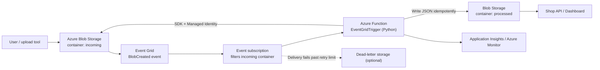
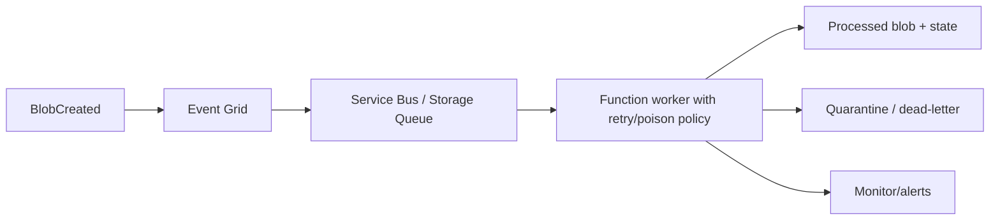

# File Processing Lab with Blob Storage, Event Grid, and Functions

## 1. Problem Statement and Objectives

An e-commerce system needs to ingest order CSV files, validate their contents, and generate summary reports for other applications to consume. If an app continuously polls a storage directory for new files, it generates unnecessary checks, scales poorly, and can miss changes. An **event-driven** architecture solves this by letting the storage service emit an event when a new file arrives, and having a serverless compute component react to the event.

In the **Architecture and Capstone Labs** chapter of the `CLOUD_PROVIDERS_AZURE` module, we build a practical lab with **Azure Blob Storage → Azure Event Grid → Azure Functions**. The exercise integrates subscriptions, resource groups, Microsoft Entra ID, Azure RBAC, storage, compute, networking, deployment, monitoring, security, and cost within an application architecture on Microsoft Azure.

After this lesson, you can:

- Diagram the flow of file upload, event emission, Function invocation, and output persistence.
- Provision a Storage Account and appropriate blob containers for an application.
- Understand **Event Grid event subscriptions**, filtering for `Microsoft.Storage.BlobCreated`, payloads, and event delivery.
- Write a **Python Azure Function using programming model v2** that receives Event Grid events, downloads blobs using **Managed Identity**, reads CSV/TXT files, and writes JSON summaries.
- Design **idempotency**, file size limits, error handling, retries, and dead-lettering.
- Practice deploying, uploading test files, verifying outputs, and inspecting logs/metrics.
- Identify risks around data permissions, networking, throughput, cost, and operations when scaling.

**Running scenario:** the `Shop API` application lets staff upload an `orders.csv` file containing order rows. The system automatically produces a summary containing line count, non-empty line count, byte size, and SHA-256 content hash. Results are written to a separate container for dashboards/apps to read. This lab only **summarizes files**; it does not execute financial transactions or modify live orders.

## 2. Reference Architecture



**Roles and boundaries:**

| Component | Role | Key takeaway |
|---|---|---|
| **Storage Account** | Stores file data and containers | Blob Storage has a data plane separate from Azure Resource Manager permissions |
| **`incoming` container** | Receives source CSV/TXT files | Blob names can look like logical paths, e.g., `batch-01/orders.csv` |
| **Event Grid system topic / event subscription** | Emits and routes storage events to endpoints | Events are **notifications**; they do not contain the file contents |
| **Azure Function** | Receives Event Grid events and runs code | The Function still downloads the blob, processes it, and saves output |
| **`processed` container** | Stores JSON outputs | Separating source/destination prevents infinite event loops |
| **Managed Identity + RBAC** | Lets the Function read/write data without embedded keys | Distinguish infrastructure creation rights from blob content permissions |
| **Azure Monitor / Application Insights** | Tracks invocations, failures, duration | Configure logs, alerts, retention, and access controls |

When a new blob is **committed** to the `incoming` container, Storage emits `Microsoft.Storage.BlobCreated` (under supported conditions). Event Grid forwards the notification to the Function. The code reads the URL/ETag from the event, verifies the source matches the expected Storage Account, downloads the blob, and writes a JSON file to the `processed` container.

**Do not confuse three trigger types:**

1. **Event Grid trigger:** the Function receives events directly from Event Grid; this is what we use in the lab.
2. **Blob trigger:** Azure Functions also has a built-in blob trigger, including an Event Grid–backed source mode in supported versions/plans. Its binding configuration differs from an Event Grid trigger.
3. **HTTP trigger:** a general HTTP endpoint called by apps; it does not automatically replace Event Grid integration without proper subscription/validation setup.

This lesson uses an **explicit Event Grid trigger** so you clearly see event schemas, filtering, and deduplication rules.

## 3. Requirements Design and Data Flow

### 3.1. Lab Data Contract

Suppose an uploaded file named `orders.csv` contains:

```csv
order_id,amount,currency
SO-1001,120000,VND
SO-1002,350000,VND
SO-1003,90000,VND
```

The Function **performs no order-confirmation business logic**; it produces a JSON summary describing the file:

```json
{
  "sourceBlob": "orders.csv",
  "sourceETag": "\"0xEXAMPLE\"",
  "eventId": "<event-id>",
  "sizeBytes": 86,
  "lineCount": 4,
  "nonEmptyLineCount": 4,
  "sha256": "<sha256-of-content>",
  "processedAtUtc": "<utc-timestamp>"
}
```

The `sizeBytes`, ETag, hash, and timestamp values in this example only **illustrate structure**; live results are generated from actual data. Line count includes the CSV header and does not directly equal order count; counting orders requires parsing CSV, checking schema, and excluding headers.

### 3.2. Constraints to Lock Down

- **Accept only UTF-8 `.csv` or `.txt` files**; binary files and other extensions are skipped and logged. This is a lab rule, not a Blob Storage limitation.
- **5 MiB/file limit** to avoid loading excessive data into the sample Function's RAM. Production needs streaming, queues, or chunking for large files.
- **Separate source and destination containers**; the event subscription filters `incoming` so `processed` writes never self-trigger.
- **At-least-once delivery:** the same event can arrive multiple times, out of order, or delayed. Code must be idempotent.
- **Never trust arbitrary URLs** inside events as download targets: read blobs only from the configured account and container.
- **If a blob is overwritten after an event fires**, its ETag may have changed. For workflows that must process every version, enable blob versioning and fetch the exact version, or use immutable blob names.
- **Data security:** never log order contents, access keys, tokens, or connection strings.

## 4. Prerequisites and Lab Limits

You need a sandbox Azure subscription, permissions to create resource groups, Storage, Functions, and Event Grid event subscriptions, Azure RBAC assignment permissions for Managed Identity, plus a workstation with Azure CLI, compatible Python, and Azure Functions Core Tools v4. Pick a region supporting your Storage/Event Grid/Functions combination and hosting plan.

**Deployment recommendation:** use a dedicated lab subscription and resource group, and configure an Azure Budget/alert to monitor spending. Create the Function App via Azure Portal with a Python runtime supported in your chosen region and plan (e.g., a Python 3.x version supported by Functions v4); Portal UI and hosting plans vary over time. Upload only synthetic test data; never use production files.

The sample values below are placeholders that must be replaced with real names. Storage account names must be **lowercase alphanumeric only, 3–24 characters, and globally unique**. Function App names must also be valid and unique within the service's DNS scope.

```bash
az login
az account list --output table

SUBSCRIPTION_ID="<subscription-id>"
RG="rg-shop-file-lab"
LOCATION="southeastasia"
STORAGE_ACCOUNT="<uniquestorageaccount>"
FUNCTION_APP="<unique-function-app>"
INPUT_CONTAINER="incoming"
OUTPUT_CONTAINER="processed"
EVENT_SUB_NAME="es-shop-blob-created"

az account set --subscription "$SUBSCRIPTION_ID"
az account show --query '{name:name,id:id,tenantId:tenantId}' --output table
```

Example commands use Bash syntax. In PowerShell, translate variable syntax (`VAR=...`, `$(...)`) to PowerShell equivalents such as `$VAR = '...'` and `(Get-...)`; do not mix shell syntax when copying.

## 5. Step 1 — Create the Storage Account and Containers

### 5.1. Provision Resources

```bash
az group create \
  --name "$RG" \
  --location "$LOCATION"

az storage account create \
  --resource-group "$RG" \
  --name "$STORAGE_ACCOUNT" \
  --location "$LOCATION" \
  --sku Standard_LRS \
  --kind StorageV2 \
  --allow-blob-public-access false \
  --min-tls-version TLS1_2

STORAGE_ID=$(az storage account show \
  --resource-group "$RG" \
  --name "$STORAGE_ACCOUNT" \
  --query id --output tsv)
```

`--allow-blob-public-access false` disables **anonymous public blob access**, which is not the same as disabling the public network endpoint entirely. Production requires firewalls/private endpoints and proper access paths for Functions and Event Grid. Default LRS keeps the lab simple; ZRS/GRS, backups, and versioning depend on reliability and cost targets.

### 5.2. Grant Data-Plane Permissions to the Operator

If `az storage container create --auth-mode login` returns `403`, your account may lack data-plane permissions. An authorized admin must grant a role such as **Storage Blob Data Contributor** at the Storage Account or container scope following least privilege. Azure Resource Manager's `Contributor` role does not automatically grant Blob data-plane access via Microsoft Entra ID.

Once permissions take effect:

```bash
az storage container create \
  --account-name "$STORAGE_ACCOUNT" \
  --name "$INPUT_CONTAINER" \
  --auth-mode login

az storage container create \
  --account-name "$STORAGE_ACCOUNT" \
  --name "$OUTPUT_CONTAINER" \
  --auth-mode login

az storage container list \
  --account-name "$STORAGE_ACCOUNT" \
  --auth-mode login \
  --query "[].name" --output table
```

**Why separate two containers?** Writing a JSON file to `processed` will not match the `subjectBeginsWith` filter scoped to `incoming`; if a Function processes its own outputs, the system can enter an infinite loop, inflating invocations, storage/event bills, and load.

## 6. Step 2 — Create the Function App and Managed Identity

### 6.1. Create the Function App

In **Azure Portal → Create resource → Function App**, choose:

1. Subscription and resource group `rg-shop-file-lab`.
2. Function App name, lab-compatible region, and **Python** runtime stack.
3. A hosting plan supporting Functions v4, Python, and **Event Grid triggers** for your account/region; review scaling, outbound networking, and pricing before selecting.
4. Host storage required by the Function App, plus Application Insights monitoring where available. Functions runtime host storage can share the **same lab account** for simplicity if supported; production should evaluate separating host storage from business data.
5. After creation, verify the Function App is running and no conflicting file-processing function shares the name.

**Azure Functions host storage differs from app data access.** The host requires `AzureWebJobsStorage` or an identity-based host connection compatible with the runtime/hosting plan. Our application code below accesses business blobs via `DefaultAzureCredential` and Managed Identity, without embedding a storage account key in code.

### 6.2. Enable System-Assigned Managed Identity

```bash
az functionapp identity assign \
  --resource-group "$RG" \
  --name "$FUNCTION_APP"

PRINCIPAL_ID=$(az functionapp identity show \
  --resource-group "$RG" \
  --name "$FUNCTION_APP" \
  --query principalId --output tsv)

echo "$PRINCIPAL_ID"
```

In the lab, to keep setup brief, assign **Storage Blob Data Contributor** to the Function Identity on the target Storage Account:

```bash
az role assignment create \
  --assignee-object-id "$PRINCIPAL_ID" \
  --assignee-principal-type ServicePrincipal \
  --role "Storage Blob Data Contributor" \
  --scope "$STORAGE_ID"
```

**Production:** grant `Storage Blob Data Reader` on `incoming` and `Storage Blob Data Contributor` on `processed` at container scope where supported, rather than granting write/delete over all source data. Distinguish the **app identity** from the **deploy identity**; the account creating the Event Grid subscription also needs management permissions at the right scope.

RBAC can take time to propagate. If the Function returns 403 right after role assignment, wait for propagation and inspect scope/identity instead of pasting storage keys into code.

### 6.3. Configure Application Settings

Set **non-secret** app settings telling the Function which Storage Account and containers it may process:

```bash
az functionapp config appsettings set \
  --resource-group "$RG" \
  --name "$FUNCTION_APP" \
  --settings \
    DATA_STORAGE_ACCOUNT="$STORAGE_ACCOUNT" \
    IN_CONTAINER="$INPUT_CONTAINER" \
    OUT_CONTAINER="$OUTPUT_CONTAINER" \
    MAX_FILE_BYTES="5242880"
```

5,242,880 bytes = 5 MiB, purely a memory safeguard for the lab. Keep existing Azure Functions runtime settings intact; **do not delete `AzureWebJobsStorage`, `FUNCTIONS_WORKER_RUNTIME`, or hosting settings** required by the app.

## 7. Step 3 — Write the Event-Handling Azure Function

### 7.1. Initialize a Python Functions v2 Project

On a workstation with Azure Functions Core Tools v4 and a compatible Python runtime:

```bash
func init shop-file-lab --python
cd shop-file-lab
```

Python programming model v2 typically uses `function_app.py` with decorators. Create/edit **files in your own lab project** based on the snippets below; these files are examples, not artifacts generated by this Markdown lesson.

Contents of `requirements.txt`:

```text
azure-functions
azure-storage-blob
azure-identity
```

In real projects, pin tested package versions and verify runtime/SDK compatibility to ensure repeatable builds.

### 7.2. Code for `function_app.py`

```python
import hashlib
import json
import logging
import os
from datetime import datetime, timezone
from urllib.parse import unquote, urlsplit

import azure.functions as func
from azure.core import MatchConditions
from azure.core.exceptions import ResourceExistsError, ResourceModifiedError
from azure.identity import DefaultAzureCredential
from azure.storage.blob import BlobServiceClient, ContentSettings

app = func.FunctionApp()

ACCOUNT = os.environ["DATA_STORAGE_ACCOUNT"]
IN_CONTAINER = os.getenv("IN_CONTAINER", "incoming")
OUT_CONTAINER = os.getenv("OUT_CONTAINER", "processed")
MAX_BYTES = int(os.getenv("MAX_FILE_BYTES", "5242880"))

credential = DefaultAzureCredential()
blob_service = BlobServiceClient(
    account_url=f"https://{ACCOUNT}.blob.core.windows.net",
    credential=credential,
)


@app.function_name(name="ProcessIncomingBlob")
@app.event_grid_trigger(arg_name="event")
def process_incoming_blob(event: func.EventGridEvent) -> None:
    if event.event_type != "Microsoft.Storage.BlobCreated":
        logging.info("Ignored event type: %s", event.event_type)
        return

    data = event.get_json()
    if not isinstance(data, dict):
        raise ValueError("Event Grid data must be an object")

    # Read only URLs belonging to the configured account; avoid arbitrary URL fetches.
    url = urlsplit(data.get("url", ""))
    expected_host = f"{ACCOUNT}.blob.core.windows.net"
    if url.scheme != "https" or url.hostname != expected_host:
        raise ValueError("Unexpected blob account or URL")

    parts = url.path.lstrip("/").split("/", 1)
    if len(parts) != 2 or unquote(parts[0]) != IN_CONTAINER:
        logging.info("Ignored event outside incoming container")
        return

    blob_name = unquote(parts[1])
    if not blob_name.lower().endswith((".csv", ".txt")):
        logging.info("Ignored unsupported extension")
        return

    event_etag = data.get("eTag")
    if not event_etag:
        raise ValueError("Missing source ETag")

    source_client = blob_service.get_blob_client(
        container=IN_CONTAINER, blob=blob_name
    )
    props = source_client.get_blob_properties()

    # Older events can arrive after a blob name has been overwritten.
    if props.etag != event_etag:
        logging.warning("Source changed; skipping stale event")
        return
    if props.size > MAX_BYTES:
        raise ValueError("Blob exceeds lab file-size limit")

    try:
        # If-Match prevents downloading a version overwritten mid-flight.
        raw = source_client.download_blob(
            etag=event_etag,
            match_condition=MatchConditions.IfNotModified,
        ).readall()
    except ResourceModifiedError:
        logging.warning("ETag changed during read; skip stale event")
        return

    if len(raw) > MAX_BYTES:
        raise ValueError("Blob exceeded size limit while downloading")

    text = raw.decode("utf-8-sig")  # Handles optional UTF-8 BOM
    lines = text.splitlines()

    # Same name + same ETag -> same output key; retries will not duplicate output.
    fingerprint = hashlib.sha256(
        f"{blob_name}\0{event_etag}".encode("utf-8")
    ).hexdigest()
    output_name = f"{fingerprint}.json"

    result = {
        "sourceBlob": blob_name,
        "sourceETag": event_etag,
        "eventId": str(event.id),
        "sizeBytes": len(raw),
        "lineCount": len(lines),
        "nonEmptyLineCount": sum(1 for line in lines if line.strip()),
        "sha256": hashlib.sha256(raw).hexdigest(),
        "processedAtUtc": datetime.now(timezone.utc).isoformat(),
    }

    destination = blob_service.get_blob_client(
        container=OUT_CONTAINER, blob=output_name
    )
    try:
        destination.upload_blob(
            json.dumps(result, ensure_ascii=False).encode("utf-8"),
            overwrite=False,
            content_settings=ContentSettings(
                content_type="application/json"
            ),
        )
        logging.info("Processed blob summary: %s", output_name)
    except ResourceExistsError:
        # On redelivery of the same event, an existing output counts as success.
        logging.info("Duplicate event already handled: %s", output_name)
```

**Key design choices explained:**

1. `@app.event_grid_trigger` receives **event metadata**; the code downloads the file via the Azure Storage SDK.
2. `DATA_STORAGE_ACCOUNT` and `IN_CONTAINER` restrict the data source. The code **never fetches arbitrary external URLs**, even if an event payload were spoofed.
3. `DefaultAzureCredential` picks the identity matching the environment. In Azure with a System-assigned Managed Identity, Storage RBAC grants read/write. Locally it can use your Azure CLI identity with **its own data permissions**.
4. Checking the ETag beforehand and using a conditional read avoids processing **overwritten** content by mistake. If business rules require processing every version, enable Blob Versioning and use a version-aware strategy; skipping stale events in the lab **does not satisfy** that requirement.
5. `sha256(blob_name + ETag)` serves as the **idempotency key**; redelivered events map to the same JSON filename. Two versions of the same blob with different ETags produce separate summaries. `overwrite=False` prevents racing invocations from overwriting outputs.
6. `raw.decode("utf-8-sig")` assumes text files; wrong encodings or oversized files raise errors. Production needs **quarantine/dead-lettering** and alerts rather than endless retries.
7. `processedAtUtc` aids observability, **never use it as an idempotency key** because every retry gets a new timestamp. `eventId` aids tracing, and should not be assumed unique per data version across all write paths.

This sample code intentionally avoids SQL inserts, payment events, or deleting source files. For workflows with non-repeatable side effects, use a **state store/transactional outbox** or idempotency recorded **before or inside the same transaction** as business state changes; output filenames alone are insufficient.

### 7.3. Local and Host Configuration

Minimal `host.json`:

```json
{
  "version": "2.0",
  "logging": {
    "applicationInsights": {
      "samplingSettings": {
        "isEnabled": true
      }
    }
  }
}
```

Example `local.settings.json` for the **lab environment**, never commit to Git:

```json
{
  "IsEncrypted": false,
  "Values": {
    "AzureWebJobsStorage": "UseDevelopmentStorage=true",
    "FUNCTIONS_WORKER_RUNTIME": "python",
    "DATA_STORAGE_ACCOUNT": "<uniquestorageaccount>",
    "IN_CONTAINER": "incoming",
    "OUT_CONTAINER": "processed",
    "MAX_FILE_BYTES": "5242880"
  }
}
```

`UseDevelopmentStorage=true` requires **Azurite** or a compatible storage emulator running for local host storage; it **does not** redirect business data to Azurite because the code uses `DATA_STORAGE_ACCOUNT` and Azure Identity. Local settings files can hold secrets if modified, so add them to `.gitignore`.

With Event Grid triggers, running `func start` locally does not allow cloud Azure Event Grid to push events directly to `localhost`. For end-to-end testing, deploy the Function App to Azure first, create an event subscription targeting the Azure Function endpoint, and upload a test file.

## 8. Step 4 — Deploy the Function and Create the Event Grid Subscription

### 8.1. Deploy the Function

Ensure you are inside the project folder containing `host.json`, `function_app.py`, and `requirements.txt`, then run:

```bash
func azure functionapp publish "$FUNCTION_APP"
```

After deployment, verify in Azure Portal → **Function App → Functions** that `ProcessIncomingBlob` appears with an Event Grid trigger. If missing, check the Python runtime, app settings, host logs, and dependencies. **Without an event subscription**, deploying the code alone provides no path to receive `BlobCreated` events.

### 8.2. Create a Subscription Filtering the Right Container

Using the Portal:

1. Open the data **Storage Account → Events** and create an Event Subscription.
2. Name it `es-shop-blob-created` and select event type **Blob Created**.
3. Set **Endpoint Type = Azure Function**, selecting your Function App and `ProcessIncomingBlob`.
4. Under **Filters**, set Subject Begins With:

   ```text
   /blobServices/default/containers/incoming/blobs/
   ```

5. Do not subscribe to events from `processed`. You can optionally add a `.csv` suffix filter, though that would exclude `.txt`; in this lab, the Function checks extensions itself.
6. Verify the subscription is created and Event Grid can deliver to the Function endpoint. Check subscription-creator permissions and network restrictions if validation or delivery fails.

You can use Azure CLI instead of the Portal when your CLI/Event Grid extension version supports Azure Function endpoints:

```bash
FUNCTION_RESOURCE_ID="/subscriptions/$SUBSCRIPTION_ID/resourceGroups/$RG/providers/Microsoft.Web/sites/$FUNCTION_APP/functions/ProcessIncomingBlob"

az eventgrid event-subscription create \
  --name "$EVENT_SUB_NAME" \
  --source-resource-id "$STORAGE_ID" \
  --endpoint-type azurefunction \
  --endpoint "$FUNCTION_RESOURCE_ID" \
  --included-event-types Microsoft.Storage.BlobCreated \
  --subject-begins-with "/blobServices/default/containers/incoming/blobs/"
```

If you **already created the subscription** in the Portal, do not re-run the CLI command with the same name. CLI flags and extension behavior can change across versions; check `az eventgrid event-subscription create -h` and version docs if you see unsupported-flag messages.

**Endpoint security:** choosing Azure Function as the destination type lets Azure/Event Grid establish proper delivery/validation handshakes; never expose an unauthenticated custom HTTP endpoint accepting arbitrary payloads. If the Function App blocks public ingress or enforces private networking, verify **Event Grid delivery compatibility with your hosting/network topology** rather than assuming Storage's Private Endpoint also covers the Function.

### 8.3. What Does Event Grid Send?

**Simplified** example of a Storage event:

```json
{
  "id": "<event-id>",
  "eventType": "Microsoft.Storage.BlobCreated",
  "subject": "/blobServices/default/containers/incoming/blobs/orders.csv",
  "eventTime": "2026-11-20T08:00:00Z",
  "data": {
    "api": "PutBlob",
    "url": "https://<storageaccount>.blob.core.windows.net/incoming/orders.csv",
    "contentLength": 86,
    "eTag": "\"0xEXAMPLE\""
  }
}
```

Real schemas also include fields such as `topic`, `dataVersion`, `metadataVersion`, or API/provider-specific details. **Never trust `contentLength` in the event to process unbounded files**: always inspect live blob properties/size before downloading, as shown in the code above. An event may also arrive after the blob was overwritten or deleted.

## 9. Step 5 — End-to-End Testing

### 9.1. Upload a Sample File

On a workstation running Bash:

```bash
cat > orders.csv <<'EOF'
order_id,amount,currency
SO-1001,120000,VND
SO-1002,350000,VND
SO-1003,90000,VND
EOF

az storage blob upload \
  --account-name "$STORAGE_ACCOUNT" \
  --container-name "$INPUT_CONTAINER" \
  --name "orders.csv" \
  --file "orders.csv" \
  --auth-mode login \
  --overwrite false
```

The file is under 5 MiB and UTF-8 encoded. If `--overwrite false` rejects because the blob already exists, upload under a new name like `orders-run-02.csv`. The upload command **does not** wait for the Function to finish; Event Grid delivers events **asynchronously**.

### 9.2. Observe Results

Inspect **Storage Account → Events/Event Subscriptions** and Event Grid metrics for delivery errors; in **Function App → Monitor / Application Insights**, check invocations, logs, and exceptions. Wait briefly for processing, then list outputs:

```bash
az storage blob list \
  --account-name "$STORAGE_ACCOUNT" \
  --container-name "$OUTPUT_CONTAINER" \
  --auth-mode login \
  --query "[].{name:name,size:properties.contentLength}" \
  --output table
```

Output filenames are the SHA-256 of the blob name and ETag, **not literally `orders.json`**. Use the real name from the listing to download the JSON file:

```bash
RESULT_BLOB="<result-blob-name>.json"

az storage blob download \
  --account-name "$STORAGE_ACCOUNT" \
  --container-name "$OUTPUT_CONTAINER" \
  --name "$RESULT_BLOB" \
  --file "./summary.json" \
  --auth-mode login
```

Open the JSON and verify: `sourceBlob` is `orders.csv`; `lineCount = 4`, `nonEmptyLineCount = 4`, `sizeBytes` equals the actual byte count; and `sha256` matches the source content. To verify the hash locally:

```bash
sha256sum orders.csv
```

Ensure you compare the **same data version** (matching ETag/event) if the source can be overwritten. If no output appears, inspect Storage events, Event Grid subscription filters/delivery, Function invocations, and Managed Identity RBAC in order. Avoid creating extra event subscriptions just to "test," as that creates duplicate processing.

### 9.3. Verify Negative and Edge-Case Behavior

| Test | Expected result | Reason |
|---|---|---|
| Upload `.csv` to `incoming` | One summary matching content/ETag appears in `processed` | Happy path |
| Upload `.txt` to `incoming` | New summary created | Supports both extensions |
| Upload `.jpg` to `incoming` | Function logs skipped extension, writes no summary | Rejects binary files |
| Upload `.csv` to `processed` | **Does not** trigger pipeline due to subject filter | Prevents event loop |
| Redeliver old event with same ETag | Output is not duplicated | Idempotency |
| Overwrite same blob name with new content | New ETag; separate output if new event matches current version | Version-aware event handling |
| Upload file over 5 MiB | Function throws traced error, requires dead-letter/quarantine handling | Memory protection |
| Remove Blob Data Contributor role in lab | Invocation likely hits 403 | Demonstrates data-plane RBAC; restore role afterward |

Failure-inducing or permission-altering tests must **only run in an authorized lab environment**, never in production. Never conclude from "the Function ran once on the dashboard" that at-least-once/idempotency works; simulate redelivery and inspect outputs/side effects.

## 10. Reliability: Retries, Duplicates, Ordering, and Dead-Lettering

**Event Grid follows an at-least-once delivery model** with no guarantee of single delivery or strict ordering. When an endpoint fails to acknowledge an event, Event Grid retries according to its retry policy and error types; once delivery attempts are exhausted, it can send the event to a **dead-letter destination** if configured and supported.

### 10.1. Why Does Idempotency Matter?

If a Function sends a confirmation email and then times out before returning success, Event Grid can redeliver the event; without idempotency, the email or order is processed repeatedly. In the lab:

```text
Idempotency key = SHA256(blobName + sourceETag)
Output object = processed/<idempotency-key>.json
Upload with overwrite = false
```

When two invocations process the same blob version, only one creates the output; the other catches `ResourceExistsError`. **This deduplicates Blob outputs in this example**, and does not replace a transactional/idempotency store if the Function triggers multiple external side effects.

### 10.2. Transient vs. Permanent Errors

| Error type | Examples | How to handle |
|---|---|---|
| **Transient** | Storage 503/throttling, network timeout, unpropagated token | Retry with bounded exponential backoff/jitter per service limits; monitor attempts |
| **Invalid data** | Bad CSV encoding, oversized file, invalid schema | Route info to quarantine or dead-letter; do not retry forever |
| **Unauthorized** | Identity lacks Storage Blob Data Reader/Contributor | Fix RBAC/scope/config; never log secrets/keys |
| **Source changed since event** | Blob deleted or overwritten before Function read | Follow policy: log and skip, or fetch exact version if versioning is enabled |
| **Event endpoint failure** | Function undeployed, wrong trigger, inbound blocks | Check Event Grid delivery failures/validation and Function host logs |

**Delivery retries and business-processing retries are distinct concepts.** When using an Azure Function as an Event Grid destination, verify both Event Grid's delivery retry policy and your Functions hosting/trigger error-handling behavior. If your requirement is **zero lost files** even during prolonged code outages, consider routing events into an **Azure Service Bus Queue or Storage Queue** with dead-letter/poison handling rather than relying solely on webhook triggers.

### 10.3. Controlled Dead-Lettering and Replay

Configure a dead-letter storage destination under **Event Grid Event Subscription → Additional Features** where supported; grant permissions and secure the dead-letter container per service guidance. Alert when dead-lettered event counts rise, and capture event ID, subject, error details, and timestamps.

**Event Grid dead-lettering primarily captures events that could not be delivered to the endpoint**, and does not automatically quarantine business-logic errors when the Function received the event cleanly but the file content was invalid. Before replaying, verify the blob still exists, the ETag/version matches, whether the idempotency key already ran, and whether replaying could duplicate side effects.

## 11. Security: Managed Identity, Networking, and Data

| Measure | Why it matters | Lab / production implementation |
|---|---|---|
| **Managed Identity** | Avoids storing Storage Account keys in source | Function Identity receives least-privilege Azure RBAC |
| **Data-plane roles** | ARM Reader/Contributor does not replace data-plane roles | Split `incoming` read and `processed` write in production |
| **Disable anonymous blob access** | Prevents anyone from downloading files | `--allow-blob-public-access false`; audit container access policies |
| **Network firewall / private endpoint** | Restricts access paths to Storage and Function | Design compatible VNet Integration/private endpoints and Event Grid delivery; test DNS/routing |
| **Validation and size limits** | Prevents memory exhaustion and binary misuse | 5 MiB limit, ETag check, extension filter; production needs MIME/schema validation |
| **Never log PII/secrets** | Reduces exposure in logs and dead-letters | Log IDs, error types, byte lengths, durations; never file contents or tokens |
| **Protect outputs** | Summaries can still expose input metadata | Private containers, data RBAC, encryption, retention, lifecycle |
| **Defender / scanning as needed** | User-uploaded files may be malicious | Consider malware scanning, quarantine, and approval before downstream steps |

**Receiving an Event Grid event does not mean the Function has permission to download the blob**; blob access is governed independently by data-plane RBAC. If legacy environments use storage keys/SAS, rotate them and narrow scopes; never hard-code secrets into source or deployment YAML.

**Production requires real CSV input validation:** parse with the `csv` library, verify required columns, max row counts, duplicates, monetary values, and app limits. Line-counting alone does not protect against CSV formula injection if exported to Excel later; never pass unsanitized file contents into commands, SQL, or templates.

## 12. Monitoring, Alerts, and Cost Control

### 12.1. Operational Signals

| Place to check | Metrics / logs to watch | Question answered |
|---|---|---|
| **Event Grid** | Published/delivered/failed/dead-letter events, delivery attempts per capability | Was the event emitted? Did it reach the Function? |
| **Azure Functions** | Invocation count, success/failure, duration, cold starts where relevant | Did the code run, where did it fail, and how long did it take? |
| **Application Insights** | Traces, exceptions, dependencies, operation correlation | Were there `403`s, timeouts, ETag conflicts, or ValueErrors? |
| **Blob Storage** | Transactions, ingress/egress, capacity, throttling | Did uploads and output writes actually occur? |
| **Cost** | Cost Analysis by subscription/RG/tag/service | Are events, Function executions, storage ops, or log ingestion spiking? |

**Track end-to-end latency** from `eventTime`/upload time to JSON output creation, rather than measuring Function duration alone. Alert when an upload succeeds yet no output appears within your SLO window; for rejected or failed inputs, maintain a ledger/quarantine to distinguish "not processed yet" from "explicitly rejected."

### 12.2. Correlating a Single Processing Run

Use `event.id`, source blob name, ETag, fingerprint, and invocation ID to trace across layers. During an incident:

1. Locate the source blob by name and ETag/version.
2. Check Event Grid publish/delivery metrics for the same UTC window.
3. Find Function invocations/exceptions by timestamp, trace, or correlation ID.
4. Check for a summary output matching the fingerprint.
5. On 403 errors, inspect Managed Identity, RBAC scope/propagation, and firewalls.
6. On data errors, do not retry thousands of times; quarantine and notify the owner.

If Azure Functions uses workspace-based Application Insights, query recent traces with KQL:

```kusto
AppTraces
| where TimeGenerated > ago(1h)
| where Message contains "Processed blob summary"
   or Message contains "Duplicate event"
   or Message contains "Source changed"
| project TimeGenerated, AppRoleName, Message, SeverityLevel
| order by TimeGenerated desc
```

Table and field names can differ between workspace-based and classic Application Insights; sampling can also hide individual traces. **Never rely solely on logs** to claim all events succeeded; cross-check input and output data.

### 12.3. Identifying Cost Meters

Costs depend on the hosting plan, execution count, duration/memory, Blob capacity/transactions, Event Grid operations, network data transfer, Application Insights ingestion/retention, and optional features. A single upload might trigger:

```text
1 Blob write (input)
→ 1 BlobCreated event (possibly redelivered)
→ 1 or more Function invocations
→ 1 Blob read + 1 Blob write (output)
→ logs/metrics and architecture-dependent network charges
```

This is a **logical flow**, not fixed meter pricing across all SKUs or agreements. Set an Azure Budget alert, tag resources (`application=shop`, `environment=lab`), and inspect Azure Cost Management by subscription/resource group; never leave event subscriptions running indefinitely after a lab ends.

## 13. Troubleshooting: Common Errors

| Symptom | Possible cause | Check and resolution |
|---|---|---|
| Upload succeeds, zero Function invocations | Missing event subscription, wrong filter, or Function unregistered | Check Event Grid subscription, event type, prefix, and Function endpoint |
| Event Grid reports delivery failure | Function endpoint validation/network/host error | Check Function state, Event Grid metrics, and endpoint reachability |
| Function reports `403 AuthorizationFailure` | Managed Identity lacks Storage Blob Data role or firewall blocks | Check principal ID, role assignment scope, network path, and propagation |
| `DefaultAzureCredential` fails to get token | System-assigned identity disabled, local missing `az login`, wrong identity | Check identity, app settings, and runtime environment permissions |
| No JSON despite successful invocation | Event filtered in code, wrong extension, or stale ETag | Inspect logs, source URL, ETag, and extension |
| Two JSON files with different names created | Blob overwritten generating new ETag, or wrong idempotency key | Compare blob version/ETag; define deduplication per business rules |
| Same event processed repeatedly | At-least-once delivery/retries or duplicate subscriptions | Check subscription count, event IDs, `overwrite=False`, and state store |
| Function timeout / high memory | File too large, high concurrency, reading entire file into RAM | Keep small lab limit; move to streaming/queues/chunking for production |
| CSV UTF-8 decode error | Wrong encoding or corrupted source file | Quarantine and verify format/encoding instead of guessing |
| Uploads to `processed` still trigger processing | Event subscription filter too broad or extra trigger registered | Restrict subject prefix strictly to `incoming`, audit subscriptions |
| Cannot download Blob via Private Endpoint | Misconfigured DNS/routing/VNet Integration or storage firewall block | Check host resolution, network path, and RBAC; avoid opening public blindly |
| Bill spiking | Retry storm, infinite loop, repeated uploads, excessive logs | Check event/invocation counts, error handling, tags/budgets, and log retention |

## 14. Scaling the Architecture for Production

The lab processes small files directly inside a Function. For production systems, consider:

### 14.1. Decoupling Event Intake from Heavy Processing



A queue decouples incoming event rate from processing speed, letting you bound concurrency and retain failed jobs. Choose Azure Service Bus when you need dead-lettering, duplicate detection, or session ordering; or Storage Queue for simpler needs. **Do not assume adding a queue creates exactly-once processing**; idempotency is still mandatory.

### 14.2. Versioning, Source Protection, and Lifecycle

- Enable Blob Versioning, soft delete, or appropriate backups if files must be recovered before overwrites.
- If **every version** must be processed, extract the version ID from the event/lookup and download **that exact version**, not just the current blob name.
- Use immutable upload names—e.g., job ID, timestamp, and trusted UUID—and allow downstream processing only after validation completes.
- Apply lifecycle policies to inputs, outputs, and logs per retention and compliance rules; never delete data while events are still queued.
- Separate dev/test/prod by subscription/resource group, identity, containers, and permissions.
- Use IaC such as Bicep/Terraform for Storage, Function App, identities, role assignments, event subscriptions, and monitoring to prevent manual drift.

### 14.3. Load Testing, Safety, and Cost

Evaluate throughput, concurrency, and rate limits across Event Grid, your Functions hosting plan, Storage transactions, and networking. Measure average and p99 file sizes, uploads per minute, processing time, and latency targets. For very large files, read via streams/chunks or offload to dedicated workers; avoid `readall()` and timeouts. For sensitive data, implement malware scanning, schema validation, PII controls, encryption, retention, access reviews, and auditing.

## 15. Exercises and Acceptance Criteria

### Exercise A — Complete the Pipeline

1. Create a Storage Account with `incoming` and `processed` containers.
2. Create a Python Function App and enable a least-privilege Managed Identity.
3. Deploy `ProcessIncomingBlob` and create a `BlobCreated` event subscription with subject prefix `incoming`.
4. Upload `orders.csv`, locate the output JSON, and compare `lineCount`, `sizeBytes`, and `sha256`.
5. Capture evidence from Function Monitor/Application Insights and Event Grid metrics for a run.

### Exercise B — Preventing Duplicate Processing

Explain why Event Grid can deliver the same event multiple times. Replay the same event logic or simulate two concurrent invocations on the same blob version in a test environment. Verify only one output exists per `blob_name + ETag`, without relying on invocation count alone to claim duplicate writes occurred.

### Exercise C — Intentional Error Analysis

Create one non-UTF-8 `.csv` file and one `.csv` file larger than 5 MiB in the lab environment. Record the error types, the distinction between **Event Grid delivery** failures and **Function business logic** failures, retry behavior, and quarantine/dead-letter design; propose how to notify uploaders so they can fix bad files.

### Exercise D — Real-World System Design

Suppose 50,000 files/day arrive ranging from 10 KiB to 2 GiB, requiring zero lost events and zero duplicate orders. Propose an architecture incorporating queues, workers, Blob Versioning, a stateful idempotency store, concurrency caps, dead-lettering, monitoring, security reviews, and budgeting; explain why simply adding RAM to the sample Function cannot meet these requirements.

**Lab acceptance criteria:**

| Criterion | Passing evidence |
|---|---|
| Protected source | `incoming` is non-public; Function uses identity with no hard-coded keys |
| Correct routing | Subscription filters strictly `BlobCreated` on `incoming` |
| Accurate processing | JSON matches source file; line/byte/hash counts verified |
| Lab-scoped idempotency | Single output per blob name + ETag |
| Operability | Invocations/exceptions visible; knows how to locate failed events |
| Loop-free | Uploading to `processed` does not trigger processing |
| Production awareness | Identifies size limits, schema, replay, RBAC, cost, and network gaps |

**Self-assessment questions:**

1. Why do Event Grid events omit the full file contents?
2. How does an Event Grid trigger differ from an Event Grid–backed Blob trigger in configuration?
3. Why can a Function holding `Contributor` at the resource group still receive `403` when reading a blob via Entra ID?
4. Why use ETags and/or Blob Versioning when filenames can be overwritten?
5. If a Function ran once during your test, does that prove exactly-once delivery?
6. Why should `processed` stay excluded from the event subscription's subject filter?
7. Should malformed data errors be retried the same way as transient network errors?
8. What would you monitor if Event Grid reports events delivered yet no business output was created?

## 16. Controlled Lab Cleanup

After saving learning evidence and confirming the resource group **holds only lab resources**, delete the event subscription first and then clean up resources:

```bash
az eventgrid event-subscription delete \
  --name "$EVENT_SUB_NAME" \
  --source-resource-id "$STORAGE_ID"

# Only for a standalone lab resource group confirmed by an administrator.
# DELETES THE FUNCTION APP, STORAGE ACCOUNT, AND ALL DATA INSIDE.
# Never run if the group holds resources or data that must be kept.
# az group delete --name "$RG" --yes
```

Never delete data subject to retention, audit, or ongoing testing without approval. If not deleting immediately, at least disable the event path causing unintended invocations and monitor Storage, Functions hosting, and Application Insights charges.

## 17. References

- Microsoft Learn — [Azure Blob Storage overview](https://learn.microsoft.com/azure/storage/blobs/storage-blobs-overview).
- Microsoft Learn — [Blob Storage event schema](https://learn.microsoft.com/azure/event-grid/event-schema-blob-storage).
- Microsoft Learn — [Event Grid concepts and delivery](https://learn.microsoft.com/azure/event-grid/concepts).
- Microsoft Learn — [Azure Functions Event Grid trigger](https://learn.microsoft.com/azure/azure-functions/functions-bindings-event-grid-trigger).
- Microsoft Learn — [Azure Functions Python developer guide](https://learn.microsoft.com/azure/azure-functions/functions-reference-python).
- Microsoft Learn — [Azure Storage Python Blob SDK](https://learn.microsoft.com/azure/storage/blobs/storage-blob-python-get-started).
- Microsoft Learn — [Azure Blob data access roles](https://learn.microsoft.com/azure/storage/blobs/assign-azure-role-data-access).
- Microsoft Learn — [Azure Event Grid retry and dead-letter](https://learn.microsoft.com/azure/event-grid/delivery-and-retry).
- Microsoft Learn — [Monitor Azure Functions](https://learn.microsoft.com/azure/azure-functions/functions-monitoring).

**Conclusion:** Blob Storage persists content, Event Grid notifies on changes, and Functions runs asynchronous processing. A reliable pipeline requires **tight source filtering, least-privilege data roles, ETag/version checks, idempotency, error handling, logging, end-to-end testing, and a budget**. Only by mastering both the happy path and failure paths can you scale a lab into a production Azure architecture.
