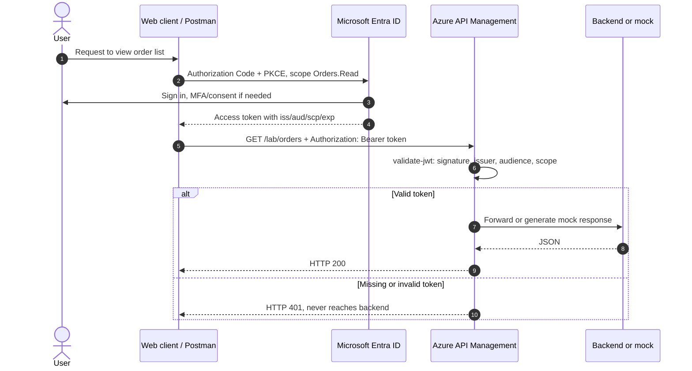
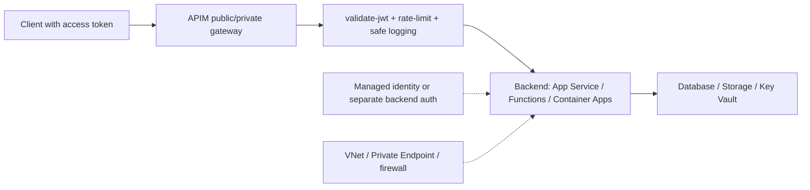
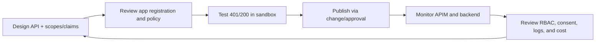

# API Gateway Lab with Microsoft Entra ID and API Management

## 1. Lab Context and Target Outcomes

In the **Architecture and Capstone Labs** chapter of the **CLOUD_PROVIDERS_AZURE** module, we combine subscriptions, resource groups, Microsoft Entra ID, compute services, networking, storage/data, monitoring, security, and cost to build a governable API entry point. An application typically serves many clients: web, mobile, automated jobs, and partner systems. If every backend handles authentication, rate limits, logging, and endpoint publishing differently, security and operations become inconsistent.

**Microsoft Entra ID** serves as the **identity provider**: authenticating users or workloads and issuing OAuth 2.0 access tokens for APIs when clients are authorized. **Azure API Management (APIM)** acts as the **API gateway and management plane**: publishing APIs, routing to backends, and applying policies to validate tokens, throttle traffic, emit telemetry, and transform requests or responses. The backend must still enforce business authorization and protect direct network paths per architecture.

**The lab:** publish `GET /lab/orders` on an APIM gateway; only requests carrying an **access token issued by Entra ID for the right API** with the `Orders.Read` permission receive a JSON response. To focus on authentication mechanics, we start with a **mock response at the gateway**, without needing a database or backend yet. Afterward, learners explore replacing the mock with a secured real backend.

By the end, you should produce the following evidence:

1. **Two app registrations** in the same Entra ID tenant: one representing the API and one representing the client using Authorization Code + PKCE.
2. **An API scope** `Orders.Read` exposed and granted with proper permission/consent to the client.
3. **An API and operation** in Azure API Management with a `validate-jwt` policy verifying tokens before returning the mock response.
4. Tests distinguishing **401 when missing a token**, **401 when the token or scope is invalid**, and **200 with a valid token**.
5. OAuth flow diagram, administrative RBAC breakdown, and plans for monitoring, backend hardening, cost control, and environment cleanup.

**Scope:** Azure public cloud, a single tenant, and an authorized sandbox subscription. Resource names, hosts, IDs, and sample JSON are illustrative. Never put tokens, secrets, or real customer data into exercise reports.

## 2. End-to-End Architecture: Identity, Gateway, and Backend



There are three distinct security boundaries:

| Boundary | Mechanism | Does NOT mean… |
| --- | --- | --- |
| **User/client → Entra ID** | OAuth 2.0/OpenID Connect, login, consent, tokens | Client can call arbitrary APIs automatically |
| **Client → APIM gateway** | HTTPS, `validate-jwt`, policies, optional subscription key/rate limit | APIM automatically shields the backend from all direct network calls |
| **APIM → backend** | TLS, private networking, managed identity/mTLS, or backend auth | Backend can blindly trust all network traffic just because APIM checks JWTs |

**Authentication** answers "who is the client/user?"; **authorization** answers "what are they permitted to do?". An access token with a valid signature that lacks `Orders.Read` is still **insufficient** to invoke the lab operation.

### 2.1. Terms You Must Distinguish

| Term | Meaning in this lesson |
| --- | --- |
| **Tenant ID** | Identifier of the Entra ID directory issuing/validating tokens |
| **API app registration** | Defines the API resource, Application (client) ID, App ID URI, exposed scopes/app roles |
| **Client app registration** | Represents the app requesting access tokens to call the API |
| **Delegated permission** | Permission acting on behalf of a user, typically in the access token's `scp` claim |
| **Application permission / app role** | Permission granted to a workload in client-credentials flows, typically in `roles` |
| **Access token** | Token consumed by the **resource API** to make authorization decisions; `aud` targets the API |
| **ID token** | Token telling the client about the user's sign-in; **never use instead of an access token** to call APIs |
| **Issuer (`iss`)** | Token issuer, determined by tenant and token version |
| **Audience (`aud`)** | Target API/resource authorized to accept the token |
| **Expiration (`exp`)** | Token expiry timestamp; expired tokens must be rejected |
| **APIM subscription key** | APIM product/subscription key for consumer/quota tracking; **does not replace OAuth access tokens** |
| **Azure RBAC** | Permissions to manage Azure resources like APIM service/API/policies; separate from calling `GET /orders` |

## 3. Preparing Subscription, Resources, and Permissions

### 3.1. Resources and Assumptions

| Component | Illustrative name | Notes |
| --- | --- | --- |
| Microsoft Entra ID tenant | `TENANT_ID_GUID` | Use a **specific tenant**, not `common`, for a single-tenant lab |
| Sandbox subscription | `SUBSCRIPTION_ID_GUID` | Organization-assigned; never use production |
| Resource group | `rg-apim-identity-lab` | Dedicated solely to this exercise |
| API Management service | `apim-orders-lab-unique` | Valid, available name; gateway host comes from the live service |
| APIM API | `Orders Lab API` | API URL suffix `lab` |
| Operation | `GET /orders` | Expected full path `/lab/orders` |
| API app registration | `orders-api-lab` | Exposes scope `Orders.Read` |
| Client app registration | `orders-client-lab` | Public/native client for PKCE in this lab |
| Backend | Mock JSON in APIM | No database or public backend required |
| Test tool | Postman or equivalent OAuth client | Obtains token via Authorization Code + PKCE |

**Cost:** Azure API Management typically bills by tier, time, and usage depending on the offer. Never assume the service is free. Check SKUs, regions, and pricing in the Azure Pricing Calculator/Portal first; use an organization-approved sandbox tier, set a budget, and delete resources cleanly when finished.

### 3.2. Who Needs Which Permissions?

- Creating the resource group/APIM requires appropriate **Azure RBAC** on the subscription/RG; importing APIs, operations, and policies requires APIM management permissions.
- Creating **app registrations** requires tenant permission to register applications; if restricted, work with an Entra administrator.
- Granting **admin consent** for delegated or application permissions may require an admin under tenant policy; never bypass authorized approvers.
- The test client only needs a user account allowed to sign in and obtain delegated tokens—it does not need Contributor on the Azure subscription.
- Anyone who can edit APIM policies can alter API protection; grant narrow admin roles, review policies, and retain change history.

**Note:** Microsoft Entra app registrations and Azure Resource Manager APIM services live in **two separate authorization systems**. Contributor on a resource group does not automatically grant permission to register Entra apps or grant tenant-wide consent.

## 4. Designing OAuth and Token Selection

### 4.1. Why Choose Authorization Code + PKCE?

For interactive web/mobile apps or Postman, **Authorization Code + PKCE** lets the client request an access token on behalf of a user **without embedding a client secret in a public app**. Flow:

1. Client redirects the user to the Entra authorization endpoint with client ID, redirect URI, scope, and PKCE challenge.
2. User signs in and completes consent if prompted.
3. Entra redirects back with an authorization code to the registered redirect URI.
4. Client exchanges the authorization code + PKCE verifier for an access token.
5. Client calls APIM with HTTP header `Authorization: Bearer ...`.

This is a **delegated** flow: both user and client permissions apply. Real systems often also inspect claims such as `tid`, `oid`, `azp`, groups/roles, and per-order business authorization. This lab checks a single scope to illustrate the gateway boundary.

### 4.2. Never Mix Token Types

- An **access token for Microsoft Graph** targets Graph as its audience, so it **must not work** against the Orders API even though the same Entra tenant issued it.
- An **ID token** never authorizes access to the Orders API, even after a valid user login.
- An **access token for the Orders API** needs the matching audience, issuer/tenant, signature, and `scp` claim containing `Orders.Read`.
- Access tokens **v1.0** and **v2.0** differ in issuer/audience/claims. The sample policy in Section 8 targets **v2 access tokens for the lab API**; supporting v1 or multi-tenant requires an explicitly designed and tested policy, never relaxed checks.

### 4.3. Delegated vs. Service-to-Service Flows

| Flow | Authenticated subject | Typical permission checked | In this lab |
| --- | --- | --- | --- |
| Authorization Code + PKCE | User + client app | `scp=Orders.Read` | **Yes**, sample policy requires `scp` |
| Client Credentials | Service principal / app | `roles` (app roles) when defined and granted | Not used in sample policy |
| On-Behalf-Of | Backend calling downstream API for user | Target API permissions and audience | Discussed architecturally, not built |
| Managed identity from Azure workload | Secretless Azure workload | Resource access token and assigned app roles | Extension topic, not for public client login |

**Never allow client-credentials tokens through a policy requiring `scp` by disabling scope checks.** For app-only calls, define an **app role**, grant admin consent, and build a dedicated `roles` gate for that endpoint/workload.

## 5. Step 1 — Create the Resource Group and API Management

### 5.1. Verify Azure Context

Can be done in Azure Portal or Azure CLI. In Bash with CLI installed:

```bash
az login
az account set --subscription "SUBSCRIPTION_ID_GUID"
az account show \
  --query "{subscription:id,tenant:tenantId,name:name}" \
  --output json
```

Stop if the tenant or subscription is not your sandbox. If you lack permission to create APIM, use an admin-provided sandbox APIM instance—**never request subscription-wide Owner just to run an exercise**.

### 5.2. Create Azure API Management

In Azure Portal:

1. Go to **API Management services → Create**.
2. Choose the sandbox subscription, resource group `rg-apim-identity-lab`, region, organization/contact email, and a valid, globally unique service name.
3. Select a **pricing tier** and features suited to the lab; VNet support, custom domains, diagnostics, scaling, and pricing vary by tier.
4. Review + Create, wait for provisioning to finish, and record the **actual gateway URL** from the APIM service.
5. Record the resource ID, region, SKU, owner, and lab cleanup plan.

**Lab network plan:** use an HTTPS gateway reachable from your test client per your tier's config. If APIM uses private ingress or IP restrictions, run test clients from an allowed network; never open a production public endpoint just to test.

### 5.3. Create the API and Operation Without a Backend

Open the APIM service → **APIs** → add an **HTTP API / Blank API** (wording varies by Portal version):

- Display name: `Orders Lab API`.
- Name/internal ID: `orders-lab`.
- API URL suffix: `lab`.
- Add operation: **GET**, URL template `/orders`, name `List orders`.
- If the wizard requires a backend URL, provide an organization-approved lab placeholder URL; **the mock policy in Section 8 returns a response before calling any backend**.
- For this lab API specifically, set **Subscription required = false** if allowed by organization policy/tier so testing stays focused on JWTs. Production often combines subscription keys and OAuth, which are separate layers.

**Do not confuse endpoints:** API URL suffix `lab` + operation path `/orders` produces `https://YOUR_APIM_GATEWAY_HOST/lab/orders`. Always take the gateway hostname from the live service rather than guessing from the resource group.

## 6. Step 2 — Register the Orders API in Microsoft Entra ID

### 6.1. Create the API App Registration

In Microsoft Entra admin center or Azure Portal → **Microsoft Entra ID → App registrations → New registration**:

1. Name: `orders-api-lab`.
2. Supported account types: select **Accounts in this organizational directory only** (single tenant) for this lab.
3. Redirect URI: an API resource needs no redirect URI just to receive access tokens.
4. Create and record the API's **Application (client) ID** and **Directory (tenant) ID**. Do not confuse this with the **Object ID** of the enterprise application / service principal.

Next, open **Expose an API**:

1. Set the **Application ID URI** to a Portal-accepted value, e.g., `api://API_APP_CLIENT_ID_GUID`.
2. Select **Add a scope**:
   - Scope name: `Orders.Read`.
   - Who can consent: per organizational policy (typically admins for sensitive data).
   - Admin consent display name: `Read orders from lab API`.
   - State: **Enabled**.
3. Save the full scope string: `api://API_APP_CLIENT_ID_GUID/Orders.Read`.

**Important:** tokens sent to APIM are issued **for the registered API resource**, not for the APIM service resource or the client app. APIM acts as the gateway validating the token before routing.

### 6.2. Choosing Access Token v2 and Audience

This lab uses Microsoft Entra **v2.0 authorization/token endpoints** and a policy pointing to v2 OpenID configuration. If the tenant/app requires setting the access token version for the API, an admin checks the API app manifest property `api.requestedAccessTokenVersion` and sets it to **v2** per current tooling.

In v2 access tokens issued for custom APIs, `aud` is typically the **API's Application (client) ID GUID**. Some token/resource configurations produce a different audience such as the App ID URI. **Never guess the audience**: inspect the `aud` claim of an actual test token using a trusted local inspection tool, verify token version/issuer, and configure that exact valid value in `validate-jwt`. The sample policy in Section 8 assumes `aud` equals the API app client ID GUID.

**Never paste real tokens into public JWT decoder websites.** You can inspect JWT claims locally, keeping in mind **decoding does not verify the cryptographic signature**. Only a validation policy checking keys, issuer, and audience enforces trust.

## 7. Step 3 — Create the Client App and Grant Delegated Permission

### 7.1. Create the Client App Registration

Create a second app registration:

- Name: `orders-client-lab`.
- Supported account types: single tenant.
- Redirect URI: choose **Mobile and desktop applications / public client** (or the platform type matching your approved OAuth test tool) with the **exact callback URL provided by the tool**.
- Do not create or embed a client secret for a public client.
- Record the client app's **Client Application ID**, distinct from the API's Application ID.

Under **API permissions → Add a permission → My APIs**, choose `orders-api-lab` and **Delegated: Orders.Read**. Save; if the tenant requires admin consent, ask an authorized admin rather than bypassing procedures.

### 7.2. Analyzing Permissions and Consent

Even after adding delegated permissions to the client app, token issuance still depends on:

- Whether the user account is permitted to sign in / assigned to the app per tenant policy.
- Whether the required consent (user or admin) has been granted.
- Whether the client requests the exact **scope**, tenant, redirect URI, and OAuth flow.
- Whether the API enforces additional business authorization rules.

If consent is missing, Entra returns errors such as `consent_required` / `interaction_required` or shows a consent prompt; **never "fix" this by disabling API validation**.

### 7.3. Values Summary Table

| Value | Where to get it | Purpose |
| --- | --- | --- |
| `TENANT_ID_GUID` | Entra tenant Overview | Metadata / OAuth endpoints |
| `API_APP_CLIENT_ID_GUID` | API app registration Overview | Audience of v2 access tokens in lab |
| `API_APP_ID_URI` | Expose an API | Scope prefix, e.g., `api://...` |
| `CLIENT_APP_ID_GUID` | Client app registration Overview | OAuth client ID |
| `CLIENT_REDIRECT_URI` | Client app Authentication | Callback URI used for PKCE |
| `ORDERS_READ_SCOPE` | Expose an API | `api://API_APP_CLIENT_ID_GUID/Orders.Read` |
| `APIM_GATEWAY_HOST` | APIM Gateway URL | Target for `GET /lab/orders` |

These are identifiers/configurations for the lab, not secret credentials. Still, internal reports reveal architectural details, so manage viewing access appropriately.

## 8. Step 4 — Configure API Management `validate-jwt` and Mock Response

### 8.1. Operation-Level Policy

In APIM → **APIs → Orders Lab API → GET /orders → Inbound processing / Code editor** (menu names vary by Portal), add a policy validating tokens before returning data. The sample uses a **specific tenant**, the API app ID audience, and delegated scope `Orders.Read`:

```xml
<policies>
  <inbound>
    <base />
    <validate-jwt
      header-name="Authorization"
      require-scheme="Bearer"
      require-signed-tokens="true"
      require-expiration-time="true"
      failed-validation-httpcode="401"
      failed-validation-error-message="Unauthorized">
      <openid-config
        url="https://login.microsoftonline.com/TENANT_ID_GUID/v2.0/.well-known/openid-configuration" />
      <audiences>
        <audience>API_APP_CLIENT_ID_GUID</audience>
      </audiences>
      <required-claims>
        <claim name="scp" match="any" separator=" ">
          <value>Orders.Read</value>
        </claim>
      </required-claims>
    </validate-jwt>

    <!-- Mock only: the request does not reach any backend. -->
    <return-response>
      <set-status code="200" reason="OK" />
      <set-header name="Content-Type" exists-action="override">
        <value>application/json; charset=utf-8</value>
      </set-header>
      <set-header name="Cache-Control" exists-action="override">
        <value>no-store</value>
      </set-header>
      <set-body>{"orders":[{"id":"demo-001","status":"ready"}]}</set-body>
    </return-response>
  </inbound>
  <backend>
    <base />
  </backend>
  <outbound>
    <base />
  </outbound>
  <on-error>
    <base />
  </on-error>
</policies>
```

**Replace both placeholders in the XML accurately:** `TENANT_ID_GUID` and `API_APP_CLIENT_ID_GUID`. Never leave `<` or `>` characters inside XML attributes, as that breaks XML syntax. If live tokens legitimately carry a different verified `aud` value, update the audience accordingly and re-test; never add unrelated audiences just to silence errors.

### 8.2. What Does the Policy Enforce?

| Check | Policy element | Meaning |
| --- | --- | --- |
| Bearer token present | `header-name=Authorization`, `require-scheme=Bearer` | Rejects requests lacking a Bearer Authorization header |
| Signed token | `require-signed-tokens=true` | Rejects unsigned JWTs |
| Token expiration | `require-expiration-time=true` and expiry check | Rejects expired tokens |
| Tenant issuer/keys | `openid-config` from tenant Entra v2 metadata | Gateway fetches metadata and signing keys to validate |
| Correct target API | `audiences` | Tokens issued for other APIs are rejected |
| Order read permission | `required-claims` checking `scp=Orders.Read` | Delegated tokens missing the scope are rejected |
| Learning mock | `return-response` | Returns JSON only after passing the JWT gate |

Using tenant-specific OpenID configuration lets APIM fetch, cache, and refresh signing keys per service behavior. Avoid hardcoding signing keys manually when trusted metadata is supported. **Never** disable `validate-jwt` during backend outages: doing so turns an operational incident into an authentication vulnerability.

**Default behavior of the example:** when `validate-jwt` fails for missing token, bad signature, wrong issuer, wrong audience, expired token, or missing scope, the gateway returns **401** because `failed-validation-httpcode="401"`. Returning **403 Forbidden** for insufficient scope can be valid in custom authorization designs, but **this sample intentionally uses 401 for all `validate-jwt` failures**. Do not document 403 as the expected output for missing scope under this exact policy.

### 8.3. Policy Scopes and Execution Order

APIM policies operate at global, product, API, and operation scopes, inherited via `<base />`. In the lab, attach it to **operation `GET /orders`** to avoid affecting other APIs. In production, teams often place baseline validation at API/product/global scope so operations cannot accidentally be left unprotected.

**What to verify:** higher-scope policies or mandatory subscription keys can reject requests **before** or independently of the operation's JWT gate. To isolate JWT testing in the lab, verify inherited policies and confirm `Subscription required` matches Section 5. When expanding to production, review inherited policies like rate limits, CORS, IP restrictions, and diagnostics.

`return-response` short-circuits execution and **never calls the backend**. Never treat a 200 mock response as evidence that a real backend is secured or healthy.

## 9. Step 5 — Obtain a Delegated Access Token via Postman/PKCE

### 9.1. OAuth 2.0 Configuration

Use Postman or another organization-approved OAuth client. In a new request, select **Authorization → OAuth 2.0** with equivalent settings:

| Field | Value |
| --- | --- |
| Grant Type | **Authorization Code (with PKCE)** |
| Auth URL | `https://login.microsoftonline.com/TENANT_ID_GUID/oauth2/v2.0/authorize` |
| Access Token URL | `https://login.microsoftonline.com/TENANT_ID_GUID/oauth2/v2.0/token` |
| Client ID | `CLIENT_APP_ID_GUID` |
| Client Secret | **Leave blank** for a public client using PKCE |
| Code Challenge Method | `S256` |
| Scope | `api://API_APP_CLIENT_ID_GUID/Orders.Read`; add `openid profile` only if the client also needs sign-in profile info |
| Callback / Redirect URL | **Exact match** to the redirect URI registered on the client app |
| Client Authentication | Option matching **public client without secret** |

Field labels vary across Postman versions. Click **Get New Access Token**, sign in with an approved lab account, and complete consent per tenant rules. Pass the returned **access token** to API requests—never an ID token or a token for another resource.

### 9.2. Inspect Claims Before Calling the Gateway

Inspect the access token with a trusted **local** tool; never paste live tokens into public websites. Illustrative payload:

```json
{
  "ver": "2.0",
  "iss": "https://login.microsoftonline.com/TENANT_ID_GUID/v2.0",
  "aud": "API_APP_CLIENT_ID_GUID",
  "tid": "TENANT_ID_GUID",
  "scp": "Orders.Read",
  "azp": "CLIENT_APP_ID_GUID",
  "oid": "USER_OBJECT_ID_GUID",
  "exp": 1893456000
}
```

This is merely an **example claim set**, not a real or signed access token. Valid tokens can include extra claims or formatting differences. Verify version, audience, tenant, scope, and expiration locally, then let APIM cryptographically verify signature, issuer, and claims. The `scp` claim can be a space-separated list of scopes; Section 8's policy checks that `Orders.Read` is included.

**Never paste access tokens into logs, chat, Git, or bug reports.** For evidence, record only claim names, redacted non-sensitive values, request IDs, and HTTP statuses—never full JWTs.

## 10. Step 6 — Call the Gateway and Run Positive/Negative Tests

### 10.1. Testing with `curl`

Get the **gateway URL** from your APIM service. Example in Bash:

```bash
APIM_URL="https://YOUR_APIM_GATEWAY_HOST/lab/orders"

# 1. Missing Authorization => expect 401 from validate-jwt.
curl -i "$APIM_URL"

# 2. Invalid token string => expect 401.
curl -i "$APIM_URL" \
  -H "Authorization: Bearer invalid-token"

# 3. Valid delegated token for Orders API with Orders.Read => expect 200.
# ACCESS_TOKEN obtained in session from an approved OAuth tool.
curl -i "$APIM_URL" \
  -H "Authorization: Bearer $ACCESS_TOKEN"
```

**Shell security note:** access tokens are short-lived credentials, yet still sensitive. Avoid putting literal tokens in shell history, do not enable `set -x`, and never share terminals/logs or save tokens in public plaintext files. You can use Postman's or your HTTP client's built-in token handling instead of pasting tokens into a shell.

If the API requires an **APIM subscription key**, requests can fail at a different layer for missing the key; do not mistake that for a JWT error. In the lab, ensure `Subscription required=false` or supply an approved APIM key. Subscription keys **do not replace** bearer tokens.

### 10.2. Test Matrix

| ID | Input condition | Expected result in lab | Evidence |
| --- | --- | --- | --- |
| `API-01` | No `Authorization` header | **401** | Response status and policy scope |
| `API-02` | Malformed / invalid-signature Bearer token | **401** | No mock JSON returned |
| `API-03` | Expired access token | **401** | Test token `exp` claim (do not store token) |
| `API-04` | Token issued by a different tenant | **401** if issuer mismatches tenant | Verified token issuer/metadata |
| `API-05` | Token for Microsoft Graph / another API | **401** due to wrong audience | `aud` claim |
| `API-06` | Token for Orders missing `Orders.Read` | **401** per sample policy | `scp` claim and `required-claims` |
| `API-07` | Valid access token with matching API/scope | **200** with mock JSON | Response and gateway request ID |
| `API-08` | Valid token without APIM key when key required | Potentially **401/403** from subscription/policy layer | Distinguish from JWT failure |
| `API-09` | Real backend down (after removing mock) | Mock 200 cannot certify backend health | Independent backend health/5xx/logs |

Tests involving issuer, scope, or audience should use genuine test tokens issued by your lab environment per approved config; never tamper with signatures or payloads and treat them as valid tokens.

### 10.3. Diagnosing 401 on a Valid Token

Check in order:

1. Is **subscription required** disabled on the lab API? Is an inherited policy blocking the request?
2. Is the request sending `Authorization: Bearer` to the exact gateway hostname and operation path?
3. Is it an **access token**, not an ID token? Does `aud` match the API app?
4. Does the v2 token's `iss` match the specific tenant metadata URL, and is `exp` still in the future?
5. Does `scp` contain `Orders.Read`? Did the client request the right scope and receive consent?
6. Are Entra metadata/JWKS reachable from APIM outbound networking?
7. Was the policy XML saved on the right operation without higher-scope overrides?

Never "fix" this by deleting `audiences`, removing issuer validation, or accepting any signed-in token. A validly signed token **does not prove** it was issued for the receiving API.

## 11. Step 7 — Moving from Mock to a Real Backend

This lab uses `return-response` to avoid provisioning a backend and database. When building a real system:



Upgrade path:

1. Deploy the backend via reviewed IaC/CI/CD with health checks and telemetry. The backend can initially return stub order JSON before wiring a database.
2. Configure the APIM **backend service URL** and remove `return-response`, keeping `validate-jwt` in `<inbound>`.
3. Restrict direct Internet paths to the backend: private networking/Private Endpoints/VNet or tier-supported ingress rules, paired with backend identity checks.
4. For Entra-authenticated backends, consider APIM **managed identity** to acquire a dedicated backend token for the backend's own audience; **avoid blindly forwarding the client's access token to every downstream service** unless designed specifically (e.g., OBO).
5. The backend must still enforce per-user/per-tenant data authorization and order ownership; the gateway only checks coarse API access.
6. Configure retries, timeouts, rate limits/quotas, CORS for browser clients, caching rules for sensitive data, and secure request/response headers.
7. Enable diagnostics, WAF/Front Door if required, separate dev/test/prod, and deploy policy changes under review.

**CORS is not authentication.** CORS tells browsers which cross-origin requests to allow; non-browser clients bypass it completely. Keep enforcing OAuth token validation and backend security.

### 11.1. An API Gateway Does Not Replace Data Authorization

`Orders.Read` only proves the client is allowed to invoke order-reading operations. It does not mean User A may read User B's orders. The backend must enforce **object-level authorization**, tenant isolation, ownership checks, and auditing to prevent IDOR/BOLA vulnerabilities. In multi-tenant models, issuer/audience/tenant validation and claim mapping are more complex than a single-tenant lab.

## 12. Azure RBAC and Release Pipeline Security

### 12.1. Independent Roles

| Role | Required permissions | NOT automatically granted |
| --- | --- | --- |
| Entra app administrator | Create/configure app registrations/API scopes, manage consent per policy | Default Azure APIM Contributor |
| APIM administrator/deployer | Manage APIM service/APIs/operations/policies at scope | Tenant app registration rights |
| Client test user | Sign in, consent/use delegated `Orders.Read` | Azure RBAC on the resource group |
| Backend workload identity | Call DB/Key Vault/Storage per data-plane roles | Permissions merely because the gateway verified the caller |
| Security reviewer | Review token validation, logs, policies, app threat model | Broad write access in Azure |

### 12.2. Production Rules

- Store APIM policies, OpenAPI/API definitions, backend configs, and key settings in **version control**; test policies in non-production before publishing.
- Never place client secrets, subscription keys, signing keys, or bearer tokens in policy XML, pipeline YAML, or public reports. Use Key Vault-backed named values where supported with tight RBAC.
- Restrict who can edit policies; anyone who can remove `validate-jwt` can expose the API. Protect branches, pipelines, approvals, and global/API/operation policy changes.
- Enforce **tenant-specific issuers**, strict audiences, signature validation, and appropriate `scp`/`roles` checks. Never use `common` metadata for a single-tenant setup without explicit issuer validation logic.
- Enforce TLS/HTTPS, never pass tokens in query strings, and protect refresh tokens in clients per OAuth best practices.
- Separate client app permissions from human accounts under least privilege; apply Conditional Access, MFA, consent governance, and app registration lifecycle reviews.
- When multiple clients share the same scope yet only select clients should call an API, also validate **authorized client** (`azp`) claims or service controls rather than relying on `scp` alone.

## 13. Observability, Alerting, and Cost Control

### 13.1. Operational Telemetry to Collect

Once policies are active, configure APIM diagnostics / Azure Monitor per tier and policy to observe:

| Metric / event | Question | Suggested alert |
| --- | --- | --- |
| `401` by API/operation | Wrong audience, issuer, expired token, missing consent, or client bug? | Sudden spike in 401s above baseline |
| `403` if custom authz exists | Valid token lacking required privileges? | Spike after policy release |
| `429` / throttling | Clients exceeding rate limits/quotas? | Sustained requests hitting limits |
| `5xx` and backend latency | Gateway or backend failing? | Error rate / latency breaching SLO |
| Request count and bandwidth | Traffic outgrowing tier capacity? | Capacity / cost forecasting |
| Policy deployment / audit | Who modified `validate-jwt`, audience, or issuer? | Unapproved policy changes |

**Protect monitoring data:** never log full `Authorization` headers, client secrets, subscription keys, cookies, or live order payloads. Apply retention, access controls, and masking to logs. Seeing APIM return 401 does not by itself prove JWT failure; inspect sanitized diagnostics and policy execution order.

### 13.2. APIM and Dependency Costs

APIM pricing varies by tier, region, runtime hours, capacity/operations, and request volume depending on the model. Additional costs can come from:

- Log Analytics, Application Insights, and diagnostic ingestion/retention.
- Backend App Service / Functions / Container Apps plus databases and storage.
- Networking, private endpoints, Front Door/WAF, egress, custom domains/certificates.
- Security services, secret management, and related operational overhead.

Before provisioning APIM, use the **Pricing Calculator** and sandbox rules to select an appropriate tier, configure a **Cost Management Budget** at the supported subscription/RG scope, and set alerts. Budgets **alert only**—they are not hard spending caps that stop charges.

### 13.3. Improvement Cycle



## 14. Common Troubleshooting

| Symptom | Possible cause | Remediation |
| --- | --- | --- |
| Entra reports `redirect_uri_mismatch` | Client redirect URI differs from OAuth tool callback | Match URI and type exactly; keep PKCE enabled |
| Entra reports `invalid_scope` | API scope not created/enabled or client requests wrong URI | Check Expose an API and API permissions |
| `consent_required` or admin approval needed | Consent not granted per tenant policy | Request admin approval; never substitute another API's token |
| APIM returns 401 when token missing | `validate-jwt` policy is working | Verify test `API-01` passed |
| APIM returns 401 with token present | Wrong `aud`, `iss`, `scp`, v1/v2 mismatch, or expired | Compare claims against metadata/policy; never disable validator |
| APIM returns 401 when APIM key required | Subscription required / product setting or inherited policy | Separate gateway subscription key errors from OAuth |
| APIM returns 404 | Wrong gateway hostname, URL suffix, or operation path | Inspect APIs/operations and exact URL |
| APIM reports policy XML error | Placeholder unreplaced, malformed XML, or wrong scope | Check policy editor validation and XML syntax |
| Cannot fetch signing keys from Entra | Wrong metadata URL or outbound network/TLS block | Check tenant endpoint and APIM outbound connectivity |
| Valid token accesses another API | Policy only on one operation/API; other endpoints unprotected | Inspect effective policy across all operations |
| After removing mock, backend returns 500/502/504 | URL, DNS, backend auth, private networking, or timeout | Inspect backend health, APIM diagnostics, and networking |
| Costs rise despite low traffic | APIM tier, reserved capacity, or auxiliary resources | Review Cost Analysis by service/meter, budget, and uptime |

**Triage sequence:** isolate failures across **Entra token issuance**, **gateway/operation routing**, **`validate-jwt` claims**, **APIM subscription/network**, or **backend**. Never assume every 401 shares a single root cause.

## 15. Team Lab Exercise and Acceptance Criteria

### 15.1. Assignment Brief

An e-commerce development team needs to publish an order list through an API gateway. Internal users must sign in via Entra ID, request `Orders.Read`, and call the gateway. Requests without a token or with an invalid token must not receive JSON. The platform team must provide evidence of administrative RBAC and budgeting, while a real backend stays out of scope for the lab.

### 15.2. Execution Steps

1. Provision or use an approved sandbox APIM instance in a dedicated RG with a budget-aligned tier.
2. Register `orders-api-lab` as single-tenant, set its App ID URI, and create delegated scope `Orders.Read`.
3. Register `orders-client-lab` as a public client, add the OAuth tool's redirect URI, and add the delegated permission.
4. Acquire a token via Authorization Code + PKCE and inspect claims locally; omit the token from reports.
5. Create an API with URL suffix `lab` and operation `GET /orders` in APIM.
6. Apply Section 8's XML policy with the **real tenant ID and audience** using the mock response—no backend needed.
7. Run tests `API-01` through `API-07`; distinguish missing token, wrong audience, missing scope, and valid token.
8. Check inherited policies / subscription required; if outcomes differ from expectations, diagnose before editing.
9. Verify Azure RBAC, app registration permissions, consent, token-safe logging, and budgets.
10. Save evidence, clean up resources, and revoke temporary permissions/registrations per policy.

### 15.3. Grading Matrix

| Area | Pass criteria | Evidence |
| --- | --- | --- |
| Entra resource API | Single tenant; `Orders.Read` scope enabled | API App ID URI and scope name |
| Entra client | Public client PKCE + right delegated permission | Client ID, redirect URI, consent status |
| APIM API | `GET /lab/orders` exists | Operation URL and policy scope |
| Token validation | Signature/issuer/audience/exp/scope checked | Policy XML and code review |
| Negative tests | Missing/invalid tokens return 401 without exposing mock JSON | HTTP statuses and test IDs |
| Positive test | Valid token returns 200 mock JSON | Status/response free of tokens |
| Azure RBAC | Admin rights separated from API calling rights | Role assignments + review |
| Operations | Monitoring/alerting planned with zero secret logging | Dashboard/diagnostic config |
| Cost/cleanup | Cost owner and lab teardown plan documented | Budget/Cost Analysis and cleanup inventory |

**Minimum credential-free evidence:** permitted internal identifiers (tenant/API/client IDs), scope name, APIM resource/operation IDs, consent state, sanitized policy XML, HTTP statuses, and cleanup results. Never submit JWTs, client secrets, subscription keys, refresh tokens, or real user identities.

## 16. Safe Lab Environment Cleanup

An APIM service can continue accruing charges until deleted or managed per policy. Before deleting:

1. Confirm the APIM service/RG is **lab-only**, hosting no APIs or products shared with other teams.
2. Archive permitted evidence and confirm no test backends or data need retention.
3. If APIM resides in a dedicated RG with owner approval, delete the service/RG per Azure process; deleting an RG **destroys all resources inside it**.
4. In Entra ID, delete app registrations/service principals **only when certain they were created solely for the lab**; deleting an app breaks active clients/permissions.
5. Revoke temporary consents, role assignments, access, or temporary keys/webhooks per approved procedures.
6. Check Cost Management after ingestion lag to ensure no lingering charges remain; budgets or resources in external scopes may require separate cleanup.

A **read-only** Azure inventory check before cleanup:

```bash
az resource list \
  --resource-group "rg-apim-identity-lab" \
  --query "[].{name:name,type:type,id:id}" \
  --output table
```

**Never run an entire-RG delete command in this lesson without inventorying and confirming ownership.** Verify the APIM service is not serving anyone else's APIs and the app registrations are not reused outside the lab.

## 17. Self-Check Questions

**1. Do Microsoft Entra ID and API Management perform the same job?**  
No. Entra ID authenticates and issues tokens; APIM acts as the API gateway enforcing token validation, traffic policies, and routing. The backend still remains responsible for data-level authorization.

**2. Why not use an ID token instead of an access token to call an API?**  
An ID token tells the client who signed in; an access token targets a specific resource API via audience and granted permissions.

**3. Can a JWT with a valid signature whose `aud` is Microsoft Graph call the Orders API?**  
No. The policy must reject it because it was issued for a different resource.

**4. With Authorization Code + PKCE, which claim typically carries `Orders.Read`?**  
`scp` in the delegated access token. Client credentials uses app roles/`roles`, which requires a different design.

**5. Why does the example return 401 instead of 403 when a token lacks `Orders.Read`?**  
Because `validate-jwt` sets `failed-validation-httpcode=401` for all validation failures. A dedicated authorization policy could return 403, though that is not the default behavior of this sample.

**6. Does disabling "Subscription required" disable JWT validation?**  
No. APIM subscription keys and Entra access tokens are independent mechanisms; the JWT policy still inspects every request.

**7. Does a successful `return-response` prove the database and backend are healthy?**  
No. It returns a mock directly at the gateway without forwarding to any backend. Once the mock is removed, test backend auth, networking, SLOs, and data authorization separately.

**8. Should any user holding `Orders.Read` be able to read every user's orders?**  
No. The backend must enforce ownership, tenant, and object-level authorization rather than treating a broad API scope as permission to read all records.

**9. Does an APIM budget automatically stop billing when the threshold is reached?**  
No. Azure Cost Management Budgets send alerts per configuration; they are not hard spending caps.

**10. Why are APIM service RBAC and client app permissions separate?**  
Azure RBAC governs management of APIM resources; Entra delegated/application permissions authorize a client to request tokens for a resource API. Both must be configured properly at their respective layers.

## 18. Official Documentation to Cross-Check

- Microsoft Learn — **Microsoft identity platform OAuth 2.0 authorization code flow** and **PKCE**.
- Microsoft Learn — **Expose a web API**, **Configure an app to access a web API**, and **Scopes and application roles**.
- Microsoft Learn — **Access tokens in the Microsoft identity platform**, **Token validation**, and **App registration manifest**.
- Microsoft Learn — **Azure API Management overview**, **Create an HTTP API**, and **Configure API/operation policies**.
- Microsoft Learn — **API Management `validate-jwt` policy**, **Policy expressions**, **API subscription keys**, and **Mock API responses**.
- Microsoft Learn — **Azure API Management managed identity for backend authentication** and **Virtual network / private endpoint considerations**.
- Microsoft Learn — **Monitor Azure API Management** and **Azure Cost Management Budgets**.
- Microsoft Learn — **Azure Well-Architected Framework**: Security, Operational Excellence, Reliability, and Cost Optimization.

Portal layouts, manifest property names, APIM tier features, pricing, and OAuth client behaviors evolve over time and across tenants. When working in live Azure, verify against current official documentation for your versions and test using **real access tokens, real audiences/issuers/scopes, effective APIM policies, and live HTTP responses**. An API gateway is truly ready only when authorized users have right-sized access, invalid requests are blocked, and backends/data remain protected independently of the gateway.
