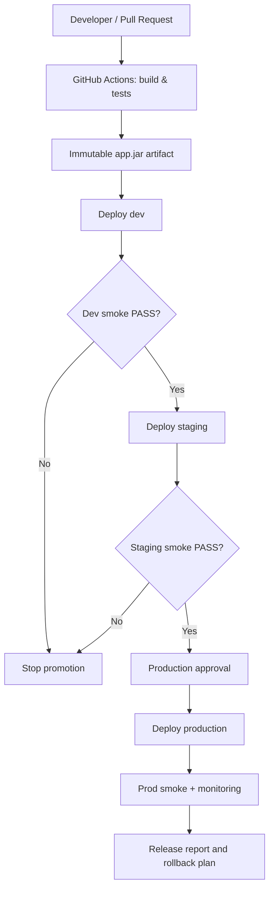
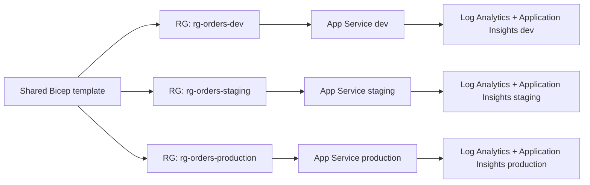
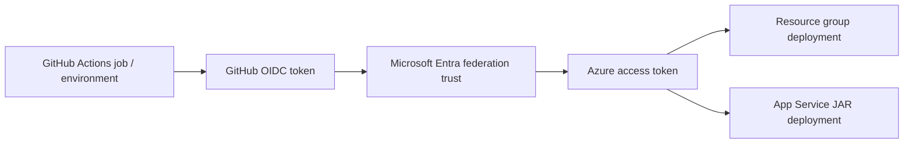

# IaC Pipeline and Multi-Environment Application Deployment Lab

## 1. Capstone Problem: One Application, Three Environments, One Reliable Process

The **Orders API** development team currently deploys manually to Microsoft Azure. One developer creates the dev App Service in the Portal, another picks a different SKU for staging, and production ends up with undocumented network and monitoring settings. Whenever a new Java build is released, the team uploads the JAR to each environment and tries to remember every verification step. Once, staging worked fine while production failed due to a missing application setting.

This lab builds an **Infrastructure as Code (IaC) and multi-environment application deployment pipeline**: infrastructure is declared in **Azure Bicep**, the sample app is **Spring Boot Java 21**, and **GitHub Actions** uses Microsoft Entra workload identity federation (OIDC) to sign in to Azure. A single built and tested artifact promotes sequentially across `dev → staging → production`; each environment has its own configuration, permissions, and approval gates.

This lesson sits in the **Architecture and Capstone Labs** chapter, connecting Azure topics from subscriptions, resource groups, Microsoft Entra ID, networking, compute, storage, and data to deployment, monitoring, security, and cost control. We focus on **architecture, IaC code, CI/CD workflows, verification, and runbooks** rather than executing changes on the learner's subscription.

### Deliverables

1. A Spring Boot application exposing `GET /api/hello` and `/actuator/health`, returning the environment name and release identifier.
2. A Bicep template provisioning a Linux App Service plan, a Web App with managed identity, a Log Analytics workspace, and Application Insights.
3. Parameter sets for `dev`, `staging`, and `production` differing only in configuration data—never duplicating three infrastructure templates.
4. A pipeline that builds and tests **once**, outputs an immutable `app.jar` artifact, and promotes that exact artifact through all three environments.
5. A deployment workflow using least-privilege OIDC, running `validate`, `what-if`, `create`, JAR deploy, and smoke tests.
6. GitHub Environments isolating configs/permissions and **requiring production reviews** when properly protected.
7. Verification, drift handling, rollback, and controlled lab cleanup runbooks.

### Learning Objectives

After this lesson, you can explain the differences among CI, CD, IaC, and GitOps; design isolation and promotion across environments; spot drift and secret leakage; read deployment diffs before applying changes; verify releases at both infrastructure and application layers; and distinguish code rollback from schema/data rollback.

> **Boundaries:** API versions, runtimes, Azure SKUs, and GitHub Actions versions below are **examples for learning**. Before running live, verify current support in official documentation/tooling, pin actions to approved commit SHAs, and evaluate service pricing. Do not automatically provision Azure resources, grant roles, or run destructive commands while reading.

## 2. Foundational Concepts

| Concept | Role | Output |
| --- | --- | --- |
| **IaC** | Declares desired state of Azure resources in code | Bicep/ARM templates, parameter files |
| **CI (Continuous Integration)** | Builds, unit tests, and checks quality on every change | Versioned artifact and test evidence |
| **CD (Continuous Delivery/Deployment)** | Promotes verified artifacts across environments with policies/gates | Deployed release and logs |
| **Pipeline** | Repeatable set of jobs/steps and dependencies | Workflow run with status |
| **Environment** | Deployment space with dedicated resources, permissions, data, and policies | `dev`, `staging`, `production` |
| **Promotion** | Advancing the exact same artifact to the next environment after passing gates | Matching checksum / build ID |
| **Drift** | Live Azure state diverges from IaC declaration | `what-if` diffs, audit reports |
| **Immutable artifact** | Build output untouched after verification | `app.jar` + commit/digest |
| **Idempotent deployment** | Applying the same declaration repeatedly creates no unintended duplicates | ARM incremental deployment converges on config |
| **Rollback** | Restoring a known-good version while accounting for infra/data state | Verified release state |

Do not confuse **Continuous Delivery** (always releasable, may require manual approval) with **Continuous Deployment** (auto-deploys to production when checks pass). This lesson uses **delivery with a production approval gate**.

### Why Not Build Environments by Clicking in the Portal?

Manual clicks are easily forgotten or misrecorded. IaC enables code review, reproducible configuration, Git commit traceability, and pre-deploy previews. However, IaC does not make a system automatically safe: templates can grant bad permissions, pick wrong regions, trigger data deletion, or leak secrets in deployment history. Reviews, policies, tests, and rollback plans remain essential.

## 3. Deployment Architecture and Lab Scope



Each environment has its own resource group:



**Lab design:** resource groups are **pre-bootstrapped** by a platform owner in a lab subscription or across separate subscriptions if available. The pipeline deploys resources only within its permitted resource group. For real production, consider a **dedicated production subscription**, Azure Policy/RBAC/tags, network restrictions, and data residency rules.

### Target Configuration Matrix

| Attribute | Dev | Staging | Production |
| --- | --- | --- | --- |
| Resource group | `rg-orders-dev` | `rg-orders-staging` | `rg-orders-production` |
| Sample App Service SKU | B1 | B1 | P1v3 |
| Sample instance count | 1 | 1 | 2 |
| Application setting | `APP_ENVIRONMENT=dev` | `staging` | `production` |
| Monitoring | Dedicated workspace | Dedicated workspace | Dedicated workspace, strict alerts |
| Pipeline permissions | Scoped to dev | Scoped to staging | Scoped to production |
| Deployment gate | CI + smoke | Dev PASS + smoke | Staging PASS + reviewer |
| Data | Synthetic data | Anonymized/sandbox data | Real data, strict access |

SKUs and instance counts are purely illustrative, **not guarantees of availability or default cost**. If your subscription or region lacks `P1v3`, select a suitable SKU after checking quotas, pricing, and availability needs.

## 4. Deciding How to Isolate Environments

A **separate resource group** separates lifecycles, but is not an absolute security boundary. Environments may still share a subscription, tenant, network, and quotas. Evaluate production independently across:

- **Subscription/billing scope:** accountability, quotas, budgets, and admin boundaries.
- **Networking:** VNet/subnets, inbound restrictions, private endpoints, DNS, WAF, and data access.
- **Identity:** per-environment pipeline service principals/workload identities; each web app's runtime managed identity.
- **Secrets:** per-environment secrets in Key Vault—never copy production DB passwords down to dev.
- **Data:** never treat production as a testbed; staging should use synthetic or anonymized data.
- **Monitoring:** alerts, retention, and workspaces scaled to criticality and compliance.
- **Change control:** reviews before production changes, plus runbooks and rollback plans.

GitHub Environment variables **do not isolate Azure by themselves**. If one pipeline principal holds permissions across all resource groups, misconfiguring `AZURE_RESOURCE_GROUP` still impacts the wrong environment. **Azure RBAC and federated identity trust** enforce the real boundary.

## 5. Lab Repository Structure

Create a sample repository `orders-azure-capstone` structured as:

```text
orders-azure-capstone/
├── pom.xml
├── src/main/java/com/example/orders/
│   └── OrdersApplication.java
├── src/main/resources/
│   └── application.yml
├── infra/
│   ├── main.bicep
│   └── parameters/
│       ├── dev.json
│       ├── staging.json
│       └── production.json
└── .github/workflows/
    ├── release.yml
    └── deploy-env.yml
```

These paths represent **files learners create in their own repository**. This lesson contract covers the Markdown guide only; do not create sample project files inside the managed workspace.

### Single Source of Truth Rules

- `infra/main.bicep` holds shared resource structure.
- `infra/parameters/<environment>.json` holds **non-sensitive** per-environment infrastructure differences.
- GitHub Environment variables hold each environment's resource group, web app name, subscription, and identity IDs.
- Secrets are **never** hardcoded in Bicep, JSON parameter files, GitHub Actions logs, or `application.yml`.
- Build the artifact once and reuse it unchanged across all environments.

## 6. Minimal Spring Boot App to Verify Promotion

To keep focus on the pipeline, the app simply returns the environment name and release ID. It **needs no database**; later you can extend it to Azure SQL, Storage, or message queues with separate IaC and tests.

### `pom.xml`

```xml
<?xml version="1.0" encoding="UTF-8"?>
<project xmlns="http://maven.apache.org/POM/4.0.0"
         xmlns:xsi="http://www.w3.org/2001/XMLSchema-instance"
         xsi:schemaLocation="http://maven.apache.org/POM/4.0.0
                             https://maven.apache.org/xsd/maven-4.0.0.xsd">
  <modelVersion>4.0.0</modelVersion>
  <parent>
    <groupId>org.springframework.boot</groupId>
    <artifactId>spring-boot-starter-parent</artifactId>
    <version>3.5.6</version>
    <relativePath/>
  </parent>
  <groupId>com.example</groupId>
  <artifactId>orders-lab</artifactId>
  <version>1.0.0</version>
  <properties>
    <java.version>21</java.version>
  </properties>
  <dependencies>
    <dependency>
      <groupId>org.springframework.boot</groupId>
      <artifactId>spring-boot-starter-web</artifactId>
    </dependency>
    <dependency>
      <groupId>org.springframework.boot</groupId>
      <artifactId>spring-boot-starter-actuator</artifactId>
    </dependency>
    <dependency>
      <groupId>org.springframework.boot</groupId>
      <artifactId>spring-boot-starter-test</artifactId>
      <scope>test</scope>
    </dependency>
  </dependencies>
  <build>
    <finalName>app</finalName>
    <plugins>
      <plugin>
        <groupId>org.springframework.boot</groupId>
        <artifactId>spring-boot-maven-plugin</artifactId>
      </plugin>
    </plugins>
  </build>
</project>
```

The Spring Boot version above is a **sample**; upgrade per current support and security-patch policies. `<finalName>app</finalName>` decouples the pipeline from versioned filenames; production artifacts can attach checksums/tags for traceability.

### `src/main/java/com/example/orders/OrdersApplication.java`

```java
package com.example.orders;

import java.util.Map;
import org.springframework.beans.factory.annotation.Value;
import org.springframework.boot.SpringApplication;
import org.springframework.boot.autoconfigure.SpringBootApplication;
import org.springframework.web.bind.annotation.GetMapping;
import org.springframework.web.bind.annotation.RestController;

@SpringBootApplication
@RestController
public class OrdersApplication {

    @Value("${APP_ENVIRONMENT:local}")
    private String environment;

    @Value("${APP_RELEASE:local}")
    private String release;

    @GetMapping("/api/hello")
    public Map<String, String> hello() {
        return Map.of(
                "service", "orders-lab",
                "environment", environment,
                "release", release);
    }

    public static void main(String[] args) {
        SpringApplication.run(OrdersApplication.class, args);
    }
}
```

The app reads `APP_ENVIRONMENT` and `APP_RELEASE` from environment variables, **never compiling separate JARs per environment**. This embodies **build once, configure at runtime**.

### `src/main/resources/application.yml`

```yaml
server:
  port: ${PORT:8080}

management:
  endpoints:
    web:
      exposure:
        include: health,info
  endpoint:
    health:
      show-details: never
```

`/actuator/health` serves basic HTTP probes. Real apps require authentication/authorization and tailored readiness checks; this public demo exposes no sensitive data, yet **is not a complete production security template**.

### Run Locally

```bash
mvn -B -ntp clean verify
APP_ENVIRONMENT=local APP_RELEASE=dev java -jar target/app.jar

# In another terminal:
curl -fsS http://localhost:8080/api/hello
curl -fsS http://localhost:8080/actuator/health
```

Sample response:

```json
{
  "service": "orders-lab",
  "environment": "local",
  "release": "dev"
}
```

Once deployed to Azure, this exact JAR returns `dev`, `staging`, or `production` based on the Bicep-managed application settings.

## 7. Managing Infrastructure Desired State with Bicep

**Bicep** is a declarative language for Azure Resource Manager (ARM). One template can deploy repeatedly across parameter sets with consistent rules. This lab uses **resource group deployment scope**: the resource group already exists, and the template provisions resources inside it.

### Resource Scope

| Resource | Purpose |
| --- | --- |
| `Microsoft.Web/serverfarms` | Linux compute App Service plan |
| `Microsoft.Web/sites` | Web App running the Java SE / Spring Boot JAR |
| `Microsoft.OperationalInsights/workspaces` | Log Analytics workspace for logs |
| `Microsoft.Insights/components` | Workspace-based Application Insights |
| System-assigned managed identity | Runtime web app identity, extensible to Key Vault / other services |

Azure SQL, Private Endpoints, and role assignments are omitted here to keep the pipeline exercise focused. Adding a database later requires networking, permissions, secrets/identity, and schema migrations under their own runbooks.

## 8. Writing `infra/main.bicep`

```bicep
targetScope = 'resourceGroup'

@allowed([
  'dev'
  'staging'
  'production'
])
param environment string

@description('Web app name must be unique within the applicable App Service namespace.')
param webAppName string

@allowed([
  'B1'
  'S1'
  'P1v3'
])
param planSku string = 'B1'

@minValue(1)
param instanceCount int = 1

@description('Commit SHA of the release artifact.')
param releaseId string = 'unreleased'

param location string = resourceGroup().location

var tags = {
  application: 'orders-lab'
  environment: environment
  managedBy: 'bicep'
}

resource plan 'Microsoft.Web/serverfarms@2023-12-01' = {
  name: 'asp-orders-${environment}'
  location: location
  kind: 'linux'
  tags: tags
  sku: {
    name: planSku
    capacity: instanceCount
  }
  properties: {
    reserved: true
  }
}

resource workspace 'Microsoft.OperationalInsights/workspaces@2022-10-01' = {
  name: 'law-orders-${environment}'
  location: location
  tags: tags
  properties: {
    sku: {
      name: 'PerGB2018'
    }
    retentionInDays: 30
  }
}

resource insights 'Microsoft.Insights/components@2020-02-02' = {
  name: 'appi-orders-${environment}'
  location: location
  kind: 'web'
  tags: tags
  properties: {
    Application_Type: 'web'
    WorkspaceResourceId: workspace.id
  }
}

resource webApp 'Microsoft.Web/sites@2023-12-01' = {
  name: webAppName
  location: location
  kind: 'app,linux'
  tags: tags
  identity: {
    type: 'SystemAssigned'
  }
  properties: {
    serverFarmId: plan.id
    httpsOnly: true
    siteConfig: {
      linuxFxVersion: 'JAVA|21-java21'
      alwaysOn: true
      ftpsState: 'Disabled'
      minTlsVersion: '1.2'
      appSettings: [
        {
          name: 'APP_ENVIRONMENT'
          value: environment
        }
        {
          name: 'APP_RELEASE'
          value: releaseId
        }
        {
          name: 'APPLICATIONINSIGHTS_CONNECTION_STRING'
          value: insights.properties.ConnectionString
        }
      ]
    }
  }
}

output appResourceId string = webApp.id
output appUrl string = 'https://${webApp.properties.defaultHostName}'
output runtimePrincipalId string = webApp.identity.principalId
```

**What to verify for real usage:**

- `JAVA|21-java21` is an **illustrative runtime value**. Verify with `az webapp list-runtimes --os linux` and update Bicep if the API expects a different runtime string.
- Check resource API versions, regional/SKU availability, quotas, and Linux App Service constraints. Pricing varies.
- `APPLICATIONINSIGHTS_CONNECTION_STRING` **only configures the telemetry endpoint**; the Java app still needs compatible instrumentation/agents to emit full request and dependency traces. Do not assume app telemetry works merely because the Insights resource exists.
- `law-orders-<environment>` must be unique within the required scope; when deploying multiple instances in the same tenant/subscription, add a prefix matching your naming standard.
- `appSettings` in IaC are the **source of truth**: manual edits in the Portal will be overwritten on the next deploy. Manage new settings and secrets via approved mechanisms—never put passwords into Bicep or deployment outputs.
- The web app gets a system-assigned managed identity, **but no Storage/Key Vault roles are granted yet**. The web app's runtime identity is distinct from the **pipeline's OIDC identity**.

### Why `httpsOnly`, `ftpsState`, and `alwaysOn`?

`httpsOnly` enforces HTTPS; `ftpsState: 'Disabled'` eliminates unneeded FTP/FTPS attack surface; `alwaysOn` keeps the app loaded on supported tiers, though it does not replace Health Checks or autoscaling. Check your security policy for minimum TLS version, VNet integration, private inbound, and authentication.

## 9. Separating Parameters per Environment

Create three **ARM deployment parameter JSON** files. They hold zero secrets. `webAppName` and `releaseId` are passed by the workflow at deploy time to keep names unique and releases traceable.

### `infra/parameters/dev.json`

```json
{
  "$schema": "https://schema.management.azure.com/schemas/2019-04-01/deploymentParameters.json#",
  "contentVersion": "1.0.0.0",
  "parameters": {
    "environment": { "value": "dev" },
    "planSku": { "value": "B1" },
    "instanceCount": { "value": 1 }
  }
}
```

### `infra/parameters/staging.json`

```json
{
  "$schema": "https://schema.management.azure.com/schemas/2019-04-01/deploymentParameters.json#",
  "contentVersion": "1.0.0.0",
  "parameters": {
    "environment": { "value": "staging" },
    "planSku": { "value": "B1" },
    "instanceCount": { "value": 1 }
  }
}
```

### `infra/parameters/production.json`

```json
{
  "$schema": "https://schema.management.azure.com/schemas/2019-04-01/deploymentParameters.json#",
  "contentVersion": "1.0.0.0",
  "parameters": {
    "environment": { "value": "production" },
    "planSku": { "value": "P1v3" },
    "instanceCount": { "value": 2 }
  }
}
```

**Key difference:** only **configuration values** vary, never copy-pasted infrastructure code. If you change how App Insights is configured or add a required tag, edit `main.bicep` once and let the pipeline verify impact across all three environments.

In this example, each environment lives in a **separate resource group**, so `asp-orders-dev`, `asp-orders-staging`, and `asp-orders-production` have isolated lifecycles. Across multiple subscriptions or multi-region deployments, parameterize prefixes/names to avoid workspace or global web app name collisions.

## 10. Validating IaC on a Developer Workstation

After installing compatible Azure CLI and Bicep CLI versions, run:

```bash
az bicep version
az bicep build --file infra/main.bicep
```

`build` checks Bicep syntax and types and compiles ARM JSON; it **does not validate live policies, quotas, or dependencies**.

Against an **existing** lab resource group with proper permissions:

```bash
az login
az account set --subscription "<subscription-id>"

RG="rg-orders-dev"
APP="<web-app-name-unique-for-dev>"
SHA="local-validation"

az deployment group validate \
  --resource-group "$RG" \
  --template-file infra/main.bicep \
  --parameters @infra/parameters/dev.json \
  webAppName="$APP" releaseId="$SHA"

az deployment group what-if \
  --resource-group "$RG" \
  --template-file infra/main.bicep \
  --parameters @infra/parameters/dev.json \
  webAppName="$APP" releaseId="$SHA"
```

**`what-if` previews changes**, reporting `Create`, `Modify`, `Delete`, `NoChange`, or cases that cannot be statically resolved. It **executes zero changes**. Even so, never treat a clean `what-if` as an absolute guarantee against side effects: computed properties, provider behavior, permissions, and drift can still cause differences.

### Reading the Diff Table

| `what-if` line | What to review |
| --- | --- |
| `Create App Service plan` | Correct SKU, instance count, region, and cost? |
| `Create Web App` | Correct hostname, runtime, identity, HTTPS? |
| `Modify appSettings` | Will it overwrite manually added production secrets or config? |
| `Modify plan SKU` | Does it change cost, capacity, or Always On support? |
| `Delete resource` | Wrong scope or unintended data loss risk? |
| `NoChange` | Still run artifact smoke tests when releasing new app code |

**Before applying IaC to production, review the diff for the exact config and scope.** Section 15's lab runs `what-if` inside the protected job; a strict production pipeline should split a **standalone preview/plan job before the approval gate**, save the reviewed diff/artifact, and then apply that exact commit and parameter digest after approval. This avoids approving changes blindly.

## 11. GitHub OIDC: Authenticating Pipelines Without Storing Azure Client Secrets

GitHub Actions can request a **short-lived OIDC token** via `permissions: id-token: write`. Microsoft Entra ID verifies the token against a **federated identity credential** configured on an application/service principal or user-assigned managed identity. When subject/issuer/audience match, Azure grants access per that identity's role assignments.



### Recommended Permission Scope

| Environment | Pipeline identity | Azure RBAC scope |
| --- | --- | --- |
| Dev | App registration / identity `gha-orders-dev` | Dev resource group |
| Staging | `gha-orders-staging` | Staging resource group |
| Production | `gha-orders-production` | Production resource group |

In the lab, **Contributor** on the target resource group suffices to create App Service/Log Analytics/Insights and deploy JARs. Production should evaluate tighter built-in or custom roles; **never grant subscription-wide Owner** as a quick fix. Creating role assignments inside Bicep requires separate permissions such as `Role Based Access Control Administrator` at the target scope—it is not included in Contributor.

### Configuring Federation

In Microsoft Entra, create one trusted identity per environment; configure issuer/audience and **subject** matching the GitHub Environment pattern. Common subjects look like:

```text
repo:<github-org>/<github-repo>:environment:dev
repo:<github-org>/<github-repo>:environment:staging
repo:<github-org>/<github-repo>:environment:production
```

**These subjects are templates.** Real values must match exact casing, org/repo name, environment name, and workflow trigger type. Never create wide trusts like `repo:*` or share a production identity across arbitrary branches. Also configure **branch restrictions and required reviewers** on GitHub Environments where supported by your plan/repo.

### Values to Store in GitHub Environments

Create three Environments named exactly `dev`, `staging`, and `production` in the repository. Each Environment defines non-secret **variables**:

```text
AZURE_CLIENT_ID       = <env-identity-client-id>
AZURE_TENANT_ID       = <tenant-id>
AZURE_SUBSCRIPTION_ID = <env-subscription-id>
AZURE_RESOURCE_GROUP  = <existing-env-rg>
AZURE_WEBAPP_NAME     = <unique-env-webapp-name>
```

`AZURE_CLIENT_ID` is a public identifier, **not a client secret**. Store any API keys or connection strings in Azure Key Vault or least-privilege GitHub Environment secrets—never in `vars`, Bicep parameter files, or workflow logs.

## 12. Bootstrapping and Infrastructure Change Permissions

The lab pipeline **does not create resource groups**, avoiding subscription-level resource creation permissions. The platform owner pre-creates each resource group with tags, budgets, policies, quotas, and regions verified:

```bash
# Example run by a platform owner in an approved lab subscription.
az group create --name "rg-orders-dev" --location "southeastasia"
az group create --name "rg-orders-staging" --location "southeastasia"
az group create --name "rg-orders-production" --location "southeastasia"
```

These commands modify Azure; **do not run them blindly while studying**. For full automation, create a separate **bootstrap pipeline** with dedicated scope and approvals to provision resource groups/policies, keeping application pipeline permissions narrow.

### Pre-Release Preflight Checklist

1. RG sits in the right subscription and region, with no environment overlap.
2. Each GitHub Environment's OIDC principal holds permissions strictly on its own RG.
3. Zero secrets in the repo, parameter JSONs, or build artifacts.
4. Azure Policy allows the SKU/region/tags, and quota covers `instanceCount`.
5. App Service Java runtime is verified valid for Linux/region/tier.
6. IaC owner reviewed `what-if`, especially SKU, instance count, and app setting changes.
7. Production environment has configured reviewers and branch restrictions.

## 13. GitHub Actions CI: Build Once and Store the Artifact

Create `.github/workflows/release.yml`. It triggers on pushes to `main` or manual dispatch, calling a **reusable deployment workflow** so deployment logic is never duplicated three times.

```yaml
name: orders-build-and-promote

on:
  push:
    branches: [main]
  workflow_dispatch:

permissions:
  contents: read
  id-token: write

jobs:
  build:
    runs-on: ubuntu-latest
    steps:
      - name: Checkout exact revision
        uses: actions/checkout@v4

      - name: Configure JDK
        uses: actions/setup-java@v4
        with:
          distribution: temurin
          java-version: '21'
          cache: maven

      - name: Unit tests and package
        run: mvn -B -ntp clean verify

      - name: Verify artifact exists
        run: test -s target/app.jar

      - name: Record artifact checksum
        run: sha256sum target/app.jar

      - name: Store build artifact
        uses: actions/upload-artifact@v4
        with:
          name: orders-app
          path: target/app.jar
          if-no-files-found: error
          retention-days: 14

  deploy_dev:
    needs: build
    uses: ./.github/workflows/deploy-env.yml
    with:
      target_environment: dev

  deploy_staging:
    needs: deploy_dev
    uses: ./.github/workflows/deploy-env.yml
    with:
      target_environment: staging

  deploy_production:
    needs: deploy_staging
    uses: ./.github/workflows/deploy-env.yml
    with:
      target_environment: production
```

### Reading the Workflow

- `build` tests and packages **exactly once**. All three deploy jobs download the exact `orders-app` artifact from the **same workflow run**.
- `needs` forces staging to wait for dev PASS, and production to wait for staging PASS. If any job fails, downstream jobs **do not run** by default.
- `permissions: id-token: write` enables OIDC token issuance; it **grants no Azure rights** without federation trust and Azure RBAC.
- The `production` GitHub Environment must have **required reviewers/branch restrictions** configured in Settings. Merely naming `production` in YAML **creates no approval gate**.
- `actions/checkout@v4`, `setup-java@v4`, and other actions use major tags for brevity. **Production must pin actions to verified commit SHAs**, govern updates, and mitigate supply-chain risk.

**Example limitations:** this is a deploy-per-push promotion pipeline without a standalone PR preview job, artifact signing/provenance checks, SAST, dependency/SBOM scanning, or cross-workflow concurrency gates. Production hardening is covered in Sections 18–20; do not treat this lab example as fully production-hardened.

## 14. Reusable Workflow: Validate, What-If, Apply, Deploy, Smoke

Create `.github/workflows/deploy-env.yml`:

```yaml
name: deploy-one-environment

on:
  workflow_call:
    inputs:
      target_environment:
        required: true
        type: string

permissions:
  contents: read
  id-token: write

jobs:
  deploy:
    runs-on: ubuntu-latest
    environment: ${{ inputs.target_environment }}
    concurrency:
      group: orders-${{ inputs.target_environment }}
      cancel-in-progress: false
    env:
      ENVIRONMENT: ${{ inputs.target_environment }}
      RG: ${{ vars.AZURE_RESOURCE_GROUP }}
      APP: ${{ vars.AZURE_WEBAPP_NAME }}

    steps:
      - name: Checkout infrastructure at same commit
        uses: actions/checkout@v4

      - name: Download built JAR
        uses: actions/download-artifact@v4
        with:
          name: orders-app
          path: artifact

      - name: Preflight parameters
        shell: bash
        run: |
          set -euo pipefail
          case "$ENVIRONMENT" in
            dev|staging|production) ;;
            *) echo "Unexpected environment"; exit 1 ;;
          esac
          test -n "$RG"
          test -n "$APP"
          test -s artifact/app.jar
          command -v jq >/dev/null
          sha256sum artifact/app.jar

      - name: Login to Azure via OIDC
        uses: azure/login@v2
        with:
          client-id: ${{ vars.AZURE_CLIENT_ID }}
          tenant-id: ${{ vars.AZURE_TENANT_ID }}
          subscription-id: ${{ vars.AZURE_SUBSCRIPTION_ID }}

      - name: Validate Bicep
        shell: bash
        run: |
          set -euo pipefail
          az bicep build --file infra/main.bicep
          az deployment group validate \
            --resource-group "$RG" \
            --template-file infra/main.bicep \
            --parameters @"infra/parameters/${ENVIRONMENT}.json" \
            webAppName="$APP" releaseId="$GITHUB_SHA"

      - name: Preview infrastructure changes
        shell: bash
        run: |
          set -euo pipefail
          az deployment group what-if \
            --resource-group "$RG" \
            --template-file infra/main.bicep \
            --parameters @"infra/parameters/${ENVIRONMENT}.json" \
            webAppName="$APP" releaseId="$GITHUB_SHA"

      - name: Apply infrastructure
        shell: bash
        run: |
          set -euo pipefail
          az deployment group create \
            --name "orders-${GITHUB_RUN_ID}-${GITHUB_RUN_ATTEMPT}" \
            --resource-group "$RG" \
            --template-file infra/main.bicep \
            --parameters @"infra/parameters/${ENVIRONMENT}.json" \
            webAppName="$APP" releaseId="$GITHUB_SHA"

      - name: Deploy same JAR
        uses: azure/webapps-deploy@v3
        with:
          app-name: ${{ vars.AZURE_WEBAPP_NAME }}
          package: artifact/app.jar

      - name: Smoke test app and release
        shell: bash
        run: |
          set -euo pipefail
          HOST="$(az webapp show \
            --resource-group "$RG" \
            --name "$APP" \
            --query defaultHostName --output tsv)"
          test -n "$HOST"
          URL="https://${HOST}/api/hello"

          for n in $(seq 1 12); do
            RESPONSE="$(curl -fsS --max-time 10 "$URL" || true)"
            if printf '%s' "$RESPONSE" | jq -e \
              --arg env "$ENVIRONMENT" \
              --arg sha "$GITHUB_SHA" \
              '.environment == $env and .release == $sha' \
              >/dev/null 2>&1; then
              echo "Smoke PASS: $ENVIRONMENT / $GITHUB_SHA"
              exit 0
            fi
            sleep 5
          done
          echo "Smoke FAILED for $ENVIRONMENT"
          exit 1
```

### Key Behavioral Details

1. `environment: ${{ inputs.target_environment }}` binds the job to that **named GitHub Environment**. `AZURE_*` variables resolve per environment, and reviewer/branch rules pause the job before it gets credentials.
2. Each job runs its own `azure/login@v2`: **never pass access tokens via artifacts** or from dev to production.
3. `what-if` **does not replace manual review**, though it logs intended changes right before `create` in the same job.
4. `az deployment group create` executes Bicep via ARM; if policies or quotas fail, the job halts and **never deploys the JAR**.
5. `azure/webapps-deploy@v3` deploys `app.jar` from the build without recompiling. `releaseId="$GITHUB_SHA"` lets the running API report its exact revision.
6. The smoke test fetches the live hostname from Azure and verifies HTTP and JSON `environment`/`release`. Getting HTTP 200 from an old version **is not enough** if the revision mismatches.
7. `concurrency` only serializes jobs **within the same environment** key; it does not replace Azure permissions or release gates.

**Note:** with a protected GitHub Environment, **approval occurs before the entire job starts**, including the `what-if` step above. If policy requires reviewers to inspect the IaC diff **before clicking Approve**, split out an **unprivileged/read-only plan/preview job before the environment gate**, publish the diff/artifact safely, review it, and then run `apply` on the exact approved commit and parameter digest. The combined job suits learning; production should adopt the split-plan pattern.

### Shell and Credential Precautions

This pipeline uses an Ubuntu Bash runner. Azure CLI's `@file.json` syntax and shell variables depend on the runner shell; rewrite for PowerShell if needed. Avoid `set -x` around credential steps, never print `az account get-access-token`, and never pass `secureString` values that leak in `what-if` logs.

## 15. Why Does Build-Once, Deploy-Many Reduce Risk?

Suppose the same commit `abc123` runs `mvn package` separately in each environment:

- Dev uses a stale dependency cache.
- Staging pulls a newer unpinned dependency version.
- Production builds with a slightly different JDK patch.

The resulting JARs can have **different checksums** from the exact same commit, making production bugs hard to reproduce. Building once, storing the JAR, and deploying that identical file to dev/staging/prod eliminates build-time drift.

### Metadata to Attach to Every Artifact

| Field | Example | Purpose |
| --- | --- | --- |
| Git commit | Full SHA | Source traceability |
| Build run | GitHub run ID/attempt | Pipeline traceability |
| Checksum | SHA-256 of `app.jar` | Tamper/mismatch detection |
| JDK/Maven | Exact versions used | Reproducibility |
| Dependency lock / BOM | Resolved versions and repos | Limits dependency drift |
| Test report | Unit/integration test results | Build quality evidence |
| SBOM / provenance | If required by org | Software supply-chain verification |

**Identical artifacts do not guarantee identical runtime behavior.** Environments still differ in SKUs, networking, secrets, data, DB schemas, and policies—so smoke and integration tests remain mandatory everywhere.

## 16. Pull Request Workflow Before Merging

A release workflow on `main` alone cannot stop dangerous IaC from entering the main branch. Add PR gates:

1. Branch protection: merge only with required reviewers and checks; block unauthorized bypasses.
2. CI runs `mvn clean verify`, `az bicep build`, and Bicep linting/type checks.
3. Run secret scanning, dependency vulnerability scanning, and SAST.
4. Review parameter edits across all environments—especially `instanceCount`, `planSku`, identities, public endpoints, and retention.
5. Review Azure Policy/Defender/cost impact when templates expand.
6. Never expose Azure production credentials to workflows triggered by **untrusted forks**.
7. After merge, promote the immutable artifact; never hand-edit settings outside Git mid-release.

### Rules for Destructive IaC Changes

Not every ARM change is safely reversible. Deleting resource groups, databases, Key Vaults, or storage accounts—or updates causing resource recreation—requires:

- Impact, cost, backup/restore, and retention assessment.
- Data and dependency migration plans.
- Explicit reviewer sign-off acknowledging impact.
- Canary or side-by-side rollout where possible.
- Tested rollback/recovery procedures.

A `what-if` showing `Delete` must be a **hard stop for human review**, never auto-applied on a schedule.

## 17. GitHub Environments: Approvals and Promotion

Create `dev`, `staging`, and `production` under **Settings → Environments**. Each environment holds its variables and **a matching federated identity trust subject**.

| Environment | Suggested rules | Effect |
| --- | --- | --- |
| Dev | Allow `main`, auto-deploy | Fast feedback |
| Staging | `main` only, optional QA reviewer | Integration and UAT verification |
| Production | Required reviewers + branch/tag restrictions + change-window rules | Authorized human approval before deploy |

Verify required reviewers are available on your **GitHub plan, repository visibility, and org policy**. If unsupported, use an organization-approved external approval gate—never assume naming an environment `production` in YAML enforces protection by itself.

### Why Isolate Production Permissions?

A compromise in dev must never grant access to modify production. Splitting identities per environment alongside narrow Azure RBAC scopes, tight federated subjects, and GitHub Environment rules shrinks the blast radius. A production deployment identity needs no rights over management groups or subscription policies when deploying inside a single RG.

### What Does Promotion Mean?

Here, the exact same JAR moves forward, while **IaC parameters vary per environment**. Define promotion clearly:

- Application artifact: immutable.
- IaC source revision: pinned to the same commit.
- Environment parameters: different, yet version-controlled.
- Secrets and data: separate per environment, never copied.
- Approvers: distinct per gate.

If any stage fails, **never skip ahead and deploy production**. Diagnose root cause and start a fresh release or controlled rerun once fixed, preserving artifact integrity.

## 18. Post-Deployment Verification: Infrastructure and Application

### Infrastructure Verification

```bash
az webapp show \
  --resource-group "<rg-env>" \
  --name "<app-env>" \
  --query "{name:name,state:state,host:defaultHostName}" \
  --output json

az appservice plan show \
  --resource-group "<rg-env>" \
  --name "<plan-env>" \
  --query "{name:name,sku:sku.name,capacity:sku.capacity}" \
  --output json
```

Verify tags, identity, HTTPS, and Application Insights/Log Analytics wiring. **Control-plane `state: Running` does not guarantee the Java app booted cleanly.**

### Application Verification

```bash
HOST="<actual-hostname-from-az-webapp-show>"
curl -i "https://${HOST}/actuator/health"
curl -i "https://${HOST}/api/hello"
```

The response must show the **exact target environment and released Git SHA**, catching deployments sent to the wrong app or checked against the wrong URL.

### Acceptance Table

| Check | Dev | Staging | Production |
| --- | --- | --- | --- |
| IaC `validate` and `what-if` review | PASS | PASS | PASS + approval |
| Right App Service plan/SKU | Verified | Verified | Verified |
| `GET /actuator/health` | 200 | 200 | 200 |
| `GET /api/hello` | `dev` | `staging` | `production` |
| Response SHA | Matches artifact | Matches artifact | Matches artifact |
| HTTPS/TLS | Valid | Valid | Valid |
| App Insights / logs | Configured and telemetry verified | Same as dev | Alerts / on-call active |
| Identity / RBAC | Dev RG only | Staging RG only | Production RG only |
| Cost / budget | Owner assigned | Owner assigned | Forecast / alerts active |

The lab passes on these two endpoints. For production, add **database, authentication, downstream APIs, performance, accessibility, and business transaction checks**.

## 19. Observability and Drift Detection After Release

### Observing Infrastructure and Runtime

| Signal | Tool | What to investigate |
| --- | --- | --- |
| ARM deployment status | Azure deployment history / Activity Log | IaC deployment success, failure, and actor |
| App Service HTTP error rate | Azure Monitor / App Service metrics | Runtime errors and rollback triggers |
| Spring Boot logs | App Service logs / supported agent | Startup errors, exceptions |
| Application requests / dependencies | Application Insights (when instrumented) | p95/p99 latency, dependencies |
| Resource drift | Periodic `az deployment group what-if` | Divergence from Bicep |
| Budget | Azure Cost Management | SKU/instance/log cost growth |

### Note on Application Insights

Bicep provisioned the **Application Insights resource** and set the connection string, yet the Spring Boot demo **does not bundle Java instrumentation**. Never claim request traces will appear automatically. Add the Azure Monitor OpenTelemetry Distro or Java agent per current docs, evaluating performance, privacy, and ingestion costs.

### Drift Detection

Suppose someone scales instance count from 1 to 3 in the Portal while `dev.json` in Git still says 1. A later `what-if` will propose `Modify` capacity back to 1. This is **drift**. How to handle it:

1. Identify who made the change, why, and whether it was an emergency fix.
2. Decide whether to update IaC in Git if valid, or revert live state if unauthorized.
3. Review the PR carefully, especially downtime and cost impacts.
4. Re-run `what-if` and record the drift incident.

Never blindly "fix drift" with IaC while production urgently needs the extra capacity; reconcile deliberately with the incident commander.

## 20. Rollback: Code, Config, Infrastructure, and Database

A safe rollback is a **pre-planned procedure**, never an improvised panic action.

| Change type | Rollback feasibility | Risks |
| --- | --- | --- |
| Application JAR | Redeploy known-good artifact if retained and compatible | New config/schema may be incompatible |
| App settings | Reapply approved IaC/config | Secret rotations or endpoints may have changed |
| App Service SKU/instances | Revert within supported tiers/quotas | Downtime, capacity, pricing, feature behavior |
| Networking / identity | Restore via PR/recovery plan | Firewalls, Private DNS, or permissions may disrupt traffic |
| Database schema | Not rolled back by redeploying an old JAR | Data loss or corruption if downgraded |
| Storage data | Needs backups/versioning/restore and data owner | IaC never restores deleted data |

### Application Rollback Runbook

1. Halt promotion and notify the change owner.
2. Identify the last smoke-tested artifact/release still available.
3. Confirm database schemas, environment variables, and infra remain compatible with the older JAR.
4. Redeploy the **exact verified artifact** via controlled workflow—never rebuild from "similar" source.
5. Verify health, `/api/hello`, metrics, and business transactions.
6. Record timestamp, root cause, owner, and permanent fix plan.

Example JAR redeploy command (**run only with approval**):

```bash
az webapp deploy \
  --resource-group "<rg-env>" \
  --name "<app-env>" \
  --src-path "<path-to-verified-artifact>.jar" \
  --type jar
```

**Never grab a different JAR with the same filename and a different checksum** and call it a rollback. In production, retain build manifests, checksums, signatures, or provenance per policy.

### Zero-Downtime Deployments

On supported tiers, App Service **deployment slots** enable blue-green swaps; account for slot limits, sticky app settings, warm-up, and database migrations. This lab uses direct JAR deployment for clarity and **does not claim zero downtime**. For production, add slots/canary rollouts and health-gated swaps as appropriate.

## 21. Security and Software Supply Chain

### Common Mistakes

| Mistake | Consequence | Prevention |
| --- | --- | --- |
| Storing Azure client secrets in workflows | Secrets exposed via Git/logs | OIDC federation and least privilege |
| Sharing one identity across all envs | Dev compromise can alter production | Separate identity and RBAC per env |
| Letting untrusted fork PRs access prod | Attackers run code with cloud privileges | Branch/environment protections and reviews |
| Putting passwords in `.json` params | Exposed in Git and deployment history | Key Vault / controlled secure parameters |
| Unpinned actions / dependencies | Supply-chain tampering risk | Pin SHAs, dependency scanning, provenance |
| Skipping `what-if` | Unexpected drift, SKU edits, or deletions | Review plan before applying |
| Skipping SHA response checks | Old version or wrong app silently served | Smoke test verifies exact artifact revision |
| Rebuilding in production | No guarantee prod runs the tested artifact | Build once, deploy many |
| Lacking a rollback strategy | Prolonged outage on bad release | Retain artifacts and data recovery plans |
| Granting subscription-wide Owner | Excessive privileges, huge blast radius | Scope to RG; use custom roles if needed |
| Creating App Insights without an agent | Missing traces despite thinking monitoring is on | Verify telemetry end-to-end |

### Production Additions

Production pipelines should add **secret scanning**, SAST, dependency auditing, SBOM generation, artifact signing/provenance, runner hardening, SHA-pinned actions, PR branch protection, IaC security scanning, and policy-as-code. Lock down OIDC workflows against untrusted triggers so tokens are issued strictly to authorized jobs—not to anyone with repo read access.

## 22. Cost and Quotas Across Three Environments

Multi-environment setups are not free even when running the same JAR:

| Cost source | Dev / Staging | Production |
| --- | --- | --- |
| App Service plan | Illustrative B1, billed while provisioned | Illustrative P1v3 × 2 instances |
| Log Analytics | Ingestion/retention per data plan | Typically higher due to traffic/alerts |
| Application Insights | Ingestion and related meters | Depends on sampling and request volume |
| Networking | Egress and network services | Often adds WAF/Private Endpoints/gateways |
| Azure SQL / Storage | Not included in lab | Adds cost when extending the app |
| Deployment | Pipeline minutes/artifact retention per GitHub plan; Azure changes | Base infra keeps billing with zero users |

### Quick Estimate

If an environment runs \(N\) instances for \(H\) hours at an assumed unit price \(P\), estimated compute cost is:

\[
C_{\mathrm{compute}}\approx N\times H\times P
\]

Purely hypothetical example: 1 instance × 730 hours × 0.10 USD/hour = **73 USD/month**. This figure **is not current Azure App Service B1 pricing** and excludes logs, networking, backups, and taxes.

Before provisioning, use the **Azure Pricing Calculator** for your region/SKU and Azure Cost Management for live usage. Check quotas, App Service plan availability, and instance limits. Never over-provision production SKUs or instance counts "just to be safe" without load tests and cost justification.

## 23. Troubleshooting Pipeline and Azure Issues

| Symptom | Possible causes | How to check |
| --- | --- | --- |
| `azure/login` reports federation mismatch | Subject/issuer/audience mismatches GitHub Environment | Compare Microsoft Entra trust against job environment |
| OIDC token lacks deploy permissions | Missing RBAC on resource group or wrong scope | Check role assignments, subscription/resource IDs |
| `az deployment group validate` fails | Bicep type/API version, parameters, policy/quota | Inspect error code and resource provider |
| `what-if` shows unexpected `Modify` | Config drift or deployment metadata | Review diff; never auto-apply blindly |
| Plan SKU unavailable | Region/subscription/quota or SKU spelling | Check product availability |
| Web app fails to start Java | Runtime string, packaging, port, or startup crash | Inspect Java runtime and App Service logs |
| `azure/webapps-deploy` fails | Azure RBAC, missing web app, or wrong package path | Check deploy logs and artifact path |
| JAR not found | Maven output isn't `target/app.jar` | Check `<finalName>` and artifact upload |
| Smoke returns 200 with wrong SHA | Stale version serving, config unapplied, wrong host | Query app resource, `APP_RELEASE` setting, deploy history |
| App Insights shows zero requests | Missing instrumentation or log pipeline | Check agent/SDK, connection string, workspace |
| Production job skips approval | Environment rules disabled or plan limitation | Check GitHub Settings → Environments |
| Production deploys to wrong RG | Misconfigured `vars` or identity scope | Check env settings, Azure RBAC, and subject |
| Bicep overwrote manual portal settings | IaC treats manual edits as drift | Move valid settings into Git under PR review |
| Release stalls on staging failure | Smoke, infra, or app error | Halt promotion, fix root cause, rerun cleanly |

### Troubleshooting Discipline

Record **run ID, commit SHA, environment, resource group, deployment name, UTC timestamp, and error code**. Never print access tokens, GitHub secrets, Key Vault secret values, or full environment variable dumps. Never enable `--debug` publicly on jobs handling secrets without sanitizing output.

## 24. Hands-On Exercise: Completing the Multi-Environment Pipeline

**Goal:** build the lab repository and present evidence that a single commit is built once and deployed sequentially across dev, staging, and gated production. If you lack authorized Azure/GitHub accounts, complete the **architecture design, Bicep code, GitHub Actions YAML, and checklists** without provisioning live resources.

### Phase A — Architecture and Permissions

1. Diagram the three resource groups and planned web app names.
2. Select subscription/region, and verify SKU availability and pricing.
3. Create three GitHub Environments with non-sensitive variables.
4. Prepare Entra identities, OIDC federation subjects, and scoped RBAC.
5. Configure production approval if supported by your GitHub plan/policy; otherwise document an alternative approval gate.

### Phase B — Source Code

1. Create `pom.xml`, `OrdersApplication.java`, and `application.yml` from Section 6.
2. Test locally; verify JSON returns `environment=local`, `release=dev`.
3. Write `infra/main.bicep` and the three parameter JSON files.
4. Run `az bicep build`; inspect any errors around API versions, SKUs, or property names.
5. Commit to a branch and open a pull request for review.

### Phase C — Build and Deploy

1. Add `release.yml` and `deploy-env.yml`.
2. Verify the `build` job produces the `orders-app` artifact.
3. Review OIDC permissions, `needs`, environment variables, and concurrency.
4. Merge to `main` per repository workflow.
5. Observe the dev job: `validate → what-if → create → JAR deploy → smoke`.
6. Once dev PASSES, observe staging; verify identical JAR checksum and revision.
7. For production, require a reviewer (where configured) to inspect changes before allowing the job.
8. Verify production returns `environment=production` and `release=<commit SHA>`.

### Phase D — Intentional Failure Testing

In the lab or via simulated review, test these scenarios:

| Scenario | Expected outcome |
| --- | --- |
| Invalid Bicep syntax | `az bicep build` / `validate` fails; JAR never deploys |
| Empty `AZURE_RESOURCE_GROUP` | Preflight step fails |
| Mismatched OIDC subject | `azure/login` fails; IaC never applies |
| Missing `app.jar` | Build/artifact gate fails |
| Health endpoint returns 500 | Smoke fails; promotion halts |
| Wrong environment string returned | Smoke JSON assertion fails |
| Production required reviewers | Job pauses for authorized reviewer approval |
| Manual Portal scaling outside Git | `what-if` flags drift needing reconciliation |

Never intentionally break production to generate evidence. Use lab environments, PRs, or safe simulations.

### Phase E — Report and Cleanup

```text
Lab ID: AZ-IAC-MULTIENV-011
Date/UTC: [timestamp]
Repository + commit SHA: [values]
Build run ID + artifact SHA-256: [values]
Bicep version/API versions: [values]
Environment scopes: dev / staging / production
OIDC federation: [configured + scoped, no secrets]
Resource group & app name per env: [values]
What-if reviewed by: [owner + timestamp]
Dev deploy/smoke result: [PASS/FAIL]
Staging deploy/smoke result: [PASS/FAIL]
Production gate/approval: [evidence]
Production deploy/smoke result: [PASS/FAIL]
Runtime release SHA verified: [PASS/FAIL]
Monitoring data verified: [status]
Cost/budget review: [status]
Rollback artifact and owner: [values]
Open risks / follow-up: [list]
Lab cleanup approved/performed: [status]
```

### Grading Rubric

| Area | Meets bar when |
| --- | --- |
| App code | JAR builds/tests cleanly; endpoints return env/revision |
| IaC | Shared Bicep template; environment-specific parameter files |
| Validation | `build`/`validate`/`what-if` run before apply |
| Identity | OIDC, RBAC scopes, and Environment trusts align |
| Artifact | Build once, deploy identical JAR across all 3 environments |
| Promotion | Staging depends on dev; production depends on staging |
| Approval | Production gate actually configured or limitations explicitly noted |
| Smoke | Health + env/revision verified; failures block promotion |
| Observability | Monitoring plans/logs and telemetry evidence per capability |
| Security | Zero secrets in code/templates; action supply chain reviewed |
| Operations | Rollback, runbook, and drift reconciliation documented |
| Cost | Estimates, owner, and lab cleanup plan documented |

## 25. Safe Lab Resource Cleanup

**Never delete a resource group containing shared resources, important data, or production.** Clean up lab environments only after owner approval and saving required evidence.

```bash
# Read-only: inspect resources before deciding to delete.
az resource list \
  --resource-group "rg-orders-dev" \
  --query "[].{name:name,type:type}" \
  --output table
```

Once the platform owner confirms the RG **holds strictly lab resources** and is no longer needed:

```bash
# DESTRUCTIVE COMMAND: DO NOT run without approval.
az group delete --name "rg-orders-dev" --yes
```

Repeat for other lab RGs **only when authorized**. Production is never deleted just because an exercise ended. Deleting a resource group impacts Log Analytics workspaces, web apps, and related data; retention/soft-delete or linked external resources follow separate rules. Check Azure Cost Management and GitHub artifact retention after cleanup.

If keeping the environment for upcoming lessons, scale down or stop eligible components—remembering **paid App Service plans and some resources keep billing with zero requests**.

## 26. Self-Check Questions

1. Why is Bicep IaC while GitHub Actions is a CI/CD orchestrator? How do they work together?
2. Why shouldn't you create three copies of `main.bicep` for dev, staging, and production?
3. Does a separate resource group automatically isolate identity, networking, and billing?
4. Which kind of drift does build-once/deploy-many prevent, and which kind does it NOT prevent?
5. How does GitHub OIDC differ from publish profiles or long-lived client secrets?
6. Why are both GitHub Environment restrictions and scoped Azure RBAC needed?
7. Is `AZURE_CLIENT_ID` a client secret? Can SQL passwords be stored in `vars`?
8. How do `az bicep build`, `az deployment group validate`, `what-if`, and `create` differ?
9. Why does `what-if` reporting `NoChange` not mean new application code was deployed?
10. Why must smoke tests check `APP_RELEASE` rather than only HTTP 200?
11. With `needs: deploy_staging`, does production run if staging fails?
12. If the `production` GitHub Environment has no configured reviewers, does YAML enforce approval automatically?
13. Bicep provisioned Application Insights, yet zero request traces appear. Where might the gap be?
14. When an admin increases instance count in the Portal while JSON parameters still say 1, what is that called?
15. Why must the pipeline identity and App Service's runtime managed identity stay separate?
16. Should you run `az group delete` just to clear a Bicep validation error?
17. Why does rolling back an older JAR not automatically roll back an Azure SQL schema?
18. If prod runs P1v3 × 2 and dev runs B1 × 1, can you assume equal cost per web app?
19. Does a pipeline pinning actions with `@v4` satisfy all supply-chain security requirements?
20. If production approval must review `what-if`, why is placing the entire preview inside the protected job insufficient?
21. What should you inspect if OIDC login succeeds yet ARM deployment reports `AuthorizationFailed`?
22. How do you verify all three environments actually run the **exact same artifact** without trusting the `release` string alone?

**Hints:** (1) Bicep declares state, Actions orchestrates/gates; (2) avoids config divergence and duplicate maintenance; (3) insufficient on its own; (4) prevents build artifact drift, not runtime config/infra drift; (5) federated short-lived tokens; (6) one gates workflow execution, the other bounds Azure resources; (7) no, secrets belong in secure stores; (8) compile / pre-check / preview / execute; (9) app code sits in the JAR outside IaC; (10) confirms the exact deployed version; (11) no by default; (12) no; (13) missing Java instrumentation; (14) drift; (15) deploy rights differ from app data access; (16) no; (17) schema/data are independent state; (18) no; (19) no, pin SHAs and scan; (20) approval runs before the job starts; (21) RBAC role, scope, subscription, propagation; (22) compare artifact checksums, run IDs, and provenance.

## 27. Summary and References

A reliable multi-environment IaC pipeline is more than a long GitHub Actions YAML file. It is a disciplined chain: **source code → CI → immutable artifact → IaC validation/preview → dev deploy → smoke → staging deploy → smoke → approval → production deploy → verification and monitoring**. Azure Bicep keeps infrastructure consistent; GitHub Environments and Microsoft Entra OIDC govern changes and privileges; Azure Monitor, rollback runbooks, and Cost Management sustain post-release operations.

Key takeaways:

- **One Bicep template, multiple parameter sets**; manage secrets outside source code.
- **One tested artifact**, reused identically across every environment.
- **Preview and approval** before critical changes; minimize what each principal can alter.
- **Verify exact environment and release**, not just an HTTP 200 page.
- **Data, schema, network, and code rollbacks are distinct**, each requiring its own runbook.
- **Close a release only with evidence**: status, deployment logs, health, telemetry, owner, and cost.

Official documentation to verify current syntax, API versions, runtimes, and security requirements:

- [Microsoft Learn — Azure Bicep overview](https://learn.microsoft.com/azure/azure-resource-manager/bicep/overview)
- [Microsoft Learn — Bicep parameter files](https://learn.microsoft.com/azure/azure-resource-manager/bicep/parameter-files)
- [Microsoft Learn — ARM deployment what-if](https://learn.microsoft.com/azure/azure-resource-manager/templates/deploy-what-if)
- [Microsoft Learn — Azure App Service Java configuration](https://learn.microsoft.com/azure/app-service/configure-language-java)
- [Microsoft Learn — Azure App Service deployment](https://learn.microsoft.com/azure/app-service/deploy-zip)
- [Microsoft Learn — Application Insights](https://learn.microsoft.com/azure/azure-monitor/app/app-insights-overview)
- [Microsoft Learn — Workload identity federation](https://learn.microsoft.com/entra/workload-id/workload-identity-federation)
- [GitHub Docs — Deploying to Azure](https://docs.github.com/actions/deployment/deploying-to-your-cloud-provider/deploying-to-azure/deploying-to-azure)
- [GitHub Docs — Environments for deployment](https://docs.github.com/actions/deployment/targeting-different-environments/using-environments-for-deployment)
- [Azure Pricing Calculator](https://azure.microsoft.com/pricing/calculator/)
