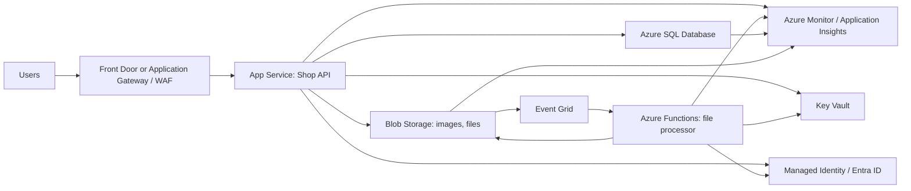
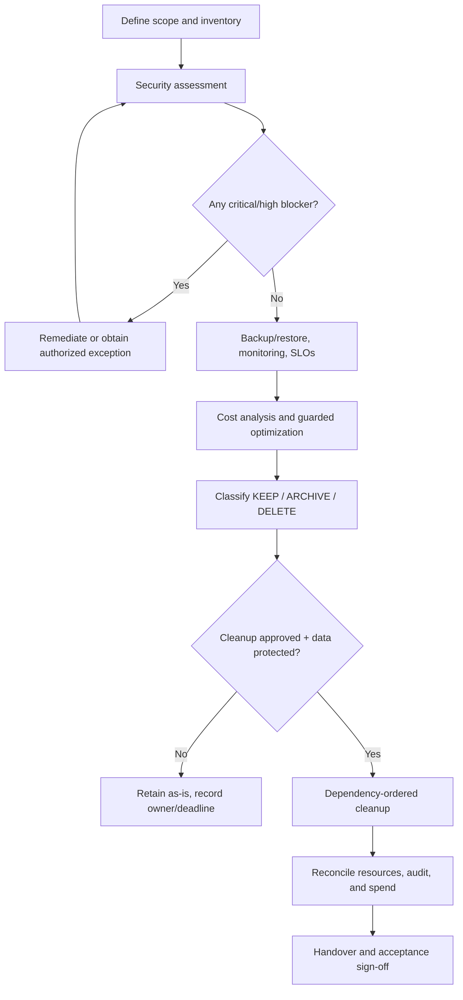
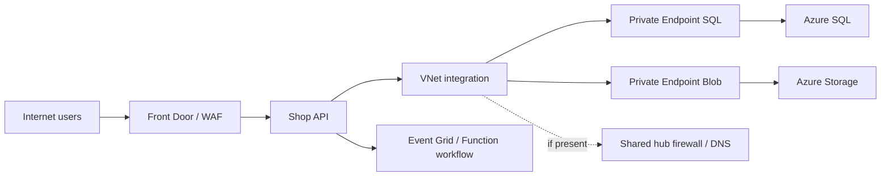
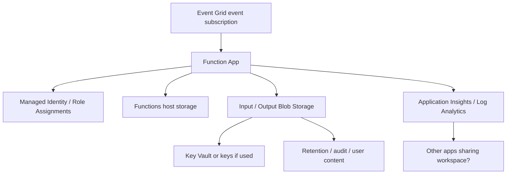

# Security, Cost Review, and Complete Azure Project Cleanup

## 1. Capstone Summary Problem and Objectives

A Microsoft Azure project is not complete merely because a website returns HTTP 200 or Bicep provisioned infrastructure successfully. Before handover, the project team must answer: **who has access to resources and data**, are network paths protected, can the system recover from incidents, **do actual costs match the budget**, and which lab/experimental resources should be **deleted, kept, or archived**?

This is the final capstone lab in the **Architecture and Capstone Labs** chapter of the `CLOUD_PROVIDERS_AZURE` module. Learners apply subscriptions, resource groups, Microsoft Entra ID, Azure RBAC, VNets, compute, storage, databases, Azure Monitor, Azure Policy, Microsoft Defender for Cloud, and Cost Management to review a complete Azure application architecture end-to-end.

After this lesson, you can:

- Build an **inventory** scoped to the right subscription, resource group, and environment; classify production, lab, shared, and retention-required resources.
- Conduct an **evidence-backed security review** across identity, permissions, networking, data, secrets, monitoring, backups, and governance.
- Distinguish **security findings**, accepted risks, required fixes, and acceptance blockers.
- Read costs by scope, service, resource group, and tags; distinguish actual, amortized, forecast, and unallocated charges.
- Prioritize optimization of idle resources, SKUs, log/storage retention, and network traffic without lowering security baselines.
- Build a **cleanup plan** with approvals, evidence archival, dependency-ordered deletion, and post-cleanup spend verification.
- Complete an acceptance report with owners, deadlines, rollback/restore proof, executed changes, and open backlog items.

**Scenario:** the `Shop API` project has been deployed on Azure, comprising an App Service API, Azure Functions for file processing, Blob Storage, Azure SQL Database, Key Vault, VNet, Private Endpoints, Application Insights, and Log Analytics. Production sits in a dedicated subscription; dev/test sit in a non-production subscription. Operations recently tested Event Grid file processing and wants to hand over production, yet lab resources, large logs, and overly broad build-phase permissions remain.

**Safety principles:** commands below are primarily **read-only / investigative**. This lesson never asks you to delete live resources. Permission edits, network changes, retention updates, locks, or resource deletions must occur only in authorized environments with verified targets and formal change approval.

## 2. Locking Scope: What Does the Complete Project Contain?

### 2.1. Reference Architecture Diagram



Components in the diagram are **reference architecture**; not every system uses all services or direct/public paths. In a Private Endpoint topology, inspect App Service VNet Integration, routes, Private DNS, access controls, and firewalls—**never** assume Storage's Private Endpoint protects App Service inbound traffic.

### 2.2. Environment and Ownership Split

| Scope | Example resources | Accountable owner | End-of-project handling |
|---|---|---|---|
| Production subscription | `rg-shop-prod`, `rg-shop-monitoring` | Product owner, SRE, Security | Keep running; hand over and monitor |
| Non-production subscription | `rg-shop-dev`, `rg-shop-test` | Dev / QA teams | Keep as needed; optimize active schedules |
| Dedicated lab resource group | `rg-shop-capstone-lab` | Lab practitioner | Delete **after** verifying lab-only contents and approval |
| Shared platform | DNS zones, firewall, hub VNet, shared Log Analytics | Platform / Security | Never delete as part of a single app's cleanup |
| Backup / audit / archive | Recovery Services/Backup vaults, logs, snapshots, legal hold | Data owner / compliance | Keep per retention; verify restore before changes |

**Subscriptions**, **resource groups**, and **tags** are three distinct governance dimensions. Resource groups are not independent billing boundaries, tags do not enforce access or spend caps, and tags on a resource group do not automatically inherit to child resources.

Establish a consistent tag taxonomy upfront, such as:

```text
application = shop
environment = dev | test | prod | lab
owner = team-shop | team-platform
costCenter = cc-042 | shared
dataClass = public | internal | confidential
managedBy = bicep | terraform | portal
expiryDate = YYYY-MM-DD (for temporary resources only)
```

Never store access keys, personal emails, passwords, or sensitive data in tags. `expiryDate` is strictly metadata for review; **it does not auto-delete resources** on that date and never authorizes deleting production.

## 3. Gate-by-Gate Review Process



Suggested **four gates** for practice:

1. **Gate A – Scope & ownership:** exact resources, subscriptions, regions, owners, environments, and dependencies are known. Never delete without an inventory.
2. **Gate B – Security & reliability:** zero unaddressed or unapproved critical vulnerabilities; core journeys and restore tests pass.
3. **Gate C – Cost & cleanup approval:** costs are accounted for, and deletion targets cleared data, lock, shared dependency, retention, evidence, and approver checks.
4. **Gate D – Final handover:** post-cleanup report completed, remaining services verified healthy, operational owner confirmed, and post-closure billing monitoring scheduled.

**Never mark "PASS" from a single isolated metric.** For example, zero high recommendations in Microsoft Defender for Cloud does not prove the full application is secure; you still must review API authorization, dependencies, secrets, access reviews, and business logic.

## 4. Inventory: Starting from Live Azure Data

### 4.1. Ensure the Right Subscription Is Selected

Commands below use **Bash**, strictly against authorized subscriptions:

```bash
az login
az account list --output table

SUBSCRIPTION_ID="<subscription-id>"
RG_NAME="rg-shop-capstone-lab"

az account set --subscription "$SUBSCRIPTION_ID"
az account show \
  --query '{subscription:name,id:id,tenantId:tenantId}' \
  --output table

# Confirm the group exists and inspect resource group metadata.
az group show \
  --name "$RG_NAME" \
  --query '{name:name,id:id,location:location,tags:tags}' \
  --output json
```

`az account show` is mandatory before inspecting or deleting anything. One user can belong to multiple tenants/subscriptions; the same `rg-shop-capstone-lab` name in two subscriptions represents **two completely different resource sets**.

### 4.2. Inventory Resources, Tags, and Dependencies

```bash
RG_ID=$(az group show --name "$RG_NAME" --query id --output tsv)

az resource list \
  --resource-group "$RG_NAME" \
  --query '[].{name:name,type:type,location:location,id:id,tags:tags}' \
  --output json

# Resource count aids review, never replaces a dependency list.
az resource list \
  --resource-group "$RG_NAME" \
  --query 'length(@)' --output tsv

# Check for protective resource locks.
az lock list --resource-group "$RG_NAME" --output table

# Inspect role assignments at RG scope, including inherited roles where supported.
az role assignment list \
  --scope "$RG_ID" \
  --include-inherited \
  --output table
```

This listing reflects **point-in-time** state within your readable scope. Dependencies may sit in other groups/subscriptions (shared DNS, logging workspaces, target Storage, public IPs, identities, Key Vaults) or outside Azure. Some services also contain child resources or specialized control-plane assets; never rely solely on `length(@)`.

### 4.3. Sign-Off-Ready Inventory Table

| Resource ID / name | Environment | Owner | Data / secrets | Dependencies | Tentative class | Evidence |
|---|---|---|---|---|---|---|
| Function App `func-shop-lab` | lab | Team Shop | No long-term data | Host storage, MI, Event Grid | DELETE? | Portal / resource ID |
| Storage `stshop...` | lab | Team Shop | Uploaded files and test JSON | Functions, Event Grid | REVIEW | Container inventory / retention |
| Log Analytics workspace | shared | Platform | Telemetry / audit | Multiple apps | KEEP | Connected data sources |
| Key Vault production | prod | Security | Secrets / keys | API, SQL, CI/CD | KEEP | Access review and rotation |
| Private DNS Zone | shared | Platform | No business payload data | Multiple VNets | KEEP | VNet links |

**DELETE?** is merely a proposal awaiting approval. A `lab` name, `expiryDate` tag, or 0% CPU never proves deletion is safe.

## 5. Reviewing Identity and Azure RBAC

### 5.1. Distinguishing Control Plane from Data Plane

**Azure Resource Manager** controls creating/editing resources, whereas the **data plane** controls reading/writing data inside services like Blob Storage, Key Vault, or Azure SQL. An account with `Reader` on a resource group cannot automatically read Blobs, and resource-group `Contributor` is rarely the right role for granting Microsoft Entra ID data-plane access across services.

| Principal | Permissions to inspect | Goal |
|---|---|---|
| Deployer staff | Deploy rights scoped to the target RG, never subscription Owner | Limit blast radius |
| Function Managed Identity | Read `incoming`, write `processed` per supported scope | Zero storage account keys in code |
| App Service Managed Identity | Read only needed secrets; access SQL via supported auth | Zero hard-coded secrets |
| Application end users | App-tier and business-tier identity/RBAC | Never substitute Azure RBAC for API authz |
| Security / operations | View logs, handle incidents, execute emergency runbooks | Auditable and able to operate |
| Automation / CI-CD | Federated workload identity or secure managed secrets | Avoid long-lived client secrets where supported |

### 5.2. Mandatory Review Questions

- Are there stale identities, unused service principals, groups with broad `Owner`/`Contributor`, or subscription-level assignments where resource-group scope suffices?
- Does production enforce **MFA/Conditional Access** for admins per org policy, with controlled break-glass emergency accounts?
- Is **Microsoft Entra Privileged Identity Management (PIM)** enabled for privileged roles where licensing and workflows allow?
- Do apps use **Managed Identity** to acquire tokens instead of storing account keys/passwords in code, variables, pipeline logs, or local settings?
- Is **least privilege** applied to `Storage Blob Data Reader/Contributor`, `Key Vault Secrets User`, and database roles per workload?
- Are `User Access Administrator` and `Owner` assignments tightly bounded and periodically reviewed?

For every RBAC change, record **principal ID, scope, role, justification, approver, and temporary expiration date**. Revoking permissions can break Functions or deployment pipelines; validate in an appropriate environment and keep a rollback plan.

### 5.3. Narrower RBAC Does Not Guarantee Application Security

Downgrading a role from `Owner` to `Reader` is good hygiene, yet an API can still suffer **broken object-level authorization** if User A can fetch User B's orders. Reviews must therefore cover **threat modeling, business authorization checks, input validation, and dependency/vulnerability scanning** matched to project risk.

## 6. Reviewing Networking and Exposure Surface

### 6.1. Tracing the Live Request Path



In practice, **App Service VNet Integration primarily governs outbound traffic**, whereas App Service inbound paths require matching controls such as access restrictions, private endpoints, gateway/Front Door integration, and host validation where supported. Never assume a VNet automatically secures every service boundary.

### 6.2. Network Checklist

| Area | What to verify | Evidence |
|---|---|---|
| Public exposure | Do App/API, Storage, SQL, Key Vault expose public endpoints/access? Is it justified? | Resource settings and connectivity tests from allowed networks |
| NSGs / routes | Inbound/outbound rules, effective routes, subnet associations, default deny | Effective security rules / Network Watcher where supported |
| Private Endpoints | Approved connections, private IPs, right VNet/subnet, working data-plane access | Private endpoint status + DNS tests from client |
| Private DNS | Blob/SQL/Key Vault names resolve properly from the **actual client** | Resolver responses and connectivity tests |
| Egress | Routed via NAT Gateway, firewall, or partner allowlists if required? | Route/topology configs, metrics, and logs |
| TLS / certs | Valid certificates, strong TLS policy, no secrets in URLs | Configs and HTTPS checks |
| WAF / DDoS | Protection aligned with exposure and threat model | Rules, alerts, safe tests |
| Logs | Signals to detect inbound denies, dependency timeouts, anomalies? | Diagnostic settings / monitoring dashboards |

Sample read-only network inventory commands:

```bash
az network nsg list --resource-group "$RG_NAME" --output table
az network public-ip list --resource-group "$RG_NAME" --output table
az network private-endpoint list --resource-group "$RG_NAME" --output table
az network vnet list --resource-group "$RG_NAME" --output table
```

These commands **do not prove** zero Internet exposure if entry points sit in another group or a service exposes its own public endpoint. Check app/service settings and test live paths directly. Before deleting an apparently unused public IP, check dependencies—it may back a NAT Gateway, load balancer, or another service.

## 7. Reviewing Data, Secrets, Backups, and Recovery

### 7.1. Data in Blob, SQL, and File Shares

| Protection domain | Questions | Passing evidence |
|---|---|---|
| **Encryption** | Encrypted at rest and in transit? CMK needed? Who owns keys? | Storage/DB/key settings and key recovery workflow |
| **Access** | Anonymous public access disabled? RBAC/data-plane roles accurate? | Principal/role audit and positive/negative access tests |
| **Data protection** | Soft delete, versioning, backups/PITR/retention matched to workload? | Policies, recovery points, and restore drills |
| **Schema / data quality** | Blob/SQL data valid; migrations reconciled? | Manifests, checksums, row/business totals |
| **Residency / compliance** | Regions and retention meet commitments? | Data classification and policy checks |
| **Key / secret lifecycle** | Key Vault permissions, rotation, expiry, logging, soft delete/purge protection? | Access review and rotation test |

**Soft delete, replication, and backups are separate protection layers.** Geo-replication faithfully replicates accidental deletions; point-in-time recovery restores pre-incident state. For Azure SQL Database, native backup/PITR differs from SQL Server inside an Azure VM—verify the right workload mechanics before claiming restore capability.

### 7.2. Key Vault and Managed Identity

- Applications fetch Key Vault secrets via Managed Identity where appropriate; never embed secrets in repos, container images, or logs.
- Scope data-plane roles or access policies tightly; never grant full Secrets Officer if an app only reads specific secrets.
- Verify **soft delete / purge protection** and key recovery plans before changing anything. Deleting a key used for data encryption can render backups permanently unreadable.
- Rehearse secret rotation alongside apps and CI/CD; rotating keys right before cleanup without checking dependencies can trigger outages.
- Store sensitive evidence in access-controlled, encrypted, audited, retention-governed repositories; never output plaintext credentials in reports.

### 7.3. Restore Testing Is an Acceptance Criterion

Seeing `Succeeded` on a backup job does not prove recovery works. Pick a recovery point, **restore into an isolated environment**, verify data and permissions, measure **RPO/RTO**, and validate app, secret, and file connectivity. Record start/end times, errors, owner, and results.

Never delete Storage Accounts, Key Vaults, DNS, or source data while backups/restores depend on them or before retention/legal holds are cleared.

## 8. Microsoft Defender for Cloud and Azure Policy

### 8.1. Contextual Security Posture Review

**Microsoft Defender for Cloud** provides security posture assessments, recommendations, alerts, and protection plans per enabled capability. Open the dashboard for the exact subscription/workload and classify:

- **Critical/high items to fix now:** exposed resources or risky configs with realistic exploit paths in your threat model.
- **Non-applicable recommendations:** short-lived lab resources may warrant time-bound exceptions with an owner and rationale; never mark "not applicable" just to inflate scores.
- **Paid protection plans:** check which plans are enabled, coverage, business need, and cost impact; never turn off production protection merely because bills rose.
- **Alerts/threats:** inspect evidence, triage, remediate, and review logs; never assume a high Secure Score prevents attacks.

**Secure Score is a prioritization signal**, not a security certificate. Pair it with Azure Policy compliance, vulnerability scanning, code/dependency reviews, app testing, and audits.

### 8.2. Governance with Azure Policy

| Policy intent | Purpose | Watch out for |
|---|---|---|
| Allowed locations / SKUs | Restrict regions/SKUs per governance | Account for DR regions and valid exceptions |
| Require tags | Attach owner/environment/costCenter | Tags alone do not prove costs are allocated |
| Deny public access where appropriate | Reduce data exposure | Verify private connectivity and exempted services |
| Audit / deploy diagnostic settings | Improve detection coverage | Can add log/ingestion costs |
| Require encryption / backups | Enforce baseline data protection | Varies by workload type and applicable rules |

Policy effects (`audit`, `deny`, `modify`, `deployIfNotExists`) have distinct prerequisites and permissions. For example, **`modify`** or **`deployIfNotExists`** typically require managed identities and remediation tasks; policies do not retroactively fix all existing resources automatically. Check **assignment scope, exclusions, exemptions, compliance state, and permissions** rather than just asking "is the policy on?"

Enabling a `deny` policy directly in production can block legitimate incident-response deployments. Roll out via audit → clear exceptions → enforcement with coordination and rollback.

## 9. Observability and Post-Handover Operability

### 9.1. Metrics/Logs Must Flow End-to-End

**Azure Monitor** and **Application Insights** track requests, dependencies, exceptions, CPU, memory, storage IO, networking, and queues when telemetry is enabled. **Log Analytics** stores and queries logs, incurring ingestion and retention fees. Missing records do not imply system health—they may reflect unconfigured diagnostics or sampling.

Before sign-off, verify:

1. Every critical journey (`checkout`, file upload, SQL queries, image reads) has an SLO dashboard: **p95/p99 latency, traffic, error rate, and saturation**.
2. Alerts for 5xx, queue age, Event Grid delivery/dead-letter failures, Function failures, and SQL/storage throttling have on-call owners, severities, runbooks, and escalation paths.
3. Alerts for backups, key expirations, Defender for Cloud findings, and budgets route to the right channels.
4. Logs omit passwords, SAS tokens, raw PII, and payment details; retention matches audit needs.
5. User-perspective synthetic/smoke tests exist beyond shallow `200` health probes.

### 9.2. Sample KQL for Post-Deployment Requests

If Application Insights uses **workspace-based** schema in Log Analytics:

```kusto
AppRequests
| where TimeGenerated > ago(24h)
| summarize
    requests = count(),
    failures = countif(Success == false),
    p50_ms = percentile(DurationMs, 50),
    p95_ms = percentile(DurationMs, 95)
  by AppRoleName, bin(TimeGenerated, 15m)
| extend failure_rate_pct = iff(requests == 0, real(null), 100.0 * failures / requests)
| order by TimeGenerated asc
```

Finding slow dependencies:

```kusto
AppDependencies
| where TimeGenerated > ago(24h)
| summarize calls = count(), errors = countif(Success == false),
            p95_ms = percentile(DurationMs, 95)
  by AppRoleName, Target, Type
| order by p95_ms desc
```

Table/column names may differ in classic Application Insights or custom pipelines; verify your live schema. Sampling can cause `requests` counts to differ from total actual traffic; cross-check at Front Door/gateway when needed.

### 9.3. Diagnostic Settings and Log Ownership

With a valid resource ID, inspect log/metric export configuration:

```bash
RESOURCE_ID="<full-azure-resource-id>"

az monitor diagnostic-settings list \
  --resource "$RESOURCE_ID" \
  --output json
```

Diagnostic settings only prove **routing/log categories are configured**; they do not prove data is arriving, alerts work, or retention fits. If the Log Analytics workspace sits in a shared resource group, **never delete it with the lab group** just because the test app ended.

## 10. Project Cost Analysis and Establishing a Baseline

### 10.1. Distinguishing Key Cost Figures

| Type | Purpose | Watch out for |
|---|---|---|
| **Actual cost** | Tracks charges recorded in billing data for the period | Not yet a finalized invoice; data lags |
| **Amortized cost** | Spreads upfront commitments (Reservations/Savings Plans) over time where supported | Never add together with actual cost |
| **Forecast** | Projects spend trends from current data | Not guaranteed or finalized charges |
| **Invoice / billed** | Contractual accounting reconciliation | Taxes, credits, marketplace, and adjustments can differ from charts |

In Azure Portal, open **Cost Management → Cost analysis** at your authorized scope; align **subscription, time range, cost type, and currency**, then Group by `Service name`, `Resource group`, `Resource`, or tags (`application`, `environment`, `costCenter`). Compare identical periods and cost types, and keep **unallocated/untagged** spend visible.

**Public retail prices differ from contract pricing** by region, SKU, tier, Reservations, Savings Plans, currency, and billing term. To explain a bill, examine exact meters, usage quantities, unit prices, and terms—not just vCPU counts.

### 10.2. Hypothetical Shop API Cost Table

Assume the table below shows one full month's `Actual cost` in USD **strictly for calculation practice**, not real Azure pricing:

| Item | Hypothetical monthly cost | Risk or investigation question |
|---|---:|---|
| App Service compute | 240 USD | Is the plan over-provisioned, running 24/7 despite low traffic? |
| Azure SQL Database | 320 USD | Right compute tier/auto-pause where suitable; IO/backup/storage? |
| Blob Storage & transactions | 85 USD | Tiers, lifecycle, versioning/retention, transaction volume |
| Private Link, networking, egress | 65 USD | Endpoint-hours, processed GB, NAT/peering/data transfer |
| Application Insights & Log Analytics | 95 USD | Verbose logs, untuned sampling or retention? |
| Key Vault | 15 USD | Transaction count and enabled features |
| Event Grid / Functions / other | 40 USD | Event volume, executions, failure retries |
| **Total** | **860 USD** | Baseline for optimization and tracking |

With a hypothetical monthly budget of **900 USD**, 860 USD actual is below threshold; however, a 940 USD forecast warns of a likely overrun. **Budgets primarily alert—they do not shut down App Service or SQL.**

A **hypothetical optimization plan requiring verification**:

- Rightsize the App Service Plan after load measurement: save 25 USD/month.
- Tune SQL compute/queries or non-prod schedules: save 30 USD/month.
- Trim unnecessary lab debug logs while keeping security/audit logs: save 12 USD/month.

```text
Expected total savings = 25 + 30 + 12 = 67 USD/month
Projected new cost     = 860 - 67 = 793 USD/month
Expected savings rate  = 67 / 860 × 100 ≈ 7.79%
```

These numbers are **not yet achieved results**. Verify contract pricing, migration costs, seasonality, and post-change billing data. Never optimize to the point of violating SLOs, backups, required logging, or security.

### 10.3. Querying the Cost Management API (Reference)

For automated reporting at subscription scope, the Cost Management Query API can aggregate by resource group:

```json
{
  "type": "ActualCost",
  "timeframe": "Custom",
  "timePeriod": {
    "from": "2026-10-01T00:00:00Z",
    "to": "2026-11-01T00:00:00Z"
  },
  "dataset": {
    "granularity": "None",
    "aggregation": {
      "cost": {
        "name": "PreTaxCost",
        "function": "Sum"
      }
    },
    "grouping": [
      { "type": "Dimension", "name": "ResourceGroup" }
    ]
  }
}
```

This JSON is an **illustrative request body**, not live billing data. Verify API version, metric name, query permissions, scope, and currency against current docs and contracts. Never assume one resource group's sum equals the entire subscription bill: subscription-level charges or untagged items may exist outside resource groups.

## 11. Commonly Overlooked Cost Sources

### 11.1. Compute

- **App Service Plans** continue billing per plan/instance even with low app traffic; check if other apps share the plan before downsizing or deleting.
- **Azure VMs** stopped from inside the OS guest can keep incurring compute charges depending on state; `Stopped (deallocated)` differs from `Stopped`, and **disks, snapshots, IPs, backups, and attached services** continue billing.
- **AKS** bills for node pools, storage, networking, monitoring, and cluster features; deleting Pods does not remove node pools.
- **Functions** depend on hosting plan, execution duration, memory, invocation counts, and connected monitoring per SKU.

### 11.2. Storage and Data

- Blob versioning, soft delete, snapshots, and backups retain multiple copies. Lifecycle rules must balance storage cost against legal retention and restore needs.
- Cool/Cold/Archive tiers carry retrieval fees, minimum retention durations, and per-transaction charges; moving down a tier does not always lower **total** cost.
- Deleting a resource group holding a Storage Account with important data **is not** cost optimization; back up, manifest, and obtain approval first.

### 11.3. Networking and Monitoring

- Private Endpoints often incur **hourly and per-GB data processing** charges; VNet peering, NAT, Firewalls, gateways, public IPs, and egress each have separate meters.
- Placing interdependent services across regions adds data transfer charges and latency; weigh data residency/DR before consolidating regions.
- Application Insights/Log Analytics, diagnostics, and flow logs incur ingestion/retention charges; blindly deleting logs/alerts blinds incident response.
- Defender for Cloud plans bill per protected resource/unit; changes must be evaluated jointly by Security and FinOps.

## 12. Prioritizing Optimizations by Value and Risk

| Action | Potential benefit | Risks / prerequisites |
|---|---|---|
| Schedule shutdown of **idle dev/test** environments | Cuts off-hours compute | Needs owner, must not break CI/nightly jobs; disks/IPs may still bill |
| Rightsize App Service/VM/SQL by p95 and peak hours | Reduces excess headroom | Load test performance and autoscale headroom |
| Trim debug logs; tune sampling/retention | Cuts log ingestion/storage | Preserve security, forensic, and compliance logs |
| Apply Blob lifecycle / tiering | Cuts medium/long-term storage | Watch retrieval fees, integrity, and retention |
| Disable unused lab Event Grid subscriptions | Stops stray events/invocations | Verify zero production workflows depend on them |
| Remove unneeded endpoints/networking | Cuts hourly/GB fees | Never open public access or break DNS/segmentation |
| Purchase Reservations/Savings Plans where steady | Discounts stable baseline load | Commitment lock-in, usage forecasting, flexibility risk |
| Remove expired lab resources | Cuts spend and attack surface | Check data/owner/dependencies and get deletion approval |

**Recommended order:** measure → find root cause → propose change → test in non-prod → verify SLOs/security → apply via change management → reconcile post-period bills. Avoid "optimizing" from price sheets alone without operational evidence.

## 13. Cleanup: Classify Before Touching Delete

### 13.1. Four Resource Categories

| Status | Definition | Action |
|---|---|---|
| **KEEP** | Production/shared resources actively serving business needs | Hand over owner, alerts, budgets, backups; never delete |
| **ARCHIVE/RETENTION** | Data/logs requiring retention while compute can stop | Store appropriately, prove readability/restore, review retention |
| **DELETE CANDIDATE** | Lab/ephemeral resources with confirmed owner and zero dependencies | List, get approval, clean up in dependency order |
| **UNKNOWN/BLOCKED** | Unclear owner, dependencies, data, or legal hold | Do not touch; open investigation ticket with deadline |

**Delete candidate is not Delete approved.** An `environment=lab` tag or creation date alone is insufficient evidence. Minimum bar: verified scope, owner confirmation, zero external apps depending on it, data handled, required logs/audit backed up, and formal approval.

### 13.2. Dependency Graph for the File-Processing Pipeline



This is a **dependency** graph, not a universal deletion sequence. When retiring the lab, stop **event emission and incoming writes** first; verify outputs and data, confirm the Function has no active consumers and role assignments aren't shared elsewhere, and only then delete lab-specific resources. Host storage and Log Analytics may be shared—never delete them based solely on an app-like name.

### 13.3. Store Evidence Outside the Deletion Scope

Before cleanup, archive inventories, cost baselines, retention policies, restore test results, approval records, and resource ID lists in a **governed system of record**, never solely inside the resource group slated for deletion. If a Log Analytics workspace or audit storage account gets deleted with the group, evidence vanishes alongside the resources.

## 14. Safe Cleanup Runbook for a Lab Resource Group

### 14.1. Mandatory Pre-Change Gate

Verify and log in the change ticket:

1. **Scope:** exact subscription ID, tenant ID, and resource group ID; `az account show` matches the plan.
2. **Owner:** who confirms this is strictly lab and unshared with production?
3. **Dependencies:** do any apps, Functions, Event Grids, DNS zones, firewalls, Managed Identities, pipelines, monitoring, or users still point here?
4. **Data:** do Blob/SQL/Files hold data to retain? Are soft delete/versioning/backups/legal holds active? Who signed off?
5. **Recoverability:** are restore proofs/manifests, keys, and recovery rights stored outside the deletion target?
6. **Locks/Policies:** do Delete Locks, Azure Policies, or governance rules block deletion? Never remove locks without owner approval.
7. **Evidence:** before-state diagrams, resource inventory, spend, alerts, and change details archived.
8. **Approvals:** sign-off from data owner, app owner, security/compliance, and change approver per policy.

### 14.2. Read-Only Final Verification Commands

```bash
az account show \
  --query '{name:name,id:id,tenantId:tenantId}' \
  --output json

az group show --name "$RG_NAME" --query '{id:id,tags:tags}' --output json

az resource list \
  --resource-group "$RG_NAME" \
  --query '[].{name:name,type:type,id:id}' \
  --output table

az lock list --resource-group "$RG_NAME" --output table

# Read-only commands inspecting specific resource types if present in the group:
az functionapp list --resource-group "$RG_NAME" --output table
az storage account list --resource-group "$RG_NAME" --output table
az network private-endpoint list --resource-group "$RG_NAME" --output table
```

**Never** run `az group delete` simply because the commands above printed a list. Compare every item against the **change ticket allowlist** and check for cross-group dependencies; deleting a group wipes all child resources at once, potentially destroying irrecoverable data.

### 14.3. Principled Cleanup Sequence

**Phase A – Stop new data and charges**

1. Pause lab uploads and disable any CI/CD jobs that recreate lab resources.
2. Disable/delete **confirmed lab** Event Grid event subscriptions with approval; verify zero pending events remain.
3. Let active Function executions finish or log backlog handling; never cut off mid-write.

**Phase B – Finalize data and dependencies**

4. Export/archive required outputs, logs, and reports **outside the group targeted for deletion**.
5. Verify Blob/SQL, backups, Key Vault secret/key dependencies, role assignments, DNS/PE, CI/CD, and shared logging.
6. Reclassify any shared or unclear resources to `KEEP/UNKNOWN` rather than quietly deleting them.

**Phase C – Delete strictly lab resources**

7. Execute changes per ticket, **targeting only approved resource IDs**, with an operator monitoring and rollback/fallback ready for reversible config edits.
8. Never delete an entire resource group if it still holds `KEEP`, `ARCHIVE`, or `UNKNOWN` resources; relocate or split retained resources via supported procedures first.
9. Only when a lab group is confirmed to **hold exclusively deletable resources**, use group deletion per org rules. This is destructive—**do not execute it inside this lesson**.

Reference syntax, **kept commented out**:

```bash
# RUN ONLY AFTER WRITTEN APPROVAL AND VERIFYING THE RIGHT SUBSCRIPTION / RG.
# THIS COMMAND CAN DELETE ALL RESOURCES AND DATA IN THE RESOURCE GROUP.
# NEVER RUN ON PRODUCTION, SHARED GROUPS, OR GROUPS UNDER LEGAL HOLD.
#
# az account set --subscription "<approved-subscription-id>"
# az group delete --name "<approved-lab-resource-group>" --yes
```

**Why not provide an immediately runnable delete command?** Learner environments, scopes, and owners vary; deleting production/shared resources, storage data, Key Vault keys, backups, or audit logs causes permanent damage. A proper runbook always verifies **actual resource IDs** and formal approvals first.

### 14.4. Post-Cleanup Verification

- Confirm all **deletion-approved resource IDs** no longer exist in ARM once asynchronous deletion completes.
- Verify **production Shop API** remains healthy: login, checkout, SQL/Blob access, event processing, networking, and alerts.
- Check for orphaned resources outside the group: public IPs, snapshots, disks, diagnostic storage, private DNS links, backup items, keys, role assignments, or monitoring.
- Confirm policies/locks remain intact and no temporary principals/credentials retain excess rights.
- Review **cost data after billing ingestion catches up**, comparing before/after using identical cost types, scopes, and currencies; never assume spend drops to zero instantaneously.
- Archive cleanup records, owner/approval proof, security/cost post-checks, and update CMDB/IaC/runbooks.

## 15. Acceptance Report and Exception Handling

### 15.1. Verification Results Table Template

| Check | Goal | Evidence | Result / owner |
|---|---|---|---|
| Subscription & inventory | Right scope, owner, region, tags | ARM export / resource IDs | PASS/FAIL |
| RBAC & Entra | Least privilege, zero orphan principals | Role assignments and access review | PASS/FAIL |
| Networking | Public/private access and DNS match design | NSG/PE/route/connectivity proof | PASS/FAIL |
| Data & secrets | Encryption, versioning, retention, Key Vault | Data-plane tests and secret policy | PASS/FAIL |
| Backup / restore | Usable recovery point, RPO/RTO met | Restore test and app verification | PASS/FAIL |
| Defender & Policy | Critical blockers resolved | Findings, policy compliance, exceptions | PASS/FAIL |
| SLO & monitoring | Logs, alerts, on-call ready | Dashboards / KQL / test alerts | PASS/FAIL |
| FinOps | Actual/forecast, tag coverage, cost owner | Cost Analysis / billing snapshot | PASS/FAIL |
| Cleanup | Strictly approved lab resources removed | Change ticket / post-cleanup inventory | PASS/FAIL |
| Handover | Runbooks, owners, incident escalation | Handover sign-off record | PASS/FAIL |

**Never use average scores** to wave away a critical failure: 9/10 checks passing alongside an **untested backup restore** or publicly exposed sensitive Storage can still make the release a **NO-GO**.

### 15.2. Final Summary Record Template

```text
Project: Shop API - Azure Capstone
Subscription(s): <IDs>
Resource group(s): <IDs>
Review window (UTC): <start> to <end>
Architecture version / IaC commit: <id>

Security:
  Critical blockers: <count, owner, due date>
  Accepted exceptions: <ticket, approver, expiration>
  RBAC / network / data protection evidence: <links>

Reliability:
  SLO and availability: <metrics>
  Backup/restore test: <result, timestamp, RPO/RTO>
  Monitoring/on-call: <owner>

Cost:
  Period / currency / actual or amortized: <...>
  Current cost, forecast and budget: <...>
  Unallocated or untagged share: <...>
  Proposed/verified savings: <...>

Cleanup:
  KEEP resource IDs: <...>
  ARCHIVE/RETENTION resource IDs: <...>
  DELETE-approved resource IDs: <...>
  UNKNOWN/BLOCKED: <ticket, owner, deadline>
  Before/after inventories and approvals: <links>

Decision: ACCEPT / CONDITIONAL ACCEPT / REJECT
Approvers: business / platform / data / security / operations
Final handover date and next review: <...>
```

**Conditional acceptance** is valid only when residual risks are formally approved by authorized stakeholders with deadlines and owners. Never use it to bypass unapproved compliance/data violations or mask severe vulnerabilities.

## 16. Comprehensive Exercises for Learners

### Exercise A — Project Audit

Suppose you have lab resources in `rg-shop-capstone-lab` alongside production/shared resources in other groups:

1. Record subscription/tenant IDs, list lab resources, and assign owners.
2. Use RBAC listings and Managed Identity details to identify **at least three risks** of over-privilege or missing permissions.
3. Cross-check network settings: public IPs, Storage public access, Private Endpoints, Private DNS, and App Service ingress/egress.
4. Review backup/restore, monitoring, Defender/Policy, and security controls item by item.
5. Build a findings table: **severity – evidence – impact – owner – action – deadline – exceptions**.

### Exercise B — Cost Optimization

Using Section 10's hypothetical table:

- Verify the **860 USD** total.
- Calculate expected dollar and percentage savings from three reductions of 25, 30, and 12 USD/month.
- If `Log Analytics` accounts for 95 USD, explain why you must not immediately wipe audit logs or turn off production monitoring.
- Explain the difference between `actual cost` and `forecast`, and why a 900 USD budget does not auto-stop resources on overrun.
- State how to verify savings post-change: period, scope, cost type, meters, currency, load/SLO impact, and billing data lag.

### Exercise C — Cleanup Classification

You have five items: (1) a lab Function App, (2) a Storage Account holding real customer images, (3) a Private DNS Zone shared between production and lab, (4) a shared production Log Analytics workspace, and (5) an Event Grid subscription serving only a stopped test pipeline.

For each item, assign **KEEP / ARCHIVE / DELETE CANDIDATE / UNKNOWN** and list the evidence needed before deletion. Design a cleanup runbook with **dependency ordering**, log/manifest storage, and production post-checks.

### Exercise D — Tabletop Incident

After lab cleanup, the production API hits 403 reading Blob Storage; investigation reveals its Managed Identity held a role assigned at a shared lab resource group. Build a response timeline:

1. Which cleanup tasks do you pause and what evidence do you preserve?
2. Identify the revoked role scope, principal, Storage data-plane permissions, and network access.
3. Restore **least-privilege scoped permissions**, avoiding subscription-wide `Owner` quick fixes.
4. Test functionality, security, monitoring, and file a postmortem.
5. Propose ownership, tagging, and dependency practices to prevent recurrence.

### Completion Assessment Criteria

| Level | Expected deliverables |
|---|---|
| **Basic pass** | Accurate scoped inventory, identifies security/cost tools, classifies keep vs. delete resources |
| **Practical pass** | Includes RBAC/network/data/backup checklists, Cost Analysis reconciliation, and approved cleanup plan |
| **Operational pass** | Includes risk register, restore/SLO evidence, shared-dependency handling, verified post-change savings, and handover sign-off |

**Self-assessment questions:**

1. Why are resource groups and tags not isolated security or billing boundaries?
2. Is `Contributor` on a resource group enough for a Managed Identity to read Blob contents via Entra ID?
3. Does a Storage Private Endpoint automatically secure App Service's inbound endpoint?
4. Why do backups reporting `Succeeded` still require restore testing?
5. How do an actual cost of 860 USD and a forecast of 940 USD differ in meaning?
6. Why might deleting a Function App fail to stop all costs or side effects of an Event Grid pipeline?
7. Why must you never delete a shared Log Analytics workspace just because a lab app ended?
8. What conditions prevent deleting an `environment=lab` resource right away?
9. Can you declare spend dropped to 0 immediately after deleting a resource group? Why or why not?
10. Which pieces of evidence prove a project is ready for acceptance and operational handover?

## 17. Pre-Project-Closure Checklist

**Security and reliability**

- [ ] Subscriptions, regions, owners, and dependencies verified.
- [ ] Azure RBAC and data-plane permissions follow least privilege; privileged accounts reviewed.
- [ ] Public/private networking, NSGs, WAF, DNS, egress, and TLS verified.
- [ ] Storage/database/Key Vault encryption, retention, and backup/restore backed by evidence.
- [ ] Microsoft Defender for Cloud and Azure Policy findings resolved or covered by valid exceptions.
- [ ] SLOs, alerts, incident runbooks, and on-call ownership handed over.

**Cost and cleanup**

- [ ] Costs tracked cleanly by subscription/RG/tag, actual/forecast, currency, and period.
- [ ] Unallocated costs and shared services have owners and reconciliation methods.
- [ ] Proposed optimizations evaluated for SLO and security impact.
- [ ] Resources classified into KEEP / ARCHIVE / DELETE CANDIDATE / UNKNOWN.
- [ ] Approvals for cleanup, retention, backups, identities, and shared dependencies signed off.
- [ ] Only allowlisted targets modified; inventories and evidence saved outside deletion scope.
- [ ] Post-cleanup production health and billing updates verified.

**Handover**

- [ ] Acceptance sign-off includes business, data, security, platform, and operations owners.
- [ ] Remaining open backlog items carry severity, owner, and due dates.
- [ ] IaC, CMDB, architecture diagrams, runbooks, and budgets updated.

## 18. References

- Microsoft Learn — [Azure Well-Architected Framework](https://learn.microsoft.com/azure/well-architected/).
- Microsoft Learn — [Azure security best practices](https://learn.microsoft.com/azure/security/fundamentals/best-practices-and-patterns).
- Microsoft Learn — [Azure RBAC overview](https://learn.microsoft.com/azure/role-based-access-control/overview).
- Microsoft Learn — [Microsoft Defender for Cloud documentation](https://learn.microsoft.com/azure/defender-for-cloud/).
- Microsoft Learn — [Azure Policy overview](https://learn.microsoft.com/azure/governance/policy/overview).
- Microsoft Learn — [Azure Monitor overview](https://learn.microsoft.com/azure/azure-monitor/overview).
- Microsoft Learn — [Azure Cost Management](https://learn.microsoft.com/azure/cost-management-billing/costs/overview-cost-management).
- Microsoft Learn — [Azure Backup overview](https://learn.microsoft.com/azure/backup/backup-overview).
- Microsoft Learn — [Azure Key Vault overview](https://learn.microsoft.com/azure/key-vault/general/overview).
- Microsoft Learn — [Azure Blob Storage data protection](https://learn.microsoft.com/azure/storage/blobs/data-protection-overview).

**Conclusion:** a complete Azure project requires **verified security, explainable costs, and accountable operations**. Project cleanup is conditional governance, not clearing a screen: **retain needed data, protect shared dependencies, delete only with evidence and approval, and re-verify both production health and billing afterward**.
