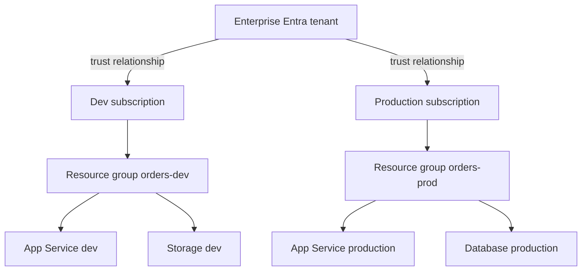
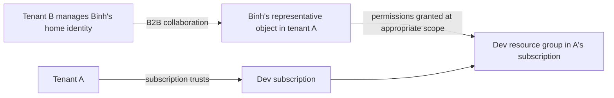

# Microsoft Entra ID Tenant and Its Relationship with Azure Subscriptions

## 1. Why must we distinguish a tenant from a subscription?

When using Azure, learners often encounter two seemingly contradictory messages: signing in succeeds yet no subscriptions are visible, or they can manage resources yet cannot manage users in Microsoft Entra ID. The reason is that identity, resource permissions, and billing relationships belong to different scopes.

**A Microsoft Entra ID tenant is an identity directory; an Azure subscription is a scope for managing resources and tracking Azure usage.** They are linked through a trust relationship, but they are not the same object. Understanding this relationship helps you deploy applications into the right environment, grant permissions to the right people, and avoid accidentally changing administrative configurations.

Within the Azure ecosystem, this knowledge is the foundation for organizing subscriptions, resource groups, application identities, and access permissions for networking, compute, Storage, or databases. It also affects how administrative activity is monitored and how an application architecture is handed over to an operations team.

After this lesson, you should be able to:

- Explain what a tenant contains and how it differs from a subscription.
- Describe the relationship between one tenant and multiple subscriptions.
- Distinguish between Tenant ID, Subscription ID, and Object ID.
- Separate Microsoft Entra directory administration permissions from Azure resource administration permissions.
- Understand why guest users can access resources while a subscription remains associated with only one tenant.
- Verify the correct tenant and subscription in the Portal or Azure CLI.
- Distinguish switching sign-in context from changing a subscription's associated tenant.

## 2. What is a Microsoft Entra ID tenant?

### 2.1. A directory for identities and access configuration

Microsoft Entra ID is a cloud-based identity and access management service. A tenant is a dedicated instance of this directory serving an organization or a specifically designed organizational scope. In documentation and the interface, the term **directory** is commonly used to refer to this directory.

Microsoft Entra ID provides authentication, access policies, and identity protection for users, applications, devices, and resources. Each new directory starts with an initial domain in the form `your-org.onmicrosoft.com` and can also be configured with the organization's custom domain. [Microsoft Learn: Microsoft Entra and Entra ID](https://learn.microsoft.com/en-us/entra/fundamentals/what-is-entra).

Common objects in a tenant include:

| Object | Role in the system |
| --- | --- |
| User | Represents a user, including internal users and external people brought into a collaboration context |
| Group | A collection of members used for management and permission assignment by design |
| Application object | Describes the registration configuration of an application |
| Service principal | Represents an application or workload identity within the tenant |
| Device | Represents a device in device identity management scenarios |

Having an object in a tenant does not automatically grant access to every resource. An identity object is the basis for the system to identify a principal; permissions still need to be granted through the appropriate mechanism and scope.

### 2.2. A tenant is not a server or deployment region

A tenant is not a VM, a virtual network, or a resource group. You do not choose a tenant instead of choosing a region when creating a VM, and you do not put a database "into a tenant" in the same way you put it into a resource group.

For example, a single tenant can serve identities for a group of applications that deploy resources across multiple regions. The deployment location of each resource is a separate concern from the identity directory that the subscription trusts. Specific data residency requirements for each service still need to be evaluated separately.

You should also not equate Entra ID with a self-installed Active Directory Domain Services server in an internal network. Entra Domain Services is a different service that supports needs such as LDAP and Kerberos/NTLM for suitable scenarios. [Microsoft Learn: Microsoft Entra product family](https://learn.microsoft.com/en-us/entra/fundamentals/what-is-entra).

### 2.3. A company does not necessarily have only one tenant

An enterprise can choose one primary tenant for employees and multiple subscriptions for application environments. Due to mergers, organizational splits, or special governance requirements, an enterprise may also have multiple tenants.

Each additional tenant brings overhead for accounts, policies, applications, and collaboration relationships. Therefore, separating a lab exercise or a dev environment from production is not enough reason on its own to create a new tenant; you must identify which boundaries truly need isolation.

Creating a new tenant also depends on current account permissions and eligibility requirements. This lesson uses an existing tenant or an environment provisioned by an administrator to observe relationships, without requiring the creation of an additional tenant. [Microsoft Learn: conditions to create a tenant](https://learn.microsoft.com/en-us/entra/fundamentals/create-new-tenant).

## 3. Relationships among tenants, subscriptions, and resources

### 3.1. Core rule: each subscription trusts one tenant

Each Azure subscription is associated with a Microsoft Entra tenant to use the identities in that directory when accessing resources. A subscription trusts only one directory at a time; a single tenant can be trusted by multiple subscriptions. [Microsoft Learn: associate subscription with tenant](https://learn.microsoft.com/en-us/entra/fundamentals/how-subscriptions-associated-directory).

This means:

- One tenant can serve `sub-learning`, `sub-orders-dev`, and `sub-orders-prod`.
- Creating an additional subscription does not necessarily require creating an additional tenant.
- Inviting someone from another organization to participate does not turn the subscription into an object attached to two tenants simultaneously.
- Switching between accessible directories in the Portal does not change a subscription's association.

The trust relationship provides the identity context. It is not an operation that grants blanket permissions to every user in the tenant.

### 3.2. Subscriptions organize resources along a different dimension

A subscription is a key scope for managing resources, assigning Azure RBAC, and aggregating usage for billing. Inside a subscription, resource groups help organize resources by lifecycle and management purpose.

An example illustrating an organization sharing one tenant for dev and production:



The diagram illustrates relationships; it does not mean everyone in the tenant can read production data. The development team may be granted permissions only in the dev environment, while production access follows a different process.

Management groups can organize subscriptions within a tenant to apply higher-level governance. Choosing a purchasing agreement type and structuring subscription governance should be considered together. [Microsoft Learn: tenant and Azure billing offers](https://learn.microsoft.com/en-us/azure/cloud-adoption-framework/ready/landing-zone/design-area/azure-billing-microsoft-entra-tenant).

### 3.3. Tenants and billing do not form the exact same simple tree

The relationship with a tenant answers which identities are used to grant access to resources. The billing relationship answers under which agreement costs are recorded. Subscriptions within the same tenant can have billing relationships with different agreements. [Microsoft Learn: billing and tenant relationship](https://learn.microsoft.com/en-us/azure/cost-management-billing/understand/understand-billing-tenant-relationship).

Therefore, do not assume that the administrator of a tenant is the person directly paying for every resource, or that all subscriptions in the same tenant must use a single payment card. To determine cost responsibility, check the corresponding billing agreement and billing permissions.

For example, `sub-orders-dev` and `sub-orders-prod` share corporate identities, yet the finance team can still track costs by subscription and according to the organization's invoice structure. Separating subscriptions helps organize resource governance; it does not create a new employee directory.

## 4. Identifying the right IDs

### 4.1. Tenant ID and Subscription ID

**Tenant ID**, also called Directory ID in some contexts, identifies a tenant. **Subscription ID** identifies an Azure subscription. Both typically take the form of a GUID, so looking at the string format alone cannot tell you whether you are using the right type of ID.

| Value | What does it identify? | Example usage |
| --- | --- | --- |
| Tenant ID | Microsoft Entra directory | Select authentication context or verify directory |
| Subscription ID | Azure subscription scope | Choose deployment target and query resources |
| Object ID | A specific identity object in a directory context | Point to the exact user, group, or service principal when configuring permissions |
| Application/Client ID | Registered application identifier | Configure a client integrated with the identity platform |
| Resource ID | Management path of an Azure resource | Identify a specific Storage account, App Service, or other resource |

Display names for tenants or subscriptions are for human readability. In a system with multiple similarly named environments, verify the IDs rather than relying solely on names like `Default Directory` or `Production`.

Example Resource ID:

```text
/subscriptions/11111111-1111-1111-1111-111111111111/resourceGroups/rg-orders-dev/providers/Microsoft.Storage/storageAccounts/stordersdemo
```

The path indicates the resource's subscription and resource group. It does not replace the Tenant ID when an application or tool needs to determine the identity context.

### 4.2. The same user does not necessarily have the same Object ID across tenants

A person can use their organization's identity to participate in another tenant through collaboration. The object representing that person in the resource tenant is a separate object, so you should not assume it has the same Object ID as the object in the home tenant.

Similarly, an application can have one Application/Client ID and multiple service principals across different tenants. The application's Client ID is not the Object ID of every service principal representing that application. [Microsoft Learn: application object and service principal](https://learn.microsoft.com/en-us/entra/identity-platform/app-objects-and-service-principals).

When troubleshooting permission errors, ask "Which object's Object ID in which tenant?" rather than only asking for an email address or application name. When sharing diagnostic information, do not send passwords, client secrets, private keys, or access tokens; those serve an entirely different role from identifier IDs.

## 5. Three permission scopes to keep separate

### 5.1. Microsoft Entra roles: directory administration

Microsoft Entra roles manage directory-related functions such as users, groups, domains, and applications. Global Administrator is an administrative role with broad impact within the tenant.

Azure roles and Microsoft Entra roles are two permission systems with different purposes. Having permission to manage a subscription does not automatically make someone a Global Administrator of the tenant. [Microsoft Learn: Azure roles and Microsoft Entra roles](https://learn.microsoft.com/en-us/azure/role-based-access-control/rbac-and-directory-admin-roles).

For example, a resource administrator can deploy an App Service without having permission to modify a directory setting. This may be intentional separation of duties, not a Portal bug.

### 5.2. Azure RBAC: resource administration and supported data permissions

Azure RBAC determines which principal can perform which actions at which resource scope. A role assignment consists of three main components:

```text
Security principal + Role definition + Scope
Principal          + Permission set  + Scope
```

A principal can be a user, group, service principal, or managed identity. A scope can be a management group, subscription, resource group, or individual resource. [Microsoft Learn: Azure RBAC](https://learn.microsoft.com/en-us/azure/role-based-access-control/overview).

Common roles include:

| Azure Role | General capabilities at the assigned scope |
| --- | --- |
| Reader | View resources |
| Contributor | Manage resources; cannot assign Azure RBAC roles through this role alone |
| Owner | Manage resources and assign Azure RBAC roles |

Effective permissions also depend on scope, inheritance, and applicable constraints. Someone with broad permissions at the subscription level is not restricted back down simply by being assigned Reader on a single resource group. [Microsoft Learn: Azure roles](https://learn.microsoft.com/en-us/azure/role-based-access-control/rbac-and-directory-admin-roles), [how role assignments combine](https://learn.microsoft.com/en-us/azure/role-based-access-control/overview).

Resource management permissions must also be distinguished from data access permissions. For example, viewing a Storage account's configuration and reading a blob are two different types of actions; specific data roles and mechanisms must be checked per service.

### 5.3. Global Administrator is not the Owner of every subscription by default

By default, Entra permissions do not automatically grant Azure resource management permissions. However, a Global Administrator has a mechanism to elevate access for Azure at the root scope to assist with administration and access recovery, receiving the User Access Administrator role through the corresponding procedure. This is an explicit action, not an Owner role automatically appearing on every subscription. [Microsoft Learn: elevate access for a Global Administrator](https://learn.microsoft.com/en-us/azure/role-based-access-control/elevate-access-global-admin).

Design point to note: separating subscriptions helps divide operational permissions, but it does not create a boundary completely independent of tenant identity administration permissions. Organizations must protect tenant administrator accounts in proportion to their blast radius.

Do not handle every access error by requesting Global Administrator or enabling access elevation. First, identify the target resource, the action to perform, and the appropriate permission scope.

### 5.4. Billing permissions: managing billing relationships

Billing permissions cover tasks under a purchasing agreement, such as managing invoice structures and certain billing details. This mechanism must be checked separately from directory permissions and resource permissions; specific capabilities also depend on the billing account type. [Microsoft Learn: billing, agreements, and tenant relationship](https://learn.microsoft.com/en-us/azure/cost-management-billing/understand/understand-billing-tenant-relationship).

For example, Minh manages a dev resource group to deploy applications, the IT team administers employee accounts, and the finance team receives invoices. All three participate in one system without needing to be assigned the same set of permissions.

## 6. Internal users, guest users, and multi-tenant access

### 6.1. Home tenant and resource tenant

In a collaboration scenario between two organizations, the **home tenant** is the origin tenant that manages the user's identity; the **resource tenant** is the tenant where the resources or applications to be accessed are managed. A person can use their own organization's credentials to collaborate with another organization via Microsoft Entra B2B.

The resource tenant has a user object representing the collaborator, typically a guest. The resource-owning organization still controls access according to its own configurations and policies. [Microsoft Learn: Microsoft Entra B2B collaboration](https://learn.microsoft.com/en-us/entra/external-id/what-is-b2b).

Member or Guest describes the user type in the directory context; you should not use that type name to infer all Azure permissions. To know whether someone can modify Storage, you need to check effective permissions on that Storage account.

### 6.2. Example: external specialist supporting the dev team

An Phát company has tenant A and subscription `sub-orders-dev` associated with A. Bình works for a partner company and has a home identity in tenant B.

Illustrative collaboration setup:

1. An Phát permits and configures collaboration with Bình according to its policies.
2. Bình completes the onboarding process using the exact invited identity.
3. An Phát's administrator grants the necessary permissions to Bình's object in tenant A on resource group `rg-orders-dev`.
4. Bình uses the tenant A context when managing the assigned resources.
5. When the contract ends, An Phát revokes the permissions and handles the collaborator object's lifecycle per procedure.

The subscription still trusts tenant A. The fact that Bình's home identity resides in B does not create a second trust relationship for the subscription.



The diagram describes collaboration and permission relationships, not the complete sign-in protocol. Collaborators may need to satisfy access conditions from the participating organizations.

### 6.3. Being invited to a tenant is not enough to use resources

An invitation or guest object only solves part of the identity presence problem. If Bình has not been granted permissions on the resource group, signing in successfully still does not allow deploying applications.

Conversely, if Bình has permissions on `rg-orders-dev`, that does not automatically allow Bình to administer all of tenant A or modify production data. In this example, the outcomes are determined by specific granted permissions and applicable policies.

Both direct permissions and group-based permissions must be reviewed. Removing a single role assignment is not enough if the user still receives the same permission through another path.

## 7. Tenants are also the identity context for applications

### 7.1. Application object and service principal

An application registered in Entra has an application object in its home tenant. A service principal is the representation of the application in a specific tenant, used in the context of permissions and access within that tenant. For an application supporting multiple tenants, there can be multiple representative service principals across the tenants using the application. [Microsoft Learn: application and service principal objects](https://learn.microsoft.com/en-us/entra/identity-platform/app-objects-and-service-principals).

Therefore, an application supporting users from multiple organizations does not mean the subscription running the application must be attached to all customer tenants. One describes the application's identity model; the other describes the subscription's governance relationship.

### 7.2. Example: Java API deployed on Azure

Suppose an orders API is deployed on App Service in `sub-orders-prod` of tenant A. The API calls Storage and a database while authenticating users according to the enterprise design.

There are at least three independent questions:

| Question | What needs to be determined |
| --- | --- |
| Who is allowed to deploy or modify the App Service? | Administrative identity and Azure permissions on the resource or parent scope |
| Who is allowed to sign in to the API and perform business operations? | Application identity configuration and authorization rules inside the API |
| Which identity does the API use to call other services? | Workload identity, permission grants, and target service configuration |

You should not grant subscription administrative permissions to users simply because they need to sign in to the application. Likewise, permission to deploy the App Service does not substitute for business permissions such as which orders a user may view.

If using a managed identity for supported connections, the application still needs to be granted the proper permissions on the target service. The goal is to use a properly scoped workload identity rather than tying every connection to a personal administrator account.

### 7.3. Successful authentication still requires authorization checks

In a high-level governance flow:

1. A user or workload authenticates in the appropriate identity context.
2. The client receives an access token intended for the target service.
3. The client sends the request with the token attached.
4. The service validates the token and applies its authorization mechanism.
5. The request is fulfilled only if the required access conditions are met.

An access token is meant for a specific resource or API; an ID token serves the client's sign-in context. Applications must validate tokens according to the proper protocol and intended purpose, rather than seeing a token string and treating it as sufficient authorization. [Microsoft Learn: tokens and claims](https://learn.microsoft.com/en-us/entra/identity-platform/security-tokens).

For example, a user authenticated in tenant A who only has Reader on `rg-orders-dev` is still not allowed to modify the App Service in that resource group. The permission error here is not resolved by signing in again to an arbitrary different tenant.

## 8. Checking tenants and subscriptions in a real environment

### 8.1. Checking with the Portal

This practice exercise only requires viewing information in an existing or provisioned tenant and subscription.

**Step 1: confirm the signed-in identity.** Open the [Azure Portal](https://portal.azure.com/) and check the current account. If you have both a personal account and a work account with similar names, choose the right one that has been granted permissions.

**Step 2: view the current tenant.** Open Microsoft Entra ID or the [Microsoft Entra admin center](https://entra.microsoft.com/), locate the directory overview information, and verify the Tenant ID, tenant name, and displayed domain according to your granted permissions. The UI layout may change over time; the goal is to identify the actual directory you are working in.

**Step 3: view the target subscription.** In the Azure Portal, open Subscriptions, select the assigned subscription, and verify the Subscription ID along with the associated directory in the subscription details.

**Step 4: check permissions at the target scope.** Use Access control (IAM) on the appropriate subscription or resource group to view your permissions as allowed. When you need to verify directory permissions, use the Entra roles management feature rather than inferring them from a resource group's IAM.

**Step 5: compare against your task scope.** If the task requires creating resources in dev, confirm that you are in the assigned dev subscription and resource group. Do not let similar names replace checking the IDs.

If you do not see the subscription, check your identity, selected directory, subscription filter, and granted permissions. Do not change the subscription's associated tenant yourself to work around the Portal not displaying the assigned environment.

### 8.2. Checking with Azure CLI

If you have installed and signed in to Azure CLI with the appropriate identity, you can list the subscriptions currently visible to the account:

```bash
az account list --query "[].{subscription:name,subscriptionId:id,tenantId:tenantId,state:state,isDefault:isDefault}" --output table
```

Select the target subscription and read back its details:

```bash
az account set --subscription "<SUBSCRIPTION_ID>"
az account show --query "{subscription:name,subscriptionId:id,tenantId:tenantId,state:state}" --output json
```

Replace the placeholder with the real ID before running. `az account set` sets the default subscription for the CLI context; it does not move resources and does not change the associated tenant. `az account list` is also not a list of every subscription across the entire enterprise regardless of permissions. [Microsoft Learn: az account](https://learn.microsoft.com/en-us/cli/azure/account).

Illustrative output example:

```json
{
  "subscription": "sub-orders-dev",
  "subscriptionId": "11111111-1111-1111-1111-111111111111",
  "tenantId": "aaaaaaaa-aaaa-aaaa-aaaa-aaaaaaaaaaaa",
  "state": "Enabled"
}
```

If the production subscription has a different Subscription ID but the same `tenantId`, both subscriptions share the same directory context. That does not imply you have the same permissions in both.

The IDs in the example are fictional. The Portal and CLI may have different current selections, so check within the exact tool where you will perform the administrative request.

### 8.3. Expected outcomes of the observation exercise

Learners succeed when they can answer:

- What identity is currently in use and in which tenant is it operating?
- What is the target subscription's ID and which Tenant ID is it associated with?
- Are the granted permissions at the subscription, resource group, or individual resource scope?
- Is a guest user object in the resource tenant being used?
- Who is the point of contact for granting directory permissions, Azure permissions, and handling billing?

There is no need to create users, invite guests, create tenants, or grant broad permissions just to complete the observation part. If you lack permission to view an item, ask an administrator to confirm the needed information following your organization's procedure.

## 9. Distinguishing context switching from architectural changes

### 9.1. Four operations with easily confused names

| Operation | What actually changes | What cannot be inferred |
| --- | --- | --- |
| Selecting a different directory in a Portal session | The user's active working directory context | That the subscription was moved to another tenant |
| Selecting a subscription with `az account set` | The default subscription in the CLI context | That resources were migrated |
| Changing a subscription's associated tenant | The directory providing identity context for the subscription | That permissions and all app connections are automatically preserved |
| Transferring billing relationship or ownership | Commercial relationship per supported operation | That the tenant always changes in the same way |

For example, Hương has permissions in tenants A and B. When Hương switches the Portal to B to view another project, subscriptions associated with A remain associated with A. This is a change in where Hương is observing, not a resource architecture change.

### 9.2. Transferring a subscription's tenant is a permission-impacting change

A subscription trusting tenant A may have many role assignments referencing users, groups, and workloads in A. When switching to another tenant, you cannot assume objects with the same names in the new tenant will automatically inherit those permissions.

Directory transfer documentation states that role assignments and custom roles are not carried over intact to the destination tenant, and managed identities as well as identity-dependent services require separate handling. Transfer eligibility also depends on subscription type and active services; some cases are not supported. [Microsoft Learn: transfer a subscription to a different directory](https://learn.microsoft.com/en-us/azure/role-based-access-control/transfer-subscription).

Therefore, before an actual migration plan, an organization must inventory identities, permissions, tenant-dependent service configurations, and how to test applications afterward. An API losing permission to call Storage is not just a question of whether an administrator can sign in.

Transferring a directory and transferring billing ownership are separate decisions; you should not treat changing directories as automatically completing the handover of billing responsibility. [Microsoft Learn: subscription directory relationship](https://learn.microsoft.com/en-us/entra/fundamentals/how-subscriptions-associated-directory).

This lesson focuses on identifying boundaries and impacts and does not require performing a transfer on a subscription containing resources.

## 10. Comprehensive scenario: one tenant, two subscriptions

An Phát company uses tenant `anphat.onmicrosoft.com`. The orders application has separate dev and production subscriptions. Employees and workload identities are governed in the tenant according to the company's design.

| Principal | Illustrative permission or duty | Desired outcome |
| --- | --- | --- |
| Development team | Contributor on `rg-orders-dev` | Deploy and test in dev |
| Production operations team | Production resource management permissions per role | Operate the live application under a separate process |
| Identity administration team | Appropriate Entra roles | Manage users, groups, and assigned identity settings |
| Bình from partner | Approved permissions at dev scope | Support dev for the duration of the contract |
| Production API identity | Required permissions on target data services | API accesses data within its job scope |
| Finance point of contact | Billing permissions per agreement | Track and handle billing responsibilities |

This design illustrates sharing an identity foundation while separating operational permissions. The rows in the table do not create permissions automatically; administrators must configure, verify, and manage the lifecycle of the corresponding permissions.

Three business changes show why tenants and subscriptions must be understood separately:

- **New employee joins:** the organization handles accounts and groups via the identity process, then checks which Azure permissions the person receives. There is no need to create a dedicated subscription just for a new employee.
- **New project starts:** the organization decides on the appropriate resource group or subscription, along with budget and administrators. Creating a new tenant is not necessarily required.
- **Partner contract ends:** the organization revokes the access paths granted to the partner. Renaming a subscription does not revoke a collaborator's permissions.

For system monitoring, distinguish between sign-in events, identity object changes, and resource changes. When investigating an error, recording the exact timestamp, identity, Tenant ID, Subscription ID, and failed action helps route it to the right team.

## 11. Common misconceptions

| Misconception | Accurate understanding |
| --- | --- |
| Tenant and subscription are two names for the same object | A tenant serves identity; a subscription organizes resources and usage |
| One tenant can only have one subscription | One tenant can be trusted by multiple subscriptions |
| Everyone in a tenant can use every subscription | Permissions must be granted by principal, action, and scope |
| Subscription Owner inherently administers all of Entra | Azure permissions do not automatically become directory admin permissions |
| Global Administrator is the Owner of all resources by default | Directory roles and Azure permissions are distinct; access elevation is a separate action |
| Guests can only view resources | Actual permissions depend on what was granted and applicable policies |
| External access attaches the user's tenant to the subscription | Identity collaboration differs from a subscription's tenant trust relationship |
| Same email means the same object in every tenant | You must identify the object and Object ID in the right tenant |
| Multi-tenant apps require the subscription to trust multiple tenants | An app's sign-in model differs from a subscription's governance relationship |
| Switch directory in the Portal moves a subscription | It only changes your session's working context |
| Changing tenants automatically preserves all permissions and connections | You must assess impact and address each identity dependency |

## 12. Self-check exercises

### Exercise 1: Diagram two environments' relationships

An enterprise has 40 employees, one tenant, and three subscriptions for dev, test, and production. Draw a diagram showing the tenant, subscriptions, resource groups, and employee groups.

**Comparison hint:** the diagram has one tenant trusted by three subscriptions. Users or groups are assigned permissions at specific scopes without duplicating the employee directory just to have three environments. Also explain which group is allowed to modify production.

### Exercise 2: Classify permission requests

Classify four requests: modifying App Service configuration, resetting an internal user's authentication credentials, reading an application blob, and viewing invoices.

**Comparison hint:** modifying resources belongs to Azure permissions; managing user accounts belongs to identity scope; reading blobs requires the appropriate data permission mechanism; invoices belong to billing permissions depending on the agreement type. Do not pick one broad administrative role instead of identifying each need.

### Exercise 3: Diagnose a guest user issue

Bình accepted An Phát's invitation, signed in successfully, yet does not see the dev resource group. List the order of information to verify.

**Comparison hint:** check the exact identity that accepted the invitation, the resource tenant, the subscription, and the active filter; then verify Bình's object in An Phát's tenant, the role assignment, and the granted scope. If all information looks correct yet the error persists, hand over concrete evidence to an administrator rather than arbitrarily creating extra accounts.

### Exercise 4: Distinguish two types of changes

Hương selects tenant B in the Portal, then selects `sub-project-b` in the CLI. A colleague says Hương's old resources have been moved out of tenant A. Is that conclusion well-founded?

**Comparison hint:** no. Context selection actions do not prove resource migration or a change to a subscription's associated tenant. To confirm, read the current association of the exact subscription and relevant change history.

### Exercise 5: Evaluate a handover plan

A team plans to move a project's subscription into the company tenant and assumes that once the recipient can sign in, the handover is complete. List at least four categories of missing information.

**Comparison hint:** user and group permissions; workload identities; tenant-dependent service configurations; post-change application verification; operational points of contact; billing relationships. This is a plan evaluation exercise and does not require performing a tenant transfer.

## 13. Key takeaways

A Microsoft Entra ID tenant provides the identity context, whereas a subscription is an Azure resource management scope that trusts one tenant at a time. Multiple subscriptions can share a tenant while still separating operational permissions and cost responsibilities.

When handling an access request, identify the right identity, tenant, subscription, permission type, and scope. When working via the Portal or CLI, verify IDs before taking action. When the architecture changes tenants, re-evaluate permissions and identity dependencies; switching the active directory in your session does not perform that architectural change.
