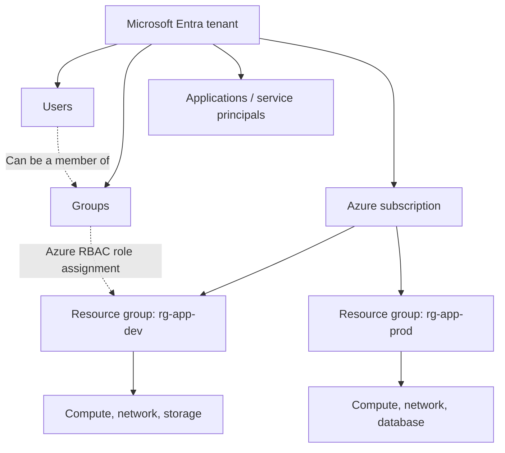
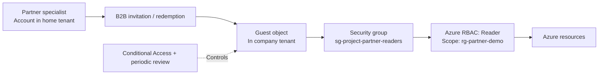

# Users, groups, and external identity management

In the Microsoft Azure ecosystem, resources such as subscriptions, resource groups, virtual machines, networks, and databases must be accessed by the right people, the right applications, and at the right permission level. **Microsoft Entra ID** (formerly Azure Active Directory) provides the identity service for authenticating users, managing groups, and collaborating with people outside the organization. By combining Entra ID with Azure Role-Based Access Control (Azure RBAC), enterprises can grant permissions by role and scope instead of sharing administrative accounts across multiple people.

This lesson focuses on three components: **users**, **groups**, and **external identities**. You will learn how to organize internal identities, delegate permissions via groups, invite external partners, protect sign-in sessions, and revoke access when collaboration ends.

## Learning objectives

After this lesson, you will be able to:

1. Explain the differences between a tenant, user, group, and Azure subscription.
2. Distinguish internal users, guest accounts, and cross-tenant collaboration mechanisms.
3. Choose appropriate group types, membership types, and permission assignment strategies.
4. Invite, grant access to, review, and revoke access for people outside the organization.
5. Apply MFA, Conditional Access, and the least privilege principle in identity governance.
6. Inspect users and groups with Microsoft Graph, distinguishing directory permissions from Azure resource permissions.

## 1. Foundational concepts

A **Microsoft Entra tenant** is an instance of an organization's identity directory. A tenant stores objects such as users, groups, applications, service principals, and authentication and access configuration. An **Azure subscription** is a boundary used for billing, quotas, and resource management; a subscription is associated with one Entra ID tenant for authentication and authorization. One tenant can be associated with multiple subscriptions.



The diagram shows that a group in the tenant can be assigned Azure RBAC on a resource group. Users who are members of the group receive the corresponding permissions via the role assignment, subject to policies and other access control conditions.

| Concept | Primary function | Example |
|---|---|---|
| **User** | Represents a user identity managed or referenced in the tenant. | Operations engineer, external consultant. |
| **Group** | A collection of identities for collaboration or bulk permission management. | `sg-azure-dev-readers`, project team in Microsoft 365. |
| **Directory role** | Permissions to administer objects and features in Microsoft Entra ID. | User Administrator, Groups Administrator. |
| **Azure RBAC role** | Permissions to perform actions on Azure resources at a specific scope. | Reader, Contributor, Virtual Machine Contributor. |
| **Service principal / managed identity** | Workload or application identity, not a human account. | Deployment pipeline, application on Azure Functions. |

Two permission systems must be clearly distinguished: **Microsoft Entra roles** administer the identity directory, while **Azure RBAC roles** administer Azure resources. Someone with permission to create users in Entra ID does not automatically have permission to modify a VM; someone with Contributor on a resource group cannot automatically create users in the tenant.

## 2. Users in Microsoft Entra ID

Each user is an identity object in the tenant with a unique **object ID**. Common attributes include:

- `displayName`: display name in the interface and applications.
- `userPrincipalName` (UPN): sign-in name in an email-like format, for example `lan@contoso.com`; the UPN is not necessarily a mail-receiving email address.
- `mail`: contact email address when present, which may differ from the UPN.
- `id`: GUID-formatted object ID, commonly used when automating via Microsoft Graph and Azure CLI.
- `userType`: usually `Member` or `Guest`, reflecting how the object is classified in the tenant.
- `accountEnabled`: status indicating whether the user is allowed or blocked from signing in per configuration.

**Object ID** is a stable identifier within the tenant scope, making it more suitable than display name or email when automating role assignments. If a person is represented in two tenants, each tenant may store a different object ID for the corresponding object.

### 2.1. Internal users (member)

Members are typically people belonging to the organization who hold an account in the tenant and use company services. An organization can create accounts under two models:

- **Cloud-only identity**: users are created and managed directly in Microsoft Entra ID; suitable for organizations operating entirely in the cloud.
- **Hybrid identity**: objects are synchronized from an on-premises identity system such as Active Directory Domain Services using Microsoft Entra Connect Sync or Cloud Sync. Certain attributes have their source of authority on-premises and therefore cannot always be edited directly in the cloud.

Creating a new user is only part of onboarding. You must also configure appropriate service licenses, groups, authentication methods, MFA requirements, and application permissions. If the user needs to administer Azure, grant permissions through groups at an appropriately narrow scope instead of assigning broad roles across the entire subscription.

### 2.2. External users (guest)

A guest is an object used by an organization to collaborate with people outside the organization. In the **Microsoft Entra B2B collaboration** model, a partner can sign in with their own organization's identity or another allowed method and then access resources your tenant has shared. Your tenant holds a corresponding user object to manage access permissions.

A B2B guest account typically has an internal UPN containing a string like `#EXT#` after being invited. This is a directory representation detail and should not be used as the sole condition for identifying external users. The `userType` field is also a classification attribute; **it does not by itself determine where the account authenticates** and **does not grant permissions on its own**. Some configurations may have external users classified as `Member`, so policies should be based on the object, identity source, and actual access requirements.

### 2.3. User lifecycle management

A practical user management process includes:

1. **Joiner**: create or synchronize the identity, verify user details, apply sign-in policies, and add to appropriate groups.
2. **Mover (role change)**: update groups, application permissions, and Azure RBAC when changing departments or duties; remove permissions no longer needed.
3. **Leaver (offboarding)**: block sign-in as appropriate, revoke active sessions, remove permissions and groups, handle data or ownership responsibilities, and then delete the object per retention policy.

You should not immediately delete a user when they leave the organization without checking applications, resources, data, or processes that depend on the account. For privileged accounts, also consider active sessions, tokens, and permission changes that may not take effect immediately due to caching or synchronization latency.

## 3. Groups: managing permissions and collaboration by collection

**Groups** centralize membership management and simplify granting and revoking permissions. Instead of creating ten separate role assignments for ten engineers who need to read resources, you can create one security group and assign the Reader role to that group on the resource group.

### 3.1. Common group types

| Group type | Primary purpose | Notes |
|---|---|---|
| **Security group** | Manage access to resources, applications, and various policies. | Commonly used as a principal for Azure RBAC. |
| **Microsoft 365 group** | Collaborate across Microsoft 365 services such as Teams, SharePoint, and Outlook, depending on configuration. | Has its own collaboration resources and lifecycle; not the default choice for every Azure RBAC scenario. |
| **Mail-enabled security group** | Combines certain security and email characteristics. | Management capabilities or applicability to specific services depend on group type and tooling. |

In Azure authorization scenarios, a **purpose-built security group** is usually easier to manage and audit than assigning permissions individually to each user. For example:

```text
sg-azure-app-dev-readers
sg-azure-app-dev-contributors
sg-azure-prod-operators
sg-project-partner-readers
```

Names are only suggested conventions. Actual policy should document which environment the group belongs to, who owns it, what permissions are assigned to it, and when it needs to be reviewed.

### 3.2. Assigned and dynamic membership

There are two common ways to manage membership:

**Assigned membership**: an administrator or a group owner with appropriate permissions actively adds and removes members. This model suits small groups, privileged groups, or groups requiring an approval workflow.

**Dynamic membership**: Entra ID automatically calculates membership based on user or device attribute rules. For example, a rule for a dynamic user group might look like:

```text
(user.department -eq "Engineering") -and (user.accountEnabled -eq true)
```

When source attributes change, membership is re-evaluated by the system; there may be processing latency. Dynamic groups require appropriate Entra ID capabilities and licensing. Do not use an attribute that users can easily edit themselves as the sole basis for automatically granting critical permissions.

A group can have an **owner** who manages lifecycle and membership within allowed limits. A group owner does not inherently become an Azure subscription Owner. For groups assigned privileged directory roles, Microsoft Entra applies additional protections and specific restrictions; they should not be treated like ordinary security groups.

### 3.3. Membership and permissions are not strictly equivalent

Adding a user to a group only has effect when that group is actually used by an application, service, or RBAC system to grant permissions. In addition:

- A group may be assigned multiple roles at different scopes; check the total permissions a member receives.
- Not all services handle nested groups the same way; in particular, do not assume nested groups are supported in every licensing or application assignment feature.
- Group-based licensing assigns licenses to members when supported by the environment and license type; this is separate from granting Azure RBAC.
- Membership or role assignment changes sometimes take time to appear in access tokens, caches, or systems consuming groups; verify actual state right after granting or revoking access.

## 4. Granting Azure RBAC through groups

Azure RBAC assigns a **role definition** to a **principal** at a **scope**. The principal can be a user, group, service principal, or managed identity. The role defines allowed operations; the scope defines where it applies.

```text
Group: sg-azure-app-dev-readers
       |
       | Role assignment: Reader
       v
/subscriptions/<subscription-id>/resourceGroups/rg-app-dev
       |
       +--> Resources inside the resource group
```

Example permission workflow for a development team:

1. Create the security group `sg-azure-app-dev-readers` in the tenant.
2. Add engineers who need to view resource group configuration to the group.
3. In the Azure Portal, open resource group `rg-app-dev`, select **Access control (IAM)**, and create a **Reader** role assignment for the group.
4. Verify that users can read resource management metadata but cannot modify configuration because Reader lacks write permissions.
5. When an engineer leaves the project, remove them from the group and check for any direct role assignments.

Note: the **Reader** role in Azure RBAC primarily applies to the **management plane**. It does not inherently allow reading blob contents or application data. To read Blob Storage data using Microsoft Entra ID, a data-plane role such as **Storage Blob Data Reader** at the appropriate scope may be required. This is a common point of confusion between "seeing the storage account" and "reading files inside storage."

If checking or applying via Azure CLI, a role assignment for a group can be written as follows (run only after confirming the group ID, scope, and your own permissions):

```bash
az role assignment create \
  --assignee-object-id "<group-object-id>" \
  --assignee-principal-type Group \
  --role Reader \
  --scope "/subscriptions/<subscription-id>/resourceGroups/rg-app-dev"
```

Using the object ID avoids ambiguity when two groups share a name or when a name is changed. Azure RBAC represents effective permissions on resources; it does not replace data access policies or Microsoft Entra directory administration.

## 5. External identities: models to distinguish

Microsoft Entra supports several ways to collaborate with people outside the organization. Choose a model based on who the users are, where they sign in, and what types of resources they need to access.

| Model | Audience and purpose | Key characteristics |
|---|---|---|
| **B2B collaboration** | Partners, contractors, and guests who need access to the organization's applications or resources. | The resource tenant typically holds an external user object for assigning permissions; users can authenticate with their home tenant identity or a supported method. |
| **B2B direct connect** | Cross-tenant collaboration in supported applications, typically Teams shared channels. | Relies on cross-tenant access policies; does not mean creating regular B2B collaboration guest users for all applications. |
| **Cross-tenant synchronization** | Automates creating, updating, and removing B2B collaboration objects across partnering tenants. | Requires configuring synchronization and appropriate acceptance policies; does not replace resource permission assignment. |
| **Microsoft Entra External ID in an external tenant** | Builds sign-in experiences for an application's customers (customer identity/CIAM). | Customer-facing tenant model and user journeys; distinct from inviting partners as guests in a workforce tenant. |

A **workforce tenant** is an organization's tenant used to manage employees and collaborate with partners. An **external tenant** serves customer-facing applications in the External ID model. Both scenarios involve "external" users, yet their operational requirements, sign-in UI, and permission models differ; do not choose B2B guests instead of a large-scale customer sign-in solution simply because both have external email addresses.

## 6. Partner invitation workflow using B2B collaboration

Suppose a company is deploying an application on Azure and needs a specialist from a partner firm to inspect a resource group's configuration for three months. You can organize access as follows:



### Step 1: Identify the need and responsible owner

Record the partner's name, access purpose, allowed identity email, resource scope, intended role, access duration, and the internal sponsor responsible. For example, if the partner only needs to inspect the configuration of `rg-partner-demo`, do not grant Contributor or Reader across the entire subscription unnecessarily.

### Step 2: Check external collaboration policies

In the **Microsoft Entra admin center**, someone with appropriate administrative permissions checks **External Identities** settings, including who is allowed to invite, allowed or blocked domains, and **cross-tenant access settings**. These settings determine whether an invitation can be accepted and whether external users can gain access.

**Inbound access settings** control the ability of users from other tenants to access your resources. **Outbound access settings** control the ability of your users to access external tenant resources. Policies can be configured as defaults or per partner organization. Some environments can be configured to trust MFA or device claims from the home tenant, though trusting external claims must follow a security assessment and each mechanism's supported capabilities.

### Step 3: Invite the external user

In the **Users** management area in the Microsoft Entra admin center, select **Invite external user** and enter the partner's details. The recipient completes the **redemption** process to accept the invitation or complete a supported sign-in method. Depending on policy and account type, the user may sign in with their organization's account, another identity provider, or an email one-time passcode if supported and enabled.

The guest object may appear in the directory as soon as the invitation is sent, before the user completes redemption. Therefore, distinguish between **object created** and **invitation accepted and signed in successfully**. If the user cannot access resources, check invitation status, cross-tenant policies, MFA requirements, and application permissions rather than merely confirming their name appears in the Users list.

### Step 4: Add the guest to a group and grant the right scope

Create or use a security group such as `sg-project-partner-readers`, add the guest, and assign Azure RBAC Reader to the group on the target resource group. Assign an internal owner to the group and document its purpose. If the partner needs to enter a SaaS or enterprise application, you must also configure permissions in that application; Azure RBAC alone is not necessarily enough to open an application.

### Step 5: Protect the sign-in session

Apply appropriate **Conditional Access** policies, such as requiring MFA and access conditions aligned with the application's risk level. For multi-tenant partners, check inbound/outbound policies and MFA trust from the source tenant. Test with an actual guest account and inspect sign-in logs to avoid unintentionally locking out all legitimate partners.

### Step 6: Review and revoke

When collaboration ends, remove the guest from security groups and shared applications, revoke any direct role assignments, and block or delete the external object per organizational procedure. Check active sessions and change propagation times. You can use **Access Reviews** or **Entitlement Management** in Microsoft Entra ID Governance, if supported and licensed in your environment, to set up approvals, expiration, and periodic reviews.

## 7. Security policies for users and guests

A critical principle is **never equate authentication with authorization**. Someone who signs in successfully still requires authorization for a specific resource.

### 7.1. MFA and Conditional Access

**Multi-Factor Authentication (MFA)** adds an authentication factor beyond a password, reducing risk if a password is compromised. **Conditional Access** can make access decisions based on identity, application, device, location signals, sign-in risk, and other supported conditions.

Example policy for partners:

- Apply to designated B2B users in the tenant and the applications requiring protection.
- Require MFA; if trusting MFA from the home tenant, configure cross-tenant access settings properly.
- Apply additional conditions for sensitive data based on the risk level accepted by the organization.
- Check sign-in reports and use report-only mode when appropriate before enforcing a policy broadly.

Features such as Conditional Access, Identity Protection, Access Reviews, or Entitlement Management may depend on the license type and Microsoft Entra tier in use. Do not assume every tenant has all of these features enabled by default.

### 7.2. Least privilege and administrative privileges

Apply these rules:

1. Grant the lowest permissions sufficient to complete the job, at the narrowest possible scope.
2. Use groups to manage shared permissions; avoid sprawling direct assignments to individual accounts.
3. Separate administrative accounts or roles from regular accounts when required by organizational policy.
4. Use time-bound permissions, approvals, and **Privileged Identity Management (PIM)** when supported by the environment for privileged roles.
5. Perform access reviews periodically and when users change roles or leave a project.

Guest management must also account for default permissions in the tenant. What directory information a guest can see may be affected by guest user access settings; however, those settings do not replace Azure RBAC, application authorization, or data policies.

### 7.3. Monitoring and audit data

Key information sources for investigation and operations:

| Source | Questions to answer |
|---|---|
| **Microsoft Entra sign-in logs** | Who signed in, from where, what was the authentication result, and which Conditional Access policies applied? |
| **Microsoft Entra audit logs** | Who changed users, groups, memberships, invitations, or directory settings? |
| **Azure Activity Log** | Who created, modified, or deleted resources on the Azure management plane? |
| **Azure role assignments** | Which principal holds which role at a subscription, resource group, or resource? |
| **Access Reviews / Governance reports** | Which permissions were confirmed as still needed and which should be revoked? |

Log retention periods, log viewing permissions, and log export capabilities to long-term storage depend on configuration and licensing. For sensitive activities, designate a point of contact responsible for responding to alerts and verifying the effectiveness of access revocation.

## 8. Reading users and groups with Microsoft Graph

**Microsoft Graph** is the API for managing many Microsoft 365/Entra objects and data, including users and groups. It is a different API from **Azure Resource Manager**: call Graph to manage objects in the directory; call ARM to manage Azure resources and Azure RBAC. A Microsoft Graph token typically has the audience `https://graph.microsoft.com/` and cannot be used in place of an ARM token `https://management.azure.com/`.

Example querying the user list via the Graph HTTP API (illustrative; requires a Graph token with appropriate permissions):

```http
GET https://graph.microsoft.com/v1.0/users?$select=id,displayName,userPrincipalName,userType,accountEnabled&$top=10
Authorization: Bearer <microsoft-graph-access-token>
Accept: application/json
```

Querying the group list:

```http
GET https://graph.microsoft.com/v1.0/groups?$select=id,displayName,securityEnabled,mailEnabled,groupTypes&$top=10
Authorization: Bearer <microsoft-graph-access-token>
Accept: application/json
```

For hands-on practice, you can use the **Microsoft Graph PowerShell SDK**. After installing the Microsoft Graph module in an environment with installation permissions, sign in with delegated scopes allowing reading users and groups:

```powershell
Connect-MgGraph -Scopes "User.Read.All", "Group.Read.All", "GroupMember.Read.All"

Get-MgUser -All -Property Id,DisplayName,UserPrincipalName,UserType,AccountEnabled |
  Select-Object Id,DisplayName,UserPrincipalName,UserType,AccountEnabled

Get-MgGroup -All -Property Id,DisplayName,SecurityEnabled,MailEnabled,GroupTypes |
  Select-Object Id,DisplayName,SecurityEnabled,MailEnabled,GroupTypes
```

These commands are read-only. A tenant may require admin consent for delegated permissions, and the caller must hold appropriate permissions. API results may be paginated; the SDK provides `-All` to iterate through multiple pages. In production environments, do not dump entire user lists into public logs because they contain personal information.

### Checking a user's group memberships

Example querying membership relationships via Graph:

```http
GET https://graph.microsoft.com/v1.0/users/{user-id}/memberOf
Authorization: Bearer <microsoft-graph-access-token>
Accept: application/json
```

This endpoint returns directory objects of which the user is a direct member per the API contract; if you need to evaluate indirect membership through nested groups, check operations such as `transitiveMemberOf` and their corresponding limitations. Do not conclude whether a user has or lacks Azure permissions solely from their group list: you must also verify role assignments at the scope and actual access policies.

## 9. Design scenario: internal team and contractor collaborating on an Azure project

A development team consists of two internal engineers, one team lead, and one partner specialist. Deployed resources are separated into `rg-app-dev` and `rg-app-prod`. Requirements are as follows:

| Subject | Need | Recommended permission setup |
|---|---|---|
| Internal engineers | Inspect configuration and deploy in dev. | Members of `sg-app-dev-contributors`; assign appropriate role on `rg-app-dev`. |
| Team lead | View dev and production resources to evaluate changes. | Corresponding Reader group on each resource group; production write permissions managed separately if needed. |
| Partner specialist | View Azure configuration only for consulting over 60 days. | B2B guest, group `sg-project-partner-readers`, Reader role on `rg-app-dev`, MFA policy, and review date. |

Operational flow:

1. Administration confirms the partner's identity, internal sponsor, and access duration.
2. Admins provision groups and roles as needed; never share accounts or send internal passwords to partners.
3. Production resources have separate role assignments with fewer people allowed to make changes.
4. After 60 days, the responsible owner reviews the business need; if no longer required, revoke group membership and any remaining direct permissions.
5. Use Entra sign-in logs, audit logs, and Azure Activity Log to verify access, track changes, and investigate incidents.

If the specialist needs to read files in Blob Storage rather than just viewing the storage account's configuration, add appropriate data-plane permissions; Azure Reader on the resource group is not sufficient for that operation.

## 10. Common misconceptions

- **"If a user is a Guest, they cannot have high permissions."** `userType` does not place a ceiling on Azure RBAC permissions; a guest can still be assigned broad permissions if an admin grants them. Always check actual role assignments.
- **"A Member is definitely a company employee."** `Member` is an object classification value in the tenant, not legal proof or an absolute source of truth.
- **"Adding a user to a group grants access to every application."** You must check which applications or resources the group is assigned to, as well as other access policies.
- **"Having Azure Contributor lets you manage Entra users."** Azure RBAC and Microsoft Entra roles are two separate permission systems.
- **"Reader can see the storage account, so it can read every blob."** Management permissions and data permissions must be evaluated separately.
- **"Once a guest is invited, they can access immediately."** There may still be redemption, MFA, Conditional Access, application assignment, and RBAC steps.
- **"Deleting or removing a group makes permissions vanish immediately across all sessions."** Account for session validity, tokens, caches, and propagation time; verify access after revocation.
- **"B2B collaboration, B2B direct connect, and External ID for customers are the same."** Each model has different objects and identity management approaches.

## 11. Real-world implementation checklist

- [ ] Tenant, subscription, and management scopes are clearly identified.
- [ ] Users are created or synchronized from the right source; UPN, email, and object ID are used for their intended purposes.
- [ ] Groups have names, owners, purposes, and a membership review process.
- [ ] Azure RBAC is assigned via groups, with appropriate roles and the narrowest required scope.
- [ ] For application data, data-plane permissions are checked separately.
- [ ] Guest invitation policies, allowed domains, and cross-tenant access settings are configured appropriately.
- [ ] External users have an internal sponsor, access expiration, and a revocation process.
- [ ] MFA, Conditional Access, and a plan for inspecting sign-in logs are applied according to risk.
- [ ] Monitoring is in place for user/group changes, role assignments, and Azure resource operations.
- [ ] Sign-in and effective permissions are tested with an account in the appropriate role, including after revocation.

## Conclusion

Identity management in Azure begins with understanding which Microsoft Entra tenant a user belongs to, which groups aggregate users needing the same access, and at which resource scope Azure RBAC assigns permissions to those groups. For external partners, B2B collaboration lets organizations collaborate while keeping permission control within their own tenant; B2B direct connect, cross-tenant synchronization, and External ID for customers address different needs. A secure system combines strong authentication, least privilege, lifecycle management, auditing, and regular verification so users retain permissions only for as long as genuinely required.
