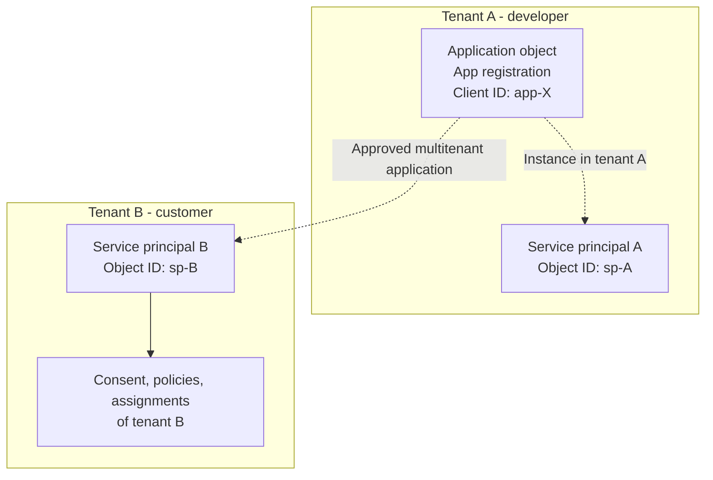
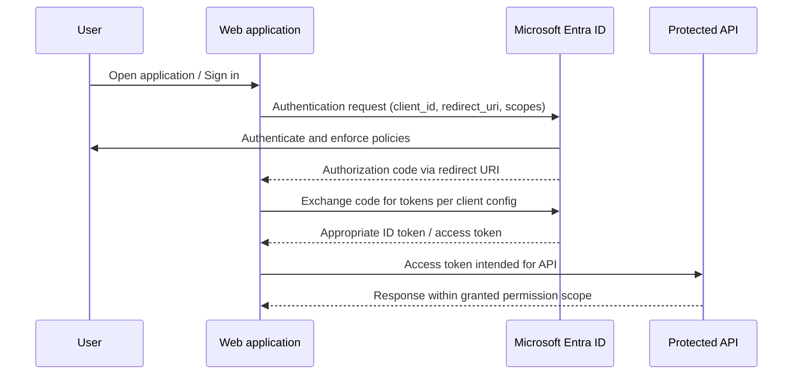

# App registration, service principal, and enterprise application

When a web application lets employees sign in with a Microsoft Entra ID account, or an automated process needs to call an Azure API, Azure must determine **which application is requesting access**, **which tenant that application exists in**, and **what it is allowed to do**. The three concepts **app registration**, **service principal**, and **enterprise application** help model these questions.

This lesson is part of the **Identity with Microsoft Entra ID** chapter of the `CLOUD_PROVIDERS_AZURE` module. Along the journey of learning Azure from subscriptions, resource groups, and Entra ID to networking, compute, storage, data, operations, and cost control, application identity management is the foundation for deploying automated workloads in a controlled manner.

## Learning objectives

After this lesson, you will be able to:

- Distinguish an application definition (*application object/app registration*) from the identity representing the application in a tenant (*service principal*).
- Explain why **Enterprise applications** in the Azure Portal is typically the management interface for service principals.
- Distinguish application (client) ID, directory (tenant) ID, and object ID; determine which ID is used in each operation.
- Describe the flow of registering an application, signing in, granting consent, creating a service principal, and assigning permissions.
- Compare delegated permissions, application permissions, app roles, and Azure RBAC.
- Read, inspect, and govern application identity lifecycles using the Azure Portal and Azure CLI.
- Choose an appropriate authentication method among managed identity, federated credential, certificate, and client secret.

## 1. Context: users and applications are two types of identities

In Entra ID, a **user** typically represents a human; a **service principal** represents an application or workload operating within a tenant. An application may sign in on behalf of a user (for example, an internal HR portal) or operate on its own without a signed-in user (for example, a scheduled data synchronization job).

Consider three scenarios:

1. An HR portal has a **Sign in with Microsoft** button: the application must participate in a user authentication flow and may be granted permission to read basic profile information.
2. A daemon runs every hour to call Microsoft Graph: the daemon needs an application identity and API permissions independent of any user sign-in session.
3. A SaaS provider serves multiple enterprises: each enterprise needs to manage usage and grant permissions for the SaaS app inside its own tenant.

To understand these scenarios, you must separate **the application identity blueprint** from **the instance of the application in each tenant**.

## 2. App registration: defining the application

**App registration** is the action of creating an *application object* in Microsoft Entra ID. The application object describes how the application integrates with the Microsoft identity platform, such as:

- The application's display name.
- **Application (client) ID**: the application identifier used in authentication and token requests.
- **Supported account types**: whether the application accepts accounts only from its own tenant or supports multiple tenants or personal Microsoft accounts.
- Redirect URIs, application platforms (web, SPA, native/mobile), and authentication flow settings.
- APIs exposed by the application (*Expose an API*), scopes, app roles, and API permissions requested by the application.
- Client credentials for confidential clients, such as certificates, federated credentials, or client secrets.
- Owners and metadata for lifecycle governance.

In the Azure Portal, this is typically located under **Microsoft Entra ID → App registrations → New registration**. The application object is created in the application's **home tenant**. Creating an app registration often also creates a corresponding service principal in the home tenant, yet the two objects still have distinct roles and object IDs.

**App registration is not where source code is deployed.** Registering an application does not create an App Service, VM, or container. Conversely, creating an Azure App Service resource does not mean an app registration and API access permissions have been configured for the software running inside it.

### IDs to distinguish

Suppose the application `web-internal-demo` is registered in tenant A. Azure displays several IDs with similar-looking names:

| ID | Meaning | Example usage |
|---|---|---|
| **Application (client) ID** (`appId`) | Application-level identifier used to identify the client in OAuth/OIDC | `client_id` parameter when requesting a token |
| **Directory (tenant) ID** (`tenantId`) | Microsoft Entra ID tenant identifier | Identifying the authority/token endpoint, e.g., `https://login.microsoftonline.com/<tenant-id>` |
| **Application object ID** (`id` of the application object) | Identifier of the app registration record in the home tenant | Managing the app registration object via Microsoft Graph or Azure CLI |
| **Service principal object ID** (`id` of the service principal) | Identifier of the service principal record in a specific tenant | Assigning Azure RBAC, managing enterprise apps, referencing the principal in the tenant |

The application object ID and service principal object ID are **not the same**, even when both belong to the home tenant. The application (client) ID generally stays the same when a multitenant application appears across multiple tenants; each tenant has its own **service principal object ID**.

## 3. Service principal: the application's identity in a tenant

A **service principal** is the object representing an application or workload in **a specific tenant**. It is the local identity that the tenant uses to enforce policies and grant access permissions.

For an application registered in Entra ID:

- The application object is the application definition in the home tenant.
- The service principal is the application instance in the consuming tenant.
- One application object can correspond to **multiple service principals**, one per tenant, when the application is offered to multiple tenants.
- A tenant can have a service principal for an application published by another organization, even though that tenant does not own the app registration.

The following diagram illustrates a SaaS application registered in tenant A and permitted for use by customer tenant B:



In this example, `sp-A` and `sp-B` have different object IDs, yet both reference the same application (client) ID `app-X`. Tenant B's administrator can control sign-in, consent, allowed users, or API permissions for the application in tenant B without owning the SaaS provider's source code.

### Not every service principal comes from an app registration you created

Beyond applications registered by the organization itself, a service principal can also represent:

- Third-party applications or Microsoft applications used by the tenant.
- A **managed identity** managed by Azure for a resource or standalone identity; this is also a form of service principal, though with a different lifecycle and credential management model.
- Certain gallery applications added through Enterprise applications to configure single sign-on (SSO) and grant access.

Therefore, not finding an application in the tenant's **App registrations** list does not mean it has no service principal in that tenant.

## 4. What is an Enterprise application?

In the Azure Portal, **Enterprise applications** is the area for managing *service principals* and tenant-level application integrations. It typically represents **the perspective of the organization consuming the application**, whereas **App registrations** represents the perspective of the organization building and configuring the application definition.

| Aspect | App registrations | Enterprise applications |
|---|---|---|
| Primary object | Application object | Service principal in the tenant |
| Core question | How is the application defined, how does it sign in, and how does it call APIs? | Does this tenant allow the application to operate, and who can use it? |
| Scope | Home tenant of the application object | Tenant currently being administered |
| Typical settings | Client ID, redirect URI, supported account types, scopes, app roles, credentials, requested API permissions | User/group assignments, SSO, sign-in logs, policies, and tenant-granted consent/permissions |
| Relationship | A multitenant app has one definition in its home tenant | Can have a separate service principal in each tenant using the app |

For an internally registered application, you typically see **both an app registration and an enterprise application** in the same tenant. For an external SaaS application, the customer tenant usually sees only the enterprise application; the app registration resides in the provider's home tenant.

In Enterprise applications, commonly useful sections include **Properties**, **Users and groups**, **Permissions**, **Single sign-on**, and **Sign-in logs**. Some features depend on the application type, configuration, and the tenant's Entra licensing; not every enterprise app has the exact same set of features.

### What does "Assignment required?" do?

For enterprise applications that support this access control mode, administrators can enable **Assignment required?** so that only assigned users or groups can sign in to the application. This setting is an access control layer at the enterprise app level; it does not replace internal business authorization checks inside the application, nor does it automatically grant Azure resource management permissions.

For certain app-only or service principal flows, app role assignments follow separate rules. Therefore, do not rely on a single UI toggle as the sole barrier against all forms of token issuance; evaluate the authentication flow, consent, and related policies.

## 5. Flow from registration to a working application

An internal web application typically goes through these steps:

1. The developer registers the application in Entra ID and obtains the client ID and tenant ID.
2. The developer configures the platform, redirect URI, OIDC/OAuth flow, and required API permissions.
3. Entra ID creates or resolves a service principal for the application in the consuming tenant; for multitenant applications, a service principal is created in the customer tenant when the app is added or consented through the appropriate flow.
4. A user or administrator grants consent if the application requests API permissions requiring consent.
5. The tenant enforces application-related settings such as user assignment, Conditional Access, consent policies, or other restrictions.
6. The application redirects the user to Entra ID, obtains tokens according to the configured flow, and validates tokens as needed.



The diagram simplifies the **authorization code flow** of a web application. In practice, use a Microsoft-supported library such as **MSAL**, use PKCE as guided for the respective client type, and strictly validate the token's issuer, audience, lifetime, and signature. An **ID token** conveys the authentication result to the client; an **access token** is issued to call a resource/API with a matching `aud`. Never use an ID token as an access token to call an API.

### Single-tenant and multitenant

- **Single-tenant**: the application accepts identities belonging to its own organization's tenant per configuration; suitable for internal applications.
- **Multitenant**: the application object can be used by multiple Entra tenants; each consuming tenant manages its own service principal and consent.
- **Applications supporting personal Microsoft accounts**: audience options can allow personal accounts alongside work/school accounts, suitable for broader consumer-facing products.

Supporting multitenant does not automatically mean every tenant has approved the application. A customer tenant still enforces its own consent policies, admin permissions, and security rules. When building multitenant applications, validate the token's tenant, isolate data routing by tenant, and prevent cross-tenant data leakage.

## 6. API permissions, consent, app roles, and Azure RBAC

One of the biggest misconceptions is treating every "permission" in Azure as the same type. In reality, API access permissions granted by Entra and Azure resource control permissions via RBAC are different mechanisms.

### Delegated permissions: application acting on behalf of a user

With **delegated permissions**, the application calls an API while a user is signed in. The token represents both the user and the client; effective permissions are typically bounded by both the delegated permissions granted to the app and the user's own permissions and policies on the API.

For example, a calendar app needs to read the user's calendar through Microsoft Graph. The app can request the delegated permission `Calendars.Read`, and the user or administrator grants consent according to tenant policy. This permission does not inherently allow the app to read every employee's calendar.

### Application permissions: application acting on its own

With **application permissions**, a daemon or background service calls an API using **the application's own identity** without an interactive user. Permissions are typically granted through app roles exposed by the resource API and usually require admin consent. App-only tokens have no signed-in user context.

For example, a scheduled automation job reading data from an enterprise management API can use the client credentials flow and an appropriate application permission. Because these permissions can affect broad datasets, scope them down to the minimum required and apply any scoping controls supported by the target API.

| Aspect | Delegated permission | Application permission |
|---|---|---|
| Signed-in user present | Typically yes | Not required and usually absent |
| Identity calling the API | Application on behalf of user | Application identity |
| Token typically carries | `scp` (scope) | `roles` (app roles), if the API uses that model |
| Consent | User or admin, depending on permissions and policy | Usually granted by admin |
| Use cases | Web/mobile apps calling APIs on behalf of users | Daemons, scheduled jobs, backend-to-backend |

**App roles** are roles published by an API or application to indicate caller permissions. App roles can be assigned to users/groups or to applications depending on configuration; when issued through the appropriate flow, they typically appear in the token's `roles` claim. **Scopes** are usually associated with delegated access. Do not infer that a user or application already has permissions simply from a permission name listed in the registration UI: confirm **consent has been granted**, the token contains the expected claims, and the target API enforces authorization checks.

### Azure RBAC: permissions to manage and access Azure resources

Azure RBAC assigns a role at a scope such as a management group, subscription, resource group, or resource. For example, a service principal used for deployment can be assigned the **Contributor** role on a specific resource group; a monitoring app can be assigned **Reader** if it only needs to read metadata.

This is a separate permission layer from Microsoft Graph API permissions:

- Granting `User.Read` on Microsoft Graph does not permit creating a VM in an Azure subscription.
- Granting the `Reader` role on a resource group does not automatically allow an application to read Microsoft 365 mailboxes via Graph.
- Having an app registration and client ID does not mean the application automatically has permissions in a subscription.
- An application may need both API permissions (such as Graph) and Azure RBAC for the resources it manages.

To assign RBAC to an application in a specific tenant, you must identify the exact **service principal object ID** in that tenant and the proper scope where you are permitted to grant access.

## 7. Protecting application identities and authentication methods

An application can use different methods to prove its identity to Entra ID. The choice depends on where the workload runs and how it is deployed:

| Method | When to use | Management characteristics |
|---|---|---|
| **Managed identity** | Workloads running on supported Azure resources | Azure manages the identity and rotates credentials; the application does not store a client secret |
| **Workload identity federation** | Pipelines or workloads outside Azure with OIDC tokens from a trusted issuer | Exchanges an external token for an Entra token via a federated credential; avoids storing long-lived client secrets |
| **Certificate** | Confidential clients needing private-key authentication with certificate management in place | Protect the private key, monitor expiration, and rotate certificates |
| **Client secret** | Simple integrations or temporary needs when stronger options are not yet feasible | Must protect the secret value, expiration, and rotation lifecycle |

**Prefer managed identity** for workloads running on Azure services that support it. There are two common models:

- **System-assigned managed identity** is tied to the lifecycle of the Azure resource. When the resource is deleted, the corresponding identity is deleted as well.
- **User-assigned managed identity** is an independent resource that can be attached to multiple supported workloads; its lifecycle does not depend on a single workload.

Managed identity creates and uses an Azure-managed service principal under a dedicated mechanism. Do not manage these identities as ordinary app registrations, and do not manually create client secrets for them. For CI/CD pipelines from GitHub Actions, Azure DevOps, or suitable OIDC platforms, consider **federated identity credentials** to avoid storing long-lived secrets.

If a client secret must be used, store its value only in a dedicated secret management system such as **Azure Key Vault** or your deployment platform's secret store. Do not commit it to Git, paste it into a wiki, or print it to build logs. The secret value is only visible at creation time in certain workflows; plan rotation before expiration. `client_id` and `tenant_id` are generally identifying metadata, **not secrets**; it is the credential itself that requires strict protection.

### Public clients and confidential clients

Backend web applications or daemons can operate as **confidential clients**, capable of protecting secrets, certificates, or federated credentials on the server. Browser-based SPAs and typical mobile/desktop applications are **public clients**: client-side code and user environments cannot protect a client secret like a backend can. Therefore, never embed a client secret in browser JavaScript, mobile binaries, or configuration files distributed to end users.

## 8. Hands-on practice in the Azure Portal

Suppose a team is deploying an internal application `inventory-training` for employees. The first goal is to create an identity for sign-in and inspect the objects before granting any resource management permissions.

### Step 1. Register the application

1. Select the right **Microsoft Entra tenant** in the Azure Portal (verify the active tenant in the Directory + subscription filter).
2. Open **Microsoft Entra ID → App registrations → New registration**.
3. Name it `inventory-training`.
4. Choose **Accounts in this organizational directory only** if the application only serves employees in the same organization.
5. Specify an appropriate redirect URI if the application already exists and you know the exact callback endpoint. For a lab focused only on observing objects, this can be configured later.
6. Select **Register** and record the **Application (client) ID**, **Directory (tenant) ID**, and **Object ID** of the application object.

### Step 2. Compare App registration and Enterprise application

Open **App registrations → inventory-training → Overview** to inspect the application object. Then open **Enterprise applications**, search for `inventory-training`, and open the corresponding entry. Compare:

- Does the **Application ID** match the client ID?
- Are the **Object IDs** in the two places different?
- What sections does the Enterprise application provide for user assignments, sign-in logs, and access policies?

The expected result is the same application (client) ID but two different object IDs: one for the application object and one for the service principal object.

### Step 3. Inspect permissions and minimal setup

Under **App registrations → API permissions**, inspect the permissions declared by default or added afterward. Add only permissions the application genuinely requires. Clicking **Add a permission** declares what the application requests; those permissions must still receive consent via the appropriate process. Do not broadly grant admin consent in production environments merely to bypass a lab error.

If the application has users and an appropriate sign-in model, you can visit **Enterprise applications → Users and groups** to view or configure assignments as permitted. Advanced Enterprise applications features may depend on tenant licensing and configuration.

## 9. Hands-on practice with Azure CLI: distinguishing application and service principal

The commands below use an Azure CLI version supporting the `az ad` command group, executed by an identity with tenant permissions. The account must be signed in to the right tenant and permitted to create or read application objects or service principals per organizational policy. Some tenants restrict app registration for regular users; in that case, an administrator or appropriate role is needed.

### 9.1 Check the current tenant

```bash
az login --tenant "<tenant-id>"
az account show \
  --query "{subscription:id,tenantId:tenantId,user:user.name}" \
  --output json
```

`az account show` reflects the currently selected subscription and its associated tenant; if managing pure Entra identities or working across multiple tenants/subscriptions, verify your sign-in context and select the right tenant before creating objects.

### 9.2 Create a single-tenant app registration

```bash
az ad app create \
  --display-name "inventory-training" \
  --sign-in-audience AzureADMyOrg \
  --query "{displayName:displayName,clientId:appId,applicationObjectId:id}" \
  --output json
```

Save the **client ID** (`appId`) from the output. This is the ID used to identify the application when configuring sign-in. You can look it up again:

```bash
az ad app list \
  --display-name "inventory-training" \
  --query "[].{name:displayName,clientId:appId,applicationObjectId:id}" \
  --output table
```

Lookup by display name may return multiple apps sharing the same display name; in real environments, use the client ID to pinpoint the exact object to manage.

### 9.3 Look up or create a service principal

Some app registration workflows automatically create a service principal in the home tenant. To check by client ID:

```bash
az ad sp show \
  --id "<application-client-id>" \
  --query "{name:displayName,clientId:appId,servicePrincipalObjectId:id}" \
  --output json
```

If it does not yet exist and you have appropriate permissions, create the service principal for the application:

```bash
az ad sp create \
  --id "<application-client-id>" \
  --query "{name:displayName,clientId:appId,servicePrincipalObjectId:id}" \
  --output json
```

Note that creating a service principal modifies tenant state; do not run the create command repeatedly just to test. Once the service principal exists, compare its returned object ID with the application object ID: they must be two distinct identifiers.

### 9.4 Assign Azure RBAC at a specific scope

If a job only needs to **read metadata** in resource group `rg-inventory-dev`, someone with role-assignment permissions can assign `Reader` to the **service principal object ID**:

```bash
az role assignment create \
  --assignee-object-id "<service-principal-object-id>" \
  --assignee-principal-type ServicePrincipal \
  --role Reader \
  --scope "/subscriptions/<subscription-id>/resourceGroups/rg-inventory-dev"
```

This is an example of Azure RBAC, **not** a Microsoft Graph API permission. The user running the command needs permission to create role assignments at the target scope, such as Owner or User Access Administrator. Assigning a role at a resource group is narrower in scope than assigning it at the subscription; always choose the minimum role and scope needed to satisfy the requirement.

Inspect the service principal's role assignments:

```bash
az role assignment list \
  --assignee "<service-principal-object-id>" \
  --all \
  --output table
```

If you lack sufficient Entra or Azure RBAC permissions, stop at the **observation** step and coordinate with an administrator; these examples do not require learners to elevate their own privileges.

## 10. Typical scenarios

### Scenario A: employee sign-in web application

An internal web application needs to sign in users from the same tenant and read the current user's profile. The development team creates a single-tenant app registration, configures the redirect URI, uses the authorization code flow with MSAL, and requests the needed delegated scopes. The tenant has an enterprise application to enforce user assignments and access policies. The backend application still performs business authorization and only accepts tokens with the expected issuer/audience.

### Scenario B: infrastructure deployment from a pipeline

A pipeline needs to read resource state and deploy into resource group `rg-deploy-dev`. The workload identity is linked via workload identity federation or another supported method; the service principal is assigned Azure RBAC at the resource group scope. The pipeline acquires tokens via a supported workflow, uses the needed permissions, and needs no Microsoft Graph permissions if it does not call Graph.

### Scenario C: vendor SaaS entering a customer tenant

The vendor registers a multitenant application object in its own tenant. Customer B approves usage per organizational policy; a service principal is created in tenant B. Tenant B's administrator manages consent, assignments, and sign-in logs under Enterprise applications. If customer C also uses the service, tenant C gets a different service principal. The vendor must ensure the application handles tenants properly and isolates data between customers.

### Scenario D: Azure Function reading Azure Key Vault

If the Azure Function supports managed identity, enable managed identity and grant the required role/permissions on Key Vault. This case uses an Azure-managed service principal without issuing a client secret or manually creating an app registration for that function. Operations teams must still review permission scopes, access activity, and the identity's lifecycle.

## 11. Common errors and how to investigate

| Symptom | What to check | Resolution path |
|---|---|---|
| `AADSTS700016` — application not found in directory | Wrong client ID, wrong tenant/authority, app does not exist, or multitenant not configured properly | Verify `client_id`, tenant endpoint, app registration, and enterprise app presence in the target tenant |
| `AADSTS7000215` — invalid client secret | Wrong secret or client mistakenly used the secret ID instead of the secret **value** | Verify the credential in use and secret lifecycle; use a supported authentication mechanism |
| Consent error / `AADSTS65001` | Appropriate consent missing, tenant blocks user consent, or API permission requires admin | Check requested permissions, consent policy, and who holds permission to grant admin consent |
| `AADSTS50105` — user is not assigned | Enterprise app requires user/group assignment | Check **Assignment required?** and assign the appropriate users/groups |
| API returns `403 Forbidden` | Token lacks required scope/role, RBAC at wrong scope, or API enforces custom rules | Check audience, token claims, consent, RBAC, and the target API's authorization policy |
| Azure RBAC cannot find new principal | Wrong service principal object ID, wrong tenant, or replication delay after creation | Look up the service principal in the target tenant, use the exact object ID, and retry after replication |
| App appears in Enterprise applications but not App registrations | App was registered by another tenant or is a managed identity/gallery app | Check publisher, application ID, service principal type, and home tenant instead of creating a duplicate registration |

**Suggested investigation workflow:** confirm tenant → confirm client ID → locate application object if in home tenant → locate service principal in the target tenant → inspect sign-in logs or audit logs → check consent and token claims → verify API permissions / Azure RBAC at the exact scope. A `401` error is typically related to authentication/token validation, whereas `403` is typically related to authorization, though you should always read the specific message from the service.

## 12. Lifecycle governance and revoking access

For real-world applications, the work does not end after creating an app registration. Define accountable owners, permission levels, and periodic review schedules:

1. **Clear owners:** assign at least a person or group responsible for operating the app registration/enterprise app; update ownership when personnel change roles.
2. **Least privilege:** trim API permissions, app roles, and Azure RBAC down to what the workload genuinely needs. Remove unused permissions.
3. **Secure credentials:** use managed identity or federation whenever feasible; track certificate/secret expiration dates and rotate before expiry.
4. **Monitoring:** monitor service principal sign-in logs (if available), audit logs, consent grants, role assignments, and unusual changes.
5. **Revocation:** when retiring an application, check dependencies, revoke consent, remove role assignments and unused credentials; delete the corresponding service principal or app registration only after assessing impact.

Distinguish the impact of deletion: deleting a tenant's **enterprise application/service principal** typically disables the application's ability to operate in that tenant, whereas deleting the **app registration** in the home tenant affects the application definition and all dependent integrations. Never delete arbitrarily while an application still serves multiple tenants or production systems.

## 13. Self-check exercises

**Question 1.** An application is registered in tenant A and used by a customer in tenant B. Where does the application object live, and where do the service principals live?

**Answer:** The application object resides in home tenant A. Service principals can exist in both tenant A and tenant B; each instance has its own object ID while referencing the same application through the application (client) ID.

**Question 2.** Why can using the application object ID from App registrations be wrong when assigning `Reader` to an application?

**Answer:** Azure RBAC assigns permissions to a security principal in the tenant. For that application, you need the service principal object ID in the target tenant, not the application object ID.

**Question 3.** An enterprise adds an external SaaS application to Enterprise applications but sees no corresponding app registration. Is something wrong?

**Answer:** Not necessarily. The app registration may reside in the SaaS provider's tenant, while the enterprise tenant holds only the service principal to govern how the application is used.

**Question 4.** An application needs to read the signed-in user's calendar. Should you start with delegated or application permissions?

**Answer:** Start with an appropriate delegated permission for the API, because the application is acting on behalf of the user. Specific permissions and consent depend on business requirements and tenant policy.

**Question 5.** An Azure Function needs to read a secret in Key Vault. Is it strictly necessary to create an app registration and client secret?

**Answer:** No. If supported by the environment, you can enable managed identity and grant the appropriate secret-read permission on Key Vault without manually managing a client secret.

**Question 6.** Does granting the Graph permission `User.Read` allow a service principal to create a virtual machine?

**Answer:** No. Microsoft Graph permissions and Azure RBAC are two separate mechanisms. Creating a VM requires appropriate resource management permissions at the relevant Azure scope.

## Key takeaways

- **App registration / application object:** defines the application in its home tenant, holding the client ID, redirect URIs, supported account types, API configuration, and credentials.
- **Service principal:** the identity or instance of the application in a specific tenant, used to apply permissions and policies in that tenant.
- **Enterprise application:** the Entra interface for governing service principals, user assignments, SSO, consent, and access activity in a tenant.
- **Application (client) ID** identifies the application; **tenant ID** identifies the directory; **application object ID** and **service principal object ID** identify two distinct objects.
- **API permissions/consent** determine API calling capabilities per granted permissions; **Azure RBAC** determines permissions on Azure resources at the corresponding scope.
- **Managed identity** and **workload identity federation** generally help avoid storing long-lived client secrets; every workload still requires least privilege and lifecycle governance.

Understanding these relationships helps you design application sign-in, API integrations, pipeline operations, and Azure security consistently from the identity layer to the resource layer.
