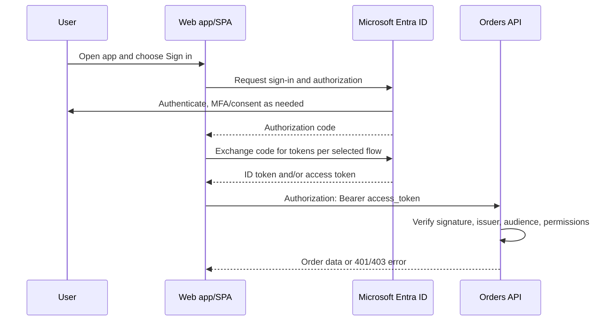
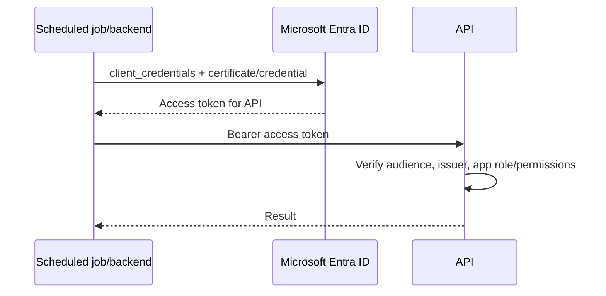
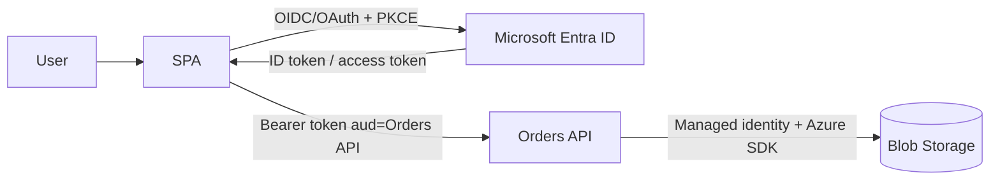

# OAuth 2.0, OpenID Connect, and tokens in Azure applications

When a user signs in to a web application on Azure, the application needs to know **who is signing in**. When the application calls a Web API or reads data in Azure Storage, the target service needs to know **who is allowed to perform which operation**. These two requirements are related yet distinct: **OpenID Connect (OIDC)** handles identity authentication, whereas **OAuth 2.0** is the authorization framework for an application to obtain permission to access resources. Microsoft Entra ID and the Microsoft identity platform provide the endpoints, tokens, and application management mechanisms to implement these protocols.

This lesson is part of the **Identity with Microsoft Entra ID** chapter of the **CLOUD_PROVIDERS_AZURE** module. The module explores the Microsoft Azure ecosystem from subscriptions, resource groups, and Entra ID to virtual networks, compute, storage, and data services, while guiding you on deploying, monitoring, securing, and controlling the cost of application architectures on Azure. Understanding tokens and authentication flows is foundational to securing App Service, Azure Functions, APIs, Storage, and workloads using managed identities.

After this lesson, you will be able to:

- Distinguish OAuth 2.0, OIDC, signing in, and granting API access.
- Understand the function of access tokens, ID tokens, and refresh tokens.
- Choose between authorization code + PKCE, client credentials, or on-behalf-of for each application type.
- Configure app registration, scopes, app roles, and consent concepts in Microsoft Entra ID.
- Design APIs that validate tokens for the right audience, issuer, lifetime, and permissions.
- Identify common errors when Azure applications call Microsoft Graph or Azure resources.

## 1. Roles in an access request

OAuth 2.0 distinguishes several roles:

| Role | In the Azure ecosystem | Responsibility |
|---|---|---|
| Resource owner | User or entity that owns the data/permissions | Grants access in the delegated model when appropriate |
| Client | Web app, SPA, mobile app, CLI tool, or backend | Requests tokens and calls APIs |
| Authorization server | Microsoft identity platform of Microsoft Entra ID | Authenticates, requests consent when needed, and issues tokens |
| Resource server | Web API, Microsoft Graph, or Azure service | Validates tokens and decides whether to allow operations |

For example, a user signs in to an ordering app, and the app then needs to call an orders API:



In the diagram, the code-to-token exchange is simplified to illustrate the concept. Redirect handling, PKCE, client credentials, and token storage depend on the application type.

**Core principle:** an application uses a token to prove authorization to a **target API**; the API must never trust a token merely because it looks like a JWT.

## 2. How do OAuth 2.0 and OpenID Connect differ?

### 2.1. OAuth 2.0: authorization

OAuth 2.0 enables a client to receive an access token to call a resource server, typically without sharing the user's password with the client. Access is bounded by the resource, permission type, principal, and enforcement conditions.

For example, a user consents to an app reading their profile via Microsoft Graph; the app receives an access token intended for Graph with the appropriate delegated permission. Microsoft Graph validates the token before returning data.

OAuth 2.0 **does not by itself define a sign-in protocol with an ID token**. Observing an access token is not sufficient for an arbitrary client to infer a valid user sign-in session.

### 2.2. OpenID Connect: the authentication layer on top of OAuth 2.0

OIDC adds a standard way to authenticate users and issue an **ID token** to the client. When a client requests the `openid` scope in an appropriate flow, the Microsoft identity platform can issue an ID token so the client can verify the sign-in session.

OIDC also provides discovery metadata and public signing keys so clients can validate tokens against the identity provider's configuration. Depending on application type, the client or authentication library uses claims such as `iss`, `aud`, `sub`, `tid`, and `nonce` to verify the sign-in session.

| Question | OAuth 2.0 | OpenID Connect |
|---|---|---|
| Primary goal | Which resources is the client allowed to access? | Who is the signed-in user? |
| Related tokens | Access token; refresh token depending on flow | ID token, alongside OAuth tokens when requested |
| Primary recipient | Resource server/API | Client that requested authentication |
| Example | API allows reading the order list | Application displays the signed-in account name |

Never send an **ID token** in the `Authorization` header to call an API. An API requires an **access token** issued specifically for that API.

## 3. Three common token types

| Token | Issued to whom, for what purpose? | Where used | Notes |
|---|---|---|---|
| **Access token** | Used by the client to access a specific resource server | Sent to target API over HTTPS | The API must validate the token and permissions itself |
| **ID token** | Used by the client to confirm the user's sign-in result | Client/OIDC middleware | `aud` is typically the client ID of the signing-in app; does not replace an access token |
| **Refresh token** | Used by the client per authorization server rules to request new tokens | Session/token management layer, typically via MSAL | Sensitive credential; never forward to resource APIs |

### 3.1. Access token and audience

**Audience (`aud`)** identifies the resource/API for which the token was issued. A token intended for Microsoft Graph cannot be accepted by the orders API simply because both use Microsoft Entra ID.

Examples of different resources:

- Microsoft Graph: API `https://graph.microsoft.com`.
- Internal API registered in Entra ID: a dedicated API identifier, commonly with an App ID URI like `api://<api-client-id>`.
- Azure Resource Manager (control plane): resource `https://management.azure.com/`.
- Azure Storage (data plane with Entra ID): resource `https://storage.azure.com/`.

A token typically has a single audience. A client calling two resource servers may need **two separate access tokens**.

### 3.2. JWTs and claims

Access tokens issued by Microsoft Entra ID for APIs are often formatted as JWTs, consisting of a header, payload, and signature. However, **clients must treat access tokens as opaque data**: the format and claims are intended for the resource server, not as a stable interface for the client to parse. The API may read claims *after validating the token*.

Illustrative payload (fictional values, not a real token):

```json
{
  "aud": "11111111-1111-1111-1111-111111111111",
  "iss": "https://login.microsoftonline.com/22222222-2222-2222-2222-222222222222/v2.0",
  "tid": "22222222-2222-2222-2222-222222222222",
  "sub": "subject-identifier",
  "scp": "Orders.Read",
  "exp": 1893456000,
  "nbf": 1893452400,
  "ver": "2.0"
}
```

Common claims:

- `iss`: issuer, the party that issued the token; must match the expected tenant and endpoint version.
- `aud`: audience, must match the target API receiving the token.
- `exp`, `nbf`: expiration time and not-before time when the token becomes valid (Unix timestamps).
- `tid`: tenant ID; can help enforce tenant policies for multi-tenant APIs.
- `sub`: subject identifier scoped to the token/application; not guaranteed to be an email.
- `oid`: object ID of the principal in the tenant when present; useful for referencing a stable identity in the right tenant.
- `scp`: list of delegated scopes, typically present in tokens with a user context.
- `roles`: app roles/application permissions granted to the principal for the API.
- `azp` or `appid`: the client calling the API, depending on token version.
- `ver`: token format version; may differ from the endpoint version the client called.

The actual set of claims depends on token type, version, resource, and configuration. Never design security assuming an optional claim is always present. Merely Base64-decoding the payload **does not verify the signature** and is insufficient to accept a token.

### 3.3. Token lifetime

An access token is only valid for a period determined by the issuer. Do not hardcode a fixed lifetime across all token types or applications; rely on `exp` and actual policy. Libraries such as **MSAL** handle caching and automatically acquire fresh tokens when needed. Applications should not try to optimize by caching access tokens indefinitely.

## 4. Entra ID components when registering applications

Integrating with the Microsoft identity platform typically requires one or more **app registrations**.

- **Application (app registration)** describes the application's configuration: application/client ID, supported account types, redirect URIs, declared API permissions, scopes or app roles exposed by an API, and credentials for confidential clients.
- **Service principal (enterprise application)** represents the application in a specific tenant; it is the object used to manage consent, assignments, and access permissions in that tenant.
- **Tenant ID (directory ID)** identifies the tenant.
- **Application/client ID** identifies the registered application; distinct from the **object ID** of the application or service principal.
- **App ID URI** identifies the API resource when exposing scopes, commonly formatted as `api://<api-client-id>`.

A SPA + API system commonly uses **two app registrations**: one client representing the SPA and one resource app representing the API. This separation keeps the audience and access permissions clear.

### 4.1. Endpoints and tenants

The Microsoft identity platform exposes common OAuth 2.0/OIDC endpoints:

```text
https://login.microsoftonline.com/<tenant-id>/oauth2/v2.0/authorize
https://login.microsoftonline.com/<tenant-id>/oauth2/v2.0/token
https://login.microsoftonline.com/<tenant-id>/v2.0/.well-known/openid-configuration
```

Authorities like `common` or `organizations` can be used in multi-tenant scenarios, yet the API must still validate the accepted issuer/tenant. For single-organization applications, using the specific tenant ID establishes a clearer boundary.

Note: calling the `/v2.0` endpoint **does not automatically guarantee an access token has `ver=2.0`**. The access token version is determined by the API/resource through its configuration. For a self-registered API, you can configure `api.requestedAccessTokenVersion` on the app registration as appropriate. API middleware must verify issuer/audience according to the **actual token version**.

### 4.2. Delegated permission, application permission, and consent

Two authorization models are crucial:

| Permission type | Signed-in user present? | Common claim | Scenario |
|---|---|---|---|
| **Delegated permission** | Yes, application acts on behalf of the user | `scp` | SPA calls the orders API for the signed-in user |
| **Application permission** | No interactive user required; application uses its own identity | `roles` if the API exposes and assigns app roles | Scheduled job reads permitted data |

With delegated permissions, effective access typically depends on both the permissions granted to the application and the permissions the user holds in the target service. With application permissions, the application must be granted permissions for the resource, and many such permissions require admin consent.

**Consent** is the approval by a user or administrator for the permissions requested by an application according to tenant policy. Declaring a permission in an app registration does not automatically grant consent or guarantee the API will accept the token.

Standard OIDC scopes include `openid`, `profile`, and `email`; `offline_access` relates to obtaining refresh tokens in supported flows. These scopes are **not** permissions to read data from the orders API. Business scopes of an API must be exposed separately by that API.

## 5. Choosing the right OAuth 2.0 flow

### 5.1. Authorization code flow with PKCE: web, SPA, mobile

This is the standard flow for applications with interactive users. **PKCE** (Proof Key for Code Exchange) protects the authorization code exchange using a `code_verifier` and `code_challenge` pair; it is especially essential for public clients such as SPAs or mobile apps.

Summarized sequence:

1. The client generates `state` and a PKCE pair. If OIDC is requested, the client handles `nonce` appropriately.
2. The client redirects the user to `/authorize` with client ID, redirect URI, scopes, `response_type=code`, and `code_challenge`.
3. Entra ID authenticates the user, enforces MFA/Conditional Access, and prompts for consent if needed.
4. Entra ID returns the authorization code to a valid redirect URI.
5. The client exchanges the code at `/token` along with `code_verifier`; a confidential client also authenticates with its appropriate credential.
6. The client/OIDC middleware verifies the sign-in result; the client uses the access token when calling the API.

Illustrative authorization request (replace placeholders with actual URL-encoded values):

```text
GET https://login.microsoftonline.com/<tenant-id>/oauth2/v2.0/authorize
  ?client_id=<spa-client-id>
  &response_type=code
  &redirect_uri=<url-encoded-registered-redirect-uri>
  &response_mode=query
  &scope=openid%20profile%20api%3A%2F%2F<api-client-id>%2FOrders.Read
  &state=<random-state>
  &code_challenge=<base64url-sha256-code-verifier>
  &code_challenge_method=S256
```

This is a conceptual example for reading parameters; use MSAL instead of manually constructing URLs and implementing the entire PKCE/OIDC mechanism yourself. `state` helps prevent CSRF during redirects; `nonce` binds the ID token to the sign-in request. Redirect URIs must be registered accurately, and the application must validate values per protocol.

**Never** use a client secret in a SPA or JavaScript downloaded to a browser. Avoid implicit grant flows or collecting passwords directly now that modern authorization code + PKCE flows exist.

### 5.2. Client credentials flow: services running without a user

Data-processing jobs, daemons, or service-to-service workloads can request tokens using the application's own identity:



Example token endpoint request parameters for a confidential client:

```text
POST /<tenant-id>/oauth2/v2.0/token
Content-Type: application/x-www-form-urlencoded

client_id=<service-client-id>
&scope=api%3A%2F%2F<api-client-id>%2F.default
&grant_type=client_credentials
&client_secret=<server-side-secret-only>
```

Here, `.default` requests the static application permissions configured/granted for that resource. The example shows a secret to make the protocol structure clear; in production, prefer **managed identity** on Azure or asymmetric credentials / supported workload identity federation instead of storing long-lived secrets.

This flow typically returns only an **access token**, does not represent a signed-in user, and does not return a user ID token. The API must check app roles or an appropriate authorization policy; do not assume every app-only token contains `scp`.

### 5.3. On-behalf-of (OBO): an API calling a downstream API

If a SPA calls API A, and API A then needs to call Microsoft Graph **on behalf of that same user**, API A can use the **on-behalf-of** flow to exchange the incoming token for a new access token for Graph. API A must be a confidential client and execute the OBO flow according to Microsoft identity platform configuration.

```text
User -> SPA -> [token aud=API A] -> API A
                                  |
                                  +-> OBO at Entra ID -> [token aud=Graph] -> Graph
```

API A **must not forward** an access token with `aud=API A` directly to Graph; Graph requires a token issued for Graph. OBO uses a delegated context; if there is no user, consider client credentials or managed identity.

### 5.4. Device code and other cases

CLI tools or devices with limited browser capabilities can use the **device authorization grant**. The user authenticates on another device as instructed. For new applications, prefer standard flows and supported libraries rather than building custom password prompts or bespoke token flows.

## 6. Scopes, app roles, and the principle of choosing the right token for each API

Suppose a system consists of a front-end app, an orders API, and Microsoft Graph.

| Goal | Permission and token to request | What the target API checks |
|---|---|---|
| Sign in to front-end | OIDC `openid`, optionally `profile` | Client verifies the ID token |
| User views orders | `api://<api-client-id>/Orders.Read` | Orders API verifies `aud` and `scp` |
| User updates orders | `api://<api-client-id>/Orders.Write` | Orders API checks the write scope |
| Read profile from Microsoft Graph | Graph's `User.Read` | Graph verifies the access token issued for Graph |
| Periodic backend job calls API | App role such as `Orders.Batch.Read`, requesting a token with `api://<api-client-id>/.default` | API checks `roles`/application permissions |

In the API's app registration, the development team can define `Orders.Read` and `Orders.Write` (delegated) scopes and the `Orders.Batch.Read` app role for application access. Clients register requests for the needed permissions; users or administrators grant consent when required.

When using `/.default`, do not interpret it as an "access everything" permission. It represents the static set of permissions declared/consented for **a specific resource** under that flow type; the token still must be validated by the resource server. Do not mix scopes belonging to different resources in a single token request.

## 7. Architecture practice: SPA calling a protected orders API

Consider a system with:

- **SPA** running in the browser and signing in users with Microsoft Entra ID.
- **Orders API** running on Azure App Service or Azure Functions, exposing scope `Orders.Read`.
- **Azure Blob Storage** storing invoices; only the backend needs to read blobs using managed identity.



### 7.1. Preparation in the Microsoft Entra admin center

1. Create an app registration for **Orders API**. Under **Expose an API**, set the App ID URI and create the delegated scope `Orders.Read`. If deploying an API that accepts v2 access tokens, configure the corresponding access token version and use middleware that validates the matching issuer.
2. Create an app registration for **Orders SPA**, select the SPA platform, and register the application's exact HTTPS redirect URI.
3. In the SPA's API permissions, add the `Orders.Read` scope of Orders API. Complete consent per tenant policy.
4. Configure the SPA with `tenant ID`, `SPA client ID`, redirect URI, and the API scope.
5. Configure Orders API to validate access tokens intended for the **API client ID** and enforce the `Orders.Read` policy. Never treat a successful front-end sign-in as sufficient proof for the API to return data.
6. Enable managed identity for the backend if it needs to read Blob Storage; assign `Storage Blob Data Reader` at the appropriate Storage Account or container scope. The blob-reading role belongs to the data plane and is separate from permission to call Orders API.

### 7.2. Illustrative SPA acquiring a token with MSAL Browser

The minimal JavaScript example below assumes `@azure/msal-browser` is installed and the environment can open a sign-in popup. Placeholder values are fictional and must be replaced with details from your app registration.

```javascript
import { PublicClientApplication } from "@azure/msal-browser";

const tenantId = "<tenant-id>";
const apiClientId = "<orders-api-client-id>";
const readScope = "api://" + apiClientId + "/Orders.Read";

const msal = new PublicClientApplication({
  auth: {
    clientId: "<spa-client-id>",
    authority: "https://login.microsoftonline.com/" + tenantId,
    redirectUri: window.location.origin
  }
});

await msal.initialize();

const login = await msal.loginPopup({
  scopes: ["openid", "profile", readScope]
});

const tokenResult = await msal.acquireTokenSilent({
  account: login.account,
  scopes: [readScope]
});

const response = await fetch("https://api.example.com/orders", {
  headers: {
    Authorization: "Bearer " + tokenResult.accessToken
  }
});

if (!response.ok) throw new Error("Orders API HTTP " + response.status);
const orders = await response.json();
```

Real applications must handle interaction-required errors (such as additional consent/MFA) as recommended by MSAL, manage accounts and session lifecycles, and configure CORS/HTTPS for the API. When using popups or redirects, register the exact redirect URI in Entra ID. MSAL manages caching and token acquisition; the application should not manually persist access tokens in long-term storage.

### 7.3. Illustrative API verifying an access token

The Node.js snippet below illustrates a **single-tenant** API accepting **v2 access tokens** issued for itself. It uses the `jose` library to verify the signature via JWKS, issuer, audience, and the `scp` claim. This demonstrates validation structure; production apps can use standard Microsoft-supported middleware and must add logging, record-level authorization, and tests.

```javascript
import express from "express";
import { createRemoteJWKSet, jwtVerify } from "jose";

const tenantId = process.env.AZURE_TENANT_ID;
const apiClientId = process.env.ORDERS_API_CLIENT_ID;
if (!tenantId || !apiClientId) {
  throw new Error("Missing identity configuration");
}

const issuer = "https://login.microsoftonline.com/" + tenantId + "/v2.0";
const jwks = createRemoteJWKSet(
  new URL("https://login.microsoftonline.com/" + tenantId + "/discovery/v2.0/keys")
);
const app = express();

app.get("/orders", async (req, res) => {
  const match = /^Bearer\s+(.+)$/i.exec(req.headers.authorization || "");
  if (!match) return res.sendStatus(401);

  let claims;
  try {
    ({ payload: claims } = await jwtVerify(match[1], jwks, {
      issuer,
      audience: apiClientId
    }));
  } catch {
    return res.sendStatus(401);
  }

  // Example endpoint accepting only user delegated permissions.
  const scopes = (claims.scp || "").split(/\s+/);
  if (!scopes.includes("Orders.Read")) {
    return res.sendStatus(403);
  }

  // Continue applying business permissions per user/record here.
  return res.json([{ id: "order-001", status: "processing" }]);
});

app.listen(3000);
```

In a v2 access token for a properly configured API, `aud` is typically the API's client ID GUID. If the API is configured to issue v1 access tokens, issuer and audience formats can differ, so do not reuse this exact example for v1 tokens. Multi-tenant APIs must implement trusted issuer and tenant validation per multi-tenant rules rather than accepting arbitrary issuers.

An API receiving application permissions needs a separate policy checking `roles` (or an explicitly designed app-only authorization check) rather than only checking `scp`. Token validation is the first step; the API still needs to verify whether the user or application is authorized for the **specific order**.

### 7.4. Backend reading Blob Storage with managed identity

When the backend needs to read invoices, it can obtain tokens for Azure Storage through the Azure SDK using `DefaultAzureCredential`. On Azure, the SDK can use managed identity; during local development, it can use development environment credential sources depending on configuration.

```javascript
import { DefaultAzureCredential } from "@azure/identity";
import { BlobServiceClient } from "@azure/storage-blob";

const credential = new DefaultAzureCredential();
const storage = new BlobServiceClient(
  "https://<storage-account>.blob.core.windows.net",
  credential
);

const blob = storage
  .getContainerClient("invoices")
  .getBlobClient("invoice-001.pdf");

const download = await blob.download();
// Process download.readableStreamBody as needed by the application.
```

Orders API must have `Storage Blob Data Reader` permissions for the data to read and an appropriate network path. The access token that the SPA sends to Orders API is not the token the API uses to call Storage. The Azure SDK uses the **backend's** credential to acquire a token for the Azure Storage resource.

## 8. Mandatory checks on the token-receiving side

A resource server should use a proven validation library, driven by OIDC discovery metadata or Microsoft identity platform configuration, to perform these checks:

1. **Signature and algorithm:** verify the signature with the issuer's trusted signing keys; reject unexpected algorithms or unsigned JWTs.
2. **Issuer (`iss`):** matches the tenant/authority allowed by the API; be careful with multi-tenant APIs.
3. **Audience (`aud`):** the token must have been issued **for this API**.
4. **Timestamps:** validate `exp`, `nbf`, and reasonable clock skew; reject expired tokens.
5. **Permission type:** delegated scope in `scp` or application role in `roles`, depending on the API and endpoint.
6. **Tenant and client:** enforce an allowlist or policy for tenant (`tid`) and calling application (`azp`/`appid`) if required by the scenario.
7. **Data authorization:** verify whether the user/application is permitted to access the requested business entity.

For OIDC applications, client/OIDC middleware must validate ID tokens according to sign-in flow rules, including `aud`, issuer, timestamps, and `nonce` when applicable. Never decode payloads to bypass signature verification.

**401 Unauthorized** typically indicates a missing token or failed token validation. **403 Forbidden** typically indicates a valid principal that lacks permission for the operation. When designing APIs, responses must not leak tokens or sensitive details.

## 9. Protecting tokens and credentials

- Always transmit tokens over **HTTPS**; never write access tokens, refresh tokens, or authorization codes into application logs, public URLs, error messages, or source repositories.
- Use **MSAL** or standard libraries to handle PKCE, caching, refresh, and interactive sign-in. Avoid writing OAuth/OIDC protocols from scratch.
- Do not embed client secrets, private keys, or sensitive connection strings in front-end code. For confidential clients, store and rotate credentials securely; prefer managed identity on Azure workloads whenever possible.
- Never pass an ID token to an API as an access token, and never reuse a token with the wrong audience.
- Choose scopes/app roles following **least privilege**; request only necessary permissions and limit admin consent for broad permissions.
- Protect redirect URIs and sign-in state; configure `state`, `nonce`, and PKCE per library guidance while defending against XSS and CSRF according to the application model.
- Account for Conditional Access, MFA, session controls, and tenant policies when implementing interactive flows. These controls provide additional protection around token issuance.
- Disabling a user or revoking permissions does not mean every previously issued access token becomes invalid immediately in all scenarios. Design token lifetimes, business-layer authorization checks, and revocation/detection mechanisms according to service capabilities.

## 10. Troubleshooting common OAuth/OIDC errors

| Symptom | Common cause | What to check |
|---|---|---|
| Redirect URI mismatch | Callback URL does not match app registration or wrong platform type | Verify scheme, host, path, port, and SPA/Web registration |
| `invalid_scope` or permission request fails | Wrong resource, scope not exposed by API, or `/.default` used in wrong context | Check App ID URI, Expose an API, client permissions, and consent |
| `invalid_client` | Confidential client provided wrong or expired credential, or wrong client type | Check client ID, certificate/secret, and where credentials are stored |
| Admin consent required | Requested permission requires admin approval or tenant blocks user consent | Check permission type and consent policy |
| API returns 401 despite successful sign-in | Sent ID token, expired token, wrong issuer/audience, wrong tenant, or signing config | Inspect outgoing header and API authentication config |
| API returns 403 | Valid token but missing `scp`/`roles` or business authorization | Check actual scopes/roles and assignments/consent |
| Token works with Graph but internal API rejects it | Token issued for Graph (different `aud`) | Request a separate access token for the internal API |
| Backend cannot read blob | Missing Storage Blob Data role, wrong managed identity, or network block | Check principal, scope, Storage endpoint, firewall/private endpoint |
| SPA receives interaction-required error | MFA, consent, or session needs interactive handling | Use MSAL interactive fallback appropriately instead of looping acquireTokenSilent |

When troubleshooting a real error, clearly identify **which application requested the token, which API the token is for, which principal received permissions, which claims were issued, and which API rejected it**. Log correlation IDs, request IDs, and error codes safely; never log raw tokens.

## 11. Applied exercises

**Scenario A:** A SPA signs in successfully and receives an ID token, yet calling Orders API returns 401. Explain why an ID token cannot substitute for an access token and list the checks the API must perform.

**Scenario B:** An Azure Function runs nightly without a signed-in user and needs to call an internal API to aggregate data. Choose the appropriate flow, the permission model to verify, and how to manage credentials.

**Scenario C:** API A receives a delegated access token from a SPA and then wants to call Microsoft Graph on behalf of the user. Why can't API A forward its own token directly to Graph? Which flow solves this requirement?

**Scenario D:** A developer Base64-decodes a JWT and sees `scp=Orders.Read`. Why is observing that claim insufficient to grant permission to read orders?

**Scenario E:** Orders API calls Blob Storage using managed identity and receives 403. Distinguish three categories of causes: identity/data-plane role, audience/token, and network configuration.

## Conclusion

OAuth 2.0 enables applications to obtain authorization to access resources; OpenID Connect adds user authentication and ID tokens. **Access tokens are for APIs**, **ID tokens are for signing-in clients**, and refresh tokens support token renewal in supported flows. In Microsoft Entra ID, app registrations, service principals, scopes, app roles, and consent determine who requests permissions and for which resource permissions are granted. Secure Azure designs choose the right flow, use MSAL/managed identity where appropriate, thoroughly validate tokens at the API, and check actual data permissions before returning results.
