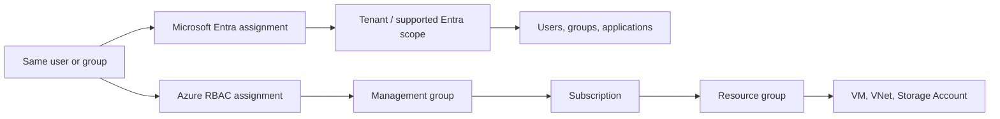

# Distinguishing Microsoft Entra ID permissions from Azure RBAC permissions

In the **Identity with Microsoft Entra ID** chapter of the **CLOUD_PROVIDERS_AZURE** module, this lesson explains how to distinguish directory administration permissions from Azure resource management permissions. This distinction helps you choose the right permissions when deploying applications, operating subscriptions and resource groups, managing users, protecting data, and investigating access errors.

An engineer may be able to manage virtual machines yet not be allowed to create users in the tenant. An administrator may be able to manage users yet not see a subscription. Both situations can be completely intentional under a well-designed authorization model.

The starting point is identifying **what object is being managed**: is it a user, group, or application in the directory, or an Azure resource such as a virtual machine, network, or Storage Account?

After this lesson, you will be able to:

- Classify requirements into the Microsoft Entra permission system or Azure RBAC.
- Explain principal, role, and scope in each system.
- Distinguish Global Administrator, Owner, and permission-management roles.
- Recognize that API permissions, data permissions, and object ownership are additional factors to evaluate.
- Inspect both sets of assignments using the right tools and interpret results within the scope of the check.

## 1. The same identity can hold two different sets of permissions

**Microsoft Entra roles** are used to administer Microsoft Entra ID objects and capabilities, such as users, groups, and applications. **Azure roles** in Azure RBAC are used to control access to Azure resources, such as virtual machines and Storage Accounts. Both systems use role definitions and role assignments, yet their permission definitions are not interchangeable. [Source: Microsoft Entra RBAC overview](https://learn.microsoft.com/en-us/entra/identity/role-based-access-control/custom-overview).

In this lesson, "Entra permissions" primarily refers to directory administration permissions via Microsoft Entra roles. Related API permissions and object ownership are distinguished separately later.

| Aspect | Microsoft Entra roles | Azure RBAC roles |
| --- | --- | --- |
| Managed objects | Users, groups, applications, and directory functions | Subscriptions, resource groups, and Azure resources |
| Example tasks | Managing users or application configurations | Deploying virtual machines or managing network resources |
| Illustrative roles | User Administrator, Application Administrator | Reader, Contributor, Owner |
| Common places to check | Roles and administrators, Assigned roles on an Entra object | Access control (IAM) at the Azure resource scope |
| Scope to specify | Tenant or supported Entra scope | Management group, subscription, resource group, resource |

These distinctions are documented by Microsoft in the comparison of Azure roles and Microsoft Entra roles. [Source: Azure roles and Microsoft Entra roles](https://learn.microsoft.com/en-us/azure/role-based-access-control/rbac-and-directory-admin-roles).

A user can hold both sets of permissions, only one set, or no administrative roles at all. A user's existence in the tenant does not automatically create an Owner or Contributor assignment for that user.

Example of two independent assignments for the same user, Lan:

```text
Assignment A:
  Principal = Lan
  Role      = User Administrator
  Scope     = assigned directory scope

Assignment B:
  Principal = Lan
  Role      = Reader
  Scope     = resource group rg-orders-dev
```

Assignment A serves identity responsibilities. Assignment B serves viewing resources of the Orders application. Never infer one assignment from the other.

## 2. Authentication does not mean authorization to perform an operation

**Authentication** determines who is calling. **Authorization** determines what that principal is allowed to do on a specific object.

Successfully signing in to the Azure Portal does not prove permission to create a virtual machine. Likewise, an application obtaining an access token does not prove it is allowed to manage users or read business data.

An access token is used to call a target API; an ID token serves to confirm sign-in to the application. Never use an ID token as proof of permission to call an API. A client should acquire a token for the appropriate API and let the target API enforce the required checks. [Source: Access tokens](https://learn.microsoft.com/en-us/entra/identity-platform/access-tokens).

In the Azure public cloud, two common management endpoints are:

```text
Microsoft Graph:
  https://graph.microsoft.com
  Example objects: users, groups, applications, directory role assignments

Azure Resource Manager:
  https://management.azure.com
  Example objects: subscriptions, resource groups, virtual machines
```

Microsoft Graph and Azure Resource Manager are two APIs with corresponding objects and authorization checks. A single sign-in session may be used by tooling to acquire tokens for multiple APIs; do not treat that as one universal token valid for every service.

When an error occurs, describe it specifically: "user Lan calls the VM management API in the Orders resource group" or "the sync app calls Microsoft Graph to read user info." Describing it this way helps pinpoint where to inspect permissions.

## 3. Two scope trees serving two types of objects

### 3.1. Scope in Microsoft Entra ID

An Entra role can be assigned at the tenant scope or a supported object scope, depending on the role and object type. For example, certain application administration permissions can be scoped to a single application. Do not assume every role supports every scope. [Source: List Microsoft Entra role assignments](https://learn.microsoft.com/en-us/entra/identity/role-based-access-control/view-assignments).

An **Administrative unit** (AU) delegates administration for a specific set of users, groups, or devices in the directory. It is not an Azure resource group. Adding a group to an AU also does not automatically place all member users under that AU's user-management scope. [Source: Administrative units](https://learn.microsoft.com/en-us/entra/identity/role-based-access-control/administrative-units).

For example, a regional support team can be assigned an appropriate Entra role on a regional AU. That does not grant permission to manage a virtual network or virtual machine with a similar regional name.

### 3.2. Scope in Azure RBAC

Azure RBAC uses the scope hierarchy: management group → subscription → resource group → resource. Permissions from a parent scope are inherited by child resources. An assignment on one resource group does not automatically extend to sibling resource groups. [Source: Azure RBAC scope](https://learn.microsoft.com/en-us/azure/role-based-access-control/scope-overview).



The diagram illustrates two permission paths. There is no automatic role inheritance from "administering the tenant" to "administering every subscription."

Examples of Azure scopes:

```text
/subscriptions/<subscription-id>

/subscriptions/<subscription-id>/resourceGroups/rg-orders-dev

/subscriptions/<subscription-id>/resourceGroups/rg-orders-dev/providers/Microsoft.Compute/virtualMachines/vm-orders-dev
```

Meanwhile, the scope of an Entra directory role assignment is represented by a field such as `directoryScopeId`. Both systems may use `/` for a root scope in their own context; always read the scope alongside the API and assignment type rather than comparing scope strings in isolation.

## 4. Role names that are easily confused

### 4.1. Directory administration roles

| Microsoft Entra role | Illustrative responsibility |
| --- | --- |
| Global Administrator | Broad administration of Microsoft Entra ID capabilities |
| User Administrator | Manage users and related tasks within allowed limits |
| Application Administrator | Manage app registrations and enterprise applications per role permissions |
| Privileged Role Administrator | Manage Microsoft Entra role assignments and related capabilities |
| Global Reader | Read administrative configurations supported by the role |

Each role has detailed boundaries by operation, object, and scope. For instance, do not assume a user-administration role can reset credentials for every privileged account. [Source: Microsoft Entra built-in roles](https://learn.microsoft.com/en-us/entra/identity/role-based-access-control/permissions-reference).

### 4.2. Azure resource management roles

| Azure RBAC role | Primary capability |
| --- | --- |
| Reader | View management resource configurations |
| Contributor | Manage resources; cannot assign Azure RBAC roles through this role alone |
| Owner | Manage resources and assign Azure RBAC roles |
| Role Based Access Control Administrator | Manage Azure RBAC access at the assigned scope |
| User Access Administrator | Manage Azure resource access at the assigned scope |

Always examine the exact permissions, scope, conditions, and restrictions applied to an assignment. Owner or Contributor on a resource group does not have the same blast radius as the same role at the subscription level. [Source: Azure privileged built-in roles](https://learn.microsoft.com/en-us/azure/role-based-access-control/built-in-roles/privileged).

Three pairs of names to remember:

- **User Administrator** is an Entra role; **User Access Administrator** is an Azure role.
- **Privileged Role Administrator** manages Entra roles; **Role Based Access Control Administrator** manages Azure RBAC roles.
- **Global Reader** and **Reader** belong to two different systems; never infer read access in one system from the other.

The Owner role in Azure is also different from being the owner of a group or an app registration. The word "owner" must always be read alongside the object type and permission system.

## 5. Global Administrator and Owner do not substitute for each other

A Global Administrator may have no access to the tenant's subscriptions. Azure provides a dedicated privilege-elevation mechanism: a Global Administrator can assign themselves **User Access Administrator at the root scope `/`** via the **Access management for Azure resources** setting. This is a separate Azure permission step, not having Owner by default. [Source: Elevate access](https://learn.microsoft.com/en-us/azure/role-based-access-control/elevate-access-global-admin).

Points to distinguish in this mechanism:

- The setting applies only to the user performing it; it does not enable access for all Global Administrators.
- After completing the task, remove the elevated permission at the root scope.
- Deactivating Global Administrator in PIM does not automatically turn off the elevated access setting.
- Any other assignments created during elevation must be reviewed separately.

Because this elevation path exists, do not treat the boundary between directory administration and Azure administration as completely impassable. Protect and monitor privileged accounts in accordance with their actual capabilities.

Conversely, being Owner on a subscription does not automatically grant user-management permissions in the directory. That person might still hold directory permissions from another source; check that source separately before drawing conclusions.

In normal operations, assign the role and scope required for the job rather than using Global Administrator or Owner to resolve every access error.

## 6. Further distinguishing data permissions, API permissions, and object ownership

### 6.1. Azure RBAC includes both management and data permissions

In an Azure role definition, `Actions` describe control-plane permissions and `DataActions` describe data-plane permissions for services integrated with Azure RBAC. Consequently, Reader being able to view a Storage Account does not mean it can read blob contents using Entra ID. [Source: Azure role definitions](https://learn.microsoft.com/en-us/azure/role-based-access-control/role-definitions).

For example, an application that needs to read files may require an appropriate data role on the container. Do not try to solve that requirement by assigning User Administrator to the application's identity.

You must also check alternative access paths such as account keys, SAS tokens, or permissions to alter authorization settings. Conclusions about data access must be based on the specific authentication method and service.

### 6.2. Microsoft Graph permissions differ from Azure role assignments

Microsoft Graph has **delegated permissions** when an app calls on behalf of a user and **application permissions** when an app calls under its own identity. Some operations require evaluating both Graph permissions and the user's Entra role. Granting Azure Contributor does not substitute for permission to call Graph. [Source: Microsoft Graph permissions](https://learn.microsoft.com/en-us/graph/permissions-overview).

Examples:

| Application need | Permission system to evaluate |
| --- | --- |
| Pipeline deploying Orders resources | Azure RBAC at the resource scope |
| Sync app reading directory data via Graph | Graph permissions and corresponding authorization requirements |
| Workload reading blobs with Entra ID | Service data role and data scope |
| User holding the "Approver" business role in the app | That application/API's own authorization mechanism |

An app role named `Approver` in the Orders application does not automatically become an Entra administrative role or an Azure RBAC role.

### 6.3. Existing in Entra does not mean Azure permissions have been granted

An app registration describes the application's identity configuration; a service principal is the representation of the application in a tenant. When checking Azure assignments for an application, identify the exact principal in the target tenant. Do not confuse the application/client ID, the application object's object ID, and the service principal's object ID. [Source: Application objects and service principals](https://learn.microsoft.com/en-us/entra/identity-platform/app-objects-and-service-principals).

Similarly, creating a new managed identity only creates an identity for the workload. In the application design, you still must determine which resources the workload may access and grant the corresponding permissions.

### 6.4. Having no admin role can still include some directory permissions

Microsoft Entra ID has default user permissions that differ between members and guests and can be affected by tenant configuration. Object ownership is another source of permissions to evaluate. Therefore, having no administrative role does not mean zero ability to read any directory information. [Source: Default user permissions](https://learn.microsoft.com/en-us/entra/fundamentals/users-default-permissions).

For example, the ability to register applications may depend on tenant settings and default permissions. Do not automatically grant Application Administrator simply because a developer needs to create an app registration.

## 7. Permission to assign roles and manage group membership

### 7.1. The granter must also hold permissions in the right system

For Azure RBAC, creating an assignment requires a permission such as `Microsoft.Authorization/roleAssignments/write` at the appropriate scope. A custom role or built-in role with this capability may still be constrained by conditions limiting which roles or principals may be assigned. [Source: Azure role assignment](https://learn.microsoft.com/en-us/cli/azure/role/assignment?view=azure-cli-latest).

For Entra administrative roles, a user or application authorized to manage the corresponding Entra assignments is required. You cannot use `az role assignment` to assign Entra's User Administrator to a user. Nor can you assign Azure Owner by adding an Entra administrative role.

When handling an access request, specify clearly:

```text
Principal: which object ID in which tenant?
Permission system: Entra role, Azure role, Graph permission, or application permission?
Role/permission: which specific operations are allowed?
Scope: which objects does it cover?
Duration: permanent, expiring, or requiring activation?
Grant source: direct or via group?
```

These fields help the approver or implementer evaluate the request accurately. A request that simply says "grant admin access for Orders" is not enough to pick a role.

### 7.2. Group membership can bridge two administration domains

Azure RBAC can assign roles to a group; members inherit permissions through that group. Azure assignments are additive, so a Reader assignment at a narrow scope does not remove Contributor granted from another source. [Source: Azure RBAC role assignments](https://learn.microsoft.com/en-us/azure/role-based-access-control/overview).

Design example:

```text
sg-orders-deploy is a security group with manually managed membership.
The group has Contributor on rg-orders-dev.

Anyone permitted to add members to the group
  -> can cause new members to receive permissions through the group
  -> impacts access permissions to Azure resources
```

Therefore, when reviewing Azure assignments granted via groups, you must also know who manages the group's membership. Two different role systems can still indirectly affect each other through an identity object.

To assign **Microsoft Entra roles** to a group, you must use a **role-assignable group** created with the `isAssignableToRole=true` property. This group type has specific restrictions on membership and governance. Do not assume any ordinary security group is eligible to receive Entra administrative roles. [Source: Role-assignable groups](https://learn.microsoft.com/en-us/entra/identity/role-based-access-control/groups-concept).

A group receiving an Azure RBAC role does not automatically make it an Entra role-assignable group.

### 7.3. Permissions to manage application credentials must also be evaluated

Consider a service principal used to deploy Orders that already holds Contributor on the development resource group. If someone is permitted to manage credentials for that application, the ability to use the application's identity must be evaluated alongside the service principal's Azure permissions.

This is a design deduction from the relationship between identity and assignments: privilege evaluation cannot just count roles assigned directly to a personal account. You must inspect groups, object ownership, and any identities that person can control.

## 8. Example permission model for an application development team

Suppose the Orders application has a development resource group, a production resource group, and a managed identity running the application.

| Principal | Need | Permission approach |
| --- | --- | --- |
| Identity support team | Manage users within an assigned scope | Appropriate Entra role at tenant/supported AU |
| Development deployment engineers | Create and update development resources | Azure role for required actions on the development resource group |
| Azure access governance team | Grant and revoke resource roles | Azure role managing assignments at the assigned scope |
| Orders managed identity | Read required data | Service data role on the appropriate resource or data scope |
| Directory sync app | Read user details via Graph | Minimal Graph permissions and corresponding authorization config |

This table is an illustrative approach, not a mandatory role set for every organization.

### 8.1. Engineer has Contributor but cannot create users

If an engineer only receives Contributor on `rg-orders-dev`, creating resources in the resource group and creating users in the tenant are two separate needs. Before granting additional permissions, determine whether the engineer genuinely needs to create users or can use identities already provisioned by the governance process.

### 8.2. User Administrator cannot deploy VMs

If someone holds User Administrator but has no Azure assignment covering the VM or resource group, check Azure permissions for the deployment task. Adding a broader Entra role may not solve the actual requirement.

### 8.3. Inviting a guest and granting work permissions are two separate steps

A partner invited into the tenant does not automatically gain permission to view the Orders resource group. After establishing the identity, grant permissions on the specific resources they are permitted to access. You must also verify the guest's exact object ID in the target tenant rather than using the account's object ID from the home tenant.

### 8.4. Creating an app registration and deploying infrastructure are two responsibilities

A pipeline may use an existing application identity to deploy infrastructure. It does not need to create a new app registration on every deployment. Separating these two responsibilities limits the directory permissions that must be granted to an infrastructure pipeline.

## 9. PIM manages privilege states in each system

Privileged Identity Management (PIM) supports time-bound permissions and conditional activation for Microsoft Entra roles and Azure resource roles. Capabilities such as MFA, justification, or approval depend on configuration. This feature requires appropriate licensing. [Source: PIM overview](https://learn.microsoft.com/en-us/entra/id-governance/privileged-identity-management/pim-configure).

Distinguish the following states:

| State | How to interpret when reviewing a task |
| --- | --- |
| Eligible | Capable of activating under conditions; not active by default |
| Active | Assignment is currently enabled for use within its validity window |
| Expired | Duration has ended; check other permission sources if access still works |

For example, a user eligible for an Entra role does not thereby hold an active Azure Contributor role. If a user needs permissions in both domains for a task, verify the role, scope, and state of each assignment.

In operational procedures, record when permissions are needed, activation conditions, and when the task concludes. For elevated access at the Azure root scope, ending an Entra role in PIM must still be distinguished from removing the Azure assignment created through the elevation mechanism.

## 10. Hands-on: reading assignments in both systems

The examples below use **PowerShell**, Azure CLI, and Microsoft Graph PowerShell. They illustrate read operations; they do not create role assignments or elevate access.

Preparation:

- Know the tenant ID, subscription ID, and object ID of the principal to inspect.
- Have a development resource group to specify the scope.
- Tools are installed in the practice environment.
- The inspecting account is permitted to read the corresponding information.

Signing in to Azure CLI and signing in to Microsoft Graph PowerShell establish separate tool contexts. Verify the tenant and account in each tool.

### 10.1. Checking Azure RBAC with Azure CLI

```powershell
$tenantId = "<tenant-id>"
$subscriptionId = "<subscription-id>"
$resourceGroup = "rg-orders-dev"
$principalObjectId = "<principal-object-id-in-target-tenant>"

az login --tenant $tenantId
az account set --subscription $subscriptionId
if ($LASTEXITCODE -ne 0) { throw "Failed to select subscription." }

az account show --query "{tenant:tenantId,subscription:id,account:user.name}" --output json

$resourceGroupScope = "/subscriptions/$subscriptionId/resourceGroups/$resourceGroup"

az role assignment list --assignee-object-id $principalObjectId --scope $resourceGroupScope --include-inherited --all --fill-principal-name false --query "[].{Role:roleDefinitionName,Scope:scope,Principal:principalId}" --output table
```

`--assignee-object-id` identifies the principal by object ID. `--fill-principal-name false` avoids querying Graph just to populate principal names. This is useful when the reviewer has Azure permissions without directory-read permissions. [Source: Azure CLI role assignment list](https://learn.microsoft.com/en-us/cli/azure/role/assignment?view=azure-cli-latest).

Illustrative output example:

```text
Role         Scope                                               Principal
-----------  --------------------------------------------------  ---------------------
Reader       /subscriptions/<sub-id>/resourceGroups/rg-orders-dev <principal-object-id>
Contributor  /subscriptions/<sub-id>                             <principal-object-id>
```

In this example, Contributor at the subscription level has a broader scope than Reader on the resource group. You cannot conclude the principal is "Orders read-only" from the Reader row alone.

This command focuses on assignments for the specified principal. To evaluate permissions inherited via groups, you must include group membership and assignments on those groups. Azure CLI provides `--include-groups` for additional querying in appropriate contexts; reading memberships may require Graph permissions. [Source: List Azure role assignments](https://learn.microsoft.com/en-us/azure/role-based-access-control/role-assignments-list-cli).

### 10.2. Checking Entra role assignments with Microsoft Graph PowerShell

The API for listing directory role assignments requires an appropriate Graph permission, such as `RoleManagement.Read.Directory`. With delegated access, the signed-in user must also meet the API's Entra role requirements; supported roles include Directory Readers, Global Reader, or an appropriate admin role. Consent and user permissions must be checked separately. [Source: List unifiedRoleAssignments](https://learn.microsoft.com/en-us/graph/api/rbacapplication-list-roleassignments?view=graph-rest-1.0).

In an environment where the required read permissions are present:

```powershell
$tenantId = "<tenant-id>"
$principalObjectId = "<principal-object-id-in-target-tenant>"

Connect-MgGraph -TenantId $tenantId -Scopes "RoleManagement.Read.Directory"

Get-MgContext | Select-Object TenantId, Account, AuthType

$directoryAssignments = Get-MgRoleManagementDirectoryRoleAssignment -Filter "principalId eq '$principalObjectId'" -ExpandProperty "roleDefinition" -All

$directoryAssignments | Select-Object PrincipalId, DirectoryScopeId, @{Name="Role"; Expression={$_.RoleDefinition.DisplayName}}
```

The cmdlet supports filtering assignments and expanding `roleDefinition` to read role details. `DirectoryScopeId` helps distinguish the assignment's scope from the role name. [Source: Get-MgRoleManagementDirectoryRoleAssignment](https://learn.microsoft.com/en-us/powershell/module/microsoft.graph.identity.governance/get-mgrolemanagementdirectoryroleassignment?view=graph-powershell-1.0).

This `principalId` filter retrieves assignments where the specified ID is the direct principal. It does not automatically aggregate Entra roles received via groups or PIM eligibilities. A complete review must include those additional sources.

You can use the Microsoft Entra admin center to view a user's **Assigned roles** or assignments at the corresponding application/AU scope. Do not use the output of Azure `az role assignment list` to infer the list of Entra roles.

### 10.3. Interpreting results within the scope of the check

| Observation | Appropriate conclusion |
| --- | --- |
| Azure assignment present, no direct Entra row | Has Azure permission from that assignment; check other Entra permission sources separately |
| Entra role present, no Azure assignment at the inspected scope | No Azure permission observed from this check |
| Group assignment present, user does not appear directly | Verify group membership and effective state |
| Listing API returns an authorization error | Reviewer could not read the data; does not mean the principal lacks permissions |
| No active assignment, but eligibility exists | Check activation conditions and state |

An empty result only describes the query that was run. Before concluding "no permission," verify the tenant, scope, filters, read permissions, and indirect permission sources.

## 11. Troubleshooting access errors and selecting the right evidence sources

An incident record should clearly capture:

```text
Actual calling principal and tenant
Target tool/API
Denied operation
Target object and scope
Timestamp, error code, request ID/correlation ID
Relevant assignment source and PIM state
```

A practical diagnostic workflow:

1. **Identify the target object.** Is the error happening on a user/group/application or an Azure resource?
2. **Identify the identity.** Which personal user, service principal, or managed identity is the tool using?
3. **Confirm tenant and API.** Are you checking the same tenant, same principal, and right target API?
4. **Check the role in the right system.** Does the role contain the needed operation and does the scope cover the target object?
5. **Include additional permission sources.** Check groups, inherited permissions, ownership, consent, and PIM state as applicable.
6. **Separate data or network errors.** Being able to view an Azure resource does not prove a data role or valid network path exists.
7. **Retry with an appropriate session.** After permission changes, confirm effective status and sign-in context before expanding permissions further.

Do not resolve Graph errors by defaulting to adding Azure Owner. Likewise, do not resolve Azure deployment errors by defaulting to adding Global Administrator.

**Microsoft Entra audit logs** assist in investigating changes to users, groups, and applications in the directory. Sign-in logs provide evidence about authentication, yet a successful sign-in does not prove every resource operation is permitted. [Source: Microsoft Entra audit logs](https://learn.microsoft.com/en-us/entra/identity/monitoring-health/concept-audit-logs).

**Azure Activity Log** provides visibility into Azure resource management operations. It is not a complete log of every authentication/authorization request rejected by ARM before an operation begins. For data operations, consult the appropriate service log source. [Source: Azure Activity Log](https://learn.microsoft.com/en-us/azure/azure-monitor/fundamentals/activity-log).

For example, when investigating how someone received Contributor via a group, correlate group membership changes with the group's Azure assignments. Checking only one side can miss the root cause of the permission change.

## 12. Applying this to permission design and handover

A useful permission record should include at least:

| Field | Illustrative example |
| --- | --- |
| Principal | Object ID of the Orders deployment group in the target tenant |
| Permission system | Azure RBAC |
| Role/permissions | Required deployment operations |
| Scope | `rg-orders-dev` |
| Grant source | Group assignment, with membership managed by procedure |
| Duration/state | Task duration or corresponding PIM state |
| Accountability | Who requested, who manages membership, and who reviews |
| Verification method | Deployment succeeds in development and is restricted outside scope |

If the same person also performs directory administration tasks, create a separate Entra permission record with the corresponding role and scope. Do not merge both responsibilities under a single "admin" label.

When roles change or access is revoked, review direct assignments, group memberships, privilege states, and related object ownership. Removing an Azure role does not remove Entra roles; removing an Entra role does not delete separately granted Azure assignments.

Good Azure application design connects the right identity to the right actions and the right scope. Microsoft Entra ID provides identities and directory administration permissions; Azure RBAC governs Azure resource access through its assignments. Clearly reading the permission system, role, scope, and grant source makes deployment, operations, and access investigations far more consistent.
