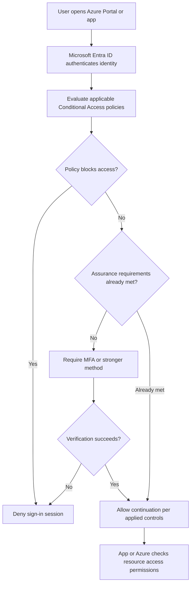

# Multi-factor authentication and Conditional Access

In Microsoft Azure, **Microsoft Entra ID** is the identity platform used to authenticate users, groups, and applications before they access the Azure Portal, Microsoft 365, or integrated applications. Usernames and passwords can be exposed through phishing or credential reuse; relying on passwords alone therefore creates significant risk for resources such as virtual machines, virtual networks, data stores, and subscriptions.

**Multi-factor authentication (MFA)** adds independent authentication evidence. **Conditional Access** uses signals from the sign-in process to decide when to require stronger MFA, when a policy-compliant device is needed, or when to block access. Together, these two mechanisms form an essential protective layer for Azure application architectures.

This lesson belongs to the **Identity with Microsoft Entra ID** chapter and focuses on recognizing authentication methods, designing Conditional Access policies, rolling them out safely, and troubleshooting issues. Examples use fictional tenants and accounts; no modifications to a live tenant are required.

## Learning objectives

After completing this lesson, you will be able to:

- Distinguish authentication, authorization, MFA, and authentication factor categories.
- Compare Microsoft Authenticator, OTP, SMS, FIDO2 security keys, passkeys, and Windows Hello for Business.
- Explain why phishing-resistant authentication is stronger than traditional MFA methods.
- Describe how Conditional Access evaluates subjects, applications, sign-in conditions, and access requirements.
- Design a policy requiring MFA or authentication strength for administrators and critical applications.
- Test policies using Report-only, What If, and sign-in logs while reducing the risk of locking out accounts.
- Diagnose sign-in errors related to method registration, devices, licensing, or policies.

## 1. How does authentication differ from authorization?

**Authentication** answers the question: *Who are you, and what evidence proves it?* For example, an employee signs in to the Azure Portal with a Microsoft Entra ID account and completes an additional verification step.

**Authorization** answers the question: *What is the authenticated identity allowed to do?* After sign-in, **Azure RBAC** checks role assignments to decide whether that user can read a resource group, deploy virtual machines, or manage a subscription.

Someone can sign in successfully and still be denied when creating resources due to missing RBAC permissions. Conversely, an account holding the Owner role can still fail to sign in if it does not satisfy a Conditional Access policy.

| Mechanism | Purpose | Example |
|---|---|---|
| Microsoft Entra ID authentication | Verify identity at sign-in | Password, passkey, Microsoft Authenticator |
| MFA | Require multiple independent factors to increase assurance | Password + confirmation on an owned device |
| Conditional Access | Decide whether to require controls or block access by context | Administrators must use phishing-resistant MFA |
| Azure RBAC | Restrict operations on Azure resources | Reader, Contributor, Owner on a resource group |

Conditional Access and Azure RBAC complement each other: meeting sign-in conditions does not by itself grant permission to act on resources.

## 2. What is MFA?

MFA requires **at least two factors from independent categories** to verify an identity. The three common factor categories are:

1. **Something you know (knowledge):** password, PIN.
2. **Something you have (possession):** security key, device holding a private key, or registered authenticator app.
3. **Something you are (inherence):** fingerprint, facial recognition, or other biometrics.

For example, entering a password and then approving a prompt on a registered phone can constitute two factors. Entering two different passwords uses only one factor category and therefore does not constitute MFA.

A **passwordless** method can still satisfy MFA if it combines possession with user verification via a PIN or biometrics. For instance, a FIDO2 security key with user verification can provide multi-factor proof in a single sign-in without typing a password.

### Example sign-in flow



This is a conceptual diagram. In practice, policy evaluation, initial authentication, and additional verification can span multiple steps and sessions; a session may already carry valid MFA claims and therefore not show a new prompt.

## 3. Authentication methods in Microsoft Entra ID

Microsoft Entra ID supports several methods. Availability depends on account type, device, tenant configuration, authentication methods policy, and service requirements.

| Method | How it works | Security notes and scenarios |
|---|---|---|
| Password | User provides a known secret | Vulnerable to phishing, credential stuffing, and reuse |
| Microsoft Authenticator – push notifications | App on registered device approves sign-in request; may require number matching | Common and convenient; users still must verify the request source and context |
| TOTP code in app | App generates a time-based one-time code | Useful when push is unavailable; codes can still be intercepted in real time by phishing proxies |
| Hardware/software OATH tokens | Generates one-time verification codes | Useful in device-constrained environments; requires token lifecycle management |
| SMS or voice call | Receives a code or approval prompt via phone number | Dependent on telecom networks; risks of SIM swapping, number hijacking, and phishing, so not preferred for privileged accounts |
| Passkey / FIDO2 security key | Cryptographic key bound to the service; user verifies on device or key via PIN/biometrics | Strong phishing resistance when deployed and configured properly; suitable for sensitive access |
| Windows Hello for Business | Sign-in using device-bound credentials unlocked by PIN/biometrics | Useful for managed corporate devices; can satisfy strong authentication requirements |
| Certificate-based authentication (CBA) | Uses certificates and policy-bound authentication | Fits certain enterprise environments; MFA satisfaction depends on configuration and certificate rules |
| Temporary Access Pass (TAP) | Time-limited code issued by an admin to register/recover methods | Used for controlled bootstrapping or recovery, not as a permanent daily sign-in method |

### Phishing-resistant MFA

Traditional MFA based on OTP codes or push notifications reduces risk when a password is leaked. However, attackers can still trick users into entering an OTP on a fake site or approving a sign-in request initiated by the attacker.

FIDO2 and compatible passkey methods cryptographically bind authentication to the legitimate sign-in origin. When a user is lured to a counterfeit website, the credentials cannot simply be replayed like an OTP on the real website. This substantially reduces credential-phishing risk.

**Number matching** in Microsoft Authenticator clarifies confirmation prompts and reduces blind approval of MFA notifications, yet it does not turn every push notification into phishing resistance equivalent to FIDO2.

Biometrics on a device are generally used locally to unlock a cryptographic key; do not assume the server receives the user's fingerprint or face image.

### How to choose a method?

- For administrators, apps containing sensitive data, and high-impact operations: prefer **phishing-resistant** methods supported by the tenant.
- For general users: use the strongest method the organization can deploy consistently, paired with guidance on recognizing fake prompts.
- For recovery scenarios: prepare multiple appropriate methods and an identity verification process before reissuing credentials.
- For machine or application accounts: use **managed identity**, workload identity federation, or an appropriate workload authentication method; never apply human OTP prompts to automated jobs.

## 4. Policy layers related to MFA

To design secure sign-in, distinguish **which methods are allowed to be used** from **the conditions requiring those methods**.

### Authentication methods policy

The authentication methods policy in Microsoft Entra ID specifies which user groups can use which methods, such as Microsoft Authenticator, FIDO2 passkeys, or Temporary Access Pass.

For example, the policy can allow the admin group to use passkeys and Microsoft Authenticator while phasing out SMS under a migration plan. Enabling a method does not mean every sign-in will automatically require it.

### Security defaults

Security defaults provide a baseline set of protections for a tenant, including strong authentication requirements and blocking certain legacy authentication flows. It is a straightforward option when an organization does not yet need many custom access rules.

If an organization needs to design custom Conditional Access policies, review the Security defaults status, licensing, and migration plan, because custom Conditional Access policies are not designed to run alongside Security defaults.

### Conditional Access policy

Conditional Access lets an organization define rules by user group, role, application, and signals such as location, device platform, device state, or sign-in risk. Outcomes can include blocking access, requiring MFA, requiring a specific authentication strength, or requiring a compliant device.

Creating and using Conditional Access policies typically requires **Microsoft Entra ID P1** or a plan with equivalent entitlements; risk-based capabilities from **Identity Protection** may require **P2**. Verify the licensing and features available in your tenant before deployment.

### Per-user MFA

Enabling MFA per user is a legacy model. For tenants needing situational controls, prefer Conditional Access policies to express access requirements centrally and testably. When migrating from legacy policies, assess real impact before removing existing configurations.

## 5. How does Conditional Access work?

A Conditional Access policy typically answers four questions:

1. **Who?** Which users, groups, or directory roles are in scope?
2. **Signing in to what?** Which cloud apps, user actions, or target resources?
3. **Under what conditions?** Which locations, device states, client types, platforms, or risk signals?
4. **Allowed under what controls?** Block access, or require MFA, authentication strength, a compliant device, or other supported controls?

For example: all members of `Azure-Admins`, when signing in to critical management applications, must use a method meeting **phishing-resistant MFA strength**. If a user lacks a sufficiently strong method, they will need to register or use a compliant method before gaining access.

### Main configuration blocks

| Block | Function | Example |
|---|---|---|
| Users | Include or exclude users, groups, or roles | `Azure-Admins` group |
| Target resources | Select apps or resources governed by the policy | Azure management, finance application |
| Conditions | Filter sign-in session signals | Location, client app, device platform, sign-in risk |
| Grant controls | Block or require conditions before granting access | Require multifactor authentication, Require authentication strength |
| Session controls | Control aspects of the authenticated session | Sign-in frequency, persistent browser session |
| Enable policy | Choose test or enforcement state | Off, Report-only, On |

Depending on features and scenarios, available conditions or controls may vary. Not every feature applies to every application, client, or identity type.

### Multiple policies can apply simultaneously

Conditional Access does not pick a single highest-priority policy. A sign-in session may be evaluated by **multiple policies** and must satisfy all applicable requirements. If one policy blocks access, satisfying MFA in another policy does not override the block.

Therefore, reviewing individual policies in isolation is insufficient: inspect the combined set of policies that actually apply to a given user and application.

## 6. Authentication strengths: requiring sufficiently strong methods

**Authentication strength** expresses combinations of authentication methods that satisfy a specific assurance level. Commonly referenced built-in levels include:

- **Multifactor authentication strength:** accepts combinations meeting multi-factor requirements as defined by that level.
- **Passwordless MFA strength:** requires sufficiently strong passwordless combinations that are supported.
- **Phishing-resistant MFA strength:** requires methods meeting phishing-resistant criteria on Microsoft's supported list, such as appropriately configured FIDO2 or Windows Hello for Business.

A policy choosing only **Require multifactor authentication** may accept many different MFA methods. If the goal is phishing resistance for administrators, consider **Require authentication strength** with the phishing-resistant level rather than assuming all MFA methods offer equal protection.

Having multiple registered methods does not guarantee the method used in the current session meets the required strength. Verify how the actual authentication method is recorded and evaluated during sign-in.

## 7. Preparing users and authentication methods

Before enforcing MFA broadly, ensure users have allowed methods and can self-register or receive support.

### Step 1: Identify users and methods

Group users by need: administrators, employees, external guests, staff without smartphones, and non-interactive workloads. Map methods that meet future policy requirements against each group's device capabilities.

### Step 2: Configure allowed methods

In the **Microsoft Entra admin center**, navigate to **Authentication methods** and inspect the method policies and enabled targets. If planning to require passkeys or stronger methods, verify that the pilot group is permitted to use and register those methods.

This configuration requires appropriate administrative permissions; menu names or locations may vary across UI versions.

### Step 3: Register authentication methods

Users can inspect and register methods allowed by the organization at:

[https://mysignins.microsoft.com/security-info](https://mysignins.microsoft.com/security-info)

For example, when registering Microsoft Authenticator, the user signs in to the Security info page, chooses to add a method, follows the prompts to link the app on their device, and completes verification. Specific steps may vary based on tenant policy and account type.

For passkeys or security keys, users need compatible devices and must complete the registration flow permitted by the tenant. Test registration before enabling mandatory enforcement to avoid leaving users without a qualifying method.

### Step 4: Prepare recovery

A user may lose a phone, misplace a security key, or change devices. Provide a support channel to verify identity, remove or replace old methods per delegated permissions, and use a Temporary Access Pass when permitted by policy. Never send recovery codes or secrets over unverified channels.

## 8. Hands-on: designing an MFA policy for administrators

Scenario: an organization has an `Azure-Admins` group managing Azure infrastructure. The goal is to protect sign-ins with phishing-resistant MFA while maintaining an emergency access path.

### Planned design

| Property | Illustrative value |
|---|---|
| Policy name | `CA-Admins-PhishingResistant` |
| Users | `Azure-Admins` admin group |
| Exclude | Separately managed and monitored emergency access accounts |
| Target resources | Admin applications within the defined scope; expandable upon review |
| Conditions | Add conditions only when clearly needed; admin MFA should not rely solely on trusted IPs |
| Grant | Grant access → Require authentication strength → Phishing-resistant MFA |
| Initial state | Report-only |
| Post-pilot state | On, after testing and establishing recovery procedures |

### Steps in the Microsoft Entra admin center

1. Sign in with an account holding appropriate permissions to manage Conditional Access policies.
2. Open **Protection → Conditional Access → Policies** in Microsoft Entra ID, or search for Conditional Access in the search bar.
3. Choose to create a new policy and give it a clear name, such as `CA-Admins-PhishingResistant`.
4. Under **Users**, add the admin group. Verify group membership and prepare the minimal exclusion list per organizational procedure.
5. Under target resources/applications, select the exact applications requiring protection.
6. Under **Grant**, select granting access when **Require authentication strength** is met, then choose **Phishing-resistant MFA** if available.
7. Set the policy to **Report-only** and save.
8. Use **What If** and pilot sign-ins to check whom the policy will affect, which apps are covered, and whether conflicts arise with other policies.
9. Verify test users can sign in with a method meeting the required strength.
10. Only after support plans, recovery workflows, and deployment approval are in place, switch the policy to **On**, monitor sign-in logs, and handle real-world exceptions.

The steps above are policy-authoring guidance, not a directive to enable the policy immediately on a production tenant. Excluding emergency accounts must be paired with strict controls and sign-in alerts, never becoming an everyday access path for regular users.

### Why use Report-only first?

Report-only lets you inspect a policy's projected impact during evaluation without enforcing that test policy's block or additional grant requirements. Other policies already set to On continue affecting sign-ins.

**What If** simulates a set of sign-in conditions and is helpful for seeing which policies are expected to apply. It does not replace verification via actual sign-ins and sign-in logs, especially for complex scenarios involving devices, clients, or authentication methods.

## 9. Example policies for common scenarios

| Need | Policy direction | Points to check |
|---|---|---|
| Protect administrators | Require phishing-resistant MFA strength for admin groups or roles | Every admin has a qualifying method; emergency plan exists |
| Protect finance applications | Require MFA or authentication strength aligned with app sensitivity | Compatibility with the app and affected user groups |
| Restrict sign-ins from legacy clients | Block legacy authentication flows that do not support modern controls | Check legacy apps, devices, and sign-in logs before enforcing |
| Allow only corporate devices to access sensitive data | Combine MFA with **compliant device** requirement where supported | Device management policies and processes exist, e.g., via Intune |
| High-risk sign-in signals | Apply risk-based conditions and appropriate protection controls | Risk features and licensing available; alert response process in place |
| External users (guests) | Evaluate dedicated policies for B2B/guests and MFA trust from source tenant | Cross-tenant access settings and guest experience |

In some scenarios, satisfying access requires both MFA **and** a compliant device simultaneously. When configuring multiple grant controls, inspect the exact requirement combination option and real outcomes rather than relying on the policy name.

## 10. Emergency access accounts, administrators, and workloads

### Emergency access accounts

A tenant should maintain an **emergency access** plan for situations where normal policies, devices, authentication providers, or admin workflows fail. These accounts require a dedicated protection model and close monitoring.

Design practices include: limiting who can use them, storing credentials in an approved secure mechanism, setting sign-in alerts, periodically testing recovery capability, and clearly identifying any Conditional Access policies that might affect them. Exceptions must be approved and audited.

### Privileged administrators

Strong MFA is one part of protecting high-privilege accounts. Combine it with **Microsoft Entra Privileged Identity Management (PIM)**, time-bound elevation workflows, and Azure RBAC reviews to reduce standing privileged access.

### Applications and workload identities

Automated applications cannot respond to push notifications or type OTPs like humans. Design authentication using managed identities, certificates, or appropriate federation, and use workload identity policies and controls where supported. User-targeted Conditional Access policies do not automatically protect every service principal sign-in flow.

## 11. Verifying policies and investigating sign-ins

When someone signs in successfully or gets blocked, Microsoft Entra ID **Sign-in logs** are the starting point to inspect:

- The identity and target application of the sign-in session.
- Timestamp, IP address, client type, and recorded device details.
- Success, failure, or interrupted status; error codes and diagnostic info.
- Which Conditional Access policies applied, did not apply, or were evaluated in Report-only mode.
- Authentication step details and whether MFA requirements were satisfied, per available log fields.

### Investigation workflow

1. Confirm the exact account, tenant, timestamp, and application having issues.
2. Locate the event in **Monitoring → Sign-in logs** or the corresponding Sign-in logs area of Entra ID.
3. Open the event details and inspect the **Conditional Access** tab to identify impacting policies.
4. Inspect **Authentication details** to see which method was used and which verification step was requested or failed.
5. Check authentication methods policies, user groups, target resources, and exclusions.
6. Use **What If** with matching conditions to check expected evaluation, then refine the design and retest with a small group.

A sign-in session may not display a new MFA prompt because authentication proof from an earlier session or a passwordless method already satisfied the policy. What matters is that the authentication requirement was **satisfied**, not how many times the user saw an MFA dialog.

### Illustrative query with Log Analytics

If the organization exports sign-in logs to Azure Monitor Logs/Log Analytics and you have query permissions, you can use KQL for an overview:

```kusto
SigninLogs
| where TimeGenerated >= ago(1d)
| project TimeGenerated,
          UserPrincipalName,
          AppDisplayName,
          ResultType,
          ConditionalAccessStatus,
          AuthenticationRequirement
| order by TimeGenerated desc
```

This query only returns data when logs have been routed to the appropriate workspace. Denied sign-ins or cases requiring extra interaction must be examined in the full source record to avoid drawing conclusions from a single summary column.

### Checking tenant context in Azure CLI

If signed in to Azure via Azure CLI, you can verify the tenant and subscription used by your CLI session:

```bash
az account show --query "{tenantId:tenantId, subscriptionId:id, account:user.name}" --output json
```

This command does **not** show all Conditional Access policies applied to the session; inspect Microsoft Entra sign-in logs for that information. If you need to sign in to a different tenant, confirm the tenant is authorized and use an interactive sign-in flow supported by your organization.

## 12. Common errors

| Symptom | Possible cause | How to resolve |
|---|---|---|
| User does not receive MFA push | Device offline, notifications disabled, phone changed, or method not properly registered | Check connectivity, app settings, Security info, and allowed fallback methods |
| Sign-in requires a stronger method | Policy enforces authentication strength that the current method does not meet | Register a passkey/security key or another method meeting the required level |
| Entered OTP yet still denied | Another policy blocks access; device requirement missing; sign-in flagged as risky | Inspect Conditional Access and Authentication details |
| Report-only policy does not block users | Report-only only evaluates that policy's impact | Inspect log outcomes; switch to On only after pilot testing and approval |
| Administrator locked out of tenant | New policy applied to admin accounts without qualifying method or emergency channel | Use the prepared emergency access procedure; adjust policy under change control |
| User signs in without seeing a push prompt | Current method or session claims already satisfied MFA | Inspect actual method and authentication steps in sign-in logs |
| Conditional Access option not visible | Licensing, admin role, or tenant UI does not satisfy requirements | Verify licensing and appropriate policy administration role |
| Automated app stops working after enabling controls | App uses legacy authentication flow or workload designed like an interactive user | Check client type, upgrade guidance, and proper workload identity design |

When troubleshooting errors, avoid temporary workarounds like disabling MFA tenant-wide or adding everyone to an exclusion list. Identify the exact policy and scenario before making edits.

## 13. Security pitfalls to avoid

**Approving unexpected MFA prompts:** Users should only approve prompts they just initiated where the displayed context makes sense. Repeated prompts may indicate MFA fatigue; deny and report them.

**Believing every MFA method is phishing-resistant:** SMS codes, TOTP, and ordinary push notifications can be stolen or abused via social engineering. Privileged roles should move toward phishing-resistant methods.

**Using trusted IP addresses as the sole proof:** Office or VPN IPs do not replace strong identity verification; attackers can also leverage compromised devices or networks.

**Focusing solely on MFA while ignoring session security:** Tokens, browser sessions, compromised devices, and account recovery paths all affect security even with MFA enabled. Combine device management, session controls, and monitoring.

**Turning on overly broad policies immediately:** Always define user and app scope, test in Report-only, prepare an emergency plan, and monitor after enabling.

**Sharing admin accounts:** Eliminates individual accountability and complicates personal protection. Prefer individual identities, least privilege, and controlled privileged access workflows.

## 14. Scenario lab

Suppose an enterprise has three groups: `Employees`, `Azure-Admins`, and `External-Guests`. An internal application stores work documents, while the Azure Portal is used to manage virtual machines and virtual networks.

**Requirements:**

- Regular employees must authenticate with MFA when accessing sensitive applications.
- Administrators must use phishing-resistant MFA for designated administrative resources.
- External guests must meet sign-in requirements under a dedicated policy.
- Managed and monitored emergency access accounts must exist.
- Before enforcement, all policies are verified via Report-only or a pilot group.

**How to execute on paper or in a test tenant:**

1. List the subjects, applications, and protection levels required for each group.
2. Check the authentication methods policy to ensure required methods are enabled.
3. Have pilot users register methods on the Security info page.
4. Design policies with recognizable names and scopes; prepare minimal exclusions.
5. Run What If for one member of each group, an admin who has not registered a security key, and an external guest.
6. Inspect actual sign-ins in Sign-in logs, including both compliant and non-compliant cases.
7. Document who has permission to modify policies, who approves changes, and the procedure when a user loses a device.
8. Only after pilot results and a support plan are complete, consider moving approved policies to On.

Test expectation table:

| Scenario | Expected outcome |
|---|---|
| Employee with qualifying MFA accesses sensitive app | Allowed after satisfying all applicable policies |
| Admin uses a method below phishing-resistant strength | Prompted for a qualifying method or denied access |
| Admin uses valid FIDO2 and holds RBAC permissions | Passes authentication; resource actions remain governed by RBAC |
| User outside the pilot policy's target scope | Pilot policy does not apply; other policies may still apply |
| Emergency access account is activated | Follows dedicated procedure; sign-in event triggers alerts and investigation |

## 15. Knowledge self-check

1. How do authentication and Azure RBAC differ? Why can someone who passes MFA still be denied from creating a virtual machine?
2. Why is entering two passwords not automatically considered MFA?
3. What is the difference in phishing resistance between TOTP and a FIDO2 passkey?
4. How does the authentication methods policy differ from a Conditional Access policy?
5. When should you choose **Require authentication strength** instead of just **Require multifactor authentication**?
6. If multiple Conditional Access policies apply, does satisfying one policy guarantee access?
7. Why must you use Report-only, What If, and sign-in logs before enabling a policy organization-wide?
8. Why are emergency access accounts and a lost-device support process necessary?
9. Can a service principal receive an OTP on a phone like a human user? How should its authentication be designed?
10. Does a user not seeing a new MFA prompt always mean MFA has not been satisfied?

## Conclusion

MFA raises identity assurance through independent authentication factors; phishing-resistant methods such as FIDO2 and Windows Hello for Business are generally better suited for privileged access. Conditional Access translates security requirements into policies based on subjects, applications, and sign-in context. An effective rollout prepares authentication methods, phases in policies carefully, monitors logs, protects emergency access accounts, and coordinates with Azure RBAC to constrain resource actions.

This lesson helps establish the authentication foundation for Azure architectures using subscriptions, resource groups, networking, compute, storage, and data, where access must be verified before any administrative or service operation is permitted.
