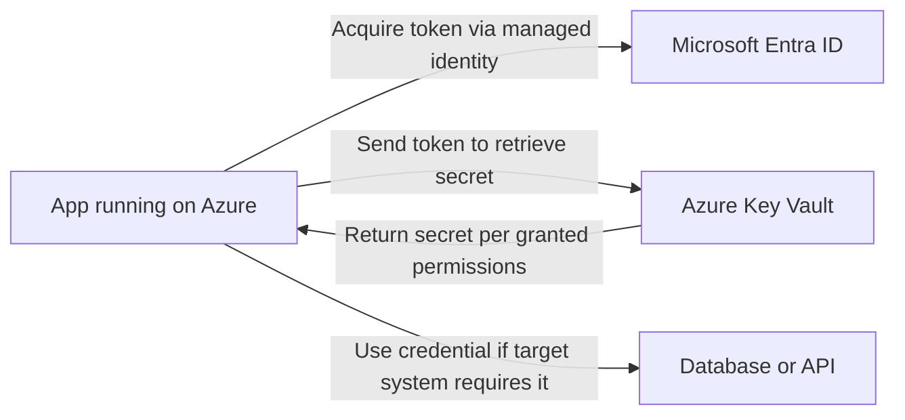
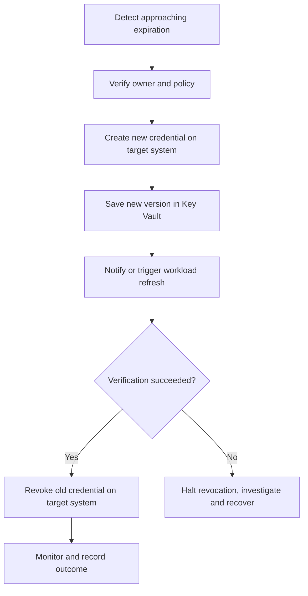

# Protecting credentials and credential rotation

In Microsoft Azure, applications and operators frequently need to prove their identity before accessing resources: APIs, databases, storage accounts, network services, or deployment systems. If a credential is exposed, someone else can use it to impersonate that identity and perform whatever actions the identity has been granted.

Protecting credentials is not just about setting strong passwords. A secure system requires **choosing the right identity type, storing secrets in the right place, granting least privilege, monitoring usage, and rotating credentials without disrupting services**.

In the **CLOUD_PROVIDERS_AZURE** module, this lesson connects Microsoft Entra ID with Azure Key Vault, Azure RBAC, and Azure application deployment workflows. These techniques continue to be used when operating virtual machines, App Service, containers, data services, and CI/CD pipelines.

## 1. Learning objectives

After this lesson, you will be able to:

- Distinguish user, application, and workload credentials; identify which values require protection.
- Choose between managed identity, workload identity federation, certificates, and client secrets.
- Use Azure Key Vault to manage secret lifecycles and limit exposure when applications access secrets.
- Design a **rotation** process with an overlap window, verification, and revocation of old credentials.
- Detect expiring credentials, address post-deployment drift, and respond to suspected exposure.

## 2. What is a credential and why is it easily exposed?

A credential is evidence used during authentication. Common examples include:

| Credential type | Example | Typical risks |
|---|---|---|
| User password | Microsoft Entra account password | Phishing, password reuse, account takeover |
| Client secret | App registration or service principal secret | Exposure in source code, config files, pipelines, logs |
| Certificate and private key | Certificate used for app authentication | Private key copied or expired |
| System password | Database connection password, technical account | Embedded in connection strings or configuration files |
| API key / shared access key | Third-party service or system key | Broad access permissions, difficult to trace caller identity |
| Access token / refresh token | Token issued by an identity system | Hijacked to access resources while still valid |

**Client ID, tenant ID, and subscription ID are not secrets.** They still require proper contextual management, yet they cannot replace a client secret or private key. Conversely, access tokens must be protected as sensitive material because anyone holding a token can use it within its granted permissions and lifetime.

Secrets often leak through overlooked paths: Git commits, application logs, terminal screenshots, shell history, environment variables printed during debugging, `.env` files baked into container images, pipeline artifacts, or poorly controlled backups.

Insecure example:

```properties
# BAD EXAMPLE: Never store real values in a repository
database.password=plain-text-password
azure.client.secret=plain-text-client-secret
```

Deleting the line containing a secret from the current Git commit **does not make an exposed credential safe**. The secret may still exist in commit history, forks, artifacts, or logs. If exposure is suspected, revoke or replace the credential at the **originating authentication system**.

## 3. Design principle: eliminate secrets whenever possible

Not every workload needs to store a client secret. The order of preference should be based on where the workload runs and which identity mechanisms are supported.

| Option | Authentication method | Suitable scenarios | Credential operations |
|---|---|---|---|
| **Managed identity** | Azure manages the resource's identity | Apps running on Azure services supporting managed identity | Platform manages underlying credentials; operations team manages RBAC permissions |
| **Workload identity federation** | Exchanges trusted tokens from an OIDC issuer | CI/CD or workloads with an Entra-supported token provider | No long-lived client secret stored; must protect trust config and token issuer |
| **Certificate** | App proves possession of a private key | Workloads needing app auth where the two options above are not yet usable | Protect private key, monitor expiration, and rotate certificates |
| **Client secret** | App uses a secret value to obtain tokens | Legacy integrations or environments lacking better options | Bound lifetime, store in a secret vault, rotate, and revoke |
| **User account** | Interactive sign-in, MFA, and access policies | Employees using Azure Portal, CLI, and developer tools | MFA, Conditional Access, and account protection processes |

This is the preferred order for new designs, not a claim that one option works in every environment. Verify service support, access permissions, audit requirements, and organizational policy.

### Managed identity

A managed identity is a Microsoft Entra identity tied to an Azure resource. Applications can use the Azure SDK to acquire tokens without embedding secrets in configuration. Azure manages the lifecycle of the underlying credentials.

There are two primary forms:

- **System-assigned:** tied to the lifecycle of a specific Azure resource.
- **User-assigned:** a standalone identity resource that can be assigned to multiple supported workloads.

Example: an App Service with a managed identity accesses Key Vault. An administrator assigns the `Key Vault Secrets User` role at the appropriate scope. The app acquires a token via the SDK, then requests the needed secret from Key Vault.

Managed identity does not exempt you from permission control. If an identity is granted overly broad permissions or the workload is compromised, an attacker can still abuse the identity's permissions. Review RBAC and monitor application activity.

### Workload identity federation

Workload identity federation lets Microsoft Entra ID trust tokens issued by an external provider under configured conditions such as **issuer, subject, and audience**. From that token, the workload can request an Entra token without holding a long-lived client secret.

Example: a deployment pipeline on a CI/CD platform supporting OpenID Connect uses a federated trust link to an Entra app registration. Only workloads matching the declared conditions can exchange tokens under that configuration.

Trust conditions must be tightly controlled. Allowing an overly broad subject lets unintended workflows assume the deployment identity. Having no client secret to rotate also does not remove the need to review permissions and trusted identities.

## 4. Protecting user accounts in Entra ID

For engineer, administrator, or operator accounts:

1. Enable and enforce **multi-factor authentication (MFA)** per organizational policy; prefer phishing-resistant methods such as FIDO2 security keys or passkeys where appropriate.
2. Use **Conditional Access** to enforce sign-in conditions based on risk, device state, or organizational rules.
3. Separate everyday accounts from privileged accounts and use just-in-time elevation such as Microsoft Entra Privileged Identity Management (if deployed by the organization).
4. Restrict legacy authentication methods that do not meet security requirements.
5. Monitor sign-in logs and investigate anomalous authentication events.

Forcing periodic password changes on a rigid schedule is neither the sole measure nor always the most effective control for users. Change passwords and revoke sessions when there is evidence of compromise or when policy or risk assessment requires it, paired with MFA and appropriate identity controls.

The **application client secret** rotation steps in the following sections differ from forcing employees to change passwords. Do not use password-based human user accounts to run long-lived background tasks.

## 5. Azure Key Vault: managing secrets, keys, and certificates

Azure Key Vault centralizes management of sensitive material and controls access.

| Object | Purpose |
|---|---|
| **Secret** | Stores values such as passwords, third-party system tokens, or sensitive connection strings |
| **Key** | Manages cryptographic keys; has its own mechanisms and lifecycle policies |
| **Certificate** | Manages certificates and related components for TLS or authentication depending on purpose |

Not every secret in Key Vault is automatically updated on the target system by Azure. For example, creating a new version of a `database-password` secret **does not automatically change the account password inside the database**. Rotation must coordinate the credential-owning system, Key Vault, and the consuming application.

### Recommended architecture



The flow above is used only when the target system still requires a password or API key. If the database, storage, or API service supports Microsoft Entra authentication, consider using tokens directly and removing shared credentials from the flow.

### Key Vault authorization and protection settings

Prefer the **Azure RBAC model for the Key Vault data plane** when supported by environmental requirements:

- `Key Vault Secrets User`: read secret values needed by applications.
- `Key Vault Secrets Officer`: manage secret lifecycles; grant only to operational identities that genuinely require it.
- Separate vault administration permissions, secret-read permissions, and credential-rotation permissions.
- Grant permissions at the smallest reasonable scope: a specific vault or specific object when needed and supported.

Alongside RBAC, configure firewalls or private endpoints depending on network architecture, enable appropriate diagnostic logging, use soft-delete and purge protection, and review pipeline and operational identity permissions. Never place secret values inside secret names, tags, error messages, or metadata attributes because metadata often has different access scopes than secret values.

**Note:** anyone permitted to read a Key Vault secret receives the value within the application context. Never log secrets or return them in API responses. Call Key Vault only over TLS and never pass secret contents in URLs.

## 6. Credential lifecycle and rotation planning

Credential rotation is the process of creating a new credential, switching workloads to use it, verifying operation, and disabling the old credential. The goal is to limit how long an exposed credential can be abused while keeping services running smoothly.

A rotation plan must answer:

| Element | Questions to resolve |
|---|---|
| Owner | Who is responsible for creating, deploying, testing, and revoking? |
| Scope | Which apps, pipelines, servers, or environments currently use the credential? |
| Expiration | When does the credential expire? How far in advance are alerts needed? |
| Dependencies | Can clients use two credentials concurrently during the transition window? |
| Distribution | How is the new credential stored, authorized, and loaded into runtime? |
| Verification | Which tests prove the workload is actively using the new credential? |
| Revocation | When and how is the old credential disabled? |
| Recovery | If deployment fails, how do you recover safely during the overlap window? |

### Standard workflow with an overlap period

```text
Inventory -> Create new credential -> Store and distribute securely
          -> Switch workloads      -> Test and observe
          -> Revoke old credential -> Verify and record results
```

**Step 1 — Inventory.** Find every place using the old credential: production, staging, cron jobs, mobile apps, pipelines, integration accounts, deployment replicas, and backup tasks. Record owners, expiration dates, and dependencies. Safe rotation is impossible if clients are missed.

**Step 2 — Create new credential.** For systems supporting multiple concurrent credentials, create the new credential while keeping the old credential active during a short, controlled transition window. This avoids downtime during multi-instance rollouts.

**Step 3 — Store and distribute.** Place the new credential into Key Vault or the corresponding secret store over a protected channel. Keep read permissions minimal; never send secrets via email, chat, tickets, or source commits.

**Step 4 — Switch workloads.** Update reference configuration, restart, or trigger the application to reload the secret per its runtime mechanism. Check instances during rolling deployments and non-continuous scheduled tasks.

**Step 5 — Verify.** Run tests covering fresh authentication, target system connectivity, representative business operations, and error logs. Confirm with certainty that workloads are using the **new credential**, not merely continuing on cached sessions or tokens.

**Step 6 — Revoke old credential.** Only after testing and confirming all clients have switched, disable or delete the old credential at the issuing system. Do not just delete the secret version in Key Vault: the old credential value may still remain valid on the target service.

**Step 7 — Post-revocation check.** Monitor authentication errors and update rotation records, approvers, and the new expiration date. If a failure requires rollback, evaluate issuing a safe replacement credential rather than re-enabling a secret suspected of exposure.

An overlap window maintains service availability, yet it is also a period when both credentials are valid. Keep this window brief and monitor usage of the old credential if supported by the system.

## 7. Rotating an app registration client secret

In Microsoft Entra ID, an **app registration** represents the application's identity definition; a service principal represents the application in a consuming tenant. A client secret or certificate is how the application proves its identity when requesting tokens.

Example: a backend app needs tokens to call an API with application permissions. Initially, the app uses client secret `secret-A`; the company wants to transition to `secret-B` before `secret-A` expires.

### Steps in the Microsoft Entra admin center

1. Open **Microsoft Entra ID > App registrations** and select the application.
2. Open **Certificates & secrets** and inspect existing credentials and expiration dates.
3. Add a new client secret with a policy-compliant lifetime. Allow `secret-A` and `secret-B` to coexist during the transition if your design supports it.
4. Copy the new secret **value** into your secret store via a secure channel immediately while it is displayed. This value is typically shown only once right after creation.
5. Update workload configuration to reference the new credential; deploy and test acquiring new tokens.
6. Verify dependent clients and schedules, then delete the old credential from the app registration.
7. Monitor authentication errors and update the next rotation schedule.

Distinguish the **Secret ID / key ID** used to identify the credential from the **secret value** used to authenticate. Never mistake the secret ID for a password, and never log the secret value to confirm rotation.

### Inventorying metadata with Azure CLI

After signing in with a sufficiently privileged identity, you can view an app registration's credential list:

```bash
az ad app credential list \
  --id "<APPLICATION_CLIENT_ID>" \
  --query "[].{keyId:keyId,expires:endDateTime,displayName:displayName}" \
  --output table
```

This command is for **metadata inventory**, not retrieving previously created secret values. Permissions to view, add, or remove app credentials depend on app registration management rights granted in Entra.

To create a new credential via CLI, `az ad app credential reset` exists, yet creating a client secret can **return the secret value in command output**. In automation, design secure handling and storage to avoid leaking secrets into terminals, CI/CD logs, or artifacts. Never run a reset command carelessly in production without confirming whether it appends or overwrites existing credentials.

Once all workloads are confirmed to have switched, delete the exact key ID of the old credential in the app registration. Deleting the old credential prevents it from requesting new tokens; previously issued access tokens may remain valid until expiration or service revocation.

### When two concurrent credentials are not supported

Not every service accepts multiple active passwords simultaneously. For database accounts supporting only a single valid password, changing it server-side can break existing clients. In such cases, use one of the strategies supported by the system:

- Use two least-privilege user/database principals and migrate connections gradually.
- Use independent credentials per client group.
- Perform a coordinated cutover, monitor errors, and schedule a maintenance window if needed.

Never assume Key Vault versioning automatically gives a database two simultaneous valid passwords.

## 8. Rotating certificates and private keys

Application authentication certificates are typically registered as public certificates in Entra; the workload must protect the corresponding **private key** to sign assertions or prove identity.

Basic workflow:

1. Inventory certificates and expiration dates, including everywhere the private key is used.
2. Generate a new key pair and certificate through an approved key-management process.
3. Add the new public certificate to the application authentication configuration while keeping the old certificate during transition.
4. Distribute the new private key over a protected channel such as Key Vault or an appropriate certificate management service.
5. Update workloads to use the new certificate; test token acquisition and dependent APIs.
6. Remove the old certificate from Entra once the cutover is verified, and handle old private key copies per policy.
7. Track the new certificate's expiration and key pair lifecycle.

Certificates expire and require rotation even when the private key has never been compromised. Replacing a certificate in Key Vault does not automatically update the application and app registration. Verify how the application reloads certificates, active instances, caching behavior, and rollover mechanics.

If a private key is compromised, treat it as an incident: generate a new key pair, block usage of the old key, and investigate related authentication sessions. Never merely reissue a certificate sharing a suspected private key.

## 9. Managing secret versions in Azure Key Vault

Key Vault creates a **new version** whenever you set a new value for the same secret name. Versions help track lifecycle and let applications reference either a specific version or the current version.

Examples:

```text
https://<VAULT_NAME>.vault.azure.net/secrets/payment-api-key
https://<VAULT_NAME>.vault.azure.net/secrets/payment-api-key/<VERSION>
```

The versionless URI typically accesses the current active version, whereas the versioned URI points to one specific version. The two reference styles behave differently during rotation:

- **Unpinned version:** can pick up the new version on the next fetch, though the app must still handle caching, open connections, and refresh intervals.
- **Pinned version:** changing the default secret does not switch the app automatically; references must be updated to the new version.

Do not assume an application sees a new secret instantaneously. Azure SDKs, Key Vault references, internal caches, connection pools, or running containers may retain old values for a period. Define a refresh or restart strategy based on the actual deployment mechanism.

### Inventorying via CLI without printing secret values

```bash
az keyvault secret list \
  --vault-name "<VAULT_NAME>" \
  --query "[].{name:name,enabled:attributes.enabled,expires:attributes.expires}" \
  --output table
```

List metadata for versions of a secret:

```bash
az keyvault secret list-versions \
  --vault-name "<VAULT_NAME>" \
  --name "<SECRET_NAME>" \
  --query "[].{id:id,enabled:attributes.enabled,expires:attributes.expires}" \
  --output table
```

Both examples target metadata; there is no need to print secret values to the screen. Also avoid enabling CLI debug mode in sensitive environments if logs are not tightly controlled.

### Setting a new secret version

Once a new value has been safely generated on the target system, Azure CLI supports setting a secret from a protected input file:

```bash
az keyvault secret set \
  --vault-name "<VAULT_NAME>" \
  --name "<SECRET_NAME>" \
  --file "<PROTECTED_FILE_PATH>" \
  --encoding utf-8 \
  --output none
```

This example illustrates syntax and **contains no real secret values**. The input file must be protected per policy: restrict read permissions, avoid synced folders or version control, keep no unnecessary copies, and securely delete it afterward. For automation, prefer direct secret-store integration and avoid temporary plaintext files whenever possible.

`--output none` suppresses standard output; it does not eliminate risks in the source file, secret-generation logs, or CI/CD configuration. If the secret is an external system password, verify that the external system has accepted the new credential.

### Permissions when an app reads Key Vault

The application needs an identity and appropriate read permissions. For example, for an App Service with managed identity and a vault using Azure RBAC, assign `Key Vault Secrets User` to the identity at the vault scope or a narrower supported scope.

A secret-read permission is sufficient for the app to run; never automatically grant delete, secret-write, or full Key Vault admin permissions. Separate the application's identity from the rotation identity.

## 10. Java application reading secrets without hardcoding credentials

For Java applications running on Azure, you can use the Azure Identity and Azure Key Vault Secrets libraries. This example illustrates reading a secret using `DefaultAzureCredential`:

```java
import com.azure.identity.DefaultAzureCredentialBuilder;
import com.azure.security.keyvault.secrets.SecretClient;
import com.azure.security.keyvault.secrets.SecretClientBuilder;

public class SecretReader {
    public static void main(String[] args) {
        String vaultUrl = System.getenv("AZURE_KEY_VAULT_URL");
        if (vaultUrl == null || vaultUrl.isBlank()) {
            throw new IllegalStateException("Missing AZURE_KEY_VAULT_URL");
        }

        SecretClient client = new SecretClientBuilder()
                .vaultUrl(vaultUrl)
                .credential(new DefaultAzureCredentialBuilder().build())
                .buildClient();

        // Returns the secret to configure the target service client;
        // never print the value to stdout, exceptions, or application logs.
        String apiKey = client.getSecret("partner-api-key").getValue();
        useCredentialSafely(apiKey);
    }

    private static void useCredentialSafely(String apiKey) {
        // Example: pass apiKey to the target service's SDK/client over TLS.
        // Avoid logging apiKey or appending apiKey to URLs.
    }
}
```

To run this example, the application needs the `azure-identity` and `azure-security-keyvault-secrets` dependencies, the `AZURE_KEY_VAULT_URL` environment variable pointing to the vault, and secret read permissions for the running identity.

`DefaultAzureCredential` selects an available authentication mechanism in the credential chain suited to the environment. During local development, a developer may sign in via a supported tool such as Azure CLI; in Azure, the app should use managed identity if supported by the service. Exact capabilities and precedence depend on SDK version and configuration. Never assume local and production identities share the same permissions.

This example shows only a single secret read. In real applications, design **refresh and error handling**: avoid calling Key Vault on every request unnecessarily, define an appropriate caching strategy, retry with backoff on transient failures, and refresh target connections when credentials change. Never record secret values in telemetry.

## 11. Automated rotation: what can be automated?

A rotation workflow can be triggered on a schedule, approaching expiration, or by events. With Azure Key Vault, services such as Event Grid and Azure Functions can help build automated secret workflows; implementation details depend on the credential-issuing system.

Example workflow for an API key:



Distinguish the following:

- **Key Vault key rotation policy:** applies to cryptographic key lifecycles and has its own mechanism.
- **Key Vault secret rotation:** usually requires a workflow or integration to update the value on the target system; saving a new version in the vault is only one step.
- **Managed identity:** underlying credentials are managed by Azure; never build a cron job to rotate a managed identity's client secret.
- **Workload identity federation:** has no traditional client secret to rotate, yet trust settings, issuer, subject, and workload permissions still require periodic review.

Automated workflows require testing, least-privilege permissions, failure circuit-breakers, logging **metadata instead of secret values**, and alerting responsible owners. Systems may support safe rollback during an overlap window; never design rollback by accidentally re-enabling a credential known to be compromised.

## 12. Monitoring expiration and detecting anomalies

Rotation failures often stem from poor visibility: a credential expires with no accountable owner, a pipeline still uses an old secret, or an app encounters authentication failures after a change.

Monitor three signal groups simultaneously:

| Group | Signals and actions |
|---|---|
| **Credential age and expiration** | Inventory of app credentials, certificates, secret metadata, owners, remaining validity, and rotation schedule |
| **Workload health** | Token issuance errors, HTTP 401/403 responses, database connection failures, scheduled job failures, post-deployment failure-rate spikes |
| **Identity activity** | User and service principal sign-in logs, Entra audit logs, Key Vault access logs, and permission changes |

Set pre-expiration alerts based on the time needed for testing and rollout, rather than waiting until expiration day. For instance, if rotation involves multiple approver groups and a rolling deployment, alerts must fire early enough to coordinate.

In reports, record: application name, object ID or app ID, credential-owning system, credential name, expiration date, owner, impact level, and rotation status. **Never put secret values or private keys into inventory tables.**

After revoking an old credential, keep monitoring. A monthly batch job might not fail on the day of rotation, so completion criteria must include verifying scheduled workflows and low-frequency environments.

## 13. Handling exposed or suspected compromised credentials

Scheduled rotation and incident response have different goals. When exposure is suspected, prioritize stopping ongoing abuse of the credential while coordinating to keep critical services operational.

An incident response workflow may include:

1. **Scope assessment:** credential type, application, tenant, granted permissions, target systems, and possible exposure window.
2. **Containment:** restrict permissions, block, or delete the suspected credential at the issuing system; handle tokens, sessions, or access keys per each service's mechanism.
3. **Issue replacement credential:** via a secure channel, preferring migration to managed identity or federation if suitable and feasible.
4. **Update workloads:** update config, deploy, and verify; if an active incident is underway, decide how to handle downtime based on risk level and response procedures.
5. **Investigation:** inspect sign-in logs, audit logs, Key Vault logs, actions performed with the credential, source code, and related artifacts.
6. **Eliminate the leak source:** remove the secret from code/config/logs and fix the distribution mechanism; remember that scrubbing public traces does not replace revoking the credential.
7. **Document and prevent recurrence:** update secret-scanning controls, CI/CD configuration, access permissions, alerts, and rotation procedures.

For an Entra client secret, deleting the old secret typically prevents using it to request new access tokens. However, already-issued access tokens may remain valid for a certain period. Evaluate session/token revocation mechanisms and target-service permission limits rather than assuming deleting a client secret instantaneously invalidates every active token.

For a database password or third-party API key, change or revoke it at **that system itself**. Simply deleting the version stored in Key Vault does not invalidate a copied value.

## 14. Common mistakes and how to fix them

| Mistake | Consequence | Correct practice |
|---|---|---|
| Storing secrets in `application.properties`, committed `.env`, or pipeline YAML | Easy exposure via Git, copies, and logs | Use managed identity/federation; store remaining needed secrets in Key Vault or a controlled secret store |
| Putting secrets in environment variables and assuming total safety | Variables can still be read by processes, debug dumps, or ops tools | Restrict process and log access; prefer centrally managed secret sources |
| Creating a new Key Vault version without updating the target system's credential | App keeps using old key or new key fails validation | Coordinate target system, vault, and workload per plan |
| Deleting the old credential before all clients are updated | Jobs and apps lose authentication capability | Use an overlap window and clear verification criteria, unless an incident demands immediate revocation |
| Leaving the old credential active indefinitely after switching | Increases attack surface | Enforce transition deadlines and revocation; inspect logs post-rotation |
| Granting `Owner` or Key Vault admin permissions to every app | Expands blast radius if a workload is compromised | Grant minimal RBAC per identity and scope |
| Checking only that the app starts successfully | App may rely on cached tokens without testing live auth | Test fresh token acquisition, target connections, background jobs, and monitor errors |
| Treating managed identities as needing no governance | Identities can accumulate excess permissions | Periodically review RBAC, identities, and usage logs |
| Scheduling rotation without knowing the owner | Credentials expire or nobody revokes old ones | Maintain inventory, assign owners, set alerts, and follow an execution checklist |

## 15. Controlled hands-on lab

**Scenario:** a Java service running on Azure needs to call a partner API using an API key. The app currently reads the key from static configuration. You are tasked with moving it to Key Vault and designing a safe rotation plan.

Perform this in a test environment with **dummy values**, never production credentials:

1. List all locations where the API key may currently reside: repository, environment variables, pipelines, and runtime configuration.
2. Design the identity for the application: managed identity if running on a supported Azure service; specify the minimal Key Vault role to grant.
3. Create a test secret in Key Vault following the environment's protection procedures.
4. Configure the Java app to read the secret via the Azure SDK using `DefaultAzureCredential`. Confirm the app does not log the value.
5. Create a new secret version; determine when the app reads the new version and how refresh works.
6. Simulate the target system accepting the new credential; test the authentication flow and revocation of the old credential.
7. Describe how to detect when a secret is nearing expiration and when the app fails to retrieve the secret.
8. Write a response checklist for what to do if a test key appears in a repository.

**Self-check questions**

1. Why is `clientId` not considered a secret, whereas `clientSecret` must be protected?
2. When should managed identity be used instead of a client secret?
3. Does creating a new secret version in Key Vault automatically change a database password? Why or why not?
4. If an app continues working after rotation, how do you verify it is using the new credential rather than a cached token?
5. Why must the old credential be revoked at the issuing system and errors monitored afterward?
6. What is the difference between scheduled rotation and responding to a compromised credential?

**Completion criteria:** ability to explain identity selection, grant permissions for an app to access secrets, execute verified rotation, and know what steps to take if a credential is compromised.

## 16. Conclusion

Protecting credentials in Azure starts with reducing the number of secrets the system must hold. Managed identities and workload identity federation free many workloads from needing long-lived client secrets. When credentials remain necessary, Azure Key Vault handles storage and access control, while Microsoft Entra ID and Azure RBAC govern identities and permissions.

Credential rotation is an **end-to-end process**: inventory dependencies, issue new credentials, distribute, switch workloads, verify, revoke at the issuing system, and monitor post-change. Executing this process properly reduces exposure risk, prevents unexpected expiration outages, and establishes a solid security foundation for applications deployed on Azure.
