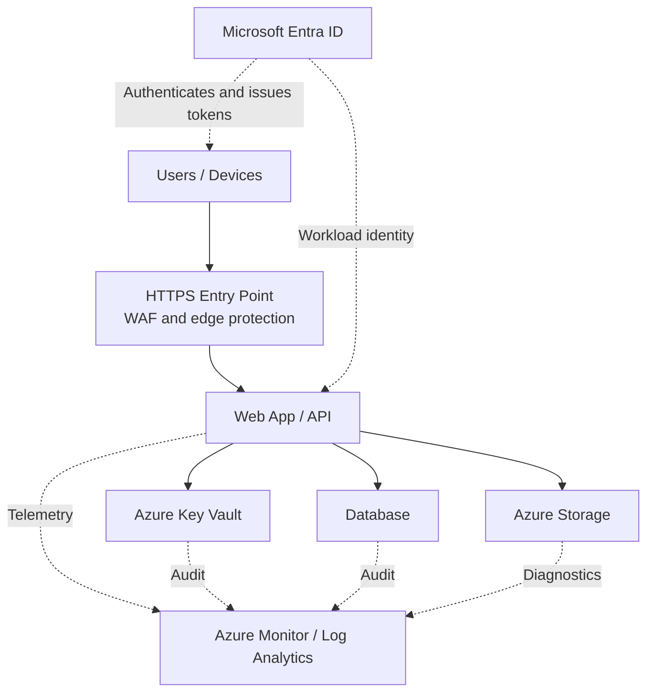
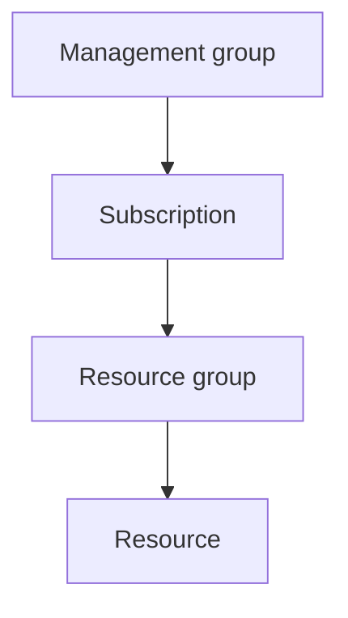
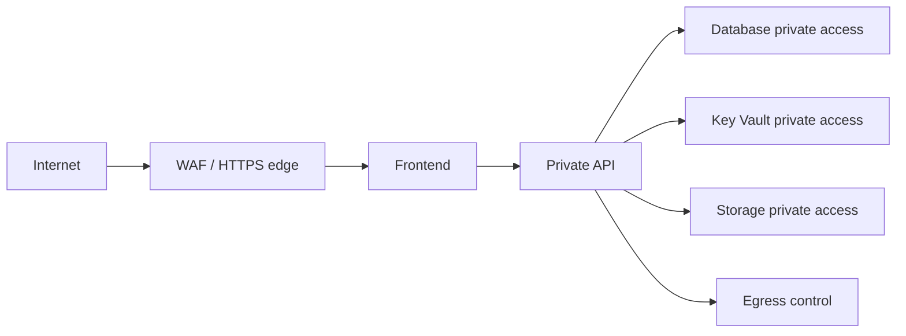
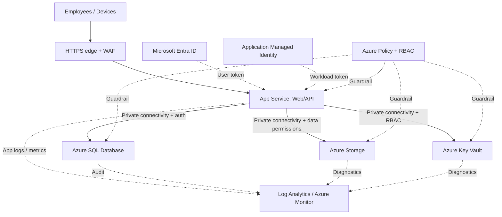

# Applying Zero Trust to Azure Architecture

An application running on Microsoft Azure may fully utilize virtual networks, virtual machines, compute services, storage, and databases, yet still be compromised if the system implicitly trusts users who are already on the internal network, services calling from an allowed subnet, or accounts with overly broad permissions. In a cloud environment, users work from many locations, services communicate over APIs, and automation identities continuously make changes. As a result, the security boundary no longer aligns with the corporate network perimeter.

**Zero Trust** is a security model in which every access request must be evaluated based on identity, context, and appropriate policies, regardless of whether the request originates from the Internet or the internal network. Applying Zero Trust to Azure means combining Microsoft Entra ID, access permissions, device security, network controls, workload identities, data protection, monitoring, and response processes into multiple layers of defense. No single product or toggle can automatically turn an entire architecture into Zero Trust.

This lesson belongs to the **Security and Compliance** chapter of the **CLOUD_PROVIDERS_AZURE** module. The examples closely follow the journey of building an Azure application: organizing subscriptions and resource groups; authenticating with Entra ID; deploying virtual networks, compute services, storage, and databases; and then monitoring, protecting, and controlling operational costs.

After this lesson, you will be able to:

- Explain the three Zero Trust principles and identify trust boundaries in an Azure architecture.
- Apply identity, permission, device, network, application, data, and infrastructure controls based on risk level.
- Distinguish access controls for users, services, and data resources.
- Design an Azure application with multiple layers of defense and limit lateral movement after an incident.
- Build a Zero Trust rollout plan, verification evidence, and monitoring process.

## 1. Zero Trust Mindset: Trust Must Be Verified

Previously, many systems relied on a perimeter defense model: users over VPN or servers inside the internal network were typically considered more trustworthy. This approach is insufficient when an attacker can steal a token, compromise an endpoint, exploit a compromised server, or use a highly privileged application identity.

Zero Trust uses three foundational principles:

| Principle | Meaning | Example on Azure |
|---|---|---|
| **Verify explicitly** | Evaluate access requests using multiple relevant signals rather than relying solely on network location | Microsoft Entra ID authenticates users; Conditional Access evaluates sign-in risk and device state according to policy |
| **Use least privilege** | Grant only the necessary permissions, within an appropriate scope and duration | Azure RBAC at the resource group scope; Privileged Identity Management (PIM) for privileged roles; managed identity reading only a single required secret |
| **Assume breach** | Design to detect, contain, and recover when a component is compromised | Network and workload identity isolation; log monitoring; alerting; permission revocation; recovery from backups |

### A Request Needs to Be Evaluated at Multiple Layers

Suppose a user wants to open the sales administration portal. The system can check:

1. Does the user have a valid identity and have they completed the appropriate authentication method?
2. Is the sign-in anomalous in terms of location, behavior, or risk level?
3. Does the device meet the security policy for this resource?
4. Does the user have the right role and permission to perform the requested action?
5. Does the API validate the token, permissions, and data object on the server side?
6. Is the activity logged to detect anomalous access?

Not every access attempt can or needs to evaluate all of the above signals. Policies must align with the identity type, resource type, sensitivity level, and service capabilities. The core point is **never treating a single signal**, such as an internal IP or a successful sign-in, as sufficient proof to grant all permissions.

### Zero Trust Does Not Equal a Single Product

MFA reduces password-theft risk but does not replace API authorization. Private Endpoint reduces the network attack surface but does not automatically grant data access permissions. Storage encryption does not prevent an account with valid permissions from reading the wrong record. Azure Firewall does not replace verifying service identities. Each layer addresses a different type of risk; the layers must complement one another.

## 2. Scope of Application in the Azure Ecosystem

An easy-to-remember model is viewing Zero Trust across six pillars alongside cross-cutting monitoring and automation capabilities.

| Pillar | What Needs Protection | Commonly Related Azure Services/Mechanisms |
|---|---|---|
| Identity | User accounts, administrators, service principals, managed identities | Microsoft Entra ID, MFA, Conditional Access, Azure RBAC, PIM |
| Devices | Laptops, phones, admin workstations, endpoints | Microsoft Intune, Microsoft Defender for Endpoint, device compliance signals |
| Network | Traffic from the Internet, between workloads, and to data services | VNet, subnet, NSG, Azure Firewall, Azure Private Link, WAF, VPN/ExpressRoute |
| Applications and workloads | Web apps, APIs, virtual machines, containers, pipelines, and service accounts | App Service, API Management, AKS, managed identity, workload identity federation |
| Data | Secrets, files, databases, backups, sensitive data | Key Vault, Azure Storage, Azure SQL, encryption, data RBAC, classification, and auditing |
| Infrastructure | Subscriptions, resource groups, resource configurations, operating systems | Azure Policy, Defender for Cloud, Azure Update Manager, IaC, Azure Monitor |

This is a practical implementation model, not a list of mandatory services. Choose services based on workload type, budget, licensing, supported regions, and operational responsibilities. For multicloud or on-premises resources, mechanisms such as Azure Arc can help extend management, though actual support capabilities for each server type and policy must be evaluated.

## 3. Identifying Trust Boundaries and Threat Modeling

Before selecting security services, identify where data flows, who requests access, and what could happen if a component is compromised.

A reference architecture:



The diagram illustrates logical relationships. In real deployments, connections from the application to Key Vault, the database, and Storage can be established via Private Endpoints, private DNS, VNet integration, or other appropriate networking mechanisms. A private connection path does not replace token validation and data permission checks.

| Boundary | Assumed Threat | Controls to Consider |
|---|---|---|
| User → application | Password/token theft, malware-infected device | MFA, Conditional Access, sign-in sessions, API authorization checks |
| Edge → application | Web attacks, direct origin access bypassing WAF | WAF, origin configuration, TLS, application authentication |
| Application → Key Vault | Compromised workload reading excessive secrets | Dedicated managed identity, least-privilege RBAC, auditing, restricted network connectivity |
| Application → database | SQL injection, over-privileged queries, data exfiltration | Parameterized queries, data permission controls, private access, auditing |
| Workload A → Workload B | Lateral movement within the network | NSGs, firewalls, network policies, service identity and mutual authentication where appropriate |
| Administrator → subscription | Privileged account takeover, policy tampering, or log deletion | PIM, strong MFA, RBAC, activity logs, separation of duties |
| Pipeline → Azure | CI/CD credential leakage, out-of-scope resource deployment | Federation, least privilege, IaC review, approvals, and pipeline logs |

Whenever adding a component to the architecture, update the data flow diagram and ask: **If this component is compromised, what can an attacker do next?** The answer helps determine the boundaries, permissions, and monitoring evidence actually required.

## 4. Identity: The Most Critical Control Plane

Microsoft Entra ID provides identities and authentication for users, groups, and many Azure applications. However, you must distinguish **authentication** (who is accessing?) from **authorization** (what are they allowed to do?). A valid token proves the authentication claims it carries; the receiving application or service must still decide whether to allow the specific operation.

### 4.1. Protecting User Sign-Ins

For employee and administrator accounts:

- Enable MFA according to appropriate policies; prioritize phishing-resistant methods such as passkeys or security keys when feasible.
- Use **Conditional Access** to evaluate target applications, user groups, sign-in risk, location, device state, and supported conditions.
- Apply stronger policies for privileged operations and applications containing sensitive data.
- Use session management policies, risk signals, and supported session/token revocation mechanisms to reduce the window an attacker can use a hijacked session.
- Restrict or eliminate legacy authentication methods that do not meet security requirements after checking business dependencies.

For example, an access policy for an HR application may require MFA and a compliant device. Another policy for Azure administrative permissions may require a stronger authentication method and short-lived access grants. Exact conditions depend on Microsoft Entra licensing, application capabilities, and device policies.

**Operational note:** Before rolling out Conditional Access broadly, test with a small group and report-only mode if available. Maintain controlled and monitored emergency access ("break-glass") account procedures to avoid locking out the entire admin team. Emergency accounts require dedicated authentication, storage, and monitoring mechanisms, and must not be used for daily tasks.

### 4.2. Azure RBAC and the Principle of Least Privilege

Azure Role-Based Access Control (RBAC) determines which Azure management operations a principal can perform and at what scope. Common scopes are management group, subscription, resource group, and resource.



Role assignments at a parent scope inherit down to child scopes where applicable. Therefore, a broad role at the subscription level can affect many resource groups. Prefer assigning permissions through Entra groups, only at the required scope, and review them periodically.

| Role or Mechanism | Usage Scope | Caveat |
|---|---|---|
| Reader | View resource configurations on the control plane | Does not inherently grant permission to read data inside blobs or databases |
| Contributor | Manage many resource types | Unsuitable for read-only scripts; can make disruptive changes |
| Owner | Manage resources and assign RBAC permissions | Very broad permissions; strictly minimize and apply special controls |
| Service/data-plane roles | Specific permissions for Key Vault, Storage, SQL, or workloads | Clearly distinguish control plane and data plane |
| PIM | Grant privileged access just-in-time, based on duration and conditions | Requires approval workflows, logging, and emergency handling procedures |

**PIM** helps organizations use privileged access on demand (just-in-time) rather than leaving accounts permanently elevated. PIM does not by itself replace proper role assignment design, separation of duties, and periodic access reviews. Some features require appropriate licensing.

### 4.3. Workload Identities: Applications Must Also Be Authenticated

A web app reading secrets or writing blobs accesses resources using an application identity, distinct from the end-user identity. Azure supports several options:

- **System-assigned managed identity:** tied to the lifecycle of the supporting Azure resource.
- **User-assigned managed identity:** a standalone identity resource that can be attached to multiple supported workloads. Consider the sharing scope carefully to avoid permission sprawl.
- **Workload identity federation:** uses tokens from a trusted identity provider, such as a properly configured CI/CD platform or Kubernetes cluster, to obtain Entra tokens without storing long-lived client secrets.
- **Service principal with certificates:** used when the mechanisms above are unsuitable; private keys must be protected and certificate lifecycles managed.

Applications should acquire tokens using supported identity libraries such as the Azure Identity SDK. Never embed client secrets, connection strings containing keys, or access tokens directly in source code, container images, public config files, or logs. When accessing multiple services, grant exact permissions per resource; a managed identity does not automatically have permission to read data.

### 4.4. Authentication and Authorization in Applications

If an API accepts JWT access tokens, it must validate the signature, issuer, audience, expiration, and required claims according to the identity provider's standards. The API must verify scopes or roles and object-level permissions on every sensitive operation. Never rely solely on a client-supplied `userId` to decide whether to read a record.

For example, a valid token for a sales representative does not mean that employee is allowed to view all invoices. The application also needs to match the business unit, owner, or invoice permissions. If an application calls another API on behalf of a user, use an appropriate delegation model such as OAuth 2.0 on-behalf-of where supported; do not arbitrarily forward tokens to a service with a mismatched audience.

## 5. Devices: Factoring Endpoint Posture into Access Decisions

An account protected by MFA can still be abused via an unprotected device. For administrative access and sensitive data, device posture is a useful signal:

- Microsoft Intune can manage configurations and evaluate compliance of enrolled/managed devices.
- Microsoft Defender for Endpoint can provide risk signals and detect anomalous behavior on supported endpoints.
- Conditional Access can use compliance status or supported signals to make access decisions.
- Administrative workstations should have dedicated hardened configurations: patch updates, disk encryption, anti-malware, local privilege controls, and privileged access methods.

For example, accountants may read sensitive reports only from devices that meet policy. External customers using personal devices will require a different authentication design, because the organization does not directly manage those devices. Do not force internal device policies onto all Internet users without evaluating user experience and supportability.

A "compliant" status is a signal at evaluation time, not a guarantee that the device cannot be compromised. Combine device protection with application permissions, session limits, and continuous monitoring.

## 6. Network: Restricting Paths and Lateral Movement

Zero Trust does not eliminate the need for network security. The network remains a layer to reduce the attack surface and contain incidents, though being inside a VNet or subnet is not enough to prove a service has permission to read data.

### 6.1. Network Segmentation Following Actual Traffic Flows

Consider a system with a frontend layer, an API layer, and a data layer:



Design boundaries to match business flows:

1. Expose only truly necessary public entry points, typically HTTPS at the edge.
2. Restrict internal APIs so only authorized components can connect.
3. Do not expose databases or secret stores directly to the Internet when the workload does not require it.
4. Control workload outbound paths; a compromised server can use outbound connections to exfiltrate data.
5. Separate management zones, production workloads, and development environments according to risk.

For VMs or subnets, a **Network Security Group (NSG)** filters traffic based on network rules. **Azure Firewall** provides centralized traffic control and logging according to service capabilities. A **User Defined Route (UDR)** can steer traffic through inspection appliances as designed. When using **VNet peering**, VNets do not automatically become a network with full transitive routing; routing and intermediate gateways/appliances must be configured as needed.

Not all PaaS services sit directly inside a subnet like a virtual machine. Verify the specific networking model of App Service, Functions, AKS, Azure SQL, Storage, or the corresponding service before applying a generic NSG template.

### 6.2. Private Endpoint and Azure Private Link

A Private Endpoint provides a network interface with a private IP inside your VNet to access a service that supports Azure Private Link. This is a common choice when restricting access paths to Azure SQL, Storage, or Key Vault.

To deploy properly:

- Create the private endpoint for the correct service and supported subresource type.
- Configure private DNS so the service name resolves to the private IP from the networks that need access.
- Verify the routing path from the workload to the endpoint; test DNS and connectivity from the actual runtime environment.
- **Explicitly disable or restrict public network access** when required and supported by the service. Creating a private endpoint alone does not always disable the public access path.
- Continue enforcing authentication and authorization at the target service. A Private Endpoint is a network path control, not a mechanism that grants permission to read secrets, blobs, or SQL records.

**Service Endpoint** and **Private Endpoint** are different. A Service Endpoint extends VNet identity to an Azure service over the Azure backbone without creating a private IP for the service inside the VNet like a Private Endpoint does. Choose between them based on service support, public exposure requirements, routing, and DNS architecture.

### 6.3. Application-Layer Controls and Edge Protection

- **Web Application Firewall (WAF):** inspects HTTP/HTTPS traffic and helps mitigate certain web attacks; can be used with Azure Front Door or Application Gateway depending on the model.
- **Azure Firewall:** centralized network traffic control and supported rules, typically placed in a hub or on the egress path.
- **DDoS Protection:** adds protection against network resource-exhaustion attacks for eligible architectures; distinguish it from WAF, which focuses on the application layer.
- **TLS:** encrypts data in transit, authenticates servers, and protects channel integrity. Configure approved TLS versions and manage certificates.
- **Origin protection:** if public traffic must traverse Front Door or WAF, configure the origin to restrict or verify the traffic source; avoid letting clients access the origin directly and bypass the protection layer.

Do not expect a WAF or firewall to fix authorization flaws inside the application. An authenticated user can still access another user's data if the API does not perform object-level authorization checks.

## 7. Protecting Applications, APIs, and Compute Resources

### 7.1. Web Apps and APIs

A well-protected application should:

- Use Microsoft Entra ID or a suitable identity provider for sign-in and token issuance.
- Validate tokens at the API, verifying scopes/roles and business permissions before processing requests.
- Use managed identities to access Key Vault, Storage, databases, or other resources supporting Entra authentication.
- Restrict administrative endpoints and internal functions; separate end-user roles from operational roles.
- Implement input validation, parameterized queries, rate limiting, upload controls, and secure error handling.
- Log relevant security events without logging tokens, passwords, secrets, or excessive sensitive data.

API Management can help validate JWTs, enforce policies, apply rate limiting, or centralize API management when the architecture requires it. Gateway token validation does not remove the responsibility for business authorization checks inside the backend API.

### 7.2. Virtual Machines and Containers

For virtual machines, minimize exposed management ports, use appropriate administrative connectivity, apply patches, anti-malware, encryption, and change monitoring. Azure Bastion or controlled access mechanisms can reduce the need to expose RDP/SSH directly to the Internet. Restrict OS privileges for users and service accounts.

For AKS or containers, apply similar principles across layers: Kubernetes access controls, network policies where supported, image scanning, container privilege restrictions, secret protection, version upgrades, and workload identity. Do not treat running pods inside a private cluster as sufficient reason for trust. Separating namespaces helps organize resources, but does not replace permission and network isolation required for security.

### 7.3. Pipelines and the Software Supply Chain

CI/CD can create and modify many Azure resources. Therefore, pipelines are privileged identities that require control:

1. Use federation instead of long-lived client secrets when supported by the CI/CD platform and Azure.
2. Separate deployment identities for dev/test/prod; scope permissions to the required subscription or resource group.
3. Require IaC change reviews, dependency and image scanning, and secret and policy checks prior to deployment.
4. Protect branches, deployment environments, and approval gates for production.
5. Retain history of who approved, which artifact was deployed, and to which environment.

If a pipeline is compromised, least-privilege RBAC and Azure Policy guardrails help limit the blast radius. Even so, policies do not replace securing the repository and build system.

## 8. Data: Protecting Content and Limiting Abuse

Data must be protected at rest, in transit, and in use/processing. You need to know what data is stored, who is allowed to read it, whom it can be shared with, and how long it is retained.

### 8.1. Classification and Ownership

Categorize data according to sensitivity levels appropriate for the organization, such as public, internal, confidential, and regulated data. For each data category, identify:

- The person or group who owns the data and is responsible for granting access.
- Approved Azure services and regions for storing the data.
- Rules for access, sharing, encryption, backup, and retention.
- Logging, auditing, and deletion requirements upon expiration.

Microsoft Purview and related data classification capabilities can assist with inventory and governance in suitable environments. Automated tools do not replace business decisions regarding data classification and usage rights.

### 8.2. Encryption and Key Management

Many Azure services encrypt data at rest by default, though you must confirm the support scope and specific service requirements. Use HTTPS/TLS for data in transit; advanced requirements may call for customer-managed keys, key rotation policies, or application-side encryption.

**Azure Key Vault** can manage secrets, keys, and certificates. Apply managed identities, appropriate roles, and network policies to restrict access. Enable necessary logging and consider soft-delete, purge protection, and recovery plans. Do not use Key Vault as an excuse to expose too many secrets to a single application: each identity should only receive permissions for the specific objects it truly needs.

### 8.3. Distinguishing Management Permissions from Data-Read Permissions

Permission to view or manage an Azure resource on the control plane does not equate to permission to read blob contents, secrets, or database tables. Services have separate data plane mechanisms, such as Azure RBAC roles for Storage or Key Vault, and database authentication/authorization mechanisms.

For example, a platform team member may need to view a storage account's configuration without needing to download customer files. An invoice-processing app may need to read a specific blob container without needing permission to modify the storage account's network rules.

### 8.4. Prevention and Recovery for Data Incidents

Beyond access controls, consider data access logging, alerts on bulk download behavior, private access, versioning, soft delete, immutable storage, or backups according to each service's capabilities. Test data restoration and define RPO/RTO for critical workloads.

Zero Trust reduces the probability and scope of compromise, but does not guarantee every attack is blocked. Recoverable backups and incident response procedures are part of the assume-breach principle.

## 9. Infrastructure Governance with Landing Zones, Azure Policy, and Defender for Cloud

When multiple applications run on Azure, Zero Trust requires consistent organization-wide rules. A landing zone structure helps assign permissions and policies across management groups, subscriptions, resource groups, and resources.

### 9.1. Placing Guardrails at the Right Scope

An architecture can separate platform subscriptions for management, connectivity, and identity, and provision dedicated subscriptions for production and development workloads. This structure does not provide Zero Trust by itself, but helps bound roles, quotas, networking, costs, and the impact of misconfigurations.

Baselines should be clearly defined:

| Governance Layer | Example Controls | What to Verify |
|---|---|---|
| Management group | Policies on deployment regions, logging standards, or security configurations | Are policies propagating down to the intended subscriptions? |
| Subscription | Admin groups, budgets, Activity Log, and security services | Who are the owners and who can modify role assignments? |
| Resource group | Application-scoped RBAC, naming conventions, and tags | Are resources with different owners grouped together? |
| Resource | Managed identity, network configuration, encryption, and diagnostic settings | Do public access paths and data permissions match requirements? |

**Azure Policy** helps evaluate and enforce configurations. A policy can use the `Audit` effect to record non-compliant configurations, `Deny` to block non-compliant requests, or `Modify`/`DeployIfNotExists` to support remediation according to configured capabilities and permissions. Some automated behaviors require a corresponding managed identity and role assignment.

Do not switch a policy to `Deny` enterprise-wide before checking its impact on existing workloads. Use test scopes, evaluate compliance, define time-bound exceptions, and roll out in phases.

### 9.2. Microsoft Defender for Cloud

Microsoft Defender for Cloud supports cloud security posture management, provides recommendations, and offers workload protection capabilities based on enabled plans and configurations. It can be used to detect configuration risks, prioritize remediation, and track outcomes. Recommendations must be evaluated in the context of the application, subscription scope, and feature availability.

For example, if a storage account is flagged with inappropriate public network access, the platform team can identify which workloads still depend on that path, plan the migration to private access, and only then change the policy. Disabling public access immediately without checking DNS and connectivity can cause application outages.

### 9.3. Securing Resources from Baseline Configurations

Embed baselines into Infrastructure as Code (Bicep, ARM templates, or Terraform) and deployment pipelines. Code-controlled configurations can be reviewed, deployed repeatably, and compared against desired state. Combine:

- Reviewed IaC modules for networking, logging, identity, and data protection.
- Drift detection mechanisms or periodic compliance assessments.
- Policy checks and security scanning in CI/CD.
- Appropriate deployment permissions per environment.
- Rollback procedures, change logs, and post-deployment checks.

Infrastructure configured securely at creation time can still drift due to manual changes, permission edits, or service updates. Therefore, Zero Trust requires continuous evaluation, not just a one-time check at go-live.

## 10. Monitoring, Detection, and Incident Response

The *assume breach* principle requires operations teams to have sufficient visibility to know what is happening, determine blast radius, and perform containment. Without telemetry, an organization may have many blocking layers yet lack evidence when one layer is bypassed.

### 10.1. Collecting Logs Driven by Investigation Questions

| Data Source | Helps Answer |
|---|---|
| Microsoft Entra sign-in logs and audit logs | Who signed in? From where? Did MFA/Conditional Access succeed? Were permissions or identity settings modified? |
| Azure Activity Log | Who created, modified, or deleted Azure management resources? In which subscription did the activity occur? |
| Diagnostic logs for Key Vault, Storage, databases | Were there anomalous requests, failures, or sensitive changes? |
| WAF, Azure Firewall, and network logs | Where is blocked or anomalous traffic appearing? |
| Application logs and tracing | Which endpoint, transaction, or application identity generated errors or anomalous behavior? |
| Endpoint and workload security alerts | Are there signs of malicious processes, vulnerability exploitation, or lateral movement? |

Azure Monitor and Log Analytics can centralize many types of telemetry. Microsoft Sentinel can assist with alert correlation and investigation when properly deployed. Having a workspace does not mean every log source is automatically sent there: you must configure diagnostic settings, data collection rules, connectors, or corresponding ingestion mechanisms.

### 10.2. Example Query for Failed Azure Activities

If a subscription's Activity Log has been exported to Log Analytics into the `AzureActivity` table, you can use Kusto Query Language (KQL):

```kusto
AzureActivity
| where TimeGenerated > ago(24h)
| where ActivityStatusValue =~ "Failure"
| summarize FailedOperations = count()
    by Caller, OperationNameValue, ResourceGroup
| order by FailedOperations desc
```

This query helps find callers and operations with the most failures over the last 24 hours. It is an investigation signal, not proof of an attack by itself. You need to correlate with other log sources, approved changes, timeframes, source addresses, and application behavior to evaluate it.

### 10.3. Designing Actionable Alerts

Events worth considering:

- A privileged account activates elevated permissions outside expected operating hours.
- Conditional Access detects an anomalous or high-risk sign-in.
- A new role assignment grants Owner/Contributor permissions at a broad scope.
- Storage, Key Vault, or a database has public network access re-enabled outside normal processes.
- A sudden spike in failed API requests or data download volume.
- Diagnostic settings, protection policies, or alerts are disabled.
- A pipeline deploys resources outside permitted subscriptions/environments.

For each alert, define its severity, recipients, required data to collect, verification steps, containment actions, and closure criteria. Alerts without responders or runbooks easily create noise without improving actual security.

### 10.4. Responding When an Identity or Workload Is Compromised

Suppose an application suffers a service token leak and anomalous data read requests appear:

1. **Verify:** cross-reference application logs, Entra, Key Vault/database, and related resources; identify which token/identity was used.
2. **Contain impact:** following incident procedures, disable or revoke appropriate access, restrict network flows, and suspend suspected workloads/pipelines if necessary.
3. **Preserve evidence:** retain logs, timestamps, resource IDs, and relevant change records; comply with legal and internal requirements.
4. **Remediate root cause:** remove exposed secrets, fix overly broad permissions or misconfigured networking, patch vulnerabilities, and inspect related identities.
5. **Verified recovery:** restore service only after access paths, permissions, data, and monitoring have been verified.
6. **Lessons learned:** update the threat model, policies, alerts, and tests to prevent similar failures.

Disabling a managed identity or revoking tokens can impact dependent applications; choose containment actions based on incident severity and service continuity plans. Do not assume every token type is invalidated immediately simply by changing a setting.

## 11. Practical Example: Order Application on Azure

Suppose a company operates an order-processing application:

- Internal users manage orders through a web interface.
- The API runs on Azure App Service.
- Order data is stored in Azure SQL Database; supporting documents are stored in Azure Storage.
- The application needs to read several secrets from Azure Key Vault.
- The platform team owns the management and monitoring subscriptions, while the product team owns the application subscription.

The goal is to ensure that one compromised account, one hijacked application, or one network misconfiguration cannot easily lead to compromising all data and subscriptions.

### 11.1. Target Architecture



The "private connectivity" arrows represent design intent, not proof of correct configuration. When using App Service, you must configure outbound VNet integration, private endpoints for each service, and proper DNS. The inbound path to App Service must also be protected separately so users cannot bypass the edge. If the workload uses a different compute platform, network integration methods will change.

### 11.2. Zero Trust Decision Matrix

| Asset | Protection Mechanism | If One Layer Is Bypassed |
|---|---|---|
| Order-management users | Entra, MFA, Conditional Access, role checks in API | Blocks unauthorized actions and detects anomalous sign-ins |
| App Service | HTTPS, controlled entry points, runtime configuration, managed identity | Service does not inherently hold subscription management rights |
| SQL Database | Private access, appropriate authentication, in-database permissions, auditing | Other workloads cannot read data merely by being in the same VNet |
| Blob Storage | Private access where appropriate, data plane RBAC, versioning/backup | Application token only has access to necessary containers/objects per service capabilities |
| Key Vault | Entra RBAC, least privilege, private access, logging | Compromising one workload identity does not grant access to all vaults |
| Subscription | Azure RBAC, Policy, Defender for Cloud, Activity Log | Sensitive changes have guardrails and an audit trail |

### 11.3. Setting Up Managed Identity and Key Vault Permissions with Azure CLI

The commands below demonstrate how to assign an identity to an existing App Service and grant a secret-reading role on a Key Vault using the **Azure RBAC permission** model. This is a conditional hands-on example: the app, Key Vault, and subscription already exist; the operator has permission to create role assignments; names and IDs must be replaced with values from an authorized test environment.

```bash
# 1. Sign in and select the assigned subscription
az login
az account set --subscription "$SUBSCRIPTION_ID"
az account show --query "{subscription:id, tenant:tenantId, user:user.name}" -o table

# 2. Enable system-assigned managed identity for the web app
APP_PRINCIPAL_ID=$(az webapp identity assign \
  --resource-group "$APP_RESOURCE_GROUP" \
  --name "$APP_NAME" \
  --query principalId -o tsv)

# 3. Get the scope of the existing Key Vault
KEY_VAULT_ID=$(az keyvault show \
  --resource-group "$VAULT_RESOURCE_GROUP" \
  --name "$KEY_VAULT_NAME" \
  --query id -o tsv)

# 4. Assign the role to the managed identity on the specific Key Vault
az role assignment create \
  --assignee-object-id "$APP_PRINCIPAL_ID" \
  --assignee-principal-type ServicePrincipal \
  --role "Key Vault Secrets User" \
  --scope "$KEY_VAULT_ID"
```

**Explanation:**

- `$SUBSCRIPTION_ID`, `$APP_RESOURCE_GROUP`, `$APP_NAME`, `$VAULT_RESOURCE_GROUP`, and `$KEY_VAULT_NAME` are shell variables that must be set before running.
- Managed identity enables the application to request tokens from Azure without storing client secrets in source code.
- `Key Vault Secrets User` permits reading secret values within the RBAC scope; this role does not grant administrative permissions over the entire subscription.
- If the vault uses the access policy permission model instead of Azure RBAC, the grant method differs. Do not arbitrarily switch the permission model of a running vault without assessing impact.
- Assigning permissions does not automatically configure private endpoints, private DNS, or public network access. Those network settings must be deployed and verified separately.
- The application must use the Azure Identity SDK or a suitable mechanism to acquire tokens via the managed identity before calling Key Vault.

For critical systems, assign permissions via IaC or reviewed pipelines rather than manual operations. Whenever possible, scope permissions to only the required secrets and review role assignments after changes.

### 11.4. Verifying Access from Multiple Perspectives

Test according to realistic roles and conditions:

1. An employee authorized to view their team's orders must be able to view the permitted data.
2. An employee without administrative permissions must be denied permission edits, data deletions, or viewing orders from another team.
3. The workload identity has only least-privilege access to Key Vault/Storage/SQL; it does not have subscription Owner permissions.
4. A machine that fails the device policy is handled according to the designed Conditional Access rules.
5. Direct access to the database or vault from an unauthorized network must fail when network policy requires private access.
6. Anomalous access patterns must generate appropriate logs or alerts for operations analysis.

Test from the actual network location, identity, and environment; a passing test from an admin workstation does not prove the production application has the exact same connectivity path and permissions.

## 12. Attack Scenarios and How Defensive Layers Coordinate

### Scenario A: Employee Password Is Stolen

The attacker has the username and password. MFA/Conditional Access can block or restrict sign-in depending on policy and authentication method. If a session token is also stolen, API authorization checks still limit data access. Sign-in and behavioral anomaly signals help security teams investigate, revoke sessions when appropriate, and remediate the affected device.

**Lesson:** MFA is a vital layer, but it is not proof that the system is completely safe from session hijacking.

### Scenario B: An API Is Exploited

Suppose an attacker achieves code execution inside a container or App Service. If the application has subscription-wide Contributor rights and unrestricted connectivity to all services, the incident can escalate broadly. If the application uses a dedicated managed identity, has read access to only one specific vault, has controlled network egress, and target APIs still enforce authentication, the reachable blast radius is much smaller.

**Lesson:** Reducing workload identity permissions and blocking lateral movement paths deliver value even after web defenses are breached.

### Scenario C: Storage Account Is Exposed Publicly

A network change may reopen a public endpoint. Azure Policy and Defender for Cloud can detect or prevent non-compliant configurations according to deployed policies. Data plane authorization continues controlling who can read data; logging helps detect anomalous access. Operations teams must verify dependencies before locking down public access to prevent unexpected outages.

**Lesson:** Private network paths, data permissions, and monitoring are complementary layers.

### Scenario D: Deployment Pipeline Is Compromised

An overly privileged pipeline token can be used to modify firewalls, role assignments, or delete logs. Federation with appropriate trust conditions, per-environment least privilege, workflow reviews, production approvals, and Activity Logs help reduce the attack surface and increase detectability.

**Lesson:** Machine identities and automation systems must also be designed according to Zero Trust.

## 13. Phased Adoption Roadmap

There is no need to implement every capability simultaneously. Prioritize areas with the highest risk likelihood and impact, verify effectiveness after each phase, and expand.

| Phase | Core Activities | Completion Evidence |
|---|---|---|
| 1. Discovery | Inventory identities, applications, data, networks, permissions, and access flows | Architecture diagrams, asset/owner lists, data flow and risk matrices |
| 2. Identity | MFA, appropriate Conditional Access, privileged governance, role assignment reviews | Tested policies, permission reports, sign-in logs, and emergency procedures |
| 3. Workloads and Network | Managed identities, API authentication, network segmentation, reducing public exposure | Workload permission checks, private connectivity, DNS, and unauthorized access tests |
| 4. Data and Infrastructure | Data plane RBAC, Key Vault, encryption, Policy, Defender for Cloud | Compliance reports, secret/permission checks, protection and backup results |
| 5. Monitoring and Improvement | Centralized logging, alerting, incident drills, effectiveness metrics | Dashboards, runbooks, drill reports, improvement backlog, and owners |

In every phase, balance controls with operability. For production, assess dependencies and prepare rollbacks before modifying authentication, networking, or permissions. Do not block all public endpoints before applications are configured with private DNS and VNet connectivity.

### How to Prioritize Risk Remediation

A simple assessment checklist can use these questions:

1. Does the resource hold sensitive data or broad administrative permissions?
2. Is the resource directly reachable from the Internet?
3. If compromised, how far can an attacker pivot?
4. Are there currently reliable logs and alerts to recognize an incident?
5. Which low-disruption controls can be applied immediately first?

For instance, eliminating standing Owner permissions, removing secrets stored in pipelines, or requiring strong MFA for administrators typically yields clear benefits. The actual implementation order must depend on discovery findings and the readiness of each system.

## 14. Measuring Zero Trust Effectiveness

A Zero Trust program needs metrics demonstrating risk reduction, not just the count of enabled services.

| Metric Group | Example Measurement Questions |
|---|---|
| Identity | How many privileged accounts still hold standing permissions? What percentage of accounts requiring MFA are protected? |
| Permissions | How many broad or ownerless role assignments exist? Which workloads hold excessive permissions? |
| Network | How many sensitive endpoints still have public access? Are there unnecessary connections between environments? |
| Data | Does critical data have data plane controls, auditing, and recovery plans? |
| Infrastructure | Which high-risk non-compliant policies remain? How many exceptions are overdue? |
| Detection | Are critical events logged, alerted, and handled according to runbooks? |
| Recovery | How are detection, containment, and recovery times changing across drills? |

Before setting targets, define the denominator and measurement scope. For example, "95% of resources have logging" says little if the remaining 5% are the systems holding the most sensitive data. Prioritize by criticality and risk rather than optimizing only an average percentage.

## 15. Common Pitfalls When Implementing Zero Trust

| Pitfall | Why It Is Insufficient | How to Improve |
|---|---|---|
| Turning on MFA and considering Zero Trust complete | Does not limit permissions, API controls, network, or data | Combine identity, authorization, workload, and monitoring |
| Trusting all connections from VNet/VPN | Internal workloads can still be compromised | Authenticate every service and restrict network flows |
| Having a Private Endpoint while leaving public access on by default | Public access paths may remain exposed | Verify public network access settings and private DNS |
| Granting apps Contributor/Owner for "ease of deployment" | One app incident can spread to other resources | Use managed identities and least-privilege roles at narrow scopes |
| Validating tokens only at the gateway | Backend APIs may lack object-level authorization | Verify scopes/roles and business permissions inside the API |
| Collecting all logs without a response process | Incurs costs, hides signals, and yields no action | Choose logs by use case; ensure alerts have owners and runbooks |
| Enforcing `Deny` policies directly in production | Can disrupt valid deployments or updates | Assess impact, pilot first, then roll out in phases |
| Treating compliant devices as completely safe | Endpoints can be compromised after the check time | Combine device protection, monitoring, session controls, and permissions |
| Checking security only at go-live | Drift, permission changes, and new vulnerabilities emerge | Assess continuously and review exceptions periodically |

## 16. Hands-On Exercise: Designing Zero Trust for an Azure Application

**Scenario:** An enterprise has 100 employees using an order-management application. The frontend and API run on Azure App Service, data resides in Azure SQL Database, documents are stored in Blob Storage, and the application uses Key Vault. The operations team holds subscription admin rights. The enterprise needs to support remote work and prevent data leakage if an account or workload is compromised.

**Tasks:**

1. Draw the traffic flow from users to the edge, App Service, SQL, Storage, and Key Vault; mark every trust boundary.
2. Propose sign-in policies for employees and administrators: authentication methods, device signals, grant conditions, and emergency procedures.
3. Build an RBAC matrix for the operations team, development team, users, and the application's managed identity. Clearly specify control plane and data plane permissions.
4. Design connectivity paths to SQL, Storage, and Key Vault; explain how to handle private endpoints, DNS, and public network access.
5. Define mandatory API checks to prevent an employee from viewing another person's orders, even with a valid sign-in token.
6. Select at least five log/alert sources that can help detect token leaks, permission edits, or anomalous data access.
7. Describe a runbook for when a workload identity is detected reading secrets at an unusual frequency.
8. Propose a rollout sequence and at least three metrics to measure improvement after 30 days.

### Suggested Answer Framework

| Asset | Breach Assumption | How to Limit Damage | How to Detect | Owner |
|---|---|---|---|---|
| Employee accounts | Stolen password or token | MFA/Conditional Access; API per-order permission checks | Sign-in logs; API access logs | Identity team + app team |
| App Service | Malicious code running under app identity | Dedicated managed identity; least-privilege data access; restricted network | App logs; Key Vault/Storage audit | App team + security |
| SQL Database | Unauthorized access attempts | Private access, least-privilege DB permissions, secure queries | SQL audit and alerts | Data team + app team |
| Subscription | Admin privilege takeover | PIM, minimal RBAC, policy guardrails | Activity Log; permission change alerts | Platform team + security |

The exercise is satisfactory when every major risk has **at least one preventive control, one detection method, and one response plan**. Controls related to networking, permissions, and identity must be verified from the actual identity and runtime environment, not solely from design diagrams.

## 17. Key Takeaways

Zero Trust on Azure is a continuous security design and operations approach built on three principles: **verify explicitly, use least privilege, and assume breach**. Microsoft Entra ID, Azure RBAC, PIM, Conditional Access, managed identities, NSGs, Azure Firewall, Private Link, Key Vault, Azure Policy, Defender for Cloud, and Azure Monitor are components that can work together based on architectural requirements. No single component completely replaces another.

In every application, start with assets and data flows, identify trust boundaries, design narrowly scoped permissions and networking, verify data protection, collect useful telemetry, and rehearse incident response. Zero Trust maturity is demonstrated by the ability to limit damage, detect anomalies, and recover with verification when a defensive layer fails.
