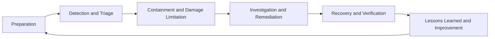

# Establishing Emergency Access and Incident Response

A security incident can strike at the exact moment normal administrative mechanisms are unavailable: a Conditional Access policy accidentally locks out all administrators, an authentication method suffers an outage, a privileged account is compromised, or an operations team needs to isolate an Azure resource to stop data leakage. In such moments, an organization must have pre-established emergency access paths and controlled response procedures.

In the `CLOUD_PROVIDERS_AZURE` module, you learn how to deploy and manage the Microsoft Azure ecosystem, from subscriptions, resource groups, and Microsoft Entra ID to virtual networks, compute, storage, data, monitoring, and cost control. Belonging to the **Security and Compliance** chapter, this lesson guides you through designing *emergency access* (often called **break-glass access**) and connecting it to incident response across both the identity layer and the Azure resource layer.

> **Scope:** Examples illustrate procedures for protecting systems an organization owns or is authorized to administer. Never use emergency accounts to bypass approval processes for routine daily work.

## 1. Learning Objectives

After this lesson, you will be able to:

- Explain when emergency access is needed and distinguish it from routine administrative privileges.
- Design Microsoft Entra ID emergency accounts independent of common failure points.
- Distinguish **Global Administrator** permissions in Entra ID from **Azure RBAC** permissions on subscriptions and resources.
- Establish authentication protections, monitoring, audit trails, and testing for emergency access paths.
- Apply the incident response lifecycle: detection, triage, containment, investigation, remediation, recovery, and lessons learned.
- Build playbooks for scenarios such as an administrative lockout or a suspected compromised identity.

## 2. What Is Emergency Access and When Is It Used?

**Emergency access** is the ability to use a pre-established, protected backup identity or administrative path to regain control when normal channels no longer work. In Microsoft Entra ID, the standard approach is maintaining dedicated, pre-existing **emergency accounts** that possess required permissions and can sign in without sharing the same failure points as daily administrative accounts.

**Incident response** is the process of detecting, analyzing, containing damage, eradicating root causes, restoring services, and strengthening defenses. Emergency access is only one capability supporting incident response; having permission to sign in does not mean you already know what to change safely.

| Scenario | Might Emergency Access Be Needed? | Priority Approach |
|---|---|---|
| A misconfigured Conditional Access policy prevents admins from signing in | Yes | Use the tested backup access path to restore the policy |
| PIM or temporary role approval workflow is unavailable | Yes, if the incident requires urgent intervention | Use emergency permissions independent of the failing PIM activation flow |
| A Global Administrator account is suspected of compromise | Possibly | Isolate the suspected account, audit action history, and restore control |
| Staff need to deploy a dev VM as part of daily work | No | Use standard Azure RBAC |
| A production app is attacked using workload credentials | Emergency resource permissions may be needed | Preserve evidence, block abused access, rotate credentials, and recover |
| Microsoft Entra ID service or Internet connectivity experiences a widespread outage | Backup accounts may also be unable to sign in | Activate communication plans, vendor support, and business continuity plans |

The key point is that **break-glass does not guarantee operation in every outage**. It helps avoid anticipated failure points, such as dependencies on federated identity systems (federation), an individual's device, or just-in-time elevation workflows; it does not replace the availability of the underlying platform service.

## 3. Distinguishing Entra ID Permissions and Azure Permissions in Emergencies

Microsoft Entra ID performs identity authentication and provides **directory roles** to administer users, groups, applications, and tenant settings. The **Global Administrator** role has broad administrative authority in Microsoft Entra ID, but **is not automatically Owner of every Azure subscription**.

Azure Resource Manager uses **Azure Role-Based Access Control (Azure RBAC)** to decide which principal can manage which resources, at which scope. Scopes typically follow a hierarchy:

```text
Management group
  └── Subscription
        └── Resource group
              └── Resource
```

| Emergency Task | Permission Layer to Check | Example |
|---|---|---|
| Fix a Conditional Access policy causing account lockout | Microsoft Entra ID | Directory role with permission to manage the corresponding policies |
| Revoke sign-in sessions, disable a compromised account | Microsoft Entra ID | Appropriate user/security administration role |
| Restore permissions on a production resource group | Azure RBAC | Owner or role managing role assignments at the relevant scope |
| Isolate a VM, modify network settings per playbook | Azure RBAC | Role with appropriate actions on VM, NIC, NSG, or resource group |
| Read secrets or data for investigation | Service data plane | Data role or access policy model supported by the service |

In certain exceptional situations, a Global Administrator can use the **elevate access to manage Azure resources** feature to obtain access management rights at the tenant's Azure root scope. This is an **explicit elevation action** that must be logged and revoked once the incident is resolved. Do not assume every Global Administrator already has that access, or use this feature as a substitute for a prepared Azure RBAC permission plan.

A sound design defines both a **tenant recovery path** and a **recovery path for critical subscriptions**. If modifying resource group configurations depends entirely on PIM or a group while the identity system is impaired, an alternative pre-approved and tested emergency access path is required.

## 4. Designing Break-Glass Accounts for Microsoft Entra ID

### 4.1. Prepare at Least Two Independent Accounts

Microsoft's recommended practice is maintaining **at least two emergency access accounts** with the permissions required to administer the tenant, typically Global Administrator, with these characteristics:

1. **Cloud-only accounts:** created directly in Microsoft Entra ID using a tenant-managed domain, such as `<tenant>.onmicrosoft.com`, to eliminate dependencies on federation systems or on-premises identity synchronization.
2. **Not tied to a specific employee:** these are organizational emergency accounts, not an individual's daily work account. Handover and user-attribution tracking procedures must be designed separately.
3. **Ready-to-use permissions in emergencies:** emergency administrative privileges must suffice to fix incidents without relying on the very PIM/activation flow that might be failing. Maintaining standing roles here is a strictly controlled exception.
4. **Independent authentication methods and storage:** never let both accounts depend on a single phone, a single key custodian, a single safe, or a single online secret vault.
5. **Never used for automation:** avoid using break-glass accounts for scripts, APIs, apps, or scheduled jobs. Automation requires dedicated managed identities or service principals.

Illustrative naming examples:

```text
emergency-admin-01@contoso.onmicrosoft.com
emergency-admin-02@contoso.onmicrosoft.com
```

The names above are illustrative only, not real accounts. Each account needs an accountable custodian, a handover procedure during staffing changes, and an accurate record of effective permissions.

### 4.2. Securing Authentication While Avoiding Common Failure Points

Emergency accounts carry very high privileges and are rarely used, so they must be tightly protected. Prefer **phishing-resistant authentication methods** supported by the tenant, such as FIDO2 security keys or equivalent strong methods. Prepare backup methods/keys, store them securely, and verify sign-in on devices that can be used during an incident.

When configuring **Conditional Access (CA)**, balance two requirements: blocking unauthorized access while preventing a faulty CA policy from disabling all recovery paths. Organizations commonly **intentionally exclude** emergency accounts from policies that could cause a mass lockout, paired with compensating controls such as strong hardware authentication, monitoring every sign-in attempt, and out-of-band approval procedures.

Do not treat a CA exclusion as permission to use weak passwords or strip away all security controls. If a CA policy is the sole place enforcing MFA, excluding an account from that policy could leave password-only sign-in valid; assess actual authentication settings, credential fallbacks, and this risk before going live. Features such as Security Defaults or other protective policies must also be evaluated based on actual tenant configuration and exclusion capabilities.

A secure design must answer:

- If the federated IdP or on-premises infrastructure goes down, can both accounts still sign in?
- If one security key breaks or is lost, is there a tested backup method?
- When the primary key custodian is absent, is there a two-person witness and access takeover procedure?
- When Conditional Access policies change, who tests the break-glass path?
- Are alerts triggered immediately if the account is used or experiences repeated failed sign-ins?

### 4.3. Controlling Emergency Account Usage

Emergency access accounts require an **operational activation procedure**. For example: the incident commander confirms severity, logs the justification, operator, and approver; the designated team retrieves the authentication credential from secure storage; and all actions are logged. If a situation cannot wait for pre-approval due to imminent harm, the procedure must clearly designate who holds decision authority and mandate a retrospective record afterward.

Never share credentials over email or chat groups. Never create a single dependency on a password manager or Key Vault that the organization might lose access to during the very incident it needs to fix. Use independent secure storage aligned with organizational policy, paired with physical controls and handover logs.

## 5. Preparing Emergency Permissions at the Azure Resource Layer

A production application typically spans many resources: VNet, NSG, VM/App Service, Storage, Key Vault, databases, Log Analytics, and monitoring resources. When needing to isolate a resource or repair role assignments, the response team needs permissions at the right **subscription/resource group/resource** scope.

Pre-incident preparation recommendations:

1. Maintain an inventory of critical subscriptions and resource groups, along with owners and on-call responders.
2. Identify actions required in playbooks, such as reading Azure Activity Log, blocking a network flow, disabling an abused credential, or fixing RBAC.
3. Prepare appropriate emergency roles or permissions at the required scope; use groups and role-based assignment where appropriate.
4. Apply **Privileged Identity Management (PIM)** for routine admin permissions or time-bound activations with approval and justification logging.
5. If a playbook must act while PIM is unavailable, prepare an approved access path **not solely dependent** on PIM, while governing that exception via monitoring and activation procedures.
6. Verify **data-plane** permissions separately; having Contributor on a resource group does not guarantee reading data if the service uses a distinct authorization model.

Never grant tenant-wide Owner by default to every response team member. Tailor permissions to roles and restrict duration/principals; overly broad rights increase damage if a responder's own account is compromised.

## 6. Setting Up Monitoring for Emergency Access

Because break-glass accounts are almost never used in normal operations, **any sign-in event or related permission change** must be treated as a high-priority signal to verify. Organizations should monitor:

- Successful sign-ins, failed sign-ins, and anomalous signals for every emergency account.
- Directory role additions/removals, authentication method changes, credential resets, and account status changes.
- Conditional Access edits, PIM configuration changes, or Azure RBAC role assignment updates.
- Resource management events executed during an incident window.
- Signs of continued access after an incident is marked closed.

**Log sources** typically include Microsoft Entra sign-in logs, Entra audit logs, Azure Activity Log, and relevant service logs. Depending on configuration, logs can be routed to a Log Analytics workspace or Microsoft Sentinel to build analytics rules/alerts and retain history per organizational retention policies.

### Example Emergency Sign-In Query Using Kusto Query Language

When **SigninLogs are routed to a Log Analytics workspace**, you can use the following KQL query as a starting point:

```kusto
SigninLogs
| where UserPrincipalName in~ (
    "emergency-admin-01@contoso.onmicrosoft.com",
    "emergency-admin-02@contoso.onmicrosoft.com"
  )
| project TimeGenerated, UserPrincipalName, AppDisplayName,
          IPAddress, ResultType, ResultDescription,
          ConditionalAccessStatus
| order by TimeGenerated desc
```

This is a log-reading query; **it does not automatically generate alerts**. Configure a dedicated alert rule, choose an appropriate evaluation frequency, wire it to a 24/7 on-call channel, and test notifications. The `SigninLogs` table only contains data once log export is configured; workload identity events may reside in separate log tables.

An alert notification should include: account, UTC timestamp, sign-in result, IP/application, on-call recipient, incident ID, and instructions for verifying whether the emergency request is legitimate. Alert recipients need an **out-of-band backup channel** in case the tenant's email or chat system is also impacted.

## 7. Incident Response Lifecycle on Azure

Procedures should be documented as playbooks with clear owners and required evidence. Not every incident requires executing every step in identical order; you may need to iterate between analysis and containment as new facts emerge.



### Step 1. Pre-Incident Preparation

Establish a responsibility matrix covering at minimum: incident commander, identity admin, application owner, security team, infrastructure team, and Microsoft support contacts. Define severity levels, escalation criteria, communication channels, and evidence storage locations. Verify critical backups, log-reading permissions, contact rosters, and emergency account readiness.

### Step 2. Detection, Verification, and Triage

Record: detection time, alert source, principal, subscription/resource, suspicious actions, blast radius, and known/unknown facts. Check indicators across Entra sign-in/audit logs, Azure Activity Log, and resource logs. Classify the incident as **admin lockout from misconfiguration**, **suspected identity compromise**, **credential leak**, **unauthorized resource change**, or another category.

### Step 3. Controlled Containment

If an account is suspected of compromise, consider blocking sign-in, disabling related credentials, revoking session/refresh tokens where supported, adjusting role assignments, and blocking abused network paths or workloads. Document rationale and impact. Actions like deleting resources or deleting logs can destroy forensic evidence, cause downtime, or hinder recovery; prefer reversible measures where appropriate.

### Step 4. Investigation and Root Cause Eradication

Identify the initial entry vector, affected identities/resources, added permissions, configuration changes, and potentially accessed data. Rotate exposed secrets, certificates, passwords, or keys following application dependency order; check for backdoors/unexpected role assignments; patch vulnerabilities and update policies.

### Step 5. Recovery and Verification

Restore services from trusted configurations or backups, verify least-privilege permissions, and test access for legitimate identities. Monitor logs and system metrics during an elevated observation period. Confirm compromised accounts can no longer reuse old tokens/credentials within the limits of supported mechanisms.

### Step 6. Incident Closure and Improvement

Finalize the timeline, evidence, root cause, impact, and approved decisions. Revoke temporary emergency privileges, terminate active sessions, rotate emergency account credentials if exposure is possible, confirm active monitoring, and update playbooks. Review customer or regulatory reporting obligations under applicable legal policies.

## 8. Playbook A: Conditional Access Locks Out All Administrators

**Scenario:** An administrator updates a Conditional Access policy, after which all routine admin accounts are unable to sign in to the Microsoft Entra admin center. Operations needs to restore access without creating overly broad exceptions.

**Execution Steps:**

1. Confirm the error across multiple accounts or environments, recording error codes and timestamps. Distinguish a policy lockout from an Azure or Microsoft Entra service outage.
2. Declare an incident, notify responsible leads, and initiate the emergency account retrieval procedure. Record operator, reason, approver, and timestamp.
3. Sign in using the tested cloud-only account paired with its protected backup authentication method.
4. Inspect recent Conditional Access changes and related audit records. Whenever possible, fix **the specific faulty policy**, rather than disabling all tenant protections.
5. Test signing in with a routine admin account in a controlled test scope, confirming MFA and expected protective policies still enforce properly.
6. Use logs to audit every action taken during the incident window, recording before/after configurations and the restoration timestamp.
7. Sign out of the emergency account, assess the security of the credentials used, verify alerts fired, and update policy-testing procedures.

If the emergency account also fails to sign in, **do not attempt uncontrolled changes across other systems**. Trigger prepared support escalation procedures, verify service health, and use out-of-band communication channels outside the tenant.

## 9. Playbook B: Detecting a Compromised Administrator Account

**Scenario:** Logs show a highly privileged account signing in from an anomalous source, followed by adding a role assignment or modifying an application. This could indicate identity compromise, but requires investigation before confirming.

**Execution Steps:**

1. Open an incident and preserve sign-in logs, audit trails, Azure Activity Logs, and timestamps. Correlate events by principal ID, resource ID, and correlation ID where available.
2. Verify the alert with the account owner over an independent channel while assessing ongoing access risk. If warranted, block sign-in and revoke sessions/credentials per playbook.
3. Inspect role assignments and credential/app registration changes; identify all resources accessed or configurations modified.
4. If legitimate admins lose access after isolating the account, use pre-established emergency access to restore minimal investigative privileges.
5. Remove unauthorized role assignments, revoke exposed secrets/certificates, hunt for persistence mechanisms, and restore proper configurations.
6. Assess impact on data, customers, and workload integrity; execute required notifications per policy.
7. Restore normal permissions, verify logs, test legitimate workflows, then close the incident with a formal record and recurrence-prevention actions.

Investigations should also examine the **data plane** (e.g., blob or secret reads) when corresponding log sources exist. Control-plane Azure Activity Logs alone are insufficient to conclude no data was accessed.

## 10. Inspecting Azure RBAC Permissions in a Controlled Manner

When checking whether the response team already holds permissions on a subscription or resource group, use Azure CLI in **read-only mode**:

```bash
# Sign in with a valid operational account
az login

# Verify current tenant and subscription
az account show --query "{tenant:tenantId,subscription:id}" --output table

# Select the subscription to inspect
az account set --subscription "<subscription-id>"

# List role assignments on a resource group, including inherited scopes
az role assignment list --scope "/subscriptions/<subscription-id>/resourceGroups/<resource-group-name>" --include-inherited --output table
```

This command reads Azure RBAC at the specified scope and does not list Microsoft Entra directory roles in full. If using PIM, unactivated eligible roles may not appear as active assignments. If results are missing or errors occur, check the caller's permissions, group memberships, scope, deny assignments, policies, and service data-access models.

Never embed passwords, security key PINs, access tokens, secrets, or emergency account credential contents in scripts, centralized logs, or report files.

## 11. Evidence and Accountability Matrix to Retain

| Stage/Step | Information to Record | Accountable Party |
|---|---|---|
| Intake | Alert, UTC timestamp, detection source, severity, incident ID | Monitoring / SOC team |
| Emergency access activation | Justification, principal, approver, operator, start/end timestamps | Incident commander and key custodians |
| Analysis | Sign-in/audit logs, RBAC changes, resource IDs, data access indicators | Identity, infrastructure, and security teams |
| Containment | Actions taken, rationale, expected impact, observed outcomes | Assigned responder |
| Recovery | Before/after configs, test results, decision to reopen service | System owner and incident commander |
| Closure | Root cause, impact, revoked credentials/roles, lessons learned, action owners | Response team and risk governance |

Store evidence in a location with controlled access, retention policies, and integrity protection. Prefer UTC timestamps, linked event IDs, and before/after configuration snapshots so another team can independently verify findings. Restrict exporting sensitive data; only authorized investigators should have access to evidence.

## 12. Periodic Drills and Avoiding Illusionary Recovery Paths

An emergency account created once and never tested may fail when an actual crisis hits. Schedule periodic drills as well as re-tests after major changes such as new CA policies, tenant configuration updates, PIM adjustments, or security key custodian changes.

A **minimum drill** should verify:

- Both accounts still exist, are cloud-only, hold required roles, and are not unexpectedly disabled or expired.
- Each account can sign in using its stored authentication method, following documented steps on backup devices/connections.
- Operators can reach the right Entra ID management blades and inspect target settings without needing to trigger a real production outage.
- Emergency Azure RBAC paths can execute defined playbook tasks where applicable.
- Every test sign-in generates an alert and is confirmed as a drill by the on-call responder.
- All test sessions and temporary privileges are terminated/revoked afterward, with action items logged for anything needing repair.

A drill can fail due to a lost key, a CA policy blocking the account, a disabled account, altered role assignments, or alerts failing to reach on-call staff. These are design defects that must be fixed before considering the system ready.

## 13. Operational Readiness Checklist

### Identity and Permissions

- [ ] At least two independent emergency accounts exist and are governed by the organization.
- [ ] Accounts are cloud-only; authentication dependencies and CA exclusions have been tested.
- [ ] Phishing-resistant authentication is used with securely stored backups.
- [ ] Emergency Entra ID roles and Azure RBAC permissions are clearly separated with documented scopes and rationales.
- [ ] Procedures exist for credential/key retrieval, approval, handover, and revoking emergency privileges.

### Detection and Response

- [ ] Entra sign-in logs, audit logs, Azure Activity Log, and necessary data logs are properly collected.
- [ ] Alerts fire whenever an emergency account signs in or undergoes permission changes.
- [ ] On-call responders and backup communication channels are designated.
- [ ] Playbooks clearly define incident commander, severity tiers, containment, evidence handling, and recovery.
- [ ] Procedures exist for incident closure, permission reviews, and credential rotation when needed.
- [ ] Drills have been executed and test results recorded on schedule.

## 14. Knowledge Self-Check

**Question 1.** A Global Administrator account cannot create a VM in a production resource group. Why might this happen?

*Hint:* Global Administrator is a directory role. Permission to create a VM is evaluated by Azure RBAC and related controls at the resource scope.

**Question 2.** Why shouldn't all emergency accounts depend on the same authentication device or a single credential storage system?

*Hint:* If that shared dependency fails, every recovery path could be disabled simultaneously.

**Question 3.** An emergency account is excluded from Conditional Access. Is the account guaranteed to be protected by MFA?

*Hint:* You cannot conclude that without checking the actual authentication configuration, fallback sign-in methods, and MFA enforcement mechanisms. Compensating controls and testing are required.

**Question 4.** After using an emergency account to fix a CA policy, what should the response team do before closing the incident?

*Hint:* Test normal sign-ins, cross-check logs, terminate emergency sessions, evaluate credential exposure risk, and archive the change record.

## Conclusion

Emergency access is a pillar of security resilience on Azure. A reliable design requires independent cloud-only Entra accounts, strong authentication methods, properly scoped emergency permissions, alerts on every use, and accountable activation procedures. When an incident occurs, operations teams must exercise those privileges inside a controlled playbook: preserve evidence, limit harm, investigate root causes, restore systems, and then revoke privileges and strengthen the design. The true strength of emergency access lies in **being prepared and tested ahead of time**, not in handing top-level privileges to everyone.
