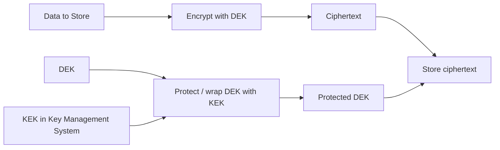
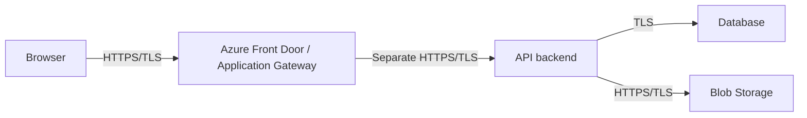
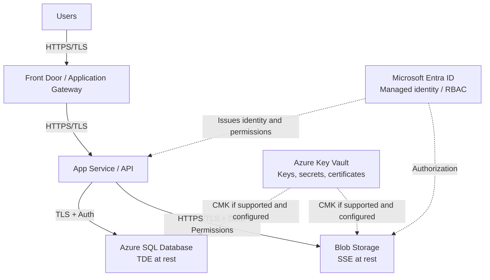

# Encrypting Data in Transit and at Rest

In an application architecture on Microsoft Azure, data moves between browsers, APIs, databases, storage systems, and other services. Data also resides on VM disks, blobs, data replicas, and backups. Protecting only the network transport while neglecting stored data, or encrypting disks while letting APIs communicate over HTTP, still leaves the system exposed to information disclosure. Therefore, security design must protect **data in transit (encryption in transit)** and **data at rest (encryption at rest)** throughout the entire data lifecycle.

This lesson belongs to the **Security and Compliance** chapter of the Microsoft Azure learning path. It explains essential cryptographic principles, capabilities of Azure Storage, Azure SQL, Managed Disks, and Azure Key Vault, how to choose encryption keys, and how to verify configurations for an application deployed on Azure.

## Learning Objectives

After this lesson, you will be able to:

1. Distinguish data in transit, data at rest, and data in use.
2. Explain the role of TLS, digital certificates, and TLS termination in an Azure architecture.
3. Describe server-side encryption mechanisms for Storage, Managed Disks, and databases.
4. Distinguish Microsoft-managed keys, customer-managed keys, and application-side encryption.
5. Design workflows for storing, rotating, scoping permissions for, and recovering encryption keys using Azure Key Vault.
6. Verify key encryption settings using the Azure Portal and Azure CLI.

## 1. Identifying Data That Needs Protection

You must distinguish three states of data:

| State | Example | Related Protection Mechanisms |
|---|---|---|
| **In transit** | Browser calling an API, app sending SQL queries, uploading files to Blob Storage | TLS/HTTPS, certificate validation, sometimes mTLS or private channel encryption |
| **At rest** | Blobs, files, managed disks, database files and backups | Server-side encryption, Transparent Data Encryption, disk encryption, centralized key management |
| **In use** | Data residing in memory while an application computes or decrypts | Access controls, workload isolation, and confidential computing in certain scenarios |

This lesson focuses on the first two states. Encryption in transit and at rest address different threats. If an attacker obtains a copy of encrypted data on storage media without the key, encryption at rest limits their ability to read the contents. If an attacker observes traffic between two systems, TLS protects confidentiality and integrity on the wire when properly configured and verified.

**Encryption does not replace authorization.** An application authorized to decrypt and read data can still leak data if compromised or granted overly broad permissions. Therefore, combine Microsoft Entra ID, Azure RBAC, data-plane permissions, firewalls, secret management, monitoring, and backups.

## 2. Cryptographic Concepts You Need to Know

**Plaintext** is readable data before encryption. **Ciphertext** is data after applying an encryption algorithm and key. The decryption algorithm uses the matching key to restore the original content.

```text
Plaintext --[algorithm + key]--> Ciphertext
Ciphertext --[algorithm + matching key]--> Plaintext
```

Two families of techniques commonly appear in security architectures:

- **Symmetric encryption:** encryption and decryption use the same secret key. AES is a widely used algorithm; many Azure services use AES-256 for encrypting data at rest.
- **Asymmetric cryptography:** uses a public and private key pair. In TLS, digital certificates and cryptographic handshakes help clients authenticate servers and establish session keys. Modern TLS typically uses symmetric session keys to encrypt transmitted content.

**Hashing** is not the same as encryption: a one-way hash value is not designed to be decrypted back to original data. Similarly, **Base64** is merely a character encoding for bytes; it provides zero confidentiality.

In **envelope encryption**, data is encrypted with a **Data Encryption Key (DEK)**. The DEK can be protected by a **Key Encryption Key (KEK)** or root key. This model enables managing large volumes of data without using asymmetric keys to directly encrypt every byte of content.



Exact details of how DEKs are generated, where wrapped DEKs are stored, and when decryption occurs depend on each service. For managed Azure services, the platform handles many of these operations; customers primarily decide key policies and key access permissions.

## 3. Encrypting Data in Transit: TLS and HTTPS

**Transport Layer Security (TLS)** protects connections between clients and servers. In a properly established TLS session, application data is encrypted and integrity-protected while traversing the network. Clients must validate the server certificate to avoid connecting to a spoofed endpoint.

An HTTPS connection flow typically proceeds as follows:

1. The client opens a connection to the service's hostname, e.g., `api.example.com`.
2. The client and server negotiate the TLS version and supported cryptographic parameters.
3. The server presents its certificate; the client verifies the trust chain, hostname, and validity period.
4. Both parties establish secure session keys and exchange HTTP data inside TLS.
5. When the session ends, session keys should not be reused contrary to protocol rules.

Prefer **TLS 1.2 or higher**, and use **TLS 1.3** when both sides and the Azure service support it. Avoid SSL and deprecated TLS versions. Support for selecting cipher suites, minimum TLS versions, and mTLS varies across services; check the options for each specific endpoint.

### 3.1. What HTTPS Protects and What It Does Not

Suppose a user signs in to an application over a public network:

```text
Browser -- HTTPS/TLS --> Azure Front Door or Application Gateway
```

HTTPS reduces the risk of an eavesdropper on the wire reading cookies or exchanged payloads. However, if the application writes passwords to logs, or a user is tricked into submitting credentials on a phishing domain holding a valid certificate for that phishing domain itself, TLS alone does not solve those issues. TLS protects the channel to an **authenticated endpoint**, so checking the exact hostname and application security policies remains essential.

Avoid certificate-verification bypass flags such as `curl -k`, `--insecure`, or `TrustServerCertificate=True` to work around production configuration issues. They undermine server authentication, even if content remains encrypted over a connection.

### 3.2. TLS Termination and End-to-End Encryption

In real-world architectures, HTTPS may terminate at an intermediate component, such as a reverse proxy or Layer-7 load balancer. That component decrypts requests to inspect, route, or apply WAF rules, then opens a new connection to the backend.



In the diagram, there are **multiple separate TLS connections**. When TLS terminates at a proxy, data may exist in plaintext inside the proxy's memory for processing; this must be accounted for in the system's trust model. If the link from proxy to backend is plain HTTP, that second hop is no longer protected by TLS. To protect the full path, use HTTPS to the backend whenever supported, configure certificate validation, and check health probes accordingly.

**TLS termination** does not automatically mean "end-to-end TLS" across every hop. When using Azure Front Door, Application Gateway, App Service, API Management, or AKS ingress, explicitly verify:

- Which certificate browsers see and who is responsible for renewal.
- Whether HTTP-to-HTTPS redirection is enabled.
- Minimum TLS policies on both frontend and backend.
- Whether the backend protocol is HTTP or HTTPS, and whether backend domain/certificate validation is enforced.
- Whether any internal traffic to databases, queues, or storage still travels in plaintext.

### 3.3. Private Endpoint, VPN, and ExpressRoute Do Not Replace TLS

A **Private Endpoint** routes traffic to a PaaS service via a private IP inside a virtual network; it restricts the network access path, **but is not itself an encryption algorithm**. Even over a private endpoint, applications must still use TLS as required by the service and security policy.

Similarly, private circuits like **ExpressRoute** do not by default equate to end-to-end encryption for all application data. If transit encryption is required, design TLS, IPsec, or link-protection mechanisms supported by the specific services. Never infer that data is encrypted simply because traffic travels over a private network.

### 3.4. Enabling Transit Protection on Common Services

| Service/Connection | Approach | What to Verify |
|---|---|---|
| **Azure Storage** | Use `https://...` endpoints, enable **Secure transfer required**, and set a supported minimum TLS version. | Legacy clients using HTTP or deprecated TLS may be rejected. |
| **Azure SQL Database** | Use drivers supporting TLS encryption and verify the server certificate. | Connection string settings, hostname, and driver version TLS requirements. |
| **Azure App Service/API** | Require HTTPS-only access and configure an appropriate minimum TLS version. | Custom domain certificates, HTTPS redirects, and outbound connections. |
| **Azure Front Door/Application Gateway** | Configure HTTPS frontend and HTTPS to backend where needed. | TLS at every hop, certificate validation, and listener/routing rules. |
| **AKS or self-managed VMs** | Enable TLS at ingress/reverse proxy or application and secure downstream links. | Certificates, auto-renewal, service-to-service TLS, no unnecessary plaintext ports. |

**Mutual TLS (mTLS)** is a model where both server and client present certificates to authenticate each other. mTLS is valuable for certain internal service-to-service or B2B connections, but requires processes for issuing, renewing, and revoking certificates. mTLS availability depends on the product and architectural placement; not every Azure endpoint has a universal mTLS toggle.

## 4. Encrypting Data at Rest: Server-Side Encryption

**Encryption at rest** protects data written to storage media or other persistent data layers. Many Azure services support or enable **server-side encryption (SSE)** by default, meaning the service encrypts before writing and decrypts for authorized access requests. Key protection and the scope of encrypted components depend on the service type.

Encryption at rest is usually transparent to applications: clients send data using the service protocol, and the service handles encryption and decryption server-side. This is convenient, but does not prevent an authorized application from receiving plaintext when making a valid request.

### 4.1. Azure Blob Storage and Azure Storage Services

Azure Storage encrypts stored data using **Storage Service Encryption**; many data types inside a storage account are protected automatically upon write. By default, Azure manages encryption keys. Depending on the service and storage type, you can select customer-managed keys and advanced options.

For Blob Storage, distinguish:

- **Storage Service Encryption (SSE):** server-side encryption of data at rest in Azure Storage.
- **Service-managed keys / Microsoft-managed keys:** Microsoft creates, stores, and manages key lifecycles per service mechanisms.
- **Customer-managed keys (CMK):** the organization manages the key used by the service to protect data encryption keys, typically via Azure Key Vault or Managed HSM where supported.
- **Encryption scope:** allows applying a dedicated encryption key scope to supported blobs or containers instead of relying solely on the storage account default.
- **Infrastructure encryption:** in supported configurations, adds an independent second layer of encryption at the infrastructure level beneath the service encryption layer.

**Replication** such as LRS, ZRS, GRS, or GZRS addresses data durability and availability, distinct from encryption's purpose. You may need both replication to survive infrastructure failures and encryption to protect confidentiality. Replication does not replace backups or access control.

### 4.2. Azure Managed Disks and VM Disks

**Azure Managed Disks** provide storage-layer encryption with platform-managed keys or customer-managed keys in supported configurations. You should also consider data processed on the VM host, temporary data, and VM caches. Certain VM families and settings support **encryption at host**, adding encryption for data on the host per published capabilities.

Do not confuse **server-side encryption of managed disks** with **guest OS encryption** such as BitLocker or dm-crypt. Each operates at a different layer and has different operational, key, and compatibility requirements. When protecting OS disks, data disks, and temporary disks, inspect each disk type along with encryption options compatible with the VM size, region, and OS.

Beyond attached VM disks, evaluate **snapshots, images, backups, and recovery copies**. Encryption on the primary system does not automatically mean data exported or copied to another service retains the exact same key policy.

### 4.3. Azure SQL and Database Services

**Transparent Data Encryption (TDE)** protects data at rest at the database layer. For Azure SQL Database, TDE is enabled by default for new databases per current service defaults; organizations can verify status and select supported key models. TDE aims to protect data files, logs, and related storage components; applications still receive decrypted data on valid queries.

**Always Encrypted** is a separate mechanism in the Azure SQL/SQL Server ecosystem: data in configured columns can be encrypted and decrypted on the client/driver side, restricting the database engine from seeing plaintext for those columns in supported setups. This mechanism requires schema, driver, and query-handling changes; not all SQL operations work as they do on plaintext columns. Never treat Always Encrypted as a drop-in replacement for TDE.

For PostgreSQL, MySQL, Cosmos DB, and other data services on Azure, consult official documentation for the exact service, tier, and deployment model to confirm encryption defaults, CMK support, TLS transit settings, and option limits. Avoid assuming all data products share an identical key policy or TDE configuration.

### 4.4. Comparison of Common At-Rest Solutions

| Data | Common At-Rest Protection | Customer Decisions Required |
|---|---|---|
| Blobs and files in Azure Storage | Storage Service Encryption | Data access permissions, who manages keys, encryption scopes if needed |
| VM OS/data disks | Managed Disks server-side encryption | Disk Encryption Set/CMK if needed, encryption at host, and VM configuration |
| Azure SQL Database | Transparent Data Encryption | TDE protector, CMK if required, database permissions, and backups |
| Sensitive SQL columns | Always Encrypted (where suitable) | Which columns to protect, key store, driver support, and query limitations |
| Application-encrypted data | Client-side/application-level encryption | Algorithms, key management, key sharing and recovery, searchability |

## 5. Microsoft-Managed Keys, Customer-Managed Keys, and Application Keys

A key architectural decision is **who controls the keys**. Azure offers different control levels to match sensitivity, audit requirements, and operational ownership.

| Model | Who Operates the Key? | Pros | Responsibilities and Limits |
|---|---|---|---|
| **Microsoft-managed keys (MMK)** | Azure manages keys via service mechanisms. | Simple deployment, minimal operational overhead. | Granular key lifecycle control is more limited than CMK. |
| **Customer-managed keys (CMK)** | Customer manages keys in Key Vault/Managed HSM; Azure services use them via supported integrations. | Greater control over access, rotation, revocation, and certain compliance requirements. | Must maintain key access, availability, recovery, monitoring, and key lifecycle. |
| **Client-side/application-level encryption** | Application manages encryption before sending data to Azure. | Can limit storage or intermediary services from seeing plaintext in suitable models. | Application owns decryption, keys, performance, and data-processing limits. |

**CMK does not mean the customer encrypts every record themselves.** In many services, Azure still encrypts data using service-side DEKs; the customer-managed key protects a higher-level key. Disabling or revoking access to a CMK can render the service unable to read/write data depending on implementation. Thus, key revocation is an operational change affecting availability and requires controlled procedures.

**Client-side encryption** is particularly relevant when requirements minimize plaintext visibility to storage systems or intermediate services, though it carries complexity costs: search, indexing, server-side content processing, and data recovery may be constrained if the service only sees ciphertext.

## 6. Managing Keys and Secrets with Azure Key Vault

**Azure Key Vault** helps manage security objects including secrets, keys, and certificates. They serve distinct purposes:

- **Secret:** sensitive strings or values such as passwords, API keys, or connection strings; do not treat secrets as cryptographic keys with full key-management features.
- **Key:** cryptographic key objects used for Key Vault-supported cryptographic operations; can back CMK integrations for supported services.
- **Certificate:** manages certificate metadata and lifecycle in supported scenarios. TLS certificates must still be deployed to the proper application or service endpoints.

**Azure Key Vault Managed HSM** is a dedicated service for hardware-protected keys and stricter cryptographic requirements. Key Vault and Managed HSM differ in feature sets, permission models, and pricing; choose based on integrated service requirements and organizational policy.

### 6.1. Key Access Permissions

An Azure service using CMK typically relies on a **managed identity** or supported service identity to access the key in Key Vault. That identity must hold required key permissions, such as `get`, `wrapKey`, and `unwrapKey` in common models, or equivalent data-plane permissions via Azure RBAC.

Distinguish clearly:

1. **Vault management permissions (management plane):** creating or configuring the Key Vault resource.
2. **Key/secret/certificate usage permissions (data plane):** retrieving or performing permitted operations on objects inside the vault.

Holding Azure RBAC Contributor on the resource group containing a vault does not inherently allow reading secrets or using keys inside it. Use a standardized permission model, assign exact roles and scopes per identity, and avoid granting unnecessary broad data-plane rights.

### 6.2. Key Lifecycle and Recoverability

Key governance must answer:

- **Where is it created and stored?** Is the key generated or imported into Key Vault/Managed HSM, in which region and subscription, and are hardware-protection requirements met?
- **Who can use and modify it?** Applications or services have minimal crypto permissions; operators have separate audited admin rights.
- **How is it rotated?** Are there rotation schedules, notifications, and tests confirming services pick up the desired key version?
- **What if it is deleted by mistake?** Enable and verify **soft delete** and **purge protection** per requirements and service capabilities; maintain key backups/recovery plans where supported.
- **What if the vault/key becomes unavailable?** Have runtime dependencies on key operations, outage tolerances, and recovery plans been assessed?
- **What happens when access is revoked?** Are there change procedures, monitoring, and rollback paths to prevent unintended outages?

**Rotation does not immediately re-encrypt all existing data.** Ability to adopt a new key version, re-wrap DEKs, or re-encrypt data depends on each service and integration. Test rotation behavior and key-version propagation delays rather than swapping a key version and assuming every older copy was re-encrypted.

### 6.3. Auditing and Alerting

Track key access and administrative activity using logging and monitoring aligned with Key Vault, Azure Monitor, and organizational log retention policies. Configure alerts for events such as keys nearing expiration, deletions or access-policy edits, spikes in key access failures, and rotation failures. Protect log stores so unauthorized users cannot read secrets or tamper with audit trails.

## 7. Example Data-Protection Architecture on Azure

Suppose an application collects customer records, stores attachments in Blob Storage, and stores metadata in Azure SQL Database. Users connect via browsers; the app runs on Azure App Service. Reference design:



Decisions to document explicitly in architecture docs:

1. **Browser to entry point:** HTTPS, valid certificate for the app domain, appropriate minimum TLS, and HTTP-to-HTTPS redirect.
2. **Gateway to API:** separate HTTPS to backend; clear awareness of TLS termination points, certificate validation, and intermediate components that may see plaintext.
3. **API to SQL and Blob:** encrypted connections; private networking or firewalls restrict paths without replacing TLS.
4. **Data in SQL:** TDE protects data at rest; for especially sensitive columns, evaluate Always Encrypted alongside functional constraints.
5. **Data in Storage:** SSE as configured; blob access permissions separated from storage account management permissions.
6. **Key management:** choose MMK or CMK per requirements; if using CMK, configure managed identities, Key Vault permissions, rotation, and recovery procedures.
7. **Backups and logs:** ensure backups, exports, and logs do not inadvertently contain unauthorized plaintext or secrets.

In this example, encryption protects data along the designed channels and storage media. It does not replace user identity checks, API authorization, SQL injection defenses, or scoping application privileges.

## 8. Hands-On Configuration Inspection with Azure CLI

This section uses **read-only inspection of existing configurations** so learners recognize key fields without creating new resources. You need Azure CLI, an account with resource read access, and a storage account in a practice subscription.

### 8.1. Sign In and Select the Subscription

```bash
az login
az account list --output table
az account set --subscription "<subscription-id>"
```

Replace placeholders below with real names. Never leak secrets or access tokens into shell history or shared logs.

### 8.2. Check Storage HTTPS-Only, Minimum TLS, and Key Source

```bash
az storage account show \
  --resource-group "<resource-group>" \
  --name "<storage-account-name>" \
  --query "{httpsOnly:enableHttpsTrafficOnly,minTlsVersion:minimumTlsVersion,keySource:encryption.keySource}" \
  --output json
```

Illustrative output example (actual values depend on the storage account):

```json
{
  "httpsOnly": true,
  "minTlsVersion": "TLS1_2",
  "keySource": "Microsoft.Storage"
}
```

Interpreting output:

- `httpsOnly: true` indicates secure transfer is required for endpoints and operations governed by that setting.
- `minTlsVersion: "TLS1_2"` indicates the minimum TLS requirement configured for requests covered by that setting.
- `keySource: "Microsoft.Storage"` indicates Microsoft-managed keys are used for the corresponding encryption mechanism; if using CMK, this field can reflect Key Vault as the key source depending on service schema.

If TLS/HTTPS settings need updating, **test client compatibility first** because legacy clients may fail to connect. Reference command for administrators in an authorized test environment:

```bash
az storage account update \
  --resource-group "<resource-group>" \
  --name "<storage-account-name>" \
  --https-only true \
  --min-tls-version TLS1_2
```

This command modifies the storage account configuration, so never run it in production without impact assessment. TLS and HTTPS settings protect transit; they **do not** prove CMK, logging, or data-plane RBAC are configured properly.

### 8.3. Check Key Vault Settings

If the organization uses Key Vault for key management, read management metadata with:

```bash
az keyvault show \
  --name "<key-vault-name>" \
  --query "{name:name,rbac:properties.enableRbacAuthorization,softDelete:properties.enableSoftDelete,purgeProtection:properties.enablePurgeProtection}" \
  --output json
```

This command reads vault metadata; it does not prove the caller has permission to use keys/secrets inside. To confirm CMK is actively used by a storage account or database, also inspect that service's encryption settings, key-access identity, and related logs.

### 8.4. Inspect Endpoint Certificate and TLS

You can use a TLS inspection tool on a machine with network reachability, such as OpenSSL:

```bash
openssl s_client \
  -connect "<hostname>:443" \
  -servername "<hostname>" \
  -tls1_2
```

Output shows the server certificate, TLS session, and ability to connect with TLS 1.2. A single successful connection **does not prove** all older TLS versions are rejected, certificates renew automatically, or all backend connections are encrypted. Additional checks on server config, TLS policies, and internal hops are required.

## 9. Encryption and Compliance Requirements

Many organizations must demonstrate sensitive data protection to satisfy internal policies or standards like ISO 27001, PCI DSS, or personal data privacy laws. However, **enabling encryption does not automatically produce compliance certification**. You must combine data scoping, access controls, retention, recoverability, reporting, and operational evidence tailored to specific requirements.

An evidence package may include:

| Control Area | Evidence to Retain |
|---|---|
| TLS at entry points and backend links | Endpoint configurations, minimum TLS versions, certificate statuses, connection test results |
| Encryption at rest | SSE/TDE/disk encryption configurations, resource inventory, and approved exceptions |
| CMK | Key protector list, rotation policies, managed identity permissions, rotation/recovery test results |
| Permission management | Azure RBAC/data-plane roles, Entra ID roles, privileged access review schedules |
| Monitoring | Log settings, retention, alerts, and incident response evidence |
| Backup and recovery | Backup policies, copy encryption, restore test results, and read-access controls on backups |

**Azure Policy** can enforce or audit certain secure settings where supported by resource providers, such as requiring secure transfer or specific encryption properties. **Microsoft Defender for Cloud** can surface security posture recommendations. However, policy compliance or security scores are configuration signals, not substitutes for real-world testing and organizational compliance audits.

## 10. Common Pitfalls and How to Fix Them

| Pitfall | Consequence | How to Address |
|---|---|---|
| Assuming a private network already encrypts data | Traffic may still travel in plaintext | Protect with TLS or supported transit encryption mechanisms |
| Enabling TLS only at the frontend | Proxy-to-API or API-to-database may remain unprotected | Inspect every hop; enable HTTPS/TLS and validate certificates on backends |
| Disabling certificate validation to silence errors | Accepts spoofed endpoints | Fix hostname, certificate, and trust chain; never bypass verification |
| Treating SSE as protecting against all data access | Authorized accounts can still read decrypted content | Restrict IAM/RBAC and data-plane permissions; monitor access |
| Using CMK without a key management plan | Lost or revoked keys can disrupt data access | Establish owners, least privilege, soft delete, purge protection, rotation, and recovery |
| Believing rotation re-encrypts all data immediately | Misjudges protection of older copies | Verify rotation mechanics, key versions, and re-encryption behavior per service |
| Checking only primary data while ignoring logs and backups | Sensitive data leaks elsewhere | Map data flows, classify data, and apply controls to copies, logs, and exports |
| Reusing the same keys or admin rights across all environments | Expands blast radius during an incident | Separate environments and keys/permissions per security policy; assess blast radius |

## 11. Pre-Production Checklist

- [ ] Mapped data paths from users through Azure services and storage locations.
- [ ] All endpoints requiring protection use appropriate HTTPS/TLS; certificates are verified and renewal workflows exist.
- [ ] Verified TLS from gateway to backend, API to database, storage, and integrated systems.
- [ ] Confirmed secure transfer, minimum TLS version, and supported client types on Storage.
- [ ] Verified encryption at rest for Blob Storage, Managed Disks, databases, snapshots, and related backups.
- [ ] Selected MMK or CMK based on data requirements, control needs, availability, and operational ownership.
- [ ] If using CMK, configured minimal key permissions, accidental-deletion protection, rotation, monitoring, and recovery plans.
- [ ] Separately verified data-plane authorization, Azure RBAC, and secret access permissions.
- [ ] Tested handling key loss, certificate expiration, incompatible TLS clients, and backup restoration.
- [ ] Archived configuration evidence and review workflows aligned with security and compliance policies.

## Conclusion

Encrypting data in transit and at rest are complementary defensive layers in Microsoft Azure. TLS protects connections between clients, gateways, APIs, and services; SSE, TDE, and disk encryption mechanisms protect stored data. Azure Key Vault along with MMK/CMK choices allow organizations to control key lifecycles as needed, while introducing responsibilities for permissions, rotation, and recovery. Secure design requires inspecting every hop and every data copy, combining encryption with identity management, authorization, monitoring, and verified recovery drills.
