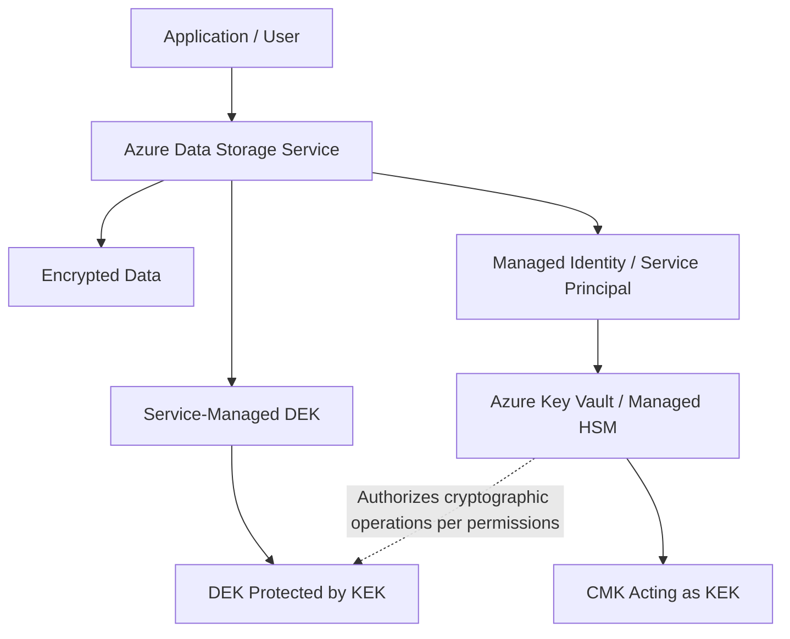
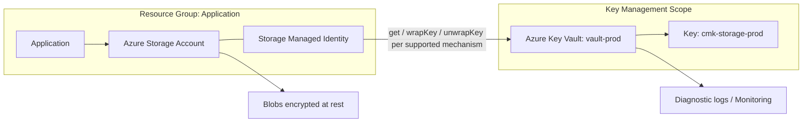
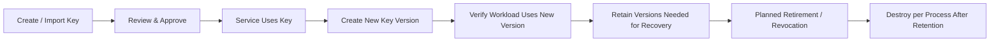

# Customer-Managed Keys and Key Control Requirements

When placing business data on Azure, many systems automatically receive encryption at rest without extra operator configuration. However, an organization handling financial data, customer records, or audited data may need to **decide who is permitted to use encryption keys, when keys must be rotated, how key access is revoked, and how to prove those controls**. These scenarios commonly lead to adopting **customer-managed keys (CMK)**.

This lesson belongs to the **Security and Compliance** chapter of the `CLOUD_PROVIDERS_AZURE` module. Along the journey of understanding Azure—from subscriptions, resource groups, and Microsoft Entra ID to networking, compute, storage, data, monitoring, and cost—CMK connects the data protection layer with identity management, access permissions, deployment automation, and recoverability.

## Learning Objectives

After this lesson, you will be able to:

- Explain how CMK differs from Microsoft-managed keys and understand multi-layered key encryption models.
- Know the roles of **Azure Key Vault**, **Azure Key Vault Managed HSM**, key versions, and managed identities in CMK workflows.
- Identify typical prerequisites before enabling CMK: service support, suitable key types, permissions, networking, recoverability, and logging.
- Design the lifecycle of **create – use – rotate – revoke – recover – destroy keys** without unintentionally making data inaccessible.
- Distinguish compliance objectives, actual control boundaries, incremental costs, and operational risks when using CMK.
- Propose a CMK architecture for an Azure application and provide auditable control evidence.

## 1. Why Do Enterprises Need Key Control?

In Azure, many services automatically encrypt stored data using platform-managed mechanisms. Under this model, the provider handles most of the service-level encryption key lifecycle. Customers typically focus on configuring resources, assigning permissions, and protecting identities and data.

When stricter governance requirements arise, an organization may want to:

1. **Manage key lifecycles:** proactively generate keys, import keys where supported, set expiration dates, schedule rotations, and keep audit trails.
2. **Control key usage permissions:** allow only designated service identities to perform necessary cryptographic operations.
3. **Separate duties:** data management teams do not automatically administer keys; key administration teams cannot automatically read business data.
4. **Controlled revocation:** retain the ability to stop a service from using a key via an approved procedure, while clearly understanding application consequences.
5. **Provide audit evidence:** prove key state, permissions, change history, deletion-protection policies, and key-access events.

CMK is an **architectural and governance choice** that addresses part of these requirements. It is neither mandatory by default for every application nor does it automatically make an application compliant with a specific legal or industry standard. Whether CMK is needed must stem from the organization's data classification, threat model, and audit obligations.

## 2. Microsoft-Managed Keys, Customer-Managed Keys, and BYOK

| Concept | Who Primarily Manages the Key Lifecycle? | When Is It Suitable? | Primary Responsibilities |
|---|---|---|---|
| **Microsoft-managed key (MMK)** | Azure service | General workloads with minimal custom key governance requirements | Service selection, security settings, IAM, data protection, and general compliance |
| **Customer-managed key (CMK)** | Customer manages the key used by the supporting service; service still handles data encryption | Requirements for key control, rotation, auditing, and granular permission governance | Operating the key store, key access, rotation, backup/recovery, monitoring |
| **Bring Your Own Key (BYOK)** | Customer generates/imports keys from an external environment if supported | Policies require customer-controlled key origin or import process | Controlling both key origin and post-import key lifecycle |

**BYOK is not synonymous with CMK.** BYOK describes **the origin and how key material is brought into the system**; CMK describes **the model where the customer manages the key used by the service to protect data**. Not every service or key type supports importing from external systems.

Other concepts to distinguish:

- **SSE (*server-side encryption*)**: the service encrypts data on the server side. Several SSE services support both Microsoft-managed keys and CMK.
- **TDE (*transparent data encryption*)**: database-level data encryption; for instance, certain Azure SQL services support customer-managed TDE protectors.
- **Client-side encryption**: the application encrypts data itself before sending it to the service. This is a different responsibility model and neither replaces nor equates to server-side CMK.
- **Encryption in transit**: protects data over the wire, usually via TLS. CMK for encryption at rest does not replace TLS, certificate validation, or API authentication.

### Data Encryption Keys and Key Encryption Keys

A common pattern is **envelope encryption**:

- A **Data Encryption Key (DEK)** encrypts the data payload or an intermediate data layer.
- A **Key Encryption Key (KEK)** protects (wraps) the DEK.
- In many CMK integrations, the key stored in Azure Key Vault or Managed HSM acts as the **KEK**. The Azure service retains responsibility for managing DEKs and data encryption operations per its own design.



The diagram illustrates the **principle**, not a fixed API sequence for every service. Azure Storage, Managed Disks, SQL, and other services each have specific key structures, caching, and operational requirements. The core point is that the customer controls the protecting key referenced by the service, while the service can still process data when authorized.

Therefore, **CMK does not mean only the customer can ever see plaintext data**. An authorized Azure service still needs decryption capability while serving valid requests. If you require a model where the cloud provider cannot access plaintext, carefully evaluate client-side encryption or confidential computing designs.

## 3. Where CMKs Are Stored and Protected in Azure

### Azure Key Vault

**Azure Key Vault** provides management for keys, secrets, and certificates. For CMK, services typically work with **key** objects, not arbitrary secrets. Key capabilities include:

- Generating or importing keys of supported key types.
- Managing status, expiration, versions, and rotation policies.
- Authorizing cryptographic operations using Azure RBAC for Key Vault or access policies in legacy setups.
- Recording activity via diagnostic logs when configured.
- Protecting against deletion with **soft delete** and **purge protection**.
- Depending on SKU and key type, supporting software-protected or HSM-protected keys.

**Key Vault Standard** and **Key Vault Premium** differ in capabilities and key protection forms; Premium supports corresponding HSM-protected key types. Never assume all key types or algorithms are accepted by every CMK-enabled service.

### Azure Key Vault Managed HSM

**Managed HSM** is a managed HSM service for organizations with stricter requirements around key protection boundaries, cryptographic governance, and HSM features. Managed HSM uses a different permission and operational model from standard Key Vault.

Choosing Managed HSM requires verifying **whether the key-consuming service supports that exact integration**. You cannot simply swap a Key Vault URI for a Managed HSM URI and expect every Azure service to keep working. Beyond technical support, evaluate cost, recovery workflows, and HSM administrative roles.

### Choosing Where to Store Keys

| Criterion | Questions to Answer |
|---|---|
| Compatibility | Does the service and CMK feature support Key Vault, Managed HSM, or both? |
| Key material protection | Does policy require software-protected keys, HSM-backed keys, or import from a dedicated source? |
| Key type | Are the algorithm, key size, and `wrapKey`/`unwrapKey` operations compatible? |
| Scope | Which tenant, subscription, and region must the key store and service reside in per feature docs? |
| Network access | Do firewalls, private endpoints, or trusted-service bypasses support the service's access path? |
| Recovery | Who holds valid backups, what is recovery time, and what is the plan if the key store fails? |
| Cost | What are the costs for the key store, HSM, crypto operations, logging, networking, and operations? |

## 4. Which Resource Types Support CMK?

CMK is **not a global switch** turned on once for an entire subscription. Each service defines eligible resource types, feature tiers, prerequisites, and how keys are referenced.

| Azure Service / Feature | Common Integration Pattern | What to Check |
|---|---|---|
| **Azure Storage** | Server-side encryption with customer-managed keys in Key Vault or supported key stores | Storage account type, identity permissions, key URI, and version update mechanism |
| **Azure Managed Disks** | `Disk Encryption Set` referencing a CMK to protect managed disk encryption keys | Disk type, deployment region, Disk Encryption Set identity, and disk/SKU support |
| **Azure SQL Database / SQL Managed Instance** | TDE protector using customer-managed keys where supported | TDE settings, key store permissions, availability dependencies, and recovery plans |
| **Other data services** | Service-specific CMK integrations | Actual feature support, tier, applicability scope, and regional restrictions |

**Distinction example:** A Disk Encryption Set used for Azure Managed Disks CMK is not the same as installing **Azure Disk Encryption** inside a VM's guest OS. Database TDE also has different requirements from Storage SSE. Always read the documentation for the exact feature being deployed and confirm which data, replicas, snapshots, and backups are actually protected by that CMK configuration.

## 5. Reference Architecture: Storage Account Using CMK

Suppose an application stores customer reports in Azure Blob Storage. The security team requires:

- The key store is owned by the security team, separate from the app operations team.
- Keys cannot be permanently destroyed by a single accidental action.
- Only the storage account's identity is permitted to invoke cryptographic operations for SSE.
- Key operations must be logged and monitored.
- A recovery plan exists if a key is accidentally disabled or permissions are revoked.

Reference design:



Design note: Azure Storage performs server-side encryption; the **service's managed identity** must be authorized to use the CMK in Key Vault. Applications uploading/downloading blobs still require authentication and authorization through Storage's separate data access mechanism. **Permission to use the key is not permission to read blobs.**

### Architectural Implementation Steps

1. Confirm tier, region, tenant, subscription, key type, and CMK setup supported by Azure Storage for the target account.
2. Create or use a governed key store, enabling soft delete and purge protection aligned with service requirements.
3. Create/import a key with compatible type and cryptographic operations; define owners and rotation policy.
4. Configure the managed identity supported by Storage CMK and note its exact **principal ID**.
5. Grant least-privilege permissions for that identity to perform required key operations at the Key Vault/key scope under your chosen permission model.
6. Configure Storage encryption to reference the key per feature guidance; choose a key version update strategy.
7. Test data read/write, key access logs, rotation procedures, and simulated outages in a non-production environment.
8. Enable monitoring, alerts, configuration controls, and document the recovery runbook before storing critical data.

Prefer **managed identities** over storing client secrets for custom service principals whenever supported. Distinguish identities for Storage, Disk Encryption Sets, and other resources: each feature may require a distinct principal.

## 6. Key Permissions: Control Plane vs. Data Plane

Two permission layers are related yet serve distinct purposes:

- **Control plane**: permissions to create/modify the Key Vault, configure networking, enable diagnostic settings, or alter management resources.
- **Data plane**: permissions to work with key objects, such as reading metadata and executing `wrapKey`/`unwrapKey`. For Azure Key Vault using Azure RBAC, these are **data-plane roles**, not resource group Reader or Contributor roles.

An application holding **Contributor** on a resource group containing storage does **not automatically** gain permission to use keys inside Key Vault. Conversely, an identity with `wrapKey` permission on a key does not automatically gain permission to read Blob Storage, access databases, or delete the vault.

In Key Vault using Azure RBAC, a built-in role commonly used for service encryption integration is **Key Vault Crypto Service Encryption User**. Specific roles and actions must be verified against the key-consuming service and granted scope. If the vault still uses **access policies**, equivalent permissions must be configured through that model; do not mix both models without understanding which mechanism is active.

| Role in the Workflow | Example Responsibilities | What to Avoid |
|---|---|---|
| Key management team | Create keys, approve rotations, recover keys, monitor vault | Simultaneously holding full read rights to all business data when unnecessary |
| Azure service identity | Invoke crypto operations needed for CMK | Being granted unnecessary key management/delete permissions |
| Application team | Deploy services, verify encryption and data access | Being able to unilaterally disable or purge keys |
| Security / audit team | Inspect settings and evidence, monitor changes | Using standing admin accounts for routine tasks |

### Common Permission Requirements

Depending on the service, a CMK-consuming identity may need:

- **Get**: read key metadata and reference details.
- **Wrap key**: encrypt the DEK/intermediate key layer with the CMK.
- **Unwrap key**: decrypt the DEK/intermediate key layer with the CMK.

Never grant `Key Vault Administrator` or delete/purge permissions merely to satisfy those three operations. Use the built-in role recommended by the service or a custom role scoped to exact permissions if permitted by your organization. Pay special attention to selecting the right **principal object ID** in the right tenant when assigning Azure RBAC.

## 7. Key Lifecycle and Rotation Mechanisms

CMK design must start from the full key lifecycle, not just creating a single key:



### Key Version and Key Identifier

A key can have multiple versions. Example URIs:

```text
Key Vault:
  https://kv-prod-example.vault.azure.net/keys/cmk-storage-prod

Specific version:
  https://kv-prod-example.vault.azure.net/keys/cmk-storage-prod/<key-version>
```

A **versionless key URI** and a **versioned URI** behave differently. Some CMK integrations allow services to automatically update when a new key version is created and referenced in a supported format; other cases require updating the resource configuration to point to the new version. **Setting a rotation policy on Key Vault does not automatically guarantee all services switch to the new key version.**

A safe rotation procedure:

1. Generate a new key version per schedule or approved security event.
2. Verify key status, algorithm, size, and identity permissions have not unexpectedly changed.
3. Verify the service transitioned to the new version via its actual integration mechanism, or update manually if required by the feature.
4. Test new reads/writes, existing data reads, and restores/snapshots if within the protected scope.
5. Schedule disabling or destroying **old versions** only after proving they are no longer needed for decryption, historical access, or restores.
6. Record the change, approver, test results, and rollback plan.

Do not confuse **creating a new version** with **changing the key name**, **switching key vaults**, or **deleting the old key**. Those actions have very different impacts on resources already referencing the key.

### Expiration, Disable, Delete, and Purge Are Different

| Action | Meaning | Operational Risk |
|---|---|---|
| Setting `notBefore` / `expires` | Controls the validity window of a key version | If the service needs crypto operations while the key is outside its valid window, data access may fail |
| **Disable** key/version | Stops allowing cryptographic operations with the key once effective | CMK-backed resources may experience outages when the service needs to use the key again |
| **Delete** with soft delete enabled | Moves object to deleted state, recoverable during retention period | Dependent resources cannot use the key normally while deleted |
| **Purge** | Permanently deletes per Key Vault policy and mechanics | Risk of permanently losing ability to decrypt dependent data if no viable recovery exists |
| **Revoke access** | Removes the identity's permission to use the key | Can cause data errors once effective; does not immediately erase previously accessed copies |

**Soft delete** enables recovering deleted objects within the retention window. **Purge protection** blocks permanent deletion before the protection period expires per supported configuration. For many CMK integrations, these are prerequisites or critical recommendations prior to enabling the feature. Never treat them as optional checkboxes.

### Revoking Access Does Not Mean Instant "Cryptographic Erasure"

Some services cache keys and maintain separate data access pipelines. Disabling a key or revoking permissions may impact operations after a propagation delay and cause loss of service availability. It **does not guarantee previously processed plaintext disappears**, does not recall data already exported externally, and does not replace legally mandated data deletion workflows. If the goal is *crypto-shredding*, carefully evaluate exact service capabilities, replicas, backups, caches, and retention rules.

## 8. Availability, Deletion Protection, and Recovery

CMK introduces an **operational dependency**: if a service cannot use its protecting key, reading/writing data may be disrupted. Therefore, gaining key control also brings responsibility for maintaining availability and recoverability.

Questions to answer before enabling CMK in production:

- If a key is **disabled** or identity permissions are accidentally revoked, who is authorized to restore them and within what timeframe?
- If the key store is soft-deleted, can it be **recovered** within the retention period? Who has permission to perform recovery?
- If key material is completely lost or the key store becomes unrecoverable, which data is at risk of permanent inaccessibility?
- Does restoring data from an older backup require an **older key version**?
- Does the CMK feature require Key Vault to be in the same tenant, region, subscription, or network boundary, or are cross-scope exceptions supported?
- During failover/DR to another region, where will the service reference the key and which permissions must exist?
- If Key Vault uses a firewall/private endpoint, is the path from the Azure service to the key store supported and permitted?

### Deletion Protection Policy

To prevent accidental key loss:

1. Enable and verify **soft delete** and **purge protection** per service requirements.
2. Restrict delete/purge rights; separate user, resource, and key administration.
3. Maintain an inventory of which resources depend on which keys, key versions, and vaults.
4. Apply change-approval workflows before disabling or revoking keys; test in a comparable environment first.
5. Prepare and test key backup/recovery procedures **if supported by the key type and service**; protect backups at the same sensitivity level.
6. Verify retention, recovery objectives, and DR procedures against actual data and services.

Never assume HSM keys can be arbitrarily copied or backed up/restored across all regions, tenants, or key store types. Always follow Key Vault/Managed HSM and service constraints.

### Runbook When an Application Loses CMK Access

Example when Storage or SQL reports key-related errors:

1. **Assess impact:** are users unable to read/write, which services are failing, and when did errors start?
2. **Check key status:** does the key still exist, is it enabled, unexpired, and on the right version?
3. **Check identity and permissions:** is the managed identity/service principal still active with required permissions?
4. **Check connectivity and policies:** vault firewall, private endpoints, DNS, network policies, Azure Policy, and tenant/scope changes.
5. **Cross-check logs:** Key Vault audit logs, Azure Activity Log, role assignment events, rotation history, and service errors.
6. **Recover per approved procedure:** restore permissions, re-enable the key, or recover deleted objects if appropriate; avoid destructive actions like creating an unrelated new key.
7. **Re-verify:** test data reads/writes, integrity, and backup/restore jobs; document root cause and preventive actions.

## 9. Deploying and Inspecting with Azure CLI

The commands below illustrate operations in a test environment. Sign in to the right tenant/subscription with appropriate permissions and replace all `<...>` placeholders with environment values. Resource creation and role assignment commands must only run in a controlled sandbox; key stores, key operations, and logging may incur costs.

### Step 1. Confirm Azure Context

```bash
az login --tenant "<tenant-id>"
az account set --subscription "<subscription-id>"
az account show --query "{subscription:id,tenant:tenantId,name:name}" -o json
```

### Step 2. Create a Resource Group and Key Vault Using Azure RBAC

In an authorized clean sandbox, create resources as follows:

```bash
az group create \
  --name "rg-cmk-lab" \
  --location "southeastasia"

az keyvault create \
  --name "<globally-unique-vault-name>" \
  --resource-group "rg-cmk-lab" \
  --location "southeastasia" \
  --enable-rbac-authorization true \
  --enable-purge-protection true
```

The vault name must meet naming rules and be globally unique. Enabling purge protection is intentional here: it prevents permanently deleting the key store during the protection window. Confirm soft delete settings, retention duration, and environment support prior to deployment.

### Step 3. Create a Key and Inspect Metadata

The operator must hold **data-plane permissions** matching the vault's authorization model to create keys. Example creating an RSA key to practice the concepts:

```bash
az keyvault key create \
  --vault-name "<vault-name>" \
  --name "cmk-lab" \
  --kty RSA \
  --size 3072

az keyvault key show \
  --vault-name "<vault-name>" \
  --name "cmk-lab" \
  --query "{id:key.kid,enabled:attributes.enabled,expires:attributes.expires}" \
  -o json
```

The commands above **only create a key**; no data service is configured for CMK yet. In a production system, verify the key type, size, and key operations **accepted by the target service** before creating/importing. Key identifiers and public metadata can be queried; private key material is never exported by a normal `key show` operation.

### Step 4. Query Vault, Key Versions, and Rotation Policy

```bash
az keyvault show \
  --name "<vault-name>" \
  --query "{id:id,tenantId:properties.tenantId,rbacEnabled:properties.enableRbacAuthorization,purgeProtection:properties.enablePurgeProtection}" \
  -o json

az keyvault key list-versions \
  --vault-name "<vault-name>" \
  --name "cmk-lab" \
  -o table

az keyvault key rotation-policy show \
  --vault-name "<vault-name>" \
  --name "cmk-lab" \
  -o json
```

If your Azure CLI version, SKU, or current permissions do not support an operation, check command help and vault configuration rather than arbitrarily escalating privileges. Permission to read metadata/rotation policies also depends on assigned policies and roles.

### Step 5. Grant Permissions to the CMK-Consuming Identity

Once the **managed identity of the key-consuming Azure service** is created, identify its **principal object ID**. For Key Vault in RBAC mode and services supporting this role, assign the dedicated data role at the vault scope:

```bash
az role assignment create \
  --assignee-object-id "<service-managed-identity-principal-id>" \
  --assignee-principal-type ServicePrincipal \
  --role "Key Vault Crypto Service Encryption User" \
  --scope "<key-vault-resource-id>"
```

This is an example of **Azure RBAC for the Key Vault data plane**. The operator assigning the role must hold permission to manage role assignments. Exact suitable roles and narrowest scopes depend on the service; if your organization uses access policies instead of RBAC, a different process is required. Never assign roles at the subscription level merely because a vault-level assignment failed.

### Step 6. Enable CMK on the Target Service and Verify

The final step depends on the service: Storage sets the encryption key source, Managed Disks typically uses a Disk Encryption Set, and SQL uses the TDE protector setting. In an end-to-end lab:

1. Select the resource and confirm CMK support.
2. Assign the identity and verify key access permissions.
3. Configure the key reference according to the service's versioning/rotation policy.
4. Verify encryption status, perform test data reads/writes, and cross-check audit logs.
5. Prepare a recovery plan before testing key disabling/revocation in a lab environment.

Never disable a production key "to see if CMK works." Revocation tests can disrupt services and must be designed as scheduled drills with monitoring and rollback plans.

## 10. Monitoring, Auditing, and Compliance Evidence

A CMK configuration only delivers operational value when the organization **knows where keys are used, who modifies them, and can recover from incidents**.

| Control Objective | Configurations / Evidence to Collect |
|---|---|
| Services using CMK | Resource encryption configuration, key identifier, linked identity |
| Least privilege | Role assignments/access policies, principal IDs, periodic review results |
| Accidental deletion protection | Soft delete, purge protection, retention settings, principals with purge rights |
| Rotation | Rotation policies, key versions, evidence services adopted new versions |
| Access audit trail | Key Vault/Managed HSM diagnostic settings, key usage/change events, service access logs |
| Change tracking | Azure Activity Log, IAM changes, network/firewall edits, anomaly alerts |
| Recoverability | Runbooks, drill outcomes, dependency inventory, data/key restore procedures |
| Cost control | Cost allocation for Key Vault/HSM, crypto operations, log storage, and related services |

**Azure Monitor** and **Log Analytics** can support collection, querying, and alerting once diagnostic settings are properly enabled. Select available log categories for the key store type, log destination, retention policy, and viewer permissions. Logs and role configurations can contain sensitive system details; protect them with appropriate access rules.

Example signals to alert on:

- **Disable/delete/purge** key operations or purge protection modifications where supported.
- Service identity key permissions revoked, principal changed, or Key Vault firewall blocking the service.
- Spikes in `Forbidden`, `KeyNotFound`, or cryptographic errors on consuming services.
- Keys nearing expiration, delayed rotation, or services failing to adopt an approved version.
- Diagnostic logs stopping flow to monitoring destinations, or abnormal error/latency spikes.

Combine **Azure Policy** to audit or enforce encryption and key-store protection settings on resources with appropriate policy definitions. Do not assume every service offers identical CMK policy granularity.

## 11. Costs and Operational Trade-Offs

CMK can increase both financial and management costs:

- Key stores, SKUs/HSMs, and cryptographic operation volumes carry varying pricing.
- Certain services or CMK features impose SKU/tier prerequisites or separate fees.
- Private networking, log ingestion, retention, and alerting also consume resources.
- Rotation, change control, separation of duties, and recovery drills require engineering effort.
- If key misconfiguration halts data access, operational losses can far exceed key service fees.

When comparing MMK vs. CMK, evaluate **data sensitivity – audit obligations – required control – recoverability – total cost**. Do not force CMK onto every service simply because "more control sounds better"; every shift in the responsibility boundary requires an owner and matching operational processes.

## 12. Real-World Scenario: Customer Data Analytics Platform

An enterprise runs an app on Azure App Service receiving API payloads and storing reports in Blob Storage. The data is classified as **confidential**, and auditors require encryption keys to have dedicated custodians and rotate on an internal schedule.

### Proposed Design

1. **Data classification and scope:** identify which reports sit in Storage, replicas, backups, and other services storing sensitive data.
2. **Verify support:** confirm the storage account and CMK features needed; if the database also stores confidential data, evaluate separate CMK integration for SQL or that data service.
3. **Dedicated key store:** deploy Key Vault per organizational policy, enabling soft delete, purge protection, diagnostic logs, and network access controls per service support.
4. **Service identity:** use a managed identity supported by Storage CMK; grant tightly scoped cryptographic permissions on the key store.
5. **Separation of duties:** the app team manages App Service and Storage per business roles; the security team manages key lifecycles; auditors have read access to relevant evidence.
6. **Rotation and monitoring:** define schedules for creating new key versions, verifying adoption, and retaining older versions while still needed for restores.
7. **Incident drills:** simulate losing `unwrapKey` permission in a sandbox, confirm alerts fire, and practice restoring permissions; never run drills against production resources.
8. **Operational handover:** maintain an inventory of key IDs, identities, dependent resources, owners, retention durations, runbooks, and test evidence.

### Questions an Architect Must Ask

- If a Key Vault administrator leaves the company, is there at least one valid, controlled path to recover permissions?
- If a backup must be restored a year later, will the required key versions still be retained by then?
- If the organization revokes a key during an incident, which services stop working and what is the observed impact timeframe from real testing?
- If Storage fails over to a secondary region, do the CMK integration and key store function in a failover scenario?
- What evidence proves CMK is actively protecting the target data, rather than a key merely sitting unused in a vault?

## 13. Common Misconceptions

**"Enabling CMK means Azure can never decrypt the data."** False. Authorized Azure services still process data to serve application workloads within design boundaries.

**"Having an Azure Key Vault means all data in the subscription is encrypted with CMK."** False. Key Vault only stores and manages keys; each resource must be explicitly configured for CMK where supported.

**"Creating a new key version means all resources immediately use the new version."** Not guaranteed. Verify rotation mechanics, versionless vs. versioned references, and individual service status.

**"Changing IAM permissions carries no downtime risk."** False. If a service loses key permissions or network connectivity to the vault, data access can break.

**"Purge protection is a backup."** False. Purge protection blocks permanent deletion before the allowed window; backup/recovery plans must also account for key types, service limits, and data lifecycles.

**"Granting Contributor on Key Vault is enough to use keys."** Inaccurate under the Azure RBAC data-plane model. Check actual data-plane roles and cryptographic permissions.

**"CMK passes all compliance requirements automatically."** False. CMK supports one set of control objectives, but does not replace data management, IAM, networking, logging, incident response, or legal assessments.

## 14. Knowledge Self-Check

**Question 1.** What is the core difference between CMK and Microsoft-managed keys?

**Answer:** The customer manages the protecting key used by a supporting service, including permissions, rotation, and lifecycle; the Azure service still executes data encryption per its design.

**Question 2.** If a storage account uses a CMK in Key Vault, does the application need blob read permissions or `wrapKey` permission to upload/download files?

**Answer:** The application needs Blob data access permissions through Storage's authorization mechanism. Storage's own identity for CMK is what needs appropriate cryptographic permissions on Key Vault; the two permission types serve distinct purposes.

**Question 3.** Why shouldn't old key versions be deleted immediately after rotation?

**Answer:** Existing data or older backups may still depend on older key versions for decryption or restoration. Verify service behavior and retention needs before retiring key versions.

**Question 4.** What are the purposes of soft delete and purge protection?

**Answer:** Soft delete allows recovering deleted keys/vaults within a retention period; purge protection prevents permanent deletion before the protection period expires.

**Question 5.** Why isn't the Contributor role on a resource group sufficient for a service to use a key in Key Vault?

**Answer:** Resource management permissions (control plane) differ from cryptographic key operations (data plane). The identity needs key operations aligned with the active authorization model.

**Question 6.** A Key Vault rotation policy is enabled, yet the service still displays the old key version. What should you do?

**Answer:** Check whether the service supports automatic version updates, whether the key URI is versioned or versionless, whether manual updates are required, and sync propagation latency; then test and document results.

**Question 7.** Does revoking CMK access immediately erase data already downloaded by users?

**Answer:** No. Revoking key access impacts the service's cryptographic operations once effective; it does not delete plaintext or copies already residing outside that control boundary.

**Question 8.** What are three pieces of evidence you can provide auditors to prove CMK controls?

**Answer:** Examples include current resource encryption config and key ID; identity permissions on the key; and rotation history alongside key usage/change logs. Additional evidence on recovery, deletion protection, and approval workflows is needed depending on audit scope.

## Summary

CMK empowers organizations to strengthen **control over keys protecting server-side encrypted data**: deciding where keys live, who can use them, when they rotate, how they are monitored, and how incidents are handled. Azure Key Vault or Managed HSM are central building blocks, while managed identities, RBAC, networking, monitoring, and recovery workflows determine whether the system operates safely.

When introducing CMK into an Azure architecture, start with **verifiable control requirements**, then validate support per service, enforce least privilege, and design rotation and recovery before going to production. Only then does key control genuinely strengthen security, compliance, and application continuity.
