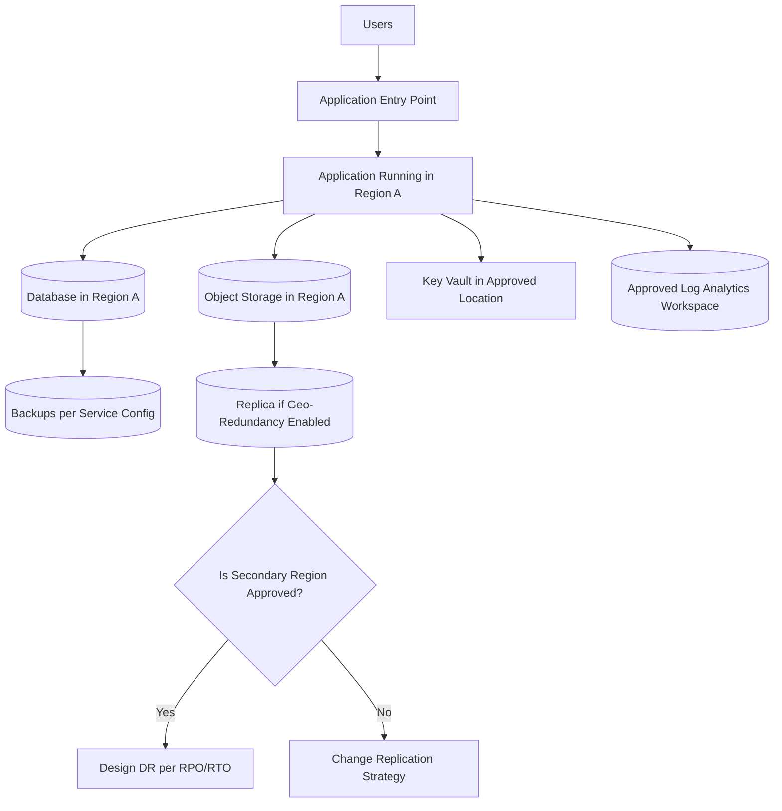

# Controlling Data Location and Compliance Requirements

In Microsoft Azure, choosing a deployment region (**region**) is only the first step in controlling data location. An application may run in one region yet generate backups, logs, recovery replicas, authentication data, or outbound streams to other services in different locations. Therefore, to satisfy **data residency** and compliance requirements, deployment teams must understand **what data resides where, where it travels, who has access, and what evidence proves it**.

This lesson belongs to the **Security and Compliance** chapter of the Azure module, connecting knowledge of subscriptions, resource groups, Microsoft Entra ID, and governance with networking, compute, storage, databases, monitoring, and disaster recovery. The goal is to establish an auditable and repeatable decision-making process when designing application architectures on Azure.

> **Scope:** This is a technical lesson on region selection and compliance controls. Legal conclusions for a specific organization must rely on contracts, current service documentation, data types, user residency, and advice from qualified legal/compliance counsel.

## Learning Objectives

After this lesson, you will be able to:

- Distinguish region, geography, availability zone, data residency, data sovereignty, and data localization requirements.
- Classify and map locations of primary data, replicas, backups, logs, metadata, and processing flows.
- Select Azure regions based on business, compliance, latency, availability, and service capability requirements.
- Explain the impact of Azure Storage replication types and disaster recovery strategies on data location.
- Apply Azure Policy, RBAC, tags, and approval workflows to restrict deployment regions.
- Collect technical evidence, read compliance statuses, and detect configuration drift.
- Build a verification checklist before promoting an Azure workload to production.

## 1. Understanding Data Location Concepts Properly

### Region, Geography, and Availability Zone

An **Azure region** is a geographic location where Azure provides a set of datacenters and services, such as `southeastasia` or `eastasia`. A *regional* resource is typically created within a specific region.

An **Azure geography** is a grouping of regions tied to markets or geographic boundaries according to how Microsoft structures infrastructure. Certain services and replication choices carry geography commitments, though actual data boundaries must still be verified **per service**.

An **availability zone** is an independent fault-isolated zone within a region that supports availability zones. When deploying applications or replicating data across zones within the **same region**, the primary goal is increasing availability against a single-zone failure.

A **region pair** is a pair of regions designated by Azure for many recovery scenarios. Not every service uses region pairs, and you must never assume all data is always replicated to the paired region.

```text
Azure geography
├── Region A
│   ├── Availability zone 1
│   ├── Availability zone 2
│   └── Availability zone 3
└── Region B
    ├── Availability zone 1 (if supported)
    └── ...
```

A region may not support availability zones for all services. Regions and zones also do not guarantee that all data, logs, and backups of a workload stay within that location.

### Data Residency, Data Sovereignty, and Data Localization

| Concept | Question to Answer | Example |
|---|---|---|
| **Data residency** | In which country, region, or geography is data stored? | Transaction records stored in an approved region |
| **Data sovereignty** | Which legal regulations and jurisdictions govern the data and processing activities? | Requires evaluating applicable laws, data processors, and contracts |
| **Data localization** | Do regulations mandate that certain data be stored or processed within a specific territory? | A dataset required to remain in-country under applicable laws |
| **Data transfer** | Is data transferred, replicated, or accessed across borders? | An analytics service in another region receiving user events |
| **Data processing location** | Does processing or service support occur outside the selected region? | A global service processing requests or metadata |

**Storing data in one region** does not automatically mean **full compliance**. Regulations may govern storage location, data transfers, who can access data, retention duration, deletion procedures, breach notification, and the legal basis for processing.

## 2. Identifying Data to Control Before Choosing a Region

First, create a **data inventory** for each system and data flow. Do not begin by simply counting VMs or resource groups.

Common data categories:

1. **Primary business data:** user profiles, orders, HR records, documents, or transaction records.
2. **Sensitive data:** personally identifiable information, financial data, health data, or trade secrets, depending on use case and applicable regulations.
3. **Operational data:** application logs, IP addresses, telemetry, traces, security events, and access logs.
4. **Copies and backups:** snapshots, backups, HA/DR replicas, data exports, and temporary files.
5. **Metadata and identities:** account details, tenant data, configurations, identity keys, audit trails.
6. **Data in transit or processing:** queues, messages, caches, analytics pipelines, streams to partner APIs.

An inventory table might look like:

| Data Group | Target Azure Service | Primary Location | Copies/Logs/Backups | Owner and Requirements |
|---|---|---|---|---|
| Orders | Azure SQL Database | Approved Region A | Backups and geo-replication must be verified | Data team; location and retention restrictions |
| Documents | Azure Blob Storage | Approved Region A | Depends on redundancy and lifecycle | App team; document classification |
| System events | Azure Monitor Logs | Workspace Region B | Retention, exports, workspace links | Ops team; avoid logging excessive personal data |
| App secrets | Azure Key Vault | Approved Region A | Backup/restore policy, service dependencies | Security team; least privilege |
| Identity data | Microsoft Entra ID | Per service terms and scope | May have global characteristics | Identity team; review separate service docs |

The **"Copies/Logs/Backups"** column is critical: a data location decision is incomplete if it only tracks the primary resource's region.

### Data Classification Questions

For each dataset, determine:

- Does it contain personal data, sensitive data, secrets, or data subject to legal/contractual retention?
- Does policy restrict **storage**, **processing**, **remote access**, **cross-border transfer**, or a combination of those?
- Is the data anonymized, pseudonymized, or encrypted? These measures change risk profiles, but do not automatically replace legal obligations.
- Who is the business owner, who sets retention periods, and who is authorized to approve exceptions?
- Is there documentation proving storage locations and data deletion workflows upon expiration?

## 3. Selecting an Azure Region Based on Evidence

Choosing a region is a multi-criteria problem:

| Criterion | Specific Check | Consequence |
|---|---|---|
| Residency/compliance needs | Do the region and geography fit approved boundaries? | May eliminate certain regions despite lower pricing |
| Service availability | Are compute, database, storage, networking, and required SKUs supported there? | May require changing services or architecture |
| Latency | Where are users and integrated systems located? | Affects UX and API response times |
| Availability | Are suitable availability zones and redundancy options present? | Affects RTO/RPO targets |
| Connectivity | How do private networks, ExpressRoute/VPN, DNS, and service endpoints behave? | Affects traffic paths and security |
| Scalability and quota | Are sufficient quotas, SKUs, and capacity available for the workload? | Affects deployment and growth |
| Cost | Service pricing, bandwidth, backups, storage, and DR | Total cost varies with architecture |

Do not use the resource group's region as sole proof. **A resource group's location primarily specifies where the group's metadata is stored**; resources placed inside that resource group can reside in different regions.

For example, a resource group located in `southeastasia` can still contain a resource deployed in `eastasia` if resource type and policies permit. Always inspect each resource's `location` property alongside the actual data locations of each service.

### Regional, Global, and Non-Regional Resources

Not every Azure resource models location like a virtual machine. Some resources show `global` as their location; some services feature a global control plane, global edge points, or distinct metadata storage rules. Identity, content delivery, security, DNS, and monitoring services must be evaluated against each service's official **data residency** documentation.

**Key rule:** before committing to "all data stays in region X," list every service, verify each service's data residency commitments, and inspect copies and exceptions. Never infer this from a region label in the Portal.

## 4. How Data Replication and Disaster Recovery Affect Location

Replication for durability and recoverability can alter where data resides.

### Example: Azure Storage Redundancy

| Option | General Meaning | Compliance Question |
|---|---|---|
| **LRS** – Locally-redundant storage | Replicates data within a single infrastructure area in the primary region | Does it meet fault-tolerance and storage location needs? |
| **ZRS** – Zone-redundant storage | Synchronously replicates across availability zones in the primary region where supported | Does that region support ZRS for the account/workload? |
| **GRS** – Geo-redundant storage | Replicates in the primary region and asynchronously to a secondary region | Where is the secondary region? Is it approved? |
| **GZRS** – Geo-zone-redundant storage | Combines zone replication in the primary region with a secondary geo-replica | Which locations hold copies? |
| **RA-GRS / RA-GZRS** | Variants allowing reads from the secondary region per service characteristics | Is read-only access from the secondary location compliant? |

Support depends on storage account type, region, and service. For GRS or GZRS, Azure picks the secondary region using the applicable region-pairing mechanism; do not treat it as an arbitrary secondary region picker. Inspect the account's actual **primary location**, **secondary location**, and replication mode.

A setup placing primary data in an allowed region while replicating geographically into an unapproved jurisdiction may fail requirements. DR plans must be reviewed with compliance teams prior to deployment.

### Databases, Backups, and Recovery

For Azure SQL Database, PostgreSQL, Cosmos DB, or other data services, replication and backup locations do not behave identically to Azure Storage. Check each specific feature: geo-replication, failover groups, multi-region writes, backup redundancy, point-in-time restore, long-term retention, and supported recovery services.

When designing, explicitly document:

- **Primary region:** where writes primarily occur.
- **Replica/secondary region:** where copies reside and where apps may read/write after failover.
- **Backup region/location:** where backup copies are stored and where restores can occur.
- **RPO:** maximum acceptable data loss measured in time.
- **RTO:** maximum target duration to restore service.
- **Failover procedure:** who authorizes failover and which legal/geographic checks apply before switching regions.

**Cross-region recovery is not always permitted.** If policy requires staying within specific boundaries, design redundancy within allowed regions or obtain proper legal approval.

## 5. Which Data Is Most Easily Overlooked?

Architectures often harbor "location leakage points" outside the primary database:

### Logs, Telemetry, and Monitoring

Applications may send logs to an **Azure Monitor Logs / Log Analytics workspace** or analytics service in another region. Logs can contain usernames, IP addresses, identifiers, URLs, or business data if code logs too verbosely.

Configure workspace location, retention, exports, access controls, collection rules, and deletion workflows carefully. Never assume logs are "non-personal data" without classifying them first.

### Caches, Message Queues, and Integrations

Queues, caches, event streams, and integration middleware can retain payloads temporarily or long-term. If sensitive data passes through third-party pipelines or APIs, inspect processing locations and data terms across every intermediate hop.

### Snapshots, Exports, and Manual Copies

Data exported to personal laptops, secondary object storage, analytics platforms, BI tools, or third-party backup services can cross approved boundaries. Snapshots and soft-delete features can also retain records after primary data is deleted.

### Identities, Metadata, and Global Services

Microsoft Entra ID and global services follow their own data location rules and processing scopes. A subscription's region does not prove where all identity data resides. Likewise, a resource with location `global` must be assessed via service documentation rather than assumed to "hold no data."

### Remote Access and Operational Support

Even if data rests in one region, staff or sub-processors in another geography may access it remotely. Review requirements on cross-border access, contracts, authorization, logging, encryption, and vendor support policies.

## 6. Compliance Requirements: Where to Start?

Compliance requirements are more than a list of certificates. Distinguish **obligations applicable to the organization** from **control attestations provided by the cloud provider**.

Several regulatory frameworks and standards may apply, depending on industry and market:

| Framework / Requirement Source | Implementation-Level Actions |
|---|---|
| **GDPR** (where applicable) | Determine legal basis, controller/processor roles, personal data handling, and lawful transfer mechanisms |
| **Personal data protection regulations in Vietnam** | Identify effective legal texts and obligations for the organization; evaluate storage, processing, and cross-border transfers per specific case |
| **Customer contracts / industry rules** | Translate "data must remain within X" clauses into constraints on services, replicas, sub-processors, and operations |
| **ISO/IEC 27001** | Establish an information security management system, assess risks, operate controls, and retain evidence |
| **SOC reports / independent audits** | Use provider reports to support due diligence on specific controls within the report's scope |
| **Internal policies** | Define allowed regions, retention periods, access rules, logging, change control, and incident handling |

**There is no "one region compliant with every regulation."** Laws vary by data type, organization type, data subject, processing purpose, and effective date. If data is subject to localization rules in Vietnam, never automatically conclude an Azure region in another country fulfills that obligation. Establish the legal basis or proper deployment choice first.

### Evidence from Microsoft

When evaluating Azure, consult:

- **Azure geographies and regions** docs and regional service availability.
- **Data residency** and **data protection** documentation for each service.
- Contracts and data protection terms, including the **Microsoft Products and Services Data Protection Addendum (DPA)** where applicable.
- **Service Trust Portal** or Microsoft compliance documentation pages for reports and certifications within offered scopes.
- Descriptions of service data boundaries, regional failover behaviors, backups, metadata handling, and published exceptions.

Microsoft compliance attestations do not prove that **a customer's own configuration** is compliant. For example, a compliant infrastructure report does not guarantee an app isn't exporting data to an external API or writing sensitive fields into logs in the wrong region.

## 7. Shared Responsibility in Azure

Under the shared responsibility model, Microsoft secures and operates the infrastructure/service layers it manages; customers remain responsible for data, identities, configurations, access permissions, processes, and compliance obligations within their scope.

| Task | Primary Responsibility |
|---|---|
| Azure physical infrastructure and operations | Microsoft per service model and commitments |
| Choosing regions, service types, redundancy, replicas | Architecture team / customer |
| Data classification and identifying legal constraints | Data owners, security, legal/compliance teams |
| Configuring Azure Policy and RBAC | Azure admin team, per delegation |
| Data access permissions, encryption, lifecycle, and deletion | Customer, leveraging provided service features |
| Collecting evidence, auditing, and managing exceptions | Customer and contractually accountable parties |

Encryption at rest and in transit, customer-managed keys, private endpoints, and RBAC reduce access or leakage risks; **they do not automatically dictate where data is stored**. These two sets of requirements must be verified independently.

## 8. Sample Architecture: Web App with Data Location Constraints

Suppose an order-processing system requires all business data and backups to be stored within **regions approved by compliance**. The illustrative example chooses primary Region A; secondary Region B may only be used if it is also approved.



The diagram does not imply all services share identical storage or replication models. For real use, every arrow needs documentation covering processing location, payload classification, data transfer, retention, and access controls.

### Design Workflow

1. Select the allowed region set and record approval justification.
2. Verify **each service** supports the required region, SKU, and features.
3. Choose locations for logs, backups, replicas, and DR mechanisms—not only the app region.
4. Restrict network flows and access permissions; evaluate third-party connections.
5. Apply policies preventing deployment in unapproved locations and monitor existing resources.
6. Gather evidence from configurations and service docs to support audits.

## 9. Using Azure Policy to Restrict Deployment Regions

**Azure Policy** evaluates or enforces resource configuration rules across scopes such as management groups, subscriptions, or resource groups.

Two built-in policies are commonly considered:

- **Allowed locations:** restricts `location` for resource types covered by the policy definition.
- **Allowed locations for resource groups:** restricts the `location` of resource groups themselves.

Evaluate both together, because a resource group's location and a resource's location are two distinct properties. Certain global resource types or resources without conventional regional locations may be exempted by the built-in definition.

### Common Policy Effects

| Effect | Meaning | Usage |
|---|---|---|
| **Audit** | Flags non-compliant configurations | Assess baseline posture before enforcing |
| **Deny** | Rejects non-compliant create or update requests | Block deployments to wrong regions within policy scope |
| **Disabled** | Disables effect evaluation for applicable conditions | Lifecycle management or controlled testing |
| **DoNotEnforce** (assignment enforcement mode) | Evaluates policy compliance without enforcing deny/modify effects of that assignment | Test impact prior to enabling enforcement |

Not every effect is supported by every policy definition. A **Policy assignment** also includes scope, parameters, exclusions, and enforcement mode; inspect the exact definition to understand outcomes.

### Steps to Deploy in the Azure Portal

1. Open **Azure Portal → Policy**.
2. Set the initial scope to an authorized test subscription or resource group.
3. Locate the **Allowed locations** definition and inspect its rule, parameters, and exemptions.
4. Create an assignment with the approved region list, selecting **DoNotEnforce** mode for testing if appropriate.
5. Inspect compliance state and test creating resources inside/outside the allowed region set in the test environment.
6. Decide how to handle pre-existing resources deployed before the policy. A new policy does not automatically migrate existing resources.
7. After reviewing impact, switch the assignment to enforce following change control procedures.
8. Also assign **Allowed locations for resource groups** when you need to constrain where group metadata lives.

**Note:** Azure Policy blocks certain **control plane** operations, but cannot replace checking internal service processing locations, egress traffic, DR replicas, or non-Azure services.

### Exemptions and Inheritance

An assignment at a management group affects many child subscriptions underneath. When a system genuinely needs an exception, document the reason, scope, owner, expiration, or review schedule, and use appropriate exemption mechanisms. Never disable an entire policy simply for one special workload.

## 10. Inspecting Resource Locations with Azure CLI

The examples below focus on **read-only configuration inspection** commands. Run them in Azure Cloud Shell or an environment with Azure CLI installed and necessary read permissions.

### Step 1: Check Current Subscription

```bash
az account show --query "{subscriptionId:id, name:name, tenantId:tenantId}" --output table
```

If the active subscription is not the target one, select an authorized subscription:

```bash
az account set --subscription "<SUBSCRIPTION_ID>"
```

### Step 2: List Declared Resource Locations

```bash
az resource list \
  --subscription "<SUBSCRIPTION_ID>" \
  --query "[].{name:name,type:type,resourceGroup:resourceGroup,location:location}" \
  --output table
```

This helps detect resources whose `location` differs from the approved list. However, this output only reflects the Azure Resource Manager resource property and **does not cover all internal data storage locations**, replicas, or services outside the subscription.

### Step 3: Check Resource Group Locations

```bash
az group list \
  --subscription "<SUBSCRIPTION_ID>" \
  --query "[].{name:name,location:location}" \
  --output table
```

Even if a resource group's location is valid, you must still inspect the locations of resources inside it.

### Step 4: Inspect Storage Account Redundancy

```bash
az storage account show \
  --subscription "<SUBSCRIPTION_ID>" \
  --resource-group "<RESOURCE_GROUP>" \
  --name "<STORAGE_ACCOUNT>" \
  --query "{name:name,location:location,replication:sku.name,primary:primaryLocation,secondary:secondaryLocation}" \
  --output json
```

Fields such as `secondaryLocation` may be empty if the storage mode is not geo-redundant. If a secondary region is present, immediately cross-check it against the approved locations list. Other properties of storage accounts and each data service must be checked individually.

### Step 5: List Policy Assignments at Scope

```bash
az policy assignment list \
  --scope "/subscriptions/<SUBSCRIPTION_ID>" \
  --output table
```

This list is a helpful starting point for auditing policies at that scope. To fully understand **effective policies**, also check assignments inherited from parent scopes, policy exemptions, initiatives, and compliance evaluations in Azure Policy. Never conclude "no policies exist" from a single query lacking context.

### Post-Query Checklist

- Do all resources have valid declared locations?
- Are there `global` resources or services without standard locations requiring separate documentation review?
- Do storage, databases, and backups have secondary regions?
- Are log workspaces, key management, integrations, and DR within the approved architecture?
- Are any policy exceptions active, and who approved them?

## 11. Continuous Monitoring and Collecting Evidence

Data location compliance is not a one-time check. Once a system goes live, the environment can still shift due to app updates, service scaling, backup copies, SKU changes, or manual deployments.

### Useful Evidence Sources

| Evidence | Purpose | Limitations |
|---|---|---|
| Resource, region, and SKU inventory | Shows where declared resources are deployed | Insufficient to prove all data stays there |
| Replication, backup, failover configs | Identifies where copies live and how they are used | Must cross-check service features and behaviors |
| Azure Policy compliance results | Detects drift against policy definitions | Inspection scope depends on rules and assignments |
| Azure Activity Log | Tracks control-plane changes and actors | Does not replace data logs or application logs |
| Sign-in logs and Azure RBAC | Audits admin identities and permissions | Does not replace data residency evidence |
| Data-flow diagrams and data inventory | Depicts data flows and processing purposes | Must be updated whenever the system changes |
| Product docs / contracts / compliance reports | Explains provider responsibilities and commitments | Must verify version and covered services |

Save timestamped configuration snapshots or state exports, change tickets, policy compliance evaluations, exception approvals, and recovery drill logs. For audit artifacts, explicitly record **collection timestamp** and **service scope** because configurations can change.

### Change Governance

Whenever adding a service, changing regions, switching replication modes, or feeding data into a new analytics platform, re-evaluate:

1. Data types and usage purposes.
2. New storage regions and processing locations.
3. Transfer flows to other systems or sub-processors.
4. Backups, logs, retention, and deletion workflows.
5. Contractual terms, approvals, and updated evidence.

## 12. Controlling Costs While Maintaining Compliance

Costs are affected by deployment region, storage tier, replication, cross-region data transfer, and monitoring services. Choosing strictly by lowest price can introduce compliance risks; choosing strictly maximum replication can cause unnecessary spending.

Key considerations:

- ZRS and GRS/GZRS differ in durability, availability, and pricing; the choice must simultaneously satisfy location rules.
- Cross-region recovery can add data transfer fees, always-on replicas, and DR drill costs.
- Overly long log or backup retention increases storage volume and the risk of holding data past allowed limits.
- Use Azure Cost Management, tags, and budget alerts to monitor approved architecture spend.
- Budget alerts aid monitoring; they do not automatically stop services from exceeding thresholds.

When cost conflicts with legal or contractual obligations, escalate to authorized decision-makers to choose an appropriate design.

## 13. Practical Scenario: Reviewing a Region-Drifted Architecture

A team deploys an order system with these assumptions:

- The web app and database are placed in Region A.
- The resource group is also placed in Region A.
- Object storage has GRS enabled, with secondary Region B.
- The Log Analytics workspace sits in Region C.
- Order data is sent via API to an external analytics platform.
- Corporate policy approves only **Region A** for certain sensitive business data types.

### Analysis

**Step 1 – Confirm scope:** the requirement mentions "certain sensitive data." You must specify exactly which data, including primary records, backups, logs, and API payload fields.

**Step 2 – Inspect storage:** if GRS replicas hold restricted data, Region B must be approved; otherwise, consider in-region redundancy within allowed regions or another architecture meeting durability needs.

**Step 3 – Inspect telemetry:** if logs capture sensitive data, Region C may represent drift. Strip sensitive data from logs, pick an approved workspace, and review export pipelines.

**Step 4 – Evaluate external API:** identify the partner's processing/storage locations, contractual terms, and lawful transfer basis. Azure Policy does not have full visibility into this flow.

**Step 5 – Design controls:** choose valid regions, enforce Allowed locations policies, apply network/identity controls, establish backup/DR approval gates, and schedule periodic audits.

**Step 6 – Collect evidence:** archive config inventories, data-owner sign-offs, service documentation, policy compliance exports, and data-flow verification results.

### Illustrative Decision Table

| Component | Finding | Remediation Direction |
|---|---|---|
| App and database | Configured in Region A | Verify backups, replicas, and service behaviors |
| Resource group | Metadata in Region A | Do not use as sole proof |
| Blob Storage GRS | May replicate to B | Inspect `secondaryLocation` and obtain approval or change redundancy |
| Log Analytics | Workspace in C | Inspect log payloads, retention, and validity of C |
| External analytics API | Data location unknown | Evaluate data flow, partner, and contract terms |
| Azure Policy | No location constraint yet | Pilot Allowed locations and complementary policies; track exceptions |

This scenario illustrates an important principle: **placing all primary resources in Region A does not prove all related data stays in Region A**.

## 14. Common Mistakes and How to Fix Them

| Mistake | Why It Is Dangerous | How to Fix |
|---|---|---|
| Checking resource group location and assuming the whole system is there | Resources and data can reside in other regions | Inspect every resource and service behavior |
| Assuming "data stored in region X" covers logs, metadata, and support access | Each service has different processing scopes | Read service documentation and maintain a data-flow inventory |
| Enabling GRS without checking the secondary region | Replicas may land outside allowed boundaries | Verify `secondaryLocation` and obtain approval |
| Using Azure Policy instead of legal review | Policy only checks technical properties and rules | Combine contracts, data classification, and audits |
| Treating Azure certifications as application compliance | Provider and customer have distinct responsibilities | Gather evidence on configuration, access, and data lifecycle |
| Ignoring logs and temporary data | Sensitive info can surface outside the main database | Minimize logging, select appropriate workspaces and retention |
| Blocking all regions immediately in production | Can break deployments or services needing exceptions | Pilot in a narrow scope, `DoNotEnforce`, review, and approve |
| Skipping reviews during region moves/DR | Failover can shift data into unapproved regions | Include DR and secondary regions in change control |

## 15. Production Deployment Checklist

Before releasing an Azure workload, the project team should complete this checklist:

- [ ] Identified data owners, data types, and applicable legal/contractual requirements.
- [ ] Mapped data flows covering primary data, backups, replicas, logs, metadata, and partners.
- [ ] Selected allowed regions and recorded formal approval decisions.
- [ ] Checked service/SKU support, residency commitments, and exceptions in product docs.
- [ ] Verified redundancy modes and secondary regions for storage/databases/backups.
- [ ] Checked locations of Log Analytics workspaces, monitoring tools, and exports.
- [ ] Configured Azure Policy at appropriate scopes and tested before enforcing.
- [ ] Applied least-privilege Azure RBAC, appropriate identities, and logged changes.
- [ ] Designed retention, deletion, recovery, and DR plans within approved boundaries.
- [ ] Audited data exported outside Azure and third-party access rights.
- [ ] Collected audit evidence with clear timestamps, sources, and scopes.
- [ ] Established a review schedule and workflow for exceptions and configuration drift.

## 16. Knowledge Self-Check

1. How do region, geography, and availability zone differ?
2. Why can't a resource group's location prove all data resides in one region?
3. Distinguish data residency, data sovereignty, and data localization.
4. How do GRS and ZRS differ regarding copy locations? Why must you check `secondaryLocation`?
5. Which data beyond the primary database must be included in a data inventory?
6. What can Azure Policy's Allowed locations control? Why is it insufficient alone to guarantee compliance?
7. When selecting a Log Analytics workspace, what details must you verify?
8. Why doesn't a cloud provider's compliance certification automatically prove a customer's application configuration is compliant?
9. If data localization permits only one specific geographic boundary, what must you do before choosing a region and DR strategy?
10. When a team adds an external analytics system, what evidence and approvals must be updated?

## Conclusion

Controlling data location in Azure means governing **the entire data lifecycle and movement flows**, not merely picking a region when provisioning a resource. Combine data classification, per-service documentation, replication and DR choices, Azure Policy, RBAC, log/backup controls, and audit evidence. This approach enables organizations to deploy Azure architectures that satisfy availability, security, cost, and defined compliance obligations.
