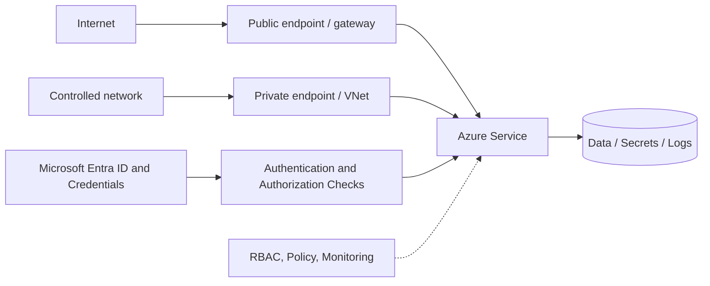
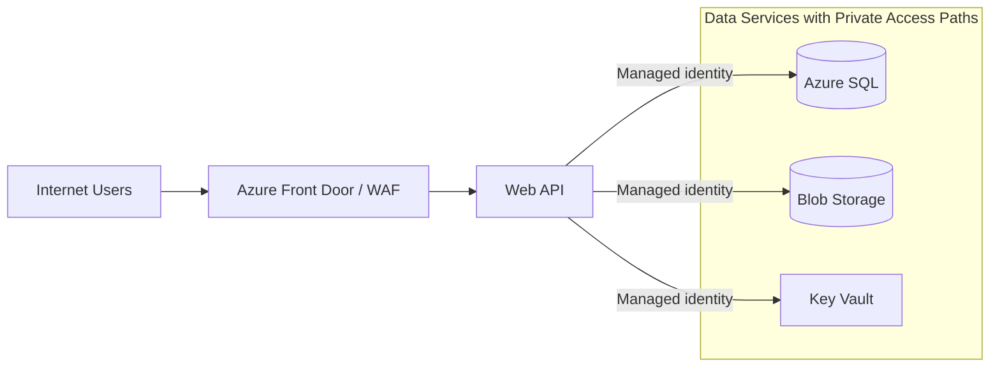

# Reviewing Permissions, Public Endpoints, and Data Exposure Risks

An application can run smoothly on Microsoft Azure yet still expose data due to three combined causes: **identities granted excessive permissions**, **services having unintended public access paths**, and **data or credentials leaked through configurations, logs, source code, or URLs**. To assess security, you must examine both access permissions and network paths alongside how data is handled; simply checking a single "public" toggle is insufficient.

This lesson belongs to the **Security and Compliance** chapter of the **CLOUD_PROVIDERS_AZURE** module. The module spans subscriptions, resource groups, Microsoft Entra ID, virtual networks, compute, storage, data, deployment, monitoring, protection, and cost control for Azure application architectures. This lesson ties those elements into a practical review process applicable before going to production and periodically during operations.

After this lesson, you will be able to:

- Distinguish **public endpoints**, **network reachability**, and **data-read permissions**.
- Audit Azure RBAC permissions, data-plane roles, managed identities, and privilege-escalation paths via keys/secrets.
- Identify which services require Internet exposure and which should use private endpoints or network restrictions.
- Review exposure risks for blobs, databases, secrets, logs, tokens, and configuration files.
- Gather evidence using the Azure Portal/Azure CLI, prioritizing read-only operations.
- Rank risk severity, propose remediations, and re-verify after changes.

## 1. Review Model: Who, From Where, Doing What, With Which Data?

When reviewing a resource, answer four questions:

1. **Who?** Which users, groups, service principals, or managed identities can access it?
2. **From where?** Can requests originate from the Internet, corporate network, Azure VNet, private endpoints, or via a proxy/API gateway?
3. **Doing what?** Can they view configs, modify resources, read/write data, retrieve keys, or grant permissions to others?
4. **With which data?** Public info, internal data, personal data, financial records, backups, or secrets?

A visual representation:



The diagram illustrates defensive layers; it does not imply all network paths are allowed. A request succeeds only when connectivity, authentication, authorization, and relevant service policies are all satisfied.

### 1.1. Easily Confused Concepts

| Concept | Actual Meaning | What Cannot Be Inferred |
|---|---|---|
| Public endpoint | The service has an address/entry point routable from public networks | Does not confirm strangers can read data |
| Public network access = Enabled | The service's public access path is enabled per service settings | Does not confirm the firewall allows all IPs or skips authentication |
| Public IP | A public IP address attached to certain network resources | Does not prove ports are open or a service is listening |
| Private endpoint | A private network interface to access an Azure service over Private Link | Does not automatically disable public endpoints or replace authorization |
| Azure RBAC Reader | Can view metadata/configuration per role and scope | Does not automatically grant permission to read blobs, secrets, or query databases |
| Contributor/Owner | Resource management rights per role and scope | Must also check ability to list keys or alter settings to reach data indirectly |
| Resource lock | Prevents certain management actions like deleting/modifying resources | Not a mechanism to restrict data reads or replace RBAC |

**Operational takeaway:** A customer-facing website may legitimately need a public endpoint. What must be controlled is **which endpoints are public, what actions they permit, whether data is protected, and whether unintended paths still exist**.

## 2. Starting from Scope and Data Classification

An incomplete resource inventory creates a false sense of security. Before inspecting individual settings, define the scope:

- **Tenant/management group/subscription**: governance boundaries and where Azure RBAC/Azure Policy inherit.
- **Resource group**: container grouping application, network, and data components.
- **Workloads**: App Service, Azure Functions, VMs, AKS, API Management, Storage, SQL, Key Vault, Service Bus, Log Analytics, or other services.
- **Identities**: users, groups, service principals, app managed identities, CI/CD pipelines, and privileged break-glass accounts.
- **Data flows**: user → frontend → API → database/storage → logs/backups; any outbound exports or external sharing points.

Build a minimal inventory table:

| Field | Example |
|---|---|
| Subscription, resource group | `sub-commerce-prod` / `rg-orders-prod` |
| Resource name, type, region | `stordersprod` / Storage Account / Southeast Asia |
| Owner and environment | Orders Team / Production |
| Processed data | Invoices containing personal information |
| Intended access path | Private backend inside Azure VNet |
| Current access path | Public endpoint enabled with firewall rules |
| Identities and permissions | Managed identity holding Storage Blob Data Reader |
| Evidence and assignee | Query/config output, ticket, accountable owner |

Label data by sensitivity before ranking risks. A public URL serving product marketing images may be completely valid; a similar URL exposing customer backups is a critical incident.

## 3. Reviewing Permissions: Resource Management and Data Access

### 3.1. Inspect Effective Permissions, Not Only Direct Role Assignments

Azure RBAC binds a **security principal**, a **role definition**, and a **scope**. Permissions assigned at a management group, subscription, or resource group inherit down to underlying resources. When auditing, check both direct and inherited assignments as well as memberships of role-assigned groups.

Prioritize detecting:

- Broad assignments at management groups or entire subscriptions, especially `Owner`, `Contributor`, `User Access Administrator`, or roles capable of managing role assignments.
- Permissions granted to large groups, stale accounts, or inactive service principals/managed identities.
- Deployment pipeline permissions extending into unrelated production data resources.
- Roles carrying excessive `DataActions` such as reading, writing, or deleting data; permissions to read or edit secrets.
- Permissions to create role assignments, edit access policies, issue credentials, or alter network configurations.

A narrow assignment at a child scope does not override a broad assignment at a parent scope. And `NotActions` in one role definition is not a universal deny rule across other roles.

### 3.2. Signs of Over-Privileged Access and Indirect Paths

For Azure Storage, `Storage Blob Data Reader` permits reading blobs through the supported data-plane mechanism, whereas control-plane `Reader` does not automatically grant that access. However, a principal authorized to call the Storage Account **listKeys** operation can retrieve account keys. If Shared Key authorization remains enabled, those account keys can grant full data access without needing Blob Data Reader.

Similarly:

- In Key Vault, check whether the vault uses the **Azure RBAC permission model** or **vault access policy**. Permission to edit access policies under the access-policy model can create a path to grant secret-read rights to oneself or others.
- In Azure SQL, Azure RBAC permissions on the resource and login/query permissions **inside the database** are two distinct layers.
- In applications, permission to view/update app configurations can expose connection strings or secrets stored in app settings, or allow swapping the execution identity. Assess per specific resource type and permission.
- For service principals, certificates, client secrets, and federated credentials must be tightly controlled because anyone holding valid credentials can impersonate the workload within its granted scope.

Therefore, the right question is **all the paths by which a principal can reach data**, including retrieving keys, SAS tokens, editing access policies, or changing application configurations.

### 3.3. Permission Remediation Principles

1. Use **least privilege**: assign the smallest sufficient role at the narrowest scope.
2. Separate infrastructure operations roles from production data-access roles.
3. Use **managed identities** for Azure workloads whenever suitable, avoiding long-lived secrets in code.
4. Review privileged roles and use **Microsoft Entra Privileged Identity Management (PIM)** where available to time-bound activations.
5. Audit **Entra directory roles** separately from **Azure RBAC roles**; Global Administrator in Entra ID does not automatically equal Owner across every subscription.
6. Inspect app consent grants to Microsoft Graph and internal APIs, especially broad application permissions.
7. Document business justification, owner, expiration, and revocation steps for any exception permissions.

## 4. Reviewing Public Endpoints and Network Paths

A public endpoint is not inherently a flaw. Customer-facing websites normally need Internet reachability; databases, secret stores, and internal storage generally do not need direct exposure to external users.

### 4.1. Common Access Surfaces

| Service | What to Inspect | Typical Suitable Design |
|---|---|---|
| VM / Azure Network | Public IPs, NSG inbound rules, management ports, load balancers | Never expose RDP/SSH to the entire Internet; use Bastion/VPN/JIT when needed |
| App Service / Azure Functions | Public network access, access restrictions, authentication, admin/deployment endpoints | Can be public over HTTPS with auth/API gateway/WAF; restrict management endpoints |
| Azure Storage | Public network access, firewall, anonymous blob access, Shared Key, SAS | Restrict public access per need; use Entra ID/data roles and private endpoints where appropriate |
| Azure Key Vault | Public network access, network ACLs, private endpoints, permission model | Restrict network access and grant secret-read permissions only to workloads that truly need them |
| Azure SQL | Public network access, firewall rules, private endpoints, DB permissions | Open only to required networks/IPs or use Private Link |
| Azure API Management | Public/internal gateway, API authentication, subscription policies, routes | Expose customer-intended APIs; protect backends separately |
| Azure Kubernetes Service | API server exposure, ingress/load balancers, node/namespace policies | Separate cluster management plane from app serving paths |

**Caution:** A service with `publicNetworkAccess` enabled is not necessarily reachable from all of the Internet, because firewalls or access restrictions may block traffic. Conversely, creating a private endpoint does not automatically disable the public endpoint. Verify settings for the **public path**, **private path**, and **DNS** actually used by clients.

### 4.2. The "Is It Reachable from the Internet?" Test

For each endpoint:

1. Identify hostname, protocol, and port: HTTPS 443, RDP 3389, SSH 22, SQL 1433, etc.
2. Identify public IP/FQDN or front door/load balancer/API gateway serving requests.
3. Inspect NSGs, firewalls, access restrictions, service-level network ACLs, routes, and private endpoints.
4. Verify whether external parties can **connect** to the endpoint.
5. Next evaluate whether **sign-in**, tokens, roles, database permissions, or keys are required.
6. If the endpoint is intentionally public, evaluate HTTPS, WAF, authentication, rate limiting, bot protection, and logging as needed.

A successful network connection only proves the endpoint accepts connections. It **does not prove data is exposed**. Conversely, a failed network test does not guarantee no other path exists, such as a SAS URL invoked from an allowed network.

### 4.3. Sample Architecture for a Web Application



In a sound design, Front Door/gateway serves as the controlled public entry point; the backend accepts only legitimate gateway traffic; data services are accessed via private endpoints or protected network settings. **You must still assign proper permissions** to the API's managed identity: a private endpoint does not replace Azure RBAC, database permissions, or Key Vault authorization.

## 5. Common Data Exposure Risks

### 5.1. Blob Storage and URL-Based Sharing

A single Storage Account may hold public images alongside sensitive records. Distinguish carefully:

- **Anonymous blob access**: Storage Accounts can allow or disallow anonymous access; individual containers also carry their own public access level. Never infer from a single setting that every blob is public.
- **Shared Access Signature (SAS)**: a URL carrying an authorization token scoped by time, resource, permissions, and optional constraints. Anyone holding the URL can exercise those SAS rights while valid. SAS is not unauthenticated anonymous access; **SAS itself is a bearer credential**.
- **Account key / Shared Key**: access keys grant broad authority. If `allowSharedKeyAccess` is permitted and keys leak, impact can be severe.
- **Public network access / firewall**: restricts network paths without replacing permissions or SAS/key governance policies.

Example: a system exports backups under predictable filenames into a publicly configured container or distributes long-lived SAS URLs. Anyone obtaining the URL can read data beyond its intended purpose.

Controls: disable anonymous blob access unless required; prefer Microsoft Entra ID and data roles; disable Shared Key where apps are compatible; use user delegation SAS where appropriate with tight permissions/scope/expiry; protect URLs; avoid writing SAS tokens to logs.

### 5.2. Databases, Backups, and Data Exports

Risk does not live solely in SQL or Cosmos DB firewalls. A database backup may reside in another Storage Account, a different resource group, or be downloaded into a CI/CD environment. Inspect:

- Accounts and database users permitted to read entire sensitive tables.
- Exports, snapshots, backups, data warehouses, and analytics accounts receiving copies.
- Overly permissive firewalls, toggles allowing access from other Azure services, and private endpoints.
- Credentials inside connection strings, deployment scripts, or environment variables readable by unauthorized staff.
- Retention periods and read access to backups/exports; whether copies require controls equivalent to the primary source.

Systems with dedicated authorization models like Azure SQL require auditing **Azure RBAC + database permissions**. Checking only resource group roles is incomplete.

### 5.3. Key Vault, Tokens, Logs, and App Configurations

- **Key Vault** protects secrets, keys, and certificates, yet vault access must be audited across both RBAC/access policies and networking.
- **App settings, pipeline variables, build logs, and deployment artifacts** can contain secrets or tokens if developers log or echo values.
- **Application Insights / Log Analytics** can capture request bodies, URLs, headers, or exceptions containing customer data if instrumentation is not carefully sanitized.
- **Public Git repositories, container images, and IaC templates** can contain credentials committed or baked in accidentally during builds.
- **SAS URLs, API keys, and refresh tokens** can spread through emails, browser histories, ticketing tools, or gateway logs.

Audit **primary data sources**, **copies**, **observability outputs**, and **indirect credentials**. Never paste raw secrets into review reports "as evidence"; log the issue type, location, timestamp, and masked traces instead.

## 6. Step-by-Step Review Process

### Step 1: Identify Scope and Owners

Document subscription, resource group, workload, environment, business owner, technical owner, and data classification. Also inspect dependencies outside the primary resource group: hub networks, shared Key Vaults, backup storage, logging workspaces, and deployment pipelines.

### Step 2: Inventory Entry Points

List HTTP endpoints, public IPs, NSG inbound rules, SQL/Storage/Key Vault public network access settings, private endpoints, DNS, and gateways/WAFs. For intentionally public endpoints, record their purpose plus auth/rate-limiting controls.

### Step 3: Resolve Effective Permissions

Inspect Azure RBAC from management group → subscription → resource group → resource, including group memberships and inherited roles. Inspect data-plane permissions on Storage, Key Vault, databases, and APIs; for each principal, verify which permissions are genuinely needed for its job.

### Step 4: Hunt for Indirect Exposure Paths

Audit SAS tokens, account keys, connection strings, secrets, tokens, and configuration-edit permissions. Check data copies, logs, and build artifacts. Confirm private-endpoint traffic actually traverses intended DNS and routing paths.

### Step 5: Prioritize Remediation

Prioritize by the combination of: **data sensitivity × actual reachability × actionable permissions × blast radius × detectability/remediation ease**. Never rely solely on a "public endpoint" label to decide severity.

| Scenario | Initial Assessment | Priority Action |
|---|---|---|
| Container holding personal data allows anonymous read | Critical | Block unintended access, assess exposure scope, follow incident response |
| Production account key appears in logs readable by many staff | Critical | Restrict log access, rotate key per plan, audit usage locations and access trails |
| External contractor group holds subscription-wide Owner without justification | High | Audit inherited permissions, narrow role/scope, verify how it was granted |
| Database has public endpoint but strict firewall rules and strong auth | Context-dependent | Confirm public need, inspect actual rules, consider private endpoint |
| Product marketing website public over HTTPS with WAF and proper auth | Acceptable | Monitor settings and document intentional public exposure |

This classification is illustrative only; final ratings depend on data, exploitability, and organizational policy.

### Step 6: Remediate and Re-Verify

Changing permissions or network settings can cause outages. Align with owners on rollout plans and rollbacks. After each change, confirm both that **authorized operations still succeed** and **unauthorized operations are blocked**; update evidence, timestamps, approvers, and any remaining issues.

## 7. Read-Only Inspection Examples Using Azure CLI

The commands below **inspect** configurations without creating or deleting resources. Replace placeholders with actual values; read permissions at the corresponding scope are required. Data-plane queries may require additional data roles even if you hold `Reader` on the resource. Examples use Bash syntax:

Check context before reviewing:

```bash
az account show --query "{name:name,id:id,tenantId:tenantId}" -o table
az group list --query "[].{name:name,location:location}" -o table
```

Fetch a Storage Account ID and list role assignments applied at the resource scope:

```bash
RESOURCE_ID=$(az storage account show \
  --resource-group <resource-group> \
  --name <storage-account> \
  --query id -o tsv)

az role assignment list \
  --scope "$RESOURCE_ID" \
  --include-inherited \
  --all \
  -o table
```

This helps inspect direct/inherited role assignments within the caller's query scope; effective access also depends on group memberships, role conditions, service authorization models, and non-RBAC credentials. Never treat a role assignment list as the sole check.

Inspect network settings and public/Shared Key flags on a Storage Account:

```bash
az storage account show \
  --resource-group <resource-group> \
  --name <storage-account> \
  --query "{name:name,publicNetworkAccess:publicNetworkAccess,allowBlobPublicAccess:allowBlobPublicAccess,allowSharedKeyAccess:allowSharedKeyAccess,networkRules:networkRuleSet}" \
  -o json
```

If granted Blob data-plane permissions, check container public access level:

```bash
az storage container show \
  --account-name <storage-account> \
  --name <container-name> \
  --auth-mode login \
  --query "{name:name,publicAccess:properties.publicAccess}" \
  -o json
```

Do not confuse a missing-permission error when running `--auth-mode login` with proof of whether a container allows anonymous access. Always verify the Storage Account's authentication model and your active identity's actual permissions.

Inspect Key Vault settings on the control plane:

```bash
az keyvault show \
  --name <vault-name> \
  --query "{name:name,publicNetworkAccess:properties.publicNetworkAccess,networkAcls:properties.networkAcls,enableRbacAuthorization:properties.enableRbacAuthorization}" \
  -o json
```

List Public IPs in the current subscription:

```bash
az network public-ip list \
  --query "[].{name:name,resourceGroup:resourceGroup,ipAddress:ipAddress,sku:sku.name}" \
  -o table
```

Inspect inbound rules of a Network Security Group (NSG):

```bash
az network nsg rule list \
  --resource-group <resource-group> \
  --nsg-name <nsg-name> \
  --query "[?direction=='Inbound'].{name:name,priority:priority,access:access,protocol:protocol,source:sourceAddressPrefix,destinationPort:destinationPortRange}" \
  -o table
```

These are only the **custom rules** in the specified NSG. When evaluating effective network paths, also account for default rules, subnet/NIC NSGs, routes, Azure Firewall, load balancers, destination service settings, and related policies. A list of Public IPs also does not confirm which ports are actually open.

## 8. Mechanisms Supporting Continuous Review

Manual reviews help during investigations, while production requires mechanisms to preserve configuration hygiene:

- **Azure Policy**: monitors or enforces settings by scope, such as allowed regions, HTTPS, network access rules, and required tags, depending on supported policy definitions.
- **Microsoft Defender for Cloud**: surfaces recommendations on security posture, attack surface, and certain data risks according to enabled plans.
- **Microsoft Entra ID and PIM**: governs identity permissions, privileged roles, conditional access, and periodic access reviews when deployed.
- **Azure Activity Log**: observes control-plane operations such as resource modifications and role assignments.
- **Resource logs / diagnostic settings**: captures data-plane activity on supporting services. Must be proactively enabled while weighing cost, retention, and log access controls.
- **Microsoft Sentinel/SIEM**: aggregates, analyzes, and alerts on events when deployed by the organization.
- **CI/CD and Infrastructure as Code**: validates network rules, policies, secret scans, and role assignments before promoting changes to production.

No single tool proves data cannot leak. A "healthy" recommendation in a monitoring dashboard never replaces verifying actual endpoints, permissions, and data-sharing paths.

## 9. End-to-End Scenario: Invoice API on Azure

Suppose a system runs an API serving invoices to authenticated customers, deployed on App Service. The API reads PDF invoice blobs and connects to Azure SQL for order details. It uses Key Vault to store secrets for a third-party integration.

**Valid access requirements:**

- Customers connect over HTTPS and may only read invoices belonging to their own account.
- The API uses a managed identity to read relevant blobs; it needs no permission to delete blobs.
- SQL and Key Vault do not need direct access from Internet users.
- The deployment team manages App Service; only the data administration team may change Storage and SQL permissions.

**Illustrative review findings:**

| Finding | Why It Must Be Addressed | Planned Remediation |
|---|---|---|
| App Service is public | Valid business need, yet requires authentication and blocking unauthorized access | HTTPS, Entra/token validation, per-invoice authorization, appropriate WAF/rate limiting |
| Blob container holding PDFs allows anonymous access | Files can be read directly without the API, bypassing invoice authorization | Disable anonymous access; enforce least-privilege data roles and appropriate networking |
| Managed identity holds `Storage Blob Data Contributor` when only reads are needed | Grants unnecessary write/delete rights | Downgrade to `Storage Blob Data Reader` at the narrowest suitable scope |
| Azure SQL allows broader network ranges than needed | Exposes extra connection paths to the database | Tighten firewall or adopt private endpoint; audit database permissions |
| Logs contain URLs with SAS tokens | Anyone reading logs can use the SAS while valid | Strip tokens from logs, restrict log access, and consider revoking/rotating credentials per SAS type |
| Deployment team can edit Key Vault access policies | Creates an indirect path to read secrets | Review permission model; separate deployment roles from secret management |

**Post-remediation verification** must prove: the API still serves valid customers; unauthorized direct blob access is denied; unauthorized principals cannot read/delete data; credentials do not appear in logs; and critical configuration edits leave an audit trail.

## 10. When Data Exposure Is Suspected

For findings with real-world impact potential, transition to your organization's approved incident response procedure:

1. **Contain scope:** identify endpoints, resources, exposed data, timeframes, and involved principals.
2. **Restrict dangerous access paths** in an order that preserves required forensic evidence: block unintended public access, adjust permissions, and disable or rotate affected credentials.
3. **Preserve evidence:** access logs, Activity Logs, role changes, diagnostic telemetry, configuration snapshots; restrict who can view sensitive data.
4. **Assess impact:** determine which data may have been read, whether anything could be altered/deleted, and which copies or credentials were affected.
5. **Notify and comply** according to organizational processes and applicable legal or contractual obligations.
6. **Verified recovery** and add guardrails to prevent recurrence: Policy, least privilege, scanning, alerting, and scheduled reviews.

Never publish raw tokens, keys, SAS URLs, or intact customer data samples inside shared tickets or public reports.

## 11. Knowledge Self-Check

1. Why isn't seeing `publicNetworkAccess` enabled on a Storage Account enough to conclude blobs can be read anonymously?
2. A managed identity holds `Storage Blob Data Reader` on the invoices container. Which other components could still prevent the API from reading blobs?
3. Why can `listKeys` permission on a Storage Account bypass an intended RBAC data-access model while Shared Key remains enabled?
4. A system has a private endpoint to Key Vault, yet public network access remains enabled. What else must you verify?
5. Are two subscriptions in the same tenant guaranteed to have separate management permissions? How does inheritance from a management group affect them?
6. A valid API must be reachable from the Internet. How do you control entry points and authorization rather than simply shutting down every public endpoint?
7. A SAS URL appears inside application logs. How would you assess its blast radius and plan remediation?
8. Is reviewing RBAC on Azure SQL enough to confirm nobody can read sensitive database tables? Why or why not?

## Conclusion

Azure security reviews must combine **identities and effective permissions**, **network access paths**, **service-specific authorization models**, and **data/credential lifecycles**. Public endpoints may be a legitimate requirement; risk arises when endpoints, permissions, keys, or data are exposed beyond their intended purpose. Start with data inventory and classification, inspect entry points alongside control-plane and data-plane permissions, collect read-only evidence, prioritize by risk, and verify after changes. Combine Azure RBAC, Microsoft Entra ID, private connectivity, Azure Policy, and monitoring to sustain a secure posture across the entire application lifecycle.
