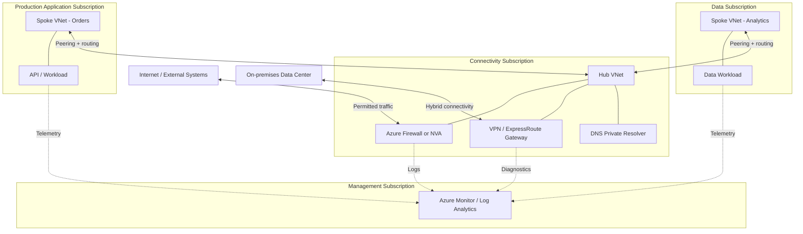
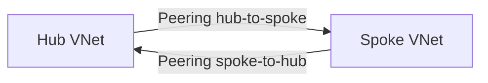
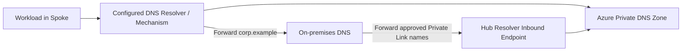

# Designing a Hub-Spoke Network

When first adopting Azure, an application often needs only a single virtual network (VNet) containing a few subnets for virtual machines, containers, or network-integrated services. However, as an enterprise grows across multiple product teams, subscriptions, and dev/test/prod environments, letting every application independently manage its own VPN, firewall, DNS, and Internet egress makes the network difficult to govern. Each application may choose conflicting address spaces, connect to the data center differently, or expose unexpected access paths.

**Hub-spoke** is an Azure network architecture pattern in which one or more **hub VNets** provide centralized connectivity and shared network services, while **spoke VNets** host individual applications or business-unit workloads. Connectivity from spokes to the hub typically uses **VNet peering**; routing and security policies govern where traffic is allowed to flow. Hub-spoke is especially valuable when an organization needs hybrid connectivity to on-premises, centralized traffic inspection, clear separation of operational duties, and scalable workload onboarding.

This lesson belongs to the **Virtual Networks and Name Resolution** chapter of the **CLOUD_PROVIDERS_AZURE** module. This knowledge builds directly on subscriptions, resource groups, and Microsoft Entra ID to design networks for virtual machines, applications, storage, and data, while addressing deployment, monitoring, security, and cost across the overall Azure architecture.

After this lesson, you will be able to:

- Distinguish between hub, spoke, peering, subnets, route tables, Network Security Groups, and firewalls.
- Plan IP addresses, subscriptions, and ownership boundaries for a multi-workload system.
- Trace **north-south** (ingress/egress), **east-west** (workload-to-workload), and hybrid (Azure ↔ on-premises) traffic flows.
- Explain why VNet peering does not automatically provide transitive connectivity between spokes, and when UDRs or gateway transit are required.
- Design DNS and Private Endpoints so applications access PaaS services over private paths.
- Apply deployment, testing, monitoring, resiliency, and cost-optimization practices for hub-spoke topologies.

## 1. What Problems Does Hub-Spoke Solve?

Suppose a company operates three workloads: an order system, a data analytics platform, and an internal HR portal. All three need access to shared services or systems in the data center. If each workload deploys its own gateway, DNS server, and firewall, the organization ends up operating three redundant infrastructure stacks, struggling to keep policies consistent and correlate traffic across systems.

In a hub-spoke model, the platform team operates shared services in the hub while individual application teams manage their own spokes. New connectivity becomes an explicit, intentional decision: which applications may talk to which, over what path, and under what policy.

| Component | Typical Responsibility | Who Usually Manages It? |
|---|---|---|
| **Hub VNet** | Central connectivity, firewall, VPN/ExpressRoute gateway, DNS resolver, management tooling | Platform/network team |
| **Spoke VNet** | Subnets and network resources for apps, VMs, AKS, or PaaS integration points | Application teams within assigned scope |
| **VNet peering** | Connectivity between VNets across Azure infrastructure | Requires coordinated permissions on both sides |
| **Route table / UDR** | Specifies next hops for specific traffic types | Network team, in coordination with workload teams |
| **NSG** | Filters traffic entering/leaving subnets or network interfaces by rule | Network or workload owners |
| **Azure Firewall/NVA** | Inspects, logs, and controls traffic passing through a central enforcement point | Platform/security team |

**Benefits:** reuse of connectivity infrastructure, separation of duties, consistent security policy enforcement, centralized IP management, and unified monitoring. **Trade-offs:** careful routing and DNS design is required, spokes depend on the hub, and central firewalls or gateways can generate substantial costs or become a shared blast radius if resiliency is neglected.

Hub-spoke is one architectural option. Small systems with only two VNets can use direct peering. Global networks spanning many branch offices may fit Azure Virtual WAN better. Base the decision on network count, connectivity model, inspection requirements, and operational capacity.

## 2. Reference Diagram and Flow Roles

The example below places shared resources in a **Connectivity subscription**, while the two applications reside in separate subscriptions. A Management subscription can receive logs and alerts; it does not need to host the hub VNet.



The diagram is logical—it does not guarantee every packet traverses the firewall. **Peering provides only network connectivity**; to force specific flows through the firewall, you must configure routing on the appropriate subnets and ensure firewall rules allow those flows. Real-world Internet ingress often enters through Azure Front Door, Application Gateway/WAF, or service-specific endpoints rather than Azure Firewall. Always map exact ingress and egress paths per application instead of inferring security from a single generic arrow.

### Three Traffic Categories to Design

| Flow | Example | Decisions Required |
|---|---|---|
| **North-south** | API calling the Internet, users accessing a web app | Public entry points, WAF, TLS, egress, NAT, logging, and routes |
| **East-west** | Spoke A API calling Spoke B service | Should spokes communicate? Must traffic traverse the firewall? Is API auth enforced? |
| **Hybrid** | Azure app reaching an on-premises database | VPN/ExpressRoute, gateway transit, BGP/UDRs, bidirectional DNS, return paths |

Document **source, destination, protocol, port, next hop, access controls, and owner** for every business flow. A clean hub-spoke diagram is incomplete unless it answers those questions.

## 3. Subscription Organization and Governance

A common Azure landing zone structure organizes subscriptions as follows:

- **Platform / Connectivity:** hosts the hub VNet, gateways, firewalls, DNS resolvers, and shared network infrastructure. The networking team governs changes here.
- **Landing zones / Corp or Online:** hosts spoke VNets and application workloads; product teams receive scoped permissions within their own subscriptions or resource groups.
- **Platform / Management:** hosts shared monitoring resources if the organization adopts centralized log collection.

VNet peering can connect VNets across different subscriptions when configuration and permissions are satisfied. If two subscriptions belong to different Microsoft Entra tenants, follow appropriate cross-tenant authentication and authorization procedures; do not treat cross-tenant identical to same-tenant. Each peering is a configuration resource on its owning VNet side.

Enforce least privilege: application teams may create subnets or network interfaces within approved limits, without needing permissions to alter central firewalls or gateways. Network teams require appropriate permissions on involved VNets to create peerings, attach route tables, and manage policies. Manage role assignments via Microsoft Entra groups and track changes via Azure Activity Log.

Subscription boundaries are valuable for governance and cost allocation, but they do not isolate network traffic once peerings and connectivity paths are opened. Actual traffic enforcement still depends on routing, NSGs/firewalls, and application authentication.

## 4. IP Address Planning Before Creating VNets

**Address spaces must not overlap** across VNets slated for peering or on-premises networks to be connected. This is painful to fix once databases, VMs, and private endpoints are deployed. Maintain a central IP/CIDR registry, reserve headroom for future spokes, and allocate ranges by environment, region, and application boundary.

Example plan for a single deployment region:

| Scope | Illustrative CIDR | Purpose |
|---|---|---|
| Hub VNet | `10.40.0.0/16` | Platform network with room for gateway/firewall/DNS |
| Production Orders spoke | `10.41.0.0/16` | Production applications and data |
| Analytics spoke | `10.42.0.0/16` | Private data services |
| Development spoke | `10.43.0.0/16` | Development environment with separate policies |
| On-premises data center | `172.20.0.0/16` | Corporate network; coordinate with existing network team |

Sample hub subnetting:

| Subnet in `10.40.0.0/16` | Illustrative CIDR | Notes |
|---|---|---|
| `GatewaySubnet` | `10.40.0.0/27` | Reserved name for virtual network gateways; size per gateway SKU and growth plan |
| `AzureFirewallSubnet` | `10.40.0.64/26` | Mandatory subnet name and minimum `/26` when deploying Azure Firewall in a VNet hub |
| `AzureBastionSubnet` | `10.40.0.128/26` | Dedicated subnet for Azure Bastion if used, per SKU/deployment requirements |
| `snet-dns-in` | `10.40.1.0/28` | Subnet for DNS Private Resolver inbound endpoint, requiring appropriate delegation |
| `snet-dns-out` | `10.40.1.16/28` | Separate subnet for outbound endpoint, requiring appropriate delegation |
| `snet-shared` | `10.40.2.0/24` | Shared resources not requiring dedicated subnets |

A production spoke might contain `snet-web=10.41.0.0/24`, `snet-api=10.41.1.0/24`, `snet-private-endpoint=10.41.2.0/27`, plus additional subnets as required. If App Service uses regional VNet integration, reserve a dedicated delegated subnet per service specifications; do not place private endpoints inside an App Service outbound integration subnet. If AKS uses Azure CNI or another specific IP mode, estimate IPs for nodes, pods, and upgrade surges based on the chosen network model.

IP allocation guidelines:

1. Azure reserves addresses in every subnet for platform functions; never count the full CIDR total as workload-assignable IPs.
2. Some services mandate exact subnet names, minimum sizes, or dedicated **subnet delegation**. Check service-version constraints before finalizing diagrams.
3. Do not reflexively assign `10.0.0.0/16`; cross-check against all on-premises sites, other clouds/VNets, and expansion plans.
4. Do not encroach on spoke IP space for ad-hoc hub growth; treat address allocation as a finite resource.
5. Decide the **region** for each VNet upfront, since latency, data transfer charges, service availability, and disaster recovery depend on geography.

## 5. Connecting VNets with Peering

**VNet peering** lets VNets communicate over Azure's network backbone without deploying a VPN gateway solely for that link. Peering works for VNets in the same region or across supported regions. The non-overlapping address rule always applies.

Between a hub and a spoke, configure both sides symmetrically:



Key peering settings to understand:

| Setting | Effect | When to Use |
|---|---|---|
| `Allow virtual network access` | Allows connectivity between the address spaces of the peered VNets | Usually enabled when traffic exchange is needed |
| `Allow forwarded traffic` | Accepts traffic forwarded from outside the peer VNet via a routing/virtual appliance | When a hub firewall/NVA acts as an intermediary forwarding traffic between spokes or other networks |
| `Allow gateway transit` | Lets the peer VNet use this VNet's gateway when supported conditions are met | On the hub side hosting a gateway that spokes need to share |
| `Use remote gateways` | Instructs this VNet to use the peered VNet's gateway | On the spoke side in a valid gateway transit design |

**Peering does not automatically transit through a third network.** If Spoke A peers with Hub and Spoke B also peers with Hub, A does not automatically connect to B through the hub. To route A ↔ B through the hub, you need a forwarding appliance such as Azure Firewall/NVA plus routing on both sides. `Allow forwarded traffic` enables this pattern, but does not automatically create routes or firewall rules. If A must connect directly to B, consider direct spoke-to-spoke peering while weighing inspection needs and link management overhead.

For hybrid access, **gateway transit** lets spokes use a hub VPN/ExpressRoute gateway when peering, gateway, and routing designs meet requirements. `Use remote gateways` carries constraints—for instance, a VNet cannot arbitrarily use multiple remote gateways simultaneously and conflicts if the spoke already deploys its own gateway. Verify exact region, SKU, and connectivity support before configuring.

Peering does not replace application-layer security: two VMs with network reachability still require service authentication and proper data authorization. When validating connectivity, inspect **peering state**, routes, and NSGs/firewalls rather than looking only at the peering list.

## 6. Routing Design: Where Does Traffic Actually Flow?

Many hub-spoke implementations fail because the diagram depicts traffic going “through the firewall,” while actual routing tables send packets directly to the destination. Azure selects routes based on prefix length and route source—combining system routes, BGP routes, and user-defined routes (UDRs). When prefixes match in length, route source precedence applies; longer (more specific) prefixes beat shorter (broader) ones.

**UDRs** live in a route table associated with a subnet. A route can specify `VirtualAppliance` and the private IP of a firewall or NVA as the next hop. Azure Firewall inspects only flows actually routed through it; firewall policy decides whether those flows are allowed or denied. Always design **both forward and return paths** to avoid asymmetry, especially with stateful inspection appliances.

### 6.1. Spoke to Internet via Firewall

If all outbound IPv4 Internet traffic from an application subnet must be centrally inspected, create a `0.0.0.0/0` route pointing to Azure Firewall's private IP. Verify firewall policies, DNS, SNAT, public IPs, platform control-plane traffic, and required exceptions. For PaaS or AKS, traffic passing through VNets and route tables depends on the network integration model; verify how each service handles outbound flows.

```text
API in Spoke → Default UDR → Azure Firewall in Hub → Internet
                    ↑                   ↓
          Subnet route table    Policy / NAT / Logs
```

A default route does not guarantee **every** packet hits the firewall: a more specific route (such as to a peered network or private endpoint) can take precedence. Always check effective routes rather than assuming from a single `0.0.0.0/0` entry.

### 6.2. Spoke A Communicating with Spoke B via Firewall

Suppose A uses `10.41.0.0/16` and B uses `10.42.0.0/16`, with both spokes routing to the hub firewall's private IP:

| Source Subnet | Destination Prefix | Expected Next Hop |
|---|---|---|
| App subnet in A | `10.42.0.0/16` | Private IP of hub firewall/NVA |
| App subnet in B | `10.41.0.0/16` | Private IP of hub firewall/NVA |

Both A ↔ Hub and B ↔ Hub peerings must permit forwarded traffic as designed, firewall policies must allow the flow, and the hub must have routes to both spokes. Routing in the B → A direction must mirror A → B so the stateful firewall sees return traffic. If direct A ↔ B peering also exists, inspect effective routes to confirm traffic does not bypass the firewall.

### 6.3. Spoke Communicating with On-Premises

Typically, a central gateway sits in the hub. Spokes can learn on-premises prefixes via gateway transit/BGP, or the organization can apply UDRs to steer hybrid flows through a hub firewall before reaching the gateway. Coordinate return routes from on-premises back to each spoke's CIDR, firewall rules, any NAT behavior, and gateway forwarding capacity.

For example, a path from an API in `10.41.1.0/24` to an on-premises database at `172.20.10.10` requires a forward route, a return route, DNS resolution, and database port access; merely having a VPN tunnel up in the hub does not prove the API can reach the database.

### 6.4. Where to Apply Routes and How to Verify Effective Routes

- Associate route tables with the workload's **source subnet**, rather than creating orphaned route tables in a subscription.
- Inspect **effective routes** on eligible VM network interfaces and use connectivity diagnostics to confirm next hops. For PaaS services, verify paths according to each service's integration characteristics.
- Exercise extreme caution before modifying routes on `GatewaySubnet`, firewall subnets, or other dedicated infrastructure subnets; services impose strict constraints. Never apply one blanket UDR to every subnet.
- Verify the effects of BGP route propagation, longest-prefix match, and peering system routes.
- Test bidirectional traffic and return flows, including appliance or gateway failover scenarios.

## 7. Designing Network Security Layers

Hub-spoke establishes boundaries, but does not enforce security policy automatically. Security requires defense in depth:

### 7.1. NSGs at the Subnet/Workload Level

Network Security Groups filter supported traffic based on source, destination, port, protocol, and direction. Use NSGs to minimize unnecessary lateral movement within and across subnets. An application subnet might accept HTTPS only from the frontend tier and allow outbound traffic only to approved databases or services, matching actual workload needs.

Never rely solely on a subnet residing in a spoke to allow all traffic freely. Explicitly define permitted flows, craft targeted security rules, and leverage service tags or application security groups where helpful. Understand default NSG rules to avoid unintentionally exposing internal connections.

### 7.2. Central Firewall

Azure Firewall or an NVA provides centralized policy enforcement for egress, spoke-to-spoke, and hybrid transit traffic. Azure Firewall offers different SKUs and capabilities; selection depends on requirements such as application-layer inspection, threat intelligence, logging, throughput, and cost.

Firewall rules should mirror concrete traffic flows. For example:

- `spoke-orders → partner API service`: only required protocols and destinations.
- `spoke-orders → spoke-data`: only approved data API ports.
- `spoke-orders → on-premises`: only specific CIDRs and application ports.
- Flows without a clear business justification must be reviewed and restricted.

Stateful firewalls require symmetric routing. NAT can alter the source IP observed at the destination, so verify partner allowlists and logging expectations. Never assume the firewall inspects all traffic merely because it sits in the hub.

### 7.3. Protecting Entry Points and PaaS Services

For public web applications, enforce HTTPS, authentication, and consider WAF on Azure Front Door or Application Gateway depending on the architecture. When traffic must pass through a WAF, block direct access to the origin whenever the service supports it. DDoS Protection, NSGs, and firewalls address distinct layers and should not be treated as interchangeable.

Azure SQL, Storage, and Key Vault can be configured with **Private Endpoints**, private DNS, and appropriate public network access controls. Creating a private endpoint does not disable the public endpoint by default. You must still enforce data-plane authorization via Microsoft Entra ID, Azure RBAC, or service-native authentication. A private IP does not prove a caller is authorized to read data.

### 7.4. Remote Administration

Avoid exposing VM RDP/SSH directly to the Internet. When administrative access is needed, use Azure Bastion or a governed private management channel as a centralized entry point. Protect privileged accounts with MFA/PIM and audit logs, validating both Azure RBAC permissions and OS-level rights.

## 8. DNS in Hub-Spoke: The Right Name Reaches the Right IP

DNS is frequently why networks with healthy peering and routing still fail at the application level. Especially with Private Endpoints, a service hostname must resolve to a private IP inside the VNet rather than a public IP.

### 8.1. Name Resolution Objectives

The DNS architecture must support all required query directions:

1. Spoke workloads must resolve standard public Internet names.
2. Spoke workloads must resolve Private Endpoint PaaS names to private IPs.
3. Azure workloads must resolve on-premises host and service names over hybrid connections.
4. On-premises machines must resolve Azure Private Endpoint names if policy permits accessing those services.
5. Workloads in two spokes may need to resolve each other's internal names, while actual reachability still depends on routes and network policies.

**VNet peering does not automatically share all DNS records.** Private DNS zone links or DNS forwarder/resolver configurations determine which networks can query a namespace. Returning the right IP from DNS also does not imply TCP connectivity or application authorization is granted.

### 8.2. Azure Private DNS and Private Endpoints

Examples of commonly used private DNS zones:

| Service | Typical Private DNS Zone | Key Consideration |
|---|---|---|
| Azure Blob Storage | `privatelink.blob.core.windows.net` | Storage has multiple subresources; blob, file, and queue use separate zones/endpoints |
| Azure SQL Database | `privatelink.database.windows.net` | Clients must connect using the standard database server hostname |
| Azure Key Vault | `privatelink.vaultcore.azure.net` | Vault hostname must resolve to the approved private endpoint's IP |

Exact zone names depend on service, cloud environment, and subresource; follow guidance for the specific service in use. When provisioning a Private Endpoint, a **private DNS zone group** can help manage DNS records automatically where supported. Always verify zone links and DNS resolution across every calling network.

In a straightforward single-region model, organizations often centralize private DNS zones in the platform subscription and link them to querying spoke VNets. In complex hybrid topologies, centralized resolvers and conditional forwarding are typically easier to govern. Avoid creating duplicate zones with the same name containing inconsistent records that return wrong IPs to clients.

### 8.3. Azure DNS Private Resolver

Azure DNS Private Resolver is a managed service that addresses hybrid DNS needs without running self-managed DNS forwarder VMs. Depending on topology, it provides:

- **Inbound endpoint:** supplies a private IP where on-premises or connected DNS servers forward queries into Azure according to routing rules.
- **Outbound endpoint:** forwards DNS queries from Azure out to target DNS servers via a DNS forwarding ruleset.
- **DNS forwarding ruleset:** holds domain-suffix rules and target DNS servers; can be linked to supported VNets.

Inbound and outbound endpoints require dedicated, appropriately delegated subnets per service specifications. Endpoint IPs, routing, firewalls, UDP/TCP port 53, and DNS governance must all be designed together.

Example DNS flows:



This is a logical model: a DNS query may traverse Azure-provided DNS, custom DNS servers, or Private Resolver depending on VNet DNS settings. Never configure forwarding loops—for example, on-premises DNS forwarding `corp.example` to Azure while Azure forwards that same domain back on-premises. With private DNS zones, always test link and resolver behavior rather than guessing from resource placement.

### 8.4. DNS Troubleshooting Workflow

When an application cannot reach `myvault.vault.azure.net` or a database:

1. Check the exact FQDN used by the application; do not replace it with a hardcoded private IP in a connection string.
2. From the workload's actual environment, run `nslookup` or an equivalent tool to see the returned IP.
3. Identify which resolver the client uses and whether matching forwarding rules or zone links exist.
4. Inspect the `A` record, private endpoint, and Private Link connection state.
5. Check routes, NSGs/firewalls, TLS, and service authentication; accurate DNS only solves address lookup.

## 9. Hybrid Connectivity via VPN or ExpressRoute

To connect Azure workloads with corporate data center systems, the hub normally terminates hybrid connectivity. Two common options:

- **Site-to-site VPN:** IPsec tunnels over the public Internet, fitting many enterprise scenarios with corresponding cost and operational profiles.
- **ExpressRoute:** private connectivity via an approved connectivity provider, suited to enterprise throughput, predictability, and reliability needs. ExpressRoute does not automatically encrypt traffic end-to-end; evaluate application-layer encryption or complementary mechanisms as required.

Before selecting a gateway, define bandwidth, connection count, latency, SLA, region, redundancy, cost, and carrier partner requirements. A gateway in the hub does not automatically give every spoke access to on-premises. Verify gateway transit, BGP advertisements, route tables, allow forwarded traffic when an NVA/firewall sits inline, and return paths.

### Hybrid Routing Checklist

| Question | Why It Matters |
|---|---|
| Do on-premises CIDRs overlap Azure CIDRs? | Overlaps create ambiguous routing and usually block direct connectivity |
| Does on-premises have routes back to each spoke? | Forward routes without return routes cause connections to fail |
| Does the firewall see both traffic directions? | Stateful firewalls require consistent bidirectional flow visibility |
| Is bidirectional DNS designed? | Internal names or Private Endpoints may fail to resolve |
| Are bandwidth and redundancy sufficient? | Prevents a single link from becoming a shared failure point |
| Who approves permitted ports? | Hybrid links expand attack surface across both environments |

In architectures combining ExpressRoute with VPN backup or multiple sites, test path preference, BGP behavior, and failover scenarios. Never rely solely on a single ping test: ICMP may be blocked even while applications work, or ping may succeed while upper-layer traffic is rejected.

## 10. Classic Hub-Spoke or Azure Virtual WAN?

Azure supports multiple ways to build centralized connectivity. Evaluate early to avoid building a large network on an ill-fitting foundation.

| Criterion | Classic Hub-Spoke VNet | Azure Virtual WAN |
|---|---|---|
| Core component | Organization-designed hub VNet running gateway/firewall/NVA | Service-managed Virtual WAN and virtual hub per service model |
| Routing control | Peerings, route tables, gateways, and appliances configured by the network team | Virtual hub connections, route tables, and routing intent policies |
| Best suited for | Small-to-moderate hub counts needing deep custom network control | Many branches/regions requiring large-scale managed WAN connectivity |
| Security | Enforced via firewalls/NVAs, NSGs, UDRs, and WAF per flow | Supports secured virtual hubs within service capabilities |
| Cost and operations | Hub resource, peering, and traffic costs; network team manages fine details | Hub/connection/data processing fees and managed service operations; evaluate TCO |

Azure Virtual WAN is not merely a renamed hub VNet. When choosing a service, review detailed routing capabilities, security integrations, ExpressRoute/VPN behavior, constraints, and workload needs. Do not blindly apply classic hub-spoke peering/UDR commands to Virtual WAN.

## 11. Scalability, Availability, and Multi-Region Design

Because the hub serves many spokes, it can become a **shared failure domain**. A misconfigured firewall, failed DNS service, or dropped gateway can simultaneously disrupt multiple applications.

Design considerations:

1. **Availability Zones:** select SKUs and zone-redundant configurations supported by each service and region. Do not assume all SKUs support identical zone redundancy.
2. **Capacity and throughput:** estimate firewall throughput, concurrent sessions, east-west traffic, hybrid volume, and egress. Monitor gateway bandwidth and subnet IP consumption.
3. **Multi-region:** consider deploying a local hub and spokes per region, interconnecting hubs per design. Forcing all regions through a single hub adds latency and creates regional coupling.
4. **DNS resiliency:** map dependencies on resolvers, forwarders, private DNS, and on-premises links; test failure of a DNS path.
5. **Change discipline:** validate route and firewall changes before broad rollout; maintain rollback plans and controlled maintenance windows.
6. **Recovery drills:** test real behavior when a gateway, firewall, or region becomes unavailable. Measure detection, rerouting, and workload recovery times.

In multi-region topologies, you might deploy `hub-sea` and `hub-ea` with local spokes. Avoid blindly peering every hub and spoke into a full mesh; explicitly define which flows cross regions, their next hops, and cross-region data transfer costs.

## 12. Basic Deployment Example Using Azure CLI

This section builds a foundational skeleton of **one hub VNet and one spoke VNet across two subscriptions**, connected via bidirectional peering. It does not yet deploy Azure Firewall, gateways, DNS Private Resolver, or Private Endpoints, allowing you to validate base VNet connectivity before adding advanced routing.

**Prerequisites:** two test subscriptions, an account with permissions to create resource groups/VNets and peerings in both subscriptions, Azure CLI installed, and assurance that the example CIDRs do not conflict with connected networks. Creating VNets, peerings, and additional services may incur charges depending on configuration and traffic. Run commands in an authorized test environment and replace sample values with real subscription IDs.

### 12.1. Declare Variables

Example using Bash or Azure Cloud Shell in Bash mode:

```bash
az login

HUB_SUBSCRIPTION_ID="11111111-1111-1111-1111-111111111111"
APP_SUBSCRIPTION_ID="22222222-2222-2222-2222-222222222222"
LOCATION="southeastasia"

HUB_RG="rg-network-hub-demo"
HUB_VNET="vnet-hub-demo"
SPOKE_RG="rg-orders-spoke-demo"
SPOKE_VNET="vnet-orders-demo"

# The IDs above illustrate format only; replace before running.
```

### 12.2. Create the Hub VNet

```bash
az account set --subscription "$HUB_SUBSCRIPTION_ID"

az group create \
  --name "$HUB_RG" \
  --location "$LOCATION"

az network vnet create \
  --resource-group "$HUB_RG" \
  --name "$HUB_VNET" \
  --location "$LOCATION" \
  --address-prefixes "10.40.0.0/16" \
  --subnet-name "snet-shared" \
  --subnet-prefixes "10.40.2.0/24"

HUB_ID=$(az network vnet show \
  --resource-group "$HUB_RG" \
  --name "$HUB_VNET" \
  --query id -o tsv)
```

Only `snet-shared` is created here to test peering; dedicated subnets like `AzureFirewallSubnet` should be added separately when actually deploying those services and verifying their constraints.

### 12.3. Create the Spoke VNet

```bash
az account set --subscription "$APP_SUBSCRIPTION_ID"

az group create \
  --name "$SPOKE_RG" \
  --location "$LOCATION"

az network vnet create \
  --resource-group "$SPOKE_RG" \
  --name "$SPOKE_VNET" \
  --location "$LOCATION" \
  --address-prefixes "10.41.0.0/16" \
  --subnet-name "snet-app" \
  --subnet-prefixes "10.41.1.0/24"

SPOKE_ID=$(az network vnet show \
  --resource-group "$SPOKE_RG" \
  --name "$SPOKE_VNET" \
  --query id -o tsv)
```

### 12.4. Create Bidirectional Peering

```bash
# Peering from hub to spoke
az account set --subscription "$HUB_SUBSCRIPTION_ID"

az network vnet peering create \
  --resource-group "$HUB_RG" \
  --vnet-name "$HUB_VNET" \
  --name "hub-to-orders" \
  --remote-vnet "$SPOKE_ID" \
  --allow-vnet-access

# Peering from spoke back to hub
az account set --subscription "$APP_SUBSCRIPTION_ID"

az network vnet peering create \
  --resource-group "$SPOKE_RG" \
  --vnet-name "$SPOKE_VNET" \
  --name "orders-to-hub" \
  --remote-vnet "$HUB_ID" \
  --allow-vnet-access
```

These commands do **not** enable gateway transit or route traffic through a firewall, since this demo has no gateway or firewall yet. When adding a firewall as an inline forwarder, adjust peering flags and routing intentionally; avoid copying `--allow-forwarded-traffic` onto every link without verifying actual forwarding flows.

### 12.5. Inspect Peering Status

```bash
az account set --subscription "$HUB_SUBSCRIPTION_ID"
az network vnet peering list \
  --resource-group "$HUB_RG" \
  --vnet-name "$HUB_VNET" \
  --query "[].{name:name, state:peeringState, remote:remoteVirtualNetwork.id}" \
  --output table

az account set --subscription "$APP_SUBSCRIPTION_ID"
az network vnet peering list \
  --resource-group "$SPOKE_RG" \
  --vnet-name "$SPOKE_VNET" \
  --query "[].{name:name, state:peeringState, remote:remoteVirtualNetwork.id}" \
  --output table
```

When both sides are properly configured, the state will show `Connected`. This confirms peering is established, but **does not prove application connections will succeed**. End-to-end verification requires test endpoints/VMs, routes, and network rules. This example omits creating VMs to avoid unnecessary costs and setup beyond scope.

### 12.6. Example Routing Through Azure Firewall (Only After Firewall Exists)

The following is a **separate** step performed after Azure Firewall is deployed in the hub, has a private IP, and has policies plus return paths configured. Never use a placeholder as a live IP.

```bash
az account set --subscription "$APP_SUBSCRIPTION_ID"
FW_PRIVATE_IP="10.40.0.68"  # Illustrative value; replace with actual IP

az network route-table create \
  --resource-group "$SPOKE_RG" \
  --name "rt-orders-egress" \
  --location "$LOCATION"

az network route-table route create \
  --resource-group "$SPOKE_RG" \
  --route-table-name "rt-orders-egress" \
  --name "default-via-firewall" \
  --address-prefix "0.0.0.0/0" \
  --next-hop-type VirtualAppliance \
  --next-hop-ip-address "$FW_PRIVATE_IP"

# Attach only to verified application subnets
az network vnet subnet update \
  --resource-group "$SPOKE_RG" \
  --vnet-name "$SPOKE_VNET" \
  --name "snet-app" \
  --route-table "rt-orders-egress"
```

Before attaching the route table, ensure the firewall can forward traffic and route back to the spoke, policies permit intended destinations, DNS works, and workload management flows are preserved. A default route alters egress paths and the source IP seen by external services; test in a proper environment and keep a rollback ready.

## 13. Connectivity Testing and Troubleshooting

Deployment success does not equal complete testing. A verification matrix should include both **allowed** connections and connections that **must be blocked**.

| Test Case | Expected Outcome | If It Fails, Check |
|---|---|---|
| Spoke VM/API connects to permitted hub resource | Succeeds over peering | Bidirectional peering, CIDRs, routes, NSGs, host firewall |
| Spoke A calls Spoke B API via firewall | Only permitted ports/targets pass | Bidirectional UDRs, forwarded traffic, firewall policy, return path |
| Spoke reaches on-premises service | Connects on right port via hybrid link | Gateway/BGP, UDRs, firewall, return route to spoke, DNS |
| Workload uses Private Endpoint for Storage/SQL/Key Vault | Hostname resolves to private IP, auth succeeds | Zone links, resolver, endpoint, public access, data-plane RBAC |
| Unauthorized machine hits VM management port | Denied | NSG rules, public IP, Bastion, routes, host firewall |
| Spoke API reaches Internet via egress firewall | Source IP and logs match design | Effective routes, NAT, firewall policy, DNS, PaaS outbound config |

Step-by-step investigation workflow for a connectivity failure:

1. **Identify source and target:** service name, IP, port/protocol, subscription, VNet, subnet, and timestamp.
2. **Check DNS:** does the name resolve to the expected IP? Is a Private Endpoint resolving to a public IP?
3. **Check next hop:** does the source have a route to the target; do packets travel directly or via firewall/gateway?
4. **Check policies:** are NSGs, Azure Firewall/NVA, host firewall, WAF, or service permissions blocking it?
5. **Check return path:** does the target have a route back to the source? Is NAT or asymmetric routing occurring?
6. **Check identity:** if network connectivity succeeds yet the API returns `401/403`, inspect tokens, RBAC, database permissions, or app roles.
7. **Correlate logs:** combine network logs, Activity Logs, application logs, and tests from the actual workload to isolate root cause.

Helpful Azure tools include **Network Watcher**, Connection troubleshoot, effective security rules/route tables (when supported), Azure Firewall logs, Azure Monitor, and Log Analytics. Do not assume one tool behaves identically across VMs, AKS, and every PaaS service: choose diagnostics suited to the resource's connectivity model.

## 14. Monitoring, Governance, and Cost Management

### 14.1. Network Observability

Centralized resources requiring ongoing monitoring include gateways, firewalls, DNS resolvers, hub peerings, network interfaces, workloads, and sensitive endpoints. Key signals to track:

- Health and throughput on gateways/hybrid circuits; route flaps or tunnel disconnects.
- Firewall traffic metrics, denied destinations, session counts, and alerts.
- Changes to route tables, peerings, NSGs, private endpoints, and DNS zones/forwarding rulesets.
- Latency, connection errors, and application request failure rates after network changes.
- Remaining subnet IP capacity and hub/spoke expansion headroom.

Activity Logs track control-plane resource modifications; Azure Monitor and Log Analytics collect metrics and diagnostic logs once configured. Store logs at an appropriate scope, restrict read access, control retention, and watch ingestion costs; avoid logging sensitive payloads unnecessarily.

### 14.2. Configuration Control with Azure Policy and IaC

Across multiple subscriptions, manage shared infrastructure with Bicep, ARM templates, or Terraform and review changes before deployment. Azure Policy can audit or enforce allowed regions, network exposure, tagging, or diagnostic settings depending on policy capabilities. Standardized documentation should capture:

- Allocated CIDRs, owners, and reservations for new workloads.
- Naming conventions for VNets, subnets, peerings, and route tables.
- Policies for creating peerings, opening firewall ports, and accessing on-premises.
- UDR rollout processes and exception approval workflows.
- Processes for provisioning Private Endpoints and updating private DNS cleanly.
- Monitoring metrics, runbooks, and incident response teams.

Never flip policies from `Audit` to `Deny` at broad scope without testing impact on live workloads. Policies assigned at a management group cascade down to multiple subscriptions; govern changes at the right level.

### 14.3. Costs of a Hub-Spoke Network

Common cost drivers:

| Cost Category | What to Estimate |
|---|---|
| Firewall/NVA | Resource charges, data processing, scale, and selected SKU features |
| VPN/ExpressRoute | Gateways, connections/circuits, and traffic per billing model |
| VNet peering | Cross-peering data transfer and regional/cross-region rate differences |
| Azure Private Link | Private endpoints and data processed per service pricing |
| DNS Private Resolver | Endpoints and query/traffic volume per configuration |
| Monitoring | Log ingestion, retention duration, alerts, and analytics tooling |

Building a central hub does not automatically lower total costs. Forcing every spoke-to-spoke flow through a firewall increases data processing fees, latency, and hub dependency. Estimate costs based on actual packet paths and traffic volume rather than simply counting VNets. For high-volume traffic between two applications, weigh the trade-off between controlled direct peering and centralized firewall inspection.

Apply tags such as `owner`, `environment`, `application`, and `costCenter`; define how hub costs are allocated across teams; track trends in Azure Cost Management; and configure budget alerts. **Budgets are alerts, not hard spending caps.** When practicing in labs, delete unused test resources promptly and verify billable items like gateways, firewalls, or public IPs are cleaned up.

## 15. Common Design Mistakes

| Mistake | Consequence | Fix |
|---|---|---|
| Hub, spoke, or on-premises CIDRs overlap | Peering or routing fails to work as intended | Centralize IP planning before creating networks |
| Assuming hub peering connects all spokes together | Spoke A has no transit path to B | Design NVA/firewall + bidirectional UDRs or controlled direct peering |
| Adding only `0.0.0.0/0` UDR and assuming all traffic hits firewall | More specific routes take alternate paths | Inspect effective routes per destination and service tier |
| Forgetting return routes from Spoke B/on-premises | Connections time out or stateful firewall drops packets | Verify bidirectional routing and NAT behavior |
| Enabling forwarded traffic without routes/firewall rules | No forwarding path or permitted policy exists | Configure complete routes, peerings, and policies |
| Creating a Private Endpoint while DNS still resolves public IP | Apps hit wrong target or fail to connect | Design private DNS zones, links, and conditional forwarding |
| Assuming creating a Private Endpoint disables public access | Service may remain publicly reachable | Verify public network access settings on each service |
| Placing gateway/firewall in an undersized or misnamed subnet | Deployment fails or cannot scale | Follow exact service subnet naming and minimum CIDR rules |
| Forcing all traffic through firewall without capacity planning | Increased cost, latency, congestion, and blast radius | Identify flows requiring inspection and size for real load |
| Testing only ping between two VMs | Misses DNS, TLS, app permissions, or port issues | Test end-to-end business flows |

## 16. Design Scenario: Enterprise with Two Applications and a Data Center

**Prompt:** An enterprise deploys an order API in Azure, a data analytics platform in a separate subscription, and retains an ERP system in its data center. Requirements:

- Employees access the application over HTTPS; the API may need to call the ERP.
- The analytics platform reads data only from approved APIs/sources.
- The development spoke must not freely access production databases.
- Control Internet egress, minimize public exposure of SQL/Storage/Key Vault, and centralize logs.

**Reference Approach:**

1. Create a **hub VNet** in the Connectivity subscription with dedicated CIDR `10.40.0.0/16`.
2. Create **spoke-orders** `10.41.0.0/16`, **spoke-data** `10.42.0.0/16`, and **spoke-dev** `10.43.0.0/16`, each with its own owner and governance scope.
3. Configure bidirectional peering between each spoke and the hub; enable forwarded traffic where intermediate appliances forward traffic.
4. Place the VPN/ExpressRoute gateway in the hub. Configure gateway transit/routing so the API can reach the ERP; coordinate return routes from the data center.
5. Deploy Azure Firewall/NVA in the hub with appropriate UDRs for egress and centrally inspected flows between orders and data. Restrict dev-to-production traffic by default, opening only approved exceptions.
6. Provision Private Endpoints for eligible PaaS services, managing DNS zones and Private Resolver for Azure and on-premises queries.
7. Enforce HTTPS/WAF on public entry points, managed identities for data access, and least-privilege RBAC.
8. Stream firewall/gateway logs and configuration changes to centralized monitoring; alert on DNS errors, hybrid outages, and sensitive route changes.

**Example Traffic Flow Matrix** (ports are illustrative; confirm per application):

| Source | Destination | Port/Protocol | Decision |
|---|---|---|---|
| Internet users | Orders website edge | TCP 443 | Allow via HTTPS/WAF and app authentication |
| Orders API | On-premises ERP | TCP 443 | Allow over hybrid link per firewall policy; ensure return route |
| Data workload | Orders API | TCP 443 | Allow only approved identities/endpoints |
| Dev workload | Production SQL | TCP 1433 | Deny by default unless explicitly approved |
| Orders API | Key Vault private endpoint | TCP 443 | Allow network path plus data-plane auth/RBAC |
| Unapproved workload | Production VM management ports | TCP 22/3389 | Deny; use dedicated management channel when needed |

**Review questions:** If the central firewall becomes unavailable, which flows stop? If the ERP changes IP, must DNS, routes, or both be updated? If one spoke peers directly with another spoke, does that violate inspection requirements? Answer these questions before going to production.

## 17. Self-Design Hands-On Exercise

Design a hub-spoke topology for three workloads: production web, internal system, and development environment; each workload has its own subscription and must share centralized DNS and monitoring services. The company also operates a data center using `172.20.0.0/16`.

1. Diagram the hub, three spokes, firewall, gateway, DNS, and paths for all three traffic categories.
2. Assign distinct CIDRs for hub and spokes, divide necessary subnets, and prove ranges do not overlap.
3. Specify all **bidirectional** peerings needed and which flags are enabled per requirement.
4. Build a UDR table for egress, inspected spoke-to-spoke, and ERP access; explain return paths.
5. Design DNS for a Key Vault private endpoint and on-premises hostname `erp.corp.example`.
6. Propose NSG/firewall rules for both allowed and denied flows.
7. Build a test plan of at least six flows, including one expected-deny case and one misconfigured-DNS case.
8. Assess the hub's shared blast radius, failure observability, and primary cost drivers.

**Completion criteria:** You can explain why packets follow a chosen route, whether the firewall truly sees both directions, which IP DNS returns, who holds rights to edit shared infrastructure, and which tests verify compliance. The design document should be clear enough for another engineer to deploy and validate independently.

## 18. Key Takeaways

Designing a hub-spoke network on Azure begins with **splitting responsibilities and planning IP addressing**, followed by defining peering, routing, security, and DNS per business flow. **Peering is not automatically transitive**: spoke-to-spoke or spoke-to-on-premises connectivity requires explicit forwarding/gateway setup, routes, and security controls. **Azure Firewall inspects only traffic routed through it**; UDRs must attach to the right subnets and return paths must remain symmetric. **Private Endpoints do not replace DNS, data authorization, or disabling public network access**. Finally, verify bidirectional connectivity, monitor costs, and engineer high availability into the hub because it serves as shared infrastructure for many applications.
