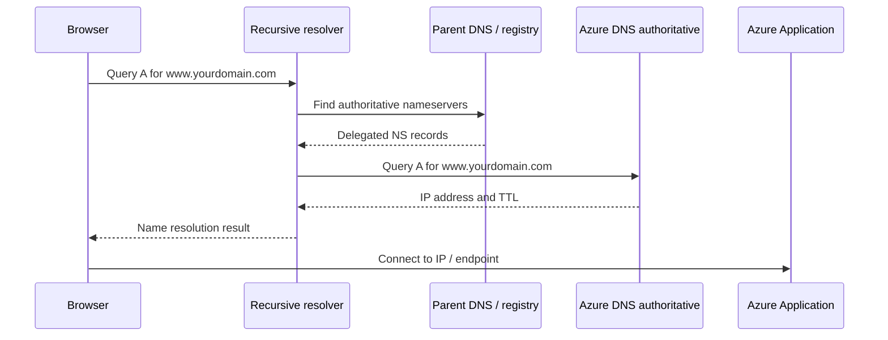

# Azure DNS and Public DNS Zone Management

A website may run reliably on Azure App Service, an API may be deployed on virtual machines, and an application may be protected by Azure Front Door. Yet users can only reach those services via a custom domain when DNS is configured properly. A wrong record, a missing nameserver delegation step, or an unplanned DNS change can take down a website or email even while servers and applications remain healthy.

In the `CLOUD_PROVIDERS_AZURE` module, you explore Microsoft Azure from subscriptions, resource groups, and Microsoft Entra ID through virtual networks, compute, storage, data, monitoring, security, and cost. This lesson belongs to the **Virtual Networks and Name Resolution** chapter, focusing on **Azure DNS** as a managed public DNS service, how to create DNS zones, manage records, delegate domains, and verify name resolution paths in real-world operations.

## 1. Learning Objectives

After this lesson, you will be able to:

- Explain the roles of authoritative DNS, recursive DNS resolvers, and public DNS zones.
- Distinguish between domain registration and DNS hosting on Azure.
- Create and manage public DNS zones and record sets via the Azure portal and Azure CLI.
- Delegate a domain from a registrar using the nameservers provided by Azure DNS.
- Choose the right record types (`A`, `AAAA`, `CNAME`, `MX`, `TXT`, `CAA`, `NS`) and understand TTL.
- Design safe DNS cutovers, troubleshoot name resolution failures, and govern change permissions.
- Recognize when Azure Private DNS is needed instead of public DNS.

## 2. What Problem Does DNS Solve?

The **Domain Name System (DNS)** maps human-readable names like `www.example.com` to information needed by applications, browsers, or services—typically IPv4/IPv6 addresses or another target hostname. DNS is organized hierarchically and uses typed records.

When a user visits a website:

1. The application queries a **recursive resolver** (the OS, ISP, or DNS provider's resolver).
2. If no valid cached answer exists, the resolver locates the authoritative servers for the domain through the DNS hierarchy.
3. The **authoritative nameserver** for the DNS zone holds the requested record and answers the resolver.
4. The resolver caches the answer per its TTL and returns it to the application; the browser then connects to the specified endpoint.



The diagram illustrates queries made by a resolver when **no cached entry exists**; in practice, resolvers may obtain delegation across multiple levels or serve cached responses.

### What Does Azure DNS Provide?

**Azure DNS** hosts DNS zones and answers authoritative DNS queries across Azure's distributed infrastructure. You manage zones and record sets via Azure Resource Manager, Azure portal, Azure CLI, PowerShell, or APIs; configuration access is governed by Azure RBAC.

Key distinctions:

- **Domain registrar:** where an organization registers, renews, manages ownership, and changes nameservers for a domain.
- **Azure DNS public zone:** where authoritative DNS records are hosted for a domain delegated to Azure.
- **Recursive resolver:** the system that queries and caches answers on behalf of applications; public Azure DNS is an authoritative service, not a public recursive DNS resolver to configure on clients.
- **Target service:** App Service, VMs, Azure Front Door, or another service actually serving HTTP, APIs, email, etc.

Azure DNS **does not register domains for you**, deploy websites, or issue HTTPS certificates merely because a DNS record exists. A domain must be validly registered and managed at a registrar; to host DNS on Azure, you must also update delegation.

## 3. Public DNS Zones and Record Structure

A **DNS zone** is a collection of authoritative records within a branch of the namespace. For instance, the `example.com` zone may contain `www.example.com`, `api.example.com`, `mail.example.com`, and other child names. Public zones are designed to answer DNS queries from the Internet.

In Azure, a zone is a resource inside a subscription and resource group managed through Azure Resource Manager. Public DNS data is served by Azure's global nameservers; do not assume a public zone only answers queries in the region where its resource group lives.

### Relative Names vs. Fully Qualified Names

In interfaces or commands managing the `example.com` zone:

| Record-set name | Corresponding FQDN | Meaning |
|---|---|---|
| `@` | `example.com` | Zone apex / root domain |
| `www` | `www.example.com` | Website |
| `api` | `api.example.com` | API |
| `_acme-challenge.www` | `_acme-challenge.www.example.com` | Example name used for domain validation |

`FQDN` stands for *fully qualified domain name*. In DNS wire format and tools like `dig`, a trailing dot (`www.example.com.`) denotes an absolute name; some tools/UIs automatically append the zone suffix when you enter a relative name.

### What Is a Record Set?

A **record set** is a collection of one or more records sharing the same **name** and **type** within a zone. For example, `www` may have an `A` record set containing multiple IPv4 addresses. TTL is configured at the **record-set level** in Azure DNS, so all records in the same record set share the same TTL. Having multiple `A` values returns multiple addresses to resolvers, but **does not provide health checks or server-health-aware load balancing**.

## 4. Common DNS Record Types

| Type | Purpose | Illustrative Example |
|---|---|---|
| **A** | Maps a name to IPv4 | `www.example.com → 203.0.113.10` |
| **AAAA** | Maps a name to IPv6 | `api.example.com → 2001:db8::10` |
| **CNAME** | Alias name pointing to another DNS name | `app.example.com → www.example.com` |
| **MX** | Specifies mail receiving servers with priority | `example.com → mail.example.com` |
| **TXT** | Text data: domain verification, SPF, DKIM, DMARC, etc. | `_dmarc.example.com` holds DMARC policy |
| **CAA** | Publishes CAs authorized to issue certificates for the domain | CAA for a chosen certificate authority |
| **NS** | Delegates a domain or subdomain to a set of nameservers | NS assigned to a public zone |
| **SOA** | Zone administrative info: primary NS, timers, and negative caching parameters | SOA at the zone apex |
| **SRV** | Specifies a service by host, port, and priority | Endpoint lookup for an SRV-enabled service |

Addresses `203.0.113.10` and `2001:db8::10` are **documentation-reserved addresses**, not live endpoints usable for deploying real applications.

### Commonly Misunderstood Rules

**A CNAME cannot coexist with records of other types at the same name.** In particular, the zone apex `example.com` already has `NS` and `SOA` records, so a standard `CNAME` cannot be created at `@`. If you need to point the root domain to an Azure service, consider `A/AAAA` records, an **Azure DNS alias record set** for supported resource types, or an architecture suited to the target service.

**Azure DNS alias record sets** allow supported record sets to reference an Azure resource or eligible target directly, reducing manual IP updates when the target changes. An alias is not an arbitrary DNS record type and does not support every resource or record type; verify support for your target service.

**MX records point to a hostname, not directly to an IP address.** That target hostname needs corresponding `A/AAAA` records. When configuring email, ensure MX, SPF, DKIM, and DMARC match your mail provider's exact requirements; misconfiguration can cause lost mail or poor deliverability.

**TXT records serve many purposes,** but there is no single “default TXT” valid across services. Only enter verification values or policies issued by the system being integrated; never place private secrets in public DNS.

## 5. TTL, Caching, and DNS Propagation Timing

**Time to Live (TTL)** is the maximum duration, in seconds, that a resolver may cache a record based on the received TTL value. For example, a TTL of `300` equals 5 minutes. In practice, caching may also be influenced by resolver policies, applications, operating systems, and intermediate layers.

Distinguish three distinct events:

1. **Authoritative DNS record updated:** Azure reflects the change on its nameservers once the configuration operation succeeds and propagates.
2. **Existing recursive resolver caches expire:** queries may continue returning old values until the remaining TTL elapses.
3. **NS delegation updated at registrar/registry:** changing nameservers at the parent level is a separate operation with its own cache TTL. Editing record sets in an Azure zone **does not automatically alter delegation** at the registrar.

When planning an IP or endpoint cutover, best practice is to **lower the TTL well ahead of the cutover window**, wait for old caches to expire, perform the cutover, monitor, and then raise the TTL back to a normal level. Lowering TTL right at cutover time does not force resolvers holding old cached records to refresh immediately.

DNS also uses **negative caching**: resolvers can cache `NXDOMAIN` or empty responses based on SOA parameters. Therefore, clients still seeing stale failures right after a new record is created is not necessarily an Azure DNS fault.

## 6. Preparing to Create a Public Zone in Azure

The walkthrough uses:

| Item | Illustrative Value |
|---|---|
| Subscription | Lab/authorized subscription |
| Resource group | `rg-dns-demo` |
| Public DNS zone | `example.com` |
| Website host | `www.example.com` |
| Illustrative IP | `203.0.113.10` |
| Lab TTL | `300` seconds |

**Note:** `example.com` is reserved for documentation. You cannot delegate it at a registrar. To practice end-to-end over the public Internet, substitute a **domain you own or are authorized to administer**, and replace the sample IP with your application's real public IP.

Prerequisites:

- An account with permissions to create resource groups, zones, and record sets in the subscription, knowing your exact target scope.
- If testing over a real domain: access to manage nameservers at the registrar, or coordination with the domain administrator.
- An inventory of existing records prior to DNS migration: website, API, email, domain verification, CAA, and related subdomains.
- Awareness that Azure DNS is billed under its service pricing model; check current pricing, quotas, and budgets in your subscription.

### Creating a Zone via the Azure Portal

1. Open the [Azure portal](https://portal.azure.com/) and verify your tenant and subscription.
2. Search for **DNS zones** and select create.
3. Choose the resource group and enter the zone name as the root domain to manage (e.g., `example.com`).
4. Review settings, create the zone, and open the newly created resource.
5. Note the **Name servers** displayed by Azure. This exact list will be used when configuring delegation at the registrar.
6. Inspect the default record sets in the zone, especially `NS` and `SOA` at the apex.

Creating the zone **does not yet route Internet queries to Azure DNS**. You still need the delegation step covered later.

## 7. Creating Zones and Record Sets with Azure CLI

The following commands run in Bash or Azure Cloud Shell after signing in. Resource-creation commands modify configuration in your subscription; run them only in authorized environments. Replace all placeholders with real domains and addresses before production use.

### Step 1. Verify Subscription and Create the Zone

```bash
az login
az account show --query "{subscription:id,tenant:tenantId}" --output table
az account set --subscription "<subscription-id>"

# Region here is metadata for the resource group.
# Public DNS zones are served by globally distributed DNS infrastructure.
az group create --name rg-dns-demo --location southeastasia

az network dns zone create \
  --resource-group rg-dns-demo \
  --name example.com

# Retrieve the nameservers assigned by Azure to the zone
az network dns zone show \
  --resource-group rg-dns-demo \
  --name example.com \
  --query nameServers \
  --output tsv
```

Always retrieve the **exact nameserver list for the zone you just created**—never copy server names from screenshots, docs, or another zone. Azure-assigned nameserver names are used for delegation, not as application IP addresses.

### Step 2. Create an A Record for the Website

```bash
# Create an A record set with a 300-second TTL
az network dns record-set a create \
  --resource-group rg-dns-demo \
  --zone-name example.com \
  --name www \
  --ttl 300

# Add an IPv4 address to the record set
az network dns record-set a add-record \
  --resource-group rg-dns-demo \
  --zone-name example.com \
  --record-set-name www \
  --ipv4-address 203.0.113.10

# Read back the declared record set
az network dns record-set a show \
  --resource-group rg-dns-demo \
  --zone-name example.com \
  --name www \
  --output json
```

Address `203.0.113.10` is documentation-only and will not let clients reach a real app. For a live website, use a real public IP or the record type recommended by the target Azure service.

### Step 3. Create a CNAME for Another Hostname

```bash
az network dns record-set cname create \
  --resource-group rg-dns-demo \
  --zone-name example.com \
  --name app \
  --ttl 300

az network dns record-set cname set-record \
  --resource-group rg-dns-demo \
  --zone-name example.com \
  --record-set-name app \
  --cname www.example.com
```

Expected result: `app.example.com` is an alias for `www.example.com`. Avoid CNAME loops (A → B → A), and never add a CNAME to a name that already holds `A`, `TXT`, `MX`, `NS`, or other record types.

### Step 4. Create an Illustrative TXT Record and List Configuration

```bash
# Illustrative value, not a real verification token
az network dns record-set txt add-record \
  --resource-group rg-dns-demo \
  --zone-name example.com \
  --record-set-name _verification \
  --value "training-token-only"

# List existing record sets in the zone
az network dns record-set list \
  --resource-group rg-dns-demo \
  --zone-name example.com \
  --output table
```

Azure can auto-create a record set when you add a record with the corresponding command; if you need a non-default TTL, explicitly create or update the record set with that TTL. Real TXT records (SPF, DKIM, domain verification, etc.) must match the exact syntax required by the integrating service.

### Step 5. Inspect SOA and NS in the Zone

In the portal, open the `NS` and `SOA` record sets at the apex. `NS` declares authoritative nameservers; `SOA` holds administrative metadata and caching timers. Azure automatically generates these when creating a public zone. Do not arbitrarily delete or alter them to “migrate DNS,” because **delegation in the parent zone** determines which nameservers Internet resolvers query.

## 8. Domain Delegation at the Registrar

When registering `yourdomain.com`, the registrar stores the details needed for the registry to manage the domain. To use Azure DNS as the authoritative service for the domain:

1. Create a public zone in Azure matching the exact domain name to manage.
2. Prepare and verify **every required record set** inside the Azure zone before changing nameservers. Pay special attention to `MX`, email `TXT` records, domain verification records, and production services.
3. Copy the **Name servers** list directly from the Azure zone.
4. Sign in to the **registrar** portal (or submit a request to the domain admin) and locate nameserver/delegation management.
5. Replace existing nameservers with the **complete set of Azure-provided nameservers**, save, and confirm.
6. Verify delegation at the parent DNS level, then verify records via authoritative nameservers and recursive resolvers.
7. Monitor websites, APIs, email, domain validations, and critical endpoints during transition.

```text
Before cutover:
example.com -> Previous DNS provider's NS

After cutover:
example.com -> NS provided by Azure DNS public zone

Internet Resolver -> parent-zone delegation -> Azure DNS -> record set
```

**Merely creating `NS` records inside the Azure zone does not update nameservers at the registrar.** Conversely, switching nameservers at the registrar before the Azure zone has all required records can cause immediate service outages. If DNSSEC is currently enabled on the domain, plan **signing keys and DS records at the parent zone** per documentation from your current provider, registrar, and Azure; a broken DNSSEC chain of trust causes `SERVFAIL` even if `A/MX` records are valid.

### Delegating a Subdomain to a Separate Zone

If you want Azure DNS to manage only `app.example.com` while `example.com` remains at another provider, create a dedicated `app.example.com` zone in Azure and add **subdomain NS delegation** in the parent `example.com` zone. This lets teams or environments independently manage specific DNS branches when operationally justified.

Distinguish a **dedicated subdomain zone** from a single `app` record inside the parent zone. An `A` or `CNAME` record for `app` is not delegation.

## 9. Verifying DNS After Configuration

Testing at two levels separates bad Azure records from bad delegation or caching. The commands below are examples; replace domain and nameserver names with your organization's real values.

### Check Records on Authoritative Nameservers

```bash
# Replace the nameserver host with an actual entry from the zone's Name servers
dig @<azure-authoritative-nameserver> www.<your-domain> A +noall +answer
```

Querying the authoritative server directly confirms the record set is served by the Azure zone, even before the registrar switches NS delegation. Note that `dig` is not installed by default on every Windows machine.

### Check Delegation and Results via Recursive Resolvers

```bash
# Check published NS records for the domain
dig NS <your-domain> +short

# Trace resolution from root/parent DNS down
dig +trace www.<your-domain> A

# Query a specific recursive resolver
dig @1.1.1.1 www.<your-domain> A +short

# Check CNAME as well if the hostname uses an alias
dig app.<your-domain> CNAME +noall +answer
```

On Windows, you can use `nslookup`:

```powershell
nslookup -type=ns <your-domain>
nslookup www.<your-domain>
```

**Interpreting Results:**

- **Authoritative returns new value, recursive returns old value:** cached TTL has likely not expired; re-check delegation and test other resolvers.
- **Authoritative cannot find record:** verify record name, record type, zone, and subscription targeted.
- **Resolver still queries old NS:** verify registrar/registry update and parent NS delegation cache TTL.
- **Returns `NXDOMAIN`:** queried name does not exist on the authoritative server queried by the resolver, or negative cache remains active.
- **Returns `SERVFAIL`:** possible authoritative failure, broken delegation chain, or DNSSEC validation failure; investigate deeper rather than immediately assuming the `A` record is wrong.
- **Returns right IP yet website fails:** investigate network connectivity, TLS/HTTPS, ports, host headers, custom domain binding, firewalls, and application health. DNS is not the entire access path.

## 10. Real-World Scenario: Putting an Azure App on a Custom Domain

Suppose a company deploys an application on Azure App Service and wants to serve it at `www.yourdomain.com`. The domain is registered at an external registrar, and the company wants to move DNS management to Azure.

Workflow:

1. Create zone `yourdomain.com` in Azure DNS and record Azure's assigned NS servers.
2. Import all active records from the old DNS provider (`MX`, `TXT`, `CAA`, subdomains, etc.), checking carefully to avoid breaking email or verification tokens.
3. Follow App Service's **custom domain validation** process to prove domain ownership. Verification TXT values and target hostnames must be taken from the **actual App Service**, not copied from examples.
4. Create a `CNAME` for `www` pointing to the hostname specified by App Service if appropriate; use an alternative pattern for the apex if needed.
5. Verify record sets directly on Azure nameservers and confirm the app accepts the custom hostname.
6. Delegate the domain to Azure nameservers at the registrar and test via recursive resolvers.
7. Configure TLS certificates and enforce HTTPS for the custom domain; DNS only resolves names and **does not automatically provide HTTPS**.
8. Monitor access errors, certificates, email delivery, and costs during transition.

### Root Domain vs. `www` Name

| Need | Design Consideration |
|---|---|
| `www.yourdomain.com` | `CNAME` to target hostname is usually appropriate if supported by the service |
| `yourdomain.com` (apex) | Never place a standard `CNAME` at the apex; consider `A/AAAA` or Azure-supported alias record sets |
| Both apex and `www` | Decide the canonical hostname and configure redirects at the web/application layer as needed |
| Endpoints with changing IPs | Prefer the DNS integration method recommended by the target Azure service; avoid hardcoding unstable IPs |
| Multi-region websites or health-check routing | Consider Azure Front Door or Traffic Manager as needed; Azure DNS alone does not replace those routing/health-check capabilities |

## 11. Security and Governance of Public DNS

DNS is critical infrastructure: an attacker who can modify records can redirect visitors, disrupt email, or hijack domain verification. Security must cover both Azure and the registrar.

### Role-Based Access Control

- Use **Azure RBAC** to grant zone and record-set management permissions at specific scopes. **DNS Zone Contributor** may suit DNS operators, though you should review the role's exact permissions before assigning.
- Use **Reader** for users who only inspect configurations.
- Restrict the **Owner** role and role-assignment permissions; apply Microsoft Entra PIM and change approvals where supported.
- Separate **registrar management access** from **Azure record-set editing access** when dual control is required.
- Avoid shared admin accounts; use role-based groups and periodically review membership.

### Configuration Protection and Change Auditing

- Enforce MFA and Conditional Access appropriate for administrative identities.
- Audit create, update, and delete actions on DNS zones and record sets using **Azure Activity Log** and supported monitoring tools.
- Manage records declaratively as Infrastructure as Code (ARM/Bicep/Terraform) where suitable, enforcing code reviews and rollback plans.
- Harden the domain at the registrar using strong credentials, domain lock, and NS-change confirmation if offered by the registrar.
- Consider **CAA** records to restrict which CAs may issue certificates, and **DNSSEC** where supported in your actual setup—paying close attention to DS records in the parent zone.
- Audit TXT records and published data. Public DNS can be queried by anyone externally; never store passwords, private keys, or secrets in record sets.
- Monitor service health and query traffic fluctuations using available metrics. Do not assume Azure DNS logs **every individual client query** by default; check exact logging/diagnostic capabilities for your service tier.

## 12. Cost Management, Lifecycle, and Safe Changes

Public Azure DNS may incur charges based on **the number of hosted zones and DNS query volume**, billed per current pricing and units. Costs for IPs, App Service, Front Door, and target services are billed separately. Check [Azure DNS pricing](https://azure.microsoft.com/pricing/details/dns/) instead of assuming a fixed price.

Before changing a critical record:

1. Identify the owner, blast radius, and maintenance window.
2. Back up or export current configuration; specifically record TTL, record name, type, value, and delegation details.
3. Lower TTL early if preparing an endpoint change that alters addresses; keep a fallback plan while caches expire.
4. Roll out small incremental changes, verifying both authoritative servers and recursive resolvers.
5. Monitor applications, certificates, and email after the change.
6. Record the final state and raise TTL back once the system stabilizes.

**Never delete a public zone while the domain is still delegated to it.** When migrating away from Azure DNS, prepare the full configuration at the new provider, update NS delegation at the registrar, allow caches to expire, and only then delete the old zone. Deleting a zone before switching delegation can break all name resolution.

## 13. Comparing Public Azure DNS and Private DNS

Azure provides distinct DNS options for different problems:

| Problem | Appropriate Solution | Notes |
|---|---|---|
| Publish `www.example.com` so Internet users find the website | **Azure DNS public zones** | Requires registrar/parent delegation if you own the domain |
| Internal name resolution between VMs and apps inside a VNet | **Azure Private DNS zones** | Uses VNet links for internal resolution; not published publicly |
| Hybrid resolution between on-premises and Azure VNets | **Azure DNS Private Resolver** or appropriate DNS forwarding | Requires dedicated resolver and forwarding path design |
| Policy/health-check endpoint selection and user traffic steering | **Azure Traffic Manager / Azure Front Door** as needed | Public Azure DNS only hosts records, not a full application traffic orchestration platform |

A public zone can technically hold a record pointing to a private IP, but that **does not make the private IP reachable from the Internet**. Never use public DNS as a substitute for private name resolution architecture, or assume internal details are safe when published in public DNS.

## 14. Hands-On Exercises and Self-Check

### Exercise A: Create and Inspect a Public Zone

In an authorized subscription:

1. Create a test zone using a domain you control, or build an undelegated sample zone to practice operations.
2. Create an `A` record set named `www` with a 300-second TTL, and a `CNAME` named `app` pointing to `www`.
3. Inspect the records in the portal and with `az network dns record-set list`.
4. Query the Azure nameservers directly to verify the response.
5. Explain why public Internet queries via standard resolvers do not yet see the zone before registrar delegation is updated.

### Exercise B: Incident Analysis

An application migrated to a new IP address. In the portal, the `A` record displays the new IP; user A reaches the new server, while user B still lands on the old IP. Explain at least two possible causes.

**Hint:** Check B's remaining cached TTL, which DNS resolver B uses, registrar delegation updates if applicable, multiple `A` records, and local OS DNS caching. Compare responses from the authoritative NS and B's resolver before making further edits.

### Exercise C: Selecting Record Types

You need to (a) point `api` to an IPv4 address, (b) point `app` to another hostname, (c) declare a mail exchanger, (d) verify domain ownership, and (e) manage the domain apex. Which record type should be used in each case?

**Hint:** (a) `A`; (b) `CNAME` if the target name has no conflicting records; (c) `MX`; (d) `TXT` per verification instructions; (e) `A/AAAA` or a supported alias, never a standard `CNAME` at the apex.

## 15. Pre-Production Checklist for Public DNS

- [ ] Domain is validly registered with an accountable owner at the registrar.
- [ ] Azure subscription, resource group, and public zone are properly named, permissioned, and documented.
- [ ] Inventoried all website, email, verification `TXT`, `CAA`, and subdomain records.
- [ ] Record names, types, values, FQDNs, and TTLs cross-checked against target service settings.
- [ ] No standard `CNAME` at the apex and no conflicting record types.
- [ ] Exact nameservers retrieved from the Azure zone and delegation configured at the registrar/parent.
- [ ] Tested both authoritative DNS and recursive resolvers; cache transition plan in place.
- [ ] TLS/HTTPS, custom domains, email, and app endpoints verified independently of DNS.
- [ ] Least-privilege Azure RBAC applied and registrar account hardened.
- [ ] Change alerts, rollback plan, on-call owner, and cost forecast prepared.
- [ ] If using DNSSEC, chain of trust / parent DS records verified throughout cutover.

## Conclusion

Public Azure DNS is the **authoritative DNS** layer that lets you manage public domains using Azure resources and Azure RBAC. Operating it cleanly requires distinguishing zones from registrars, choosing proper record types, updating parent NS delegation, controlling TTL/caching, and testing both resolution paths and target services. For production DNS cutovers, prepare complete records, protect change permissions, monitor impact, and always maintain a tested rollback plan.
