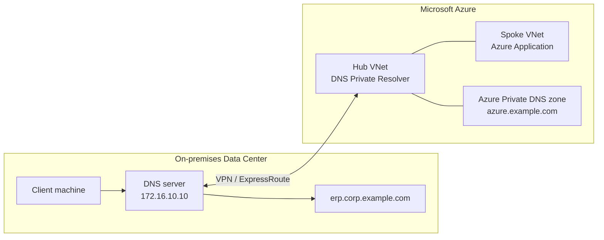
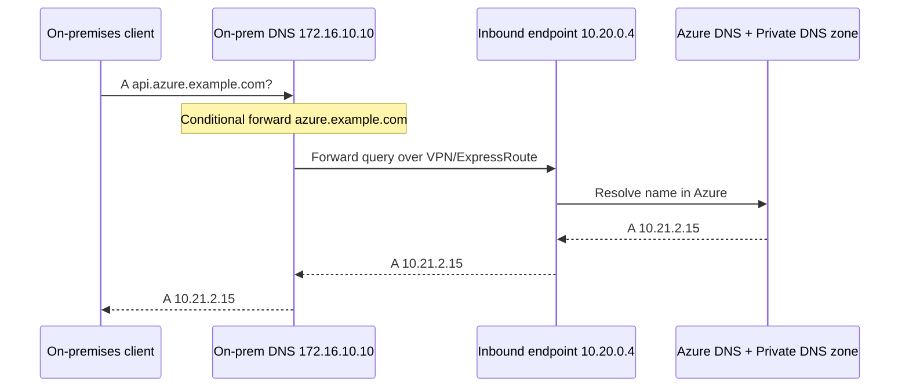
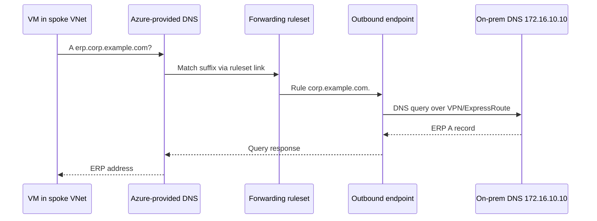
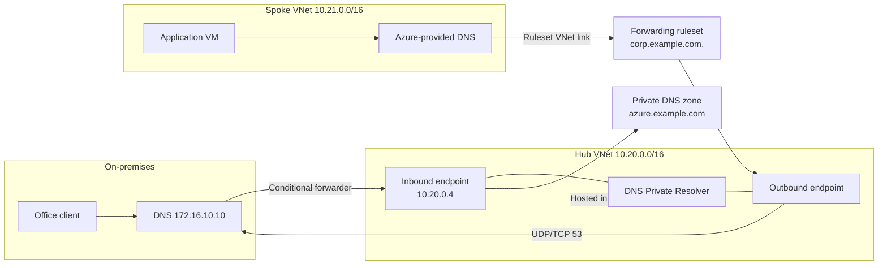

# Azure DNS Private Resolver for Hybrid Environments

An application deployed on Microsoft Azure often needs to exchange data with systems still hosted in an enterprise's data center. Azure VMs need to locate Active Directory domain controllers, APIs, or databases on-premises; conversely, office users need to access an Azure service via a **Private Endpoint** without using public IP addresses. A VPN or ExpressRoute connection handles packet transport, but applications only work reliably when **DNS names resolve properly on both sides**.

**Azure DNS Private Resolver** is a managed Azure service for resolving and forwarding DNS queries. It bridges on-premises DNS infrastructure with Azure's private DNS mechanisms without requiring you to maintain a cluster of DNS forwarder VMs. This lesson belongs to the **Virtual Networks and Name Resolution** chapter, focusing on hybrid design with virtual networks, Azure Private DNS zones, VPN/ExpressRoute, resolver endpoints, forwarding rulesets, monitoring, and operational optimization.

## Learning Objectives

After this lesson, you will be able to:

1. Describe the differences between public DNS, Azure-provided DNS, Azure Private DNS, and Azure DNS Private Resolver.
2. Explain the roles of the **inbound endpoint**, **outbound endpoint**, **DNS forwarding ruleset**, and **virtual network link**.
3. Design bidirectional name resolution flows between on-premises and Azure.
4. Link Azure Private DNS zones with virtual networks to resolve resources using Private Endpoints.
5. Verify prerequisites regarding subnets, routing, UDP/TCP port 53, DNS suffixes, and client DNS servers.
6. Diagnose name resolution failures, detect forwarding loops, and evaluate cost and high availability.

## 1. The DNS Problem in Hybrid Architectures

Consider an organization with two environments:

- **On-premises**: network `172.16.0.0/16`, DNS server `172.16.10.10`, hosting records `dc01.corp.example.com` and `erp.corp.example.com`.
- **Azure**: hub VNet `10.20.0.0/16`, spoke VNet `10.21.0.0/16`, Azure application using `api.azure.example.com`, and data potentially behind an Azure Private Endpoint.

The requirement is for servers in the spoke VNet to resolve `erp.corp.example.com`, while office devices resolve `api.azure.example.com` and receive its private IP. If DNS is configured independently on each side, Azure machines will not know on-premises internal zones, and on-premises DNS servers will not know private DNS zones linked to Azure VNets.



Keep in mind that **IP transport** and **DNS name resolution** are two distinct parts of the problem. VPN/ExpressRoute may allow pinging or opening TCP connections to a private IP, yet DNS can still return `NXDOMAIN`, return an unwanted public IP, or time out.

## 2. Azure-Provided DNS, Private DNS Zones, and Private Resolver

The following services all relate to DNS but perform different roles:

| Component | Role | What to Understand |
|---|---|---|
| **Azure DNS (public)** | Hosts records for public DNS zones. | Serves public domain queries using standard Internet DNS. |
| **Azure-provided DNS** | Built-in DNS resolution service for VMs using default VNet DNS settings. | Documented platform address is `168.63.129.16` inside Azure; not a server on-premises hosts can query directly over the Internet. |
| **Azure Private DNS zone** | Stores private DNS records and resolves them within properly linked VNets. | A zone does not automatically turn into a DNS server that on-premises systems can query directly. |
| **Azure DNS Private Resolver** | Receives and forwards DNS queries across networks per design. | Bridges private Azure DNS with on-premises DNS servers over private network connectivity. |
| **Custom DNS server on a VM** | Self-installed and self-managed DNS server. | Flexible, but you own OS management, patching, security, backups, HA, and operations. |

**Private Resolver is not where you author records for a private zone.** Records for `api.azure.example.com` live in an Azure Private DNS zone or an authoritative DNS system. The resolver receives queries and works with Azure's resolution infrastructure or forwards them to other DNS servers according to rules.

When a VNet uses Azure-provided DNS, VMs inside it use the integrated DNS resolver. For a private DNS zone to be visible from a VNet, it requires a **virtual network link** to that VNet, either directly or as designed for the query path. Never assume VNet peering automatically makes another VNet's private DNS zones resolvable.

## 3. Components of Azure DNS Private Resolver

A Private Resolver architecture typically includes these resources.

### 3.1. DNS Private Resolver Resource

This is a regional managed resource associated with one virtual network. You deploy a resolver inside an eligible VNet, typically the **hub VNet** in a hub-and-spoke topology. A resolver can host endpoints according to service configuration and limits.

The VNet containing the resolver needs proper connectivity and routing to other DNS systems. In multi-region deployments, design the relationships among resolvers, VNets, zone links, and corporate networks separately per region; do not assume a resolver in region A automatically serves region B in all scenarios.

### 3.2. Inbound Endpoint: Receiving Queries from Outside the VNet

An **inbound endpoint** receives DNS queries at a **private IP** allocated from a dedicated subnet for the endpoint. On-premises DNS servers or connected networks routed to that IP can send queries into Azure over UDP/TCP port 53.

Example: an office DNS server forwards queries for `api.azure.example.com` to inbound endpoint `10.20.0.4`; the resolver leverages Azure's resolution infrastructure, including Azure Private DNS zones linked to the appropriate VNet, to return the answer.

An inbound endpoint does not store DNS records itself. If a record is missing from the queried zone, the zone is not properly linked, or DNS settings are wrong, queries will not return the expected private IP.

### 3.3. Outbound Endpoint: Forwarding Queries to Target DNS Servers

An **outbound endpoint** is the egress point for DNS queries that Azure forwards to designated DNS servers, such as `172.16.10.10` on-premises. This endpoint belongs to its own dedicated subnet separate from the inbound endpoint.

An outbound endpoint does not automatically intercept all queries from every VM. It requires a **DNS forwarding ruleset** referencing the outbound endpoint and **virtual network links** enabling clients in those VNets to use the forwarding rules.

### 3.4. DNS Forwarding Ruleset and Forwarding Rules

A **DNS forwarding ruleset** contains forwarding rules. Each rule pairs a **domain suffix** with one or more **target DNS servers** (IP and port). When a query matches a rule, the system forwards the query through the outbound endpoint attached to the ruleset.

Example:

| Component | Illustrative Value | Purpose |
|---|---|---|
| Domain suffix | `corp.example.com.` | Names under the enterprise's internal domain |
| Target DNS server | `172.16.10.10:53` | On-premises DNS server |
| Outbound endpoint | `outbound-hub` | Egress path forwarding queries to targets |
| Ruleset link | `vnet-spoke-app` | Applies rules to clients in the spoke VNet |

Some interfaces require domain suffixes in FQDN format with a trailing dot, such as `corp.example.com.`. Check syntax when creating rules; a rule for `corp.example.com.` matches child names like `erp.corp.example.com` without matching arbitrary Internet domains.

Note: a **DNS forwarding ruleset virtual network link** and an **Azure Private DNS zone virtual network link** are two different link types. A ruleset link decides which VNets apply forwarding rules. A Private DNS zone link decides which VNets can resolve records inside that zone through Azure's resolver.

## 4. Designing Bidirectional Resolution Flows

The two resolution directions in a hybrid environment can be designed independently and then combined within the same architecture.

### 4.1. From On-Premises to Azure Resources

Suppose an Azure application has a record in private zone `azure.example.com`:

```text
Private DNS zone: azure.example.com
Record:           api.azure.example.com
Type:             A
Value:            10.21.2.15
```

For office machines to resolve this address:

1. Create the private DNS zone and required records.
2. Link the private DNS zone to the VNet hosting the resolver's inbound endpoint.
3. Create the inbound endpoint, e.g., IP `10.20.0.4`.
4. Ensure on-premises DNS servers have a network path to that IP over VPN or ExpressRoute with DNS ports allowed.
5. Configure a **conditional forwarder** on the on-premises DNS server: queries for `azure.example.com` forward to `10.20.0.4`.
6. From an office machine, query `api.azure.example.com` through the machine's regular DNS server and verify it returns `10.21.2.15`.



Returning the IP confirms only that **DNS works**. Reaching the API still requires routes, NSGs/firewalls permitting the app port, authentication, and security policies. If DNS returns `10.21.2.15` properly yet HTTPS to that IP fails, troubleshoot the network path and backend rather than tweaking forwarding rules.

### 4.2. From Azure to On-Premises Systems

Suppose a VM in `vnet-spoke-app` needs to call `erp.corp.example.com`, whose record lives on on-premises DNS server `172.16.10.10`:

1. Create an outbound endpoint in the hub VNet.
2. Create a DNS forwarding ruleset and associate it with the outbound endpoint.
3. Add a rule for suffix `corp.example.com.` targeting `172.16.10.10`, port 53.
4. Link the ruleset to the spoke VNet requiring it, such as `vnet-spoke-app`.
5. Ensure network paths from the outbound endpoint reach on-premises DNS over VPN/ExpressRoute and permit DNS queries/responses.
6. From a VM using Azure-provided DNS in the spoke, query `erp.corp.example.com` and verify both the returned IP and service connectivity.



**Critical requirement:** the VM must actually use the DNS path governed by the ruleset. If the VNet or OS uses a **custom DNS server** instead of Azure-provided DNS, linking the ruleset to the VNet alone is usually insufficient; the custom DNS server must be configured with matching forwarding or resolution adjusted to match the intended architecture. Always check the host's actual DNS server rather than looking only at VNet links in the Portal.

### 4.3. Combining Both Directions in a Hub-and-Spoke Topology

Reference design:



The diagram shows logical DNS flow. In real deployments, **private DNS zone links** must point to the appropriate VNets and **ruleset links** must point to VNets originating queries. VNet peering only establishes configured network connectivity—it does not replace either DNS link type.

## 5. Preparing Networks and Subnets Before Deployment

DNS Private Resolver is managed by Azure, yet its endpoints still attach to subnets inside a VNet. Prepare the underlying network before creating resources:

| Prerequisite | Why It Is Needed |
|---|---|
| Eligible region and subscription | Resolver, endpoints, and related resources must reside within supported service scope. |
| Hub VNet with sufficient IP space | To carve out dedicated subnets and connect to spokes/on-premises. |
| Dedicated inbound subnet | Provides a private IP to receive DNS queries from external networks. |
| Dedicated outbound subnet | Serves as the source subnet for DNS queries sent to target DNS servers. |
| Subnet delegation per service spec | Allows Azure to manage endpoints inside dedicated subnets. |
| Working VPN or ExpressRoute | Ensures bidirectional connectivity between endpoint IPs and on-premises DNS. |
| Network rules for UDP and TCP 53 | DNS primarily uses UDP, while TCP is required for large responses and fallback scenarios. |
| Appropriate Azure RBAC roles | Operators need permissions to create resolvers, endpoints, rulesets, and network links. |

Inbound and outbound subnets must be dedicated per service requirements—never shared with VMs or Private Endpoints, and never sharing one subnet between both endpoint types. Check current **subnet size** and **delegation** requirements for Azure DNS Private Resolver in your region before allocating addresses. Maintain a clear IP plan to avoid CIDR overlaps with on-premises networks.

When traffic traverses a network virtual appliance or central firewall, inspect **route tables, NSGs, firewall policies, and return paths**. Resolution works only when queries travel from client to DNS server and replies return along a valid route.

Because the inbound endpoint has a private IP, office DNS servers must send packets to the **inbound endpoint IP**, never directly to `168.63.129.16`. Azure-provided DNS's address is a platform-internal address used inside Azure, not an external server reachable directly over VPN.

## 6. Step-by-Step Deployment in the Azure Portal

This deployment example uses illustrative names and addresses; substitute values from your actual network design.

| Resource | Example Value |
|---|---|
| Resource group | `rg-hybrid-dns` |
| Region | A region supporting Azure DNS Private Resolver |
| Resolver VNet | `vnet-hub`, `10.20.0.0/16` |
| Inbound subnet | `snet-dns-inbound`, dedicated IP range in hub |
| Outbound subnet | `snet-dns-outbound`, separate dedicated IP range |
| Resolver | `dnspr-hub` |
| Inbound endpoint | `inbound-hub`, sample IP `10.20.0.4` |
| Outbound endpoint | `outbound-hub` |
| Forwarding ruleset | `ruleset-to-onprem` |
| Rule | `corp.example.com.` → `172.16.10.10:53` |
| Ruleset link | `vnet-spoke-app` |
| Private DNS zone | `azure.example.com` |

### Step 1. Create the Hub VNet and Dedicated Subnets

In the Azure Portal, prepare a hub VNet connected to the data center via VPN/ExpressRoute. Create two separate subnets, one for inbound and one for outbound. Configure subnet delegation to `Microsoft.Network/dnsResolvers` as required by endpoint setup. Do not deploy general workloads into these subnets.

### Step 2. Create Azure DNS Private Resolver

Search for **DNS Private Resolver** in the Azure Portal, create resolver `dnspr-hub`, and select subscription, resource group, region, and `vnet-hub`. Configure an **inbound endpoint** pointing to the inbound subnet. Record the actual private IP assigned to the inbound endpoint; if a predictable address is needed for conditional forwarders, use an IP allocation option supported by the service.

Add an **outbound endpoint** pointing to the outbound subnet. Having an outbound endpoint is a prerequisite for using a forwarding ruleset to send queries to target DNS servers; creating the endpoint alone does not create forwarding rules.

### Step 3. Link Azure Private DNS Zone for Inbound Queries

Create or select private DNS zone `azure.example.com`. Add an `A` record for `api` pointing to private IP `10.21.2.15`, then create a **virtual network link** to `vnet-hub`, where the inbound endpoint resides. Verify the link status before testing queries from on-premises.

If the name belongs to a **Private Endpoint**, use the exact private DNS zone required for that service (for example, `privatelink.blob.core.windows.net` for an eligible Blob Storage scenario) and manage records via a **Private DNS zone group** when using integrated management. Never substitute an arbitrary zone name for the zone expected by Private Link.

### Step 4. Configure the DNS Forwarding Ruleset for Outbound Queries

Create ruleset `ruleset-to-onprem` referencing outbound endpoint `outbound-hub`. Create a forwarding rule with domain suffix `corp.example.com.` and target `172.16.10.10`, port 53. Link the ruleset to `vnet-spoke-app`, which contains clients needing to resolve on-premises names.

When multiple on-premises DNS servers exist, configure targets in line with operational policy and service limits. Do not assume target ordering equates to full application failover; test what happens when one DNS server stops responding.

### Step 5. Configure Conditional Forwarding on On-Premises DNS

On the internal DNS server, create a conditional forwarder for the suffixes of Azure zones to resolve, such as `azure.example.com`, pointing to private IP `10.20.0.4`. Exact steps depend on the DNS platform: Windows Server DNS, BIND, Infoblox, or another solution.

With Windows Server DNS, the logical flow is: open **DNS Manager**, navigate to **Conditional Forwarders**, create a forwarder for `azure.example.com`, and add `10.20.0.4` as the master server. Before enabling Active Directory replication of the forwarder, review which DNS servers will receive it and whether those locations can route to Azure.

### Step 6. Test Both Directions

Test from an office machine and from a VM in the spoke VNet. Names must resolve through **each machine's default DNS server**, not merely when manually targeting a specific server. Afterward, test actual network connectivity to the resolved IPs.

## 7. Private Endpoints and CNAME Chain Handling

In an Azure Storage scenario using a Private Endpoint, applications normally query the standard service hostname, such as:

```text
storage-demo.blob.core.windows.net
```

Private Link DNS resolution can involve a **CNAME** step pointing to a name in `privatelink.blob.core.windows.net`, which then resolves to a **private IP** when the private zone is properly configured and linked. Therefore, checking only the record inside the private zone is insufficient; inspect the full resolution chain executed by the client.

```text
Client query: storage-demo.blob.core.windows.net
             |
             v
        CNAME to Private Link name (service-dependent)
             |
             v
        A record from Azure Private DNS zone
             |
             v
        Private Endpoint IP, e.g., 10.21.3.8
```

For on-premises machines, conditional forwarders must cover the **name the application actually queries**, including the CNAME chain where required. In many Private Endpoint scenarios, DNS guidance requires forwarding the **public service suffix** like `blob.core.windows.net` to the inbound resolver so Azure handles resolution down to the private zone. Forwarding only `privatelink.blob.core.windows.net` may fall short if on-premises DNS cannot follow CNAME steps to the right resolver.

When designing, check DNS guidance for each Private Endpoint resource type rather than using one generic forwarding rule for all services. Also remember that **Private Endpoints control the network path**, while Azure RBAC, identity, and data permissions still govern what a client can do once connected.

## 8. Inspecting Configuration with Azure CLI and DNS Tools

The commands below are primarily for **reading and verifying**, not creating or modifying resources. Replace placeholders with values from your lab environment.

### 8.1. View DNS Private Resolvers in the Subscription

```bash
az login
az account set --subscription "<subscription-id>"

az resource list \
  --resource-type "Microsoft.Network/dnsResolvers" \
  --query "[].{name:name,resourceGroup:resourceGroup,location:location,id:id}" \
  --output table
```

This lists Private Resolver resources and deployment scopes. To inspect endpoints or forwarding rulesets, use the Azure Portal or corresponding Azure Resource Manager queries. Always verify the active subscription and region before concluding a resolver is missing.

### 8.2. Verify Dedicated Subnets and Delegation

```bash
az network vnet subnet show \
  --resource-group "rg-hybrid-dns" \
  --vnet-name "vnet-hub" \
  --name "snet-dns-inbound" \
  --query "{addressPrefix:addressPrefix,delegations:delegations[].serviceName}" \
  --output json
```

Repeat for `snet-dns-outbound`. Check the CIDR, delegation, and whether other resources occupy the subnet. If a subnet fails service requirements, fix it before deploying endpoints.

### 8.3. Inspect Private DNS Zones and VNet Links

```bash
az network private-dns link vnet list \
  --resource-group "rg-hybrid-dns" \
  --zone-name "azure.example.com" \
  --output table

az network private-dns record-set a list \
  --resource-group "rg-hybrid-dns" \
  --zone-name "azure.example.com" \
  --output table
```

Verify the zone is linked to `vnet-hub` and records have the expected names and IPs. If records are managed automatically by a Private Endpoint's Private DNS zone group, inspect the zone group configuration and service-managed records.

### 8.4. Send DNS Queries from On-Premises

On Windows:

```powershell
# Query the inbound endpoint directly to isolate the issue
Resolve-DnsName -Name "api.azure.example.com" -Type A -Server "10.20.0.4"

# Query the on-premises DNS server using the conditional forwarder
Resolve-DnsName -Name "api.azure.example.com" -Type A -Server "172.16.10.10"
```

On Linux/macOS with `dig`:

```bash
dig @10.20.0.4 api.azure.example.com A
dig @172.16.10.10 api.azure.example.com A
```

If querying the inbound IP directly succeeds while querying on-premises DNS fails, the fault likely lies in the conditional forwarder, rule precedence, firewall, or on-premises DNS cache. If both fail, check network paths, the inbound endpoint, private zone links, and records.

### 8.5. Send Queries from an Azure VM

On a VM inside `vnet-spoke-app`, check the active DNS server and test resolution:

```powershell
ipconfig /all
Resolve-DnsName -Name "erp.corp.example.com" -Type A
```

Or on Linux:

```bash
cat /etc/resolv.conf
dig erp.corp.example.com A
```

Hosts may use a local DNS stub resolver or OS-managed DNS mechanism, so `resolv.conf` does not always show the final upstream server. When needed, check NetworkManager or `systemd-resolved` status. Confirm whether the VM/VNet uses Azure-provided DNS or custom DNS and verify the ruleset link targets the right VNet.

### 8.6. DNS Success Does Not Equal Service Connectivity

After obtaining an IP, test the service over the required protocol:

```powershell
Test-NetConnection -ComputerName "erp.corp.example.com" -Port 443
```

If DNS returns the right IP yet TCP 443 fails, inspect routes, VPN/ExpressRoute, NSGs, firewalls, service listeners, and TLS certificates. If DNS itself times out, verify UDP/TCP 53 and paths to DNS servers before troubleshooting application ports.

## 9. Common Troubleshooting Workflows

When DNS fails, the fastest way to isolate the fault is finding **the first hop in the query chain that returns the wrong result**.

| Symptom | Possible Cause | Where to Check |
|---|---|---|
| On-premises cannot resolve Azure names | Missing conditional forwarder, wrong inbound IP, no route, or zone not linked to hub | Query inbound IP directly, inspect conditional forwarder, check VNet link and UDP/TCP 53 |
| Azure VM cannot resolve on-premises names | Ruleset not linked to spoke, wrong suffix, unreachable outbound target, or VM uses custom DNS | Check VM's DNS server, ruleset link, forwarding rule, and path to target DNS |
| DNS returns public IP instead of private IP | Private DNS zone or CNAME chain mismatch, wrong zone link, or query took a different resolver | Check exact queried name, CNAME, private zone records, and resolution path |
| Slow or intermittent queries | Failing target DNS server, packet loss, DNS timeouts, or inconsistent caches | Test each target, VPN/ExpressRoute link, DNS server logs, TTLs, and retries |
| `NXDOMAIN` right after creating record | Wrong zone, wrong record, or negative caching | Inspect authoritative record, query directly, wait for TTL or clear controlled caches |
| Looping queries or long timeouts | Forwarding loop, e.g., both sides forwarding the same suffix to each other | Map forwarding paths per suffix; ensure an authoritative answer or final resolver exists |
| DNS works yet app is unreachable | Firewall, NSG, routing, TLS, application, or permissions | Check IP/port connectivity, auth, and application logs |

### 9.1. Avoiding Forwarding Loops

A subtle failure mode is circular forwarding: on-premises DNS forwards `corp.example.com` to the inbound endpoint, while Azure has an outbound rule forwarding that exact suffix back to on-premises DNS. Queries never reach an authoritative answer, resulting in timeouts or errors.

To prevent loops:

- Clearly delineate which zones are owned by on-premises DNS and which by Azure Private DNS.
- Scope forwarding rules to exact required suffixes rather than broad catch-all rules without impact analysis.
- Avoid linking a forwarding ruleset in a way that loops queries arriving at the inbound endpoint back out again, especially when the hub VNet also hosts the outbound endpoint.
- Trace child queries and CNAME chains, not just the initial queried name.

### 9.2. Caching and TTL

DNS caching reduces latency, but prevents configuration changes from appearing instantaneously. After updating an `A` record or conditional forwarder, clients may keep returning the old result until TTL expires; negative answers can also be cached. During investigations, record query timestamps, the responding DNS server, and record TTLs. Clear caches only for deliberate testing—never rely on cache flushing as a workaround for misconfigured rules.

## 10. Security, High Availability, and Operations

### 10.1. Restricting Who Can Send DNS Queries

An inbound endpoint exposes a private IP serving DNS queries over reachable private networks. DNS typically uses UDP and TCP port 53; this is **not inherently DNS-over-HTTPS or DNS-over-TLS**. If strict transport protection is required, combine appropriate network transport controls, source restrictions, and security mechanisms supported by involved components.

Operational guidelines:

1. Restrict queries reaching the inbound endpoint to authorized networks or DNS servers using NSGs and network policies per design.
2. Permit the outbound endpoint to communicate only with approved target DNS servers.
3. Secure VPN/ExpressRoute, routes, and firewalls; never expose internal DNS to the public Internet.
4. Apply least-privilege Azure RBAC for creating/modifying endpoints, forwarding rules, and private zones.
5. Never use DNS records as a substitute for application authentication or authorization.

### 10.2. High Availability and Failure Handling

Private Resolver is managed by Azure, yet hybrid resolution still depends on **WAN/VPN/ExpressRoute links, on-premises DNS servers, private zone links, rules, and applications**. Evaluate single points of failure:

- A single on-premises DNS server jeopardizes every forwarding rule pointing to it.
- Losing VPN or ExpressRoute disrupts both inbound and outbound hybrid queries.
- A misconfiguration on a DNS server or ruleset can impact many VNets simultaneously.
- A resolver deployed in one region does not automatically provide cross-region DNS disaster recovery.

When high resiliency is required, configure multiple target DNS servers, redundant network paths, standby DNS in a secondary region, and procedures to update conditional forwarders during failover. Verify multi-endpoint support, availability zones, and SLAs for your target region and service version; do not assume a single-region hub survives a full regional outage.

### 10.3. Monitoring and Auditing

Monitor DNS health through periodic synthetic queries from real client perspectives: an on-premises host querying Azure names, and a spoke VM querying on-premises names. Record resolution results, latency, returned IPs, and follow-up application checks.

Combine on-premises DNS server logs, supported metrics and diagnostic settings from DNS Private Resolver and networking resources, Azure Monitor, and VPN/ExpressRoute health signals. Per-query logging depends on current service capabilities; verify actual observability features rather than assuming every DNS query lands in Azure Activity Log. **Activity Log primarily records management-plane changes**, not payloads of individual DNS queries.

### 10.4. Cost Control

When estimating costs, review current Azure DNS Private Resolver pricing for inbound/outbound endpoints, DNS forwarding rulesets, and related resources in the region. Add costs for VPN/ExpressRoute, private networking, monitoring, and ongoing on-premises DNS operations. Avoid deploying endpoints across every environment or region by default without validating demand, as resources incur charges even at low query volume.

Plan tagging, shared hub cost allocation, governance boundaries, and periodic cost reviews. Balance sharing one resolver to reduce operational overhead against the larger blast radius when modifying a ruleset shared by many workloads.

## 11. Comparison with VM-Based DNS Forwarders

| Criterion | Azure DNS Private Resolver | DNS Forwarder on a VM |
|---|---|---|
| OS management | Azure manages the service layer | Team manages OS, patching, hardening, and backups |
| Private DNS zone resolution | Integrates with Azure DNS via VNet/zone configuration | Must manually forward to Azure DNS with proper network context |
| Hybrid DNS forwarding | Inbound/outbound endpoints and forwarding rulesets | Depends on BIND, Windows DNS, Infoblox, or other software config |
| Custom DNS server plugins | Limited to service-provided capabilities | Can install custom plugins, policies, or specialized software if supported |
| Availability | Managed service; still requires resilient WAN and DNS dependencies | Must engineer multiple VMs, load balancing, and failover yourself |
| Cost | Service/endpoint/ruleset pricing per rate card | VM, disk, licensing, networking, monitoring, and operational labor |

If your goal is straightforward bidirectional DNS forwarding between Azure and on-premises, Private Resolver generally simplifies operations. If the organization requires specialized DNS capabilities unavailable in the managed service, dedicated DNS servers or enterprise DNS appliances may still be necessary. Both can be combined: Azure Private Resolver forwarding queries to on-premises DNS hosting specialized zones.

## 12. Scenario Exercise

An enterprise runs a web application in Azure `vnet-spoke-app` and an ERP system on-premises. Simultaneously, the on-premises ERP needs to call the Azure app's API over private IP. On-premises DNS manages `corp.example.com`, while Azure Private DNS manages `azure.example.com`.

**Requirements:**

- `vm-app` in Azure must resolve `erp.corp.example.com`.
- Office machines must resolve `api.azure.example.com` to `10.21.2.15`.
- Do not deploy additional VMs solely to act as DNS forwarders.
- Define how to distinguish DNS failures from application connectivity failures.

**Proposed architecture:** deploy DNS Private Resolver in the hub; an inbound endpoint for on-premises queries; private DNS zone `azure.example.com` linked to the hub; on-premises DNS conditional forwarder for the Azure zone pointing to the inbound IP; an outbound endpoint and forwarding ruleset for `corp.example.com.` targeting `172.16.10.10:53`, linked to the spoke VNet. Allow UDP/TCP 53 and bidirectional routing across the hybrid connection. Finally, test DNS from both sources and verify service connectivity after resolution.

**Self-Check Questions:**

1. Why is VNet peering between hub and spoke alone insufficient for all VMs to resolve the hub's Azure Private DNS zone?
2. What happens if a VM in the spoke uses a custom DNS server while you only create a ruleset link?
3. Why is a conditional forwarder still needed on on-premises DNS even when a VPN is active?
4. Why can `api.azure.example.com` return the right IP yet HTTPS connections still fail?
5. If both on-premises and Azure forward `corp.example.com` to each other, what failure occurs and how do you fix it?

## 13. Production Deployment Checklist

- [ ] Clearly identified authoritative zones and domain suffixes to forward in each direction.
- [ ] Hub VNet, spoke VNet, VPN/ExpressRoute, and bidirectional routes are functioning.
- [ ] Inbound/outbound endpoints sit in dedicated subnets with required delegation and sizing.
- [ ] Private DNS zones are linked to VNets requiring resolution, especially the VNet hosting the inbound endpoint.
- [ ] DNS forwarding rulesets reference the outbound endpoint, rules, target IPs/ports, and correct spoke VNet links.
- [ ] On-premises DNS has conditional forwarders pointing to the inbound IP with no forwarding loops.
- [ ] Firewalls/NSGs allow necessary UDP/TCP 53 traffic without exposing query access beyond design scope.
- [ ] Azure VMs and on-premises hosts use intended DNS servers; verified from real clients on both sides.
- [ ] Full CNAME/Private Endpoint chains for service names are tested, not only a standalone `A` record.
- [ ] HA plans cover DNS servers, hybrid links, standby regions, and misconfiguration recovery.
- [ ] Synthetic query monitoring, appropriate logs, tagging, and cost controls are in place.
- [ ] Rollback procedures documented for changes to forwarding rules, zone links, or conditional forwarders.

## Conclusion

Azure DNS Private Resolver enables Azure and on-premises environments to exchange private DNS queries through a managed service. The **inbound endpoint** accepts queries from outside the VNet into Azure; the **outbound endpoint** paired with a **DNS forwarding ruleset** forwards queries for specified suffixes to target DNS servers. Making the solution work reliably requires combining **private DNS zone links**, **ruleset VNet links**, VPN/ExpressRoute routing, and network policies for UDP/TCP port 53. Accounting for full resolution chains, Private Endpoints, access controls, high availability, and monitoring keeps hybrid environments stable when deploying and operating applications on Microsoft Azure.
