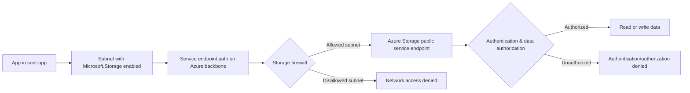
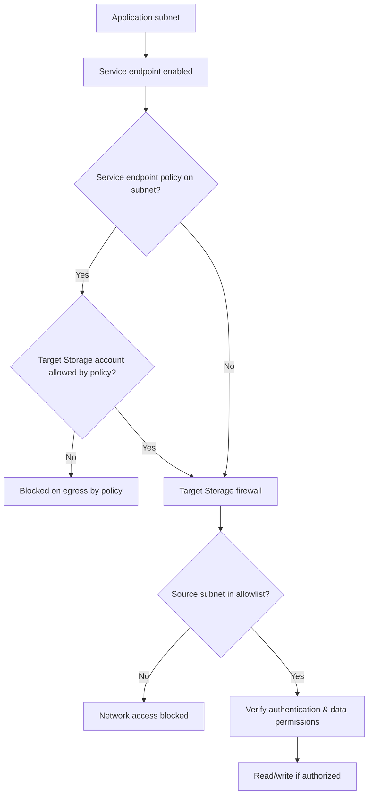

# Service Endpoints and Restricting Service Access Scope

In Azure, an application running on virtual machines or integrated with a **Virtual Network (VNet)** frequently needs to access platform services (**PaaS**) such as Azure Storage, Azure SQL Database, or Azure Key Vault. If the target service permits connections from any network, compromised credentials or an exposed token can allow unauthorized access to data from unexpected locations.

**Virtual Network service endpoints** provide a connectivity mechanism that identifies **which Azure subnets** are allowed to reach supported Azure services. By combining a subnet service endpoint with a **virtual network rule** or firewall on the target resource, operations teams can narrow access from “any source on public networks” down to “only approved subnets.”

This lesson belongs to the **Virtual Networks and Name Resolution** chapter in the Microsoft Azure module. It ties into subscriptions, resource groups, Microsoft Entra ID, Azure RBAC, storage, and data services, helping you design Azure application architectures with controlled, observable, and securely operable connectivity.

## Learning Objectives

After this lesson, you will be able to:

- Explain the nature, routing behavior, and protection scope of Azure VNet service endpoints.
- Distinguish between **enabling a service endpoint on a subnet** and **allowing that subnet on the target resource**.
- Understand how service endpoints affect source IP visibility, DNS, and access from networks outside Azure.
- Compare service endpoints, **Private Endpoints/Private Link**, IP firewall rules, and Network Security Groups (NSGs).
- Configure an illustrative connection from a subnet to Azure Storage using the Azure Portal and Azure CLI.
- Understand how to restrict allowed sources on target resources and restrict target resources using service endpoint policies where supported.
- Verify both network access and data-plane permissions, test from allowed and disallowed locations, and troubleshoot common failures.

## 1. The Problem: An Application Subnet Needs Data Access Without Opening to Everyone

Suppose an order management application runs on virtual machines in subnet `snet-app` of VNet `vnet-shop`. The app saves invoice files to an Azure Storage account. Organizational requirements:

1. Only workloads inside the application subnet may send requests to the Storage account.
2. Application identities must still authenticate and hold appropriate data permissions.
3. Personal laptops, test subnets, or workloads outside approved networks must not read files even if they know the Storage account address.
4. Operations teams must be able to audit configuration and track changes.

A service endpoint solution has **two halves**:

- **Source side:** enable the `Microsoft.Storage` endpoint on the application subnet.
- **Target side:** configure the Storage account's firewall/network rules to allow only the selected subnet, plus strictly necessary exceptions.

If you only enable the endpoint on the subnet while the Storage account still allows public access from all networks, source restriction is not achieved. If you only add a rule for the subnet without enabling the endpoint properly, connectivity can fail or fail to be recognized by subnet identity.

## 2. What Is an Azure Service Endpoint?

A **service endpoint** is an Azure Virtual Network feature that extends a subnet's network identity to a supported Azure service. When you enable an endpoint for a service on a subnet:

- Azure adds an optimized route for traffic destined for that service's public IP address prefixes.
- Traffic stays within Microsoft Azure's network backbone as supported by the service.
- The target service can recognize the subnet/VNet as a valid source when evaluating **virtual network rules**.
- Applications continue using the service's **standard public DNS hostname**, such as `https://<storage-account>.blob.core.windows.net`.

A service endpoint **does not assign a private IP address to the PaaS service** inside your subnet. The target address remains Azure's public service endpoint—this is a critical distinction from **Private Endpoints**.

### Illustrative Access Flow



The diagram separates two distinct controls: **network access** and **data access**. A network rule permitting a connection path does not grant permission to read blobs.

### Two Key Points to Remember

**First:** service endpoints are enabled per **subnet**, not across an entire VNet with a single switch. If a VNet has three subnets, enabling an endpoint on one subnet does not automatically authorize the other two.

**Second:** a service endpoint supports **network-scope enforcement**, while resource access still depends on firewalls, Microsoft Entra ID, Azure RBAC, access keys, or authentication mechanisms supported by the target service.

## 3. How Do Service Endpoints Work with DNS and Routing?

### DNS Does Not Switch to Private DNS

When a workload queries `<storage-account>.blob.core.windows.net`, standard DNS still returns a **public IP address**. That is normal behavior for service endpoints. Never treat `nslookup` returning a public IP as proof that the endpoint is broken.

The routing path toward supported service IP prefixes changes once the endpoint is enabled on the subnet. Azure uses service-endpoint routing for eligible traffic. You can inspect **effective routes** on a VM's network interface to aid troubleshooting.

With a **Private Endpoint**, things work differently: the service gets a **private IP** in your VNet and typically requires appropriate name resolution (such as a private DNS zone) so applications reach that private IP via the familiar service hostname.

### Source IP and Firewall Rules

When a service endpoint is active, the Azure service identifies callers by configured subnet/VNet identity. Consequently, relying purely on a public/NAT IP to allowlist a subnet may no longer match the new traffic path.

Use **virtual network rules** on the target service to authorize the subnet, and re-evaluate existing IP firewall rules when enabling endpoints. When changing network paths on a live system, outages can occur if rule updates are sequenced improperly.

### Can Networks Outside Azure Automatically Use Service Endpoints?

No. Corporate office computers or on-premises systems arriving over the Internet, VPN, or ExpressRoute **do not inherit subnet identity** merely by having connectivity into Azure. If you need private access paths for office or data center clients, consider **Private Endpoints** with proper DNS and routing, or another explicitly designed network solution.

Never treat service endpoints as a drop-in substitute for VPN, ExpressRoute, routing, and DNS across hybrid scenarios.

## 4. Distinguishing Network Control Layers

| Mechanism | Where Configured? | What Problem Does It Solve? | Limitations to Understand |
|---|---|---|---|
| **Service endpoint** | VNet subnet | Routes/identifies a subnet when accessing supported Azure services | Does not assign a private IP to the service; alone does not lock down public access |
| **Virtual network rule** | Target service firewall/networking | Permits only approved subnets | Requires compatible service endpoint setup and public access mode |
| **IP firewall rule** | Target service firewall | Permits public source IPs within supported scopes | Cannot express subnet identity; subject to per-service constraints |
| **NSG** | Subnet or NIC | Allows/denies inbound/outbound traffic by IP, port, protocol, and service tag | Does not replace authentication or target service firewalls |
| **Service endpoint policy** | Subnet, for supported services | Restricts which **target resources** can be reached over a service endpoint | Narrow service support, primarily Azure Storage; not a general egress firewall |
| **Private Endpoint** | Network interface / private IP in subnet | Reaches target service over private IP with proper DNS | Requires managing DNS, endpoint connectivity, NSGs/routing, and service settings |
| **Azure RBAC / data-plane role** | Identity and resource scope | Governs which actions are permitted after authentication | Does not block network paths from other sources on its own |

Note: both **service endpoints** and **Private Endpoints** reduce service exposure, yet serve different architectures. Choosing between them depends on requirements for private IP addressing, on-premises access, DNS, service support, cost, and governance.

## 5. When Should You Choose a Service Endpoint?

Service endpoints are typically suitable when:

- Workloads live in an explicit Azure subnet and connect to a supported Azure service.
- The target can continue using its public service endpoint, restricted by subnet-level firewall rules.
- You do not need private IPs for PaaS or direct private access from on-premises.
- Operations wants subnet-level enforcement without building a full private DNS infrastructure.

Private Endpoints are usually a better fit when:

- Policy mandates accessing the service strictly via **private IP** and disabling public network access on the target when supported.
- Hybrid/on-premises systems must reach the service over a private network.
- You need per-resource private connectivity with strict DNS control and network segmentation.
- Architecture standards require the Private Link model supported by your services and systems.

### Decision Matrix

| Criterion | Service Endpoint | Private Endpoint |
|---|---|---|
| Target PaaS IP | Public service endpoint | Private IP inside VNet |
| Application DNS changes needed? | Normally no | Usually requires verifying and configuring private DNS |
| Identity scope | Source subnet | Private link to a specific PaaS resource |
| Direct private access from on-premises | Not primary purpose | Can be designed over VPN/ExpressRoute and DNS |
| Disabling target public network access | May break service-endpoint access | Usually the preferred model for private-only access, if supported |
| Source restriction configuration | Endpoint + firewall/VNet rule | Private endpoint + public access controls, NSG/routing, and permissions |
| Dedicated connection fee | Typically no separate endpoint feature charge | May incur Private Link / data processing charges per current pricing |

A storage account with `publicNetworkAccess: Disabled` is not reopened merely by configuring service endpoints and virtual network rules. When private-only network access is required, use Private Endpoints or a supported equivalent.

## 6. Which Services Support Service Endpoints?

Azure service endpoints do not apply uniformly to every service. Common supported families include:

- **Azure Storage:** commonly uses service name `Microsoft.Storage`; supports cross-region scope in certain configurations.
- **Azure SQL:** uses service `Microsoft.Sql` for scenarios supporting virtual network rules.
- **Azure Key Vault:** can use `Microsoft.KeyVault` when network access is configured appropriately.
- **Select other data and messaging services:** varies by product, region, and resource type; verify support lists at deployment time.

When designing for a new service, never guess the endpoint name from the product name. Check the **Virtual Network service endpoints** documentation and the target service's Networking blade.

Several services support both service endpoints and Private Endpoints, though rules, exceptions, regional scopes, and firewall options differ per service.

### Note on Storage Geographic Scope

`Microsoft.Storage` and `Microsoft.Storage.Global` have different support scopes for Storage accounts across regions. Never assume a subnet can reach any Storage account in any region just because `Microsoft.Storage` is enabled. Especially when workloads and Storage accounts sit in different regions, verify regional/global support and per-case network rules.

Check current capabilities and compatibility between these two options before modifying subnets. Some combinations cannot be enabled simultaneously on the same subnet.

## 7. Two-Sided Configuration: Source Subnet and Target Firewall

To protect a Storage account using a service endpoint, follow this standard workflow:

1. Identify the exact subscription, VNet, subnet, and Storage account.
2. Verify service and regional support.
3. Inspect current endpoints, routes, NSGs, and existing rules on the subnet.
4. Enable the `Microsoft.Storage` service endpoint on the approved subnet.
5. Add a **virtual network rule** on the Storage account pointing to that subnet.
6. Switch the Storage account's public network access rule to allow only selected networks/sources, reviewing all exceptions.
7. Test from both an allowed subnet and a disallowed subnet/source.
8. Verify authentication and data-plane permissions, document results, and configure monitoring.

**Critical sequencing:** before enforcing default Deny on the target resource, confirm valid subnets are already in the allowlist and an operational break-glass path exists. When altering live workloads, test in an isolated environment first to avoid locking out applications.

### Configuring via the Azure Portal

Assume you have:

- An approved lab subscription.
- VNet `vnet-shop` with subnet `snet-app`.
- Storage account `stshoplabdemo` in a separate resource group.

**On the source subnet:**

1. Open **Azure Portal → Virtual networks** and select `vnet-shop`.
2. Open **Subnets** and select `snet-app`.
3. Locate the **Service endpoints** section.
4. Select service `Microsoft.Storage`, checking region/scope if prompted.
5. Save configuration, wait for the update to complete, and re-verify the subnet.

**On the target Storage account:**

1. Open **Storage accounts** and select the right account.
2. Open **Networking** (or the corresponding networking blade).
3. Choose the mode allowing access from selected virtual networks and IP addresses if supported by the interface.
4. Under virtual networks, add `vnet-shop/snet-app`.
5. Audit exceptions such as trusted Azure services and existing IP allowlists; keep only necessary ones.
6. Save and confirm virtual network rules after updating.
7. Test the data flow using the proper application identity before declaring completion.

Portal labels may shift across UI versions. If you cannot add the subnet or save rules, check RBAC permissions on both the network resource and Storage account, endpoint support, and current network state.

## 8. Hands-On with Azure CLI: Configuring and Verifying a Storage Service Endpoint

These examples run in **Bash** via Azure Cloud Shell or a signed-in Azure CLI environment. Commands modifying configuration should be run only on learning or approved resources. None of the commands below execute automatically in your subscription.

### Step 1: Confirm the Exact Context

```bash
az account show --output table
az account list --output table
```

If needed, select the approved subscription:

```bash
az account set --subscription "<SUBSCRIPTION_ID>"
```

Declare sample variables (replace all placeholders before running):

```bash
SUBSCRIPTION_ID="<SUBSCRIPTION_ID>"
NETWORK_RG="rg-network-lab"
VNET_NAME="vnet-shop"
SUBNET_NAME="snet-app"
STORAGE_RG="rg-data-lab"
STORAGE_NAME="<STORAGE_ACCOUNT_NAME>"

SUBNET_ID="/subscriptions/$SUBSCRIPTION_ID/resourceGroups/$NETWORK_RG/providers/Microsoft.Network/virtualNetworks/$VNET_NAME/subnets/$SUBNET_NAME"
```

The Storage account must already exist and be valid; this snippet does not create new resources.

### Step 2: Inspect the Subnet Before Making Changes

```bash
az network vnet subnet show \
  --ids "$SUBNET_ID" \
  --query "{name:name,addressPrefix:addressPrefix,serviceEndpoints:serviceEndpoints[].service}" \
  --output json
```

Review already-enabled endpoints. When updating `--service-endpoints`, you must **preserve existing required endpoints**; never overwrite with a partial list that disrupts connectivity to other services.

### Step 3: Enable the Service Endpoint

For a lab subnet with no other service endpoints enabled yet:

```bash
az network vnet subnet update \
  --ids "$SUBNET_ID" \
  --service-endpoints Microsoft.Storage
```

If the subnet already has other endpoints, construct the update command to retain the entire active list. Never paste a single-service command onto a production subnet without checking current state.

Read back configuration:

```bash
az network vnet subnet show \
  --ids "$SUBNET_ID" \
  --query "serviceEndpoints[].{service:service,locations:locations}" \
  --output table
```

Expected output includes `Microsoft.Storage` in the service endpoints list.

### Step 4: Inspect the Storage Account Firewall

```bash
az storage account show \
  --resource-group "$STORAGE_RG" \
  --name "$STORAGE_NAME" \
  --query "{publicNetworkAccess:publicNetworkAccess,defaultAction:networkRuleSet.defaultAction,virtualNetworks:networkRuleSet.virtualNetworkRules}" \
  --output json
```

Confirm the account uses a public network access setting compatible with selected networks and VNet rules. If public network access is **Disabled**, a service-endpoint-only path cannot replace a Private Endpoint; redesign connectivity rather than arbitrarily opening public access.

### Step 5: Add the Subnet to the Allowlist

```bash
az storage account network-rule add \
  --resource-group "$STORAGE_RG" \
  --account-name "$STORAGE_NAME" \
  --subnet "$SUBNET_ID"
```

Verify:

```bash
az storage account network-rule list \
  --resource-group "$STORAGE_RG" \
  --account-name "$STORAGE_NAME" \
  --output json
```

Confirm `virtualNetworkRules` lists the subnet with the exact resource ID and an active state.

### Step 6: Restrict Sources with Default Deny

After verifying the allowlist and administrative access path, set the default action to deny unlisted networks:

```bash
az storage account update \
  --resource-group "$STORAGE_RG" \
  --name "$STORAGE_NAME" \
  --default-action Deny
```

This command illustrates only the final firewall step. Before running in real environments, check `publicNetworkAccess`, IP rules, resource instance rules, and active `bypass` exceptions. Setting `defaultAction: Deny` does not eliminate existing exceptions.

### Step 7: Re-Verify Final Configuration

```bash
az storage account show \
  --resource-group "$STORAGE_RG" \
  --name "$STORAGE_NAME" \
  --query "{name:name,publicNetworkAccess:publicNetworkAccess,defaultAction:networkRuleSet.defaultAction,virtualNetworkRules:networkRuleSet.virtualNetworkRules,bypass:networkRuleSet.bypass}" \
  --output json
```

Expected: the authorized subnet appears in the allowlist, default configuration restricts access as designed, and no unintended exceptions remain.

**Important:** never test data access directly from Azure Cloud Shell and treat it as a service endpoint test. Cloud Shell does not automatically run inside your managed VNet's `snet-app` subnet. Execute tests from a VM or workload **actually running inside the source subnet**.

## 9. Testing Network Access and Data Access

A solid test plan separates network checks from authentication/authorization checks:

| Test Location | Network Configuration | Identity Has Data Permission? | Expected Outcome |
|---|---|---|---|
| VM in `snet-app` | Endpoint enabled and subnet allowed by Storage firewall | Yes | Data access succeeds |
| VM in `snet-app` | Permitted through firewall | No | Denied at authentication/authorization step |
| VM in another subnet | Not in subnet allowlist | Yes | Denied at network layer unless another exception applies |
| Machine outside Azure | Not in allowed networks | Yes | Denied at network layer unless covered by an IP rule or exception |
| App after subnet move | New subnet not yet allowlisted | Yes | Connectivity may fail until rules are updated |

### Example Blob Access Test

On a VM assigned a **managed identity** with appropriate data roles, sign in using the machine identity:

```bash
az login --identity
```

Then query an authorized container:

```bash
az storage blob list \
  --account-name "<STORAGE_ACCOUNT_NAME>" \
  --container-name "<CONTAINER_NAME>" \
  --auth-mode login \
  --output table
```

For this test to succeed, the managed identity must hold a role such as **Storage Blob Data Reader** at an appropriate scope. Avoid using storage account keys as your primary test method, because account keys grant broad access and blur network issues with RBAC issues.

From a machine outside the allowlist, holding the same data role **must not be enough** to bypass the firewall. If external access still works, investigate IP rules, trusted services exceptions, resource instance exceptions, public access settings, and the actual network path.

### Verifying Service Endpoint Effectiveness

- Re-read endpoint configuration on the subnet.
- Re-read virtual network rules on the target service.
- Inspect outbound NSG rules and effective route tables on the test NIC.
- Distinguish network blocks from `403` permission denials; some services return similar HTTP codes for different causes, so inspect detailed error messages and logs.
- Confirm the workload has expected DNS and routes, without an unintended proxy or intermediate hop.

Do not rely solely on `ping`: many PaaS services do not respond to ICMP in a way that proves application requests will succeed.

## 10. Restricting Access Scope: Source Side vs. Target Side

The phrase “restricting service access scope” can refer to **two opposite directions**. Clarify your objective to pick the right control.

### A. Restricting Which Subnets *May Access a Resource*

This model consists of:

- Enabling service endpoints on selected subnets.
- Configuring the **target resource's** firewall with virtual network rules for those subnets.
- Denying other sources per the service's public access and exception settings.

Example: only `snet-orders` may access the invoice Storage account; `snet-test` is unlisted and cannot connect over that path.

### B. Restricting Which *Target Service Resources* a Subnet May Send Data To

Once a service endpoint is enabled, routing from the subnet can reach a broader set of PaaS services than just one specific resource. If corporate policy requires an application to send data only to **approved Storage accounts**, virtual network rules on your target Storage account are **not enough** to block workloads from writing to other Storage accounts.

In supported scenarios, a **service endpoint policy** defines an allowlist of target Azure Storage resources reachable from a subnet over the storage service endpoint.

Example: `snet-orders` is allowed to connect to `st-orders-prod` and `st-archive-prod`, while preventing apps from exfiltrating data to a user-created Storage account elsewhere.

Conditions to note:

- Service endpoint policies support specific services only; they are not a universal filter for every Azure PaaS endpoint.
- For Storage, policies normally reference allowed resources by Azure resource ID or supported scope.
- Do not treat policies as complete DLP or an egress firewall replacing NSGs, Azure Firewall, or application controls.
- Test thoroughly first, as policies can also affect access to Storage accounts used for operations or sidecar workloads.

### Relationship Between Control Layers



With layered controls, a request succeeds only when every applicable condition passes. Never assume “allowed by service endpoint policy” automatically bypasses the target Storage account's firewall.

## 11. NSGs, Route Tables, and Service Tags Alongside Service Endpoints

### Network Security Group

NSGs can restrict traffic from subnets or NICs by IP, port, protocol, and service tag. When controlling traffic to Azure Storage, service tags such as `Storage` or regional variants help describe **target service groups** without maintaining manual IP lists.

However, a service tag spans many resources and cannot represent a single Storage account. To permit only one specific Storage account, evaluate service endpoint policies or Private Endpoints paired with proper firewalls.

### Route Tables and Forced Tunneling

Service endpoints alter how traffic to the service is routed. If the network uses **user-defined routes (UDRs)** to force traffic through a firewall/NVA or back on-premises, inspect effective routes after enabling the endpoint. Never assume all packets still traverse the egress inspection appliance as before.

Altering paths can affect flow monitoring requirements, firewall traversal, and governance coverage. In architectures requiring all egress to pass through a central inspection appliance, evaluate Private Endpoints, Azure Firewall, or another pattern aligned with that requirement.

### DNS

Because service endpoints still use public service endpoints, **private DNS zones** are not a baseline requirement for service endpoints to work. If using custom DNS, proxies, split-horizon DNS, or running Private Endpoints in parallel, analyze actual DNS resolution results on each client.

## 12. Defense in Depth: Endpoints Do Not Replace Identity

Network allowlists reduce reachable entry points, but do not decide which users or apps may read specific data.

For applications storing blobs:

- Use workload **managed identities** whenever possible.
- Assign data-plane roles such as **Storage Blob Data Reader** or **Storage Blob Data Contributor** at the narrowest appropriate scope.
- Grant control-plane rights only to operators administering the Storage account.
- Avoid distributing storage account keys; govern Shared Key or SAS access under organizational policy.
- Enable encryption and access auditing tailored to data sensitivity.
- Use Azure Policy, Defender for Cloud, and diagnostic logs where appropriate to detect configuration drift.

A service endpoint adds no extra application-layer encryption. Continue enforcing HTTPS/TLS and service authentication; routing across Microsoft's backbone does not replace cryptographic controls.

## 13. Required Administrative Permissions and Cross-Team Operations

Enabling a service endpoint and adding a VNet rule typically involve two separate permission scopes:

| Activity | Scope to Check | Typical Responsible Team |
|---|---|---|
| Configure endpoint on subnet | Source resource group/VNet/subnet | Network team |
| Add subnet to Storage firewall | Target Storage account and permission to reference the subnet | Platform or data team |
| Configure service endpoint policy | Subnet and policy resource | Network/security team |
| Assign blob read/write roles | Appropriate data-plane role assignments | Identity/data team |
| Inspect routes, NSGs, and logs | Network and monitoring resources | Operations team |

Azure RBAC may require permissions to modify the subnet, update the target service's firewall, and *join* the subnet to a service endpoint as required by each service. When the subnet and service live in different resource groups or subscriptions, verify permissions on **both sides**; Contributor solely on the Storage account may not suffice for subnet-related operations.

Workflows should include change approval, outage alerting checks, a rollback owner, and before/after configuration snapshots.

## 14. Common Issues and Troubleshooting

| Symptom | Possible Cause | Verification Steps |
|---|---|---|
| Endpoint enabled yet Storage still reachable from other networks | Firewall still allows broad public access, IP rules, or exceptions remain | Check `publicNetworkAccess`, `defaultAction`, `virtualNetworkRules`, and `bypass` |
| Workload loses access after enabling endpoint | Missing VNet rule, unsupported service, endpoint still provisioning, or NSG/route block | Check subnet, target firewall, effective routes, and service type |
| DNS still returns a public IP | Normal behavior for service endpoints | Not an error; verify routes and network rules |
| Cloud Shell access to Storage fails | Cloud Shell does not run inside the allowlisted subnet | Test from a VM/workload inside the target subnet |
| Client in valid subnet gets 403 | Firewall, network rule, data RBAC, or authentication failure | Read detailed error, storage diagnostic logs, and separate network vs. RBAC |
| Adding subnet to allowlist is rejected | Missing permissions on subnet or account, wrong resource ID, unsupported config | Verify Azure RBAC and service subnet specifications |
| VNet in another region behaves unexpectedly | Service's regional/global service endpoint limits | Verify regional support and appropriate endpoint type |
| Service endpoint policy added yet required Storage traffic blocked | Target account missing from policy or policy scope incomplete | Cross-check target resource list, endpoint, and effective routes |
| Public network access disabled yet service-endpoint app breaks | Service endpoints rely on the public service endpoint | Switch to Private Endpoint if private-IP-only access is required |
| App loses access to another service after subnet update | `--service-endpoints` overwrote an existing active endpoint | Read subnet config and restore all required service endpoints |

Never “fix” errors by opening public access to all networks and leaving it open. Investigate systematically: **DNS → routes/NSGs → network rules → authentication → data authorization**.

## 15. Operations, Monitoring, and Cost

Post-deployment, operations should be able to answer:

- Which subnets have endpoints enabled for which services?
- Which Storage accounts allow a given subnet, and are there exceptions?
- Which applications run in those subnets, and who owns them?
- If a subnet moves or is re-addressed, do network rules need updates?
- When creating a new Storage account, can it be used as a data destination from a given subnet?
- Are endpoint, firewall, and policy changes logged, reviewed, and tested?

### Useful Tools

- **Azure Portal / Azure CLI:** inspect current state of subnets, Storage accounts, and policies.
- **Azure Activity Log:** track control-plane modifications.
- **Azure Monitor / diagnostic logs:** collect access events and network/data errors per service capabilities.
- **Azure Policy:** govern and audit compliant configurations using built-in or validated custom definitions.
- **Azure Cost Management:** evaluate source, target, traffic, and connectivity costs during design.

Service endpoints typically do not carry a dedicated connection fee like Private Endpoints, but **that does not mean all traffic and services are free**. Azure Storage capacity, data operations, compute, data transfer, and monitoring still follow actual rate cards.

## 16. Architecture Analysis Exercise

An enterprise runs three workloads in one subscription:

- `snet-web` hosts frontend servers.
- `snet-api` hosts the order-writing API.
- `snet-test` hosts testing utilities.
- Storage account `st-orders-prod` stores invoices and business files.
- Certain staff access Storage through the application, never directly from personal laptops.
- Security wants to mitigate the risk of data being copied to an unapproved Storage account.

**Proposed Requirements:**

1. Only `snet-api` needs connectivity to `st-orders-prod`.
2. The API app uses a managed identity granted least-privilege data write access.
3. `snet-web` calls the API and needs no direct Storage access.
4. `snet-test` must not be in `st-orders-prod`'s allowlist.
5. Security also wants to restrict which target Storage accounts `snet-api` can send data to.

### Design Approach

- Enable the `Microsoft.Storage` service endpoint on `snet-api` after auditing existing subnet settings.
- Configure a virtual network rule on `st-orders-prod` allowing `snet-api`, while setting public network access to selected networks with minimal exceptions.
- Do not add `snet-web` or `snet-test` to the allowlist unless a real need exists.
- Use a managed identity on the API app, assigning **Storage Blob Data Contributor** if it must create/update/delete blobs, or **Storage Blob Data Reader** if read-only.
- Evaluate a **service endpoint policy** on the API subnet to restrict which target Storage accounts may receive traffic over the endpoint.
- Test from all three subnets and an external source outside Azure, then re-verify firewall settings and data roles.
- Document the design, exception boundaries, and approval workflow for future edits.

### Expected Test Matrix

| Action | Location / Identity | Expected Outcome |
|---|---|---|
| Write invoice to `st-orders-prod` | API in `snet-api` with valid permissions | Succeeds |
| Read blob directly | Host in `snet-web`, not in allowlist | Denied by network rule unless exempted |
| Read blob directly | Host in `snet-test` with valid creds, not in allowlist | Denied at network layer |
| Send blob to Storage account outside service endpoint policy | App in `snet-api` | Blocked when service endpoint policy is properly configured and enforced |
| Write blob without data role | App in `snet-api`, network allowed | Denied due to missing data permission |

This scenario demonstrates how **source restriction**, **target restriction**, and **data authorization** operate as independent yet complementary layers.

## 17. Pre-Production Checklist

- [ ] Identified source subnets, PaaS targets, and business justification.
- [ ] Verified service endpoint support and regional/resource-type limits.
- [ ] Audited existing subnet endpoints, NSGs, UDRs, routes, and proxies.
- [ ] Inventoried existing endpoints to avoid accidentally overwriting them.
- [ ] Configured virtual network rules or target firewalls using exact subnet resource IDs.
- [ ] Audited public network access, IP rules, trusted services, and exceptions.
- [ ] Prepared test plan covering both allowed and disallowed subnets.
- [ ] Verified data-plane permissions and workload identities independently from network rules.
- [ ] Evaluated Private Endpoints if private IPs or hybrid access are required.
- [ ] Evaluated service endpoint policies if target Storage accounts must be restricted.
- [ ] Established monitoring, rollback owner, and change approval.
- [ ] Recorded post-deployment test evidence and configuration state.

## 18. Self-Check Questions

1. Is a service endpoint enabled on the subnet or directly on the Storage account?
2. Why is enabling a service endpoint alone insufficient to restrict who can access a Storage account?
3. Does a service endpoint make Storage account DNS return a private IP?
4. What is the most important difference between a service endpoint and a Private Endpoint for hybrid connectivity?
5. Why might a VM inside an allowlisted subnet still fail to read a blob?
6. Which two opposite control directions do Storage virtual network rules and subnet service endpoint policies enforce?
7. When updating `--service-endpoints` on an active subnet, what risk must you avoid?
8. Why does testing from Cloud Shell fail to validate the application subnet's service endpoint path?
9. If `publicNetworkAccess: Disabled` is set on a Storage account, is a service endpoint configuration still viable?
10. When an application must be restricted to only one target Storage account, is the NSG `Storage` service tag sufficient?

## Conclusion

Azure Virtual Network service endpoints identify and optimize traffic from **selected subnets** to **supported Azure services**, while virtual network rules on the target service decide which subnets may access that resource. When you also need to restrict which Storage accounts data may flow to, service endpoint policies add an outbound control layer within supported scope.

To design secure connectivity, always verify **source subnet, target network, DNS, routing, public network access, firewall exceptions, and data-plane permissions**. If your architecture requires private IPs, on-premises access, or disabling public service endpoints, consider Private Endpoints. Keeping these layers distinct lets you deploy, monitor, and protect Azure applications strictly within their approved access scope.
