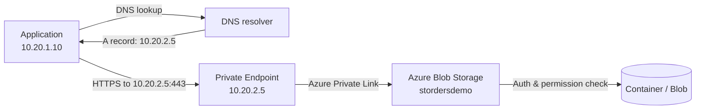
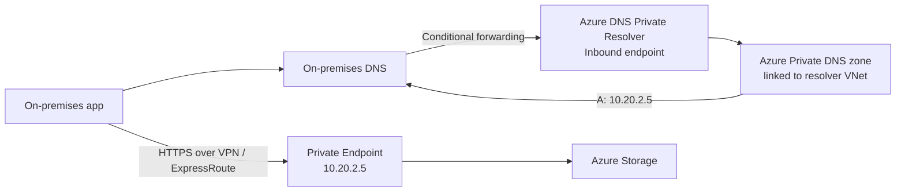

# Private Endpoints, Private Link, and DNS Resolution Flows

An application running inside an Azure Virtual Network (VNet) regularly needs to access services such as Azure Storage, Azure SQL Database, or Azure Key Vault. These services have familiar domain names and can expose public endpoints, yet many architectures require data traffic to travel over **private IP addresses**. Azure Private Link and Private Endpoints establish that private connectivity path; **DNS** determines whether the application actually uses the private path or still resolves the domain name to a public address.

This lesson belongs to the **Virtual Networks and Name Resolution** chapter of the **CLOUD_PROVIDERS_AZURE** module. The module explores the Microsoft Azure ecosystem from subscriptions, resource groups, and Microsoft Entra ID to virtual networks, compute, storage, data, deployment, monitoring, security, and cost control. In an Azure application architecture, Private Endpoints, DNS, and service authorization must be designed together so private connectivity works as expected.

After this lesson, you will be able to:

- Distinguish between Azure Private Link, Private Endpoint, Private Link Service, and Service Endpoint.
- Describe the connection flow from an application over a private address to an Azure service.
- Explain why the original service domain name is normally preserved while DNS returns a private IP.
- Configure a Private DNS zone, VNet link, and DNS zone group using a Blob Storage example.
- Design DNS resolution from other VNets, on-premises networks, and hybrid environments.
- Diagnose connectivity failures caused by approval state, routing, firewalls, DNS, or authorization.

## 1. The Problem: PaaS Services Have Public Domain Names

Suppose an API on Azure App Service or a VM in a VNet reads invoices from Storage Account `stordersdemo`. The blob access URL looks like:

```text
https://stordersdemo.blob.core.windows.net/invoices/invoice-001.pdf
```

This is the **standard service domain name**. By default, service DNS can direct clients to a public Azure address. Even though traffic may stay on Microsoft's backbone, a public address does not satisfy a requirement that “the service is accessed via a private IP inside the organization's VNet.”

An organization may need to:

- Allow only workloads in controlled networks to access data.
- Reduce the attack surface by not accepting requests through the service's public path.
- Connect from other VNets and on-premises networks over VPN or ExpressRoute.
- Keep existing application URLs and SDKs unchanged without rewriting code to call a hardcoded IP address.

The solution requires **two coordinated layers**: creating a private network path with a Private Endpoint and providing appropriate DNS records so applications follow that path.

## 2. Distinguishing Easily Confused Concepts

### 2.1. Azure Private Link

**Azure Private Link** is the capability for connecting to supported services over a private endpoint inside your Azure network. Traffic to the service traverses Microsoft's network infrastructure without requiring clients to connect to the service's public address. Azure supports Private Link for many Microsoft PaaS services, select partner services, and custom enterprise services published via Private Link Service.

Private Link is a **connectivity mechanism**. It does not automatically grant permission to read blobs, query SQL, or fetch secrets; service-level authentication and authorization layers still need configuration.

### 2.2. Private Endpoint

A **Private Endpoint (PE)** is a network interface created in a VNet subnet, assigned a **private IP**, and mapped to a specific Private Link resource/service. Clients connect to this private IP to consume the target service.

Example:

```text
VNet: vnet-orders-prod
Subnet dedicated to Private Endpoints: snet-private-endpoints
Private Endpoint: pe-blob-orders-prod
Illustrative Private IP: 10.20.2.5
Target: Storage Account stordersdemo, subresource blob
```

A Private Endpoint has a connection approved by the target service. Its connection state can be `Pending`, `Approved`, `Rejected`, or `Disconnected` depending on the workflow. Having a private IP exist is not enough to guarantee requests succeed; check connection state, routing, DNS, and authorization.

### 2.3. Private Link Service

**Private Link Service** is the component for a **private service provider** wanting to publish its own application so consumer networks can create Private Endpoints to it. For instance, a platform team puts an application behind a Standard Load Balancer and uses Private Link Service so other subscriptions can connect privately.

For Azure Storage, Azure SQL, or Key Vault, learners typically only create a **Private Endpoint pointing to the PaaS service**; you do not create a Private Link Service yourself.

### 2.4. How Does a Service Endpoint Differ from a Private Endpoint?

| Criterion | VNet Service Endpoint | Private Endpoint / Private Link |
|---|---|---|
| Service address clients connect to | Still uses the service's public endpoint/IP | Clients use the PE's private IP inside the VNet |
| Control model | Authorizes selected subnets/VNets on supported target services | Private connection path to a specific resource/subresource |
| DNS | Normally needs no private DNS zone to switch to a private IP | Requires DNS configuration so service hostname returns the private IP |
| On-premises networks | Not directly extended like a private IP inside a VNet | Reachable over hybrid networks with proper DNS resolution |
| Service scope | Only services supporting Service Endpoints | Services supporting Azure Private Link |
| Security note | Must still configure firewalls and data permissions | Must still configure data permissions and disable public access if desired |

Both mechanisms help protect connectivity; the choice depends on the service, network requirements, and architecture. Neither replaces Azure RBAC, database permissions, or application authentication.

## 3. Request Flow Through a Private Endpoint

Consider an API running on a VM in a VNet that can reach subnet `10.20.2.0/24`. The Storage Account has a Private Endpoint for the `blob` subresource at `10.20.2.5`.



Network and application sequence:

1. The API calls the familiar URL `https://stordersdemo.blob.core.windows.net`.
2. The DNS resolver returns the Private Endpoint's private IP within the configured network context.
3. The client opens a TCP/TLS connection to `10.20.2.5:443` via valid routes in the Azure VNet or hybrid network.
4. The Private Endpoint carries traffic to the linked Blob Storage resource over Private Link.
5. Storage still validates the Microsoft Entra ID token, SAS, Shared Key, or allowed auth mechanism, along with data-plane permissions.
6. The service returns the response over the connection.

**Important:** clients should continue using the **original service hostname**. Do not modify applications to call `https://10.20.2.5` or hardcode `privatelink.*` hostnames into URLs. TLS certificates, hostname verification, and service protocols expect the standard service name; DNS handles steering connections to the private IP.

## 4. DNS Is the Key to Taking the Right Path

Creating a Private Endpoint does not automatically make all applications query the private IP. If clients still receive a public IP from DNS, requests still take the public path per resolution results and will be rejected if public network access is disabled on the service.

### 4.1. Typical DNS Flow for Azure Blob Storage

When a Blob Storage Private Endpoint and DNS are properly configured, typical resolution looks like:

```text
Client queries:   stordersdemo.blob.core.windows.net
Public DNS:       CNAME stordersdemo.privatelink.blob.core.windows.net
Private DNS zone: A     10.20.2.5
Client connects:  10.20.2.5:443
TLS hostname:     stordersdemo.blob.core.windows.net
```

The CNAME chain above illustrates the standard resolution pattern. Exact CNAME records/chains can vary by service and configuration, but the core principle is that **the standard public name maps to a private IP for clients using VNet-linked DNS**.

A client outside the private network, not using private DNS, continues to receive a public address on lookup. If public network access has been disabled, the service rejects the public path; creating a Private Endpoint **does not automatically disable** the public path.

### 4.2. Azure Private DNS Zone and VNet Links

For Blob Storage, the standard zone is:

```text
privatelink.blob.core.windows.net
```

Inside the zone is an `A` record for the Storage Account:

```text
stordersdemo  IN A  10.20.2.5
```

For a VNet to use the zone's private records:

1. Create Azure Private DNS zone `privatelink.blob.core.windows.net`.
2. **Link the zone to the VNet** needing resolution using a virtual network link.
3. Create a **Private DNS zone group** on the Private Endpoint pointing to the appropriate zone so Azure manages the endpoint's DNS records.
4. Verify the `A` record, VNet link, and resolution results on an actual client.

A Private DNS zone and a VNet link are separate objects. The zone stores records; the **VNet link** lets that VNet's resolution environment see the zone. A VNet in the same subscription or peered with the Private Endpoint's VNet **does not automatically** get the right DNS answers unless connected to the proper DNS setup.

A **DNS zone group** integrates the Private Endpoint with the zone to create/update required records. If using self-managed DNS or another DNS model, establish a process to update records accurately whenever endpoint IPs change.

### 4.3. Common Private DNS Zones by Service

| Azure Service / Subresource | Typical Private DNS Zone |
|---|---|
| Azure Storage Blob (`blob`) | `privatelink.blob.core.windows.net` |
| Azure Data Lake Storage Gen2 DFS (`dfs`) | `privatelink.dfs.core.windows.net` |
| Azure Storage File (`file`) | `privatelink.file.core.windows.net` |
| Azure Storage Queue (`queue`) | `privatelink.queue.core.windows.net` |
| Azure Storage Table (`table`) | `privatelink.table.core.windows.net` |
| Azure SQL Database | `privatelink.database.windows.net` |
| Azure Key Vault | `privatelink.vaultcore.azure.net` |
| Azure App Service (websites) | `privatelink.azurewebsites.net` |

Each service or subresource may require its own Private Endpoint and zone. With Azure Data Lake Storage Gen2, applications may use both **blob** and **dfs** endpoints; configuring only one can cause certain operations to fail or take another path. For App Service, access to deployment endpoints (`scm`) may require specific DNS handling. Check supported subresources and DNS zones for each service before deploying.

## 5. DNS Flows in Default VNets, VNet Peering, and Custom DNS

### 5.1. Clients in a VNet Using Azure-Provided DNS

When a VNet uses Azure's default resolver, linking the matching Private DNS zone to the VNet enables VMs/apps inside it to resolve private records. Azure provides its platform DNS service at special address `168.63.129.16` for supported Azure network contexts.

Never configure on-premises hosts to query `168.63.129.16` directly. That address serves Azure-internal network contexts and is not a public DNS resolver queryable arbitrarily over the Internet.

### 5.2. Clients in Another Peered VNet

VNet peering provides a **network path** between an application VNet and the VNet hosting a Private Endpoint, but peering does not replicate Private DNS zone links.

Example:

```text
vnet-app       10.10.0.0/16  ---> API client
vnet-services  10.20.0.0/16  ---> Private Endpoint 10.20.2.5
```

For the application in `vnet-app` to work:

- Both networks must have routing/connectivity permitted to the PE's private IP.
- The DNS resolver used by `vnet-app` must return `10.20.2.5` for the Storage service's base hostname.
- Either link the same Private DNS zone to both VNets, or use a centralized DNS setup with appropriate forwarders.
- Check NSGs, UDRs, Azure Firewall, and Private Endpoint network policies wherever those components are in use.

When a VNet-integrated workload runs on App Service or Functions, verify DNS paths and outbound VNet integration on that workload itself; merely creating a PE for the data service does not guarantee App Service uses the private IP.

### 5.3. Clients Using Custom DNS

If a VNet declares custom DNS servers, clients normally query those DNS servers instead of querying Azure-provided DNS automatically. Custom DNS must be able to resolve service hostnames to private IPs.

A common pattern uses a DNS server/forwarder inside Azure:

```text
VNet Client -> Custom DNS -> conditional forwarder
                               |
                               +-> Azure-provided DNS (168.63.129.16)
                                   inside a VNet linked to the private zone
```

Do not arbitrarily create an authoritative `blob.core.windows.net` zone containing only a handful of internal records, as doing so can break resolution for all other Storage Accounts. Use `privatelink.blob.core.windows.net` per Azure design, paired with suffix forwarders, and verify both base names and CNAMEs.

## 6. DNS Resolution Flows from On-Premises over VPN or ExpressRoute

Private Endpoints can be accessed from on-premises networks when the enterprise has **private network connectivity** (site-to-site VPN, ExpressRoute, or a supported connectivity solution) and DNS capable of resolving private names.

A common architecture uses **Azure DNS Private Resolver**:



Sequence:

1. On-premises DNS receives a query for `stordersdemo.blob.core.windows.net`.
2. Using the matching conditional forwarding rule, on-premises DNS forwards the query to the Azure DNS Private Resolver **inbound endpoint** over private connectivity.
3. The Azure resolver looks up the Azure Private DNS zone linked to the appropriate VNet and returns the PE's private IP.
4. The on-premises client connects to the private IP over VPN/ExpressRoute rather than the public Internet.
5. Storage enforces authentication and data permissions as usual.

Under Microsoft's DNS design pattern, on-premises DNS should typically forward the **service's public suffix** such as `blob.core.windows.net` to the inbound endpoint so the entire CNAME chain resolves within the right Azure context. Exact rules depend on existing DNS infrastructure; check carefully to avoid conflicting with organization-managed zones.

Aside from Azure DNS Private Resolver, organizations can run DNS forwarder VMs in a VNet, taking ownership of availability, patching, and security for those DNS servers. Under either option, keep in mind:

- The inbound endpoint must be reachable over the network from on-premises DNS servers.
- The Private DNS zone must be linked to the VNet used by the Azure resolver for resolution.
- Routes to the Private Endpoint IP must exist bidirectionally per network design and not be blocked by policies/firewalls.
- Never point on-premises straight at Azure-provided DNS `168.63.129.16` over Internet/VPN as if it were a regular resolver.
- Test DNS answers from an **actual on-premises host**, not solely from an Azure VM.

## 7. Hands-On: Private Endpoint for Azure Blob Storage

The example below assumes an eligible subscription, Storage Account, VNet, and subnet already exist. These Azure CLI commands illustrate a real deployment; **do not run in production without reviewing network, permission, DNS, and cost impacts**. Private Endpoints, Private DNS zones, and DNS Private Resolver (if used) may incur separate charges.

### 7.1. Prepare Parameters

Assume:

| Item | Illustrative Value |
|---|---|
| Network resource group | `rg-network-lab` |
| Data resource group | `rg-data-lab` |
| VNet | `vnet-app-lab` |
| Subnet for PE | `snet-private-endpoints` |
| Storage Account | `stordersdemo` |
| PE | `pe-storders-blob` |
| DNS zone | `privatelink.blob.core.windows.net` |
| Region | `southeastasia` |

Ensure the subnet has enough free private addresses, the caller holds permissions to create network resources and Private Endpoints, and the target resource supports the `blob` subresource. If the principal creating the PE lacks approval permissions on the target service, the Storage Account owner may need to **Approve** the connection.

### 7.2. Retrieve Resource IDs and Create the Private Endpoint

```bash
RG_NET="rg-network-lab"
RG_DATA="rg-data-lab"
VNET="vnet-app-lab"
SUBNET="snet-private-endpoints"
STORAGE="stordersdemo"
PE_NAME="pe-storders-blob"
LOCATION="southeastasia"

STORAGE_ID=$(az storage account show \
  --resource-group "$RG_DATA" \
  --name "$STORAGE" \
  --query id -o tsv)

VNET_ID=$(az network vnet show \
  --resource-group "$RG_NET" \
  --name "$VNET" \
  --query id -o tsv)

az network private-endpoint create \
  --resource-group "$RG_NET" \
  --name "$PE_NAME" \
  --location "$LOCATION" \
  --vnet-name "$VNET" \
  --subnet "$SUBNET" \
  --private-connection-resource-id "$STORAGE_ID" \
  --group-id blob \
  --connection-name "plsc-storders-blob"
```

The endpoint is created in the specified subnet with its own network interface and private IP. Do not hardcode or assume the IP is `10.20.2.5`, as Azure allocates an address from the actual subnet configuration.

Inspect status:

```bash
az network private-endpoint show \
  --resource-group "$RG_NET" \
  --name "$PE_NAME" \
  --query "{name:name,connections:privateLinkServiceConnections,customDnsConfigs:customDnsConfigs}" \
  -o json
```

In the output, inspect `privateLinkServiceConnectionState.status` and DNS/address details. If `Pending`, get the connection approved on the target resource per organizational workflow before testing.

### 7.3. Create the Private DNS Zone, VNet Link, and DNS Zone Group

```bash
ZONE="privatelink.blob.core.windows.net"

az network private-dns zone create \
  --resource-group "$RG_NET" \
  --name "$ZONE"

az network private-dns link vnet create \
  --resource-group "$RG_NET" \
  --zone-name "$ZONE" \
  --name "link-vnet-app-lab" \
  --virtual-network "$VNET_ID" \
  --registration-enabled false

ZONE_ID=$(az network private-dns zone show \
  --resource-group "$RG_NET" \
  --name "$ZONE" \
  --query id -o tsv)

az network private-endpoint dns-zone-group create \
  --resource-group "$RG_NET" \
  --endpoint-name "$PE_NAME" \
  --name "default" \
  --private-dns-zone "$ZONE_ID" \
  --zone-name "blob"
```

After integrating:

```bash
az network private-dns record-set a list \
  --resource-group "$RG_NET" \
  --zone-name "$ZONE" \
  -o table

az network private-dns link vnet list \
  --resource-group "$RG_NET" \
  --zone-name "$ZONE" \
  -o table
```

You will see the `A` record for the Storage Account in the zone along with the created VNet link. If a DNS zone group or Private Endpoint spans multiple zones/subresources, verify every required record rather than checking only one zone.

### 7.4. Test from Inside the VNet

From a VM or workload inside the VNet with valid access paths:

```bash
nslookup stordersdemo.blob.core.windows.net
```

Expected output shows the base hostname (potentially via CNAME) resolving to the **PE's private IP**. Then test TCP/TLS connectivity:

```bash
curl -v --connect-timeout 5 https://stordersdemo.blob.core.windows.net/
```

`curl` may return `400` or `403` because the request lacks Blob Storage parameters or authentication. Those status codes **do not automatically indicate a Private Link failure**; separate DNS checks, TCP/TLS checks, and Storage authorization checks into distinct steps. To test reading a blob properly, use valid credentials and appropriate data-plane permissions.

On a Windows machine with PowerShell:

```powershell
Resolve-DnsName stordersdemo.blob.core.windows.net
Test-NetConnection stordersdemo.blob.core.windows.net -Port 443
```

Never treat results from an admin workstation outside the VNet as proof that apps inside the VNet receive the same private IP: DNS answers differ depending on where queries originate.

## 8. Security: What Private Endpoints Solve and What They Do Not

### 8.1. Disabling Public Access When Isolation Is Required

Once you have verified that applications traverse the Private Endpoint and all dependent workloads function, configure the service to **disable public network access** if appropriate. Exact settings depend on Storage, SQL, Key Vault, or the target service.

Recommended sequence of changes:

1. Design network paths, permissions, and DNS—including apps, deployment agents, backup jobs, and monitoring.
2. Create the Private Endpoint and wait for connection state `Approved`.
3. Configure private DNS and test from all required networks.
4. Confirm applications successfully read/write data over the private IP.
5. Restrict public network access per policy, keeping a rollback plan ready.
6. Verify the public path is no longer unintentionally reachable while the private path remains functional.

Disabling public access prematurely can sever CI/CD pipelines, Azure-hosted agents, administrators, or backup services still relying on the public endpoint.

### 8.2. Private Endpoints Do Not Replace Access Permissions

An application able to reach a Private Endpoint **must still be authorized** by the service. For example:

- Blob Storage: Azure RBAC data roles, SAS, or Shared Key if still permitted.
- Azure SQL: database authentication and permissions.
- Key Vault: Azure RBAC or vault access policies depending on permission model.
- Custom APIs via Private Link Service: application authentication/authorization.

A Private Endpoint also does not mean application payloads are automatically end-to-end encrypted by your app; enforce TLS and service-appropriate encryption mechanisms. Also audit permissions to fetch keys or secrets that could create indirect data access paths.

### 8.3. NSGs, UDRs, and Network Policies on the PE Subnet

Private Endpoints handle network policies uniquely. Applying **NSGs** or **user-defined routes** (UDRs) to traffic targeting a PE depends on the subnet's **private endpoint network policies** setting and supported capabilities.

Do not assume adding an NSG rule on a subnet automatically filters PE traffic. When designing firewall inspection or custom routing, verify subnet network policies, effective routes, prefix/longest-prefix-match rules, and service-specific documentation. Establish explicit rules, then validate empirically with Network Watcher tools.

## 9. Common DNS and Connectivity Errors

| Symptom | Possible Cause | How to Verify |
|---|---|---|
| Machine in VNet still receives public IP | Missing Private DNS zone/link or zone group; custom DNS not forwarding properly | Query from the workload itself; check CNAME, `A` record, VNet link, and DNS server |
| Returns `NXDOMAIN` when querying service | Private zone or custom DNS missing record; misconfigured split-horizon DNS | Inspect authoritative zone, records, conditional forwarders, and caches |
| VM in one VNet works, peered VNet fails | Second VNet lacks DNS link/forwarder or routes/NSGs | Inspect DNS and routing specifically for the second VNet |
| Azure VM works, on-premises fails | On-premises DNS not forwarding to Azure; missing routes to PE | Check inbound endpoint, DNS forwarding, VPN/ExpressRoute, and routes |
| DNS returns private IP yet TCP times out | Connection state not Approved, or route/firewall/NSG/UDR/service not ready | Check PE state, TCP 443, network policies, and service health |
| TCP/TLS succeeds yet service returns `403` | Missing data-plane permission, wrong token audience, expired SAS, or access policy | Check principal, service authorization, and credentials |
| ADLS Gen2 operations behave inconsistently | PE/zone exists for `blob` but missing `dfs`, or vice versa | Inspect actual subresources used by SDK/application |
| Connecting directly by IP fails certificate check | Hostname mismatches TLS certificate/SNI | Use the service's original FQDN and fix DNS |
| Different machines resolve differently | Different DNS resolvers, caches, or VNet links | Compare resolvers, TTLs, caches, routes, and workload configs |

### 9.1. Layer-by-Layer Diagnostic Workflow

When an application cannot connect:

1. **Hostname**: confirm the app calls the exact original URL, such as `stordersdemo.blob.core.windows.net`.
2. **DNS**: query from the exact environment running the app. Record the CNAME, returned IP, and queried DNS server.
3. **Network connectivity**: verify routes to the IP, NSGs/UDRs/firewalls, peering, VPN/ExpressRoute, and TCP/TLS.
4. **Private Endpoint**: verify target resource/subresource and connection state `Approved`.
5. **Target service**: check public network access, approved private connections, and firewall/network ACLs.
6. **Identity and permissions**: verify managed identity/service principal, token audience, Azure RBAC data roles, or service-native permissions.
7. **Application**: inspect logs by correlation ID and SDK config without printing raw tokens or secrets in logs.

Do not change DNS, RBAC roles, and firewalls simultaneously before isolating the root cause. Changing one layer at a time and re-testing verifies which adjustment actually works.

## 10. Scenarios Requiring Careful Design

### 10.1. Multiple Private Endpoints for the Same Resource

A single resource can have multiple Private Endpoints across different networks or regions. If the same hostname/subresource maps to multiple `A` records inside one shared Private DNS zone, clients may receive an IP unsuitable for their routing or region. Exercise particular caution when linking one zone across multiple VNets alongside multiple PEs for the same name.

DNS design must account for **which network region should receive which IP**, avoiding situations where a DNS zone group updates a record and disrupts other workloads. In multi-region topologies, analyze DNS models, cross-region reachability, failover, and endpoint lifecycles before choosing a shared zone vs. splitting zones per resolution domain.

### 10.2. Private Endpoint in One Subscription, Service in Another

A Private Endpoint and target resource can live in different subscriptions in supported scenarios. Determine the exact **target resource ID**, endpoint creation permissions, and approval authority from the service owner. Note that the VNet, private DNS zone, and target resource do not have to reside in the same resource group or subscription.

### 10.3. Serverless Apps and PaaS Platforms

App Service, Azure Functions, or other PaaS workloads may require **outbound VNet integration** to reach a Storage/Key Vault Private Endpoint. A Private Endpoint for **inbound access to an app** is distinct from VNet integration enabling **outbound access from an app**. Identify traffic direction before creating endpoints.

### 10.4. Cost and DNS Operations

Private Endpoints can incur hourly and data-processing charges; Private DNS zones, DNS queries, and Azure DNS Private Resolver also carry their own pricing models. Track costs by subscription/resource group, enforce ownership tags, and forecast expenses across endpoint counts, resolvers, and hybrid links. In operations, monitor IP changes, connection states, DNS records, connectivity alerts, and network configurations.

## 11. Practice Exercises

**Exercise 1 — Trace the DNS flow.** A VM in `vnet-app` calls `https://stordersdemo.blob.core.windows.net` and receives CNAME `stordersdemo.privatelink.blob.core.windows.net`, followed by `A` record `10.20.2.5`. Identify the TCP/TLS destination, the role of the VNet link, and why the application URL does not need to change to `privatelink.*`.

**Exercise 2 — Identify the fault.** Storage has an Approved Private Endpoint, yet an app in another VNet receives a public IP and gets `403` when Storage public network access is disabled. List DNS, network, and public/private access checks in order.

**Exercise 3 — Hybrid DNS.** An on-premises application must read Blob Storage over ExpressRoute. Diagram the flow from on-premises DNS to the Azure DNS Private Resolver inbound endpoint, to the Private DNS zone, and to the PE. Why should on-premises not point directly to `168.63.129.16`?

**Exercise 4 — Permissions.** A VM has a route to a Key Vault Private Endpoint and the vault hostname resolves to a private IP, yet it receives a permission error. Can Private Endpoint fix this error? Which layer must be checked?

**Exercise 5 — Choosing services.** An enterprise runs its own API behind a Standard Load Balancer and wants customers in other VNets to connect privately. Where is Private Link Service required, and where is a Private Endpoint created?

**Exercise 6 — Multiple networks.** Two VNets in two regions each have a Private Endpoint to the same Storage Account. List the risks when both `A` records are managed in one shared private zone and how to validate the DNS design.

## Conclusion

Azure Private Link provides private connectivity to supported services, while a **Private Endpoint is a private IP address inside a VNet** used by clients. **DNS decides whether clients actually reach that private IP**: standard service names typically traverse a CNAME and map through Azure Private DNS zones, VNet links, or appropriate DNS forwarding. In hybrid topologies, Azure DNS Private Resolver or DNS forwarders bring on-premises queries into Azure's private zone context. A working end-to-end connection always requires valid **Private Endpoint approval, DNS, routing, network security, and data-plane permissions**; once the private path is verified, the public path can be locked down according to workload policy.
