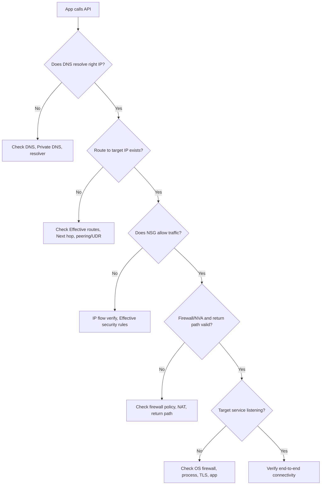
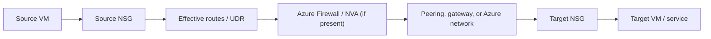
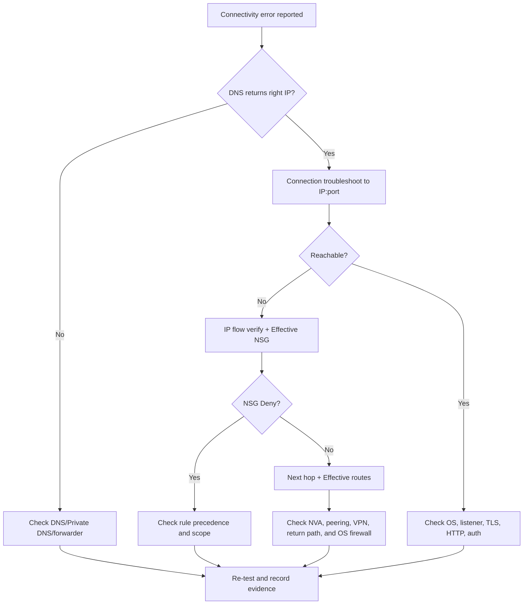

# Troubleshooting Connectivity with Network Watcher

An application running on Microsoft Azure may deploy cleanly yet still fail to connect from a web server to an internal API, from a VM to a database, or from the corporate network to a service inside a virtual network. When that happens, the key question is not merely **“can I ping it?”**, but rather: **did the domain name resolve properly, which route does traffic take, do Network Security Groups (NSGs) allow or block it, is there an intermediate firewall or appliance, and is the target service actually listening on the required port?**

**Azure Network Watcher** provides network-layer diagnostic tools to answer those questions. This lesson belongs to the **Virtual Networks and Name Resolution** chapter of the `CLOUD_PROVIDERS_AZURE` module. While learning the Azure ecosystem from subscriptions, resource groups, and Entra ID through virtual networks, compute, storage, and data, Network Watcher serves as the practical toolset for verifying connectivity, diagnosing deployment issues, supporting safe operations, and controlling monitoring costs.

## Learning Objectives

After this lesson, you will be able to:

- Identify the right issue to investigate using **Connection troubleshoot**, **IP flow verify**, **Next hop**, **Effective security rules**, and **Effective routes**.
- Prepare subscriptions, resources, access permissions, regional Network Watcher setup, and required agents/extensions for a diagnostic check.
- Use the Azure Portal or Azure CLI to test connectivity from an Azure VM to a target address and TCP port.
- Distinguish failures across **DNS**, **NSGs**, **UDRs/routes**, **Azure Firewall/NVA**, **peering**, **VPN/ExpressRoute**, and the **target service**.
- Understand each tool's scope limits and avoid concluding “the application works” solely because network traffic is allowed.
- Build an evidence-based troubleshooting workflow with minimal impact on production and a plan for ongoing monitoring.

## 1. Modeling Connectivity Before Opening Network Watcher

Suppose an application runs VM `vm-web` in subnet `snet-web` and an internal API on `vm-api` in subnet `snet-api`. The API serves HTTPS on port `443`. From the web machine, users get `Connection timed out` when accessing `https://api.internal.example`.

To investigate accurately, first describe the **connection flow** with at least six attributes:

| Attribute | Example | Diagnostic Relevance |
|---|---|---|
| Source | `vm-web` / IP `10.10.1.4` | Where the connection originates |
| Destination | `vm-api` / IP `10.20.2.4` | Where the connection lands |
| Target hostname | `api.internal.example` | Must resolve to the expected IP address |
| Protocol | TCP | Distinguishes from UDP/ICMP and matches app protocol |
| Destination port | `443` | Is the service listening on this port? |
| Expected path | VNet peering or internal route | Does live traffic actually follow the intended route? |

A connection can fail at multiple layers:



This diagram is a **reasoning framework**. Multiple faults can occur simultaneously—for example, DNS pointing to a wrong IP while an NSG also blocks the destination port. Never edit a single NSG rule and assume the incident is fully diagnosed.

### Packet Path Inside Azure

In a multi-tier design, traffic may traverse the following components:



Not every flow traverses all of these components. A single VNet has no peering; intra-subnet traffic may bypass an NVA; a private endpoint uses a different model than a traditional VM. Network Watcher helps inspect each observable segment of the connection path.

## 2. What Is Network Watcher and What Does It Support?

Network Watcher is Azure's network monitoring and diagnostics service, integrating with resources such as virtual networks, VMs, and network interfaces. Many capabilities are available directly in the Azure Portal and Azure CLI; some features require the **Network Watcher agent/extension** on VMs, resource permissions, or storage/log destinations for results.

Key tool categories:

| Tool | What Question Does It Answer? | Key Value / Limitation |
|---|---|---|
| **Connection troubleshoot** | Can the source reach the destination host/IP/port? | On-demand check returning status and hop/diagnostic data depending on source/target |
| **IP flow verify** | Does an NSG allow or deny a specific IP flow to/from a VM? | Identifies `Allow`/`Deny` and matching rule; does **not** prove a service is listening |
| **Effective security rules** | After merging subnet and NIC NSGs, which rules actually apply? | Reveals rule precedence and effective rules on a NIC |
| **Next hop** | Which next hop type is chosen for packets from a VM to a target IP? | Spots bad UDRs, NVA paths, or gateways, without proving app-layer success |
| **Effective routes** | Which routes exist on a NIC and where did they originate? | Shows system routes, peering routes, and user-defined routes |
| **Connection Monitor** | Does a connection consistently meet reachability/latency targets? | Periodic monitoring, trend tracking, and alerting; incurs feature-based costs |
| **Packet capture** | What exact packets enter/leave a VM? | Deep inspection; requires storage and strict data governance over captures |
| **Flow logs/traffic analysis** | What traffic patterns occur across the network? | Historical analysis; depends on supported log types and collection config |
| **Topology** | How are network resources connected? | Visualizes architecture, though a topology map does not prove live reachability |

Supported features, UI, and source/destination types vary across Azure regions, resource types, and tool versions. For example, not every Network Watcher check can originate directly from a PaaS service as if it were an Azure VM.

### Regional Scope of Network Watcher

Network Watcher is managed per **region** within a subscription. Before diagnosing a VM, verify Network Watcher is enabled for the **source VM's region**. Network Watcher resources are normally placed by Azure in a default resource group during enablement unless your organization manages them differently.

Enabling Network Watcher does not open NSG rules, connect VNets, or fix application DNS. It is an observation, testing, and monitoring toolset—not a substitute for network design.

## 3. Preparing a Diagnostic Test

Before choosing a tool, gather:

1. **Subscription, tenant, and region:** confirm you are inspecting the right environment, especially in multi-subscription organizations.
2. **VM/source resource:** name, resource group, resource ID, OS, and source IP used for diagnostics.
3. **Destination:** FQDN or IP, expected private/public IP, port, and protocol (`TCP`/`UDP`/`ICMP`) of the actual flow.
4. **VNet/subnet/NIC:** address ranges, route tables, NSGs on subnet/NIC, peerings, firewalls/NVAs, and gateways involved.
5. **Timing context:** when did failures begin, were there recent deployment/NSG/DNS/route edits, and is the issue continuous or intermittent?
6. **Permissions:** permissions to read network configuration and execute diagnostic tools; some operations require extra permissions on VMs, extensions, or storage accounts for logs.

In the Azure Portal, open **Network Watcher**, select the region, and pick the relevant tool. If a test requires the VM agent/extension, confirm the VM is running and the extension is healthy. For non-VM sources, features may follow distinct testing mechanisms or limits.

**Note:** A VM in `Running` state, valid-looking NSG rules, or VNet peering reporting `Connected` are never sufficient alone to conclude an application port is open. They are pieces of evidence to combine.

## 4. Connection Troubleshoot: Testing from Source to Destination

**Connection troubleshoot** is the right starting point when you know “source A cannot reach destination B on port P.” It tests reachability from supported sources and can return latency, hop details, or failure reasons depending on the scenario.

### Testing via the Azure Portal

1. Open **Network Watcher → Connection troubleshoot**.
2. Select subscription/resource group and an eligible **source**, such as VM `vm-web`.
3. Specify the **destination**: a supported resource, IP address, or FQDN.
4. Select the port/protocol matching your goal, such as TCP/443 for HTTPS.
5. Run the check and record status, destination IP, probe results, latency, and returned hops or error messages.
6. If the check fails, move to **IP flow verify** and **Next hop** to inspect NSG and routing layers.

Never substitute ICMP ping for an HTTPS port 443 check and extrapolate from it. Systems often **block ICMP** while serving TCP/443 normally, or allow ICMP while TLS/HTTP fails.

### Testing via Azure CLI

Sign in and select the right subscription:

```bash
az login
az account set --subscription "<subscription-id>"

az account show \
  --query "{subscription:id,tenantId:tenantId,name:name}" \
  --output json
```

Retrieve the source VM's resource ID:

```bash
SOURCE_VM_ID=$(az vm show \
  --resource-group "rg-app-lab" \
  --name "vm-web" \
  --query id \
  --output tsv)
```

Run diagnostics to the API's private IP on TCP/443:

```bash
az network watcher test-connectivity \
  --source-resource "$SOURCE_VM_ID" \
  --dest-address "10.20.2.4" \
  --dest-port 443 \
  --output json
```

This example syntax targets an Azure VM source. Substitute `rg-app-lab`, `vm-web`, and IP with values from your authorized environment. Depending on the check type, the CLI may require an agent/extension or additional source/destination flags. Run `az network watcher test-connectivity -h` to inspect parameters for your installed Azure CLI version.

Sample output fields might look like:

```json
{
  "connectionStatus": "Unreachable",
  "avgLatencyInMs": null,
  "probesSent": 10,
  "probesFailed": 10,
  "hops": []
}
```

The JSON above only **illustrates representative fields**, not a guaranteed fixed Azure output schema. Probe counts, hop data, and latency fields depend on test type and live connection behavior.

### Interpreting Results

- `Reachable`: probes connected successfully per the test method. Continue checking TLS, HTTP status codes, authentication, and business logic if the app still reports errors.
- `Unreachable`: the source failed to reach the target during probing; investigate DNS, NSGs, routes, firewalls, non-listening targets, or source-side issues.
- Elevated latency: may point to paths detouring through firewalls/NVAs, gateways, WAN links, or heavy load, though it should be corroborated with other measurements rather than jumping to conclusions from one metric.
- Hop/diagnostic details: suggest where traffic encountered trouble, though they may not represent an entire end-to-end packet trace.

If testing with an FQDN, confirm **which IP the FQDN resolved to from the source's context**. A successful probe to a public IP still violates intent if the architecture requires traversing a private endpoint.

## 5. IP Flow Verify: Which NSG Allows or Blocks Packets?

**IP flow verify** analyzes how Network Security Groups evaluate a specific IP flow involving an Azure VM. You supply:

- The VM to evaluate.
- Direction `Inbound` or `Outbound` from that VM's perspective.
- Protocol, **local** IP and port (on the VM side).
- **Remote** IP and port (the opposite side).

The output indicates **Allow/Deny** and the matching NSG rule. This is invaluable when NSGs exist on both the subnet and the NIC, or when many rules have competing priorities.

### Example: Checking Inbound Traffic to the API VM

The API VM has IP `10.20.2.4` with destination port TCP/443. The web VM has IP `10.10.1.4` using an ephemeral source port `55000`.

```bash
TARGET_VM_ID=$(az vm show \
  --resource-group "rg-api-lab" \
  --name "vm-api" \
  --query id \
  --output tsv)

az network watcher test-ip-flow \
  --vm "$TARGET_VM_ID" \
  --direction Inbound \
  --protocol TCP \
  --local "10.20.2.4:443" \
  --remote "10.10.1.4:55000" \
  --output json
```

Illustrative result:

```json
{
  "access": "Deny",
  "ruleName": "UserRule_DenyHttpsFromWeb"
}
```

For return traffic or outbound flows, set direction and local/remote relative to the **VM being evaluated**, not a vague mental model of “the app calling the API.” Source port `55000` is illustrative; live connections use dynamic ephemeral ports.

### Interpreting Results Within Scope

If `Deny`, inspect the NSG rule reported by Azure and adjust through change control: source/destination prefixes, application security groups, protocol, port, priority, and default rules.

If `Allow`, you can conclude only that **evaluated NSGs do not block the simulated flow with those parameters**. It does **not** prove that:

- Routing to the destination is valid.
- Azure Firewall or a network virtual appliance (NVA) permits traffic.
- The target guest OS firewall permits it.
- The API process is listening on TCP/443 with a valid TLS certificate.
- DNS resolved accurately.

Remember also that **NSGs are stateful**: once a valid connection is established, return packets for that flow are handled automatically; never create unnecessary reverse rules opening ephemeral ports simply because you observe random source ports.

## 6. Effective Security Rules: Finding the Rules Actually in Effect

A network interface can be governed by both a NIC-attached NSG and a subnet-attached NSG. User-created rules and default rules are evaluated within their respective scopes and orders.

**Effective security rules** show the combined rules computed for a NIC. In the Azure Portal, open the NIC or VM → Networking → **Effective security rules** (menu locations may vary with UI updates).

Via Azure CLI, query the NIC:

```bash
az network nic list-effective-nsg \
  --resource-group "rg-api-lab" \
  --name "nic-api" \
  --output json
```

What to inspect:

1. Which rules match the **Inbound/Outbound** direction, protocol, source/destination, and destination port?
2. Are NSGs attached to both the **subnet** and the **NIC**? Allowing at one layer does not override a block at the other.
3. Are priorities ordered properly? Within an NSG, **lower priority numbers have higher precedence**.
4. Are default rules such as `DenyAllInBound`, `AllowVnetInBound`, or `AllowInternetOutBound` affecting this case?
5. Do **service tags** or **application security groups** accurately match the actual source and destination?

Example: the subnet NSG allows `10.10.1.0/24 → TCP/443`, while the target NIC's NSG has a higher-priority rule blocking TCP/443. Looking only at the subnet NSG leads to the wrong conclusion.

**Design note:** Editing NSG rules in production can impact multiple VMs and services sharing a subnet. Modify only the rule proven to be the cause, keep source/destination/port scopes tight, assess blast radius, and save before/after evidence.

## 7. Next Hop and Effective Routes: Where Are Packets Sent?

When NSGs report `Allow` yet Connection troubleshoot still fails, the next layer to inspect is usually **routing**.

Azure provides **system routes** for baseline connectivity. Enterprises can add **user-defined routes (UDRs)** to steer traffic through Azure Firewall, NVAs, or gateways. VNet peering and hybrid links add their own routes as well.

### Next Hop: Routing Decision for an IP Pair

**Next hop** tests from a source VM to a specific destination IP, reporting which next hop type Azure selects.

```bash
az network watcher show-next-hop \
  --vm "$SOURCE_VM_ID" \
  --source-ip "10.10.1.4" \
  --dest-ip "10.20.2.4" \
  --output json
```

Output typically includes `nextHopType`, and depending on the case, `nextHopIpAddress` and route details. Common next hop types to know:

| Next Hop Type | How to Interpret |
|---|---|
| `VirtualNetwork` | Azure routes inside the virtual network via an eligible system route |
| `VirtualNetworkPeering` | Route targeting a peered VNet |
| `VirtualAppliance` | Route directs traffic to an NVA, such as a firewall |
| `VirtualNetworkGateway` | Route traverses a virtual network gateway where supported |
| `Internet` | Route points toward the Internet per network configuration |
| `None` | Traffic is dropped / no valid next hop per selected route |

A `VirtualAppliance` result does not prove the NVA accepted or forwarded packets; inspect firewall policies, IP forwarding, NAT, and return routes. If traffic was expected to traverse VNet peering yet shows `Internet` or `None`, check peering state, routes, or whether the target IP lies outside expected ranges.

### Effective Routes: The NIC's Complete Route Table

```bash
az network nic show-effective-route-table \
  --resource-group "rg-app-lab" \
  --name "nic-web" \
  --output json
```

Inspect fields such as address prefix, next-hop type, next-hop IP, state, and route source. Check:

- Which UDR is attached to the source subnet.
- Whether destination range `10.20.2.0/24` matches the expected route.
- Which route has the most specific prefix selected by **longest prefix match**, and route precedence if prefixes tie.
- Whether a `0.0.0.0/0` UDR pulls traffic to a firewall/NVA.
- When traversing an NVA, whether return paths are symmetric and IP forwarding is enabled on the NVA.
- For hybrid paths, whether VPN/ExpressRoute BGP advertisements and address spaces conflict or overlap.

Viewing effective routes shows the **actual active routing table**, not the idealized diagram in infrastructure docs.

## 8. DNS and Private DNS: Reach the Right Address First

Network Watcher does not replace full DNS diagnostic tooling. Succeeding by IP while failing by FQDN points directly to name resolution, DNS server settings, or DNS records.

### Testing from the Source VM Itself

On Linux:

```bash
nslookup api.internal.example

# Example checking API connectivity after name resolution
curl -vk --connect-timeout 5 https://api.internal.example/
```

On Windows PowerShell:

```powershell
Resolve-DnsName api.internal.example
Test-NetConnection api.internal.example -Port 443
```

In the example, `curl -k` is used strictly to **bypass certificate checks while observing connection behavior in a lab**—never use it in application code or as secure production TLS validation. In real testing, keep certificate validation enabled and check SAN/hostname, trust chain, and TLS versions.

Distinguish three distinct outcomes:

- FQDN resolves to the **wrong IP**: investigate DNS/Private DNS, forwarding, custom DNS servers, and caching.
- FQDN resolves accurately, **TCP times out**: investigate routes, NSGs, firewalls, OS, and service state.
- TCP opens, yet **TLS or HTTP errors**: inspect certificates, SNI, application gateway, backend health, auth, or application logs.

### Private Endpoint Scenarios

When accessing an Azure PaaS service via a **Private Endpoint**, the service hostname must resolve to the endpoint's **private IP** from the right network and DNS context. Check:

1. Is the private endpoint approved/connected, and what is its private IP?
2. Does the corresponding Private DNS zone contain the right record and link to the source VNet?
3. Do custom DNS servers or on-premises DNS forwarders return the right private IP?
4. Are routes and private endpoint network policies configured properly; some NSG/UDR controls on PE subnets depend on supported policy settings.
5. Is traffic accidentally hitting the **public** endpoint even though a private path is required?

You cannot conclude “the private endpoint works” solely because DNS returns a private IP. Continue verifying TCP connectivity, service authentication, and data-plane permissions.

## 9. Connection Monitor: When Continuous Observation Is Needed

**Connection troubleshoot** runs on-demand checks at a point in time. **Connection Monitor** executes scheduled tests per configuration to evaluate path quality and availability continuously over time.

Typical components configured in Connection Monitor:

- **Supported sources and destinations**: Azure resources, Internet endpoints, or external monitoring agents depending on feature support.
- **Test configuration**: protocol, test parameters, port, frequency, and thresholds.
- **Test group**: pairs sources, destinations, and test configurations.
- **Workspace / monitoring**: stores results per supported integrations for alerts and dashboards.

For example, operations can schedule periodic checks from `vm-web` to `vm-api:443` to track:

- Probe success percentage.
- Latency and jitter relative to baseline.
- Intermittent drops coinciding with route/NSG updates or maintenance windows.
- Alerts when consecutive probes fail.

Connection Monitor's strength lies in **historical data** and **trend signals**, especially for intermittent issues occurring only a few times a day. Consider test volume, source/destination placement, and retention duration, since monitoring and storage components can incur charges.

## 10. Packet Capture and Flow Logs: When Deeper Evidence Is Needed

When Connection troubleshoot, IP flow verify, and routing checks still leave gaps, gather deeper evidence from packet captures or flow logs.

### Packet Capture

Network Watcher supports **packet capture** on eligible sources—typically Azure VMs meeting agent/extension and configuration requirements. Captures can filter by:

- Source/destination IP.
- Protocol and port.
- Duration, packet size, or total capture storage limit.

Use cases: verifying whether `SYN` packets leave, whether `SYN-ACK` returns, or spotting `RST` packets, TCP retransmissions, or unidirectional traffic. However, captures can contain sensitive metadata and unencrypted payloads; strictly restrict access, duration, and storage locations per security policy.

### Flow Logs

Flow logs reveal traffic patterns over time and support historical analysis. Azure provides flow logging mechanisms depending on network layer and service generation. For new designs, **check current guidance on Virtual Network flow logs and the lifecycle of NSG flow logs** to avoid adopting legacy features being retired.

Flow logs do not replace full packet captures; flow records normally omit full packet payloads. Nor do logs guarantee enough detail to explain application-layer HTTP or TLS errors.

## 11. Systematic Diagnostic Workflow

When a ticket reports “web cannot call API,” follow this sequence to avoid blind configuration edits without evidence.

### Phase A — Confirm the Symptom

1. Record source/destination, FQDN, IP, port, error timestamp, and exact app error message.
2. Run a DNS lookup from the source and record the resolved IP.
3. Quickly test the port with `curl`/`Test-NetConnection` if you have machine access; distinguish timeout, reset, DNS failure, or HTTP/TLS failure.
4. Confirm you are inspecting the exact environment and subscription referenced in the ticket.

### Phase B — Inspect the Network Path

1. Run **Connection troubleshoot** between the exact source and destination IP/port.
2. If unreachable, run **IP flow verify** on the involved VMs in the right inbound/outbound directions to locate any blocking NSG rule.
3. Inspect **Effective security rules** to compare subnet and NIC NSGs.
4. Run **Next hop** and inspect **Effective routes** on the source side; review UDRs, NVAs, peerings, and hybrid routes.
5. Check firewalls/NVAs, Azure Firewall policies, on-premises networks, and the **return path** if intermediate appliances exist.

### Phase C — Inspect Target and Remediate

1. Confirm the target VM is running and the OS is listening on TCP/443.
2. Check host firewalls, TLS certificates, backend services, and application logs.
3. Choose the smallest targeted fix matching the verified root cause; snapshot existing rules/routes first.
4. Re-run the exact original test alongside real business verification; compare before/after evidence.
5. If failures recur over time, configure Connection Monitor and appropriate alerts.



## 12. Hands-On Lab: Web VM Cannot Reach API VM

This simulated lab builds diagnostic discipline. All addresses, VM names, and resource groups are **examples**, not pre-provisioned resources in your subscription.

### Topology

| Component | Illustrative Value |
|---|---|
| Source resource group | `rg-app-lab` |
| Source VM | `vm-web` |
| Source subnet | `snet-web`, CIDR `10.10.1.0/24` |
| Source private IP | `10.10.1.4` |
| Target resource group | `rg-api-lab` |
| Target VM | `vm-api` |
| Target subnet | `snet-api`, CIDR `10.20.2.0/24` |
| Target private IP | `10.20.2.4` |
| Endpoint tested | TCP/443 |
| Connectivity between VNets | Peering per lab design |

**Initial hypothesis:** the source machine cannot reach the API because the target NSG has a rule blocking TCP/443. However, operators must **verify** the hypothesis with tools rather than editing rules on a hunch.

### Step 1. Verify Name and IP

If an FQDN is used, query it from `vm-web` with `nslookup` and confirm it resolves to `10.20.2.4`. If it returns another IP, do not touch NSGs yet; investigate DNS first.

### Step 2. Run Connection Troubleshoot

From `vm-web` to `10.20.2.4:443`, record:

- Execution timestamp.
- `connectionStatus` and accompanying details.
- Returned hop, latency, or failure indicators.

For instance, `Unreachable` tells you further investigation is required—it does not solely prove an NSG fault.

### Step 3. Run IP Flow Verify

On `vm-api`, test an inbound TCP packet with:

```text
Direction: Inbound
Protocol:  TCP
Local:     10.20.2.4:443
Remote:    10.10.1.4:55000
```

If it returns `Deny` with a rule name, locate that rule in effective NSGs. Verify whether it was intentionally created as a block, whether it sits on the subnet or NIC, and whether business requirements justify modifying it.

### Step 4. Run Next Hop from the Source VM

With source `10.10.1.4` and destination `10.20.2.4`, check whether the expected peering route is chosen. If it does not match expectations, inspect peering state, address spaces, route tables, UDRs, and firewalls/NVAs.

### Step 5. Remediate Under Change Control

If you confirm only the target NSG blocks TCP/443 and network policy permits the flow, prepare a scoped change **allowing only approved sources/CIDRs to destination TCP/443**, respecting the system's NSG priority scheme. Avoid opening `Any → Any` or `0.0.0.0/0` on a subnet just to clear an error.

If Next hop reports a wrong route or a Firewall denies it, fix that specific component first. If Network Watcher shows the network path is open yet the API does not respond, inspect the process, OS firewall, TLS, and application instead of loosening NSGs further.

### Step 6. Validate After the Change

Re-run the exact same diagnostic check. Next, test the application over HTTPS with valid certificate verification and test credentials. Record `Connection troubleshoot`, `IP flow verify`, rule/route diffs, and HTTP results as audit evidence for peers and future incident correlation.

## 13. Common Errors and Diagnostic Clues

| Symptom | Likely Areas to Check | Priority Tools |
|---|---|---|
| `nslookup` returns public IP instead of private endpoint | Private DNS zone/record, VNet link, DNS forwarding | DNS from source VM, Private DNS config |
| IP flow verify returns `Deny` | NIC/subnet NSGs, rule priority, mismatched source/port | IP flow verify, Effective security rules |
| IP flow verify returns `Allow`, Connection troubleshoot fails | UDR, next hop, firewall/NVA, OS firewall, listener | Next hop, Effective routes, app logs |
| Route shows `VirtualAppliance` yet times out | NVA not forwarding, firewall policy/NAT, return route | Next hop, NVA logs, packet capture |
| Peering `Connected` yet API unreachable | NSG, route, forwarded traffic setting, target not listening | Effective routes, IP flow verify, Connection troubleshoot |
| TCP/443 open yet HTTPS errors | TLS certificate, hostname/SNI, reverse proxy, HTTP/app auth | `curl`, TLS diagnostics, application logs |
| Timeouts occur intermittently | Load, DNS cache, route/NSG edits, resource limits, network instability | Connection Monitor, metrics, logs |
| On-premises connectivity fails | VPN/ExpressRoute, BGP/route ads, NSG, return path, hybrid DNS | Effective routes, gateway logs, DNS from on-prem |
| Network Watcher tool fails to run | Region not enabled, RBAC, VM/agent/extension, unsupported source type | Azure Portal/CLI, resource/extension status |

### Distinguishing Network Errors from Application Errors

- `Name or service not known` / `NXDOMAIN`: primarily a name resolution issue.
- `Connection timed out`: could be filtering, bad routing, or an unresponsive target; do not default to blaming NSGs.
- `Connection refused` / TCP `RST`: target host or intermediate device actively rejected the connection; check listener/firewall.
- `HTTP 401/403`: TCP/TLS likely succeeded; inspect application or service authentication/authorization.
- `HTTP 502/503`: typically proxy, backend health, or target service availability; still verify network paths if upstream cannot be reached.

Never attribute an error code to a single cause before reading logs and checking context.

## 14. Permissions, Security, and Cost When Using Diagnostic Tools

**Permissions:** Operators need appropriate permissions to read VMs, NICs, NSGs, and routes and invoke Network Watcher actions. Read access to configurations and permission to run active tests or install extensions are not always identical. Grant least-privilege scoped roles via Microsoft Entra ID and log changes.

**Security:** Packet captures and flow logs can expose IPs, hostnames, connection timestamps, and more. Restrict who can view them, storage locations, retention periods, and export channels. Never paste topology details, credentials, or raw packet capture payloads into broadly accessible tickets.

**Operational safety:** Diagnostics are mostly observational, but editing NSGs/routes, installing extensions, or running packet captures can impact production workloads. Set limits, cap durations, verify change approvals, and maintain rollback plans.

**Cost:** Enabling Network Watcher and individual features carries varying cost models. Connection Monitor, packet capture storage, flow logs, Log Analytics ingestion, and retention can incur charges. Before enabling broad periodic monitoring, plan probe counts, frequency, log destinations, retention, and alerting scope.

**Post-lab hygiene:** Stop and remove temporary captures, monitors, or test logs when no longer needed; revert any temporary approved network rules; review accrued costs; and store diagnostic evidence in a governed repository.

## 15. Self-Check Questions

**Question 1.** Connection troubleshoot returns `Unreachable`. Can you conclude an NSG is blocking the traffic?

**Answer:** Not yet. It could be wrong DNS, routing, firewall/NVA, guest OS firewall, non-listening target, or an invalid test source. Use IP flow verify and routing diagnostics to narrow it down.

**Question 2.** IP flow verify returns `Allow`. Does that mean HTTPS is guaranteed to work?

**Answer:** No. That tool checks NSG evaluation for the declared IP flow; it does not test routes, intermediate firewalls, TCP listeners, TLS, HTTP, or authentication.

**Question 3.** When a VM has NSGs on both its NIC and subnet, which tool shows the combined active rules?

**Answer:** Effective security rules, paired with IP flow verify to identify the exact matching rule for a specific flow.

**Question 4.** To see whether traffic from a source VM to a target IP goes via an NVA or peering, which tool do you use?

**Answer:** Next hop for a specific IP pair, paired with Effective routes to view all active routes.

**Question 5.** Why might accessing a private endpoint by FQDN fail even when direct connectivity to its private IP succeeds?

**Answer:** The FQDN may be resolving to a public IP or wrong IP due to Private DNS zone, VNet link, forwarding, or DNS server misconfiguration. Check name resolution from the source.

**Question 6.** When should you use Connection Monitor instead of running only Connection troubleshoot?

**Answer:** When you need periodic monitoring, historical reachability/latency trends, detection of intermittent issues, or automated alerting.

**Question 7.** Is opening `Any/Any` on an NSG a good way to test connectivity?

**Answer:** No. Doing so widens exposure and can affect other systems. Identify the root cause, apply minimal targeted rules, and test under controlled change.

**Question 8.** If TCP/443 is open yet the application still reports `HTTP 403`, what is the next step?

**Answer:** Inspect authentication, authorization, and application/API policies; review logs, tokens, and permissions instead of loosening NSGs.

## Summary

Network Watcher moves Azure network troubleshooting from guesswork to **evidence-based diagnostics**. For a specific connection flow, start with the source, destination, and expected IP/port; verify DNS, run Connection troubleshoot, inspect IP flow verify and effective NSGs, check Next hop and effective routes, and then move to firewalls, the guest OS, and the application as needed.

Any single tool's output reflects only that tool's inspection scope. Combining tools in the proper sequence enables operations teams to fix the right layer, preserve security boundaries, monitor critical paths, and operate Azure applications more reliably.
