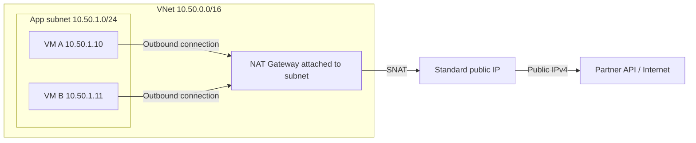
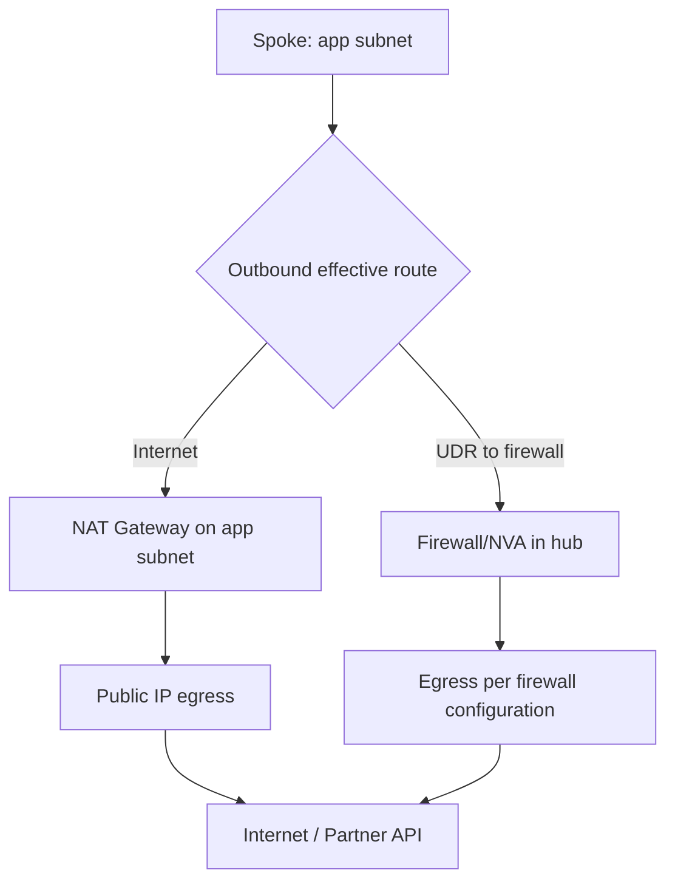

# Controlling Outbound Internet Traffic with NAT Gateway

An application running in Azure often needs to **initiate outbound connections** to call a partner's API, download updates, access SaaS services, or send data to a publicly addressed system. If the source IP address changes unpredictably, partners may block requests; if every virtual machine is assigned its own public IP, managing the Internet attack surface becomes much harder.

**Azure NAT Gateway** is a managed networking service that enables resources in a subnet to **initiate outbound IPv4 Internet connections** through one or more designated public IPs. Workloads do not need a public IP attached to each NIC to use this mechanism. NAT Gateway performs source address and port translation (SNAT) for outbound connections while allowing reply packets for established connections to return to the right source.

In the **CLOUD_PROVIDERS_AZURE** module, this lesson belongs to the **Network Connectivity and Security** chapter. Knowledge of NAT Gateway connects directly to VNet/subnet design, application deployment, partner allowlisting, incident troubleshooting, network security, and cost optimization on Azure.

## 1. Learning Objectives

After this lesson, you will be able to:

1. Explain NAT, SNAT, public IPs, and why private workloads can still reach the Internet.
2. Identify that NAT Gateway operates at the subnet level, handles outbound traffic, and does not provide arbitrary inbound access paths.
3. Distinguish NAT Gateway from Network Security Groups (NSGs), Azure Firewall, Load Balancer, NIC-attached Public IPs, and Private Endpoints.
4. Create a NAT Gateway, associate a public IP, and attach it to a subnet using Azure CLI.
5. Verify the egress address, compile IP lists for partner allowlisting, and analyze routing, port, and DNS issues.
6. Plan traffic limits, availability monitoring, SNAT capacity, and costs.

## 2. From Private IP to Public Source Address

Consider an application VM with private IPv4 `10.50.1.10`. The VM needs to make an HTTPS call to an Internet API. This private IP is not directly routable on the Internet. If the subnet is associated with a NAT Gateway having public IP `203.0.113.20` (a documentation address used solely for illustration), Azure can translate the outbound connection as follows:

```text
Before SNAT, inside the Azure network:
  10.50.1.10:50120   -> 198.51.100.30:443

After SNAT, leaving toward the Internet:
  203.0.113.20:62001 -> 198.51.100.30:443

Connection reply packet:
  198.51.100.30:443 -> 203.0.113.20:62001

Azure NAT Gateway looks up the mapping and forwards the reply back:
  198.51.100.30:443 -> 10.50.1.10:50120
```

The `203.0.113.0/24` and `198.51.100.0/24` blocks in this example are ranges reserved for documentation, not real addresses for deployment.

**SNAT (Source Network Address Translation)** translates the source IP address and may translate the source port of a connection. Azure tracks these flow mappings so multiple VMs and container instances can share the NAT Gateway's public IP set while still receiving their own reply packets correctly.

NAT Gateway performs this translation for **connections initiated by the workload**. A machine on the Internet cannot initiate a new inbound session to a VM simply because that public IP is attached to a NAT Gateway.

### Overall Model



The diagram emphasizes the **logical association** between the subnet and the NAT Gateway. NAT Gateway is an Azure platform service; it is not a router VM where you configure an internal IP, install software, or operate a separate NIC.

## 3. Components and Scope of NAT Gateway

| Component | Role |
|---|---|
| **VNet** | Virtual network containing the workload subnet |
| **Subnet** | Scope attached to NAT Gateway; eligible workloads in the subnet use this egress mechanism |
| **NAT Gateway** | Azure resource providing SNAT for eligible outbound Internet traffic |
| **Standard public IP** | Public IPv4 address used as the source IP after SNAT |
| **Public IP prefix** | Contiguous block of public IPs, making it easier to manage multiple egress IPs |
| **NIC / workload** | Traffic origin; typically needs only a private IP on the subnet |
| **NSG / route table** | Policy and routing layers remain in effect; NAT Gateway does not replace them |

One NAT Gateway can be associated with **multiple subnets within the same VNet** within Azure-supported configuration limits. A subnet can be attached to at most **one NAT Gateway** at a time. A NAT Gateway does not automatically become a shared outbound service for other subnets or peered VNets.

The NAT Gateway, public IPs, and VNet must be created in compatible regions and scopes per Azure rules. When availability zone requirements exist, evaluate zone settings for both the NAT Gateway and public IPs alongside your redundancy architecture; never assume a single egress address is protected from all zonal failures.

### Which Workloads Benefit?

Typical examples include VMs, VM Scale Sets, and workloads connected to a subnet supporting outbound connectivity via NAT Gateway. For PaaS services, behavior depends on each service's VNet integration mechanism. Never assume that merely creating a NAT Gateway in a VNet causes every Azure App Service, Function, database, or managed service to automatically route through it.

## 4. What NAT Gateway Handles and What It Does Not

### What NAT Gateway Does

- Provides a **predictable public IPv4 source address** for eligible outbound Internet connections from the subnet.
- Enables multiple workloads to share a pool of public IPs and SNAT ports.
- Manages SNAT mappings and reply packets for initiated connections.
- Supports scaling egress capacity by adding more public IPs or a public IP prefix within Azure-supported limits.
- Gives private workloads an explicit outbound path, reducing the need to attach public IPs directly to individual machines.

### What NAT Gateway Does Not Do

- **Does not open inbound ports** for Internet users to arbitrarily access VMs.
- **Does not replace a firewall** for filtering websites, domains, HTTP payloads, or detecting threats.
- **Does not replace an NSG** for deciding which traffic is permitted by port or protocol.
- **Is not a route next hop**: you do not configure a UDR pointing to a NAT Gateway the way you point to a network virtual appliance.
- **Is not an application proxy** and does not decrypt HTTPS.
- **Does not turn a private IP into a public IP** attached directly to a VM.
- **Does not fix DNS**, TLS certificates, API authentication errors, or application access permissions.

Reply packets for an outbound session are allowed back through the SNAT mapping; that is different from accepting **new inbound connections**. If a system needs inbound access from the Internet, design ingress separately using Application Gateway, Load Balancer, public endpoints, or another approved solution.

### Quick Comparison of Solutions

| Solution | Primary Purpose | Typical Use |
|---|---|---|
| **NAT Gateway** | Predictable IPv4 egress, subnet-level outbound SNAT | Private workloads calling Internet APIs or IP-allowlisted partners |
| **NIC-attached Public IP** | Public endpoint bound to a specific IP configuration | VMs requiring direct public access with strict inbound controls |
| **Azure Load Balancer** | Layer-4 traffic distribution and frontend | Load balancing multiple instances; outbound rules use separate mechanisms when needed |
| **Azure Firewall** | Centralized traffic protection and filtering policy | Destination control, services, FQDN filtering, logging, and firewall egress |
| **NSG** | Allow/deny network flows by rule | Controlling ports, protocols, and source/destination addresses at subnet or NIC |
| **Private Endpoint** | Access supported services via private address | Connecting to PaaS over a private network without traversing the public Internet to that target |

**Choose by objective:** if the business wants a fixed set of outbound IPs to share with partners, NAT Gateway is usually a good fit. If you must block unapproved domains or inspect traffic at higher layers, add Azure Firewall, a proxy, or an appropriate security service.

## 5. NAT Gateway and Routing Rules

NAT Gateway applies to eligible outbound Internet traffic from the subnet to which it is attached. However, actual traffic flow still depends on **effective routes**.

### When the Next Hop Is Internet

For matching outbound Internet routes, Azure applies the NAT Gateway to translate the source address before traffic leaves. NAT Gateway does not require attaching a public IP to every NIC or creating manual routes pointing to the NAT Gateway.

### When Routes Steer Traffic to a Firewall or NVA

If a subnet has a user-defined route such as `0.0.0.0/0` with a virtual appliance or Azure Firewall as the next hop, traffic will be forwarded to that appliance per the route. In this case, do not expect a NAT Gateway attached to the workload subnet to directly determine the egress public IP. The configuration of the firewall, next hop, and downstream path will determine how traffic exits to the Internet.

An architecture using Azure Firewall may use the firewall's own outbound mechanism or integrate with NAT Gateway depending on configuration and service support. Always inspect **effective routes** and verify the actual observed egress IP rather than checking only whether a NAT Gateway exists.

### When Accessing Destinations Over Private Paths

Traffic flowing over Private Endpoints, VNet peering, VPN connections, ExpressRoute, or other private paths does not automatically become Internet traffic requiring SNAT through NAT Gateway. Similarly, service endpoints use their own routing paths and mechanisms for supported services.

### When Workloads Already Have Public IPs or Legacy Outbound Paths

When a NAT Gateway is attached to a subnet with an appropriate Internet route, **new outbound connections** generally use the NAT Gateway instead of default outbound access or other workload SNAT paths. However, already-established connections and reply flows for inbound sessions may follow different handling. If a VM still has an instance-level public IP, that public IP can continue serving inbound traffic as designed and is not automatically removed by NAT Gateway.

Therefore, when migrating egress from a legacy mechanism to NAT Gateway, check:

1. The source address of **new** outbound connections.
2. Behavior of existing open connections.
3. Which IPs are currently configured in external allowlists.
4. NSG rules, route tables, and firewall configurations.
5. Whether the application has proper retry, reconnect, and timeout handling.

## 6. NAT Gateway Is Part of an Egress Policy, Not the Entire Policy

A company may want workloads to call only three partner APIs—for example, `api.partner-a.example`, `api.partner-b.example`, and an approved update endpoint. NAT Gateway provides a stable source IP, but **it does not restrict the list of destination domains**.

Control layers typically work together as follows:

| Layer | What It Decides |
|---|---|
| Application identity & tokens | Which workload is authorized to call the API or service |
| NSG | Which TCP/UDP flows are permitted by source, destination, port, protocol, and direction |
| UDR / Firewall / Proxy | Where traffic goes and what policy inspection it undergoes |
| DNS | Which IP address a target hostname resolves to |
| NAT Gateway | Which public source IP and SNAT ports are used for eligible outbound flows |
| Partner system | Whether the egress IP, token, mTLS certificate, and API request are accepted |

For example, an NSG rule allowing outbound TCP/443 does not ensure a workload can call only approved domains: countless websites also use TCP/443. If policy enforcement by FQDN, certificate, or application category is required, use a security layer capable of that inspection.

For connections to Azure Storage, Azure SQL, or PaaS services supporting Private Endpoints, evaluate keeping traffic on private networks rather than sending Azure-bound traffic out to the Internet through NAT.

## 7. Public IPs and Partner Allowlists

A common requirement: a partner only accepts API requests from a pre-registered set of public IPs. NAT Gateway consolidates outbound traffic from many workloads onto one or more public IPs.

Coordination workflow:

1. Create a Standard public IP or public IP prefix for the NAT Gateway.
2. Associate the NAT Gateway with the subnet containing the workloads.
3. Check effective routes and NSGs to confirm traffic actually uses the intended egress path.
4. From a workload, make a request to an organization-approved IP-echo test endpoint.
5. Compare the observed address against the public IP set attached to the NAT Gateway.
6. Send **all** public IPs that could be used to the partner for allowlisting.
7. Run functional validation tests and record the owner of the allowlist.
8. When changing public IPs, coordinate allowlist updates prior to cutover to avoid API disruption.

If a NAT Gateway has multiple public IPs configured, a workload may use different source addresses from that pool across different connections. **Never assume each VM gets its own fixed egress IP** or that all requests always use the first public IP.

For integrations requiring a single IP, size the public IP count and SNAT capacity accordingly while accepting the scale limits and redundancy trade-offs. Growing connection demand may eventually require adding more IPs and updating the partner allowlist.

## 8. SNAT Ports, Concurrent Connections, and Capacity Limits

A single public IPv4 address has a finite port space. Azure NAT Gateway uses **SNAT ports** to distinguish multiple concurrent sessions sharing a public IP. With standard NAT Gateway, one public IPv4 address provides a large SNAT port pool (commonly documented as **64,512 ports**); effective usable capacity depends on protocol, destination, and how Azure allocates and reuses ports.

Unlike configurations that pre-allocate fixed port counts per VM, NAT Gateway dynamically manages SNAT resources across workloads in the subnet. Demand depends on:

- Number of workloads and connection establishment rate.
- Concurrent connections, especially to the same destination IP and port.
- Connection lifetime and port-reuse cooldown intervals.
- How SDKs, HTTP clients, and apps use connection pooling or keep-alive.
- Number of public IPs attached to the NAT Gateway.
- Current service, subscription, and region limits.

### Example of SNAT Pressure

Suppose 200 instances continuously open short-lived HTTPS requests to a partner API, and every request opens a brand-new TCP connection. Even if total data volume is small, the rate of new connections per second and un-released port mappings can strain the SNAT pool.

How to improve it:

1. Use **HTTP keep-alive** and bounded connection pooling.
2. Reduce rapid TCP open/close churn and uncontrolled retries.
3. Apply exponential backoff on transient failures.
4. Add public IPs/prefixes when higher SNAT capacity is genuinely required, ensuring the partner allowlists them.
5. Monitor connection metrics, dropped packets, and application health.

### TCP Idle Timeout

Some TCP connections remain idle for extended periods. NAT Gateway has a configurable **TCP idle timeout** within service-supported bounds. Once a connection mapping has been inactive long enough, it can be reclaimed.

If an application holds connections open for long periods without traffic, the connection may fail when reused. Align timeouts across the NAT Gateway, HTTP client, connection pool, proxy, target API, and TCP keepalive mechanisms. Setting a longer idle timeout does not solve every error and keeps connection state occupied longer.

**SNAT port exhaustion** and DNS/TLS failures have different symptoms. When investigating, examine failure timestamps, connection counts, destinations, retries, routes, network metrics, and application logs instead of jumping to conclusions from a single timeout.

## 9. Hands-On Guide with Azure CLI

This example creates a test VNet with an application subnet, a Standard public IP, and a NAT Gateway. Commands are for **Bash / Azure Cloud Shell (Bash)**. Run only in an authorized subscription, as these resources can incur charges.

### Prepare and Confirm Subscription

```bash
az login

az account show \
  --query "{subscription:name, id:id, tenant:tenantId}" \
  --output table
```

If working across multiple subscriptions, select the right one before creating resources:

```bash
az account set --subscription "<SUBSCRIPTION_ID>"
az account show --query "{id:id, name:name}" --output table
```

Define variables for the example:

```bash
RG="rg-nat-lab"
LOC="southeastasia"
VNET="vnet-nat-lab"
SUBNET="snet-app"
PIP="pip-egress-lab"
NAT="nat-egress-lab"
```

These names are for a test environment only. Verify resource limits and regional support against your actual subscription.

### Step 1 — Create the Resource Group

```bash
az group create \
  --name "$RG" \
  --location "$LOC"
```

### Step 2 — Create the VNet and Subnet

```bash
az network vnet create \
  --resource-group "$RG" \
  --name "$VNET" \
  --location "$LOC" \
  --address-prefixes "10.50.0.0/16" \
  --subnet-name "$SUBNET" \
  --subnet-prefixes "10.50.1.0/24"
```

In this example, workloads use private IPv4 addresses from subnet `10.50.1.0/24`. Do not create address ranges that overlap with hybrid links or existing VNets.

### Step 3 — Create a Standard Public IP

```bash
az network public-ip create \
  --resource-group "$RG" \
  --name "$PIP" \
  --location "$LOC" \
  --sku Standard \
  --allocation-method Static
```

Inspect the address assigned by Azure:

```bash
az network public-ip show \
  --resource-group "$RG" \
  --name "$PIP" \
  --query "{address:ipAddress, sku:sku.name, allocation:publicIPAllocationMethod}" \
  --output json
```

The returned IP is a real public address, not the documentation addresses shown earlier. Record the IP and govern resource access and changes carefully.

### Step 4 — Create the NAT Gateway

```bash
az network nat gateway create \
  --resource-group "$RG" \
  --name "$NAT" \
  --location "$LOC" \
  --public-ip-addresses "$PIP" \
  --idle-timeout 10
```

This command attaches the existing public IP and sets the TCP idle timeout per the example configuration. You can use a public IP prefix when the design requires a larger address pool and the service supports it. Check metrics, resource limits, IP counts, and zone behavior for your chosen region/SKU.

### Step 5 — Associate the NAT Gateway with the Subnet

```bash
az network vnet subnet update \
  --resource-group "$RG" \
  --vnet-name "$VNET" \
  --name "$SUBNET" \
  --nat-gateway "$NAT"
```

Verify the association:

```bash
az network vnet subnet show \
  --resource-group "$RG" \
  --vnet-name "$VNET" \
  --name "$SUBNET" \
  --query "{subnet:name, natGateway:natGateway.id, prefix:addressPrefix}" \
  --output json
```

Verify the NAT Gateway configuration:

```bash
az network nat gateway show \
  --resource-group "$RG" \
  --name "$NAT" \
  --query "{name:name, state:provisioningState, idleTimeout:idleTimeoutInMinutes, publicIps:publicIpAddresses[].id}" \
  --output json
```

After this step, egress configuration is ready at the subnet level. **You still need a workload in the subnet, a valid Internet route, and an NSG permitting outbound traffic** to validate real connectivity.

### Step 6 — Verify the Egress IP from Inside a Workload

Sign in to a test VM in the subnet via a secure management method such as Azure Bastion or an authorized private path. From a shell inside the VM, call an **organization-approved source-IP echo service**:

```bash
curl -4 --fail --silent --show-error https://api.ipify.org
```

This command is only an example using a public IP echo service; if your enterprise provides an internal test endpoint, use that instead. The returned value must belong to the public IP set attached to the NAT Gateway when routing conditions are right.

Cross-check with:

```bash
az network public-ip show \
  --resource-group "$RG" \
  --name "$PIP" \
  --query "ipAddress" \
  --output tsv
```

Note: `az network public-ip show` reads Azure's configuration, whereas running `curl` **inside the VM** reveals the actual source IP observed on the Internet. If you run `curl` on your local laptop or in Cloud Shell, you will test that environment's IP rather than the VM's egress IP.

### Step 7 — Test the Application and Allowlist

- Verify the workload can call the partner API over HTTPS/TLS.
- Check partner logs or authorized observability tools to confirm the observed source address.
- Submit the active public IPs to the team managing the allowlist.
- Retry a fresh request after configuration changes while checking any long-lived open connections.
- Confirm background workers and infrequent scheduled jobs can also connect.

## 10. Changing NAT Gateway on a Live Subnet

Attaching a NAT Gateway to a production subnet can **change the public source address of new outbound connections**. Integrations relying on source IPs, long-lived sessions, connection pools, or external firewalls can be affected.

A change plan should include:

1. **Destination inventory**: partner APIs, SFTP servers, SaaS services, package repositories, and IP-allowlisted systems.
2. **Identify current egress path**: instance public IP, Load Balancer outbound, firewall, proxy, or another method.
3. **Prepare new public IPs**: register them in allowlists and confirm destination acceptance.
4. **Evaluate routes**: especially UDRs to firewalls/NVAs and private connections.
5. **Choose a deployment window**: with a rollback plan and active monitoring.
6. **Attach NAT Gateway** to the subnet; validate new outbound connections.
7. **Monitor for errors**: HTTP 401/403/429, TCP timeouts, connection resets, TLS, DNS, connection counts, and packet drops.
8. **Validate dependent workloads**: continuous processes, background jobs, and all instances.
9. **Update egress documentation and cost tracking**; remove the legacy outbound mechanism only after confirmation.

Do not remove existing public IPs or outbound mechanisms before confirming that workloads are actually exiting through the NAT Gateway. Already-open sessions may follow different paths or SNAT state than newly created sessions; applications need proper reconnect and retry behavior.

## 11. NAT Gateway in Hub-and-Spoke and Multi-Subnet Architectures

An enterprise design often includes:

- **Hub VNet**: hosts firewalls, DNS resolvers, or on-premises connectivity.
- **Spoke VNets**: host applications across different environments.
- **Application subnets**: require outbound connectivity to call public APIs.
- **Data subnets**: prefer private access and restrict egress as required.

A NAT Gateway is attached to a subnet and **is not automatically shared across VNet peering** like a centralized hub appliance. If individual spokes need direct, stable egress, NAT Gateways can be placed on their respective subnets/VNets. If security policy forces all Internet-bound traffic through a hub firewall, routes, firewall rules, and SNAT behavior behind the firewall must be designed together.

Example:



The two branches illustrate **alternative routing options**, not a single connection passing through both a spoke NAT Gateway and a hub firewall at the same time. Where to place a NAT Gateway must follow the actual traffic path and service support.

## 12. Monitoring, Logging, and Incident Investigation

For sustainable operations, monitor both the NAT Gateway resource and the workloads using it.

### Data to Monitor

| Source | Signals |
|---|---|
| Azure Monitor for NAT Gateway | Data throughput, SNAT connection counts, packet drops, and datapath availability metrics provided by the service |
| Azure Monitor / Network Watcher | Connectivity checks, effective routes, connection troubleshooting, and flow telemetry when configured |
| NSG and VNet flow logging | Traffic flows by source/destination/port within supported and configured scopes |
| Firewall or proxy | Denied flows and security events; details depend on service |
| Workload/application logs | Timeouts, DNS failures, TLS errors, HTTP status codes, and new connection rates |
| Partner API | Observed source IP address and allowlist rejection reasons |

Do not assume NAT Gateway provides per-URL or request-payload application logs. If domain-level or application-layer auditing is needed, implement logging at the firewall, proxy, API gateway, or application layer.

### Distinguishing Failures by Symptoms

**Case A: Cannot reach any Internet destination.**

Check VM status, DNS, effective routes, outbound NSGs, firewalls, UDRs, and NAT Gateway association. If a route sends traffic to a firewall instead of the Internet, having a NAT Gateway attached to the subnet does not guarantee traffic goes through it.

**Case B: General Internet works, but partner blocks requests.**

Verify the source public IP using an independent check endpoint, then compare against the allowlist and partner logs. HTTP 403 errors can also stem from tokens or app permissions; do not immediately assume a NAT failure.

**Case C: Failures occur only under high load.**

Inspect SNAT metrics, concurrent connections, connection creation rate, retries, and idle durations. Review connection pooling, add public IPs if needed, and verify the partner accepts the expanded IP set.

**Case D: Long-lived connections drop after sitting idle.**

Compare NAT Gateway idle timeout with proxy, target server, TCP keepalive, and client retry timeouts. Idle disconnects are not necessarily SNAT port exhaustion.

**Case E: Domain names fail to resolve.**

Check DNS resolvers, records, and DNS reachability first. NAT Gateway does not fix DNS issues or replace private DNS designs.

### Quick Investigation Checklist

```text
[ ] In the right subscription, VNet, and subnet?
[ ] Is the subnet associated with the right NAT Gateway?
[ ] Does the NAT Gateway have valid public IPs and Succeeded provisioning state?
[ ] Does the effective route for Internet destinations point to the expected next hop?
[ ] Do NSGs and firewalls allow the required flow?
[ ] Are workload DNS and TLS working?
[ ] Does an egress check endpoint return the expected public IP?
[ ] Has the partner allowlisted every IP that could be used?
[ ] Is there an abnormal spike in connections, retries, timeouts, or packet drops?
```

## 13. Performance, Availability, and Safe Operations

### Capacity and Scaling

NAT Gateway is Azure-managed so you do not maintain NAT servers, yet the resource still has limits on **throughput, public IP/prefix count, and SNAT ports**. Before deploying high-load environments, check current SKU and region limits, forecast peak connections, and design representative load tests.

Looking at total bandwidth alone is insufficient to estimate port exhaustion risk. A low-bandwidth system that creates massive numbers of short-lived connections can still exhaust SNAT capacity.

### Availability and Zones

Verify availability zone support and how NAT Gateway and public IPs are configured in your target region. For strict uptime targets, evaluate zone failure scenarios, egress dependencies, application retries, and multi-zone or multi-region strategies. NAT Gateway does not replace application-wide redundancy.

### IPv6

The examples and commands in this lesson focus on **outbound IPv4**. If workloads require Internet access over IPv6 or dual-stack, check service, SKU, region support, and corresponding egress mechanisms; never assume IPv4 NAT translates IPv6 traffic.

### Change Control

Never store secrets, tokens, or partner API credentials in network scripts. Public IPs and subnet names may live in IaC, while permissions to modify NAT Gateways, subnet associations, routes, and NSGs must follow least-privilege RBAC, peer review, and proper auditing.

## 14. Costs and Cleaning Up Lab Resources

NAT Gateway is a billable resource. Operating costs typically relate to NAT Gateway provisioning duration and data processed; public IPs or public IP prefixes may incur separate charges. Actual pricing depends on region, SKU, and current rate cards.

When evaluating a design, keep in mind:

- NAT Gateway can incur charges even with minimal traffic.
- Using many public IPs increases managed resources and may affect cost.
- Data transfer, firewall services, monitoring, and log storage may be billed separately.
- Centralizing egress can reduce per-VM public IPs, though it does not guarantee lower total cost in every architecture.
- Configure budgets and cost alerts for test environments if needed.

After the lab, delete only a **dedicated lab resource group** once you are certain it holds no shared resources and deletion is authorized. In shared or non-lab environments, disassociate the NAT Gateway from the subnet first, then review public IPs and dependent resources and delete per organizational procedures.

Never hastily delete a resource group if it still contains VMs, VNets, Key Vaults, data resources, or shared configurations used by others.

## 15. Design Example: Partner API Accepting Only a Public IP List

An enterprise runs three application VMs—`app-01`, `app-02`, and `app-03`—in subnet `snet-app`. The VMs must call an external payment API over HTTPS. The partner requires source IP allowlisting, and the enterprise wants no inbound Internet access opened to the VMs.

### Proposed Design

1. Place the three VMs in the application subnet with private IPs only.
2. Create a NAT Gateway with an approved Standard public IP and associate it with `snet-app`.
3. Ensure outbound Internet routing directs new API connections through the NAT Gateway.
4. Configure NSGs to allow only required flows; if domain filtering is needed, add an appropriate firewall/proxy.
5. Register all public egress IPs of the NAT Gateway with the partner API.
6. Verify the actual observed source IP from each VM and test the API with a valid token.
7. Monitor success rate, latency, retries, and SNAT connections during peak hours.
8. Document the procedure for rotating public IPs or adding more egress addresses.

**Expected outcome:** the VMs keep only private IPs, the partner API sees source addresses within the allowlisted public IP pool, the application handles transient connection failures via retries, and NAT Gateway exposes no inbound ports.

**Design limitation:** if security requirements demand FQDN filtering, DLP, TLS inspection, or detailed access logging, NAT Gateway alone is not enough. Add an appropriate network security layer.

## 16. Hands-On Exercise

### Scenario

You have a test subscription with subnet `10.50.1.0/24`. Two VMs in the subnet have private IPs only; they need to reach a public SaaS API over HTTPS. The SaaS provider requires source public IPs to be pre-registered.

Tasks:

1. Diagram the outbound flow before and after attaching a NAT Gateway, highlighting the source IP observed by the SaaS provider.
2. Create the test resource group, VNet/subnet, Standard public IP, and NAT Gateway using Azure CLI following the steps in this lesson.
3. Attach the NAT Gateway to the subnet and verify `natGateway.id` in the subnet properties.
4. Check the public IP state and its reference on the NAT Gateway.
5. From an authorized VM in the subnet, check the egress public IP using an organization-approved endpoint and compare it against the IP in Azure.
6. Describe how you would inspect NSGs and routes if the VM has working DNS yet cannot establish a TCP/443 connection to the Internet.
7. Explain why NAT Gateway does not allow Internet users to SSH directly into the VM.
8. Assume the application creates too many short-lived connections; propose fixes before adding more public IPs.
9. Write a plan for changing the egress IP without causing the partner to block API calls.
10. Identify the billable resources to clean up after the lab.

### Self-Check Questions

**Question 1.** Can a public IP attached to a NAT Gateway also be assigned to a VM's NIC at the same time? Why must their purposes remain separate?

**Question 2.** If a subnet has a UDR `0.0.0.0/0` pointing to Azure Firewall, will Internet traffic necessarily use a NAT Gateway attached to that same subnet?

**Question 3.** Does an NSG allowing only outbound TCP/443 guarantee a VM can call only three approved domains?

**Question 4.** Why must you provide all public IPs associated with the NAT Gateway to a partner when using multiple IPs?

**Question 5.** An API starts timing out frequently after scaling out instance count, even though DNS works and single requests succeed. How would you inspect metrics, connection counts, and HTTP client strategy?

**Completion criteria:** you accurately explain outbound SNAT, create and attach a NAT Gateway at the subnet level, verify the egress IP from inside a workload, distinguish routing/firewalls from NAT, and produce a safe rollout plan for IP-allowlisted integrations.

## Conclusion

Azure NAT Gateway enables private-IP workloads to use **outbound IPv4 connectivity with a managed public source address**. It is a valuable solution when applications must reach the Internet or IP-allowlisted partners without attaching public IPs directly to individual VMs.

Real-world designs must consider **subnets, effective routes, NSGs, firewalls, DNS, SNAT ports, redundancy, and costs** together. NAT Gateway solves source address translation for outbound traffic; access control, application protection, and security monitoring still rely on the other control layers in your Azure architecture.
