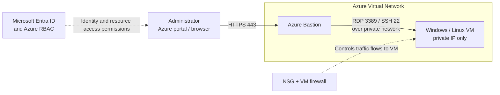

# Administrative Access to Virtual Machines with Azure Bastion

When administering virtual machines on Azure, engineers often need to sign in to Windows using Remote Desktop Protocol (RDP) or Linux using Secure Shell (SSH). Connecting directly from the Internet to a VM's public IP is easy for quick tests, but it exposes management ports to constant scanning and attack. In production architectures, VMs should have only private IP addresses and accept administrative connections exclusively through controlled access paths.

**Azure Bastion** is an Azure-managed connectivity service that lets authorized users open RDP or SSH sessions to virtual machines through the Bastion access endpoint without assigning public IPs to target VMs. In common configurations, administrators connect straight from the browser in the Azure portal; additional connectivity options depend on the SKU and enabled features.

In the **CLOUD_PROVIDERS_AZURE** module, you explore subscriptions, resource groups, Microsoft Entra ID, virtual networks, compute, storage, data, deployment, monitoring, security, and cost control for Azure application architectures. This lesson belongs to the **Network Connectivity and Security** chapter and focuses on designing, deploying, and operating **Azure Bastion** for secure VM administrative access.

## 1. Learning Objectives

After this lesson, you will be able to:

- Describe the connection path between an admin workstation, Azure Bastion, and a virtual machine.
- Explain why target VMs do not need public IPs and do not need RDP/SSH exposed directly from the Internet.
- Prepare a virtual network (VNet), dedicated Bastion subnet, Bastion public IP when required, NSGs, and permissions.
- Deploy Azure Bastion via the portal and inspect resources using Azure CLI.
- Use Bastion to open RDP sessions to Windows VMs or SSH sessions to Linux VMs.
- Distinguish Azure RBAC permissions from operating system sign-in accounts inside the VM.
- Troubleshoot connection failures, choose an appropriate SKU, and evaluate security, operational, and cost impacts.

## 2. How Does Azure Bastion Work?

**Azure Bastion** is a PaaS service deployed into your Azure network according to the model supported by its SKU. Bastion acts as an intermediary for administrative access; target VMs are reached via their **private IP addresses** inside the VNet or supported connected networks.

In the common browser-based workflow via the Azure portal:

1. The administrator authenticates to the Azure portal using a Microsoft Entra ID identity and must hold permissions to view/access the relevant resources.
2. The browser opens a secure HTTPS/TLS session to the Azure Bastion endpoint.
3. Bastion initiates the administrative connection to the VM's private IP over the Azure network.
4. The administrator authenticates against the **VM's operating system** using credentials or methods supported by the scenario/SKU.
5. RDP or SSH runs through the Bastion session instead of exposing VM ports 3389/22 to the Internet.



This diagram illustrates the Bastion model with an Internet-accessible endpoint. **Bastion's public endpoint is different from a VM's public IP**: in this model, target VMs still have no public IP. With a *private-only deployment* supported by eligible SKUs/features, Bastion can be designed around a private access endpoint; connectivity prerequisites and access flows differ accordingly.

### What Azure Bastion Does Not Do

- Bastion **does not replace** Windows/Linux OS sign-in credentials. Azure RBAC resource permissions do not automatically grant valid OS passwords or SSH keys.
- Bastion **does not automatically fix** blocked NSGs, VM host firewalls, or broken routes: traffic from Bastion to the VM must still be permitted.
- Bastion **is not** a general-purpose VPN for applications or a reverse proxy serving public websites.
- Bastion **does not patch** VMs, manage OS updates, rotate credentials, or detect every malicious action inside a session.
- Bastion eliminates the need to expose RDP/SSH on VMs, but it does not automatically make the VM or admin privileges completely secure.

## 3. Comparing Bastion with Other VM Access Methods

| Option | How Access Works | Considerations |
|---|---|---|
| Assign public IP to VM, open 22/3389 | Client connects directly to VM from Internet | Easily scanned on management ports; requires very strict protection |
| Azure Bastion | Browser or supported client connects to Bastion, then reaches VM over private IP | Reduces VM exposure; carries service cost plus network and SKU prerequisites |
| VPN / ExpressRoute | Admin workstation has a private network path into Azure | Fits broad internal/admin flows; requires managing connectivity and routing |
| Jump box VM | Sign in to an intermediate VM self-managed by ops team | Ops must patch, monitor, harden, and protect the jump box itself |
| Just-in-Time (JIT) VM access | Opens management ports on demand for a limited time window | Reduces port exposure window; can complement an access strategy |

For frequent RDP/SSH administration across many VMs in Azure, Bastion is a strong choice because Azure manages the intermediary infrastructure. However, factor in SKU, session counts, network connectivity, and costs instead of assuming one access pattern fits every workload.

## 4. Components to Prepare

Suppose you have an application running in VNet `vnet-app-prod` inside resource group `rg-app-prod` and need to administer two VMs:

```text
Subscription: sub-prod
Resource group: rg-app-prod
VNet:           vnet-app-prod       10.20.0.0/16
App subnet:     snet-app            10.20.1.0/24
Windows VM:     vm-win-prod         10.20.1.10 (illustrative)
Linux VM:       vm-linux-prod       10.20.1.11 (illustrative)
Bastion subnet: AzureBastionSubnet  10.20.254.0/26
Bastion host:   bas-app-prod
```

These IPs are design examples; actual IPs must come from your VM/NIC configuration and must not overlap existing ranges.

### 4.1. VNet and Dedicated Subnet with Exact Name

For a dedicated-subnet Bastion deployment, create a subnet named **`AzureBastionSubnet`** inside the VNet. This exact name is mandatory and must be separate from workload subnets. Plan a **/26 or larger** prefix per current deployment requirements; never place VMs or other workloads inside this dedicated subnet.

The example address `10.20.254.0/26` does not overlap `10.20.1.0/24`. Pick an address block considering the entire VNet address space, other subnets, and future growth. A dedicated subnet that is too small, occupied by other resources, or blocked by misconfigured routes/NSGs will prevent Bastion from deploying or working properly.

**SKU exception:** Some options like **Developer** use a different deployment model and do not require the same dedicated subnet resources as dedicated Bastion. Therefore, the `AzureBastionSubnet` steps in this lesson apply to dedicated Bastion models commonly used in environments with stricter operational requirements.

### 4.2. Public IP Belongs to Bastion, Not the VM

For dedicated Bastion deployments using a public endpoint model, you typically need a **Standard SKU public IP** with **Static** allocation for Bastion. This IP is Bastion's service endpoint; Windows/Linux VMs still need only private IPs.

Higher tiers support **private-only Bastion**, which omits the public IP used above; verify SKU, feature, and regional prerequisites before designing around it. Never attempt a private-only setup simply by omitting the public IP from standard deployment steps.

### 4.3. VM, NSG, and Management Services Inside the OS

For **Windows VMs**, RDP typically uses TCP port **3389**. For **Linux VMs**, SSH typically uses TCP port **22**. These ports must be allowed **from Bastion to the VM over the private network**, across subnet/NIC NSGs and any host OS firewall.

You do not need a rule allowing `0.0.0.0/0` directly to VM ports 3389/22. An NSG protecting the VM can allow management ports solely from the **AzureBastionSubnet address range** and any other approved internal management sources.

If you attach an NSG directly to `AzureBastionSubnet`, preserve **required Bastion service flows** such as HTTPS and Azure infrastructure control/management traffic per your SKU's documentation. Blocking all traffic and leaving only a single port 443 rule can break Bastion. Route tables or intermediate firewalls must likewise not block traffic between Bastion and VMs.

### 4.4. Identity and Permissions

At least two permission layers must be verified:

1. **Azure RBAC:** users hold the required roles to view the VM, NIC, and Bastion and initiate connections in the portal. Creating or modifying Bastion requires appropriate resource management permissions.
2. **OS authentication:** a valid Windows/Linux account, SSH key, or Entra ID sign-in method supported by both the VM and the active Bastion mode.

When connecting via Bastion in the portal, an account commonly needs **Reader** on the **target VM**, the **VM's NIC**, and the **Bastion resource**; depending on features or topology, permissions on related network resources may also be needed. Reader only allows viewing/initiating the connection flow and **does not mean** the user holds Administrator rights in Windows or `sudo` on Linux.

## 5. SKUs and Features to Evaluate

Azure Bastion offers SKU tiers with varying capabilities and costs. Common tier names/options include **Developer**, **Basic**, **Standard**, and **Premium**, though exact support and regional availability must be checked against current documentation and the portal.

| Need | What to Verify When Choosing a SKU |
|---|---|
| Quick VM login tests in simple setups | Verify Developer/Basic availability and limits in your region |
| RDP/SSH via Azure portal | Choose a SKU supporting browser-based connections |
| Native SSH/RDP client or tunneling | Check native client support, typically in tiers above Basic |
| Larger-scale ops with many sessions | Evaluate instance scaling, host scale units, and SKU limits |
| Session recording or private-only deployment | Check Premium features, configuration prerequisites, and costs |
| Reaching VMs across VNet peering | Verify peering support, routing, NSGs, and supported connection modes |

Do not rely on an old pricing table or screenshot to assume every feature is available. Open the **Bastions** blade in the Azure portal or official documentation to confirm your **subscription, region, SKU, and connection modes** prior to deployment.

## 6. Deploying Azure Bastion via the Azure Portal

This example uses a **dedicated Bastion with a public endpoint** and private-IP-only VMs. Names and IP ranges are illustrative; practice in a subscription you are authorized to manage.

### Step 1: Verify VMs and IP Addresses

1. Open [Azure portal](https://portal.azure.com/) and confirm the tenant and subscription.
2. Go to **Virtual machines** and select the target VM.
3. Check **Networking**: confirm the VM connects to `vnet-app-prod`, has a private IP, and does not need its own public IP.
4. Note the VM's resource group, region, VNet/subnet, and associated NSGs.
5. Confirm the VM is running, RDP/SSH is enabled, and you hold valid sign-in credentials.

### Step 2: Create AzureBastionSubnet

1. Open **Virtual networks** and select `vnet-app-prod`.
2. Go to **Subnets** and select Add subnet.
3. Enter the exact name **`AzureBastionSubnet`**.
4. Choose a non-overlapping range such as `10.20.254.0/26`.
5. Save and verify the subnet exists. If applying an NSG or UDR, check Bastion-specific requirements.

### Step 3: Create the Bastion Host

1. Search for **Bastions** and click **Create**.
2. Choose subscription/resource group and host name, such as `bas-app-prod`.
3. Choose the region matching the VNet and a SKU meeting your connectivity needs.
4. Select the VNet and `AzureBastionSubnet`.
5. For the public endpoint model, select or create a **Standard Static public IP** for Bastion.
6. Review SKU-specific options, costs, and configuration, then deploy.
7. Wait for provisioning status **Succeeded** before attempting connections.

On some Azure portal screens, you can trigger Bastion creation directly from a VM's **Connect → Bastion** blade; options, field labels, and SKUs may differ. Afterward, open the Bastion resource directly to verify its VNet, subnet, endpoint settings, and provisioning state.

### Step 4: Allow Traffic from Bastion to the VM

On the VM's NSG (subnet or NIC level), check inbound rules from `AzureBastionSubnet`:

| Source | Destination | Protocol / Port | Purpose |
|---|---|---|---|
| AzureBastionSubnet IP range | Windows VM private IP | TCP 3389 | RDP |
| AzureBastionSubnet IP range | Linux VM private IP | TCP 22 | SSH |

This represents the **flow from Bastion to the VM**, not the browser-to-Bastion direction. NSGs are stateful; alongside VM inbound rules, check routes, firewalls, and any outbound rules on the Bastion subnet.

### Step 5: Connect to a Windows VM via RDP

1. In the portal, open **Virtual machines** → Windows VM.
2. Select **Connect → Bastion**.
3. Choose the appropriate Bastion host if multiple are available.
4. Pick a supported authentication method and enter Windows credentials matching the VM configuration.
5. Click **Connect** to open the RDP session in a browser tab or window per current UI behavior.
6. Sign out or disconnect when administrative work is complete.

If signing in to Windows with a domain account or Entra ID, the VM must be configured to support that authentication method; do not assume every Windows machine accepts the same credential type just because you signed into the Azure portal.

### Step 6: Connect to Linux via SSH

1. Open **Virtual machines** → Linux VM → **Connect → Bastion**.
2. Choose the host and an SSH authentication method supported by the SKU/UI, such as username + password or SSH private key.
3. Supply valid Linux credentials; any private key must match a public key configured on the VM.
4. Open the terminal session and run a read-only command such as `whoami` or `hostname` to confirm the target host.
5. Close the SSH session when done; never store SSH private keys or passwords in shared documents.

Capabilities such as key upload, Azure Key Vault integration, copy/paste, or file transfer depend on SKU, configuration, and organizational security policies. Test them before standardizing them in operational runbooks.

## 7. Inspecting Bastion Infrastructure with Azure CLI

Azure CLI helps quickly inspect Bastion hosts, subnets, and VM private IPs. Examples use Bash or Azure Cloud Shell. Replace placeholders with real resource names; the commands below are **read-only**.

```bash
# Sign in and verify subscription
az login
az account set --subscription "<subscription-id>"
az account show --query "{subscription:id,tenant:tenantId}" --output table

# List Bastion hosts in a resource group
az network bastion list \
  --resource-group rg-app-prod \
  --output table

# Check Bastion SKU and provisioning state
az network bastion show \
  --name bas-app-prod \
  --resource-group rg-app-prod \
  --query "{name:name,sku:sku.name,state:provisioningState}" \
  --output json

# Check AzureBastionSubnet and its address prefix
az network vnet subnet show \
  --resource-group rg-app-prod \
  --vnet-name vnet-app-prod \
  --name AzureBastionSubnet \
  --query "{name:name,addressPrefix:addressPrefix}" \
  --output json

# Check private/public IPs attached to the VM
az vm list-ip-addresses \
  --resource-group rg-app-prod \
  --name vm-linux-prod \
  --output json
```

If your Azure CLI or extension version does not yet support a flag or feature, check `az network bastion --help` and update the CLI per organizational process. Never run create/delete commands directly against production without verifying the active subscription and resource group.

### Example Infrastructure Provisioning with Azure CLI

When creating a dedicated Bastion from CLI, prepare the VNet, subnet, and public IP first. The example below illustrates the core steps and should **only be run after verifying available address space**:

```bash
# VNet vnet-app-prod already exists with unused IP space.
az network vnet subnet create \
  --resource-group rg-app-prod \
  --vnet-name vnet-app-prod \
  --name AzureBastionSubnet \
  --address-prefixes 10.20.254.0/26

# This Public IP is for Bastion, not for target VMs.
az network public-ip create \
  --resource-group rg-app-prod \
  --name pip-bastion-prod \
  --sku Standard \
  --allocation-method Static

az network bastion create \
  --resource-group rg-app-prod \
  --name bas-app-prod \
  --vnet-name vnet-app-prod \
  --public-ip-address pip-bastion-prod \
  --location southeastasia \
  --sku Standard
```

The `bastion create` command may take additional flags or have constraints varying by CLI version, SKU, and configuration. This sample **does not replace verifying permissions, VNet/subnet sizing, NSGs, quotas, pricing, and regional availability**. Do not re-run create commands against existing resources without evaluating update impact.

## 8. VNet Peering and Multi-Environment Architectures

A company may run two subscriptions: `sub-shared` containing network management infrastructure and `sub-app-prod` containing production VMs. The goal is to use one Bastion in the management VNet to access VMs in other connected VNets where supported.

```text
sub-shared
  vnet-hub
    AzureBastionSubnet
    Bastion host
         |
         | VNet peering / supported private routing
         v
sub-app-prod
  vnet-spoke
    snet-app
      vm-prod-01 (private IP)
      vm-prod-02 (private IP)
```

This design requires checking:

- Whether the VNets, regions, and subscriptions meet Bastion, SKU, and connectivity prerequisites.
- Whether peering, route tables, NSGs, and firewalls allow Bastion traffic to reach target VMs.
- Whether IP ranges between hub and spoke are non-overlapping; in multi-tier hub/spoke topologies, never assume peering is transitive.
- Whether administrators hold sufficient Azure RBAC and guest OS login rights on VMs in the target subscription.
- Whether the operations team has tested connectivity in the required routing direction using private IP addresses.

Seeing a VM in the portal **does not prove** Bastion has network reachability to it. Conversely, having a clear network route **does not automatically grant** OS sign-in rights.

## 9. Permissions and Defense-in-Depth Layers

Bastion should be part of a multi-layered security model covering admin identities, Azure resource permissions, private networking, and VM operating systems.

### Azure RBAC vs. Operating System Permissions

| Task | Permissions to Verify |
|---|---|
| View Bastion, VM, and NIC to initiate connection | Azure RBAC at the right scope, typically starting from Reader per portal requirements |
| Deploy or modify a Bastion host | Azure RBAC for `Microsoft.Network`, VNet/subnet, and related public IP |
| Open an RDP session to Windows | Windows account permitted to sign in over RDP; VM/guest OS configured to allow it |
| Open an SSH session to Linux | Linux account and permitted SSH authentication method |
| Sign in to guest OS using Microsoft Entra ID | VM must have compatible settings, extensions, roles, and connection mode |
| Modify NSGs or route tables | Azure RBAC on network resources; changes require approval |

**Microsoft Entra ID governs Azure identities and resource access; the VM OS enforces its own authentication/authorization layer.** Holding Azure RBAC Reader or Contributor on a VM does not automatically reveal a Windows password or supply an SSH private key.

### Principles to Apply

- **Do not assign public IPs to managed VMs unless required by architecture.** Once Bastion is verified, audit and remove leftover public IPs and direct Internet RDP/SSH rules.
- **Minimize privileges:** assign roles at narrow scopes, using Entra groups and PIM for privileged elevation where feasible.
- **Protect sign-ins:** enforce MFA/Conditional Access on the Azure portal; manage guest OS credentials under separate security policies and avoid shared accounts.
- **Restrict network paths:** allow management ports to VMs only from the Bastion subnet or approved internal management ranges; inspect NSGs on both subnets and NICs.
- **Protect admin workstations:** avoid leaving SSH keys, passwords, or tokens in clipboards or unencrypted storage.
- **Track changes:** enable monitoring and logging for Bastion, VMs, NSGs, RBAC, and network flows per service capabilities.
- **Adopt advanced features deliberately:** native clients, tunneling, file transfer, or session recording (where available) should align with organizational security policy.

## 10. Monitoring, Access Sessions, and Cost

Administrative access is a sensitive operation. You need visibility into who can reach VMs, when Bastion infrastructure changes, and whether anomalous activity occurs.

**Useful observation sources:**

1. **Azure Activity Log:** management operations such as creating, modifying, or deleting Bastion/NSGs or changing role assignments.
2. **Microsoft Entra sign-in/audit logs:** sign-ins and identity operations associated with Azure administration.
3. **Guest OS logs:** such as Windows Event Logs or Linux SSH/auth logs capturing actual OS-level logins on the VM.
4. **Azure Monitor, metrics, and diagnostics:** resource health, status, and telemetry provided by the SKU/service.
5. **Session recording if supported by SKU:** enable only after reviewing who can view recordings, recording scope, storage location, and retention limits.

Never assume Azure Activity Log captures keystrokes, screen output, or shell commands inside an admin session. Session recording and forensic capture depend on Bastion features, logging configuration, and guest OS auditing policies.

**Costs:** Bastion can incur charges based on SKU, deployment duration, and data/feature usage; a dedicated Bastion host running with zero active user sessions still accrues hourly charges. Public IPs and log storage can also carry separate costs. Check current pricing, set an Azure Budget, and clean up lab resources afterward. When deleting a lab Bastion, verify whether its public IP, NSG, or subnet is still needed by other resources before removing them.

## 11. Troubleshooting Bastion Connectivity

Investigate in order—**resources → permissions → network path → OS → authentication**—rather than hastily opening ports to the Internet.

| Symptom | Possible Causes | Check and Resolution |
|---|---|---|
| Cannot create Bastion | Missing `AzureBastionSubnet`, CIDR too small or overlapping, permissions/quota/SKU-region mismatch | Verify subnet name, prefix, region, SKU, and deployment error details |
| Bastion option missing or VM unselectable | No compatible Bastion, missing RBAC Reader, unsupported VNet/peering setup | Verify Bastion resource, IAM on VM/NIC/Bastion, and connectivity config |
| Bastion provisioning fails | Incompatible NSG/routes, wrong subnet or public IP, platform issue | Inspect deployment operations, host status, subnet, and required NSG rules |
| Session window opens but RDP/SSH times out | Blocked by NSG/firewall/UDR, VM stopped, RDP/SSH service not running | Verify VM private IP, effective NSGs, routes, and listening port/service in guest |
| RDP reports invalid credentials | Wrong username, password, or Windows RDP logon policy | Check username format, `Remote Desktop Users` group, and account state |
| SSH reports `Permission denied` | Wrong username, SSH key, or `sshd` settings | Check auth method, public key on VM, and guest auth logs |
| Connection to VM in peered VNet fails | Broken peering/route/NSG, or unsupported connection mode/SKU | Verify peering between both VNets, private IP, scope, and feature support |
| Portal works, yet RDP/SSH fails | Azure login does not replace guest OS privileges | Verify credentials and permissions inside Windows/Linux |
| Slow or disconnecting session | User network quality, session/SKU limits, high VM load, browser policies | Check VM load, browser, metrics, and compare against SKU limits |

### Practical Troubleshooting Workflow

1. **Bastion:** confirm provisioning state is `Succeeded` and the right host/SKU/VNet is selected.
2. **Virtual machine:** verify the VM is running, along with its private IP, NIC, and actual subnet.
3. **Permissions:** check effective Azure RBAC on the VM, NIC, and Bastion, without confusing it with guest OS rights.
4. **Network path:** check effective NSG rules and effective routes on the NIC plus the VM host firewall; RDP 3389/SSH 22 only need to allow the Bastion source.
5. **VM services:** verify Windows Remote Desktop or the SSH daemon is running, listening on the expected port, and the account is not locked out.
6. **Logs:** inspect connection error messages, Activity Log, guest OS logs, and supported monitoring telemetry.
7. **Remediate:** fix the specific root cause and retest; avoid temporary workarounds opening `3389/22` to the entire Internet, which introduce new risk.

If using private-only Bastion or native client tunneling, the traffic path differs from the typical browser-based diagram. Match your troubleshooting to the actual mode in use.

## 12. Real-World Scenario: Operations Team Managing a Multi-Tier Application

An e-commerce system runs two Linux VMs for APIs, one Windows VM for administrative tasks, and a private database. All VMs sit in an application subnet with private IPs only. Operations engineers need SSH and RDP access during incidents while controlling costs and avoiding public management ports.

**Recommended design:**

1. Use a VNet or supported hub/spoke topology; reserve `AzureBastionSubnet` with sufficient space for dedicated Bastion.
2. Deploy Bastion in the management VNet, selecting a SKU aligned with browser-based SSH/RDP needs, session count, native client usage, and audit requirements.
3. Keep VMs in workload subnets with private IPs only. VM NSGs allow SSH/RDP solely from the Bastion subnet and approved internal management sources.
4. Grant Azure RBAC at the minimum required scope to the ops team; manage Windows/Linux accounts and SSH keys individually without shared credentials.
5. Log administrative actions, test connectivity during deployment, and establish session-termination procedures.
6. Periodically review Bastion SKU, concurrent session usage, cross-VNet access rules, costs, and security settings.

Each control solves a different layer: **Bastion** provides the access path; **NSGs and routing** control network reachability to the VM; **Azure RBAC** governs who can manage resources; and the **VM OS** enforces who can log in and run commands.

## 13. Hands-On Exercises

### Exercise A: Deploy and Connect

In an authorized lab environment:

1. Create a VNet and a Linux VM with a private IP only. Confirm the VM has no public IP.
2. Create `AzureBastionSubnet` with an appropriate CIDR, then deploy a dedicated Bastion host using an authorized SKU.
3. Ensure NSGs allow SSH to the VM only from the Bastion subnet range while permitting required Bastion control flows.
4. From the portal, open an SSH session via Bastion and run `whoami` and `hostname` to confirm the target machine.
5. Close the session, inspect Activity Log and guest auth logs, and note which log source captures which actions.
6. After the lab, clean up **only the resources created by this exercise**, following dependency order and environment policies.

### Exercise B: Troubleshooting

Your Bastion host shows `Succeeded`, yet SSH to the Linux VM consistently times out. The VM is running, has a private IP, and uses a valid SSH key. List four places to check before changing credentials.

**Hint:** NSG on the VM's NIC/subnet, routes/peering, Linux host firewall, and `sshd` service status / port 22. A timeout differs from `Permission denied`; check the network path first.

### Exercise C: Distinguishing Permissions

An engineer holds Azure RBAC Reader on the VM, NIC, and Bastion, can open the connection form in the portal, yet Windows sign-in fails with an authorization error. They request Owner on the subscription. What should you inspect?

**Hint:** Windows/RDP sign-in rights inside the guest OS, username format, and authentication policies. Subscription Owner does not automatically grant a valid Windows OS account.

## 14. Checklist Before Using in Production

- [ ] Target VMs have private IPs only; RDP/SSH are not exposed directly to the Internet without a special approved exception.
- [ ] Bastion SKU and region verified against required features.
- [ ] `AzureBastionSubnet` created with exact name and CIDR sized for dedicated deployment.
- [ ] Bastion's public IP (if used) has a supported SKU/allocation method and is not mistakenly attached to a VM.
- [ ] NSGs and routes allow mandatory Bastion flows while blocking RDP/SSH from untrusted sources.
- [ ] Azure RBAC verified on Bastion, VM, and NIC alongside OS-level login privileges.
- [ ] Tested Linux SSH, Windows RDP, or the actual connection methods required by workloads.
- [ ] If using VNet peering, verified support, non-overlapping IPs, routing, and policies between both networks.
- [ ] Monitoring, logging, incident response runbooks, and session termination practices configured.
- [ ] Named owner for the Bastion host, documented configuration, cost forecast, and review schedule in place.

## Conclusion

Azure Bastion provides a managed RDP/SSH access path so operations teams can connect to VMs via **private IP**, eliminating the need to expose VM management ports to the Internet. Proper deployment requires a dedicated subnet, appropriate SKU and endpoint model, NSG/routing controls, Azure RBAC governance, and OS-level authentication. Once in production, continue monitoring admin sessions, enforcing least privilege, troubleshooting layer-by-layer, and tracking Bastion costs in your Azure architecture.
