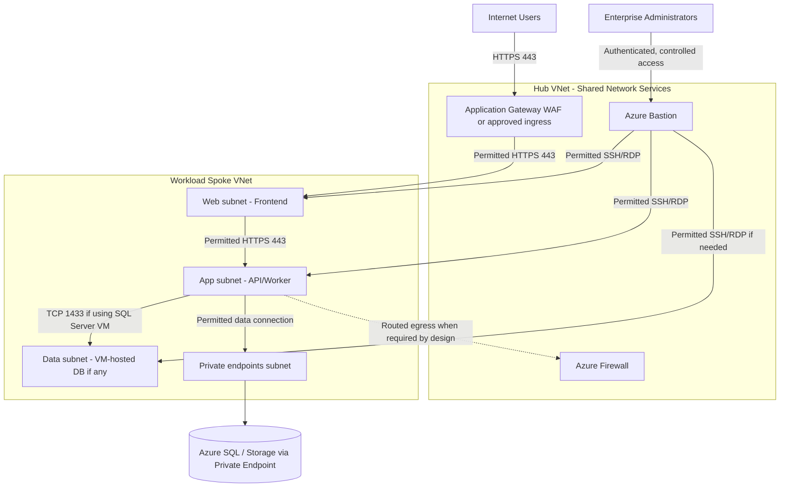

# Separating Management, Application, and Data Networks

In Microsoft Azure, an application may have a user-facing web portal, business-logic APIs, databases, and administrative tooling. If all of them sit on the same network able to connect freely to one another, a single compromised web server can become a launchpad to reach management hosts, databases, or other services. Therefore, **network segmentation** is a core part of security architecture.

Separating management, application, and data networks means designing distinct **trust zones**, explicitly defining which connections are required between them, and then applying Azure control layers to allow only those flows while denying the rest. This structure reduces *lateral movement*, shrinks the attack surface, and simplifies monitoring and incident response.

This lesson belongs to the **Network Connectivity and Security** chapter in the Microsoft Azure module, building on subscriptions, resource groups, Microsoft Entra ID, virtual networks, compute services, storage, and data. It implements a multi-tier design spanning VNets and subnets through Network Security Groups (NSGs), Azure Firewall, Azure Bastion, Private Endpoints, DNS, and access governance.

## Learning Objectives

Upon completion, you will be able to:

- Explain the goal of network segmentation and distinguish network boundaries from identity or account boundaries.
- Design **ingress, web, application, data, and management** zones using VNets/subnets or multiple VNets.
- Build a **connectivity matrix** specifying source, destination, port, protocol, and business justification.
- Understand NSG rules, priorities, and why inter-subnet traffic must be controlled.
- Compare subnet-level separation against **hub-and-spoke** architectures, Azure Firewall, and user-defined routes (UDRs).
- Explain how Azure Bastion, Private Endpoints, and private DNS reduce exposure of management ports and data services.
- Practice configuring NSGs for a multi-tier network with Azure CLI, verify results, and troubleshoot common failures.

## 1. Why Separate Network Tiers?

Consider an order-management application with four components:

1. **Web frontend:** receives HTTPS requests from users.
2. **API/application server:** runs business logic and calls external services.
3. **Database or storage:** holds order records, invoices, and file attachments.
4. **Administrative tooling:** SSH/RDP, monitoring, OS patching, deployment, or incident recovery.

If every component is permitted to reach every other component, lateral reachability inside the system becomes overly permissive. For example, a vulnerability on the frontend could let an attacker probe database ports, management services, or unrelated hosts.

Network segmentation restricts which paths can be used:

- Internet users access only **defined public entry points**, such as Application Gateway/WAF.
- The web frontend may connect only to the API on permitted application ports.
- The API connects only to the required databases or data services over designated protocols.
- Databases have no reason to accept connections from the Internet or the web subnet.
- Administrators reach systems over controlled management channels rather than opening public SSH/RDP on every machine.

**The goal is not merely splitting IP space into multiple subnets.** Subnets inside the same Azure VNet can communicate with one another via default system routes. Without NSG rules, firewalls, or equivalent controls, placing machines in separate subnets does not create the intended security boundary.

## 2. Distinguishing Boundaries to Protect

| Boundary | Common Azure Mechanisms | Purpose | What It Does Not Guarantee Alone |
|---|---|---|---|
| **Subscription / resource group** | Azure RBAC, Azure Policy, locks | Admin delegation, policy enforcement, and resource grouping | Does not block IP packets between two VMs |
| **VNet** | Address space, peering, VPN/ExpressRoute | Organizes network space and connectivity | Does not automatically inspect all inter-subnet traffic |
| **Subnet** | IP ranges, NSGs, UDRs, delegation | Separates app tiers and attaches network controls | Does not block traffic solely by having different subnet names |
| **NSG** | Inbound/outbound rules by IP, port, protocol, service tag, ASG | Allows or denies traffic at the network layer | Does not verify application user identities |
| **Firewall / NVA** | Azure Firewall, Firewall Policy, UDRs | Inspects and controls routed traffic | Requires proper routing so traffic actually traverses it |
| **Private Endpoint** | Private Link, private IP, private DNS | Provides private network path to PaaS services | Does not replace data permissions or authentication |
| **Identity** | Microsoft Entra ID, MFA, Conditional Access, Azure RBAC | Protects sign-in and management operations | Does not enforce IP-packet segmentation |

In a sound architecture, **network controls** and **identity controls** reinforce one another. A connection from a valid subnet can still be rejected by a database if the app account lacks authorization. Conversely, an identity holding data permissions still cannot bypass a network firewall.

## 3. Three Core Networks: Management, Application, and Data

### Management Network

The management network serves tasks such as VM sign-in, OS patching, monitoring, deployment, and recovery. Only approved devices, identities, and management connectivity paths should enter this zone.

Common controls:

- **Azure Bastion** enables VM administration via SSH/RDP without assigning public IPs directly to individual VMs.
- VPN or ExpressRoute connections provide private connectivity from the corporate network.
- Microsoft Entra ID, MFA/Conditional Access, Azure RBAC, or PIM reduce risks from privileged accounts.
- NSGs restrict source addresses allowed to reach VM management ports. When using Bastion, allow required flows from the Bastion subnet to target VMs per service guidelines.

The management network **is not the same as the Azure management plane**. Azure Resource Manager APIs, the Azure Portal, and subscription configuration rights are governed primarily by identity and Azure RBAC. A VM sitting in a management subnet does not automatically hold permissions to manage Azure resources; conversely, a user holding Azure RBAC does not automatically bypass NSGs to log in to a VM.

### Application Network

The application network contains the web frontend, APIs, workers, and business-processing components. It can be split further into a **web tier** and an **app tier**:

- The web tier accepts traffic only from the ingress component, such as Application Gateway.
- The app tier accepts traffic from the web tier or authorized callers.
- The app tier initiates connections to the data tier on ports declared in the matrix.
- Application Internet egress should be evaluated, restricted, and observed, especially for workloads handling sensitive data.

Separating web and app tiers limits blast radius if the frontend is exploited. Web servers do not need direct connectivity to databases or management infrastructure.

### Data Network

The data network holds VM-hosted databases, caches, internal storage systems, or subnets dedicated to Private Endpoints for PaaS services.

Core principles:

- Only the app tier or authorized workloads may connect on the required data ports.
- Never open database ports directly to the Internet.
- Do not grant data-tier access to the entire web subnet when only the API needs it.
- Restrict data-tier outbound traffic, with documented exceptions for backups, monitoring, patching, or service dependencies.

When using **Azure SQL Database, Azure Storage, Key Vault**, or other PaaS services, evaluate **Private Endpoints** and disable or restrict public network access per service capabilities. A subnet holding Private Endpoints must be planned explicitly for DNS and network policy settings.

## 4. Reference Architecture for a Multi-Tier Application

Suppose an organization has a central VNet hosting shared network services (*hub*) and a VNet hosting the application (*spoke*). The example below illustrates connection flows; it is not a detailed configuration diagram for every SKU or service.



In real deployments, **Application Gateway** requires its own subnet per service rules; **Azure Firewall** requires its dedicated subnet; and **Azure Bastion** requires a subnet with an exact name and minimum size. Place components in the hub only when routing, peering, DNS, and product features satisfy requirements.

A small organization can start with **a single VNet using multiple subnets and NSGs**. As multiple applications share administrative access, egress inspection, or on-premises links, a **hub-and-spoke** topology helps centralize shared network services while isolating individual applications.

## 5. IP Address and Subnet Design

To prevent CIDR overlaps as you scale, plan address spaces before provisioning resources.

| Component | Illustrative CIDR | Function |
|---|---|---|
| Hub VNet | `10.10.0.0/16` | Shared network services zone |
| AzureFirewallSubnet | `10.10.0.0/26` | Dedicated subnet for Azure Firewall |
| AzureBastionSubnet | `10.10.1.0/26` | Dedicated subnet for Azure Bastion |
| Spoke VNet | `10.20.0.0/16` | Ordering application |
| snet-ingress | `10.20.1.0/24` | Ingress or Application Gateway if placed in spoke |
| snet-web | `10.20.10.0/24` | Frontend |
| snet-app | `10.20.20.0/24` | APIs and workers |
| snet-data | `10.20.30.0/24` | VM-hosted databases or self-managed data services |
| snet-private-endpoints | `10.20.40.0/24` | Private Endpoints for Azure SQL/Storage/Key Vault |
| snet-mgmt | `10.20.50.0/24` | Internal management tooling if genuinely needed |

These prefixes are **examples**; verify they do not collide with on-premises networks, peered VNets, or reserved IP ranges. Azure reserves several addresses in each subnet, so avoid sizing subnets too tightly when services scale out IP usage.

Dedicated subnets such as `AzureFirewallSubnet` and `AzureBastionSubnet` carry strict naming, sizing, and configuration rules set by each service. In the example, both receive `/26` to provide adequate space for modern configurations. Never reuse them for application VMs.

Subnets provide attachment points for NSGs, UDRs, and service policies. However, when strict isolation is required between production and development, using **separate VNets, subscriptions, and RBAC scopes** provides stronger boundaries than splitting subnets within one VNet.

## 6. Defining Access Flows with a Connectivity Matrix

Before creating NSGs, engineering and security teams must agree on **who can connect where and why**.

| Source | Destination | Protocol/Port | Purpose | Decision |
|---|---|---|---|---|
| Internet | Ingress/WAF endpoint | TCP 443 | User HTTPS traffic | Controlled Allow |
| Ingress/WAF | Web tier | TCP 443 | Forward valid requests | Allow |
| Web tier | App tier | TCP 443 | Internal API calls | Allow |
| App tier | SQL database on VM | TCP 1433 | Data queries | Allow if matching DB/port |
| App tier | Storage Private Endpoint | TCP 443 | Read/write object storage over HTTPS | Allow |
| Bastion | Approved managed VMs | TCP 22 or 3389 | SSH/RDP | Restricted Allow |
| Web tier | Database directly | Any | No business need | Deny |
| Internet | App/Data VMs | SSH/RDP/DB | No business need | Deny |
| Unapproved subnet | Data tier | Any | No business need | Deny |
| App/Data | Internet | By allowlist | Updates, dependency APIs, or telemetry | Allow only where needed |

**The ports above are illustrative.** PostgreSQL commonly uses TCP 5432; MySQL commonly uses TCP 3306. With PaaS services, connections and networking requirements can differ. Never infer from the example port that every data service uses TCP 1433.

A strong matrix also records owners, approval tickets, expiration dates, monitoring methods, and review dates. Whenever APIs change or new services appear, update the matrix before opening ports.

## 7. NSGs: The First Control Layer Between Subnets

A **Network Security Group (NSG)** contains rules allowing or denying inbound and outbound traffic by IP, port, and protocol. NSGs attach to subnets or VM NICs.

### How Rules Are Evaluated

An NSG rule typically specifies:

- **Priority:** an integer from 100 to 4096; lower numbers are evaluated first.
- **Direction:** Inbound or Outbound.
- **Source/Destination:** IP addresses, CIDRs, service tags, or Application Security Groups (ASGs) as supported.
- **Protocol/Port:** TCP, UDP, specific ports, or wildcards.
- **Action:** Allow or Deny.

NSGs are **stateful**: for traffic permitted to initiate a connection, return traffic for that connection is allowed automatically. You do not need a separate inbound rule just to permit responses to an allowed outbound session.

### Why Default NSG Rules Are Not Enough

Azure creates default NSG rules, including **AllowVNetInBound** (priority 65000) and **AllowVNetOutBound** (priority 65000). These rules allow traffic between addresses within the `VirtualNetwork` service tag as defined by Azure.

Consequently, **having two separate subnets does not mean traffic between them is blocked**. For internal traffic that must be restricted, create explicit Allow rules for required flows first, followed by a **Deny** rule at a higher priority (lower number) than the default Allow.

Example on the app subnet's NSG:

1. Allow from `10.20.10.0/24` (web) to app TCP 443.
2. If needed, Allow approved management flows from the Bastion subnet on TCP 22/3389.
3. Deny other `VirtualNetwork` inbound connections to app using a rule placed after the specific Allows.

Because `VirtualNetwork` can include ranges reachable over peering or gateways depending on topology, verify the actual effective scope. If you only want to block a specific CIDR, specify that CIDR; base the choice on your topology and matrix.

### Application Security Groups

**ASGs** let you group VM NICs by application role—such as `asg-web` and `asg-api`—so NSG rules reference ASGs rather than static CIDRs. This is useful as VMs scale in and out. ASGs do not replace subnet segmentation or flow rules, and usage must follow Azure's scoping constraints.

### Caution with NSGs on Both Subnets and NICs

When a VM has NSGs on both its subnet and its NIC, rules are enforced at both layers. Traffic must be allowed through all relevant NSGs along the path; a Deny at one layer still blocks the flow even if the other layer allows it. Adopt a consistent management convention to avoid hard-to-diagnose conflicts.

## 8. Hub-and-Spoke: Separating Applications from Shared Network Services

In a **hub-and-spoke** architecture:

- **Hub VNet** centralizes firewalls, Bastion, DNS resolvers, and data center connectivity where needed.
- **Spoke VNets** host applications or workload groups with separate web/app/data subnets.
- **VNet peering** or other connectivity links connect the hub and authorized spokes.

### Peering Is Not a Firewall

VNet peering provides efficient private connectivity across Azure's backbone. **Peering is not an application filter by default.** Once two VNets are peered, combine NSGs, UDRs, firewalls, and access governance to constrain flows.

Peering is **non-transitive**: if Spoke A peers with the Hub and Spoke B also peers with the Hub, A does not automatically route to B through the Hub. To route traffic through an intermediate firewall/NVA, configure peering, **allow forwarded traffic**, UDRs, and matching return paths properly.

### When Do You Need Azure Firewall?

NSGs work well for allow/deny filtering by subnet, address, and port. When you need centralized inspection across network boundaries or Internet egress, **Azure Firewall** adds:

- Network and application traffic policies depending on rule types.
- Egress control to approved services or destinations, including FQDNs where rule types support it.
- Centralized logging for investigation and compliance monitoring.
- A single enforcement point between application networks and other zones when routes steer traffic through it.

Azure Firewall carries uptime and data-processing costs along with subnet, routing, DNS, and high-availability requirements. Therefore, in simple workloads, NSGs paired with private access may suffice; in multi-application environments requiring centralized observability, hub-and-spoke with a firewall warrants evaluation.

## 9. UDRs: To Traverse a Firewall, You Must Route Properly

A common architectural mistake is placing Azure Firewall in a Hub and assuming **all traffic between subnets automatically flows through the firewall**. In reality, Azure uses system routes and sends traffic to the firewall only when effective routes direct it there.

**User-defined routes (UDRs)** in a route table specify the next hop—such as a **virtual appliance** pointing to the firewall's private IP.

Conceptual flow:

```text
Application subnet
  -> Route table points destination network via Azure Firewall
  -> Azure Firewall inspects per policy
  -> Valid route delivers to data subnet or target network
  -> Return traffic follows matching path to avoid asymmetry
```

Key considerations:

- **Effective routes:** actual routes applied to a NIC/subnet, combining system routes and UDRs.
- **Forward and return paths:** design so traffic is not routed asymmetrically across stateful appliances.
- **Peering and forwarded traffic:** enable required settings when the firewall forwards traffic across VNets.
- **Special subnets:** avoid attaching arbitrary UDRs to subnets hosting Azure Firewall, Bastion, Application Gateway, or services with dedicated routing rules.
- **Private Endpoints:** when applying NSG/route policies to Private Endpoint traffic, inspect **private endpoint network policies** settings and Azure support conditions.
- **Azure service access:** certain service endpoints or platform paths use special route handling; always review service docs and effective routes after changes.

UDRs do not grant access permissions; routers only choose paths. **Firewalls/NSGs and application authorization** decide whether requests succeed at their respective layers.

## 10. Securing VM Administration with Azure Bastion

The objective of management network isolation is to keep VM SSH/RDP ports off the Internet and tightly control who can establish management sessions.

### Administrative Access Model

1. Administrators sign in with individual identities protected by MFA/Conditional Access per policy.
2. Administrators hold least-privilege Azure RBAC on VMs and Bastion.
3. Azure Bastion provides SSH/RDP sessions to VMs over the Azure network per service capabilities and configuration.
4. Target-subnet NSGs allow required flows from the Bastion source while blocking unapproved SSH/RDP access.
5. Administrative events and configuration changes are logged for auditing.

Bastion requires a dedicated **`AzureBastionSubnet`** sized to meet current SKU requirements; modern designs typically use **/26 or larger**. Network paths between Bastion and target VMs must be allowed by routing, peering, and NSGs. Placing Bastion in a Hub can support managing VMs in peered VNets when product prerequisites are met.

Never attach public IPs to every VM just for convenience. If your organization requires a jump host in a management subnet, protect it using the same principles while accounting for OS patching, ops overhead, and its attack surface.

### Cloud Admin Permissions Differ from OS Sign-In Rights

A user with Azure RBAC permissions on a VM does not automatically have OS credentials to sign in to Linux or Windows. For Microsoft Entra ID-based VM login, corresponding VM login roles and extensions are required. Always verify **Azure control-plane RBAC**, **OS/data-plane permissions**, and **network paths**.

## 11. Protecting the Data Tier with Private Endpoints and DNS

A common approach for Azure SQL Database, Azure Storage, or Key Vault is creating a **Private Endpoint** for the target service and restricting public network access where supported.

### How Private Endpoints Work

A Private Endpoint creates a network interface with a **private IP address inside your VNet** to reach a service via Azure Private Link. For example, an app connects to Azure SQL Database using the service's hostname, while DNS inside the VNet resolves that name via CNAME/private records to the private IP.

For Azure SQL Database, the typical private DNS zone is **`privatelink.database.windows.net`**. For Azure Storage Blob, it is typically **`privatelink.blob.core.windows.net`**. Exact zone names must match the **subresource** and guidance for the target service.

### Required Layers

- **Private Endpoint:** creates the private IP path to the service.
- **Private DNS:** ensures app hosts resolve hostnames to the private IP on the right network.
- **Public network access:** disabled or restricted on the target resource per requirements and service support.
- **NSG/route policies on the Private Endpoint subnet:** check and enable **private endpoint network policies** if enforcing NSGs/UDRs on Private Endpoint traffic under supported conditions.
- **Identity/data roles:** applications still must authenticate and hold permissions in SQL/Blob/Key Vault.

Never assume creating a Private Endpoint automatically blocks all public access paths. Inspect the target resource's public network access setting. Likewise, if hostnames still resolve to public IPs from app VMs, troubleshoot DNS rather than just tweaking NSGs.

### How VM-Hosted Data Tiers Differ from PaaS

If your database is SQL Server running on a **VM in `snet-data`**, use NSGs directly on the subnet/NIC to allow TCP 1433 from the app tier; no PaaS Private Endpoint is involved for that connection.

If your database is **Azure SQL Database PaaS**, the private endpoint lives in the Private Endpoint subnet, and network access is governed across the service firewall, Private Endpoint subnet, and DNS. Do not try to apply a DB VM NSG template blindly to every PaaS service.

## 12. Applying Segmentation to App Service, AKS, and Other Services

VNet/subnet design for VMs is the starting point, yet each managed service integrates with networking differently.

| Workload | Network Segmentation Considerations |
|---|---|
| **Azure VM / VM Scale Sets** | NICs sit directly in subnets; NSGs/UDRs control traffic directly |
| **Azure App Service** | VNet Integration typically handles outbound flows; inbound can use Private Endpoints or access restrictions per design |
| **Azure Functions** | Networking features depend on hosting plan; verify VNet Integration, private access, and plan support |
| **Azure Kubernetes Service (AKS)** | Nodes, pods, services, and ingress have distinct IP/routing models; use network policies for intra-cluster pod traffic |
| **Azure Container Apps** | Managed environment has its own networking, subnet, and ingress requirements; use supported features |
| **Azure SQL/Storage/Key Vault** | Combine private endpoints, DNS, service firewalls, and data-plane roles |

In Kubernetes, separating namespaces **does not equal network segmentation**. To prevent pods from talking freely across namespaces, enforce Kubernetes network policies or supported platform controls. Separate clusters or VNets may be more appropriate when trust boundaries differ sharply.

## 13. Azure CLI Hands-On: Separating Web, App, and Data with NSGs

This example creates **a single lab VNet** with three subnets—web, app, and data—and attaches NSGs to app and data to allow only specific internal flows. No VMs, databases, firewalls, or public endpoints are created. All commands are illustrative for an authorized test subscription.

**Context:** run in **Bash in Azure Cloud Shell** using an account authorized to manage networks and resource groups in the chosen subscription. CIDRs must not overlap existing networks.

### Step 1: Confirm Subscription

```bash
az account show --output table
az account list --output table

az account set --subscription "<SUBSCRIPTION_ID>"
az account show --output table
```

Never skip confirming your subscription before creating resources. Replace the placeholder with your actual lab subscription ID.

### Step 2: Create Resource Group and VNet

```bash
RG="rg-segmentation-lab"
REGION="southeastasia"
VNET="vnet-seg-lab"

az group create --name "$RG" --location "$REGION"

az network vnet create \
  --resource-group "$RG" \
  --name "$VNET" \
  --location "$REGION" \
  --address-prefixes 10.20.0.0/16 \
  --subnet-name snet-web \
  --subnet-prefixes 10.20.10.0/24
```

Create the two additional subnets:

```bash
az network vnet subnet create \
  --resource-group "$RG" \
  --vnet-name "$VNET" \
  --name snet-app \
  --address-prefixes 10.20.20.0/24

az network vnet subnet create \
  --resource-group "$RG" \
  --vnet-name "$VNET" \
  --name snet-data \
  --address-prefixes 10.20.30.0/24
```

### Step 3: Create NSGs for Each Tier

```bash
az network nsg create --resource-group "$RG" --name nsg-app
az network nsg create --resource-group "$RG" --name nsg-data
```

One clean approach for the lab is attaching NSGs at the **subnet** level so all NICs in each subnet share the same baseline policy. When combining subnet and NIC NSGs in real systems, inspect both layers.

### Step 4: Allow Web to Call App on TCP 443

```bash
az network nsg rule create \
  --resource-group "$RG" \
  --nsg-name nsg-app \
  --name allow-web-to-app-443 \
  --priority 100 \
  --direction Inbound \
  --access Allow \
  --protocol Tcp \
  --source-address-prefixes 10.20.10.0/24 \
  --source-port-ranges "*" \
  --destination-address-prefixes 10.20.20.0/24 \
  --destination-port-ranges 443
```

This rule lets the web subnet reach the app subnet on TCP 443. The web/app workloads must still actually listen and enforce TLS properly; NSGs do not provide HTTPS encryption.

Add a rule so other sources in `VirtualNetwork` are not automatically allowed to reach the app subnet via the default Allow rule:

```bash
az network nsg rule create \
  --resource-group "$RG" \
  --nsg-name nsg-app \
  --name deny-other-vnet-inbound \
  --priority 4000 \
  --direction Inbound \
  --access Deny \
  --protocol "*" \
  --source-address-prefixes VirtualNetwork \
  --source-port-ranges "*" \
  --destination-address-prefixes "*" \
  --destination-port-ranges "*"
```

Priority 4000 evaluates after priority 100, yet **before** the default `AllowVNetInBound` rule at priority 65000. If administrative access from Bastion or specific monitoring is needed, add targeted Allow rules with lower priority numbers before the Deny rather than opening all sources.

### Step 5: Allow App to Connect to Data on TCP 1433

For example, `snet-data` hosts SQL Server on a VM accepting traffic from the app tier on TCP 1433:

```bash
az network nsg rule create \
  --resource-group "$RG" \
  --nsg-name nsg-data \
  --name allow-app-to-sql-1433 \
  --priority 100 \
  --direction Inbound \
  --access Allow \
  --protocol Tcp \
  --source-address-prefixes 10.20.20.0/24 \
  --source-port-ranges "*" \
  --destination-address-prefixes 10.20.30.0/24 \
  --destination-port-ranges 1433

az network nsg rule create \
  --resource-group "$RG" \
  --nsg-name nsg-data \
  --name deny-other-vnet-inbound \
  --priority 4000 \
  --direction Inbound \
  --access Deny \
  --protocol "*" \
  --source-address-prefixes VirtualNetwork \
  --source-port-ranges "*" \
  --destination-address-prefixes "*" \
  --destination-port-ranges "*"
```

These rules govern **inbound** traffic only. They do not build a full outbound firewall or complete database security architecture. When deploying real VMs, also protect the OS, database accounts, TLS, and update/backup/monitoring flows.

### Step 6: Attach NSGs to Subnets

```bash
az network vnet subnet update \
  --resource-group "$RG" \
  --vnet-name "$VNET" \
  --name snet-app \
  --network-security-group nsg-app

az network vnet subnet update \
  --resource-group "$RG" \
  --vnet-name "$VNET" \
  --name snet-data \
  --network-security-group nsg-data
```

**Read carefully before applying to production:** existing subnets may hold delegations, service endpoints, route tables, or private endpoint network policies. This lab attaches NSGs to brand-new subnets; when modifying live subnets, preserve all existing settings.

### Step 7: Verify Saved Configuration

```bash
az network vnet subnet show \
  --resource-group "$RG" \
  --vnet-name "$VNET" \
  --name snet-app \
  --query "{name:name,prefix:addressPrefix,nsg:networkSecurityGroup.id}" \
  --output json

az network vnet subnet show \
  --resource-group "$RG" \
  --vnet-name "$VNET" \
  --name snet-data \
  --query "{name:name,prefix:addressPrefix,nsg:networkSecurityGroup.id}" \
  --output json
```

List the rules:

```bash
az network nsg rule list \
  --resource-group "$RG" \
  --nsg-name nsg-app \
  --output table

az network nsg rule list \
  --resource-group "$RG" \
  --nsg-name nsg-data \
  --output table
```

Expected: NSGs are attached to the right subnets, showing the specific **Allow** at priority 100 and **Deny** at priority 4000. Do not treat rule creation alone as proof that application connectivity works: testing live flows requires real source/destination hosts and listening services.

### Step 8: Clean Up the Lab Environment

If this resource group contains only resources created for this lab and is no longer needed:

```bash
az group delete --name "$RG" --yes --no-wait
```

This deletes all resources inside that resource group. Verify subscription, group name, and contents before executing; in shared or production environments, follow organizational change and approval processes.

## 14. Testing Segmentation After Deployment

The goal of testing is to **prove required flows work and unauthorized flows are blocked**.

| Scenario | Source | Destination | Expected Result |
|---|---|---|---|
| Web calls API | VM in snet-web | App VM TCP 443 | Allow if app is listening and OS firewall permits |
| Web reaches SQL directly | VM in snet-web | Data VM TCP 1433 | Deny |
| App accesses SQL | App VM | Data VM TCP 1433 | Allow if database and OS firewall permit |
| App probes another port | App VM | Data VM TCP 3389 | Deny per illustrative rules |
| Unauthorized internal subnet calls app | VM in another subnet | App VM TCP 443 | Deny unless explicit allow/exception exists |
| Internet SSHs to data VM | Internet source | Data VM TCP 22 | No public path expected; blocked |
| Bastion administers VM | Configured Azure Bastion | Target VM TCP 22/3389 | Allow if management rule and permissions exist |

To verify in practice, deploy test VMs into the corresponding subnets, configure services listening on the expected ports, confirm NSGs and OS firewalls, and test using appropriate TCP/HTTPS tools. Never rely solely on `ping`: ICMP does not verify TCP 443 or TCP 1433.

### Azure Tools for Investigation

- **Effective security rules** on a NIC: view combined subnet and NIC NSG rules.
- **Effective routes** on a NIC: check system routes, UDRs, and next hops.
- **Network Watcher – IP flow verify**: test NSG Allow/Deny evaluation for a specific IP flow.
- **Network Watcher – Connection troubleshoot**: test reachability and inspect path hops between endpoints.
- **Azure Monitor / Virtual Network flow logs** (if configured): analyze traffic flows and support auditing.
- **Azure Firewall logs / Application Gateway WAF logs**: helpful when traffic passes through those components.

Command to inspect effective NSG rules on an existing VM's NIC:

```bash
az network nic list-effective-nsg \
  --resource-group "<VM_RESOURCE_GROUP>" \
  --name "<NIC_NAME>" \
  --output json
```

Effective NSG output requires a NIC attached to a running/eligible VM and proper permissions. Since the lab above only created a VNet, subnets, and NSGs, **there is no NIC/VM yet to run this command against**. Never assume test outcomes without deploying workloads and generating real traffic.

## 15. Common Pitfalls

| Symptom | Possible Cause | Where to Check |
|---|---|---|
| Separated web and app into two subnets, yet traffic still flows freely | Default NSG `AllowVNetInBound` or missing Deny rules | Check where NSGs attach, rule priorities, and effective rules |
| Allow rule for TCP 443 exists, yet connection fails | Higher-priority Deny, NIC NSG, OS firewall, app not listening, or wrong route | Read effective NSGs, routes, listening ports, and app logs |
| Created Azure Firewall, yet no traffic appears in logs | Routes do not steer traffic to firewall, or peering/forwarding misconfigured | Check UDRs, effective routes, forward and return paths |
| After enabling UDRs, one direction works while the other fails | Asymmetric routing or missing return route | Inspect next hops in both directions and firewall state |
| Bastion cannot SSH/RDP to VM | NSG blocks port, bad peering/routes, VM/OS firewall, or missing login rights | Check path from `AzureBastionSubnet`, ports, Bastion, and OS config |
| App cannot reach Azure SQL after creating Private Endpoint | Wrong private DNS, network/route block, or missing SQL auth | Verify DNS private IP resolution, endpoint status, policies, and auth |
| Blocking outbound stops app updates or log shipping | Missing allowlist for required dependency endpoints | Inventory required services and add controlled exceptions |
| App Service ignores NSG rules like a VM would | App Service uses a different networking model | Inspect VNet Integration, inbound private endpoints, and access restrictions |
| Dev and prod use separate resource groups yet share networks/access | Resource groups are management containers, not firewalls | Separate VNets/subnets and RBAC; verify policies and flows |
| Data still exfiltrates even with tight inbound rules | Uncontrolled egress, public service access, or external service accounts | Audit outbound NSGs/firewalls, endpoint policies, and data permissions |

When diagnosing, follow the sequence **DNS → effective routes → NSGs/firewalls → OS/service status → identity and app permissions**. Connectivity failures can span multiple layers, so never widen permissions or disable an entire NSG before isolating root cause.

## 16. Operations, Monitoring, and Change Governance

Network segmentation stays effective over time only with disciplined operational processes:

1. **Ownership:** every subnet, NSG, firewall policy, and route table has a clear owner.
2. **Documentation:** maintain the flow matrix, VNet diagrams, CIDRs, DNS, applications, and exception rationales.
3. **Approval:** opening ports or editing routes requires a ticket stating scope, justification, expiration, and rollback plan.
4. **Infrastructure as Code:** use Bicep, ARM templates, or Terraform so configurations are reproducible and peer-reviewed.
5. **Monitoring:** collect logs from relevant network services and alert on critical changes.
6. **Periodic reviews:** hunt for overly broad rules (`*` source, `*` destination, `*` port) lacking clear justification, or orphaned NSGs.
7. **Incident response:** know which subnets, identities, routes, and logs to isolate when anomalous traffic is detected.

Azure Policy can audit public IP usage, NSG attachment, resource settings, and supported compliance checks. However, a single policy cannot understand every application flow; combine policy governance with live testing and matrix reviews.

### Costs of Network Segmentation

Splitting subnets and using NSGs generally carries no separate per-rule inspection charge like a dedicated firewall appliance. However, billable components such as **Azure Firewall, Bastion, Application Gateway/WAF, Private Endpoints, peering data transfer, Azure Monitor logs, and network links** must be budgeted according to current rate cards and expected usage.

Never add expensive network appliances solely to stack more layers. Start from traffic requirements, risk profile, operational capacity, compliance needs, and recovery objectives, then pick the right components.

## 17. Design Scenario: Isolating the Production Environment

An engineering team runs a system with a web frontend, API, PostgreSQL, and CI/CD tooling. Development shared a single VNet, while production requires stricter isolation.

### Requirements

- Users access HTTPS only through WAF/ingress.
- The web frontend must never reach PostgreSQL directly.
- Only the production API may connect to the production DB on the required port.
- No SSH/RDP open from the Internet to production VMs.
- CI/CD deploys only through approved channels and scoped identities.
- Developer accounts must not be able to edit production NSG rules to expose the whole production network.

### Design Approach

**Step 1:** Provision a dedicated production VNet with subnets for ingress, web, app, and data or Private Endpoints. Ensure address spaces do not overlap corporate networks.

**Step 2:** Place a WAF or approved ingress service as the public entry point; assign no direct public IPs to databases or internal VMs.

**Step 3:** Create NSGs with explicit Allow rules matching the matrix, paired with Deny rules blocking unauthorized east-west connections.

**Step 4:** If the DB is PostgreSQL PaaS, use a service-supported private networking option and verify private DNS and data permissions. If hosted on a VM, restrict inbound sources on PostgreSQL's typical port TCP 5432.

**Step 5:** Centralize VM administration via Bastion or controlled private links. Pair with MFA, PIM, and Azure RBAC for configuration changes.

**Step 6:** Place egress inspection points and routes where security policies require logging or restricting outbound targets; verify traffic genuinely traverses the inspection appliance.

**Step 7:** Run Allow/Deny validation tests, store logs/evidence, and promote to production only after required flows are verified.

### Decision Matrix

| Risk | Recommended Control | Verification Evidence |
|---|---|---|
| Compromised frontend reads DB | No direct web → data flow; only app → data | TCP test results and effective NSGs |
| SSH/RDP exposed to Internet | No public IPs on internal VMs; admin via Bastion | Public IP inventory, NSGs, Bastion test |
| API exfiltrates data to unapproved hosts | Egress filtering and identity controls; service endpoints/private access where suitable | Firewall logs, policy, outbound matrix |
| Developer edits prod rules out-of-process | Least-privilege Azure RBAC, PIM/approvals, Azure Policy, IaC reviews | Role assignments, Activity Log, git history |
| Private Endpoint resolves wrongly | Private DNS zones and proper VNet links configured | DNS lookups from VMs/apps in target VNet |
| Unauthorized dev–prod connectivity | Separate networks, restricted peering/routes, NSGs, and firewalls | Peering inventory, route tables, connection tests |

## 18. Production Deployment Checklist

- [ ] Source–destination–port–protocol matrix created per application and approved by owners.
- [ ] Management, web, app, and data networks segmented according to trust levels.
- [ ] CIDRs verified non-overlapping with peered and on-premises networks.
- [ ] NSGs or equivalent network controls applied; default inter-subnet Allow addressed.
- [ ] SSH/RDP restricted; no public VM management ports opened without approved exception.
- [ ] Administrative paths checked across Azure RBAC, MFA, Conditional Access, and OS rights.
- [ ] WAF/ingress, backend pools, health probes, and inbound paths verified.
- [ ] UDRs, peering, forwarded traffic, effective routes, and return paths checked.
- [ ] Private Endpoints or equivalent protections implemented for PaaS data where required.
- [ ] Private DNS, public network access settings, and data-plane permissions verified.
- [ ] Permitted and blocked flow tests executed from real source locations.
- [ ] Monitoring enabled, with documented update, rollback, and exception-retirement workflows.
- [ ] Firewall, Bastion, Private Endpoint, log ingestion, and cross-zone traffic costs reviewed.

## 19. Self-Check Questions

1. Why is merely creating `snet-web`, `snet-app`, and `snet-data` subnets insufficient to isolate them?
2. Which default NSG rule can allow traffic between subnets inside a VNet?
3. Why does the priority ordering of Allow and Deny rules determine the outcome?
4. When a VM has NSGs on both its subnet and its NIC, which layers must you inspect?
5. Does VNet peering automatically transit traffic between two spokes via a hub?
6. Does placing Azure Firewall in a hub automatically send all east-west traffic through it? What else is needed?
7. What risks does Azure Bastion mitigate, and how does it differ from Azure RBAC?
8. If Azure SQL uses a Private Endpoint yet DNS still returns a public IP to the app, what is the critical investigation step?
9. Why distinguish a VM-hosted database from a PaaS database when designing data subnets?
10. Can NSGs replace database authentication and data-access authorization?
11. How do you test that web → app is permitted while web → data is blocked?
12. Why log NSG/UDR changes and review exceptions periodically?

## Conclusion

Separating management, application, and data networks limits connectivity according to **each component's role and trust level**. In Azure, VNets/subnets structure addressing and scope, **NSGs** enforce baseline flow rules, **UDRs and Azure Firewall** steer and inspect routed traffic, **Azure Bastion** protects VM management access, and **Private Endpoints with DNS** provide private connectivity to PaaS data services.

Effective defense starts with a clear connectivity matrix, adding minimal Allow rules and explicit Deny rules for unapproved paths, then validating with **effective rules, effective routes, and live application tests**. Combining segmentation with Microsoft Entra ID, Azure RBAC, monitoring, and change control reduces lateral-movement risk while keeping the Azure architecture operable, scalable, and cost-controlled.
