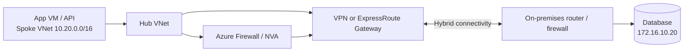
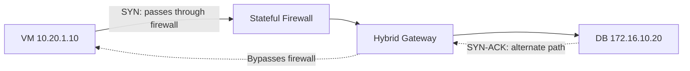
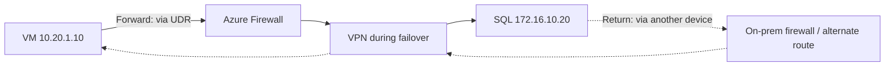

# Diagnosing Hybrid Connectivity Failures and Asymmetric Routing

An ordering application running in Azure may access a database in an enterprise data center over VPN or ExpressRoute. When connectivity breaks, operators often encounter puzzling symptoms: ping succeeds yet the application cannot connect, TCP SYN leaves Azure without receiving SYN-ACK, or failures occur only after failing over to a backup path. A major culprit is **asymmetric routing**: forward and return packets of the same session travel over different network paths, especially when a stateful firewall or inspection device sits along the path.

This lesson belongs to the **Network Connectivity and Security** chapter of the **CLOUD_PROVIDERS_AZURE** module. The module explores the Microsoft Azure ecosystem from subscriptions, resource groups, and Microsoft Entra ID to virtual networks, compute, storage, and data, while teaching how to deploy, monitor, secure, and control costs for application architectures. This lesson focuses on hybrid connectivity between Azure and on-premises networks, reading actual packet paths, and following an evidence-based diagnostic workflow before changing configurations.

After this lesson, you will be able to:

- Identify components and traffic paths across VPN Gateway, ExpressRoute, hub-spoke topologies, Azure Firewall, and network virtual appliances (NVAs).
- Distinguish failures caused by DNS, routing, firewalls, NAT, TCP session errors, or the application itself.
- Explain why asymmetric forward and return paths can cause a stateful firewall to drop packets.
- Inspect NIC effective route tables, BGP learned routes, and next hops using appropriate Azure tools.
- Formulate a routing remediation plan, test both directions, and validate after failover.

## 1. What Makes Up a Hybrid Architecture?

**Hybrid connectivity** is communication between Azure infrastructure and networks outside Azure—typically a data center, branch office, or carrier network. Common components include:

| Component | Role in Traffic Flow |
|---|---|
| Azure Virtual Network (VNet), subnets | Private IP address space for Azure workloads |
| Site-to-site VPN and Azure VPN Gateway | Connects on-premises networks to a VNet over IPsec/IKE tunnels |
| Azure ExpressRoute and corresponding gateway | Private connectivity via a connectivity provider; uses BGP to exchange configured prefixes |
| Local Network Gateway / on-premises VPN device | Represents or advertises non-Azure prefixes depending on VPN/BGP model |
| Hub VNet and spoke VNets | Centralizes connectivity, firewalls, and shared network services for workloads |
| Azure Firewall or NVA | Inspects/filters traffic; typically tracks session state |
| User-defined route (UDR) | Steers subnet traffic to a virtual appliance, gateway, or supported next hop |
| BGP | Dynamically exchanges prefix and route information between devices/gateways |
| NSGs and firewall policies | Controls permitted flows; does not dictate the entire return path |
| DNS | Translates hostnames to IPs; a wrong DNS answer can send clients down a different network path |

Hub-spoke example:



The diagram shows potential components, **not a guarantee that traffic always traverses the firewall**. Which next hop a packet actually reaches depends on route selection, peering settings, BGP, UDRs, network policies, and hardware on both sides. In many outages, the actual path differs from what the architect intended.

## 2. What Is Asymmetric Routing?

For a TCP connection from an Azure app `10.20.1.10:52000` to an on-premises database `172.16.10.20:1433`, there are two directions:

- **Forward path:** `10.20.1.10 → 172.16.10.20`, carrying the initial TCP SYN and request data.
- **Return path:** `172.16.10.20 → 10.20.1.10`, carrying the SYN-ACK and response data.

A **symmetric** path, in firewall operational terms, means packets in both directions of a session pass through the stateful inspection device that needs to track them. IP routing **does not strictly require** both directions to take the same physical link for connectivity to work: asymmetry can be valid if intermediate nodes support it. Problems arise when a **stateful** firewall/NVA sees only one direction or when NAT must maintain session state.

### 2.1. Classic Scenario: Device Sees Only Return Packets

Suppose the design expects all traffic from spoke to on-premises to traverse Azure Firewall in the hub. Yet the return path from on-premises to the VM arrives via the VPN Gateway and VNet peering along a path that bypasses the firewall.



Such a session might still succeed in some architectures if no device along the actual path enforces bidirectional state. However, if the **return** path traverses a different stateful device that **never saw the initial SYN**, it may treat the SYN-ACK as out-of-state and drop it.

The reverse scenario also happens: packets from on-premises travel straight to the spoke, while reply packets from the spoke hit a UDR pointing to an Azure Firewall that never saw the opening SYN. The firewall may drop the packet or NAT may break the session.

**Keep distinct:** "different paths" is a clue to investigate, not standalone proof of root cause. Use flow logs, drop counters, next-hop checks, and packet captures to prove **which packets** are failing to arrive.

### 2.2. NAT Makes Diagnostics More Complex

Network devices may apply source NAT (SNAT) or destination NAT (DNAT). The receiver then sees a different IP/port than the application's original IP/port. If return packets do not traverse the same device holding that NAT state, they cannot be un-translated and never reach the real client.

Example: an NVA SNATs source `10.20.1.10` to `10.0.2.5` when sending to on-premises. The server replies to `10.0.2.5`; to restore `10.20.1.10`, the response must pass back through the NAT device/cluster holding that translation state. Never try to "fix" this with a return route that bypasses the NAT state table.

## 3. How Are Paths Selected?

Azure selects the next hop for traffic based on effective routes in the source context. Common route sources are:

1. **System routes:** default routes created by Azure for VNets, connected networks, and supported scenarios.
2. **BGP propagated routes:** routes learned via virtual network gateways or supported BGP sources.
3. **User-defined routes (UDRs):** admin-configured routes in a subnet's route table.

### 3.1. Longest Prefix Match First, Then Route Source

Azure prefers the route with the **most specific prefix** matching the destination IP (longest prefix match). When routes share identical prefix lengths, precedence generally follows **UDR > BGP > system route**.

Illustrative example for destination `172.16.10.20`:

| Prefix | Source | Next Hop | Outcome |
|---|---|---|---|
| `0.0.0.0/0` | UDR | Azure Firewall `10.0.1.4` | Least specific |
| `172.16.0.0/16` | BGP | Virtual network gateway | More specific than default route |
| `172.16.10.0/24` | UDR | NVA `10.0.2.4` | Most specific route wins |

Consequently, a `0.0.0.0/0` UDR will not force traffic destined for on-premises prefixes through a firewall if the VNet learns a more specific BGP route. To know where traffic goes, inspect **effective routes**—do not infer from a single route table alone.

Other factors also apply: route state, next-hop reachability, subnet BGP route propagation settings, VNet peering, gateway transit, NVA or Azure Route Server configs, and routing policies on on-premises devices.

### 3.2. VNet Peering Does Not Automatically Create Transit Routes

Peering lets VNets exchange traffic within configured capabilities, yet linking `spoke A ↔ hub` and `hub ↔ spoke B` does not automatically turn the hub into a transit router for every flow. For hybrid hub-spoke topologies, check:

- Does the hub have gateways and properly configured **gateway transit / use remote gateways** settings?
- Do peering configs permit **forwarded traffic** per design?
- Do spoke routes point to the right gateway, NVA, or Firewall?
- Does the transit appliance have routes back to the right spokes and on-premises?
- Do NSGs, Firewall Policy, Azure Route Server, or BGP propagation alter the path?

Never add routes to **GatewaySubnet** or alter specialized gateway settings just to "force a return path" without checking Azure VPN/ExpressRoute Gateway support limits. Certain UDRs or NSGs on GatewaySubnet are unsupported or can disrupt the gateway.

### 3.3. VPN, ExpressRoute, and BGP Failover

When an organization runs dual hybrid paths (such as primary ExpressRoute and backup VPN), routers can learn the same prefix over both paths. Path selection depends on prefix specificity, BGP policies, route attributes, Azure behavior, and carrier equipment. Never assume "ER primary, VPN backup" automatically keeps both directions symmetric.

During outages or failover:

- One side may converge BGP faster than the other.
- A more specific prefix may keep pulling traffic onto an unintended link.
- Azure VMs and on-premises routers may both hold valid routes yet steer traffic through **two different firewall appliances**.
- When the primary path recovers, the return path may shift back while old sessions still hold active state elsewhere.

Test **both directions** at the same point in time for the exact source/destination IPs; seeing BGP peering `Connected` alone does not prove applications work.

## 4. Which Symptoms Point to Which Faults?

| Symptom | Priority Root Causes to Check | Useful Evidence |
|---|---|---|
| Only one Azure subnet cannot reach on-premises | That subnet's UDR/route table, NSG, or peering | Per-NIC effective routes/NSGs |
| Azure → on-premises works, reverse fails | Return-path route, firewall policy, or NAT | On-prem and Azure routing tables, packet captures on both ends |
| SYN leaves, SYN-ACK never reaches client | Firewall state, NAT, return route, server not listening on port | TCP capture, firewall deny logs, next hop |
| Ping succeeds yet TCP 1433/443 fails | Port/service, protocol-specific firewall rule, MTU, or app | TCP test on exact port, service logs, packet capture |
| Fails only when failing over from ExpressRoute to VPN | BGP convergence, prefix advertisement, differing NAT/firewalls | BGP peers/routes before and after failover |
| DNS returns wrong IP or unexpected public IP | Split-horizon DNS, conditional forwarder, Private DNS zone | `nslookup` / `Resolve-DnsName` from source |
| Small requests work, large transfers hang | MTU/PMTUD, fragmentation, firewall, retransmissions | Packet capture, TCP retransmissions, ICMP feedback |
| One host in a subnet works, another fails | NIC/OS firewall, agent, DNS cache, differing service route/NSG | Compare NIC routes/NSGs and TCP tests per host |
| Failure occurs only for a single source IP | On-prem ACL, NAT policy, advertised prefix, or app permissions | 5-tuple, firewall, and service logs |

Some appliances or Azure hops do not respond to ICMP/traceroute, so **an incomplete traceroute does not mean the route is missing**. Combine multiple telemetry sources and test TCP/UDP on the application's actual protocol.

## 5. Standardizing Details Before Diagnosing

Document one concrete failing flow rather than starting with routing edits:

```text
Environment: sub-orders-prod / rg-orders-app-prod
Source: VM app01, 10.20.1.10
Destination: on-premises SQL, 172.16.10.20:1433/TCP
Failure window: 10:05-10:15 UTC
Target DNS: sql.corp.example -> 172.16.10.20
Expected path: Spoke -> Azure Firewall -> ExpressRoute -> on-prem firewall
Observed result: SYN retransmits; TCP handshake never completes
Recent change: shifted route preference to backup VPN
```

Mandatory fields to capture:

- **5-tuple:** source IP, source port, destination IP, destination port, protocol. If NAT is involved, record tuples **before and after NAT**.
- **Timestamps with timezone:** to correlate BGP events, Activity Logs, and firewall logs.
- **Measurement points:** client, NIC, Azure Firewall/NVA, VPN/ExpressRoute Gateway, on-premises router, target server.
- **Expected vs. actual behavior:** timeout, connection refused, TLS failure, HTTP 403, or query result.
- **Recent changes:** UDR, NSG, Firewall Policy, peering, VPN/ER, DNS changes, or workload deployments.

Never paste secrets, full connection strings, tokens, or customer data into diagnostic tickets. Example IPs in this lesson teach analytical reasoning; substitute real values in your target environment.

## 6. Diagnostic Workflow from Application to Network Path

### Step 1: Verify Application and DNS

Directly on the host or workload experiencing the error:

```powershell
Resolve-DnsName sql.corp.example
Test-NetConnection sql.corp.example -Port 1433 -InformationLevel Detailed
```

On Linux:

```bash
getent hosts sql.corp.example
nc -vz -w 5 sql.corp.example 1433
```

A correct DNS answer only confirms the hostname resolves to the expected IP; **it does not prove the network path works**. If the resolved IP is wrong, fix DNS first; if the IP is right yet TCP times out, inspect routes and firewalls next. If TCP connects yet SQL/TLS auth fails, focus on the application layer and certificates rather than hastily editing UDRs.

### Step 2: Determine the Outbound Route in Azure

From the VM's NIC or effective-route view, find the prefix covering `172.16.10.20` and the selected next hop. Record competing routes as well: UDR, BGP, system, and default routes.

Watch closely for:

- Does a more specific route override the default UDR?
- Are BGP routes to on-premises propagated to the source subnet?
- Is the UDR attached to the **right subnet** rather than another subnet?
- Does the `VirtualAppliance` next hop point to the firewall/NVA's exact private IP?
- Is the chosen route Active, and is the next hop actually forwarding?

If the app runs on App Service/Functions/AKS rather than a VM, route inspection tools differ. Identify the actual network interfaces, nodes, or VNet integration involved rather than assuming VM commands expose all PaaS routes.

### Step 3: Inspect the Return Path from On-Premises

On the on-premises router/firewall, look up the route for the **Azure source IP** `10.20.1.10`. Check:

1. Is prefix `10.20.0.0/16` properly advertised by Azure and learned on-premises?
2. Does the selected next hop point to ExpressRoute, VPN, or another NVA?
3. Does a longer prefix send return traffic down an unexpected link?
4. Does NAT rewrite source/destination IPs prior to route lookup?
5. Does the firewall hold bidirectional state or drop half-open replies?

This step **cannot be concluded from Azure NIC effective routes alone**. Azure's route table shows one side; the return path must be verified on the router/device actually forwarding responses.

### Step 4: Cross-Check Both Directions and Stateful Inspection Points

Draw separate arrows for forward and return paths. Example:

```text
Forward: VM -> UDR -> Azure Firewall A -> ExpressRoute -> Router/DC -> SQL
Return:  SQL -> Router/DC -> VPN -> Gateway -> Spoke -> VM
```

If a stateful firewall sits in one direction without seeing the other, search for **drop logs or state-table evidence**. With clustered firewalls/NVAs, verify state-sync mechanisms and route symmetry per pair. When SNAT is active, confirm responses return to the translated NAT IP and hit the device holding that NAT table.

### Step 5: Check Security Controls and Application State

Even when both directions align, connections can still be blocked by:

- NIC/subnet NSGs, Azure Firewall Policy, NVA ACLs, or on-premises firewall rules.
- Server not listening on the target port, or host firewall blocking it.
- Post-NAT source IP differing from the source IP allowlisted on the database/firewall.
- Timeouts, idle connection tracking, session limits, or invalid TLS certificates.
- PMTUD/MTU issues over VPN; blocked required ICMP causing large transfers to stall.

Record timestamps and observation points at every step; never blame every `timeout` automatically on asymmetric routing.

### Step 6: Remediate One Cause at a Time and Retest

Prioritize fixing the **proven-wrong route, peering, BGP, or next hop**, immediately test a representative connection, and then expand verification across subnets and workloads. Update architecture diagrams so intended paths match actual paths after the change.

## 7. Azure CLI Commands for Gathering Evidence

Commands in this section only read configuration or run diagnostics; they **do not modify routes or firewall policies**. Network Watcher queries may require specific permissions, Network Watcher enabled in the region, and eligible resources. Examples assume you are signed in to Azure CLI on the right subscription.

### 7.1. Confirm Context and VM NIC Effective Routes

```bash
az account show --query "{subscription:name,id:id,tenant:tenantId}" -o table

az network nic show-effective-route-table \
  --resource-group <vm-resource-group> \
  --name <vm-nic-name> \
  -o table
```

Output lists effective routes for the NIC; pay attention to `Address Prefix`, `Next Hop Type`, `Next Hop IP Address`, `Source`, and route state. Select the route matching the destination IP by **most specific prefix**, then apply route-source precedence if needed. A route marked `Invalid` or inactive must not be treated as a live forwarding path.

### 7.2. Inspect UDRs and NSGs

```bash
az network route-table route list \
  --resource-group <route-table-resource-group> \
  --route-table-name <route-table-name> \
  -o table

az network nic list-effective-nsg \
  --resource-group <vm-resource-group> \
  --name <vm-nic-name> \
  -o json
```

The UDR list reflects custom routes inside **one route table**, not every final route on the NIC. Effective NSG helps inspect combined NIC and subnet rules; it does not replace checking Azure Firewall/NVAs or host firewalls.

### 7.3. Query Next Hop with Azure Network Watcher

```bash
az network watcher show-next-hop \
  --resource-group <vm-resource-group> \
  --vm <vm-name> \
  --source-ip 10.20.1.10 \
  --dest-ip 172.16.10.20 \
  -o json
```

Output may show `nextHopType`, `nextHopIpAddress`, and the selected route from the VM. This verifies the **outbound direction from the Azure VM toward the destination**; it does not verify the return path from on-premises routers, nor prove the firewall permits the application.

### 7.4. Check BGP and Gateway Routes

For an eligible **virtual network gateway** with BGP configured:

```bash
az network vnet-gateway list-bgp-peer-status \
  --resource-group <gateway-resource-group> \
  --name <gateway-name> \
  -o table

az network vnet-gateway list-learned-routes \
  --resource-group <gateway-resource-group> \
  --name <gateway-name> \
  -o table
```

Verify peers are in the expected state and on-premises prefixes are learned properly. Not every gateway or connection type has BGP routes to list; if static prefixes are used, inspect the local network gateway configuration and on-premises router tables.

With ExpressRoute, also check circuit/peering status and BGP on the provider edge. Circuit health alone does not replace checking **NIC effective routes** and remote routers.

### 7.5. Actively Test Connectivity

Azure Network Watcher **Connection troubleshoot** can probe a path (when source, destination, and SKU support it). This generates probe traffic; interpret results alongside route, firewall, and application logs. For VM workloads, you can also run `Test-NetConnection` or `nc` to the target IP/port when authorized.

When packet captures or flow logs are needed to pinpoint packet drops, follow security policies and tool capabilities: capture at the source, stateful inspection point, and destination server, filtering by source/destination IP, port, protocol, and timestamp. Avoid storing sensitive payloads or credentials in reports.

## 8. Case Study: Primary ExpressRoute, Backup VPN, and Azure Firewall

An enterprise has:

- **Application spoke:** `10.20.0.0/16`, VM `10.20.1.10`.
- **Hub:** Azure Firewall `10.0.1.4` and hybrid gateways.
- **On-premises network:** `172.16.0.0/16`, SQL `172.16.10.20`.
- **Hybrid paths:** ExpressRoute for primary operations, site-to-site VPN as backup.
- **Requirement:** all access from Azure to SQL and return traffic must traverse the agreed firewall/NAT inspection chain.

**Symptom:** When ExpressRoute drops, BGP fails over to VPN; new TCP connections from the VM to SQL time out even though the VPN tunnel shows healthy.

### 8.1. Gathering Evidence

| Measurement Point | Illustrative Observation | Meaning |
|---|---|---|
| Azure VM | DNS resolves `172.16.10.20`; repeated SYN packets | Client never completes TCP handshake |
| NIC effective routes | `172.16.0.0/16` routes via Azure Firewall | Forward path hits stateful inspection |
| Azure Firewall | Sees outbound SYN yet sees no response | Return traffic may take another path or be blocked downstream |
| On-premises router | Route to `10.20.0.0/16` points via VPN | Confirms backup hybrid path active during failover |
| Second firewall appliance | Sees SYN-ACK without matching SYN state | Symptom of asymmetry / state mismatch |

These observations are a **hypothetical scenario**. In a live environment, missing responses at a firewall could also stem from the server, ACLs, NAT, or remote routing; capture flows and inspect logs to distinguish them.

### 8.2. Diagramming Intended vs. Observed Paths



Once a stateful device on the return path is found lacking forward-packet state, the network team must adjust **both the routing chain and state handling**, rather than merely tweaking a firewall rule to allow TCP 1433.

### 8.3. Remediation Options

Choices depend on the actual architecture:

1. Adjust UDRs and route advertisements so both directions of each session traverse the designated firewall/NVA; check **longest prefix match** at every hop.
2. Fix BGP policies on organization-managed routers so asymmetric prefixes do not pull forward and return traffic across different links unexpectedly.
3. For clustered NVAs, deploy proper HA/state-synchronization models so both directions of a session are handled consistently.
4. Evaluate NAT/SNAT if design requires pinning return traffic back to the stateful device—weighing impacts on source-IP visibility, logs, ACLs, and session scale. Never treat SNAT as a default fix for every routing bug.
5. Verify gateway transit, forwarding settings, and Azure limits before editing routes in the hub or GatewaySubnet.

**Validation criteria:** new TCP 1433 connections succeed; both directions are observed on the right appliance; NAT un-translates cleanly; and the fault does not recur during controlled failover and failback drills.

## 9. Distinguishing Asymmetry from Other Hybrid Issues

### 9.1. Overlapping Prefixes

If VNet `10.20.0.0/16` and on-premises share any slice of `10.20.0.0/16`, clients may treat the target as local or hit conflicting routes. Overlapping CIDRs break hybrid routing even while VPN tunnels stay up. Design non-overlapping address plans or apply supported NAT per architecture.

### 9.2. DNS and Private Endpoints

An on-premises app calls a Storage Account using its standard hostname, yet DNS returns a public IP instead of the Private Endpoint's private IP. The app receives `403` when public network access is disabled. This is primarily a **DNS resolution and network/permission access** issue, not necessarily asymmetric routing.

In hybrid environments, check on-premises DNS forwarders, Azure DNS Private Resolver inbound endpoints or hub DNS servers, Private DNS zone links, and routing to the private IP. Private Endpoints also still require data-plane authorization.

### 9.3. MTU and Path MTU Discovery

IPsec encapsulation adds overhead over VPN links. If PMTUD is blocked or packets exceed effective MTU, TCP handshakes succeed yet large data transfers stall. That signature differs from a stateful firewall dropping SYN-ACK during the initial handshake.

Inspect retransmissions, required ICMP types, packet sizes, and device MSS/MTU settings—never arbitrarily lower MTU across an entire network without evidence.

### 9.4. Health Probes, Load Balancers, and Timeouts

An unhealthy backend or misconfigured load balancer rule can also cause timeouts. Raw TCP tests between IPs do not always represent the application path through a gateway or load balancer. Check backend health, ports, listeners, TLS, and firewall policies along the real flow.

## 10. Preventing Asymmetric Routing Failures

- **Document IP plans and traffic directions:** hub-spoke diagrams, on-premises prefixes, gateways, NVAs, Azure Firewall, DNS, and backup paths.
- **Specify stateful inspection points:** identify clearly which firewalls must see both directions; if using NAT, identify which device owns NAT state.
- **Manage UDRs and BGP together:** verify impacts of more specific prefixes, BGP propagation, prefix advertisement/withdrawal, and route shifts during failover.
- **Test from both sides:** Azure → on-premises and on-premises → Azure, across critical subnets and exact service ports.
- **Practice failover/failback drills:** measure BGP convergence SLAs, behavior of existing vs. new sessions, logging, and recovery steps.
- **Monitor gateways and firewalls:** track BGP peer status, tunnel health, drop logs, flow logs, bandwidth, DNS errors, and application latency.
- **Enforce least privilege:** restrict who can edit route tables, Firewall Policies, gateways, and peerings; audit changes via Azure Activity Log and change management.
- **Account for cost and performance:** ExpressRoute, VPN Gateway, Azure Firewall, NVAs, packet processing, and cross-zone/link data transfers carry limits and charges; design paths to avoid loops and unnecessary hairpins.

## 11. Applied Exercises

1. **Route selection.** A NIC has a `0.0.0.0/0` UDR pointing to a firewall and a `172.16.10.0/24` BGP route pointing to a gateway. For destination `172.16.10.20`, which route wins under longest prefix match, and why?
2. **Checking the return path.** Azure effective routes show the VM reaches SQL via the NVA. What additional evidence from on-premises is needed to conclude bidirectional traffic passes through that NVA?
3. **Stateful firewall.** Device B sees only SYN-ACK without SYN. Why might Device B drop the packet? Give at least two valid network-design fixes.
4. **Failover.** Connections run cleanly over ExpressRoute yet fail after failing over to VPN. List the BGP, UDR, and firewall data to compare before and after failover.
5. **DNS or routing?** An on-premises client calls Storage via Private Endpoint, yet DNS returns a public IP. Which component should you inspect first, and why can you not conclude this is asymmetric routing?
6. **Tool limits.** Network Watcher shows the outbound next hop from the VM matches expectations. Does that prove the return path or SQL permissions are valid?
7. **Transport layer.** TCP handshakes succeed, yet large file transfers hang over IPsec VPN. How do you inspect MTU/PMTUD, retransmissions, and policies?

## Conclusion

Diagnosing hybrid connectivity requires observing **both directions of the same flow**: DNS selects the target IP, Azure effective routes/UDRs/BGP pick the outbound next hop, on-premises routers determine the return path, and firewalls/NAT devices may require seeing full session state. Asymmetric routing is not always an error, yet it breaks TCP sessions whenever forward and return traffic hit different stateful appliances. Start with the 5-tuple and failure timestamps, verify DNS and live port reachability, compare routes on both sides, gather drop/state-mismatch evidence, then apply planned configuration fixes and test failover/failback. An evidence-based approach protects Azure applications and avoids disruptive routing mistakes.
