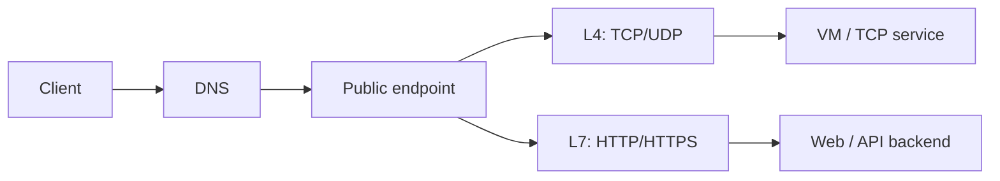
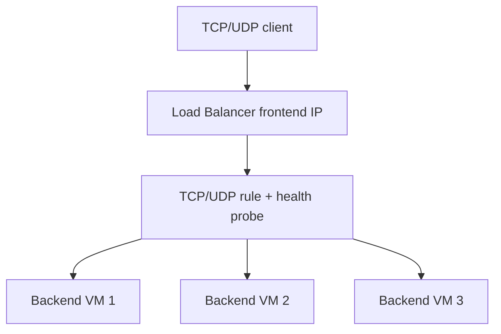
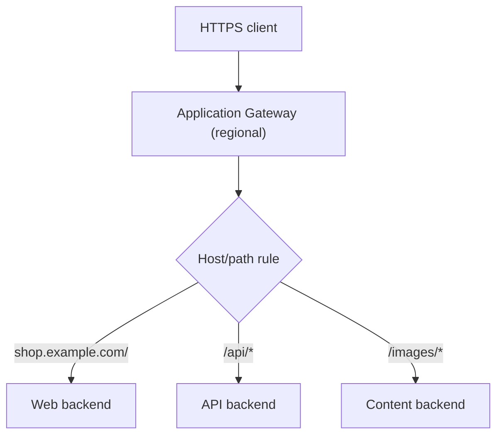
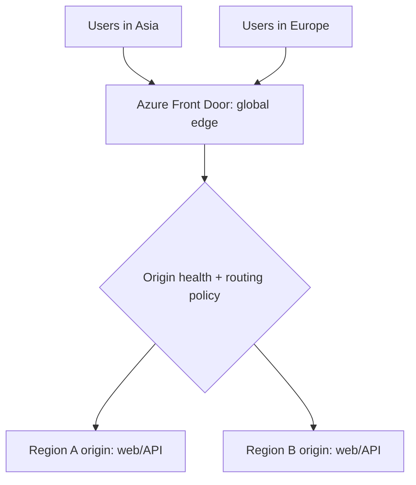
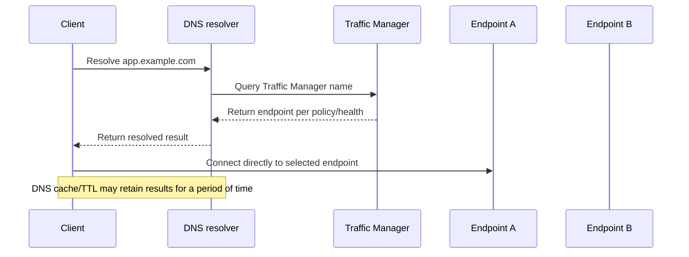
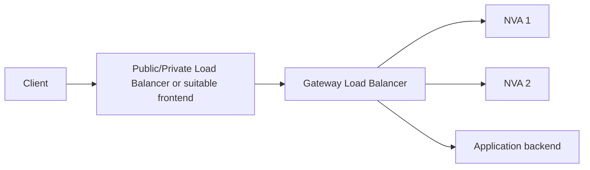
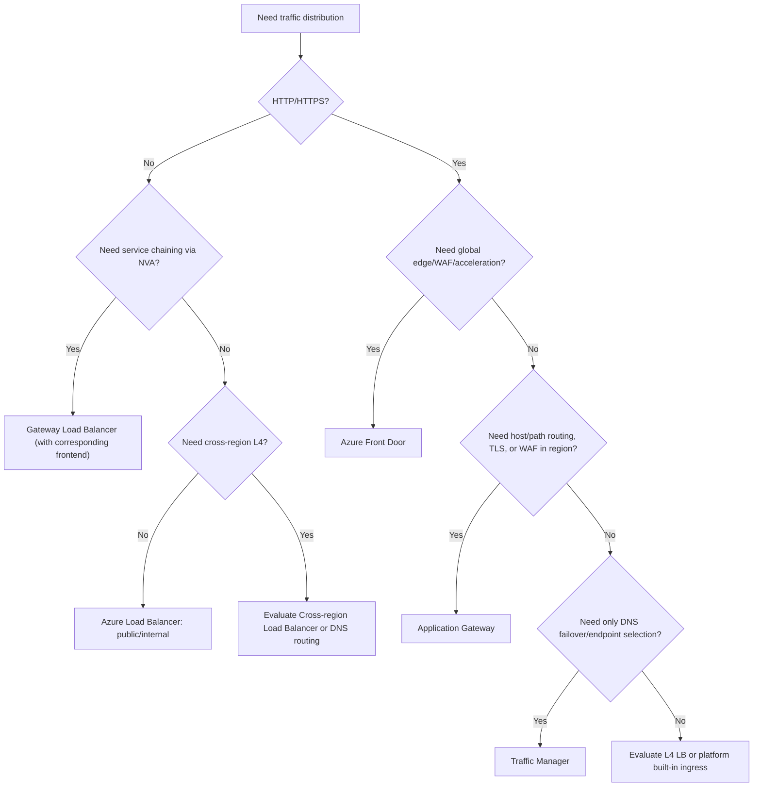
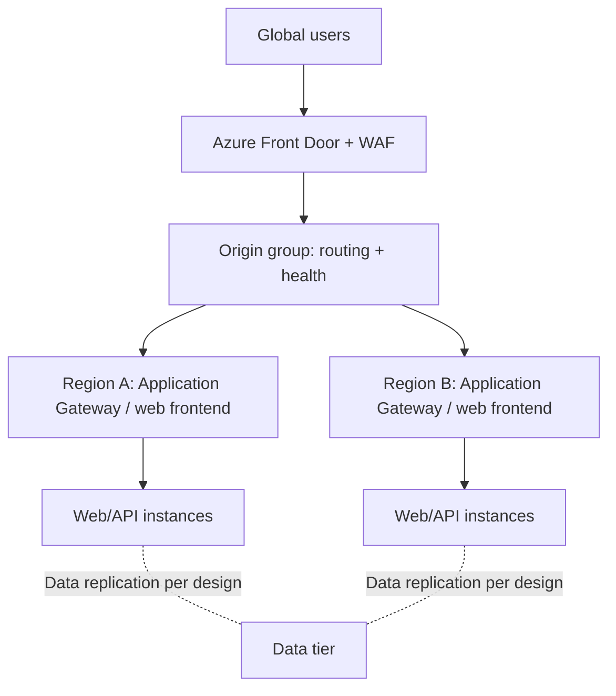
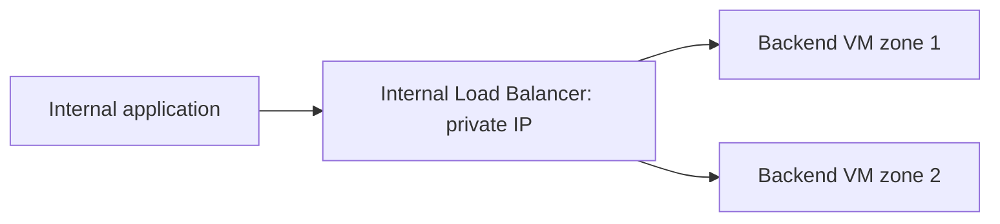
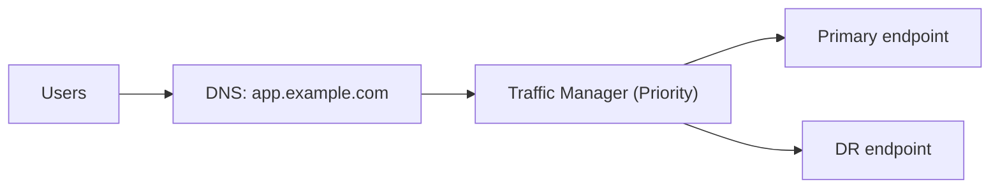

# Choosing a Traffic Distribution Service on Azure

An application might need to receive millions of HTTP requests from multiple countries, an internal system might need to distribute TCP connections to servers in a virtual network, while a SaaS platform might need to redirect users to a standby region when a region experiences an outage. All of these requirements involve **traffic distribution**, yet they should not be solved with the same service.

Microsoft Azure provides several options such as **Azure Load Balancer**, **Azure Application Gateway**, **Azure Front Door**, **Azure Traffic Manager**, and **Azure Gateway Load Balancer**. Each service handles traffic at a different protocol layer, geographic scope, and position along the request path. This lesson helps you choose the right tool before starting implementation.

This content belongs to the **Load Balancing and Application Delivery** chapter in the `CLOUD_PROVIDERS_AZURE` module. Across the Azure ecosystem—from subscriptions, resource groups, and Microsoft Entra ID to virtual networks, compute, storage, and data—traffic distribution decisions directly affect scalability, availability, security, monitoring, and the cost of the entire application architecture.

## Learning Objectives

After this lesson, you will be able to:

- Distinguish traffic distribution at **Layer 4**, **Layer 7**, and the **DNS layer**, as well as distinguish **regional** from **global** services.
- Choose between Azure Load Balancer, Application Gateway, Front Door, Traffic Manager, and Gateway Load Balancer for a specific requirement.
- Explain the roles of frontend, backend/origin, listener, routing rule, health probe, failover, and TLS/WAF.
- Design architectures that combine multiple traffic distribution layers without introducing unnecessary components.
- Identify common risks such as DNS caching, health probe failures, misconfigured routes, direct access to public origins, and session state issues.
- Prepare a checklist for testing, monitoring, security requirements, and costs before going to production.

## 1. All Traffic Distribution, Yet at Different Layers

In the TCP/IP model, there are several ways to decide which destination a request should reach:

- **DNS-based routing:** the DNS service returns an appropriate IP address or endpoint name when the client resolves the domain name. DNS does not directly receive and forward individual application packets.
- **Layer 4 (L4):** distribution decisions are based on network/transport information, typically IP address, protocol, and TCP/UDP port. L4 does not need to understand URLs, HTTP hosts, or cookies.
- **Layer 7 (L7):** operates at the HTTP/HTTPS application layer and can inspect hostname, path, headers, or HTTP attributes; some services also support TLS termination and Web Application Firewall (WAF).

### Intuitive Example

Suppose you have three backends serving different needs:

| Incoming request | Information needed to make a decision | Suitable layer |
|---|---|---|
| TCP to `10.1.2.10:1433` needing load sharing across VMs | IP, TCP port, backend health | L4 |
| `https://shop.example.com/cart` to cart service, `/images` to content service | Host, path, HTTPS | L7 |
| European users choosing a nearby or healthy endpoint | Endpoint selection policy during DNS resolution | DNS or global L7, depending on requirements |
| Global HTTP requiring WAF and fast response from the edge | HTTP/TLS, routes, origin health, edge acceleration | Global L7 |

**The first question is not "which service is the most powerful?", but "at which layer must the decision be made?"** For example, if an application uses a custom TCP protocol, a service that only understands HTTP cannot replace an L4 load balancer.



In practice, multiple layers can be combined. For example, Front Door selects the region at the edge, while the Application Gateway in each region routes traffic further to groups of web services.

## 2. Criteria to Clarify Before Choosing a Service

Before designing, confirm six groups of requirements:

1. **Protocol:** TCP, UDP, or HTTP/HTTPS? Are there WebSockets or requirements tied to long-lived connections? Do you need host/path, cookie, header, or redirect handling?
2. **Scope:** a single VNet, a single Azure region, multiple regions, or global users? Do you need acceleration at the edge or only failover?
3. **Access point:** do backends accept public traffic over the Internet or must they stay on a private network? Do you need an internal frontend IP or a public FQDN?
4. **Security:** do you need TLS termination, WAF, DDoS protection, private networking, self-managed certificates, or origin access restriction policies?
5. **Availability:** do you need active-active distribution, active-passive failover, health probing, zone redundancy, and what recovery targets (RTO/RPO)?
6. **Operations and cost:** what are the expected load/throughput, connection volume, bandwidth, number of rules/routes, telemetry, autoscaling requirements, and data transfer costs?

An unclear requirement about protocol or access point leads to a wrong choice much more easily than a minor difference in performance or price.

## 3. Comparison Table of Core Services

| Service | Primary scope / layer | Key strengths | Typical use cases |
|---|---|---|---|
| **Azure Load Balancer** | L4 TCP/UDP; typically regional | Public or internal frontend, distribution to backends, health probes | VM/VM Scale Sets, TCP/UDP services, internal load balancing |
| **Azure Application Gateway** | Regional L7 HTTP/HTTPS | Listeners, host/path routing, TLS termination or end-to-end TLS, WAF depending on SKU | Web/API applications in one region needing HTTP policies, WAF |
| **Azure Front Door** | Global L7 HTTP/HTTPS at the edge | Global routing, health-based failover, edge acceleration, TLS, CDN/WAF per configuration/tier | Websites/APIs serving multiple countries or multiple Azure regions |
| **Azure Traffic Manager** | Global DNS-based routing | Endpoint selection by priority, performance, weighted, and other policies; DNS failover | Active-passive or global endpoint selection without an HTTP proxy |
| **Azure Gateway Load Balancer** | L3/L4 service chaining | Inserts transparent network virtual appliances into the traffic flow | Architectures with firewalls/NVAs/traffic inspection appliances |

No single product in the table replaces all the others on its own. For example, **Load Balancer** may be a necessary component to bring traffic to backend VMs, while **Front Door** decides which region global HTTP users are routed to.

Several related options:

- **Cross-region Load Balancer** is a public cross-region Layer 4 load-balancing variant for supported scenarios and regions. You must check backend requirements, regional support, and feature limitations; it does not turn a standard Load Balancer into a global HTTP reverse proxy.
- **Application Gateway for Containers** is a product aimed at HTTP load balancing for container/Kubernetes workloads, with supported ingress or Gateway API integration models; it should be evaluated separately when designing AKS.
- **Azure API Management** addresses API governance such as authentication, subscriptions, policies, transformations, rate limiting, and developer portals; it can sit alongside the L7 layer but is not a default replacement for a load balancer.
- **Azure NAT Gateway** typically handles subnet outbound Internet connectivity/SNAT; it is not a tool for distributing inbound requests to a backend pool.
- **Azure DNS** hosts and resolves DNS records; it is not synonymous with Traffic Manager's health-based routing policies.

## 4. Azure Load Balancer: The L4 Choice for TCP and UDP

**Azure Load Balancer** receives traffic at a frontend IP and distributes it to healthy backends in a backend pool according to configured rules. It is the right component when traffic does not require understanding HTTP structure.

### Key Components

- **Frontend IP configuration:** a public IP address (public Load Balancer) or a private IP belonging to a VNet (internal Load Balancer).
- **Backend pool:** backends associated via a supported model, such as appropriate NICs or backend IP addresses.
- **Load-balancing rule:** maps a frontend protocol/port to a backend protocol/port.
- **Health probe:** checks a service or port on the backend; unhealthy backends are not selected for new flows according to service mechanics.
- **Inbound NAT rule:** used when forwarding management or specific connections to a single backend, serving a different purpose from general load-balancing rules.
- **Outbound connectivity:** SNAT/egress must be designed explicitly; you should not assume that having a public load balancer automatically gives every backend default outbound connectivity that meets your requirements.



For example, three VMs listening on TCP/443 can be placed behind a public or internal Load Balancer. Load Balancer can distribute TCP traffic, but it **cannot** read the `/api` path on its own, perform HTTP WAF inspection, or terminate TLS like an L7 reverse proxy.

### Distribution Behavior and Limitations

L4 rules typically use network flow information to determine the target backend. Because a TCP connection must remain consistent with its backend, adding or removing a backend does not mean active live connections are seamlessly migrated. Health probes only evaluate the configured criteria and do not guarantee that the entire application business logic is healthy.

**When to choose Load Balancer:** the application needs TCP/UDP load balancing, a stable frontend IP, backends are VMs/VMSS or supported workloads, and L7 path routing/WAF is not required at this layer.

**When it is not enough:** a website needs host/path routing, WAF protection, edge caching, or multi-region HTTP routing. Application Gateway/Front Door can be added depending on the design.

### Public or Internal?

| Design | Use case | Considerations |
|---|---|---|
| **Public Load Balancer** | Service needs a public frontend IP; Internet clients connect over TCP/UDP | NSGs, DDoS, TLS at backend, inbound rules, and public exposure |
| **Internal Load Balancer** | Service between subnets/VNets or over hybrid connectivity | Private frontend IP, internal routes and DNS; does not expose an endpoint to the Internet |

For internal traffic, you should generally start with an **internal Load Balancer** to avoid unnecessarily increasing public exposure.

## 5. Azure Application Gateway: Regional Web Delivery

**Application Gateway** is an L7 reverse proxy for HTTP/HTTPS. It fits well when a web application is organized into multiple backends and needs routing based on HTTP rules.

### Important Capabilities

- **Listeners and routing rules:** define hostname, protocol, and port, combined with basic or path-based routing.
- **Backend pool:** a group of supported application targets, such as VMs, IPs/FQDNs, web services, or reachable backends.
- **Backend HTTP settings:** specify how Application Gateway connects onwards to the backend, including protocol, port, and related settings.
- **TLS:** can terminate HTTPS at the gateway and reconnect to backends over HTTP/HTTPS per design; use end-to-end TLS when encryption on both hops is required.
- **Web Application Firewall:** with an appropriate WAF SKU/configuration, supports inspecting HTTP traffic against web application rules.
- **Health probes:** can check specific HTTP/HTTPS endpoints, especially `/health` or `/ready` with an appropriate hostname.
- **Host/path routing:** send `api.example.com` to the API and `shop.example.com` to the web frontend; or route `/api/*` and `/static/*` to different backends.



Applications can use a **public or private frontend** depending on SKU, design, and service support. The gateway is typically deployed into a dedicated subnet as required by the service; IP space, routes, and NSGs must be planned so they do not block gateway operation.

### Health Probes and 502 Errors

A common failure is when the backend works fine when called directly, yet the gateway reports it unhealthy or returns HTTP `502 Bad Gateway`. Possible causes include:

- The probe targets the wrong path or the backend returns a status not considered healthy.
- The HTTP host header or SNI does not match the backend configuration.
- The gateway cannot reach the backend due to NSGs, routes, DNS, or firewalls.
- The backend certificate is invalid for end-to-end HTTPS configuration.
- The application process has started, but the readiness endpoint is not yet ready.

When hosting multiple sites, you must align **hostname, certificate, backend protocol/port, and custom probe**. An L7 rule with the right path is not enough if the probe misjudges application health.

### Application Gateway vs. Load Balancer

Application Gateway suits HTTP/HTTPS traffic requiring content-based routing, WAF, and TLS. Azure Load Balancer suits TCP/UDP and a simple frontend IP. A platform running both web apps and internal TCP services can use **both** on separate traffic paths.

## 6. Azure Front Door: Global Web Delivery at the Edge

**Azure Front Door** is a global HTTP/HTTPS application delivery service that receives requests at Microsoft's edge network and routes them to **origins** based on routing/health configuration. It is the primary candidate when a product serves multiple geographic regions and needs improved latency, resilience, or application protection close to users.

### Common Components

- **Endpoint and custom domain:** the domain name clients access; TLS certificates at the frontend edge.
- **Route:** maps domain/path/protocol to an origin group and delivery policies.
- **Origin group:** a group of backends/origins configured with load balancing, priority, latency sensitivity, and health probes per service capabilities.
- **Origin:** web/API endpoints hosted in one or more regions or supported hosting locations.
- **Rules engine/rule sets:** routing decisions and HTTP processing per supported features.
- **WAF, CDN/caching, and security features:** depending on tier, configuration, and specific feature support.



**Front Door is an HTTP/HTTPS reverse proxy**, not a load-balancing path for arbitrary TCP or UDP protocols. If a system requires raw cross-region TCP/UDP, you must evaluate L4 solutions and their corresponding support scope.

### Why Does Front Door Fit Global Applications?

- Clients connect to an appropriate edge location, from which traffic travels over the service's network infrastructure to the origin.
- Supports distributing across multiple origins and removing unhealthy origins according to configuration.
- Can combine TLS management, WAF, and HTTP content caching/acceleration as needed.
- Provides a consistent global entry point when deploying across multiple Azure regions.

**What to verify:** tiers (such as Standard/Premium) differ in features, support for private origins via **Private Link** in supported scenarios, and connection approval requirements. Do not assume Front Door can automatically reach any private IP inside a VNet. If backends must remain private, verify the exact origin type, tier, Private Link support, and connection model supported by the service.

### Health and Failover

Front Door evaluates origins via health probes and appropriate route selection signals. However, **successful failover at the edge layer does not automatically guarantee application data is synchronized between two regions**. If region B lacks session data, has a lagging database replica, or has an un-warmed environment, users may still experience errors even though endpoint B is marked healthy.

For multi-region applications, you must also design data, state, sessions, secrets, supporting DNS, and autoscaling capacity in the standby region.

## 7. Azure Traffic Manager: Endpoint Selection via DNS

**Azure Traffic Manager** uses DNS to direct clients to endpoints according to a configured routing method, such as:

- **Priority:** prefers a primary endpoint; shifts to a backup endpoint when the primary fails health checks.
- **Performance:** selects an endpoint using network latency data/characteristics maintained by the service; does not guarantee it is always the geographically closest location.
- **Weighted:** distributes the probability of returning an endpoint by weight, useful during migrations or partial traffic shifts.
- **Geographic:** distributes based on configured geographic scope.
- Other methods such as **Subnet** and **Multivalue** depending on endpoint type and use case.

Traffic Manager can monitor configured endpoints using health probes over supported protocols and adjust DNS responses accordingly. Once a client receives the endpoint, **application traffic goes directly to that endpoint**; Traffic Manager is not a reverse proxy receiving every HTTP request.



### Pros and Cons of DNS Failover

**Pros:** does not have to receive and proxy every request; can route among public endpoints on Azure or elsewhere using DNS mechanisms, working for many application types as long as the endpoint and health monitor are supported.

**Limitations:** DNS resolvers and clients may cache results for the TTL or longer; an endpoint status change does not force all clients to switch destinations immediately. Existing connections do not automatically migrate to the new endpoint. DNS routing also does not provide HTTP path routing, WAF, or TLS termination.

With the performance routing method, the address information used for the DNS decision may reflect the recursive resolver or supporting mechanisms; you should not assume exact selection for the physical location of every end-user device.

### When to Choose Traffic Manager Instead of Front Door?

Choose **Traffic Manager** when the primary goal is **DNS-based endpoint selection**, when routing applications or platforms that do not need an HTTP reverse proxy, or when you need global routing across multi-provider public backends. Choose **Front Door** when you need a **global HTTP reverse proxy**, edge acceleration, integrated WAF/HTTP routing/caching, and a single web-experience entry point.

Sometimes both can address a multi-region HTTP problem, but their delivery mechanics and failover limits differ. Avoid placing both together just to "have two layers of redundancy" without clear requirements and a way to measure effectiveness.

## 8. Azure Gateway Load Balancer: Inserting Network Appliances into the Flow

**Azure Gateway Load Balancer** serves **service chaining** scenarios with network virtual appliances (NVAs), such as third-party firewalls that inspect and process traffic. It routes traffic through scalable appliances operated under supported connectivity designs.



The diagram illustrates the **service chaining objective**, not packet encapsulation details across tunnels or every supported deployment pattern. Gateway Load Balancer has specific requirements for virtual networks, NVA backends, and chaining.

Do not choose Gateway Load Balancer for a web application that only needs HTTP requests distributed across backends. If the goal is OWASP protection at the web application layer, a gateway/edge with **WAF** is usually more appropriate than introducing an NVA without specific network traffic inspection requirements.

## 9. Service Selection Decision Tree

Start from protocol, scope, and processing requirements:



The decision tree is a reference framework, not an absolute rulebook. In practice, **Front Door and Application Gateway can be combined**, and **Traffic Manager can select among existing frontends**. The final choice must be verified against feature documentation and supportability in the chosen region/SKU.

### Quick Selection Table

| If your requirement is… | Reasonable starting point | Why |
|---|---|---|
| Internal VMs serving TCP/1433 over a private IP | **Internal Load Balancer** | L4, private frontend |
| UDP service across multiple VMs | **Azure Load Balancer** | L4 protocol support; L7 web gateways do not fit |
| Web app in one region with `/api` and `/static` | **Application Gateway** | Path-based routing, TLS, and optional WAF |
| Global web app, multiple regions, needing WAF at the edge | **Front Door** | Global L7 and origin health/routing |
| Multi-region active-passive needing only DNS endpoint failover | **Traffic Manager** | DNS priority and health monitoring |
| Organization must route inbound traffic through an NVA cluster | **Gateway Load Balancer** with suitable frontend | Chaining, preserving traffic inspection objectives |
| AKS needing L7 ingress | **Ingress/Gateway API or Application Gateway for Containers**, evaluated per AKS model | Purpose-built Kubernetes integration |
| APIs needing quotas, subscription keys, products, and versioning | **API Management** combined with gateway/edge if needed | API governance differs from load balancing |

## 10. Three Reference Architectures

### Architecture A: Multi-Country E-Commerce Site

Requirements:

- Customers across multiple continents, HTTP/HTTPS traffic.
- Needs protection against common web-layer attacks, TLS, and a unified domain.
- Two application deployments in two Azure regions.
- Standby region must take traffic when the primary origin is unhealthy.

Architecture:



Front Door is the **global entry point**. Each region can use Application Gateway if additional local HTTP routing/WAF or governance is genuinely needed; if the web/API origin already provides the needed capabilities and meets security requirements, the intermediate layer can be omitted to reduce complexity and cost.

You must define how origins are protected: configure private origin/Private Link **when the tier and origin type support it**, or restrict incoming traffic strictly to authorized sources using an appropriate mechanism; do not leave public backends exposed to bypassing the WAF via accidental direct access.

**The hard part is data:** load balancing does not automatically synchronize sessions, shopping carts, inventory, databases, or queues. Data state and failover must be designed before considering an application truly multi-region.

### Architecture B: Internal TCP Service in One Region

Requirements:

- Backends run on VMs across two supported availability zones.
- Clients are internal applications in the VNet or over hybrid connectivity.
- TCP protocol, no URL path routing or WAF needed.



This is a classic case for **Internal Load Balancer**. You need health probes, NSGs, private DNS, appropriate routes, and verification that the application does not depend on session state stored on a single VM. When secure outbound connectivity is needed, evaluate NAT Gateway or a dedicated egress mechanism; an inbound Load Balancer does not automatically solve all outbound requirements.

### Architecture C: Failover Between Two Web Endpoints Operated by Two Providers

Requirements:

- Public website running on a primary endpoint and a DR endpoint.
- The two endpoints may reside on different platforms.
- Organization wants DNS priority routing; no WAF/caching requirements at the orchestration layer.



Traffic Manager fits if the endpoints and health monitoring are compatible. You must account for DNS TTL/caching, configure HTTPS/certificates on **each endpoint**, maintain data/sessions at the DR site, and run drills against RTO targets. Do not promise instantaneous switchover for every client when the primary endpoint goes down.

## 11. Health Probes, Resilience, and Session State

A load balancer can only make good decisions if **the backend health signal reflects real serving capability**.

### Designing a Health Endpoint

For web/API services, an endpoint like `GET /health/ready` can be designed to:

- Return HTTP `200` when the instance is ready to accept requests.
- Return HTTP `503` when the instance has not finished starting up or needs to be drained from the pool.
- Reflect critical dependencies in a balanced way, avoiding heavy database load on every probe.
- Not require interactive login, because health probes are typically platform-originated requests following their own mechanics.
- Not expose internal data, tokens, or sensitive details to untrusted callers.

```http
GET /health/ready HTTP/1.1
Host: api.example.com

HTTP/1.1 200 OK
Content-Type: application/json

{"status":"ready"}
```

This illustrates the protocol format, not the default probe configuration of every service. **Azure Load Balancer at L4** can use TCP or HTTP/HTTPS probes per supported capabilities; **Application Gateway/Front Door** support HTTP/HTTPS probing with their own rules. Match path, host, protocol, port, interval, and threshold to the actual service.

### Failover Does Not Replace HA/DR Design

| Requirement | What traffic distribution can help with | What must be solved additionally |
|---|---|---|
| A VM fails | Stop sending new flows to the unhealthy backend per health policy | Multiple instances, autoscaling, state, and retries |
| An availability zone has an outage | Distribute across supported backends/zones | Zone redundancy planning for frontend, backend, and data |
| A region loses serving capability | Front Door or Traffic Manager can redirect users per their mechanics | Replication, DB failover, secrets, standby region capacity, RTO/RPO |
| An in-flight user session | Affinity can stick certain flows/sessions per supported mechanisms | Externalized session state, idempotency, retries, and graceful draining |
| Misconfigured health probe | Can eject healthy backends or keep broken ones | Designing and testing readiness endpoints |

Do not expect **sticky sessions/cookie affinity** to solve state completely. When a backend fails or a region fails over, in-memory local sessions can still be lost. Critical applications should store session/state in a shared tier or use a stateless design.

## 12. Security in Traffic Distribution

### TLS and Certificates

For HTTP/HTTPS at L7, you must know where TLS terminates:

1. **Client → gateway/edge:** protected by TLS, using a valid domain and certificate.
2. **Gateway/edge → origin/backend:** can continue using HTTPS for end-to-end encryption, validating hostname and certificate per supported settings.
3. **Backend → other services:** requires TLS/mTLS or separate security mechanisms; a load balancer does not automatically secure all downstream hops.

With an L4 Load Balancer, TLS normally terminates at the application/backend or a separate component. Do not attribute WAF/TLS termination capabilities to L4 just because it forwards TCP/443.

### WAF, DDoS, and Origin Protection

- **WAF** on Application Gateway or Front Door (when configured and supported by the tier) inspects web traffic against HTTP policies. You must manage rules, exceptions, false positives, logs, and appropriate Detection/Prevention modes.
- **DDoS protection** at the network/edge layer is a different defense layer from WAF. Do not treat WAF as the sole solution for all DDoS types or for volumetric UDP/TCP attacks.
- **Origin lockdown**: once a gateway/edge is used as the official entry point, restrict direct access to backends via private connectivity or appropriate source/host controls.
- **NSGs, firewalls, and Azure Policy** still need to be applied at the right scope; having a load balancer does not automatically establish secure access permissions.
- **Managed identity/Key Vault** helps manage secrets and certificates in supported integrations; never put private keys or secrets in templates or logs.

### Administrative Permissions

Operators need administrative permissions on traffic distribution resources at the appropriate scope. Modifying a route, WAF rule, TLS certificate, or backend pool can disrupt service for all customers; enforce separation of duties, audit trails, and change management through IaC/pipelines per organizational processes.

## 13. Observability and Troubleshooting

Each layer needs its own telemetry. Measuring only VM CPU makes it hard to tell whether an error comes from DNS, Front Door, Application Gateway, NSGs, or the backend.

| Layer | Signals to monitor | Questions to answer during an incident |
|---|---|---|
| Traffic Manager | Endpoint/probe status, DNS config, time of change | Which endpoint is DNS returning? Is TTL/caching still holding old results? |
| Front Door | Request count, latency, response status, origin health, WAF logs | Is the edge reaching the origin? Was the request blocked or did the origin return an error? |
| Application Gateway | Backend health, failed requests, HTTP status, access/WAF logs | Do listener/rule/probe match the right host, path, cert, and port? |
| Load Balancer | Data path/health probes, related metrics, and backend configuration | Which backend is unhealthy? Is the issue in rules, NSGs, or listeners? |
| Backend | Readiness, application logs, CPU/memory, dependency health | Is the application actually serving requests? |
| Network connectivity | DNS, NSG flow/routes, firewall logs, Network Watcher | Is traffic blocked, misrouted, or is the target not listening? |

### Scenario: HTTP 502 Returned via Application Gateway

Do not assume the gateway itself has a service outage. Investigation steps:

1. Check **Backend health** to see whether instances are `Healthy` or `Unhealthy`.
2. Inspect the custom health probe and HTTP backend settings: scheme, port, path, host/SNI, and certificate.
3. Check DNS, NSGs, and routes from the gateway subnet to the backend.
4. Call the backend directly from an authorized environment to verify the application process and response.
5. Correlate access logs with the error timestamps; fix the root cause and re-test.

### Scenario: Users Still Hit the Failed Region After Traffic Manager Failover

Check endpoint health and routing policy, then check DNS TTL, recursive resolver caching, and client caching. Some clients may continue using previously resolved IPs/addresses for a period of time. Run realistic DNS drills and measure RTO rather than treating a TTL number as an absolute switchover guarantee.

### Scenario: Front Door Is Healthy, Yet the Application Remains Slow

Health probes can succeed while business endpoints making database calls are slow. Compare per-hop latency, origin metrics, database performance, caching/rules, and actual load. Measure **end-to-end latency** rather than looking only at origin health status.

## 14. Azure CLI for Identifying Resources and Inspecting Configuration

The examples below use Azure CLI in **read-only inspection mode**. Sign in to the right tenant/subscription and substitute your resource group/resource names; you do not need to create resources just to inspect information.

### Confirm Subscription

```bash
az login
az account set --subscription "<subscription-id>"
az account show --query "{id:id,name:name,tenant:tenantId}" -o json
```

### Azure Load Balancer

```bash
az network lb list \
  --resource-group "rg-network-prod" \
  --query "[].{name:name,sku:sku.name,location:location}" \
  --output table

az network lb probe list \
  --resource-group "rg-network-prod" \
  --lb-name "lb-internal-prod" \
  --output table

az network lb rule list \
  --resource-group "rg-network-prod" \
  --lb-name "lb-internal-prod" \
  --output table
```

Cross-check frontend IP, backend pool, load-balancing rules, and health probes. For an internal Load Balancer, check the private frontend IP and associated NSGs/routes before concluding it is unreachable.

### Application Gateway

```bash
az network application-gateway list \
  --resource-group "rg-network-prod" \
  --query "[].{name:name,location:location,sku:sku.name}" \
  --output table

az network application-gateway show-backend-health \
  --resource-group "rg-network-prod" \
  --name "agw-web-prod" \
  --output json
```

If a backend is marked unhealthy, compare probe/backend settings against the actual endpoint.

### Azure Front Door Standard/Premium and Traffic Manager

```bash
az afd profile list \
  --resource-group "rg-edge-prod" \
  --output table

az afd endpoint list \
  --resource-group "rg-edge-prod" \
  --profile-name "afd-global-prod" \
  --output table

az network traffic-manager profile list \
  --resource-group "rg-edge-prod" \
  --output table
```

Command groups and features may depend on the Azure CLI version and installed extensions. Azure Front Door has different resource/CLI models across product generations; use the right command group for the actual resource. When syntax differs in your environment, check `az afd -h` or the help output for the corresponding command group rather than guessing property names.

### Example User-Side Verification

```bash
# Check HTTP response, certificate, and overall latency
curl -I https://app.example.com/

# Check where the domain name resolves
nslookup app.example.com
```

`curl -I` sends a HEAD request; if the application does not support HEAD, use an appropriate GET/health request. For more accurate diagnostics, record HTTP status, endpoint, timestamp, and error code rather than relying on a single successful check.

## 15. Choosing Based on Real-World Cost and Complexity

No single price list fits every architecture. Cost depends on SKU/tier, capacity, number of requests or rules, data processed/transferred, region, WAF, logging, caching, and integrated features.

| Option | Cost components to review | "Hidden cost" risks |
|---|---|---|
| Load Balancer | Resources/rules/data processed per current pricing, public IPs, and related networking | SNAT/egress, outbound connectivity, backend VMs |
| Application Gateway | Capacity/instances, data processed, WAF, and telemetry per SKU | Suboptimal autoscaling, WAF logs, TLS certificate management |
| Front Door | Requests, edge data transfer, routing, WAF/caching/Private Link per tier | Data transfer fees, origin egress, log ingestion, cache misses |
| Traffic Manager | DNS queries, health monitoring/endpoints per pricing policy | DNS caching slowing failover, operating two endpoint infrastructures |
| Gateway Load Balancer | GWLB and associated NVAs/compute/licenses | NVA throughput, packet processing, appliance operations |

Beyond the distribution service fees, add:

- Backend compute, storage, databases, and multi-region replication.
- Data transfer across regions, from origin to edge, out to the Internet, or over hybrid connections.
- Log Analytics/storage retention, metrics, alerting, and DDoS/WAF protection.
- Standby infrastructure that must stay running, cold start/warm-up, and operational staffing.

**Rule of thumb:** choose the fewest layers that meet the stated requirements while retaining secure control points. Every additional proxy/gateway introduces its own certificates, health probes, routing, and costs that must be monitored.

## 16. Lab Exercise: Making Architecture Decisions for Three Workloads

You are an architect responsible for an Azure subscription. Use the table below to choose a distribution layer **aligned with the needs**, while noting conditions to verify before deployment.

| Workload | Requirements | Starting option | What must be tested |
|---|---|---|---|
| **A. Internal TCP service** | VMs in one region, clients only from VNet, port TCP/9092 | Internal Load Balancer | TCP health, NSGs/routes, backend VM failure, sessions and long-lived connections |
| **B. Multi-region Web/API** | Public HTTPS, WAF, serving multiple countries, failover | Front Door; can combine with regional gateway if needed | TLS, custom domain, origin health, origin lockdown, state/data failover |
| **C. Two independent public endpoints** | Active-passive across two providers, DNS-based routing | Traffic Manager Priority | Endpoint monitor, TTL/cache, DNS hostname, certificates on both endpoints |

### Suggested Practice Steps

1. **Write measurable requirements:** protocol, public/private frontend, routes, health criteria, RTO/RPO, and traffic profile.
2. **Draw the client → entry point → backend path** with subnets, firewall/WAF, TLS termination, and deployment regions.
3. **List one alternative:** for instance, Front Door vs. Traffic Manager in workloads B/C; state the differences between a reverse proxy and DNS.
4. **Define the health signal:** for APIs, use an appropriate readiness endpoint; for TCP, test the listener and corresponding check logic.
5. **Assess security risks:** can public origins be accessed directly? How is frontend TLS managed? Is WAF or internal policy needed?
6. **Plan a failover test:** remove a test backend from the pool or change the status of a test endpoint in a lab environment, observing detection and recovery times; do not shut down production resources for ad-hoc testing.
7. **Estimate total cost:** include standby backends, edge, networking, logging, and data transfer.
8. **Document the decision:** chosen service, assumptions, rejected alternatives, acceptance criteria, and operational owner.

Example decision record template:

```text
Workload: Multi-region customer API
Protocol: HTTPS
Frontend: Public custom domain
Needs: Global routing, WAF, origin failover
Choice: Azure Front Door
Origin: Region A (active), Region B (standby/active per SLO)
Health: /health/ready + scheduled end-to-end checks
Security: Frontend/backend TLS, WAF policy, direct origin access restricted
Dependencies: Data replication, secrets, and session strategy
Acceptance criteria: Backend/region failure is detected and traffic redirected
                     within the RTO verified through drills
Monitoring: Request status/latency, origin health, WAF, backend logs
```

## 17. Common Misconceptions

**"Traffic Manager is the same as Front Door because both do global routing."** Both can select regions/endpoints, but Traffic Manager answers DNS queries, whereas Front Door receives and proxies HTTP/HTTPS at the edge.

**"Load Balancer sees TCP/443 so it can select backends by URL."** L4 sees protocol/port and flow information, not HTTP paths. Routing by `/api` or hostname requires an L7 solution.

**"Deploying Application Gateway in one region gives global DR."** No. Handling a region outage requires a multi-region entry point, standby backends, and corresponding data/session design.

**"A green health probe means all requests are guaranteed to succeed."** A probe only proves specific conditions at a point in time. Business transactions can still fail due to auth, databases, or other dependencies.

**"Enabling WAF secures the entire system."** WAF addresses one layer of HTTP risks; you still need TLS, IAM, NSGs, origin protection, DDoS, patching, and monitoring.

**"More gateways are always better."** Each added layer increases control in certain areas, but also adds configuration points, telemetry, latency, and cost. Only add one when there is a clear requirement.

**"DNS failover switches all open connections immediately."** DNS caching and established connections cause transition delays and client-dependent behavior.

## 18. Self-Check Questions

**Question 1.** An internal application uses TCP/9000 across multiple VMs and does not need to read URLs. Which service fits?

**Answer:** An internal Azure Load Balancer if clients only access it from a private network. Design health probes and NSGs/routes for the TCP flow.

**Question 2.** A website in one region needs to route `/api/*` and `/assets/*` to two backends and needs WAF. What should you choose?

**Answer:** Application Gateway with path-based routing and an appropriate WAF SKU/configuration. Verify TLS, host headers, and health probes.

**Question 3.** You need a global HTTPS entry point, WAF, and origin failover at the edge. Which service should you start with?

**Answer:** Azure Front Door, while also evaluating tier, origin connectivity, origin protection, and multi-region data design.

**Question 4.** Why does Traffic Manager not act as an HTTP reverse proxy?

**Answer:** It distributes traffic through DNS responses; clients then connect directly to the endpoint. Traffic Manager does not process individual HTTP requests, perform TLS termination, or provide path-based routing.

**Question 5.** Load Balancer's health probe marks a backend unhealthy. Can you conclude the application has completely stopped?

**Answer:** Not yet. The probe might target the wrong port/path, be blocked by an NSG or firewall, or the probe endpoint may not reflect actual business health. Inspect the probe itself and backend logs.

**Question 6.** Why do users still see shopping cart errors after Front Door fails over to region B?

**Answer:** Traffic distribution does not automatically synchronize sessions, databases, or dependencies. Region B may lack the required data state or access permissions.

**Question 7.** You need to insert an NVA cluster to inspect traffic at the network layer. Which service supports that architecture?

**Answer:** Gateway Load Balancer with service chaining and supported NVAs, integrated with frontends/resources under an Azure-supported model.

**Question 8.** Does WAF on Front Door or Application Gateway replace backend access controls and firewalls?

**Answer:** No. You must continue protecting backends, restricting direct origin access, and configuring IAM, NSGs, TLS, and monitoring.

**Question 9.** Why does choosing a very low DNS TTL still not guarantee instant failover for every client?

**Answer:** Resolvers and clients may cache or honor TTLs differently; existing connections also do not automatically switch destinations when the DNS answer changes.

**Question 10.** Beyond healthy status, what metrics should be observed to assess real user experience?

**Answer:** End-to-end request success rate, HTTP status codes, latency, timeouts, backend application errors, authentication outcomes, and data dependencies.

## Summary

To choose a traffic distribution service on Azure, start with **protocol, geographic scope, public/private access point, routing requirements, and security controls**. Azure Load Balancer fits L4 TCP/UDP; Application Gateway fits regional L7 HTTP/HTTPS; Front Door fits global web applications through the edge; Traffic Manager fits DNS-based routing; and Gateway Load Balancer fits service chaining through NVAs.

A good architecture may combine multiple services when each layer solves a clear requirement, but you must always verify health probes, data/sessions, failover, origin protection, monitoring, and total cost. Only then does traffic distribution genuinely support **availability, performance, security, and sustainable operations** on Azure.
