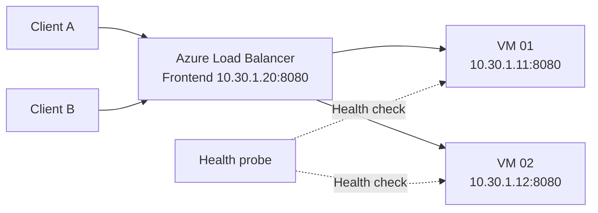
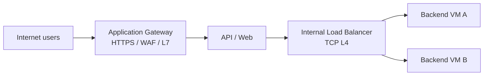
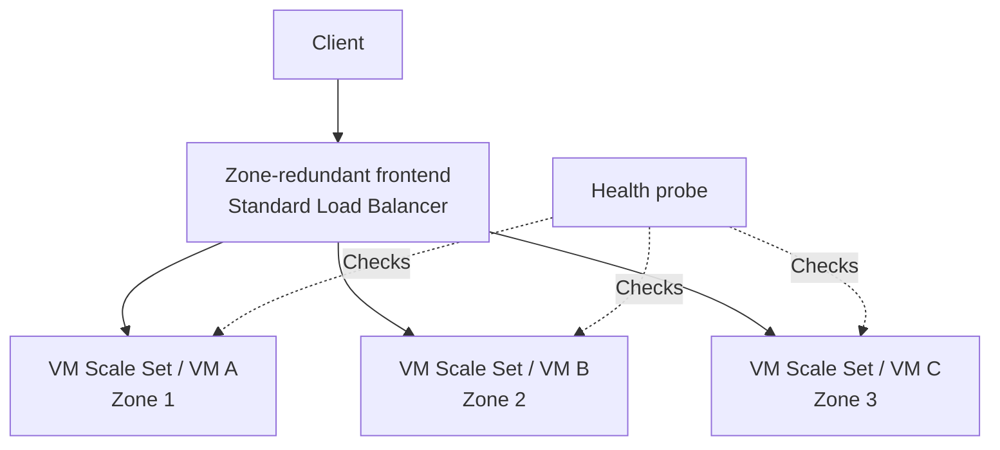

# Transport-Layer Load Balancing with Azure Load Balancer

When an application on Microsoft Azure runs across multiple servers handling the same service, the system needs to distribute connections to healthy servers to increase serving capacity and reduce dependence on a single machine. **Azure Load Balancer** is a managed **Layer 4 (L4)** load-balancing service: it routes **TCP or UDP** flows based on IP addresses and ports without inspecting the application's HTTP content.

In the Azure learning path, this service relates directly to virtual networks, VMs/Virtual Machine Scale Sets, availability zones, Network Security Groups (NSGs), monitoring, and cost control. This lesson belongs to the **Load Balancing and Application Delivery** chapter, guiding you from concepts, components, and traffic flows to hands-on configuration, security, and operations.

## Learning Objectives

After this lesson, you will be able to:

1. Explain how Layer 4 load balancing differs from Layer 7 HTTP/HTTPS load balancing.
2. Distinguish between **Public Load Balancer** and **Internal Load Balancer**.
3. Describe **frontend IP**, **backend pool**, **health probe**, **load-balancing rule**, and **inbound NAT rule**.
4. Understand flow-hash backend selection and session persistence options.
5. Design a Standard Load Balancer configuration for VMs or a VM Scale Set, including multi-availability-zone scenarios.
6. Use Azure CLI to create and inspect an internal load balancer and troubleshoot traffic failures.
7. Identify the distinct responsibilities of NSGs, applications, outbound connectivity, and Layer 7 services.

## 1. Why Is Load Balancing Needed?

Suppose an orders API runs on two virtual machines, `vm-app-01` and `vm-app-02`, in the same virtual network. If users only connect to the IP of `vm-app-01`, that machine can become overloaded or go offline during updates. By placing a Load Balancer in front, clients connect to **a single stable frontend IP address**; the Load Balancer selects a backend that passes health probes to handle the connection flow.



Load Balancer helps distribute traffic and reduces the impact when one backend fails. However, **load balancing alone does not create a highly available system**. If both VMs run out of capacity together, share a failing database, or the application cannot recover state, Load Balancer cannot solve those problems.

### 1.1. What Is Layer 4?

The TCP/IP model separates layers with different responsibilities. Within the scope of this lesson:

- **IP** delivers packets to source/destination addresses.
- **TCP** establishes reliable port-based connections; **UDP** sends datagrams without TCP-style connection setup.
- **HTTP, HTTPS, gRPC**, and other application protocols run on top of the transport protocol.

An L4 Load Balancer makes decisions based on the **IP/port/protocol flow**; it does not decide based on URL `/orders`, HTTP Host, cookies, or the `Authorization` header. The service can load-balance an HTTP application over TCP ports 80/443, but doing so does not turn it into a Layer 7 HTTP router.

## 2. Components of Azure Load Balancer

An Azure Load Balancer resource is typically configured using the following objects:

| Component | Role | Example |
|---|---|---|
| **Frontend IP configuration** | The IP and entry point clients connect to. | `10.30.1.20` or a Standard Public IP. |
| **Backend pool** | List of backend endpoints eligible to receive traffic. | NIC/IP configurations of `vm-app-01`, `vm-app-02`, or a VM Scale Set. |
| **Health probe** | Checks whether a backend is eligible to receive new traffic. | TCP port `8080` or HTTP `GET /healthz`. |
| **Load-balancing rule** | Maps frontend/protocol/port to a backend pool and backend port. | TCP `10.30.1.20:8080` → pool port `8080`. |
| **Inbound NAT rule** | Forwards traffic to a specific VM/instance rather than distributing across the entire pool. | A management frontend port mapped to a single VM's port. |
| **Outbound rule** | Configures outbound flows through public frontend IPs when appropriate. | SNAT traffic from the backend pool via a public frontend. |

One frontend can be used by multiple rules to serve different ports/protocols. One backend can participate in multiple rules subject to service capabilities and limits. Check combinations of frontend, backend, protocol, and port to avoid conflicts.

### 2.1. Frontend IP

The **frontend** is the address clients use to connect to the service. It can be a public IP or a private IP depending on the deployment type. Load Balancer does not automatically make a domain name known to clients; if you need `api.example.com`, you must configure appropriate DNS pointing to the frontend IP.

A **public frontend** typically uses a Public IP resource compatible with the SKU. An **internal frontend** takes an address from a subnet in the VNet; you can choose an appropriate static private IP address for easier DNS and dependent system setup. Placing a frontend in a subnet does not mean every VM in that subnet has permission to access the application: network policies, routes, and OS permissions still apply.

### 2.2. Backend Pool

The **backend pool** tells Load Balancer which application endpoints can handle connections. In NIC-based deployments, each VM typically has a NIC IP configuration associated with the pool. Azure Load Balancer also supports IP-based backend pools or integration with VM Scale Sets subject to the corresponding features and configuration requirements.

Having two VMs in a pool does not mean both are **healthy**. Each rule needs appropriate health-checking logic, and the application must listen on the target port. If a backend is not considered healthy, Load Balancer can stop selecting it for new flows.

### 2.3. Load-Balancing Rule

A rule defines a port and protocol pairing. For example:

```text
Protocol        TCP
Frontend IP     10.30.1.20
Frontend port   8080
Backend pool    pool-app
Backend port    8080
Health probe    probe-app
```

When a client sends TCP traffic to `10.30.1.20:8080`, Load Balancer uses the rule to identify the pool and pick an eligible backend. Frontend port and backend port can differ if the rule allows and is configured properly; for example, frontend `443` → backend `8443`. However, port mapping is **not** TLS termination or converting HTTPS to HTTP.

## 3. Public Load Balancer vs. Internal Load Balancer

Distinguish the two models by the connectivity scope the frontend serves:

| Criterion | Public Load Balancer | Internal Load Balancer |
|---|---|---|
| **Frontend** | Public IP. | Private IP in a VNet. |
| **Typical clients** | Internet users or networks with valid routes to the public IP. | VMs in the VNet, peered VNets, on-premises networks via VPN/ExpressRoute. |
| **Suitable applications** | Public TCP/UDP services, game servers, specialized protocols. | Internal APIs, middleware components, database proxies, or apps that do not need public exposure. |
| **Security focus** | NSGs, IP/port exposure controls, attack protection, and application authentication. | NSGs, routes, private DNS, and internal access control. |
| **Ability to read HTTP headers** | No. | No. |

### Two-Layer Architecture Example

An application can place **Application Gateway** in front to handle HTTP/HTTPS, TLS, and WAF, while using an **Internal Load Balancer** behind it to distribute an internal TCP protocol to a dedicated VM group.



Not every application needs both services. Choose one or more layers based on protocol, protection requirements, and backend structure. If an application only needs HTTP URL-based routing, Azure Load Balancer alone cannot meet that requirement.

## 4. Standard Load Balancer and SKU Considerations

For new deployments, design on **Standard Load Balancer**. Basic Load Balancer is a legacy SKU on Azure's retirement path; do not build new architectures assuming Basic remains a viable choice.

Standard Load Balancer provides production-grade configuration capabilities, including TCP/UDP distribution, health probes, availability zone options when paired with compatible frontends/backends, explicit outbound policies, and integration with Azure networking resources.

Several key principles:

- When using a **public frontend**, the Public IP resource must use a SKU compatible with Standard Load Balancer; configure IP/zone settings per deployment requirements.
- Standard Load Balancer is designed with a **closed-by-default approach for inbound traffic unless an NSG rule allows it**. Creating a load-balancing rule does not automatically open the entire firewall to the VMs.
- **Inbound** and **outbound** are separate directions. Having a public frontend for incoming traffic does not guarantee every backend VM automatically gets the desired outbound Internet behavior.
- Support for zones, HA ports, Floating IP, or specialized networking depends on frontend type, backend type, and service conditions. Verify compatibility before going to production.

## 5. How Does Azure Load Balancer Select a Backend?

### 5.1. Flow-Hash Distribution

Azure Load Balancer typically distributes **new flows**, not individual HTTP requests, by computing a hash over attributes such as:

```text
Source IP
Source port
Destination IP
Destination port
Protocol
```

This is the **five-tuple (5-tuple)**. Two TCP connections with different source ports may be assigned to different backends even when coming from the same user. Conversely, multiple HTTP requests sent sequentially over **the same TCP connection** are not re-distributed per request under this default mechanism.

Example:

```text
Client 192.0.2.10:51000 -> VIP 203.0.113.10:443 / TCP -> VM A
Client 192.0.2.10:51001 -> VIP 203.0.113.10:443 / TCP -> VM B
```

The IP addresses in the example are illustrative only. Do not think of Azure Load Balancer as guaranteeing an exact 50/50 split of requests or round-robin on every call. Actual distribution depends on flow count, healthy backend count, client connection reuse, traffic patterns, and load distribution configuration.

### 5.2. Session Persistence / Load Distribution

Some rule settings allow changing how flow affinity is determined:

| Mode | Typical distribution basis | Meaning |
|---|---|---|
| **Default** | Five-tuple. | Fits when backends can handle independent connections. |
| **Client IP (Source IP)** | Two attributes: source IP, destination IP. | Tends to send flows from the same source IP to the same backend. |
| **Client IP and protocol** | Source IP, destination IP, protocol. | Keeps affinity at the IP and protocol level per supported mode. |

**Source-IP affinity is not a session cookie.** Many users behind the same NAT may all land on one backend; conversely, a changing client IP breaks affinity. For web applications requiring durable sessions, design a shared session store or appropriate service rather than relying solely on LB affinity.

### 5.3. Idle Timeout and TCP Reset

Long-lived idle TCP connections may exceed the rule's **idle timeout**. Choose a value suited to application behavior and consider TCP keepalive or application-level heartbeats. Some configurations support sending a TCP reset on idle timeout, helping clients detect closed connections rather than waiting for an application timeout.

Changing idle timeout does not fundamentally fix applications that hold connections open forever, lost network paths, or broken retry handling. Clients should be designed with proper timeouts, backoff, and idempotency.

## 6. Health Probes: Selecting Servers Still Able to Serve

Health probes are the foundation for Load Balancer to know which backends can accept **new flows**. Health probes are configured separately and referenced by rules.

### 6.1. TCP Probe

A **TCP probe** attempts to establish a TCP connection to a port on the backend. If the port accepts the connection as required, the probe can be considered successful. This approach is simple but verifies only a small slice of health: a process might open its port even though dependencies like a database or queue are broken.

### 6.2. HTTP/HTTPS Probe

When supported by the configuration, an **HTTP or HTTPS probe** can call a path such as `/healthz` and decide based on a response considered healthy by the service. Azure Load Balancer still distributes traffic at L4; using an HTTP probe does **not** turn it into an L7 application router.

Applications should expose a purposeful health endpoint, for example:

```http
GET /healthz HTTP/1.1
Host: api.internal.example

HTTP/1.1 200 OK
Content-Type: text/plain

ok
```

In practice, check Azure Load Balancer's requirements for response codes, headers, host, TLS, and probe paths for the service version you are using. A health endpoint should be fast, require no interactive login, and cause no side effects. Avoid running expensive queries or exposing sensitive information in probes.

### 6.3. Interval, Threshold, and Backend State

A probe has a time interval between checks (**interval**) and a number of consecutive failures (**threshold**) before marking a backend unhealthy. Choosing these values balances failure detection speed against false positives during brief slowdowns.

Illustrative example:

```text
Probe: TCP 8080
Interval: 5 seconds
Unhealthy threshold: 2
```

These are **illustrative configuration parameters**, not a guarantee that every failover completes in exactly 10 seconds. Actual timing and behavior also depend on rules, probe type, failure timing, and traffic characteristics.

When a backend becomes unhealthy, Load Balancer stops selecting it for new flows per service mechanics. **Already established connections** may be affected differently depending on failure type, backend state, and configuration; do not promise that all existing sessions will seamlessly migrate to another VM. Applications must handle retries or session recovery according to business requirements.

### 6.4. Health Probes and Network Security Groups

Azure uses platform addresses such as `168.63.129.16` for certain infrastructure operations, including Load Balancer health probes. When configuring NSGs or firewalls, allow probes from the appropriate source per service guidance (typically represented by the **`AzureLoadBalancer` service tag** in NSGs) to the health probe port.

Default NSG rules include related platform allowances; however, a higher-priority deny rule or host firewall can block probes. Do not open all inbound Internet traffic just to make probes pass. Allow **application traffic** from authorized networks/clients and **probe traffic** from Azure's required source/port as two separate needs.

## 7. Load Balancer Does Not Replace NSGs, Routes, or Application Security

A request reaching a backend typically passes through multiple layers:

```text
Client -> Frontend IP/port -> Load-balancing rule -> Backend pool
       -> NSG/route/host firewall -> Listening process
```

Failure at any step can cause client timeouts. Creating a frontend IP and rule correctly is therefore not enough:

- **NSGs** must allow inbound traffic from valid sources to the backend port and health probes as needed.
- **Guest OS firewalls** must allow the process to accept connections.
- **Applications** must bind to the right IP/interface and port, not only `127.0.0.1` when network access is needed.
- **Routing** must allow forward and return paths between client and backend; user-defined routes or network virtual appliances can alter traffic paths.
- **TLS, authentication, and authorization** belong to the application or appropriate components. An L4 Load Balancer does not validate JWTs, block SQL injection, or provide HTTP WAF.

With an internal frontend, a VM on a connected network can still be denied by an NSG or firewall. With a public frontend, never leave broad `Any/Any` test rules enabled in production.

## 8. High Availability Design with Availability Zones

Standard Load Balancer can be used in multi-**Availability Zone** architectures, depending on region and supported resource types. The goal is to avoid placing all backends in a single failure domain.



A **zone-redundant frontend** and backends across multiple zones reduce single-zone dependency. However, spreading VMs across zones while sharing a single-point-of-failure database does not achieve end-to-end HA. You must also evaluate the data tier, storage, DNS resolution, secrets, deployment strategy, capacity, and application behavior.

Distinguish:

- **Zonal frontend**: pinned to a specific zone per IP type/region capabilities.
- **Zone-redundant frontend**: placed by Azure to maintain availability across multiple available zones per service design.
- **Cross-region resilience**: survives region-level outages and requires a dedicated architecture, such as global traffic distribution and multi-region backends; a single regional Load Balancer does not create cross-region DR.

To improve availability, pair VM Scale Sets with appropriate scaling policies and health probes that genuinely reflect processing readiness. Scale-out can add backend instances, but new instances must have the application started, configured, and healthy before receiving traffic.

## 9. Hands-On: Creating an Internal Standard Load Balancer with Azure CLI

This lab uses **two existing VMs** in a VNet to focus on load-balancing functionality; there is no need to provision the entire VM infrastructure here. Names and IPs are examples and must be adjusted to match your actual test environment.

### 9.1. Prerequisites

- An Azure subscription and permissions to manage Load Balancers, NICs, and NSGs in the target resource group.
- Resource group `rg-lb-lab`, VNet `vnet-app`, and subnet `snet-app` in the same resource group.
- Two VMs `vm-app-01` and `vm-app-02` with NICs `nic-app-01` and `nic-app-02`, each having an IP configuration named `ipconfig1` in the target VNet.
- Each VM runs an application or HTTP test server on **TCP 8080** capable of returning distinct output to identify the backend; do not bind only on loopback.
- Address `10.30.1.20` is available and within subnet `snet-app`; the frontend is strictly for internal traffic.
- NSGs/host firewalls allow TCP 8080 from test client sources and allow appropriate health probes.

Do not apply these commands verbatim to production. Creating a Load Balancer or modifying NICs/NSGs can affect traffic and incur charges. For simplicity, examples use Bash in an environment with Azure CLI installed.

### Step 1. Select Subscription and Set Variables

```bash
az login
az account list --output table
az account set --subscription "<subscription-id>"

RG="rg-lb-lab"
LB="lb-app-internal"
VNET="vnet-app"
SUBNET="snet-app"
VIP="10.30.1.20"
```

Inspect the subnet and NICs before changing any configuration:

```bash
az network vnet subnet show \
  --resource-group "$RG" \
  --vnet-name "$VNET" \
  --name "$SUBNET" \
  --query "{name:name,addressPrefix:addressPrefix}" \
  --output json

az network nic list \
  --resource-group "$RG" \
  --query "[].{name:name,privateIp:ipConfigurations[0].privateIPAddress}" \
  --output table
```

The commands above are read-only. If NIC names, IP configuration names, or subnet addresses differ from the example, update the variables and parameters in subsequent steps.

### Step 2. Create the Standard Internal Load Balancer

```bash
az network lb create \
  --resource-group "$RG" \
  --name "$LB" \
  --sku Standard \
  --vnet-name "$VNET" \
  --subnet "$SUBNET" \
  --private-ip-address "$VIP" \
  --frontend-ip-name "fe-private" \
  --backend-pool-name "pool-app"
```

This command creates the Load Balancer with a private frontend IP and a backend pool. This is not yet a complete configuration for serving traffic via the VIP: you still need to create a probe, a rule, and add backends to the pool. If rejected because the IP is already in use or does not match the subnet, do not pick an arbitrary address without checking the IP plan.

### Step 3. Create a TCP Health Probe

```bash
az network lb probe create \
  --resource-group "$RG" \
  --lb-name "$LB" \
  --name "probe-tcp-8080" \
  --protocol Tcp \
  --port 8080 \
  --interval 5 \
  --threshold 2
```

A TCP probe checks whether TCP port 8080 is accepting connections. In production, if your HTTP application exposes a suitable `/healthz` endpoint, consider an HTTP/HTTPS probe to measure actual serving readiness rather than only checking if the TCP port is open.

### Step 4. Create a Load-Balancing Rule

```bash
az network lb rule create \
  --resource-group "$RG" \
  --lb-name "$LB" \
  --name "rule-tcp-8080" \
  --protocol Tcp \
  --frontend-ip-name "fe-private" \
  --frontend-port 8080 \
  --backend-pool-name "pool-app" \
  --backend-port 8080 \
  --probe-name "probe-tcp-8080"
```

The rule connects frontend `10.30.1.20:8080` to backend pool `pool-app` using the probe created above.

### Step 5. Add Both VM NICs to the Backend Pool

```bash
az network nic ip-config address-pool add \
  --resource-group "$RG" \
  --nic-name "nic-app-01" \
  --ip-config-name "ipconfig1" \
  --lb-name "$LB" \
  --address-pool "pool-app"

az network nic ip-config address-pool add \
  --resource-group "$RG" \
  --nic-name "nic-app-02" \
  --ip-config-name "ipconfig1" \
  --lb-name "$LB" \
  --address-pool "pool-app"
```

Adding NIC IP configurations modifies backend infrastructure and should be performed carefully. For VM Scale Sets, backend pool association differs; it is normally defined in the scale set network configuration rather than editing individual NICs manually.

### Step 6. Verify NSGs, Firewalls, and Application Processes

For NSGs attached to the backend subnet or NICs, ensure:

1. Application traffic on **TCP 8080** is allowed from authorized subnets or clients.
2. Health probes from Azure Load Balancer are allowed using the appropriate service tag/service requirement and probe port 8080.
3. No higher-priority `Deny` rule accidentally blocks valid traffic.
4. Host firewalls on both VMs permit the required traffic; the application binds to an address reachable over the network.

Inspect existing rules before adding any. Example **read-only** command:

```bash
az network nsg rule list \
  --resource-group "$RG" \
  --nsg-name "<nsg-name>" \
  --output table
```

Do not open TCP 8080 to all sources `*` just to make the lab work. Use the test source address or appropriate service tag per network policy.

### Step 7. Test from an Internal Client VM

From a VM inside the VNet or a network with connectivity to the VIP, run:

```bash
curl --connect-timeout 3 --max-time 10 "http://10.30.1.20:8080/"
```

Repeat several times or open multiple independent TCP connections. If the application returns the backend hostname, you can observe responses from different VMs. However, due to flow hashing, **do not expect strict alternation between VM A and VM B on every run**. Also do not test the VIP from a machine without a route to the VNet and conclude the LB is broken.

### Step 8. Re-Read Configuration and Verify Results

```bash
az network lb show \
  --resource-group "$RG" \
  --name "$LB" \
  --query "{name:name,sku:sku.name,frontends:frontendIPConfigurations[].privateIPAddress}" \
  --output json

az network lb probe list \
  --resource-group "$RG" \
  --lb-name "$LB" \
  --output table

az network lb rule list \
  --resource-group "$RG" \
  --lb-name "$LB" \
  --output table

az network lb address-pool list \
  --resource-group "$RG" \
  --lb-name "$LB" \
  --output json
```

These commands only read configuration. To confirm backends are truly healthy and data paths work, combine probe status, metrics, and client testing rather than merely verifying that rules exist.

### Step 9. Clean Up the Lab

When finished, verify whether the Load Balancer is serving any other workloads. Remove backend pool references from NICs properly, then delete **only** the lab resources confirmed to belong to you. Do not delete shared VNets, NICs, or VMs just because they have similar names. Afterward, check Azure Cost Management to ensure no lab resources continue incurring charges.

## 10. Outbound Connectivity and SNAT

**Inbound traffic** (client → backend) and **outbound traffic** (backend → external services) must be designed separately. An internal Load Balancer that only provides a private frontend for inbound traffic does not automatically act as an Internet NAT gateway. Even with a public Standard Load Balancer, explicitly define the outbound path and public source IP for backend VMs instead of relying on implicit outbound behavior.

Common outbound design options:

| Solution | Role | When to consider |
|---|---|---|
| **NAT Gateway** | Translates subnet outbound source addresses using configured public IPs/prefixes. | Workloads needing reliable, large-scale outbound Internet connectivity and dedicated SNAT management. |
| **Load Balancer outbound rule** | Uses a public frontend with a Standard Load Balancer outbound rule to provide outbound access for the backend pool. | When the architecture already uses a public Standard LB and this option satisfies requirements. |
| **Public IP on NIC/VM** | VM has its own configured public IP. | Specific cases with clear requirements; weigh attack surface and operations. |
| **Azure Firewall or NVA** | Controls, filters, and logs outbound traffic per policy. | Environments requiring centralized flow control and logging. |

### SNAT Port Exhaustion

When many outbound connections share a limited pool of **SNAT ports**, applications may experience new-connection failures or timeouts even when inbound networking is healthy. Systems opening thousands of short-lived connections to an external service are at much higher risk than applications that reuse connections properly.

Mitigations include **connection pooling**, reusing HTTP keep-alive, tuning timeouts/retries, optimizing concurrent connections, and choosing an appropriate egress mechanism such as NAT Gateway. Monitor outbound metrics/logs supported by the service; do not assume adding backend VMs alone solves all SNAT limits.

## 11. Inbound NAT Rules, HA Ports, and Floating IP

These features serve purposes different from standard TCP/UDP load-balancing rules.

### 11.1. Inbound NAT Rule

An **inbound NAT rule** maps a frontend IP/port to a port on **one** specific backend for management or instance access. It does **not** distribute traffic across the entire backend pool like a load-balancing rule. For example, in some designs, different frontend ports are mapped to RDP/SSH on individual VMs.

However, **Azure Bastion** or a dedicated administrative access solution is often preferable to exposing public SSH/RDP. Do not expose management ports to the Internet without explicit requirements and security controls.

### 11.2. HA Ports

**High Availability (HA) Ports** allow a single rule to cover multiple TCP/UDP ports under supported Azure Load Balancer configurations, useful in certain network virtual appliance (NVA) scenarios. This is not the default way to build a two-port web application. Review routing, Floating IP, and NVA flow handling before using it.

### 11.3. Floating IP (Direct Server Return)

**Floating IP** is an option used for scenarios requiring the frontend address to be handled specially on the backend, such as certain clustered applications or Direct Server Return models. Do not enable it thinking it will speed up every web app. With Floating IP enabled, OS/backend configuration may need changes to handle the frontend address properly; only enable it when required by the architecture and tested.

## 12. Comparing Azure Load Balancer with Other Services

Azure offers multiple traffic distribution tools across different layers:

| Service | Decision basis | Best suited for |
|---|---|---|
| **Azure Load Balancer** | L4, TCP/UDP, IP and port; typically serves backends within a regional deployment. | TCP/UDP apps, VM/VM Scale Set load balancing, internal/public VIPs. |
| **Azure Application Gateway** | Layer 7, HTTP/HTTPS, can inspect URL/host; supports WAF on appropriate SKUs. | Web apps needing TLS termination, WAF, path/host-based routing. |
| **Azure Front Door** | Global edge HTTP/HTTPS delivery with acceleration and application protection. | Web/APIs with geographically distributed users or edge requirements. |
| **Azure Traffic Manager** | DNS-based traffic steering; does not proxy client TCP streams. | Directing clients to endpoints based on DNS/health policies. |
| **Cross-region Load Balancer** | Public L4 distribution across supported regional backends. | Multi-region TCP/UDP designs within service support conditions. |
| **Gateway Load Balancer** | Integrates traffic processing chains through network virtual appliances. | Firewalls/IPS or virtual network appliances, not an HTTP router. |

**Quick decision check:** If you need to receive TCP/UDP and forward via a frontend IP based on health probes, Azure Load Balancer fits. If `https://example.com/orders` must route to a different backend group than `/users`, look at Application Gateway or Front Door. If you want DNS to select which regional endpoint is used without directly proxying connections, look at Traffic Manager.

## 13. Monitoring and Troubleshooting

Azure Load Balancer can emit useful **Azure Monitor metrics** such as health probe status (**Health Probe Status / DipAvailability**) or data path status (**Data Path Availability / VipAvailability**) depending on resource type and current support. Verify dimensions, aggregations, and metric definitions when configuring alerts. **Azure Activity Log** tracks management-plane configuration changes, not logs of individual requests processed by the Load Balancer.

### 13.1. Diagnostic Sequence

If clients cannot connect to the VIP, check in order:

1. **Frontend:** Are the IP, public/internal type, subnet, and client DNS correct?
2. **Rule:** Are protocol, frontend/backend ports, backend pool, and health probe correct?
3. **Backend pool:** Are NICs/VMSS/IPs associated? How many endpoints are actually healthy?
4. **Health probe:** Are port/path, firewall, and listening backend process correct? Is the probe receiving valid responses?
5. **NSG/host firewall:** Is there a higher-priority deny rule or source IP restriction?
6. **Routing:** Does the client have a route to the VIP, do NVAs/UDRs alter paths, or is there asymmetric return routing?
7. **Application:** Does the backend respond properly when called **directly on its private IP** from an authorized test source?
8. **Monitoring:** Correlate LB metrics, VM/application logs, and recent infrastructure changes around the failure time.

### 13.2. Common Failure Patterns

| Symptom | Possible cause | How to verify |
|---|---|---|
| VIP times out completely | Wrong route, frontend IP, NSG, or zero healthy backends. | Check IP/rules, NSGs, probe metrics, and test from a routed client. |
| One backend receives most connections | Five-tuple hash, connection reuse, Source-IP affinity, or low flow count. | Open multiple independent TCP flows, check load distribution mode and app logs. |
| Backend app runs but health probe fails | App binds only to loopback, wrong probe port/path, or blocked by firewall. | Check socket listeners, test probe path directly, inspect NSG/host firewall. |
| TCP probe healthy yet API returns errors | TCP port is open but app logic, database, or dependencies are broken. | Use an appropriate HTTP health endpoint and monitor application telemetry. |
| Public frontend exists but Internet traffic fails | NSG blocks traffic, app not listening, or wrong routes/firewall. | Check IP/SKU, inbound rules, and test externally. |
| Inbound works, outbound Internet fails | No outbound path, SNAT port exhaustion, or UDR/firewall block. | Check NAT Gateway/outbound rules, routing, NSGs, and SNAT metrics. |
| Connections drop when a backend is removed | Existing connections do not seamlessly migrate to another VM. | Check retries, session handling, and application graceful shutdown. |
| Internal VIP unreachable from on-premises | VPN/ExpressRoute, routes, or DNS misconfigured. | Test from a VM inside the VNet first, then from the on-premises network. |

### 13.3. Checking with Network Tools

For TCP, commands like the following help isolate DNS, TCP, and application issues:

```bash
# On Linux, test the backend directly from an authorized source
curl --connect-timeout 3 --max-time 8 http://10.30.1.11:8080/

# Test through the internal VIP
curl --connect-timeout 3 --max-time 8 http://10.30.1.20:8080/
```

On Windows:

```powershell
Test-NetConnection -ComputerName 10.30.1.20 -Port 8080
```

If direct backend calls succeed while the VIP fails, focus on LB frontend/rules/probes/NSGs/routes. If both fail, first inspect the application, firewall, and VM networking. HTTP `curl` is only suitable when the backend actually serves HTTP on the tested port; for custom TCP protocols, use a protocol-appropriate client tool.

## 14. Operations and Cost Optimization

In production, Load Balancer must be treated as part of the overall architecture, not just an IP address:

- **Capacity:** measure connection counts, throughput, application response times, and backend CPU/RAM usage; scale VMs based on load and health checks.
- **Safe deployments:** before updating VMs, use rolling deployment strategies, readiness/health probes, and graceful shutdown; verify real behavior on active connections.
- **Security:** least-privilege NSG source rules, no public management ports; manage keys/certificates and identity permissions separately in the application.
- **Availability:** spread backends across availability zones where appropriate, avoiding shared single points of failure in databases and dependencies.
- **Outbound:** plan NAT/SNAT explicitly; watch for port exhaustion and outbound traffic spikes to prevent unexpected failures.
- **Cost:** evaluate Standard Load Balancer pricing, billed rules/processed traffic per current pricing, Public IPs, NAT Gateway, bandwidth, VMs, and monitoring. Exact prices vary by region/SKU, so verify with the Azure Pricing Calculator and Cost Management.

Do not delete or alter load-balancing rules just because no traffic is visible at the moment of inspection; confirm with workload owners, batch schedules, and intermittent callers. Use tags, Azure Policy, and appropriate Azure RBAC permissions to manage the lifecycle of the LB and related resources.

## 15. Case Study and Self-Check Questions

### Scenario

A company deploys a TCP service on port `9000` across four VMs: two VMs in Zone 1 and two VMs in Zone 2. Clients may only connect from the office network over ExpressRoute. When a VM reboots, new traffic must continue reaching healthy VMs. The system must also call a partner API on the Internet once per hour to refresh data.

**Suggested analysis:**

1. Choose **Internal Standard Load Balancer** because the frontend is strictly for internal clients over private connectivity.
2. Provision a stable private frontend IP, a backend pool containing all four VMs, and a TCP `9000 → 9000` rule.
3. Configure health probes suited to application characteristics; if using only a TCP check, understand the probe's limitations.
4. Configure NSGs, ExpressRoute routes, and host firewalls to allow only valid sources to the service port and probe port.
5. Distribute VMs across availability zones; test VM/zone failure scenarios and measure recovery behavior.
6. Design **separate outbound connectivity**, such as NAT Gateway or a policy-compliant egress mechanism; an internal LB does not automatically provide Internet SNAT.
7. Monitor probes, connection errors, application availability, and costs.

### Review Questions

1. Why can't Azure Load Balancer route `/api/orders` requests by URL without a Layer 7 component?
2. A backend's TCP port is open, yet database calls fail: can a TCP probe still report healthy? How should the health endpoint be designed?
3. Why might two HTTP requests from one client hit the same backend even with multiple VMs in the backend pool?
4. When deploying an Internal Load Balancer, what determines whether on-premises clients can reach the VIP?
5. If you have a Public Load Balancer, are backend VMs guaranteed to have outbound Internet access? What needs to be checked?
6. Does adding multiple availability zones keep the application safe if all VMs share a single-point-of-failure database?

### Suggested Answers

1. An L4 LB selects backends by IP/port/protocol flow, not by reading HTTP URLs or host headers for routing.
2. Yes, it can. Use an application health probe representing **readiness**, checking critical dependencies appropriately while avoiding overly heavy checks.
3. Because the same TCP connection remains pinned to one backend, or flow hashing/affinity selects the backend by flow/IP.
4. Routing over ExpressRoute/VPN, NSGs/firewalls, the VIP address, LB rules, probe status, and DNS when using a hostname.
5. No. You must verify the outbound path, NAT Gateway/outbound rules, source IPs, routes, firewalls, and SNAT capacity.
6. Not enough. Single points of failure must also be eliminated or mitigated across dependencies, storage, databases, and recovery procedures.

## 16. Production Readiness Checklist

- [ ] L4 vs. L7 requirements, TCP/UDP protocol, internal/public frontend, and client scope are defined.
- [ ] Frontend IP, SKU/zone, and DNS are properly configured; public frontends use compatible Public IPs.
- [ ] Backend pool includes the right VMs/NICs/VM Scale Sets with sufficient capacity and zone spread where appropriate.
- [ ] Health probe checks the right port and readiness signal; single-backend failure has been tested.
- [ ] Load-balancing rule uses the right protocol, frontend/backend ports, probe, and load distribution mode.
- [ ] NSGs, host firewalls, and routes permit application flows and health probes from appropriate sources.
- [ ] Outbound connectivity, NAT/SNAT plan, and egress monitoring are in place.
- [ ] Application implements timeouts/retries, session handling, and graceful shutdown during backend changes.
- [ ] Tested from real clients, verifying both direct backend connectivity and access via the VIP.
- [ ] Monitoring, alerts, owner, tags, rollback documentation, and cost controls are configured.
- [ ] HA architecture evaluated databases, data tier, networking, and dependencies rather than only the LB.

## Conclusion

**Azure Load Balancer** solves **transport-layer TCP/UDP** flow distribution through a frontend IP to backends passing health probes. Its core components are the **frontend**, **backend pool**, **health probe**, and **load-balancing rule**, alongside options for session persistence, NAT, outbound connectivity, and availability zones. For reliable operations, ensure NSGs/firewalls, routes, application listeners, DNS, session resilience, and egress planning are all accurate. When URL-based routing, WAF, or TLS termination is required, combine or select an appropriate Layer 7 service instead of expecting an L4 Load Balancer to handle those functions.
