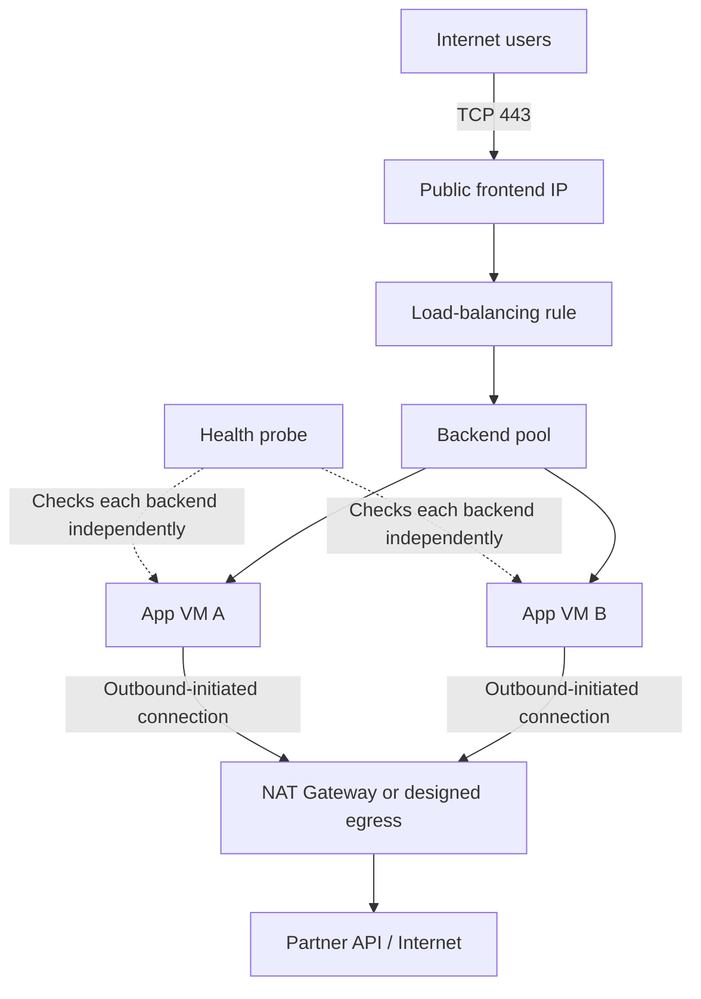
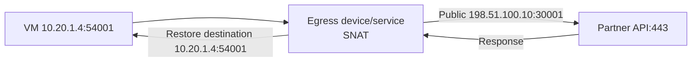
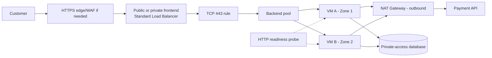

# Health Probes, Load-Balancing Rules, and Outbound Connectivity

When an application runs on two or more virtual machines (VMs) in Microsoft Azure, placing those VMs in the same virtual network is not enough to turn them into a fault-tolerant service. Users need a stable address to send requests to; traffic must be distributed to machines still capable of serving; and backend machines must also reach the Internet or external systems when business logic requires it. These three concerns are related, yet they are **not the same function**.

In the **Load Balancing and Application Delivery** chapter of the **CLOUD_PROVIDERS_AZURE** module, this lesson focuses on **Azure Standard Load Balancer**: how **health probes** detect backends eligible to accept connections, how **load-balancing rules** map traffic from a frontend to a backend pool, and how to design **outbound connectivity/SNAT** separately so workloads connect outward predictably. This knowledge fits within the broader context of managing subscriptions, resource groups, Microsoft Entra ID, virtual networks, VMs, data, monitoring, security, and cost control when deploying Azure application architectures.

After this lesson, you will be able to:

- Explain the roles of frontend IP configurations, backend pools, health probes, load-balancing rules, and Network Security Groups (NSGs).
- Distinguish TCP, HTTP, and HTTPS health probes; design a readiness endpoint that accurately reflects serving capability.
- Predict the impact of failing probes, misconfigured rule ports, backends missing from the pool, or NSGs blocking traffic.
- Distinguish **inbound** connectivity from **outbound** connectivity; explain source network address translation (SNAT).
- Choose between NAT Gateway, public Standard Load Balancer outbound rules, or firewall egress paths based on requirements.
- Deploy a load balancer baseline with Azure CLI and test both inbound and outbound paths.

## 1. Problem Statement: Three Independent Functions

Suppose a sales API runs on two VMs across two Availability Zones. Customers access a public domain, while the VMs must call a partner API to verify payments.

1. **Inbound path:** customers connect to the load balancer's frontend IP; a rule selects the backend and target port.
2. **Health probing:** Azure checks each backend as configured; a backend failing the criteria is not selected for new connection flows matching the rule.
3. **Outbound path:** a VM initiates a connection to the partner API. The route, public source IP address, and available SNAT ports must be designed separately.

A properly working load-balancing rule **does not prove** the workload has outbound Internet connectivity. Conversely, a VM calling the Internet successfully **does not prove** the public frontend is configured properly or that backends pass health probes.

### Overview Diagram



The diagram shows logical relationships. Probes and user flows differ in source, may differ in protocol/port, and may have different allow rules. **A Public Load Balancer does not automatically act as a NAT Gateway.** When an application uses Azure Firewall, User-Defined Routes (UDRs), or another network model, the egress diagram must reflect the actual routing path.

## 2. Which Layer Does Azure Load Balancer Operate At?

**Azure Load Balancer** is a **Layer 4 (TCP/UDP)** load-balancing service. It forwards flows based on network connection attributes such as IP, port, and protocol. It is not a reverse proxy that understands full HTTP requests, does not route by URL path, and does not enforce application login policies.

| Service | Primary processing layer | Best suited when |
|---|---|---|
| **Azure Standard Load Balancer** | Layer 4 – TCP/UDP | Balancing TCP/UDP to VMs, VM Scale Sets, or supported backends, public or private |
| **Azure Application Gateway (with optional WAF)** | Layer 7 – HTTP/HTTPS | Host/path routing, TLS termination, cookie affinity, HTTP protection |
| **Azure Front Door** | Application layer at global edge | Multi-region web app delivery, acceleration, protection, and global request routing |
| **Azure Traffic Manager** | DNS-based orchestration | Selecting endpoints via DNS policy without proxying individual connections |

Common confusion: Standard Load Balancer **can use HTTP/HTTPS probes** to evaluate backends, yet **the load-balancing rule remains Layer 4**. Being able to query a health URL does not turn Load Balancer into Application Gateway.

### Public vs. Internal Load Balancer

- **Public Load Balancer:** frontend uses a public IP; fits when a TCP/UDP service must be exposed to the Internet by design, combined with NSGs and appropriate application-layer protection.
- **Internal Load Balancer:** frontend uses a private VNet IP; fits service-to-service communication, internal applications, or API/database tiers requiring a private connection point.

An application can have both a public and an internal load balancer. Choose the type based on callers and security boundaries, not by how many VMs the application runs. In this lesson, all configuration examples use the **Standard SKU**; do not treat older SKU generations as a baseline for new deployments.

## 3. Components That Must Align Together

Consider a simple rule: users call `203.0.113.10:443`, and Azure forwards the connection to `10.20.1.4:443` or `10.20.1.5:443`.

| Component | Meaning | Example |
|---|---|---|
| **Frontend IP configuration** | IP/entry point accepting connections | Service public IP or private IP in a subnet |
| **Backend pool** | Set of addresses/resources eligible to receive flows | VM-A `10.20.1.4`, VM-B `10.20.1.5` |
| **Health probe** | Checks whether each backend is eligible to receive connections | HTTP GET `/health/ready` on port 8080 |
| **Load-balancing rule** | Binds frontend, backend pool, protocol, ports, and probe | TCP 443 → TCP 443 |
| **NSG and host firewall** | Determines which traffic is allowed to reach the backend | Allows the application port and corresponding probe |
| **Route/NAT egress** | Determines the path for backend-initiated connections | NAT Gateway or firewall in a hub |

An **empty backend pool**, or VMs in the pool failing probes, can both prevent the frontend from serving requests. A **healthy probe** also does not guarantee user access succeeds if an NSG, OS firewall, or application authentication blocks user traffic.

### How Are Flows Distributed?

Standard Load Balancer uses flow mapping based on a hash of connection attributes. By default, the hash is typically based on the **5-tuple**: source IP, source port, destination IP, destination port, and protocol. Different flows may land on different backends; do not assume per-HTTP-request round-robin distribution.

An existing TCP flow generally stays pinned to its chosen backend; two HTTP requests over the same connection share that connection path. Enabling **session persistence** by client IP or client IP + protocol can reduce the number of backends chosen for flows from the same source, but does not replace application session design. For web apps needing shared state, prefer storing sessions in an appropriate tier (such as a cache or database) rather than relying entirely on connection stickiness.

## 4. Health Probes: What Does Load Balancer Check?

A **health probe** is a periodic check from the Azure platform to each backend. For a rule referencing a probe, backends meeting the criteria are considered eligible for new flows; failing backends are excluded from the candidate set according to service mechanics. A probe does not read overall subscription health or application dashboards; it checks the declared **protocol, port, and path**.

### 4.1. Three Common Probe Types

| Probe type | Basic check | What it does not prove |
|---|---|---|
| **TCP** | Backend completes TCP handshake on the configured port | Whether the API returns valid results or the DB is available |
| **HTTP** | Backend returns HTTP **200 OK** to a GET request on the specified path and port | Whether other business endpoints are healthy or users are authorized |
| **HTTPS** | Performs an HTTPS check to the endpoint and expects a successful response per probe requirements | Whether full auth flows, business logic, or all client types work |

For Azure Load Balancer HTTP/HTTPS probes, prepare an endpoint returning **200** when ready. Do not use a `301/302` redirect, `401` login prompt, `500` error, or an endpoint returning only `204` as a healthy signal if the probe expects 200. Avoid URLs requiring special query strings or host bindings that the probe cannot send; verify the probe type's capabilities against your actual endpoint.

Example health endpoint:

```http
GET /health/ready HTTP/1.1
Host: 10.20.1.4:8080

HTTP/1.1 200 OK
Content-Type: application/json

{"status":"ready"}
```

This illustrates the application's response, not a byte-for-byte transcript of the exact request Azure's probe sends. The endpoint must respond in a way the probe supports, without requiring user credentials or end-user hostnames.

### 4.2. Core Configuration

- **Protocol:** TCP, HTTP, or HTTPS.
- **Port:** listening port on the probed **backend**; may match or differ from the client-facing port.
- **Path:** check path for HTTP/HTTPS, such as `/health/ready`.
- **Interval:** time between probe checks.
- **Unhealthy threshold:** number of consecutive failed probes before marking the backend unhealthy, per service implementation rules.

A shorter interval detects failures faster but increases sensitivity to transient blips. A higher threshold reduces flapping from brief errors but lengthens detection time. Choose values based on SLOs, application startup time, load levels, and real testing. Do not alter defaults without measuring impact.

### 4.3. Probe Source and Network Security Groups

For Azure Load Balancer IPv4 health probes, an important platform address is **`168.63.129.16`**. In NSGs, the **`AzureLoadBalancer` service tag** identifies related probe traffic; default NSG rules typically allow this source, though a higher-priority custom rule can block it.

Check **NSGs, OS firewalls, VM listeners, and how the application binds addresses**. A probe to port 8080 will not pass just because an NSG allows port 443. Do not open `0.0.0.0/0` to an internal health port just to fix probes: use the appropriate probe source/service parameters and restrict unnecessary access.

The probe path differs from the client path:

```text
Azure Load Balancer health probe  ──>  backend:<probe-port>
Users / application sources       ──>  frontend:<frontend-port>
                                           │
                                     Load-balancing rule
                                           │
                                           └──> backend:<backend-port>
```

A service might probe port 8080 while the rule accepts TCP 443 and forwards to backend TCP 443. Both flows must be tested and permitted independently as required.

## 5. Designing the Right Health Endpoint: Liveness Is Not Readiness

Do not merely make `/health` return 200 unconditionally just to turn dashboards green. Distinguish whether an application is **running** versus **actually ready to accept new connections**.

| Application check type | Question | Usage |
|---|---|---|
| **Liveness** | Is the process still alive? | Helps the platform/runtime decide on restarts or crash detection per its mechanics |
| **Readiness** | Can this instance handle new requests right now? | Suitable endpoint for load balancers to decide on sending new flows |
| **Deep health/diagnostics** | Are all dependencies and business workflows healthy? | Used for dashboards, alerting, and investigation; not necessarily the sole probe |

For example, a .NET or Java API after deployment needs to load config, build connection pools, and warm caches. Liveness may turn healthy early, while readiness should only return 200 once the endpoint can serve requests. When an instance needs draining for maintenance, readiness can flip to failing; draining existing connections requires its own plan.

**Avoid excessive dependencies:** if readiness synchronously calls five remote services, a brief outage in one shared dependency can mark **every** backend unhealthy even when the app can still serve core functionality. Separate dependencies critical enough to pull an instance from those that should only trigger alerts. Keep the endpoint lightweight, fast, bounded by timeouts, free of sensitive data, and free of noisy per-probe logging.

### Response Scenarios

| `/health/ready` result | Appropriate interpretation |
|---|---|
| 200, fast response | Backend meets probe criteria |
| TCP connects but HTTP 500 | TCP probe may still pass, HTTP probe catches the failure |
| 301/302 to a login page | HTTP probe does not get expected 200; fix the endpoint |
| 401 requiring a token | Platform probes lack user tokens; separate an unauthenticated readiness path |
| Timeout or no listener | Check app, port, NSG/host firewall, routes, and system load |
| All backends unhealthy | Rule has no eligible backends for new flows; find the shared failure rather than just adding VMs |

## 6. Load-Balancing Rules: Connecting Frontend to Backend

A **load-balancing rule** defines which connections arriving at a frontend are distributed to which pool. Key configuration fields typically include:

1. **Frontend IP configuration:** address receiving traffic.
2. **Protocol:** TCP or UDP; `All` may apply in specialized configurations such as internal load balancer HA ports.
3. **Frontend port:** port users/gateways connect to.
4. **Backend port:** application port on target VMs.
5. **Backend pool:** set of load-balanced candidates.
6. **Health probe:** eligibility criteria for each backend.
7. **Flow options:** session persistence, idle timeout, TCP reset, and other compatible settings.

Example for an internal application:

| Rule | Frontend | Backend | Probe |
|---|---|---|---|
| `rule-api` | Private frontend `10.20.0.10:443/TCP` | Pool `api-prod`, port `8443/TCP` | HTTPS `/health/ready` on 8443 |
| `rule-metrics` (if truly needed) | Private frontend `10.20.0.10:9090/TCP` | Pool `api-prod`, port `9090/TCP` | Appropriate probe on 9090 |

Not every application needs to expose a metrics port through a load balancer. Management, metrics, and probe ports should remain within a tightly scoped network and permission boundary.

### 6.1. Load Balancing Does Not Mean Equal Per-Request Spread

A Layer 4 rule preserves flow consistency; it does not inspect cookies or URLs. Many connections from the same NAT device may concentrate on one backend depending on hash/session persistence settings. Thus, "two VMs" does not mean both machines always show identical CPU.

To improve distribution:

- Ensure backends have equivalent sizing and processing capacity.
- Account for keep-alive and connection pooling behavior.
- Review session persistence before enabling it, as it can skew distribution.
- Monitor traffic, CPU, connection count, and latency on **each** backend.
- Design applications to be stateless or use shared state whenever possible.

### 6.2. Idle Timeout and TCP Reset

**Idle timeout** sets how long an idle flow can go without traffic before it can be removed from the load balancer's tracking state. The **TCP reset** option helps endpoints detect more clearly when an idle connection has been closed, where supported. Do not use idle timeout as a workaround for broken readiness or overloaded backends.

For long-lived connections (WebSockets, persistent TCP sessions, gRPC), verify keep-alives, client/server timeouts, SDK behavior, and durability requirements. Test under realistic configurations rather than assuming connections stay alive indefinitely.

### 6.3. Floating IP and HA Ports

**Floating IP** (Direct Server Return in certain scenarios) is a specialized option that affects backend IP/port handling; do not enable it for standard web apps just because "floating" sounds highly available. **HA ports** on internal Standard Load Balancers are useful for balancing multiple ports at once—typically for network virtual appliances—but require dedicated firewall/routing design. Do not confuse HA ports with HTTP path inspection or sticky sessions.

## 7. Backend Pools, Failure States, and Resilience

A backend pool can reference VM NIC IP configurations, VM Scale Set backends, or IP addresses as supported by Standard Load Balancer. Membership attachment depends on pool model and backend type. **Putting a VM in the same subnet does not automatically add it to the backend pool.** Also verify the backend has a listener on the actual port and binds to an address reachable by the probe.

### When One Backend Becomes Unhealthy

Suppose a pool contains three VMs:

```text
VM-A   HTTP probe = 200   → eligible for new flows
VM-B   HTTP probe = 500   → ineligible after failure threshold
VM-C   HTTP probe = 200   → eligible for new flows
```

Load Balancer stops selecting VM-B for new flows according to its probe state. **Do not assume all existing TCP connections on VM-B are immediately terminated**; behavior depends on flow type, failure timing, and connection handling options. If draining is required for zero-downtime deployments, coordinate readiness, stopping new request intake, in-flight request completion windows, application shutdown, and rolling update strategies.

If A, B, and C all turn unhealthy, adding a new load-balancing rule will not fix it. Check whether all instances lost the database, readiness got locked behind auth, an NSG blocks probes, or a recent deployment broke the listener.

### Availability Zones and Scale-Out

Standard Load Balancer can be used in multi-Availability Zone architectures when supported by the region/SKU and related configuration. However, a zonal or zone-redundant frontend **does not automatically make the application zone-resilient** if all VMs, storage, and dependencies sit in a single zone. The architecture needs:

- Backends distributed across zones per availability requirements.
- Frontend IP and load balancer SKUs aligned with the zone design.
- Health probes reflecting each backend's genuine readiness.
- Applications that avoid storing critical state on a single VM; proper data and session strategies.
- VM Scale Sets or orchestration that deploys/scales on metrics when autoscaling is required.
- Drills simulating loss of a backend, a zone, and shared dependencies.

**Load balancing is not autoscaling.** The LB picks where to send flows among existing backends; VM count only grows or shrinks when another mechanism performs scaling.

## 8. Outbound Connectivity: Which Path Do VMs Take to Call the Internet?

An **outbound connection** starts from the backend, such as an order-processing API calling `api.partner.example:443`. Egress design must define:

1. **Next hop:** where does subnet traffic go per effective routes?
2. **Address translation:** if private IP `10.20.1.4` connects to the Internet, the source usually needs translation to a public IP via an SNAT mechanism.
3. **Public source IP:** which IP will the partner see, and can it be allowlisted stably?
4. **Scalability:** are there enough SNAT ports when many instances open concurrent connections?
5. **Policy:** are there firewalls, destination filtering, logging, DNS, or compliance constraints?



Addresses and ports are illustrative data, not actual Azure configurations. SNAT maps a connection from a private address to a corresponding public source IP/port so replies return to the right flow. Private internal connectivity to SQL over a Private Endpoint **does not mean** outbound Internet access exists.

### 8.1. Outbound Connectivity Options

| Option | High-level behavior | Considerations |
|---|---|---|
| **NAT Gateway** | Attached to a subnet, providing outbound SNAT via assigned public IPs/prefixes | Fits explicit egress with high port scalability; does not expose public inbound to VMs |
| **Public Standard LB outbound rule** | Uses Load Balancer's public frontend IP and allocates SNAT to the backend pool per rule | Requires configuring pool, frontend, ports, outbound policies, and monitoring SNAT |
| **Outbound SNAT via inbound load-balancing rule** | Some public Load Balancer setups can provide outbound SNAT when enabled | Avoid implicit reliance; risks port exhaustion and changes when editing rules |
| **Azure Firewall/NVA** | Traffic routes to an egress control appliance that can perform NAT | Fits inspection/logging/destination filtering; needs UDRs, policies, and return-path design |
| **Direct Public IP on VM** | VM has public reachability per configuration and effective routes | Increases exposure surface and complicates centralized control; poorly suited at scale |
| **Default outbound access** | Platform outbound path that may exist in certain legacy setups/environments | **Should not be treated as a reliable production solution**; varies with subnet models and platform policies |

For new workload subnets, **design explicit outbound connectivity** from the start. When you need a fixed public source IP and high connection volume, NAT Gateway is usually the straightforward choice. When you need FQDN/application-level egress control, security logging, and centralized policy inspection, consider Azure Firewall in your architecture. A public LB is unnecessary if an app only accepts private inbound traffic yet needs to call the Internet.

### 8.2. Coexistence of NAT Gateway and Public Standard Load Balancer

A common architecture:

```text
Internet client ──> Public Standard LB ──> VM pool (inbound)
VM pool ──> Subnet-attached NAT Gateway ──> External API (outbound)
```

When NAT Gateway is configured on a subnet, it takes precedence for **new outbound connections** in supported scenarios; do not treat the Load Balancer's outbound rule as the subnet's default path. Existing inbound traffic through the LB frontend continues following inbound configuration, separate from outbound connections initiated by backends.

Clearly establish ownership and the IP used for egress. When migrating from Load Balancer outbound SNAT to NAT Gateway, the public source IP seen by partner APIs may change; update allowlists and verify DNS, retry logic, and monitoring before cutover.

### 8.3. Standard Load Balancer Outbound Rules

An **outbound rule** typically binds:

- Public frontend IP configuration used as the SNAT source.
- Backend pool containing instances needing outbound access.
- Protocol and appropriate idle timeout settings.
- Port allocation method or outbound SNAT port count per backend.

An outbound rule is **not** an inbound NAT rule: an inbound NAT rule routes an incoming connection to one specific backend/port, typically for specialized needs; an outbound rule governs how backends initiate outbound connections. Load-balancing rules distribute inbound connections across a pool, whereas outbound rules manage outbound SNAT. Do not confuse the three rule types.

If using outbound rules, check their relationship with outbound SNAT options on inbound rules to avoid overlapping SNAT configuration. Never toggle `disableOutboundSnat` from a snippet without confirming backends already have another egress path; doing so can cut off VMs from calling external services.

### 8.4. Forced Tunneling and Effective Paths

If a subnet has a `0.0.0.0/0` UDR pointing to Azure Firewall/NVA or a hybrid link, the **effective route** can send packets along a path different from the intended NAT Gateway/LB outbound path. Combining NAT Gateway, UDRs, Internet gateways, and firewalls must follow each service's routing rules and precedence. Never write design documentation claiming "everything goes through NAT Gateway" if effective routes show a different next hop.

When outbound traffic traverses on-premises, design NAT at the actual egress point, return routes, DNS, and bandwidth. For Azure service Private Endpoints, traffic stays on supported private paths and should not be conflated with Internet egress over public SNAT.

## 9. SNAT Port Exhaustion: Why Do Calls Fail Despite Having a Public IP?

A public IP has a finite number of TCP/UDP ports. Many concurrent outbound connections—especially to the same destination group—can exhaust allocated SNAT ports. Once available ports run out, new connections fail or time out even while VM CPU is low, DNS works, and Internet routes are valid.

Example: three VMs process tens of thousands of orders, and each request creates a new HTTP client to the same partner API and immediately closes it. The app churns through short-lived TCP connections, consuming SNAT ports faster than expected. Scaling out more VMs does not automatically ensure sufficient total SNAT capacity if each backend receives a low port allocation or a single public IP/pool is heavily loaded.

### Warning Signs

- `connect timeout` or `socket error` spikes under rising traffic while CPU and memory look healthy.
- New calls to external APIs fail, while internal flows or existing connections still work.
- Public Load Balancer/NAT Gateway telemetry shows high SNAT port utilization or connection counts (per supported metrics).
- Connections to one specific destination/protocol suffer more than others.

### Mitigations

1. **Reuse connections:** use HTTP keep-alive, connection pooling, and client libraries that manage sockets properly.
2. **Control concurrency:** bound concurrent outbound calls and apply retries with backoff/jitter to avoid retry storms.
3. **Choose suitable egress:** use NAT Gateway when large, flexible SNAT allocation is needed; size public IPs/prefixes by actual demand, not just VM count.
4. **Monitor SNAT:** build dashboards and alerts on available metrics, analyzing peak load rather than averages alone.
5. **Reduce unnecessary connections:** cache appropriate data, batch requests, or use asynchronous patterns where business logic allows.
6. **Load-test thoroughly:** test app, LB, DNS, egress, and partner APIs together; do not overlook partner rate limits/quotas.

Do not simply increase timeouts or open extra frontend ports to "fix" SNAT exhaustion. Identify the active egress mechanism and actual port capacity.

## 10. Securing Inbound and Outbound Flows

**Load Balancer does not replace NSGs, TLS, API authentication, or WAF.** Standard Load Balancer forwards network flows by rule; a malicious HTTP request will still reach the backend unless the application protects itself or an HTTP inspection layer sits in front.

### Inbound

- For public services, open only required ports. Enforce TLS and proper authentication on the app or a supported entry point.
- If you need WAF, host/path routing, or centralized TLS termination, consider Application Gateway or Front Door instead of expecting a Layer 4 Load Balancer to do those jobs.
- **Backend NSGs** must allow user traffic on the **backend port** from permitted sources per architecture. With a public LB, backends can see the client's source IP; do not assume the source is always the LB frontend IP.
- Probes must be allowed from the platform source; avoid exposing probe ports to the public Internet unnecessarily.
- Never open RDP/SSH to the entire Internet just to troubleshoot backends; prefer Azure Bastion, VPN, or controlled privileged access solutions.

### Outbound

- Define permitted destination APIs/domains; apply egress firewalls/policies when security requirements demand it.
- Use a fixed public egress IP if partners use allowlists and manage IP changes through planned rollouts.
- Use managed identities and authorization checks when calling Azure services; private networking does not replace data-plane authorization.
- Restrict automation/deployment identity permissions over frontend IPs, LB rules, NAT Gateways, and route tables.
- Enable logging, monitoring, and change controls to detect anomalous outbound behavior.

## 11. Architecture Example for a Multi-VM API Application

Suppose a company deploys an order-processing application with these requirements:

- Users connect to a public entry point with TLS.
- Two backend VMs sit in the same VNet, deployed across supported zones.
- If one VM fails startup or is not ready, it temporarily stops receiving new connections.
- Backends call an external payment API from a stable source IP so the partner can allowlist it.
- The database sits behind private access and cannot be reached arbitrarily from the Internet.
- Operations must tell whether failures stem from load balancing, the application, or outbound networking.

One approach:



If HTTPS terminates at a WAF/Application Gateway, port and TLS design between gateway → Load Balancer → VMs must be explicitly defined. **Not every system needs both WAF and a public LB**; some architectures place an internal LB behind the gateway, or omit the Layer 4 LB if the gateway itself satisfies application distribution needs. The diagram shows composable options, not a mandate to deploy every piece in all cases.

### Control Matrix

| Requirement | Design configuration | Evidence |
|---|---|---|
| Failing VM receives no new flows | Dedicated readiness probe attached to LB rule | Make one VM return 503 and observe probe state |
| Users only call HTTPS | TLS entry point and matching NSG/backend port | Hit real endpoint, verify certificate and HTTP redirect if used |
| Prevent random IP changes seen by partner API | Organization-managed NAT Gateway/public IP | Check public egress IP from backend and match against allowlist |
| Database not public | Private access/Private Endpoint, DNS, data permissions | Verify DNS name, routes, and auth with authorized identity |
| Pinpoint failures to a specific VM | Probe metrics, app logs, dedicated alerts | Dashboard displays per-backend status and API errors |
| Survive single-zone failure | Well-distributed backends/dependencies, right SKU | Run planned drill draining one backend/zone |

## 12. Azure CLI Hands-On: Creating a Standard Load Balancer and Health Probe

This example creates only the core networking components of a **public Standard Load Balancer**, then demonstrates attaching an existing VM and adding a NAT Gateway for outbound traffic. It does **not** deploy VMs, databases, TLS certificates, or a production application. The goal is to understand each object clearly instead of running a large template blindly.

**Prerequisites:** permission to create networking resources in a test subscription; Azure CLI installed; resource group/VNet/subnet and test VMs already present (or provisioned via your own lab setup); backend port 8080 has a listener returning 200 at `/health/ready`. These commands can incur charges for public IPs, load balancers, or NAT Gateways. Run only in an authorized environment and replace sample values with real names/IDs.

### 12.1. Select Subscription and Environment Variables

Example uses **Bash / Azure Cloud Shell in Bash mode**:

```bash
az login

SUBSCRIPTION_ID="<subscription-id-lab>"
RG="rg-lb-demo"
LOCATION="southeastasia"
PIP="pip-web-demo"
LB="lb-web-demo"
FRONTEND="fe-web"
BACKEND="be-web"
PROBE="probe-ready"
RULE="rule-http"

az account set --subscription "$SUBSCRIPTION_ID"
az account show --query "{id:id, tenant:tenantId, name:name}" -o table
```

Create the resource group if it does not exist:

```bash
az group create --name "$RG" --location "$LOCATION"
```

Do not use `<subscription-id-lab>` literally as a real ID. The demo uses HTTP to make port mapping easy to observe; **never use unencrypted HTTP for sensitive data in production**.

### 12.2. Create a Public IP and Standard Load Balancer

```bash
az network public-ip create \
  --resource-group "$RG" \
  --name "$PIP" \
  --location "$LOCATION" \
  --sku Standard \
  --allocation-method Static

az network lb create \
  --resource-group "$RG" \
  --name "$LB" \
  --location "$LOCATION" \
  --sku Standard \
  --public-ip-address "$PIP" \
  --frontend-ip-name "$FRONTEND" \
  --backend-pool-name "$BACKEND"
```

When multi-zone or zone-redundant behavior is needed, select public IP and resource settings aligned with the region/SKU and workload availability requirements. The demo does not assume every region supports the same Availability Zone list.

### 12.3. Create an HTTP Health Probe

```bash
az network lb probe create \
  --resource-group "$RG" \
  --lb-name "$LB" \
  --name "$PROBE" \
  --protocol Http \
  --port 8080 \
  --path "/health/ready" \
  --interval 5 \
  --threshold 2
```

The probe calls backends directly on port 8080. The application must return `200 OK` when ready. If port 8080 is not listening, an NSG/host firewall blocks probes, or the endpoint requires authentication, the probe will fail even though the load balancer was created successfully.

### 12.4. Create a Load-Balancing Rule

```bash
az network lb rule create \
  --resource-group "$RG" \
  --lb-name "$LB" \
  --name "$RULE" \
  --protocol Tcp \
  --frontend-ip-name "$FRONTEND" \
  --frontend-port 80 \
  --backend-pool-name "$BACKEND" \
  --backend-port 8080 \
  --probe-name "$PROBE"
```

The connection path in this demo is `public-ip:80/TCP → backend-ip:8080/TCP`. Azure LB maps TCP flows; the HTTP path is used solely by the health probe. If backends need TLS, you can choose a TCP 443 rule with a backend TLS listener on 443 and an appropriate probe after deploying certificates and TLS policies.

### 12.5. Attach Existing VM NICs to the Backend Pool

With a NIC/IP-configuration backend pool model, attach each test VM's NIC to the pool; verify exact NIC and IP configuration names in the actual resource group. For example:

```bash
NIC_NAME="<existing-vm-nic>"
IPCONFIG_NAME="<existing-ip-configuration>"

az network nic ip-config address-pool add \
  --resource-group "$RG" \
  --nic-name "$NIC_NAME" \
  --ip-config-name "$IPCONFIG_NAME" \
  --lb-name "$LB" \
  --address-pool "$BACKEND"
```

This command illustrates NICs and the load balancer in the resource group matching the variables. If a NIC lives in another resource group, use the syntax/resource-ID reference method appropriate for the API/CLI and your permissions; do not assume all resources share one group. For VM Scale Sets or IP-based backend pools, the association process differs and must match the chosen pool type.

Besides pool membership, permit these flows:

- **User traffic:** TCP 8080 from authorized user sources after LB translation.
- **Probe traffic:** TCP 8080 or HTTP 8080 from Azure's probe source per design; use the appropriate service tag in NSGs.
- **Host firewall:** must not block either traffic type you intentionally allowed.

These are two separate rules to evaluate independently—do not allow all sources to all ports just because "the LB isn't working."

### 12.6. Inspect Configuration

```bash
az network lb probe show \
  --resource-group "$RG" \
  --lb-name "$LB" \
  --name "$PROBE" \
  --output json

az network lb rule show \
  --resource-group "$RG" \
  --lb-name "$LB" \
  --name "$RULE" \
  --output json

az network public-ip show \
  --resource-group "$RG" \
  --name "$PIP" \
  --query "{ip:ipAddress, allocation:publicIPAllocationMethod, sku:sku.name}" \
  --output table
```

Valid configuration output is not enough: the backend pool must actually contain VMs, the application must be running, NSGs must allow traffic, and probes must be healthy. Only then can you test HTTP requests to the public IP in the lab.

### 12.7. Explicit Outbound with NAT Gateway (Optional, Conditional Step)

**Run this section only** if you already have a VNet/subnet containing backend VMs needing egress, have checked routes, and have no conflicting egress architecture. It creates an extra public IP and NAT Gateway, which may incur costs:

```bash
NAT_PIP="pip-egress-demo"
NAT="nat-web-demo"
VNET="<existing-backend-vnet>"
SUBNET="<existing-backend-subnet>"

az network public-ip create \
  --resource-group "$RG" \
  --name "$NAT_PIP" \
  --location "$LOCATION" \
  --sku Standard \
  --allocation-method Static

az network nat gateway create \
  --resource-group "$RG" \
  --name "$NAT" \
  --location "$LOCATION" \
  --public-ip-addresses "$NAT_PIP"

az network vnet subnet update \
  --resource-group "$RG" \
  --vnet-name "$VNET" \
  --name "$SUBNET" \
  --nat-gateway "$NAT"
```

If backends are in a different resource group, adjust commands/resource references accordingly. **Never attach a NAT Gateway to a production subnet just to test**: this can change the public egress IP, break allowlists, disrupt active flows, violate firewall policies, and add charges. Review routes, dependencies, and rollback plans before making changes.

### 12.8. Cleanup and Cost Control

If resource group `rg-lb-demo` was created exclusively for this lab and **contains no non-lab resources**, preview the resource list first and delete only after confirmation:

```bash
az resource list --resource-group "$RG" --output table

# Only after confirming this RG is dedicated solely to the lab:
# az group delete --name "$RG" --yes
```

Deleting a resource group destroys everything inside it; never run delete commands in shared subscriptions or resource groups. If VNets or VMs sit outside the lab RG, check associations and clean up carefully via approved procedures. Do not overlook lingering billed resources such as public IPs, NAT Gateways, Load Balancers, VMs, or log destinations.

## 13. Mandatory Pre-Production Testing Matrix

Do not stop at "resource deployment succeeded." Test network paths from the right sources, destinations, and identities.

| Test case | How to test | Expected outcome |
|---|---|---|
| Frontend has right IP and port? | Check frontend/rule and connect to the IP/DNS name | Reaches the intended service |
| Each backend healthy individually? | Call readiness endpoint on each VM; compare with probe metrics | Healthy VMs return 200; unhealthy VMs are detected |
| A VM dies under load? | Stop listener or intentionally flip readiness to unhealthy in test | New flows shift to eligible VMs; existing flows follow design |
| NSG blocks users but allows probes? | Test from a blocked client source and inspect rules | Probes may stay green while clients fail: confirms separation |
| NSG blocks probes while app runs? | Test with a controlled change in a lab environment | Backend turns unhealthy after threshold, confirming probe failure |
| Rule mismatches frontend/backend ports? | Compare rule against actual listening ports | Catch mismatches and fix before go-live |
| Outbound from backend to partner API? | Initiate HTTPS from VM to an authorized test endpoint | Connection succeeds and receives expected response |
| Stable public egress IP? | Compare source IP seen by partner/test endpoint with design | Matches approved public egress IP |
| Egress handles peak load? | Load-test at expected volume and monitor new connections | No unexpected SNAT failures; alerts configured |
| Private Endpoint to database? | Check DNS, network path, and app permissions | Service accepts only authorized access as configured |

**A successful connection from inside a VM does not prove the load balancer works**: the VM might be calling the backend directly. Likewise, one HTTP 200 from the frontend does not prove all backends are healthy or every VM's outbound path works.

### Question-Based Fault Isolation Sequence

When users report timeouts:

1. **Is DNS right?** Does the domain point to the right frontend IP, or is there a bad record/cache?
2. **Do frontend and rule match?** Are protocol/port, pool, and probe correct?
3. **Are backends in the pool?** Are NIC/IP configurations attached, or are VMs merely in the VNet?
4. **Do probes pass?** Check endpoint, port, response, NSG, host firewall, and response latency.
5. **Is user traffic permitted to the backend?** Check NSG/backend port, listener, and host firewall.
6. **Is the application truly healthy?** Check HTTP 500s, slow dependencies, exhausted connection pools, CPU/memory.
7. **If outbound fails:** where do routes go, what is the egress IP, are SNAT ports sufficient, is the partner blocking via allowlist/rate limit?
8. **If failures follow a deployment:** compare the latest changes across LB, NSGs, routes, NAT, TLS, images, and app config.

### Differentiating Failures by Symptom

| Symptom | Initial hypothesis | Data to inspect |
|---|---|---|
| Probes unhealthy on all VMs | Shared wrong path/port, redirect/auth, shared NSG, or shared dependency | Probe config, per-VM responses, NSGs, and app logs |
| Probes healthy yet users time out | Wrong rule/frontend, user port blocked, or user route/listener differs from probe | Load-balancing rule, NSGs, firewalls, client logs |
| Only some requests fail | One broken backend, unshared session state, or uneven flow distribution | Per-backend telemetry, persistence, app, and dependencies |
| Inbound works, outbound times out | Missing SNAT/route, egress firewall block, or wrong partner allowlist | Effective routes, NAT/LB outbound config, egress IP, logs |
| Outbound fails only at peak | SNAT port pressure, poor connection pooling, or partner rate limits | SNAT metrics, connection counts, HTTP client, partner |
| Partner rejects after NAT Gateway change | Public source IP changed | NAT public IP, partner allowlist, target-side logs |
| Flapping health probes | App restarts, GC pauses, tight timeouts, or unstable dependencies | Probe interval, threshold, latency, and runtime metrics |

## 14. Azure Monitor: Observing Health and Paths

Load-balanced systems need monitoring from at least three angles: **LB platform**, **backend application**, and **egress path**.

### 14.1. Telemetry Sources

| Source | Data to monitor | Why it is needed |
|---|---|---|
| Azure Standard Load Balancer metrics | Health probe status, data path availability, traffic stats, SNAT metrics where available | Reveals when backends or LB paths fail to respond |
| Azure NAT Gateway metrics | Traffic volume and SNAT/connections per service visibility | Detects outbound limits and traffic anomalies |
| VM/VM Scale Set metrics | CPU, memory (with agent), network throughput, instance count, OS errors | Separates machine overload from LB issues |
| Application logs and tracing | HTTP status codes, p95/p99 latency, request IDs, dependency failures, readiness transitions | Identifies business-logic and performance failures |
| Azure Activity Log | Who modified LB rules, frontends, NSGs, backend membership, routes, or NAT | Scopes incidents after configuration changes |
| Azure Firewall/network logs | Blocked destinations, inbound/outbound flows, applied rules | Investigates routing and egress policies |

Available metrics, metric names, and breakdowns by backend/SNAT method depend on resource type and configuration. Do not assume that "creating a Log Analytics workspace" sends all metrics/logs there automatically; configure appropriate diagnostic settings, agents, or connectors, then verify queries and alerts.

### 14.2. Examples of Actionable Alerts

- Health probes for a backend or backend group continuously fail beyond a threshold.
- Count of eligible instances drops below the expected minimum.
- App p95/p99 latency spikes alongside probe or CPU anomalies.
- Outbound connection failure rate climbs alongside SNAT utilization metrics.
- Public egress source IP changes unexpectedly.
- Unexpected modifications occur on frontend rules, NSGs, NAT Gateways, or route tables.

Every alert should have an **owner, severity, runbook, supporting data, and closure criteria**. Avoid "probe down" alerts that cannot distinguish brief deployment blips from losing the entire backend. For critical workloads, pair probes with **end-to-end synthetic monitoring** from a client perspective because probes only test a narrow health endpoint.

## 15. Zero-Downtime Operations and Fault-Tolerant Design

### 15.1. Rolling Deployments

To update an application across a multi-VM pool:

1. Ensure remaining VMs have enough capacity to carry the load.
2. Transition one backend to not-ready per deployment workflow; wait until probes stop selecting it for new flows.
3. Allow in-flight requests/flows to finish within a designed draining window; do not treat probe failure as an automatic command to kill active connections.
4. Update the application, then verify readiness and dependencies.
5. Return the backend to the pool once probes stabilize; proceed to the next VM only when metrics meet thresholds.

For locally stored application state, synchronize it or externalize state to shared storage so users do not lose sessions when requests hit another VM. A Layer 4 Load Balancer cannot fix application session architecture.

### 15.2. Shared Dependencies

Three VMs in three zones can still go down together if all depend on one unavailable database/secret store. Do not configure readiness as "every dependency must be green" without analyzing cascading impact. Separate core feature health from deep diagnostics so a secondary dependency does not pull every VM out of rotation.

### 15.3. Zone and Region Safety

Regional load balancing does not automatically handle multi-region traffic orchestration. If multi-region failover is required, evaluate DNS/global edge architectures and data recovery capabilities, such as Azure Front Door or Traffic Manager depending on the application type. Verify data-source health and write paths, not just whether an HTTP endpoint responds.

## 16. Cost, Limits, and Architectural Decisions

Architecture cost is more than VM pricing. Estimate:

| Line item | Why costs arise |
|---|---|
| Standard Load Balancer | Resource/configuration charges and data processing under current billing models |
| Public IP | Public IP address fees and selected SKU/configuration |
| NAT Gateway | Hourly uptime, data processed, and associated public IPs |
| Azure Firewall or NVA | Service/compute fees, traffic processing, log ingestion, and operations |
| VMs/VMSS, Availability Zones | Compute, storage, cross-region/zone data transfer per actual paths |
| Log Analytics/monitoring | Ingestion, data retention, alerts, and observability resources |
| Partner APIs | Outbound request/traffic fees, quotas, retries, and data egress |

Not every workload needs a public Load Balancer **and** Application Gateway **and** NAT Gateway **and** Firewall. For instance:

- Simple internal TCP service: **internal Standard LB** + appropriate network policies may suffice for inbound.
- Web app needing WAF and path routing: favor **Application Gateway/Front Door** for Layer 7 capabilities, deciding whether an L4 LB behind it is even needed.
- VMs needing to call Internet services from a fixed source IP: **NAT Gateway** handles outbound without requiring a public LB.
- Organization requiring centralized egress filtering: **Azure Firewall** in a hub-spoke architecture, checking routes and DNS.

Track spend with **Azure Cost Management**, apply tags such as `application`, `environment`, `owner`, and `costCenter`, and set budget alerts per subscription or cost group. Budgets are alerting mechanisms, **not hard spending caps**. Before scaling, estimate throughput, connection counts, SNAT ports, availability targets, and required protections.

## 17. Self-Assessment Lab Exercise

**Context:** An API runs on three VMs across two Azure zones, exposed behind a public IP. The API must call an external payment gateway whose partner only accepts an allowlisted source IP. One VM just deployed a new version whose readiness endpoint returns 503, and during peak hours several outbound requests time out.

Complete these tasks:

1. Sketch the flow **Internet → LB frontend → load-balancing rule → backend pool**, adding a separate probe path to each VM.
2. Choose protocol, frontend port, backend port, and health probe for an API running TLS on port 443 with a separate HTTP readiness endpoint on port 8080. Explain why the rule remains Layer 4.
3. Describe the NSG rules required for probes and user traffic; do not use "allow all ports from all sources."
4. Explain what happens to **new flows** after one VM returns 503 to probes past the failure threshold; propose how to handle in-flight flows during rolling updates.
5. Choose among NAT Gateway, public LB outbound rules, and Azure Firewall for egress; justify based on IP allowlisting, destination filtering, and connection volume.
6. List at least four possible causes of outbound timeouts while inbound still succeeds.
7. Build a test table covering a successful inbound connection, a failed probe, NSG-blocked backend access, a successful outbound connection, and a high-load test stressing SNAT.
8. Propose a dashboard/alert setup that helps operators distinguish health probe failures from SNAT exhaustion.
9. List cleanup steps for lab resources and potential ongoing costs if a NAT Gateway, public IP, or VM is forgotten.

### Expected Outcome Framework

| Decision | Must explain |
|---|---|
| Backend pool | Which three VMs are actually attached to the pool and have listeners? |
| Probe | Why readiness returns 200 when healthy and 503 when the instance cannot take new flows? |
| Rule | How client/backend ports differ; does TLS need to terminate on the backend? |
| NSG | Why a healthy probe does not prove client traffic is permitted? |
| Outbound | Which device/resource provides SNAT and a stable public source IP? |
| Monitoring | Which metrics/logs indicate unhealthy backends, bad rules, or exhausted SNAT ports? |
| Availability | What happens when one VM, one zone, or a shared dependency fails? |

The exercise is complete when you can trace **one inbound request** and **one outbound connection** from source to destination, pinpointing the component governing routing, probes, permissions, and SNAT at each step, along with the telemetry to inspect during failures.

## 18. Key Takeaways

With **Azure Standard Load Balancer**, **health probes** determine which backends are eligible, while **load-balancing rules** determine how TCP/UDP flows arriving at a frontend map to a backend pool. A healthy probe does not guarantee NSGs permit user ports or that the API handles every business flow cleanly. When a backend becomes unhealthy, understand the impact on new flows and plan in-flight flow handling in your deployment workflow.

**Outbound connectivity is a separate problem.** A VM receiving traffic from a public Load Balancer does not automatically have an appropriate Internet egress design. Proactively choose NAT Gateway, outbound rules, or a firewall based on public source IP needs, SNAT port capacity, security policies, and routing paths. For reliable operations, measure per-backend health, test end-to-end, monitor SNAT/connection metrics, and control costs on both inbound and outbound paths.
