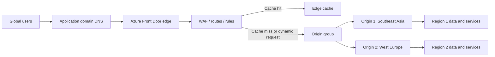
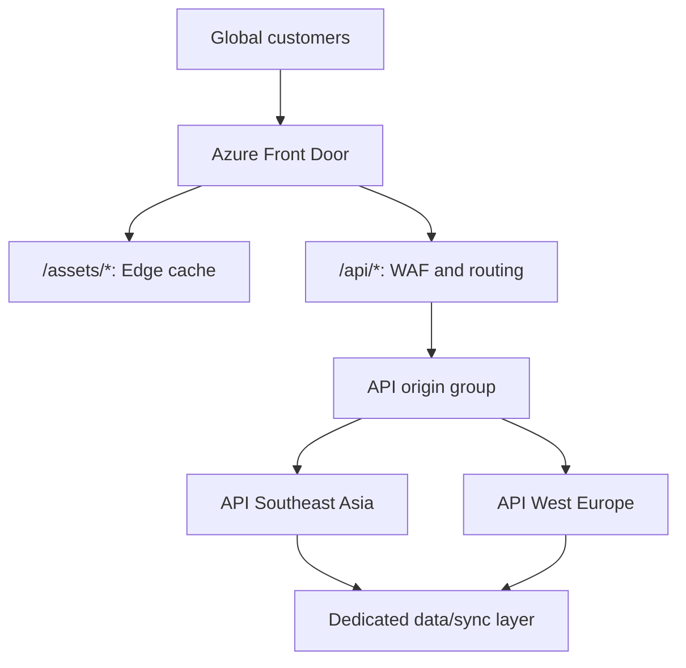

# Global Application Delivery with Azure Front Door

When an application serves users across multiple countries, network distance, latency, outages in a deployment region, and traffic spikes all affect the user experience. A web server in one Azure region may be operating normally while distant users still see slow page loads; if that region suffers an outage, the entire system can lose availability.

**Azure Front Door** is a global HTTP/HTTPS application delivery service. It uses Microsoft's edge network to accept requests close to users, select an appropriate origin (source server or service), accelerate content delivery, protect applications with Web Application Firewall (WAF) when configured, and shift traffic to healthy origins during failures.

This lesson belongs to the **Load Balancing and Application Delivery** chapter of the **CLOUD_PROVIDERS_AZURE** module. Azure Front Door connects directly with VNets, compute services, storage, DNS, Microsoft Entra ID, monitoring, security, and cost when deploying application architectures on Azure.

## 1. Learning Objectives

After this lesson, you will be able to:

1. Explain the request flow from users through the Front Door edge to origins.
2. Distinguish Front Door from Azure Load Balancer, Application Gateway, and Traffic Manager.
3. Design profiles, endpoints, origins, origin groups, routes, custom domains, and rule sets.
4. Understand how health probes, priority, latency, and weight participate in origin selection and failover.
5. Configure HTTPS, protect origins, and apply WAF appropriately.
6. Use caching to reduce latency while avoiding caching personal data or sensitive dynamic content.
7. Plan testing, operational monitoring, and cost evaluation for multi-region architectures.

## 2. The Global Application Delivery Problem

Suppose an e-commerce site serves customers in Vietnam, Singapore, and Europe. The application runs in two Azure regions:

- **Southeast Asia**: primary web API cluster.
- **West Europe**: standby web API cluster or serving traffic by design.
- Static assets such as images, CSS, and JavaScript are stored in an appropriate origin.
- Users connect through a unified domain name, such as `www.example.com`.

If DNS points directly to one web server, the operations team must solve many problems on their own: how to switch regions when a server fails, how to route requests across backends, how to protect against HTTP attacks, how to offload traffic when thousands of users fetch the same image, and how to track errors across regions.

Front Door places a **global HTTP/HTTPS entry point** in front of the origins. Users access the same hostname; the edge service terminates requests, applies rules, can serve cached content, and forwards unfulfilled requests to the chosen origin.

Front Door does not replace databases, business logic, or cross-region data consistency design. If failover sends users to a second region whose database cannot accept writes or is out of sync, the application can still fail. Multi-region architectures must also address **application state, data, sessions, and dependent services**.

## 3. Where Does Front Door Sit in the Request Flow?



The diagram represents a logical model. Real requests pass through components matching the configured profile and routes; not every request checks a cache, and not every system spans two regions.

**Typical request flow:**

1. The browser resolves `www.example.com` to locate the Front Door entry point.
2. It connects to an **edge location** on the global network, typically directed to a suitable edge via network routing mechanisms.
3. Front Door handles client TLS, evaluates routes, rule sets, and attached security policies.
4. If the route enables caching and valid content is cached, the edge can respond without calling the origin.
5. If an origin call is needed, Front Door selects a healthy origin per the origin group's configuration and forwards the request over the network to that origin.
6. The origin processes business logic and returns a response to Front Door; Front Door forwards the response to the client and may cache it if permitted by configuration.

Note that there are **two HTTPS connection legs**: client to Front Door, and Front Door to origin. HTTPS on the first leg does not prove the second leg is properly encrypted; forwarding protocol and origin certificate validation must still be verified.

### Anycast Does Not Mean the Nearest Origin

Front Door uses a global edge network to bring users to an appropriate intake location. The **edge location** is where the user connects into Front Door; the **origin** is where the application actually runs.

A request from Vietnam might enter an edge close to the user, yet the selected origin might sit in West Europe because the Southeast Asia origin is unhealthy, has a lower priority, or origin-selection policy dictates it. You cannot infer the target origin solely from the edge location.

## 4. Components of Azure Front Door Standard/Premium

For new deployments, study the **Azure Front Door Standard/Premium** resource model. Older documentation may describe Front Door (classic) with different names and configuration models; when deploying, choose the exact service generation your organization uses.

| Component | Purpose |
|---|---|
| **Profile** | Administrative scope for Front Door, SKU, endpoints, and related settings |
| **Endpoint** | Entry point with a Front Door–assigned hostname; can host multiple routes |
| **Custom domain** | Organization's domain name associated with Front Door |
| **Origin** | A specific HTTP/HTTPS backend, such as App Service, Application Gateway, VM frontend, or other service |
| **Origin group** | Group of origins plus origin-selection, health probe, and load-balancing settings |
| **Route** | Specifies hostname, path, protocol, origin group, forwarding, caching, and associated rule sets |
| **Rule set / rule** | Conditions and actions on requests/responses, such as rewrites, redirects, header edits, or cache policies |
| **WAF policy / security policy** | HTTP security rules and associations tying protection to specific domains/paths |
| **Secret/certificate** | TLS certificates and configuration for domains depending on deployment approach |

The **Profile** is where administrators manage the Front Door instance. An **Endpoint** is a specific access address, while a **route** decides which origin group receives requests for a matching host and path.

### Route Mapping Examples

| Host and path | Route | Origin group | Caching guidance |
|---|---|---|---|
| `www.example.com/` | `web-route` | `og-web` | Enable selectively for static content |
| `www.example.com/assets/*` | `assets-route` | `og-static` | Can cache versioned static assets |
| `api.example.com/*` | `api-route` | `og-api` | Usually disable caching for user-specific APIs |
| `www.example.com/admin/*` | Dedicated route | `og-admin` or protected backend | Require auth/authorization; never cache sensitive content |

With multiple routes, verify how Front Door matches routes by hostname, pattern, and specificity. Do not create overlapping wildcard paths and assume the portal display order equals evaluation order.

## 5. How Does Front Door Differ from Other Azure Load-Balancing Solutions?

| Service | Prominent layer and scope | Commonly considered when |
|---|---|---|
| **Azure Front Door** | Global HTTP/HTTPS at the edge, host/path routing, acceleration/caching, WAF | Web/API applications for global users across multiple regions |
| **Application Gateway** | Regional/VNet HTTP(S) reverse proxy/load balancer, optional WAF by SKU | Intra-region web traffic, routing to backends in a VNet architecture |
| **Azure Load Balancer** | Layer 4, TCP/UDP; frontend and backend per service scope | Network load balancing for VMs, VMSS, or services not needing HTTP routing |
| **Azure Traffic Manager** | DNS-level routing using endpoint-selection methods | DNS steering to global endpoints, including protocols Front Door does not proxy |
| **Azure NAT Gateway** | Outbound IPv4 SNAT at the subnet level | Private workloads initiating Internet connections with a managed source IP |

Front Door is a **global HTTP/HTTPS reverse proxy**, not a general-purpose TCP/UDP load balancer. It is not used to distribute arbitrary protocols such as raw TCP database connections simply because cross-continent connectivity is needed.

Application Gateway and Front Door can work together: Front Door provides the global entry point, while Application Gateway handles regional functions before forwarding to workloads. Combine both only for a clear architectural reason to avoid unnecessary intermediate layers, duplicate WAF configs, and extra cost.

## 6. How Front Door Selects Origins and Performs Failover

An **origin group** can contain multiple origins serving a route. Front Door uses load-balancing settings and health status to pick an eligible origin. Key factors include:

- **Health probe:** checks a health endpoint to identify unresponsive origins.
- **Priority:** prefers origins by declared priority level; supports active/passive setups.
- **Latency and additional latency:** defines the pool of eligible origins based on measured latency where applicable.
- **Weight:** relative distribution among eligible origins, especially within the same priority tier.
- **Origin enable/disable:** administrators can temporarily exclude an origin from selection.

There is no rule that "always picks the origin closest to the user" for every configuration. The outcome depends on priority, health probes, observed latency, and the origin group's distribution policy.

### Active/Passive Design

Example:

| Origin | Priority | Weight | Role |
|---|---:|---:|---|
| `app-sea` | 1 | 1000 | Primary |
| `app-weu` | 2 | 1000 | Standby |

When the primary is healthy and enabled, Front Door prefers it. When the primary no longer meets health criteria, the service can route subsequent requests to the standby. **Failover does not guarantee zero dropped requests or uninterrupted sessions.** Open connections, write operations, tokens, shopping carts, or session state must be handled by the application.

### Active/Active Design

Two regions serving traffic concurrently can share the same priority:

| Origin | Priority | Weight | Role |
|---|---:|---:|---|
| `app-sea` | 1 | 1000 | Active |
| `app-weu` | 1 | 1000 | Active |

Front Door can select among healthy origins based on latency and weight settings. **Weight is a relative weighting, not a strict percentage guarantee.** Actual request shares depend on client locations, latency, probes, connection reuse, and service behavior.

Use active/active only if **both regions can handle the same request types**, know how to access required data, and have a data consistency strategy. If the second region only has a read replica, routing write operations there can cause business failures.

### Why Is a Dedicated Health Endpoint Necessary?

Health probes should call a stable path like `/healthz` that returns a success HTTP code when the origin can serve traffic. Do not use pages requiring interactive login, third-party redirects, or very heavy endpoints as probes.

There are two check levels:

- **Liveness:** the process is running and accepting connections.
- **Readiness:** the origin is genuinely ready to handle requests per system requirements, potentially checking essential dependencies.

If the health endpoint always returns HTTP 200 even when the database is down, Front Door may keep sending traffic to an origin unable to process business logic. Conversely, an overly strict probe endpoint can pull an origin because of a non-critical dependency failure.

For health probes, verify the path, HTTP/HTTPS protocol, method, and frequency supported by Front Door. Some backends respond differently to HEAD vs. GET; choose the method matching your application to avoid misjudgment.

## 7. Origin Configuration and Headers Matter Greatly

An origin typically includes hostname/address, HTTP/HTTPS ports, enabled state, priority, weight, and **origin host header**.

Suppose the origin is an Azure App Service at `shop-sea.azurewebsites.net`. You want users to visit `www.example.com`, yet App Service only accepts hostnames it is configured to recognize. Front Door must send a **Host header** matching the origin's configuration.

If the Host configuration mismatches, requests can fail with HTTP 400/404 or hit the wrong virtual host even though TCP and TLS succeed. When using HTTPS to the origin, ensure SNI and certificate name validation match the origin hostname per Front Door's supported behavior.

**Configuration principles:**

1. Prefer **HTTPS to the origin**.
2. Use an origin hostname with a valid certificate and matching name.
3. Set the origin host header to a hostname accepted by the app/origin.
4. Enable origin certificate name validation; handle exceptions only through approved workflows if special requirements exist.
5. Inspect `X-Forwarded-For`, `X-Forwarded-Host`, and related headers when the app builds URLs, logs client IPs, or issues redirects.

Never trust any client-supplied header merely because its name resembles a proxy-added header. The application must identify trusted proxies, normalize hosts, and process source IPs using proper safeguards.

## 8. Protecting Access Paths and Origins

Front Door can serve as the sole public entry point for a web app, yet **the origin can still be reached directly** if its public endpoint remains open. In that case, attackers could bypass WAF or edge rules by calling the origin directly.

### Origin Protection Options

**A. Private Link to Supported Origins**

With **Front Door Premium**, certain origin types support connecting via **Azure Private Link**. The workflow typically requires configuring the connection in Front Door and **approving the private endpoint connection** on the origin service.

Benefit: reduces the need to expose the origin publicly; the Front Door–to–origin path uses private connectivity per service mechanics. Limitation: support depends on origin type, region, and SKU features; do not assume Front Door Standard has the same capability.

**B. Origin with Public Endpoint Restricted by Source**

In suitable scenarios, you can restrict the origin to accept traffic only from Front Door infrastructure using a service tag such as `AzureFrontDoor.Backend`, and then inspect the Front Door identity header `X-Azure-FDID` to confirm requests come from the intended profile.

These two controls complement each other:

- Service-tag network filtering blocks access from unauthorized networks.
- Checking the Front Door ID distinguishes your organization's profile from other Front Door profiles sharing the same service infrastructure.

When using App Service access restrictions or similar controls, configure and test both the header filter and permitted traffic source. Checking only a header can be spoofed by clients if the origin still accepts direct Internet requests. Lock down the network path simultaneously rather than relying on a header as the sole security layer.

### Web Application Firewall

Azure Front Door can integrate a **WAF policy** to inspect, block, or monitor HTTP requests showing attack patterns. Depending on SKU and service capabilities, WAF can support:

- Custom rules by IP, country/region, path, header, or supported conditions.
- Rate limiting to curb anomalous request bursts.
- Managed rule sets to detect common web attack categories.
- Detection or prevention mode for phased rollout.

Managed rule sets and advanced features **differ between Standard and Premium**. When choosing an SKU, verify the exact WAF features your organization requires.

WAF does not replace **authentication, authorization, data validation, patching app vulnerabilities, or business-level rate limiting**. A request allowed by WAF must still pass authorization checks inside the application.

### Test Before Blocking

For new rules, start in detection mode when appropriate; review logs for false positives before enabling broad blocking. When protecting login paths or critical APIs, test impact on valid requests, webhooks, and non-browser clients.

## 9. Custom Domains, DNS, and HTTPS

Users usually access a custom domain like `www.example.com` rather than the default Front Door hostname. Custom domain setup involves three layers:

1. **Verify domain ownership** in Front Door following service workflow.
2. **Configure DNS** for the domain to route traffic to the Front Door endpoint.
3. **Configure TLS/HTTPS** with a managed certificate or your organization's certificate, then associate the domain with the right route.

### Subdomains

For `www.example.com`, DNS administrators typically configure a CNAME from `www` to the Front Door endpoint hostname. The service may require a dedicated domain validation record. Validation values provided by Azure must be retrieved directly from the portal or API/CLI rather than guessed from the profile name.

### Apex/Root Domains

Apex domains like `example.com` normally cannot use standard CNAME records at the zone apex. Depending on the DNS provider, you may use alias/ANAME records or supported mechanisms. Check DNS provider capabilities and domain validation workflows before altering production DNS.

### TLS in Both Directions

- **Client → Front Door:** certificate must be valid for the custom domain, e.g., `www.example.com`.
- **Front Door → Origin:** origin must serve HTTPS with a valid certificate for the configured name, and Front Door must validate the certificate name.

Front Door supports managed certificate options per SKU and deployment scenario; some organizations bring their own certificates via Azure Key Vault using supported mechanisms. In all cases, monitor domain validation status, certificate issuance, renewal, and expiration alerts.

**DNS propagation** and certificate issuance are not guaranteed to finish instantaneously. Never cut over DNS to Front Door before verifying routes, TLS, origin health, and WAF on a test hostname.

## 10. Routes, Rule Sets, Redirects, and Rewrites

A **Route** is the primary rule mapping domains and paths to an origin group. For example:

- `/api/*` → API origin group.
- `/images/*` → static content origin group.
- `/*` → web application origin group.

Each route defines supported protocols, HTTPS redirect, forwarding protocol, and caching options. **Rule sets** add conditions and actions when requests or responses must be modified.

### Redirect vs. Rewrite

- **Redirect:** Front Door returns an HTTP 3xx response instructing the browser to send a new request to another URL. The URL shown to the user changes.
- **Rewrite:** Front Door can modify the path sent to the origin while the browser still sees the original URL, depending on configured actions.

For example, when migrating an old URL `/products/item-1` to `/san-pham/item-1`, a permanent redirect works well if you want search engines and users to switch to the new URL. If the origin expects an internal path prefix, a rewrite may fit better.

### Common Routing Mistakes

1. A `/*` wildcard captures a path meant for another route.
2. A rewrite produces a path that does not exist on the origin.
3. The origin issues a redirect back to HTTP, causing a loop when Front Door enforces HTTPS.
4. The app uses the wrong Host header and generates redirects to `azurewebsites.net` instead of the custom domain.
5. The cache stores a redirect or error response longer than intended.

Therefore, test each hostname, path, and HTTP method explicitly, including GET, POST, login callbacks, and API webhooks.

## 11. Caching and Static Content Acceleration

Front Door can cache eligible HTTP responses at the edge network to cut long-distance trips to the origin. The biggest gains typically come from **images, CSS, JavaScript, fonts, and clearly versioned static assets**.

Example: a webpage serves `/assets/banner.abc123.jpg` to many users. With valid caching, repeat requests can be served from the edge instead of hitting the origin every time.

### Cache Hit and Cache Miss

- **Cache hit:** the edge already holds a valid object and returns the response immediately.
- **Cache miss:** the edge fetches the object from the origin and may store it for subsequent requests.
- **Expired/stale:** the object must be revalidated or fetched again per cache policy.
- **Purge:** an operation requesting removal of objects from caches when content needs urgent updating.

Cache effectiveness depends on **TTL, response headers, query string behavior, HTTP methods, object size, and route configuration**. Do not assume every GET is cached.

### Content Classification

| Content type | Recommendation |
|---|---|
| CSS/JS files with hashed filenames | Long-lived caching when publishing produces new versions |
| Public static images | Cache per approved TTL; purge when needed |
| Frequently changing HTML pages | Short TTL or no cache depending on app |
| Order APIs, customer information | Do not cache at the edge if personalized or authenticated |
| `/login`, `/logout`, token/callback endpoints | Avoid caching; inspect sensitive headers and cookies |
| Health endpoints | Do not cache; ensure Front Door checks real status |

**Practical warning:** if the cache key ignores query strings, cookies, or a user-differentiating factor, content may be shared across users unintentionally. Enable caching only for data designed to be publicly shared; carefully test `Cache-Control`, `Set-Cookie`, `Authorization`, and service cache conditions.

### Versioning Strategy

For static files, a safe practice is publishing hashed filenames like `app.7e91a2.js`; when a new version ships, HTML references the new name. This avoids purging the entire cache on every deploy and lowers the risk of clients loading mismatched asset versions.

If an emergency purge is required, run the purge on the exact endpoint/path and verify from multiple locations. Purges can take time to propagate; do not expect every edge globally to update the instant the command returns success.

## 12. Deployment Guide via Azure Portal

Scenario: an application has two valid HTTPS backends:

- `shop-sea.azurewebsites.net`: deployment in Southeast Asia.
- `shop-weu.azurewebsites.net`: deployment in West Europe.

Both expose a public `/healthz` endpoint for probes and handle equivalent requests within this lab. These are **illustrative names**: learners must substitute real hostnames of authorized test resources.

### Step 1 — Prepare Origins

Before creating Front Door, confirm:

- Both origins return valid responses over HTTPS.
- `/healthz` returns a success status when ready.
- A data and session synchronization plan exists if both origins serve traffic.
- Origin certificates are valid; hostnames and Host headers match.
- A mechanism exists to restrict direct origin access after route testing.

### Step 2 — Create Profile and Endpoint

In the Azure Portal, search for **Front Door and CDN profiles** and create an **Azure Front Door Standard/Premium** profile. Choose subscription, resource group, and appropriate SKU. Create an endpoint with an available name; Azure assigns a default endpoint hostname.

Portal labels and navigation steps may evolve over time. Distinguish profile, endpoint, and origin group since they are separate resources.

### Step 3 — Create Origin Group

Create origin group `og-shop`, configuring the health probe on HTTPS path `/healthz` with an appropriate interval and method. Configure latency sensitivity, sample size, or health criteria supported by the UI per operational needs.

Add two origins:

- `origin-sea`: SEA hostname, priority 1.
- `origin-weu`: WEU hostname, priority 2 to model active/passive.

Verify the origin host header matches what the app accepts, enable HTTPS, and enable certificate name validation. Enable both origins only after verifying their health endpoints.

### Step 4 — Create Route

Create route `shop-route`:

- Bind the default endpoint hostname for initial testing.
- Pattern `/*`.
- Origin group `og-shop`.
- Accept HTTP/HTTPS per design and enable HTTP → HTTPS redirect.
- Forward traffic to origins over HTTPS.
- Keep **caching disabled** for the dynamic application during initial testing.

Once the route works, add an `/assets/*` route and configure appropriate caching for public content.

### Step 5 — Test Endpoint and Switch Domain

Access the endpoint hostname over HTTPS; verify HTTP status codes, request paths, origin logs, and health probes. Add custom domain `www.example.com`, verify ownership, configure DNS and TLS, and associate the domain with the route.

Wait for validation and certificate issuance to complete, then test the custom domain hostname before shifting production traffic.

### Step 6 — Protect

Attach a WAF/security policy per SKU, placing rules in an appropriate detection mode before blocking. Restrict origins using Private Link (if using Premium with a supported origin) or network access restrictions combined with Front Door identity verification.

### Step 7 — Test Failover

In a test environment, safely disable the primary origin or make it fail health probes. Observe origin status and verify new requests shift to the standby. Restore the primary and observe distribution behavior as it recovers; do not assume traffic immediately snaps back to exact ratios or that existing connections migrate.

## 13. Azure CLI: Inventory and Baseline Configuration

Azure CLI provides the **`az afd`** command group to manage Azure Front Door Standard/Premium. Depending on installation, some commands prompt to install an extension. Check version and syntax with `az afd --help` and subcommand `--help` before running production operations.

Examples below use **Bash or Azure Cloud Shell (Bash)**. Replace placeholders with authorized subscription and resource group values.

### Verify Environment

```bash
az account show \
  --query "{subscription:name, subscriptionId:id, tenant:tenantId}" \
  --output table
```

### Create a Standard Profile and Test Endpoint

```bash
RG="rg-frontdoor-lab"
PROFILE="afd-shop-lab"
ENDPOINT="shop-lab-endpoint"

az afd profile create \
  --resource-group "$RG" \
  --profile-name "$PROFILE" \
  --sku Standard_AzureFrontDoor

az afd endpoint create \
  --resource-group "$RG" \
  --profile-name "$PROFILE" \
  --endpoint-name "$ENDPOINT" \
  --enabled-state Enabled
```

This example assumes the resource group exists and the endpoint name is available. **Creating a profile and endpoint does not make the application ready:** you must still configure origin groups, origins, routes, and related permissions/protections before valid content can be served.

### Inventory Configuration

```bash
az afd profile list \
  --resource-group "$RG" \
  --output table

az afd endpoint list \
  --resource-group "$RG" \
  --profile-name "$PROFILE" \
  --output table

az afd origin-group list \
  --resource-group "$RG" \
  --profile-name "$PROFILE" \
  --output table

az afd route list \
  --resource-group "$RG" \
  --profile-name "$PROFILE" \
  --endpoint-name "$ENDPOINT" \
  --output table
```

View origins in group `og-shop` created via Portal or IaC:

```bash
az afd origin list \
  --resource-group "$RG" \
  --profile-name "$PROFILE" \
  --origin-group-name "og-shop" \
  --output table
```

In real projects, manage Front Door configuration with **Infrastructure as Code (ARM/Bicep/Terraform)** and reviewed changes instead of relying on untracked Portal clicks. Keep IaC code free of sensitive secrets; manage certificates, tokens, and secrets with proper secret-management mechanisms.

## 14. End-to-End Testing Before Production

A `Succeeded` deployment status does not prove traffic works properly. Test from clients, through the edge, to origins and downstream dependencies.

### Client-Side Test Commands

```bash
curl -I https://www.example.com/
curl -I https://www.example.com/assets/app.7e91a2.js
curl -I https://api.example.com/healthz
```

Domains and paths are illustrative; substitute your configured domains. For authenticated APIs, use proper test credentials and **never log tokens or leave them in shell history**.

Items to verify:

- HTTPS and certificates are valid.
- No HTTP ↔ HTTPS loops or redirects to origin hostnames.
- Correct response status codes and bodies for every route.
- Cache headers and caching behavior match the data classification.
- API POST/PUT requests work, not only home-page GETs.
- Origin logs show requests with expected host and forwarded headers.
- WAF does not falsely block legitimate requests.
- When one origin fails, new requests shift to healthy origins within expected detection and failover windows.

### Verify Caching

Send multiple requests to a static asset and inspect headers and metrics related to cache hit/miss. Specific headers can vary by configuration and service version; combine response headers with logs or metrics provided by Front Door.

Do not treat a single cache hit as proof that every geographic region holds the same object. Edge caches hold independent state by location and time.

### Failure Testing

Design at least these test scenarios:

1. Primary origin returns `5xx` or fails health probes.
2. Origin is slow, times out, or has a TLS certificate problem.
3. Origin returns 200 while a critical business dependency fails.
4. Custom domain DNS cutover or certificate is not ready yet.
5. A new WAF rule triggers false positives.
6. Stale assets remain cached after a deployment.
7. Standby region lacks compatible data or configuration.

For each scenario, document **detection signals, user impact, owner, and recovery procedure**.

## 15. Monitoring, Logging, and Troubleshooting

With Azure Monitor and corresponding diagnostic settings, you can track Azure Front Door traffic and health. When enabled and pointed to an appropriate sink, diagnostic data can be sent to Log Analytics, Storage, or supported destinations.

### Key Signal Categories

| Category | What to track |
|---|---|
| Edge traffic | Request count, bandwidth, latency, HTTP status codes, client distribution |
| Origin health | Which origins are healthy or unhealthy, probe state transitions |
| Origin latency and errors | Time to origin, 4xx/5xx, connection or TLS errors |
| Cache | Cache hit ratio, miss rate, data egress from edge vs. origin |
| WAF | Flagged/blocked request counts, rule IDs, false positives, traffic sources |
| Domain/TLS | Domain validation state, cert issuance/renewal, HTTPS errors |
| Cost | Data transfer, request counts, origin request distribution, WAF and feature charges |

### Symptom-Based Troubleshooting

**502/503 from Front Door:** check origin health, origin DNS, TLS/certificates, Host header, HTTPS ports, firewall/access restrictions, Private Link approval if used, and backend status. Do not simply raise timeouts when the origin is actually blocked.

**404 on a path:** check route patterns, rewrite rules, Host header, and application logs. Confirm requests reached the right origin and check the path received by the origin.

**Redirect loop:** check HTTP-to-HTTPS redirect, `X-Forwarded-Proto`, application redirect rules, and canonical domain logic.

**WAF false positives:** check WAF diagnostic logs, rule IDs, and request patterns; add the narrowest scoped rule/exclusion rather than disabling protection broadly.

**Cache serving stale content:** check TTL, query string behavior, `Cache-Control`, asset versioning, and purge status.

**Slow or missing failover:** check probe path, health thresholds, priorities, whether both origins can actually serve the app, and failure detection time. Never infer failover behavior from a single request.

**Slow responses for users on one continent:** separate client → edge latency from edge → origin latency; also measure app processing, DB latency, and cache misses. A nearby edge does not guarantee low RTT for every dynamic request.

### Correlation

For end-to-end investigation, propagate a **request ID** across proxies and backends, logging useful fields such as route, origin, status, latency, and application region. Never log auth tokens, session cookies, or sensitive personal data. Configure retention and log access per organizational policy.

## 16. Cost and SKU Selection

Azure Front Door costs depend on SKU, request volume, data transfer, features such as WAF, and other billable components per current pricing. Origin compute, App Service, databases, log storage, DNS, and related networking are still billed separately.

Evaluate costs using these questions:

- Do you need **Private Link to origins** or advanced managed WAF rules? If so, review Premium features and pricing.
- What percentage of total traffic is static data? Caching cuts origin load, yet edge egress still carries data-transfer charges.
- How many small, high-frequency requests do you serve? Request counts—not just gigabytes transferred—affect cost.
- How many domains, rules, origins, and profiles exist? Overly fragmented setups raise operational overhead.
- Does running two active/active regions increase compute/database costs and data replication charges?
- Do required protection and logging levels add extra service or ingestion costs?

A single-region architecture behind Front Door can improve entry points and caching, but **does not automatically become a highly available multi-region app**. Running two regions with failover-ready databases and data costs more; base the decision on RTO, RPO, user distribution, and business requirements.

## 17. Real-World Design Example: Global Web, Regional APIs, and Data

Suppose an enterprise runs an ordering system for customers in Southeast Asia and Europe:

- Frontend: versioned static assets.
- API: two App Service clusters in Southeast Asia and West Europe.
- Database: read/write strategy, replication, and failover tailored to data requirements.
- Security: WAF at the edge, identity and authorization in the API, origins accepting only permitted traffic.

### Approach



### Decisions to Capture in the Design Document

1. Hostnames `www.example.com` and `api.example.com` are verified with clear TLS and routes.
2. Static assets have defined cache keys, TTLs, versioning, and purge procedures.
3. Regional APIs enforce timeouts, retries, and idempotency suitable for order workflows.
4. Origin groups use active/passive or active/active based on **data write capabilities** and recovery targets.
5. Health probes accurately reflect serving readiness.
6. Origins permit only approved Front Door traffic so WAF cannot be bypassed easily.
7. WAF uses managed/custom rules per SKU, with a plan for detection-mode testing and false-positive handling.
8. Dashboards, alerts, and runbooks cover origin down, TLS errors, stale cache, and failover.
9. Budgets and quantitative SLOs cover latency, error rate, cache hit ratio, and recovery capability.

### What Not to Overlook

External shipping or payment providers might allowlist only your backend's outbound IP. Front Door governs **HTTP/HTTPS ingress to the application**, not the outbound IP used when your backend API calls third-party systems. That egress requirement must be solved with NAT Gateway, a firewall, or an equivalent subnet/backend mechanism.

## 18. Hands-On Exercise

**Scenario:** A website runs on two Azure App Services across two regions. You must expose it via `www.example.com` with a primary and standby region, enable WAF, and cache `/assets/*` files without caching user API responses.

### Tasks

1. Sketch the request flow from client to Front Door edge and both origins.
2. Explain why the origin group needs a dedicated probe path and the meaning of priority 1 vs. 2.
3. Create a Front Door Standard or Premium profile in a test subscription per your requirements and permissions.
4. Create an endpoint, origin group, and two origins; verify HTTPS and origin host headers.
5. Create route `/*` to the origin group, enable HTTPS redirect, and leave caching off initially.
6. Verify HTTP status codes, certificates, and response headers through the default endpoint.
7. Add a custom domain if you manage a test DNS zone; complete domain and certificate validation.
8. Create a route or rule for `/assets/*`, enable controlled caching, and verify cache hit/miss behavior.
9. Associate WAF and test a rule in detection mode before switching to blocking.
10. Simulate an unhealthy primary origin and observe new requests routing to the standby origin.
11. Describe a control preventing clients from calling the origin directly to bypass Front Door.
12. Inspect metrics/logs and prepare a post-lab cleanup checklist to avoid ongoing charges.

### Self-Check Questions

**Question 1.** How do an edge POP and an origin differ? Why does an edge close to the user not guarantee an origin in the same region?

**Question 2.** How does active/active differ from active/passive? Can you safely enable active/active when the database accepts writes in only one region?

**Question 3.** When an origin returns 404 due to a wrong Host header, will adding more origins or changing the health probe fix the root cause?

**Question 4.** Why should APIs returning personal information and login endpoints not be cached?

**Question 5.** Can Front Door replace NAT Gateway when backends must call a partner API using a fixed public IP?

**Question 6.** Name two layers of control to block direct origin access that bypasses Front Door/WAF.

**Completion criteria:** you can distinguish endpoint, route, origin, and origin group; explain failover, HTTPS/WAF protection, and origin lockdown; configure and test a multi-region route; evaluate caching; and observe operational behavior.

## Conclusion

**Azure Front Door** delivers HTTP/HTTPS applications to global users via Microsoft's edge network, combining **intelligent routing, health-based failover, TLS, WAF, and caching** in a unified entry point. It is especially valuable for websites and APIs serving geographically dispersed users or requiring recovery when an origin fails.

A successful design depends on both Front Door and what sits behind it: **healthy origins, ready data, accurate routes and Host headers, valid TLS, tuned WAF rules, and safe cache classification**. When tested, monitored, and cost-managed properly, Front Door becomes a cornerstone of global application delivery architectures on Microsoft Azure.
