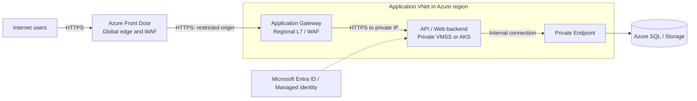
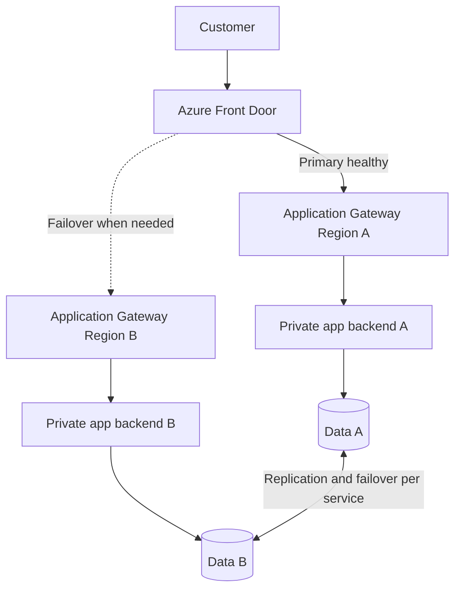

# Combining Front Door, Application Gateway, and Private Backends

An Azure application serving customers across multiple locations often has two parallel needs: **delivering fast, reliable HTTP(S) access globally** and **keeping business-logic servers, APIs, and databases on a private network**. Exposing every server to the Internet for load balancing expands the attack surface; placing the application inside a private VNet alone prevents external users from reaching the service as desired.

Azure provides multiple components with distinct responsibilities. **Azure Front Door** is the global HTTP(S) entry point at the edge, supporting application routing, health probes, path acceleration, and Web Application Firewall (WAF). **Azure Application Gateway** is a regional Layer 7 load balancer that accepts requests, selects backend pools, and can apply WAF to protect application traffic. **Private backends** are processing services behind the delivery layer, typically having no public IP or reached via **Private Endpoints**, virtual networks, and strict access policies.

This lesson belongs to the **Load Balancing and Application Delivery** chapter of the Microsoft Azure module. It ties together subscriptions, resource groups, Microsoft Entra ID, VNets, subnets, DNS, compute services, storage, monitoring, security, and cost control to deploy a secure Internet-to-private-backend access flow.

## Learning Objectives

After this lesson, you will be able to:

- Explain the placement and roles of Front Door, Application Gateway, and private backends in an HTTP(S) architecture.
- Design the request path from users to the application and identify **every connection leg that must be secured**.
- Distinguish an Application Gateway with a source-restricted public frontend from a private origin using a supported Private Link mechanism.
- Design listeners, routing rules, origin groups, health probes, TLS, backend hostnames, and private DNS.
- Restrict origin access with service tags, Front Door identity headers, WAF, NSGs, and data permissions.
- Plan multi-region high availability and failover without overlooking data state verification.
- Verify configurations via the Azure Portal, Azure CLI, and HTTP(S) tests; troubleshoot 403, 502, 503, DNS, and health probe issues.
- Weigh cost, complexity, and operational responsibilities before choosing one or both load-balancing layers.

## 1. Distinguishing the Components

| Component | Operating scope | Primary role | Considerations |
|---|---|---|---|
| **Azure Front Door Standard/Premium** | Global application service at the edge | HTTP(S) entry point, routing, acceleration, TLS, WAF, origin group management, and failover | Does not replace origin-specific settings or data access permissions |
| **Azure Application Gateway v2** | Regional application component per Azure region | Listeners, HTTP settings, host/path routing, health probes, and backend load balancing; optional WAF v2 | Requires a dedicated subnet, backend network reachability, DNS, and access rules |
| **Private backend on VM/VMSS/AKS** | Subnet/VNet or network connected to Application Gateway | Runs internal web/API/services, typically with private IPs only | NSGs, UDRs, and host OS firewalls must still protect ports |
| **Private Endpoint** | NIC/private IP in a VNet | Private access to Azure PaaS services over Private Link | Requires endpoint approval, private DNS, and target public-access controls |
| **Azure SQL/Storage/Key Vault** | PaaS services with dedicated networking and data permissions | Stores data, secrets, or state | Should not allow Front Door to connect directly to the data plane unnecessarily |

The two load-balancing products sit at different architectural layers. Front Door chooses the origin/region and enforces edge controls; Application Gateway controls HTTP(S) routing to backends inside a regional architecture. Placing both layers makes sense when an organization genuinely needs both **global orchestration** and **regional routing/WAF**.

### Common Terminology

- **Frontend domain:** customer-facing domain name, e.g., `www.example.com`.
- **Front Door endpoint and route:** configuration of domain, protocol, path, and link to an origin group.
- **Origin group / origin:** set of target endpoints Front Door can route to, including health, priority, and weight policies.
- **Application Gateway frontend/listener:** where Application Gateway accepts requests by IP, port, protocol, hostname, and certificate.
- **Backend pool:** list of internal application IPs or FQDNs.
- **Backend settings / probe:** protocol/port, hostname, TLS, and health check settings from Application Gateway to backends.
- **Private network boundary:** connectivity boundaries enforced by VNets/subnets, private IPs, DNS, firewalls, and identities.

## 2. Baseline Flow: Front Door → Application Gateway → Private Backend

A common architecture starts with an **Application Gateway using a public listener** dedicated strictly to accepting traffic from Azure Front Door, while backend servers behind it use private IPs only.



Example: a user visits `https://www.example.com/orders`. Front Door evaluates hostname and route, then selects an origin group. The request goes to Application Gateway in the chosen region. Gateway matches its listener/routing rule, verifies backend health, and forwards the request to a backend private IP. The application authenticates the request and uses a managed identity to reach Azure SQL or Storage over a private path when configured.

### Security Layers Along the Path

1. **Users → Front Door:** TLS validation for the customer domain, WAF protection, and edge policies.
2. **Front Door → Application Gateway:** TLS to the origin, hostname/certificate validation, and restricting direct origin access.
3. **Application Gateway → backend:** matching backend, port, hostname, TLS, and probes; allowing required traffic via NSGs or equivalent controls.
4. **Backend → PaaS data:** Private Endpoints, private DNS, target service firewalls, and data-plane permissions.
5. **Administration:** Microsoft Entra ID, RBAC, MFA/Conditional Access, logging, and approved change workflows.

**Key distinction:** private backends **do not automatically mean** Application Gateway's frontend is private. In this model, Gateway may have a public IP/listener for Front Door to connect to, while **backends are never directly exposed**.

## 3. Can Front Door's Origin Also Be Completely Private?

Some architectures use **Azure Front Door Premium with Private Link** to connect to origin types and private connectivity paths supported by the service. In that setup, the Front Door–to–origin hop does not rely on a conventional open public listener.

However, never assume **Front Door can connect directly to any arbitrary private IP in a VNet**, or that every Application Gateway SKU/frontend works identically as a Private Link origin. Depending on timing, origin type, SKU, region, and integration mechanics, you may need **Private Link Service**, a supported Application Gateway Private Link pattern, or another compatible origin type.

### Two Models to Evaluate Separately

| Model | Front Door → origin connection | Gateway → backend connection | When suitable |
|---|---|---|---|
| **A. Strictly restricted public origin** | Front Door sends HTTPS to Application Gateway's public listener with source-restriction rules and Front Door ID checks | Private IPs / private backend pool | Want straightforward deployment while tightly controlling the public origin path |
| **B. Private origin via Private Link** | Front Door Premium uses a **supported and approved** Private Link connection to the origin | Continues using private backends when origin is Gateway | Want to eliminate public origin exposure; verified exact origin type, SKU/region, and support |

Do not choose Model B merely because Application Gateway has a private IP option. Verify product documentation for the **exact configuration**, connection/approval workflow, and an end-to-end test before designing for production.

If Private Link to Gateway does not fit your deployment constraints, use Model A with strict public origin lockdown, or redesign the private origin around a supported service type. Decide based on risk, operability, and actually supported capabilities.

## 4. Network and Subnet Design

Application Gateway v2 deploys into a **dedicated subnet**. Backend VMs, VMSS, or AKS can reside in other subnets in the same VNet, a peered VNet, or a network reachable via supported routing. PaaS data components are accessed via Private Endpoints.

Example address plan for a workload in region A:

| Component | Illustrative CIDR | Role |
|---|---|---|
| Application VNet | `10.40.0.0/16` | Workload address space |
| `snet-appgw` | `10.40.1.0/24` | Dedicated Application Gateway subnet |
| `snet-web` | `10.40.10.0/24` | Private-IP web/API backends |
| `snet-worker` | `10.40.20.0/24` | Internal workers |
| `snet-pe` | `10.40.30.0/24` | Private Endpoints to SQL/Storage/Key Vault |
| `snet-management` | `10.40.40.0/24` | Internal admin tooling if truly needed |

Illustrative ranges must be replaced with non-overlapping ranges across peered VNets, VPNs, and on-premises networks. Subnets for dedicated services and Private Endpoints have specific sizing, delegation, NSG, and routing rules. Verify product prerequisites before applying generic templates.

### Required Network Flows

| Source | Destination | Protocol/port | Purpose |
|---|---|---|---|
| Browser | Front Door | HTTPS 443 | Public user access |
| Front Door | Application Gateway origin | HTTPS 443 | Forwarding requests to regional app |
| Application Gateway subnet | Web/API backend | HTTPS 443 or actual backend port | Routing and health probes |
| Web/API backend | SQL/Storage Private Endpoint | Per service protocol | Internal data access |
| Bastion/approved admin channel | Backend VMs if any | SSH 22 or RDP 3389 | Controlled administration |
| Monitoring systems | Configured log/metric sources | Per service | Observability and investigation |

**Never open SSH/RDP or database ports publicly** just to test connectivity from Front Door. Front Door needs access to the **HTTP(S) origin**, while Application Gateway connects onward to backends per design.

## 5. Protecting Public Application Gateway Origins from Direct Access

In Model A, anyone discovering Application Gateway's public DNS or IP could try bypassing Front Door and calling the origin directly. That can bypass edge WAF, rate limiting, or routing unless extra controls are enforced.

Combine **network-layer source restriction** with **verifying requests truly come from your organization's Front Door**:

1. Restrict traffic to Application Gateway's frontend using the **`AzureFrontDoor.Backend` service tag** or Microsoft's recommended approach for your topology.
2. Validate the Front Door identity header **`X-Azure-FDID`** matches your expected **Front Door ID**, using a WAF custom rule or inspection mechanism on a supported component.
3. Expose only required listeners/hostnames and enforce HTTPS with valid certificates.
4. Monitor logs for requests originating outside the intended flow.
5. Ensure NSGs and routes still permit **Application Gateway management, health probe, and mandatory infrastructure flows** for your SKU.

### Why Use Both Network Source and Header Validation?

The `AzureFrontDoor.Backend` service tag covers Front Door's shared backend infrastructure, **not exclusively your organization's Front Door instance**. Conversely, an HTTP header alone can be spoofed by clients hitting a public endpoint.

Combining source filtering with `X-Azure-FDID` validation sharply reduces direct Internet calls or spoofing from another Front Door profile. Trust the header only after establishing the appropriate source filter; never treat the header as a standalone cryptographic authenticator.

### Caution with NSGs on the Application Gateway Subnet

Never slap an arbitrary "deny all" rule onto the Application Gateway subnet. Gateway versions require inbound/outbound infrastructure rules, service tags such as `GatewayManager` and `AzureLoadBalancer`, health checks, and management paths. Exact required ports/ranges depend on SKU, deployment mode, and current documentation.

Before changing NSGs, inspect **effective security rules**, product-required allowances, and test carefully. If overly strict rules break Application Gateway's control plane, the entire origin fails even while backends keep running.

### Custom Headers and Routing

Application Gateway can route by hostname or path. Ensure:

- Front Door sends an **origin host header** matching the expected listener/site.
- Gateway listeners have matching hostnames and certificates.
- Front Door ID validation rules apply to the target listener/site without accidentally blocking health probes or management paths.
- Invalid requests return appropriate rejection codes and are logged.

## 6. Front Door: Domains, Routes, Origin Groups, and Health Probes

In Azure Front Door Standard/Premium, configurations typically include:

- **Profile:** resource managing Front Door configuration.
- **Endpoint / custom domain:** public entry point and domain, e.g., `www.example.com`.
- **Route:** maps hostname, protocol, and path patterns to an origin group, plus forwarding options.
- **Origin group:** set of origins, health probe policy, and traffic-balancing settings.
- **Origin:** Application Gateway's hostname or another supported source, with priority, weight, enabled state, and connection settings.
- **Security policy/WAF:** associates domains/paths with a WAF policy per product capabilities.

### Route Example

| Property | Illustrative value |
|---|---|
| Custom domain | `www.example.com` |
| Accepted protocols | HTTPS (redirect HTTP to HTTPS if needed) |
| Patterns to match | `/*` |
| Origin group | `og-shop-primary` |
| Origin hostname | `origin-a.example.net`, pointing to Application Gateway A's listener |
| Origin host header | Hostname accepted by the Gateway listener and application |
| Forwarding protocol | HTTPS |
| Health probe path | `/health/ready` or an approved dedicated health path |
| WAF | Edge policy matching application protection tier |

If region B exists, add Gateway B's origin to the origin group or design matching origin groups/routes. Priority, weight, latency sensitivity, and health probes must align with traffic distribution goals and recovery targets.

### What Do Front Door Health Probes Check?

Probes from Front Door check the **HTTP(S) origin** per configured path, protocol, and health criteria. If Application Gateway returns errors or the probe receives invalid responses, Front Door can mark the origin unhealthy.

Do not use probe paths requiring interactive login, captchas, or user authentication. Design a `/health/ready` endpoint returning minimal status without leaking secrets.

Front Door's health probe **does not replace** Application Gateway's probe. Front Door may consider an origin healthy as long as Gateway returns HTTP 200 at the probe path, even when a specific backend pool behind Gateway has failed. Design health endpoints to genuinely represent the serving health of the protected application path.

### Priority and Weight

- **Priority** prefers one region's origin in an active-passive model.
- **Weight** distributes request proportions across eligible origins in an active-active design.
- **Health status** determines which origins remain eligible per configuration.

Traffic shifting to origin B when A fails is strictly **HTTP routing**. Backend B must have the application, data, and dependencies required to handle requests safely. Front Door does not replicate databases or synchronize sessions.

## 7. Application Gateway: Listeners, Rules, Backend Pools, and Probes

In each region, Application Gateway accepts requests from Front Door and routes them to private backends.

### Conceptual Configuration

| Gateway component | Example | Purpose |
|---|---|---|
| Frontend IP | Public frontend for Model A; private frontend for supported topologies | Request intake point |
| HTTPS listener | `www.example.com:443` | Matches hostname, port, and certificate |
| Request routing rule | `/api/*` to API pool; `/*` to web pool | Distributes by request content |
| Backend pool | VMSS private IPs or internal FQDNs | List of backend endpoints |
| Backend settings | HTTPS, port 443, host name, timeout | How Gateway connects to and validates internal origins |
| Health probe | `GET /health/ready` with matching host and port | Evaluates backend members |
| WAF policy | Regional app rules when using `WAF_v2` | Filters Layer 7 attacks before backends |

If there is only one application, you do not need multiple path-based routing rules. If API and web use different hostnames, use appropriate multi-site listeners rather than cramming every path into one rule.

### How Does Backend Health Work?

Application Gateway sends probes to each backend per configured parameters. Backends must return a status Gateway considers healthy. Common failures:

- Cannot reach the private IP or FQDN from the Gateway subnet.
- NSG or UDR blocks traffic.
- Wrong backend port or process not listening.
- Probe uses a path/hostname not configured on the app.
- TLS certificate fails hostname validation or root trust requirements.
- Backend demands authentication on the probe path.

Backends marked Unhealthy by Gateway can cause Gateway to return **502 Bad Gateway** on that route. Never "fix" this by allowing all network traffic: inspect backend health details and logs instead.

## 8. Private Backends: Three Common Patterns

### A. VMs or VM Scale Sets with Private IPs

The backend pool references appropriate private IPs/NICs/VMSS. Application Gateway connects via the VNet or routed connectivity, with NSGs and DNS if using FQDNs.

Example: an API on VMSS listens on HTTPS 443 at `api.internal.example.net`. The API subnet NSG permits only required traffic from the Application Gateway subnet plus approved management channels. VMs need no public IPs.

Verify autoscaling, health probes, zero-downtime rolling updates, and instance states in the backend pool.

### B. AKS Using Internal Ingress or Endpoints

AKS can serve backends via an **internal load balancer/ingress** per supported networking and product models. Application Gateway connects to that internal endpoint, or uses an appropriate AKS-integrated ingress solution.

Distinguish three layers:

- HTTP(S) ingress from Gateway to AKS.
- Network policies between pods/services inside the cluster.
- Pod/workload permissions when accessing Azure SQL, Storage, or Key Vault.

Do not assume a private AKS cluster automatically means every service inside the cluster exposes only private endpoints. Inspect actual ingress configs and LoadBalancer services.

### C. App Service or PaaS Services via Private Endpoint

For App Service plans supporting Private Endpoints, create an endpoint in the VNet so Application Gateway reaches the app over a private IP.

**Key point:** Application Gateway typically needs to use the **application FQDN matching its TLS certificate and Host header**; private DNS must resolve that hostname to the endpoint's private IP for Gateway.

App Service **VNet Integration** generally handles **outbound traffic from the app into the VNet**—it does not automatically make inbound access from Gateway private. For private inbound, check Private Endpoint/access restriction capabilities of your App Service plan and actual settings.

Backends like Azure SQL, Storage, and Key Vault should be called from the **application** along the data flow; never configure Front Door as a direct client to a database.

## 9. TLS, Host Headers, SNI, and Certificates

A multi-tier model can have three **separate** HTTPS sessions:

1. Browser ↔ Front Door.
2. Front Door ↔ Application Gateway.
3. Application Gateway ↔ backend.

This is **hop-by-hop re-encrypted TLS**, not a single unbroken TLS tunnel through all proxies. Each leg needs matching hostnames, certificates, trust chains, and protocol policies.

### Hostname Example

| Hop | Illustrative hostname | Matching certificate requirement |
|---|---|---|
| Client → Front Door | `www.example.com` | Certificate for custom domain on Front Door |
| Front Door → Gateway | `origin-a.example.net` or designed listener hostname | Application Gateway certificate matching the validated name |
| Gateway → backend | `api.internal.example.net` | Backend certificate with accepted SAN/trust chain |

Front Door has origin hostname / origin host header settings; Gateway has listener hostnames and backend host settings. **Do not assume the three hostnames can be changed arbitrarily**: a mismatch can prevent listeners from matching requests, break probes, or fail TLS validation.

### Host Header and SNI

- **Host header:** HTTP field telling the app which hostname is requested.
- **SNI:** TLS handshake extension letting the server select the matching certificate.
- Certificates must validate against the domain name used on that hop.
- If Gateway routes by hostname, Front Door must send the matching Host value.
- If backends use virtual hosts, Gateway must send Host/SNI matching backend settings and probes.

With App Service, altering the Host header can send requests to the wrong site or fail if the custom hostname is not bound. Verify custom domain bindings and how the service processes requests.

### HTTPS Redirect Loops

A frequent issue occurs when Front Door enforces HTTPS while the backend does not recognize the original scheme and repeatedly issues 301/302 redirects, causing a loop. Applications may need to honor **forwarded headers** from trusted proxies such as `X-Forwarded-Proto`.

Never trust arbitrary `X-Forwarded-*` headers sent by Internet clients; accept them only from proxies in a locked-down, trusted proxy chain.

## 10. WAF at the Edge and Region: Dividing Responsibilities

Both Front Door and Application Gateway WAF can enforce HTTP(S) protection policies, yet running two WAFs helps only when each layer's role is clearly defined.

| Layer | Typical focus | Examples |
|---|---|---|
| **Front Door WAF** | Edge protection before traffic hits origins | Managed rules, rate limiting/bot protection per SKU features, blocking malformed request patterns |
| **Application Gateway WAF** | Additional per-app or regional protection | Custom rules for the origin, per-site/route inspection, app-specific exclusions |
| **Backend application** | Authentication, authorization, input validation, business logic | JWT/OIDC, API permissions, preventing cross-user data access |

If managed rules run on both WAFs, manage false positives and duplicate processing effects. You can reserve the edge for broad rules and regional Gateway for app-specific conditions, or run WAF on just one chosen layer when sufficient.

**Blocking direct origin access** matters more than drawing "two WAFs" on a diagram. If attackers call Application Gateway directly via its public IP, they bypass Front Door WAF unless the origin path is properly locked down.

### Preserving Real Client IP

Because requests traverse multiple reverse proxies, backends normally see the proxy's IP on the TCP socket. For logging, rate limiting, and source verification, components can inspect forwarded headers like `X-Forwarded-For`.

Never make security decisions from an IP header supplied by an arbitrary client without validating the proxy chain. Know which proxies append, overwrite, or forward headers and configure trusted proxy lists in the application.

## 11. DNS: Public at the Edge, Private at the Backend

In a two-tier architecture, DNS solves at least two distinct problems.

### Public DNS

User CNAMEs/custom domains point to Front Door following domain onboarding, ownership validation, and certificate issuance. Users only need to know `www.example.com`.

When using a public Application Gateway origin, assign a dedicated hostname like `origin-a.example.net` and **do not advertise it as a user-facing endpoint**. Still, hiding DNS names **never replaces** network and header controls.

### Private DNS Inside the VNet

Application Gateway must resolve `api.internal.example.net` or PaaS backend names to private IPs when connecting by FQDN.

- Use Azure Private DNS Zones with VNet links for managed private backends.
- For App Service Private Endpoints, private DNS zone names and records must match the **exact service/subresource type**.
- If the VNet uses custom DNS, ensure proper forwarding/resolution from the Gateway subnet.
- In active-active multi-region setups, verify private DNS per region so region A's Gateway does not mistakenly resolve region B's backends.

### What Not to Assume

`ping` or `nslookup` returning a public IP is not enough to validate all connectivity; with Private Endpoints, target hostname resolution **must** be verified against private DNS requirements. For an Application Gateway backend pool using FQDNs, a DNS mismatch can make probes and traffic fail even when NSGs open the right ports.

## 12. Multi-Region High Availability and Failover

To survive regional failures, Front Door can route across multiple origins:



This is a logical diagram. Each data service has its own replication, consistency, and failover rules; not every database supports simultaneous writes across two regions.

### Active-Passive

Region A is primary; B is standby. Front Door prefers A while healthy and shifts to B when A fails health policies. This minimizes write conflicts, but requires verifying region B's readiness.

### Active-Active

Front Door distributes requests to A and B while both are healthy. Evaluate:

- Whether data tiers support multi-region reads/writes.
- Whether sessions live in a shared or properly synchronized cache/database.
- Consistency and idempotency when requests shift regions.
- Cross-region bandwidth and operational costs.
- Data residency, backup, and replica location requirements.

### RTO and RPO

- **RTO (Recovery Time Objective):** target maximum duration to restore the service.
- **RPO (Recovery Point Objective):** maximum tolerable data loss window.

Front Door failover helps restore HTTP reachability when an origin turns unhealthy. **It does not guarantee data RTO/RPO**, synchronize blobs/databases, or complete primary database promotion on its own. Maintain a DR runbook and run regular drills.

### Do Health Probes Reflect "Readiness to Serve"?

A health endpoint returning 200 simply because the web process is alive is too shallow if the API cannot reach its data tier. Conversely, an overly deep probe can mark an entire region unhealthy over a brief hiccup in a non-critical dependency.

Separate **liveness** and **readiness**:

- Liveness: process is alive, used for operational restarts.
- Readiness: instance or region can serve critical business traffic.

Use readiness for routing decisions, while avoiding side-effecting database writes inside probes.

## 13. Step-by-Step Deployment Workflow

Example: deploying `www.example.com` on Azure with private APIs in region A, then expanding to region B.

### Phase 1: Define Requirements

1. Select **subscription**, resource groups, allowed regions, and resource owners.
2. Define RTO/RPO, data scope, expected request volume, budget, and security requirements.
3. Choose backend type: VMSS, AKS ingress, App Service Private Endpoint, or another supported model.
4. Decide between **locked-down public origin** vs. **private origin via Private Link** based on current SKU/region support.
5. Build a matrix of traffic sources/destinations, DNS hostnames, certificates, NSGs, and RBAC roles.

### Phase 2: Build Private Backends

1. Create the VNet and dedicated Application Gateway subnet.
2. Create backend (or private endpoint) subnets and attach NSGs permitting required flows.
3. Deploy applications with private IPs/FQDNs or Private Endpoints without unnecessary public IPs.
4. Expose `/health/ready` returning clear status without user login.
5. Test the app and TLS from a client inside the VNet before adding Gateway.
6. Connect the app to SQL/Storage/Key Vault using managed identities and dedicated network controls.

### Phase 3: Configure Application Gateway

1. Create Application Gateway v2 or WAF v2 with the right SKU, subnet, frontend IP, zones, and capacity.
2. Populate backend pools with private IPs or FQDNs.
3. Configure backend settings for HTTPS, hostname/SNI, and trusted certificates if needed.
4. Create custom health probes using the right protocol, host, port, and path.
5. Create HTTPS listeners and routing rules.
6. Verify **Backend health** before attaching Front Door.
7. For public origins, configure source restrictions and Front Door ID validation while preserving mandatory infrastructure flows.

### Phase 4: Configure Front Door

1. Create a Front Door Standard/Premium profile and endpoint.
2. Configure origin groups, origin hostnames, HTTPS, origin host headers, and health probes.
3. For private-origin designs, configure supported Private Link connections and approve them before routing traffic.
4. Configure routes for domains, paths, caching, and forwarding policies.
5. Attach WAF/security policies and test rules.
6. Add custom domains, DNS records, and TLS certificates when ready.
7. Test via the customer-facing hostname and inspect logs across every hop.

### Phase 5: Validate and Expand

1. Test frontend URLs and critical routes.
2. Verify requests cannot bypass Front Door to call origins directly in Model A.
3. Confirm backends still have no direct Internet access.
4. Check errors/latency and logs from both Front Door and Application Gateway.
5. If adding region B, provision B's infrastructure and data, then test controlled failover and rollback.
6. Track costs and update diagrams/connectivity matrices whenever changes occur.

## 14. Hands-On Configuration Inspection with Azure CLI

The following lab is **read-only**. You need an existing subscription and sample resources; none of these commands modify configurations or deploy new infrastructure. Commands use Bash in Azure Cloud Shell.

Variables below are placeholders:

```bash
SUBSCRIPTION_ID="<SUBSCRIPTION_ID>"
FRONTDOOR_RG="rg-edge"
FRONTDOOR_PROFILE="afd-shop"
AFD_ENDPOINT="shop-edge"
APPGW_RG="rg-app-region-a"
APPGW_NAME="agw-shop-a"
```

### Step 1: Verify Subscription

```bash
az account show --output table
az account set --subscription "$SUBSCRIPTION_ID"
az account show --query "{name:name,id:id,tenantId:tenantId}" --output table
```

In multi-subscription/tenant environments, verify where each resource resides. If Front Door and Gateway sit in different subscriptions, pass the right subscription ID for each command and ensure read permissions.

### Step 2: Inspect Front Door Profile and Endpoint

```bash
az afd profile show \
  --resource-group "$FRONTDOOR_RG" \
  --profile-name "$FRONTDOOR_PROFILE" \
  --output json

az afd endpoint show \
  --resource-group "$FRONTDOOR_RG" \
  --profile-name "$FRONTDOOR_PROFILE" \
  --endpoint-name "$AFD_ENDPOINT" \
  --output json
```

Cross-check SKU, endpoint hostname, deployment state, and related properties.

### Step 3: Inspect Origin Groups and Origins

```bash
az afd origin-group list \
  --resource-group "$FRONTDOOR_RG" \
  --profile-name "$FRONTDOOR_PROFILE" \
  --output table
```

Once you know the origin group name:

```bash
az afd origin list \
  --resource-group "$FRONTDOOR_RG" \
  --profile-name "$FRONTDOOR_PROFILE" \
  --origin-group-name "<ORIGIN_GROUP_NAME>" \
  --output json
```

Inspect origin hostname, origin host header, priority/weight, enabled state, and Private Link settings if present. **Do not infer real health merely because an origin is Enabled**; check diagnostics/metrics and probe outcomes.

### Step 4: Inspect Routes

```bash
az afd route list \
  --resource-group "$FRONTDOOR_RG" \
  --profile-name "$FRONTDOOR_PROFILE" \
  --endpoint-name "$AFD_ENDPOINT" \
  --output json
```

Check accepted protocols, forwarding protocol, patterns, origin group, and linked domains. A route missing a custom domain or matching pattern prevents traffic from reaching the intended backend.

### Step 5: Inspect Application Gateway

```bash
az network application-gateway show \
  --resource-group "$APPGW_RG" \
  --name "$APPGW_NAME" \
  --query "{name:name,sku:sku,frontendIPConfigurations:frontendIPConfigurations,backendPools:backendAddressPools}" \
  --output json
```

To inspect backend health:

```bash
az network application-gateway show-backend-health \
  --resource-group "$APPGW_RG" \
  --name "$APPGW_NAME" \
  --output json
```

If a backend is Unhealthy, read the error message and inspect DNS, NSGs, routes, ports, probes, hostnames, and certificates. On older Azure CLI installs, some `az afd` commands require a newer version or extension; check `az version` and command help.

### Step 6: Inspect Private Endpoints If Backends Are PaaS

```bash
az network private-endpoint list \
  --resource-group "<BACKEND_RESOURCE_GROUP>" \
  --output table
```

This command only lists Private Endpoints in the target resource group. To verify connectivity fully, also inspect approved connection status, private IPs, private DNS zone groups, and public network access settings on the target service.

## 15. End-to-End Testing with HTTP(S)

Real-world testing must validate three perspectives:

- **From the Internet:** users can reach only Front Door's public hostname.
- **From Front Door:** requests reach the origin validly with TLS and the right host header; direct-origin bypass is blocked per security model.
- **From the VNet:** Application Gateway reaches backends via private IPs/FQDNs, and backends hold required data permissions.

### Illustrative Verification Commands

From a client authorized to test the frontend:

```bash
curl -I https://www.example.com/health/ready
curl -v https://www.example.com/api/status
```

Inspect HTTP status codes, TLS certificates, and redirect chains. Do not assume every health path must be public; use dedicated test endpoints per organizational policy.

From a VM **actually inside the VNet**, check backend FQDN resolution and connectivity:

```bash
nslookup api.internal.example.net
curl -vk https://api.internal.example.net/health/ready
```

The `-k` flag in this example is strictly for diagnosing certificate issues during troubleshooting; **never use it to certify production TLS readiness**. In operations, use `curl -v` or certificate validation tools without skipping verification.

Test direct origin access in an authorized environment:

```bash
curl -I https://origin-a.example.net/health/ready
```

Expected outcome under Model A: requests from ordinary Internet hosts **are not served by the application as valid requests** via origin bypass. The exact response (403, timeout, deny) depends on the enforcement layer, DNS, and WAF.

### Test Matrix

| Scenario | Expected result |
|---|---|
| Customer accesses `www.example.com` over HTTPS | Succeeds; Front Door routes to healthy region |
| Request bypasses Front Door to call public Gateway origin | Blocked or rejected per origin policy |
| Front Door selects region A while A is healthy | Gateway A forwards request to private backend A |
| Backend A becomes Unhealthy | Gateway stops selecting unhealthy instances/pool per configuration |
| Origin Gateway A becomes completely unhealthy | Front Door fails over to region B if group/priority and B are properly designed |
| Internet client calls private backend IP/FQDN directly | No permitted public path exists |
| Backend connects to Azure SQL/Storage via private access | Succeeds when DNS, networking, and data permissions are valid |
| Client lacks data permissions despite being in a valid subnet | Denied by service authentication/authorization |

Never draw conclusions from a single HTTP 200. Verify **which origin/region/backend actually handled the request** using logs or controlled test markers.

## 16. Monitoring and Log Correlation

Front Door and Application Gateway sit at different layers, so one request can appear across multiple logs:

| Source | Useful information | Used to determine |
|---|---|---|
| **Front Door access/health/WAF logs** | Host, route, origin, latency, status, WAF action per logged fields | Did the request hit edge and which origin received it? |
| **Application Gateway access/WAF logs** | Listener, backend, HTTP status, processing time, and rules per log type | Did Gateway receive the request and forward it to a backend? |
| **Application Gateway backend health** | Probe status and error messages per backend member | Why did Gateway mark a backend healthy/unhealthy? |
| **Backend application logs** | Correlation ID, route, app errors, and dependency queries | How far did the app process the request? |
| **Private DNS / network diagnostics** | Name resolution results, routes, allowed or blocked connections | Is there an issue in the private network layer? |
| **Azure Monitor metrics / alerts** | Error rates, latency, backend health, capacity per available metrics | When does the system require intervention? |

For correlation, applications can pass a **correlation ID** across proxy layers and log it while redacting tokens and sensitive data. Identify which headers are added by trusted proxies and how they propagate through backends.

### Investigation Order

1. Locate the request by timestamp and URL in Front Door.
2. Identify the selected route and origin.
3. Correlate Application Gateway access logs by timestamp/correlation ID.
4. Inspect backend health and probe messages.
5. Review application logs and SQL/Storage dependencies.
6. If the request never appears at lower tiers, revisit TLS, DNS, firewalls, listeners, and routes above.

## 17. Common Incidents and Troubleshooting

| Symptom | Possible cause | What to check |
|---|---|---|
| Client hitting Front Door gets 403 | Front Door WAF, access rule, backend WAF, or app logic | Identify which layer returned 403 via logs; check WAF policy and request |
| Front Door returns 502/503 | Origin unresponsive, TLS/hostname mismatch, or origin marked unhealthy | Inspect origin health, hostname, certificate, and probes |
| Application Gateway returns 502 | Unhealthy backend pool, bad DNS/NSG/port/TLS | Open Backend health; check probes and network paths |
| Calling Gateway directly still reaches backend | Public listener open or FDID/source rules ineffective | Check service tag, WAF custom rule, and direct-origin tests |
| Front Door cannot reach private origin | Unsupported origin/SKU/region, unapproved Private Link, or misconfig | Verify supported Private Link path, approval, DNS/ports, and health |
| Gateway listener serves wrong site | Host header from Front Door mismatches listener | Compare origin host header, listener hostname, and certificate |
| Redirect loop or scheme flips | App mishandles proxy headers/HTTPS redirects | Check forwarding protocol, forwarded headers, and trusted proxies |
| App Service Private Endpoint backend unhealthy | Wrong FQDN/private DNS or hostname binding | Resolve DNS from VNet, inspect endpoint connection, TLS, and probes |
| Region B gets traffic yet writes fail | Database/replica not writable yet | Review DR runbook, replication, RPO/RTO, and readiness |
| App Gateway missing request logs | Traffic never hits listener, diagnostic settings off, or wrong route | Check Front Door logs, listeners, and log exports |
| Unexpected cost spike | Two WAF layers, multiple regions, log retention, Private Link, bandwidth | Inspect Cost Management by resource/tag vs. design |
| TLS handshake fails | SNI, cert chain, hostname, or protocol version mismatch | Read TLS error details on that hop; verify names and trust |

**Avoid temporary workarounds** like opening backends to the Internet, disabling WAF entirely, or skipping TLS validation in production. Such shortcuts hide root causes and defeat the goal of private backends.

## 18. Scalability and Performance

Adding both Front Door and Application Gateway brings rich capabilities, but also adds an extra proxy hop and configurations to maintain.

### Optimizing at the Edge

Front Door excels at caching static content when routes and responses allow. Never cache personal data or authenticated responses without explicit cache keys and headers. Order creation, profile updates, and write APIs generally must **forward** to origins rather than cache.

### Optimizing in the Region

Application Gateway v2 scales according to configuration. Placing VMSS or clusters in the backend pool lets the app scale independently of the ingress tier. Check throughput, connection, TLS, and health probe limits for your SKU.

### Sessions and Data Queries

If backends require sticky sessions, understand how affinity behaves at each layer and consider externalizing sessions to a shared store so sessions do not depend on one instance or region. Never rely on multi-region failover while keeping all sessions in one VM's memory.

### Optimizing Health Probes

Overly frequent probes load backends heavily; overly sparse probes delay fault detection. Pick lightweight paths that verify real readiness, tuning intervals and thresholds to availability goals.

## 19. Cost and Operational Responsibilities

Each component can incur separate charges:

- **Front Door:** base/edge requests, WAF/security, data transfer, or SKU-specific pricing dimensions.
- **Application Gateway v2/WAF v2:** capacity, uptime, capacity units/processed data depending on SKU.
- **Private Link/Private Endpoint:** per-endpoint and processed-data charges where applicable.
- **Backend compute and data:** VMSS, AKS, App Service, SQL, Storage, and backups.
- **Observability:** Azure Monitor/Log Analytics ingestion, queries, and retention.
- **HA/DR:** multi-region deployments, data replication, and cross-region transfer.

Do not assume two WAF layers or two regions are automatically best for every workload. A single-region app with simple backends may only need Application Gateway; an app needing global routing whose backends directly support private origins may not need an extra Gateway. Base designs on real routing, security, operations, cost, and supportability.

For production workloads, apply tags such as `environment`, `owner`, and `service`, and use Azure Cost Management, budgets, and alerts. **Budget alerts do not automatically shut off services when thresholds are exceeded.**

## 20. Comprehensive Scenario Exercise

An e-commerce system has:

- Users across multiple regions accessing `www.shop.example` over HTTPS.
- Two API clusters in regions A and B.
- Each cluster uses private backends with no public IPs on API servers.
- Front Door must shift requests to the healthy region when one region fails.
- Backends access Azure SQL/Storage with controlled permissions and network connectivity.
- Security mandates that **nobody can bypass Front Door WAF by calling the origin directly**.

### Proposed Design

**Step 1:** Choose Front Door Standard/Premium based on required features. If private origin via Private Link is required, verify support and choose Premium/an eligible origin type.

**Step 2:** Each region deploys Application Gateway serving that region's app. Use private backend pools and open only required ports/protocols from Gateway to the APIs.

**Step 3:** For a public Gateway origin model, restrict Gateway sources to the Front Door backend service tag and validate `X-Azure-FDID` against your organization's Front Door without breaking mandatory management flows.

**Step 4:** Configure hostnames, listeners, certificates, and health probes on Gateway. Verify Gateway reaches internal backends before creating Front Door routes.

**Step 5:** In Front Door, create an origin group adding regions A and B with priorities/weights matching active-passive or active-active. Configure HTTPS forwarding and probes reflecting readiness.

**Step 6:** Configure Azure SQL/Storage per data requirements; verify replicas, failover, backups, and data residency, since shifting HTTP to region B does not automatically make B's data writable.

**Step 7:** Test valid requests, WAF-blocked requests, direct-origin bypass attempts, unhealthy backends, origin failover, TLS, and DNS. Collect logs from all three layers.

### Mapping Requirements to Controls

| Requirement | Mechanism | Evidence |
|---|---|---|
| Global entry point | Front Door custom domain + route + origin group | DNS, edge responses, route config |
| Regional L7 routing | Application Gateway listener/rules | Backend health, access logs |
| No public IPs on APIs | VMSS/AKS private backends or Private Endpoints | IP/NIC/endpoint inventory, NSGs |
| Block edge bypass | Service tag + Front Door ID/WAF or supported Private Link path | Direct-origin access tests from the Internet |
| Multi-region continuity | Health probes, origin priority/weight, and data DR | Failover drills and logs |
| Least-privilege data access | Managed identities, Azure RBAC/data roles, network policies | Allow/deny tests, role assignments |
| Auditable operations | Diagnostic logs, monitoring, alerts | Dashboards, correlation IDs, runbooks |

## 21. Pre-Production Checklist

- [ ] Business need for both Front Door and Application Gateway confirmed.
- [ ] SKU, regions, and **origin connectivity model** chosen per product documentation.
- [ ] VNet/subnets planned with network permissions restricted between Gateway and backends.
- [ ] Direct Internet access to private backends blocked.
- [ ] If public origin: Front Door source restriction, `X-Azure-FDID` check, and Gateway management flows verified.
- [ ] If private origin: Private Link support, approval, connectivity, and real health verified.
- [ ] Hostnames, Host headers, SNI, certificates, and TLS trust defined for every hop.
- [ ] Routes, origin groups, Gateway listeners/rules, backend settings, and health probes tested.
- [ ] Private DNS/Private Endpoints configured properly for PaaS backends if used.
- [ ] Microsoft Entra ID permissions, managed identities, and least-privilege data-plane roles configured.
- [ ] Application tested from both the Internet and private networks, including denied paths.
- [ ] Verified 403, 502/503, redirects, Unhealthy backends, and failover scenarios.
- [ ] Required logs/metrics enabled with unnecessary sensitive data stripped from logs.
- [ ] Replicas, data state, and RTO/RPO evaluated for multi-region deployments.
- [ ] Costs estimated for Front Door, Application Gateway, WAF, Private Link, compute, data, and logging.
- [ ] Operational runbooks, owners, rollback plans, and change-approval workflows in place.

## 22. Self-Check Questions

1. How do Front Door and Application Gateway differ in scope and responsibility?
2. Does having private-IP-only backends mean the Application Gateway origin is automatically private too?
3. Why does a public Gateway origin need both network source filtering and a Front Door identity header check?
4. Does `AzureFrontDoor.Backend` uniquely represent only your organization's Front Door instance?
5. Can Front Door connect directly to any arbitrary private IP in a VNet without a dedicated supported mechanism?
6. Why must Front Door and Application Gateway health probes be configured and monitored independently?
7. If Gateway returns 502 while the Front Door endpoint resolves DNS normally, where do you check first?
8. Why can a wrong Host header, SNI, or private DNS make backends report Unhealthy?
9. Do two WAF layers automatically block every request bypassing Front Door?
10. Does Front Door failing over to region B mean database B is ready for writes?
11. Why should `curl -k` never be used to verify production TLS readiness?
12. When cutting costs, in what scenarios might a single load-balancing layer suffice?

## Conclusion

Combining **Azure Front Door**, **Application Gateway**, and **private backends** creates an HTTP(S) delivery architecture where the edge handles global access, Gateway orchestrates regional requests, and apps and data remain protected inside private networks. Sound design requires attention to **how Front Door connects to origins**, preventing bypass paths, per-hop TLS/hostnames, backend health, private DNS, data permissions, and multi-region resilience.

Start from business requirements and security boundaries, build hop by hop, test both permitted and denied paths, monitor actively, and manage costs. When every layer is verified independently and works together cohesively, the architecture scales cleanly, supports fast incident investigation, and maintains strict access control from the Internet down to private Azure services.
