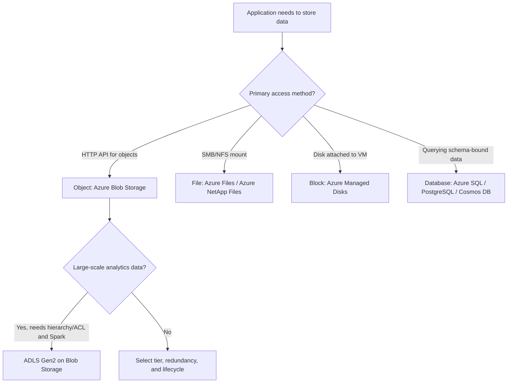
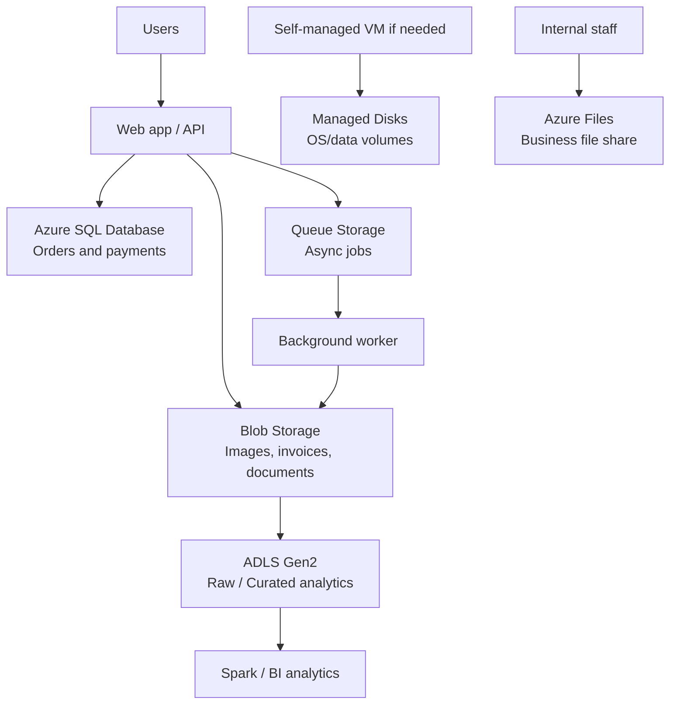

# Choosing a Storage Service by Data Type and Workload

When designing applications on Microsoft Azure, the question is not only **where to store data**, but also **how the application needs to access that data, at what latency, and with what durability and security requirements**. A user-uploaded image file, a virtual machine's OS disk, a shared folder for multiple employees, and a multi-terabyte analytics dataset have very different storage formats, access protocols, and cost profiles. Choosing the wrong service can make an application difficult to scale, drive up read/write costs, or fail to meet recovery requirements during an outage.

This lesson belongs to the **Azure Storage Fundamentals** chapter of the Microsoft Azure ecosystem exploration module. We will compare **object storage, file storage, block storage, and specialized data/analytics options**, build a set of workload evaluation criteria, illustrate reference architectures, and practice inspecting an Azure Storage account. These decisions tie directly into subscriptions, resource groups, Microsoft Entra ID, virtual networks, compute, security, monitoring, and cost management in an Azure application architecture.

## Learning Objectives

After this lesson, you will be able to:

1. Distinguish between **object**, **file**, **block**, and **database** storage based on how applications access data.
2. Identify when to use Azure Blob Storage, Azure Data Lake Storage Gen2, Azure Files, Azure Managed Disks, and Azure NetApp Files.
3. Recognize adjacent services such as Table Storage, Queue Storage, Azure Elastic SAN, and Azure databases, avoiding misselection simply because they share the word "storage".
4. Evaluate **latency, IOPS, throughput, concurrency, capacity, data age, durability, availability, and RPO/RTO** before deployment.
5. Distinguish between **storage tier**, **redundancy**, and **backup**, while selecting appropriate security mechanisms and cost controls.
6. Apply an explainable decision-making process for web workloads, VMs, file sharing, data analytics, and long-term archiving.

## 1. Start from Workload Requirements, Not Service Names

Consider an e-commerce system with the following types of data:

- **Product images:** uploaded via API, frequently read by the application or CDN; do not need to be mounted as a disk.
- **Shared quote files:** employees need access via network paths, folders, permissions, and occasionally file locking.
- **VM disks:** the operating system and software require a block device to create a filesystem, install applications, and handle small random I/O.
- **Orders:** require querying by customer, status, and creation date; updating multiple records according to business rules.
- **Event logs and clickstream data:** continuously written, batch-processed by Spark/SQL engines, and stored long-term at optimized cost.
- **Compliance archives:** rarely read, must be retained for years, and require immutability policies or appropriate retention periods.

If you lump all of these into a single storage type just because "they are all data," you will end up having to build capabilities that the service does not natively provide: file locking, transactional queries, indexing, mounting block devices, or directory-based file operations. **The first rule is to choose the access pattern required by the workload, and only then select the tier and features.**

## 2. Three Core Storage Models: Object, File, and Block

| Criterion | Object storage | File storage | Block storage |
|---|---|---|---|
| Management unit | Objects/blobs with name, content, and metadata. | Files and directories in a filesystem tree. | Blocks on a volume/disk; the OS creates the filesystem. |
| Access method | HTTP(S) API, SDK, URI, and occasionally additional integrated protocols. | SMB, NFS, or supported file-sharing protocols. | Block device attached to a machine/host, typically over storage infrastructure. |
| Typical workload | Images, video, documents, backups, analytics data. | File shares, legacy applications, home directories, HPC file workloads. | OS disks, databases on VMs, application filesystems needing block I/O. |
| Strengths | Massive scale, convenient APIs, tiering/lifecycle, usage-based pricing. | File path compatibility and multi-client sharing. | High IOPS/low latency and OS-level filesystem control. |
| Usually **not** suited for | Emulating a POSIX/SMB drive for apps requiring native file operations. | Massive HTTP object traffic when the app does not need a filesystem. | Global data repositories accessed via VM-independent object APIs. |

**Object storage** fits when an application interacts with individual objects via API: uploading, downloading, deleting, and reading metadata. Paths that look like folders do not necessarily carry the same semantics as a traditional filesystem.

**File storage** fits when existing programs use paths like `\\server\share\reports` or NFS mounts, requiring directory listings, access permissions, and sharing across multiple clients.

**Block storage** fits when the operating system needs "a disk" to format, mount, and manage I/O. Do not treat a block disk as a multi-writer file share across multiple machines unless the specific workload and configuration support shared disks/cluster filesystems; attaching a filesystem not designed for multi-writer access to multiple VMs can cause data corruption.



The diagram is a starting point, not a rigid formula: a single application often uses **multiple** storage types. For example, Azure SQL stores transactions, Blob holds attachments, and Managed Disks serve self-managed VMs.

## 3. Azure Blob Storage: Object Storage for Cloud-Native Applications

**Azure Blob Storage** is an object storage service designed for unstructured data or data stored as objects: images, videos, documents, deployment packages, exported log files, backups, records, and data lakes. Applications typically use REST APIs or SDKs to read/write blobs inside a **container** of a **storage account**.

```text
Subscription
└─ Resource group: rg-store-app
   └─ Storage account: stappdemo123456
      ├─ Container: product-images
      │  ├─ items/101/front.jpg
      │  └─ items/102/front.jpg
      └─ Container: exports
         └─ 2026/11/orders.csv
```

Names containing `/` give a folder-like appearance; in flat-namespace Blob Storage, that is simply part of the blob name, and clients may render them as virtual folders. If **hierarchical namespace (HNS)** is enabled—as when deploying Data Lake Storage Gen2—directory semantics differ; you must choose the model right at design time.

### 3.1. Blob Types

| Type | Key Characteristics | Examples |
|---|---|---|
| **Block blob** | Optimized for uploading and storing objects; can be uploaded in blocks. | Images, PDFs, videos, packages, Parquet files. |
| **Append blob** | Supports append-style data additions within service limits. | Certain sequential logging scenarios. |
| **Page blob** | Page-based read/write for specialized random-access scenarios. | Certain virtual disk deployments or systems requiring page blobs. |

For typical web applications, **block blob** is usually the default choice for uploaded files. Choosing Blob does not mean you can automatically query JSON or CSV contents like a database: to search, filter, and join data by business logic, you must design a separate index or query service.

### 3.2. When Should You Use Blob Storage?

- Storing **images and videos** served by applications or CDNs via URL/SDK.
- Storing **attachments**, receipts, and documents handled as individual objects.
- Storing **backups, data exports, or log files** with varying retention and access frequencies.
- Storing **analytics data files** such as CSV, JSON, Avro, and Parquet accessed via API/object interfaces.
- Storing **static content**; if publishing a website, also evaluate endpoints, CDN/Front Door, authentication, and public access policies.

**Do not choose Blob solely for low per-GB storage pricing** when the application strictly requires mounting an SMB drive, using shared-protocol file locking, or needing database transactions. Only use drivers/gateways that translate objects into a filesystem after verifying semantics, latency, concurrency, and system supportability requirements.

## 4. Azure Data Lake Storage Gen2: Object Storage for Data Analytics

**Azure Data Lake Storage Gen2 (ADLS Gen2)** builds on Blob Storage with a **hierarchical namespace** to support analytics workloads that require efficient directory operations, granular permission models, and data processing ecosystems like Spark. It is neither a VM-attached disk nor a relational database.

Example of a data lake:

```text
Container: lake
raw/orders/year=2026/month=11/day=20/part-0001.json
raw/events/year=2026/month=11/day=20/part-0001.json
curated/sales/year=2026/month=11/part-0001.parquet
serving/customer_features/part-0001.parquet
```

In analytics systems, you can organize zones into **raw → curated → serving**, keeping raw data separate from cleansed data ready for reporting or ML models. ADLS Gen2 supports a true directory model and hierarchy operations suited to data processing engines; access control can combine **Azure RBAC** with **access control lists (ACLs)** as configured.

### When to Choose ADLS Gen2

Choose it when you simultaneously need:

1. High volumes of file-based data written in batch or streaming into a data lake.
2. Directory-based data partitioning and hierarchy operations such as rename/move as supported.
3. Directory- and file-level permissions for data engineering teams.
4. An integrated analytics ecosystem, such as Spark and tools supporting Data Lake protocols.

**Design note:** Enabling hierarchical namespace is an important architectural decision. API compatibility, certain Blob features, lifecycle/tiering, and upgrade paths may depend on the storage account kind and supported versions. Check the relevant limitations before migrating an active Blob workload to the ADLS Gen2 model. Do not assume every Blob Storage feature behaves identically when HNS is enabled.

## 5. Azure Files: Shared File Storage via SMB or NFS

**Azure Files** provides Azure-managed file shares accessible via **SMB** or **NFS** on supported share types/SKUs. It is the right choice when existing applications require file paths, directories, and file-sharing protocols rather than rewriting code to use the Blob REST API.

Example:

```text
\\storage-account.file.core.windows.net\team-share
  ├─ reports\
  ├─ templates\
  └─ shared-documents\
```

Windows Server or employee Windows workstations can access an SMB share when networking and identity are properly configured. Linux can mount certain share types via SMB or NFS depending on the environment and service capabilities. Choose the protocol first, as requirements for authentication, ports, networking, tiers, and features like snapshots can differ.

### 5.1. When to Use Azure Files?

- Migrating a legacy application from a file server to Azure while **preserving SMB paths**.
- Sharing documents and configuration files across multiple VMs or authorized users.
- Using **Azure File Sync** to synchronize and tier an SMB file share with an on-premises Windows Server in a supported hybrid model.
- Providing shared filesystem mounts for workloads; with AKS, this can be integrated via the appropriate CSI driver.

### 5.2. Limitations to Consider

**Azure Files is not synonymous with Azure Blob Storage.** File shares have their own semantics and protocols. For web applications that primarily upload/download files via API at massive scale, Blob can be simpler and more economical. For file workloads demanding ultra-low latency or high NFS/SMB performance, compare supported Azure Files SKUs against Azure NetApp Files.

Pay attention to network paths for SMB—especially **TCP 445**, which may be blocked on certain user networks or by Internet service providers. Verify Private Endpoints, VPN/ExpressRoute, and expected connectivity paths. Having a file share in a storage account does not mean user machines on arbitrary networks can mount it.

**Identity:** SMB shares can integrate with supported identity-based authentication methods, such as AD DS or Kerberos options supported by the service. Distinguish between **share-level permissions** and **file/directory-level permissions**. NFS uses a different authentication and authorization model; do not copy an SMB identity design onto NFS without consulting the product documentation.

## 6. Azure Managed Disks: Block Storage for Virtual Machines

**Azure Managed Disks** provides Azure-managed block disks for Virtual Machines and compatible compute workloads. When a VM needs an OS disk, application installation storage, self-managed database storage, or a filesystem with random I/O, block storage is the appropriate access model.

Common disk families include **Standard HDD**, **Standard SSD**, **Premium SSD**, **Premium SSD v2**, and **Ultra Disk**, subject to VM size, region, and disk type support. Performance levels, IOPS/throughput configurability, latency, snapshot capabilities, and limits vary by SKU; do not assume all disk types behave identically or follow the same pricing formula.

### 6.1. Choosing Disk Types by I/O

| VM Workload | Selection Direction | What to Measure |
|---|---|---|
| Dev/test, low-I/O workloads | Standard HDD/SSD when requirements are met. | Acceptable latency and cost. |
| Web/application VM with steady I/O | Standard SSD or Premium SSD depending on requirements. | IOPS, throughput, and tail latency. |
| Self-managed database needing high I/O | Premium SSD, Premium SSD v2, or Ultra Disk in supported scenarios. | Read/write IOPS, queue depth, block size, and real-world latency. |
| Scratch processing, recreatable data | Evaluate VM **temporary/ephemeral storage** if appropriate. | Data loss risk during maintenance, redeploy, or VM lifecycle events. |

A disk with high IOPS specs is not enough if the **VM size has a lower aggregate IOPS/throughput limit**. Measure VM limits, filesystem behavior, application patterns, caching, and the network path together. For example, a workload writing many small random blocks may hit an IOPS bottleneck, whereas large video processing may be throughput-bound.

### 6.2. What Managed Disks Do Not Replace

- **A disk is not a database service:** SQL Server/PostgreSQL on a VM still requires self-managing the engine, backups, replication, recovery, and patching.
- **A disk snapshot does not automatically equal a verified backup:** you need snapshot/backup policies, retention, and restore testing.
- **A standard disk is not a multi-writer file share:** you need a shared disk model and a supporting cluster filesystem/application if multiple machines write concurrently.
- **VM/disk availability zone is an architectural constraint:** select disk types and zones compatible with your VM, replication, and desired HA strategy.

For containerized applications, the **Azure Disk CSI driver** can provision persistent volumes backed by Managed Disks for pods under supported access modes; if multiple pods/nodes need to share files concurrently, evaluate Azure Files or other file solutions instead of forcing a block filesystem onto multiple nodes.

## 7. Azure NetApp Files: High-Performance File Storage

**Azure NetApp Files (ANF)** is a managed file storage service aimed at enterprise workloads requiring **NFS/SMB** with higher performance, lower latency, and richer file features. Suitable scenarios include:

- Enterprise applications using NFS/SMB with high I/O demands and many concurrent clients.
- Data volumes serving SAP, HPC, or specialized compute workloads within supported configurations.
- Applications migrating from on-premises NAS to Azure without wanting to self-operate NAS VMs.

ANF uses its own capacity/performance model and networking configuration; it involves **capacity pools**, volumes, and feature-specific data protection policies. On the flip side, its cost and deployment prerequisites may not suit a small, infrequently accessed file share. Therefore, **measure latency, throughput, concurrent client count, and NFS/SMB characteristics** and compare ANF against Azure Files, rather than choosing based on service name alone.

## 8. Related Options That Are Not Direct File/Object/Block Replacements

Azure offers several specialized storage and data services. Confusing these layers can lead to hard-to-operate architectures.

| Service | Primary Access Model | When to Use? | Not a Direct Replacement For |
|---|---|---|---|
| **Azure Table Storage** | NoSQL key/attribute with partition key and row key, table API. | Simple non-relational lookups by key and partition. | Relational databases with complex JOINs/transactions. |
| **Azure Queue Storage** | Simple message queue. | Decoupling asynchronous processing between apps and workers. | Storing large files or full-featured analytics event streaming. |
| **Azure Cosmos DB** | Managed NoSQL database accessed via chosen API/model. | Application data needing queries, multi-region distribution, and database-level scaling. | Blob Storage for cheap, large-capacity file storage. |
| **Azure SQL Database / Azure Database for PostgreSQL** | Relational database with engine-level queries and transactions. | Orders, payments, schema-bound relational data. | Object storage for images, videos, and backup files. |
| **Azure Elastic SAN** | SAN-style block storage for iSCSI-compatible workloads. | Multi-volume scenarios needing centralized SAN management. | Azure Files/Blob or a default single VM disk in every architecture. |
| **Azure Backup** | Data protection/recovery orchestration service. | Backup and restore policies for supported workloads. | Replacing live storage serving application I/O. |

**Table Storage** typically follows an access model keyed by partition key and row key, so keys must be designed around query patterns; simply pushing arbitrary JSON into a table does not give you full SQL capabilities. **Queue Storage** holds messages for asynchronous processing, unlike Blob Storage which stores file payloads. If an application needs advanced messaging like transactions or publish-subscribe semantics as required, compare it against Azure Service Bus/Event Hubs rather than trying to turn Queue Storage into a streaming platform.

## 9. Service Selection Matrix by Data Type and Workload

This is an initial advisory table. Final decisions must confirm regional support, SKU availability, performance, and actual cost.

| Need | Primary Candidate to Evaluate | Why? | Questions Before Finalizing |
|---|---|---|---|
| Store user-uploaded images, videos, PDFs | **Blob Storage** | Object API, container management, lifecycle, and tiering. | Read volume, CDN needs, private access, and egress? |
| Static website or widely distributed media | **Blob Storage + Front Door/CDN** where appropriate | Offloads static files from the app, optimizes delivery. | Auth, caching, custom domain, and public policies needed? |
| File share for Windows/SMB applications | **Azure Files SMB** | File share semantics and identity integration. | TCP 445, share/ACL permissions, capacity, and client count? |
| High-performance NFS file sharing | **Azure NetApp Files** or **Azure Files NFS** depending on needs | Fits workloads needing file protocols. | Latency, throughput, POSIX semantics, SKU/region? |
| VM OS or data disk | **Managed Disks** | Block device integrated with Azure VMs. | IOPS, throughput, caching, backup, and zone? |
| Self-managed database on a VM | **Managed Disks** for volumes + database engine | Requires block I/O for the engine. | Can a PaaS database be used to reduce operations? |
| Orders with JOINs, transactions, schema | **Azure SQL Database/PostgreSQL** | Purpose-built database engine. | Consistency, HA, queries, migration, and licensing? |
| JSON documents needing query/partitioning | **Azure Cosmos DB** or suitable database | Database-level querying and indexing. | Partition key, throughput, consistency, region? |
| Event logs, Parquet, and Spark pipelines | **ADLS Gen2** | Hierarchy and analytics integration. | Partitioning, ACLs, small-file count, and format? |
| Object-based exports/backups | **Blob Storage** | Easy data-age and storage-cost management. | Restore frequency, retention, immutable policies? |
| Rarely accessed records kept for years | **Appropriate Blob tier**, potentially archive | Optimizes capacity cost when reads are rare. | Rehydration time, retrieval fees, and minimum retention? |
| Messages between API and workers | **Queue Storage** | Buffers asynchronous work. | Need strict FIFO, transactions, or pub/sub? |
| Enterprise NAS workloads | **Azure Files / Azure NetApp Files** | Preserves file protocols, reduces file-server ops. | Tested ACLs, locks, client count, latency? |
| Specialized SAN volumes | **Azure Elastic SAN** if supported | Centralized block volume management. | iSCSI, networking, host compatibility, and HA? |

## 10. Five Technical Criteria Groups Affecting the Decision

### 10.1. Access Protocol and Semantics

Ask: does the application use REST APIs, SDKs, SMB, NFS, a block device, or SQL queries? Does it require directory renames, file locking, append operations, random writes, POSIX ACLs, or multiple concurrent writers?

This is an **exclusion criterion**: if a legacy application only knows how to write files over SMB and code modifications are prohibited, Blob is generally unsuitable. Conversely, if a serverless application stores uploaded files via API, provisioning a file share and mounting it across every instance can introduce unnecessary complexity.

### 10.2. Latency, IOPS, and Throughput

Three metrics that are frequently confused:

- **Latency:** time for a single operation to complete, typically measured in ms; pay attention to tail latency as well, such as p95/p99.
- **IOPS:** number of I/O operations per second; critical for small random reads/writes in filesystems or databases.
- **Throughput:** amount of data transferred per second, typically measured in MB/s or Gb/s; critical for large files and analytics processing.

For example, a database writing small data pages needs steady IOPS and low latency; a pipeline reading large Parquet files may prioritize throughput and parallel reads; an image service needs bandwidth optimization and caching. Do not choose a Premium Disk solely because a database is large in capacity without measuring actual I/O.

### 10.3. Capacity and Scalability

Evaluate current capacity, growth rate, number of objects/files, average size, concurrent clients, and limits at the **account/share/disk/VM/region level**. A service with a huge capacity limit does not mean every client can consume the entire published throughput. When testing, measure at a data scale, concurrency level, and duration representative of production.

### 10.4. Durability, Availability, and Recoverability

**Durability** is the ability to preserve data against hardware failures, whereas **availability** is the ability to access the service at the moment it is needed. **RPO (Recovery Point Objective)** describes the maximum acceptable data loss; **RTO (Recovery Time Objective)** is the target time to restore the service.

Redundancy keeps multiple copies to survive infrastructure faults; it does not replace backups against user operational errors, overwrites, or accidental deletions. Data faithfully replicated to another region after an accidental delete can still be lost at the application logic level without proper versioning, backups, or retention.

### 10.5. Security, Compliance, and Data Residency

Check access identities, encryption in transit/at rest requirements, storage regions, network isolation, auditing capabilities, and immutability policies. **Microsoft Entra ID**, Azure RBAC, and service data-plane permissions are critical; having permission to view a storage account on the management plane does not equate to permission to read all blobs inside it.

For sensitive data, prioritize **managed identities**, Entra ID-based authentication, least-privilege scoping, Private Endpoints/firewalls where appropriate, access logs, and accidental deletion safeguards. Avoid sharing a single storage account key across every application whenever narrower authorization mechanisms can be used instead.

## 11. Storage Accounts, Redundancy, and Access Tiers

### 11.1. The Storage Account as a Configuration Boundary

Many Azure Storage services are organized under a **storage account**. Properties such as region, account kind, certain limits, and network/identity policies apply at the account scope. **General-purpose v2 (StorageV2)** is the common choice for compatible Blob/Files/Queue/Table workloads; specialized or premium account kinds may be necessary when workloads demand different performance profiles or features.

**You do not have to cram every workload into a single storage account.** Separating accounts by environment, data sensitivity, performance limits, redundancy requirements, or permission boundaries can reduce blast radius and simplify cost tracking. However, too many tiny accounts also increase operational and configuration management overhead.

### 11.2. Core Redundancy Options

| Option | Conceptual Data Protection | Points to Note |
|---|---|---|
| **LRS** (Locally Redundant Storage) | Multiple replicas within a single location/storage unit inside a region. | Protects against certain local hardware faults, not cross-region DR. |
| **ZRS** (Zone Redundant Storage) | Synchronous replication across multiple availability zones in a supported region. | Reduces single-zone dependency; verify service and region support. |
| **GRS** (Geo Redundant Storage) | Replicas in the primary region plus asynchronous replication to a paired/secondary region. | May lose un-replicated data during a regional outage; recovery and secondary access have conditions. |
| **GZRS** (Geo-Zone Redundant Storage) | Combines zone redundancy in the primary region with asynchronous replication to the secondary region. | Availability depends on region, account kind, and workload. |
| **RA-GRS / RA-GZRS** | Variants allowing read access to the secondary under specific conditions. | Does not mean the secondary is instantaneously up to date or that apps fail over automatically. |

These options are **not uniformly supported across all Azure storage types**. Managed Disks, Azure Files, Blob, and Azure NetApp Files have different HA/replication capabilities. Do not apply a Blob redundancy matrix across every service.

### 11.3. Blob Storage Access Tiers

For supported blob types and storage accounts, data can be placed in appropriate access tiers:

| Tier | Access Pattern | Qualitative Cost Model |
|---|---|---|
| **Hot** | Frequent reads/writes. | Storage capacity fee is typically higher than cooler tiers, while access fees can be more favorable. |
| **Cool** | Less frequent reads while remaining online. | Can reduce capacity fees while increasing access/transaction costs. |
| **Cold** | Rarely read, still kept online in supported configurations. | Further optimizes capacity cost, but check operation fees and minimum retention periods. |
| **Archive** | Very rarely accessed long-term storage; not immediately readable directly like online tiers. | Capacity cost is typically low, but requires **rehydration**, incurring latency and retrieval fees. |

**Do not choose Archive for data requiring immediate access.** Archived data must be rehydrated via service-supported mechanisms and priority levels before reading; retrieval times are nothing like a standard GET request. For cool/cold/archive, **minimum retention/early deletion** rules and operation/retrieval fees must be factored into the decision. Tiers can be transitioned automatically via **lifecycle management policies** based on supported conditions, such as days since creation, modification, or policy-tracked access.

One way to choose a tier is to measure **access frequency, volume of downloaded data, and required retrieval time**, then calculate total cost rather than comparing per-GB/month storage prices alone.

## 12. Real Cost Includes More Than Storage Capacity

An approximate estimation formula:

```text
Total storage cost
  ≈ storage capacity by tier/SKU
  + number of read/write operations, transactions, and retrievals
  + bandwidth/egress outside applicable free or internal scopes
  + redundancy/replication and recovery capabilities
  + snapshots/backups/retention
  + security tools, networking, monitoring, and supporting resources
```

This formula only describes cost categories; Azure prices vary across products, regions, tiers, and provisioning models. For example, Managed Disks may be billed by type/size or provisioned performance parameters depending on SKU; Azure NetApp Files may be billed by capacity pool/volume and performance tier; Blob may incur capacity, operation, and retrieval fees. **Do not use Blob per-GB pricing to estimate SQL Database or Premium SSD.**

### Qualitative Example

Two repositories both store 10 TB:

- **Repository A:** images downloaded millions of times per day. Capacity fees are only one part; you must account for operations, egress, and the benefits of caching/CDN.
- **Repository B:** backups retained for years, rarely retrieved. Cool/archive tiers may be more economical, provided recovery times and rehydration fees still meet the organization's RTO/RPO.

Azure Pricing Calculator helps estimate before deployment; **Azure Cost Management** helps verify actual spend. Apply appropriate tags and establish a review cadence for capacity growth, access tiers, stale snapshots, orphaned data, and unexpected egress.

## 13. Security and Data Lifecycle Management

A sound storage design requires multiple layers of protection:

1. **Authentication:** prefer Microsoft Entra ID/managed identities and appropriate authentication methods over hard-coded account keys.
2. **Authorization:** data-plane Azure RBAC roles, ADLS Gen2 ACLs, or SMB/NFS permissions depending on the service; separate resource management permissions from data read permissions.
3. **Networking:** restrict public network access where appropriate, using Private Endpoints, service endpoints, or firewalls per the actual architecture.
4. **Encryption:** HTTPS/TLS in transit; server-side encryption at rest; choose customer-managed keys via Key Vault in supported scenarios requiring key control.
5. **Data protection:** versioning, soft delete, snapshots, backups, and immutability/legal hold policies when required by the service and compliance obligations.
6. **Monitoring:** audit logs, metrics, and alerts for access, errors, capacity, and cost; verify logs do not leak secrets.
7. **Lifecycle:** transition tiers or delete on schedule, control retention, and distinguish temporary copies from legally significant records.

### 13.1. Redundancy Differs from Backup and Immutability

Suppose a developer accidentally deletes a folder containing invoices. ZRS or GRS does not necessarily recover the prior version if the deletion is replicated. **Soft delete/versioning** or **restorable backups** protect against operational mistakes and other forms of data loss. **Immutability** prevents modification/deletion for the required duration when properly configured. They complement one another rather than being interchangeable terms.

### 13.2. Scoped Object Sharing

When you need to provide a time-limited file download link, Blob supports mechanisms like **Shared Access Signature (SAS)** in appropriate scenarios. A SAS is a form of delegated authorization credential; anyone holding the valid URL/token can exercise the granted permissions within its scope. Therefore, restrict permissions, lifetime, and resource scope, guard against token leakage, and plan for revocation where appropriate. For internal applications with Entra ID, consider role-based data access before issuing broad shared credentials.

## 14. Reference Design: E-Commerce Application on Azure

A reference architecture separating transactional data, user files, batch analytics, and compute:



### Selection Rationale

- **Azure SQL Database** stores orders with state, data locking, and transactional business logic; do not store every order as an individual JSON file if the application needs relational queries and transactional updates.
- **Blob Storage** stores PDF invoices and product images. The database holds metadata and blob IDs/URIs; file access is granted according to application policy.
- **Queue Storage** buffers thumbnail generation or email tasks so the API responds quickly, avoiding storing messages as files and polling all of Blob.
- **ADLS Gen2** stores batch-exported data for Spark/BI processing, typically using optimized formats/partitions instead of querying all live production transactions directly.
- **Azure Files** is included only if there is a workload that genuinely requires an SMB/NFS file share; not every web application needs it.
- **Managed Disks** serve self-managed VMs if present; for PaaS/serverless compute, persistent storage must follow whatever model that compute service supports.

In the diagram, the arrow from Blob to ADLS Gen2 represents a **designed data transfer/sync pipeline**, not Azure automatically moving data between two storage accounts. You can share the underlying object platform and separate accounts/namespaces appropriately for security, performance, and governance.

## 15. Azure CLI Practice: Creating Blob Storage for File Uploads

The goal is to deploy a **learning-safe** example and then inspect its configuration. You need the Azure CLI, a test subscription, permission to create a storage account in a resource group, and appropriate data-plane permissions if you plan to create containers or upload blobs. The example uses **Bash**; do not run it against unapproved production environments.

### Step 1. Sign In and Set Variables

```bash
az login
az account list --output table
az account set --subscription "<subscription-id>"

RG="rg-storage-lab"
LOCATION="southeastasia"
ACCOUNT="<globallyuniquestoragename>"
CONTAINER="uploads"
```

The storage account name must be **globally unique across Azure**, using lowercase letters and numbers, within the length limits defined by the service. Replace the placeholder with a valid name and verify regional/SKU support before creating.

### Step 2. Create a Resource Group and StorageV2 Account

```bash
az group create \
  --name "$RG" \
  --location "$LOCATION"

az storage account create \
  --resource-group "$RG" \
  --name "$ACCOUNT" \
  --location "$LOCATION" \
  --sku Standard_LRS \
  --kind StorageV2 \
  --https-only true \
  --min-tls-version TLS1_2 \
  --allow-blob-public-access false
```

The example picks **Standard_LRS** to start with a minimal lab; this is **not a default recommendation for production**. Production workloads with HA/DR requirements may need ZRS/GRS/GZRS or other strategies depending on recovery goals and support scope. Creating an account can incur charges; monitor actual costs.

### Step 3. Inspect the Created Configuration

```bash
az storage account show \
  --resource-group "$RG" \
  --name "$ACCOUNT" \
  --query "{name:name,kind:kind,sku:sku.name,location:location,httpsOnly:enableHttpsTrafficOnly,minTls:minimumTlsVersion,publicBlob:allowBlobPublicAccess}" \
  --output json
```

Read the fields: **kind** indicates the account type, **sku** indicates the provisioned redundancy/tier, **httpsOnly/minTls** reflect transport configuration, and **publicBlob** shows the account-level policy for public blob access. Disabling anonymous blob public access **does not mean** the public network endpoint is blocked; check firewall and private access settings separately.

### Step 4. Create a Container and Upload a File

Use Entra ID with `--auth-mode login` when your identity holds a data-plane role such as **Storage Blob Data Contributor** at the appropriate scope:

```bash
az storage container create \
  --account-name "$ACCOUNT" \
  --name "$CONTAINER" \
  --auth-mode login

az storage blob upload \
  --account-name "$ACCOUNT" \
  --container-name "$CONTAINER" \
  --name "example.txt" \
  --file "./example.txt" \
  --auth-mode login

az storage blob list \
  --account-name "$ACCOUNT" \
  --container-name "$CONTAINER" \
  --auth-mode login \
  --output table
```

Create a small text file `example.txt` in your working directory beforehand before running the upload. If you encounter `AuthorizationPermissionMismatch` or a 403 error, verify your data-plane role and role assignment propagation time; do not simply grant Contributor on the resource group, because management roles do not automatically grant blob upload permissions.

### Step 5. Clean Up Within Permitted Scope

If the resource group contains only newly created demo resources and you have verified no data needs to be kept, you can delete the lab resources following your organization's procedures. **Do not delete the entire resource group if it contains shared resources or other data.** Confirm blobs, containers, storage accounts, and dependencies before deleting; monitor Cost Management after the exercise.

## 16. Decision Framework: 8 Questions Before Choosing a Service

To design and review systematically, answer these in order:

1. **Data type:** media files, file shares, block I/O, schema-bound/transactional data, or analytics logs?
2. **Required interface:** REST/SDK, SMB, NFS, POSIX-like hierarchy, database query, or block device?
3. **I/O behavior:** object/file size, request rate, concurrency, random/sequential I/O, target latency and throughput?
4. **Scalability:** current/projected capacity, object/file/partition-key counts, account/share/VM limits?
5. **Durability & recovery:** zone/region failure, RPO/RTO, retention, backups, soft delete, versioning, and restore capability?
6. **Security & compliance:** public/private endpoints, Entra ID/RBAC/ACL, encryption, auditing, residency, and immutability?
7. **Data lifecycle:** hot/cold patterns, retrieval frequency, acceptable rehydration time, tiering/deletion policies?
8. **Total cost:** capacity, operations, retrieval, egress, provisioned performance, backups, networking, and operational effort?

If answers remain unclear, build a small **proof of concept** with representative data. Measure p95/p99 latency, throughput, errors, concurrency, and projected costs; also test failover/restore scenarios. Do not use a sequential-write-only benchmark to conclude that a system is fit for production random I/O.

## 17. Common Mistakes

| Mistake | Consequence | How to Avoid |
|---|---|---|
| Storing transactional orders as scattered JSON blobs | Difficult to ensure transactions, queries, and updates | Choose a database with the appropriate data model and consistency. |
| Using Managed Disk as a multi-VM file share without cluster support | Risk of filesystem corruption | Use Azure Files/ANF or a shared disk with proper clustering. |
| Choosing Archive for files needing download within seconds | Fails RTO, triggers rehydration | Use an online tier and check retrieval times. |
| Treating ZRS/GRS as a complete backup | Cannot recover from application-level deletion/overwrite | Use versioning, soft delete, backups, and test restores. |
| Buying Premium Disk based solely on capacity | High cost without fixing bottlenecks | Measure IOPS, throughput, tail latency, and VM limits. |
| Using Blob for an app that must mount SMB | Forces complex gateways, incompatible semantics | Choose Azure Files or ANF when the true requirement is a file share. |
| Putting confidential data on storage and merely hiding the URL | URL is not an authorization mechanism | Use RBAC/data-plane roles, private access, and scoped SAS when needed. |
| Calculating only per-GB/month storage fees | Misses operations, retrieval, egress, snapshots, performance | Estimate total cost by workload and measure in practice. |
| Enabling hierarchical namespace without checking compatibility | Certain apps/features may not be compatible | Verify HNS, APIs, ACLs, and service limits before choosing. |
| Cramming all dev/prod into one account with shared access keys | Widens blast radius of mistakes/overly broad permissions | Separate environments, use managed identities and least privilege. |

## 18. Pre-Production Checklist

- [ ] Each data type has been classified by object/file/block/database and access protocol.
- [ ] Service chosen based on workload, not solely on name or low per-GB cost.
- [ ] Measured IOPS, throughput, latency, concurrency, and confirmed limits by SKU/region.
- [ ] Identified storage accounts/shares/disks/volumes suited for growth requirements.
- [ ] Selected redundancy, availability zones/regions, and a separate backup plan aligned with RPO/RTO.
- [ ] Verified restore capabilities, soft delete, versioning, and data retention policies.
- [ ] Implemented secure authentication, data-plane RBAC/ACLs, network restrictions, and encryption.
- [ ] Distinguished access tiers from redundancy and fully evaluated retrieval/rehydration costs.
- [ ] Accounted for data and costs across secondary locations: snapshots, backups, logs, exports, replicas.
- [ ] Set up monitoring, alerts for capacity/performance/errors, owners, and cost-allocation tags.
- [ ] Tested failure modes: zone failure, permission loss, accidental deletion, quota exhaustion, client retries, and recovery.

## Conclusion

In Microsoft Azure, **Blob Storage** fits objects and files accessed via API; **ADLS Gen2** fits data lakes and analytics needing hierarchy/ACLs; **Azure Files** and **Azure NetApp Files** serve SMB/NFS workloads; **Azure Managed Disks** provides block storage for VMs. For data requiring queries and transactions, choose an appropriate **database** instead of forcing object/file storage to act as a database. The right decision combines access protocol, performance, durability, recoverability, data security, and **total lifecycle cost**, not just stored gigabytes. A real-world Azure application typically succeeds by combining multiple services, each solving the exact data category it was designed to serve.
