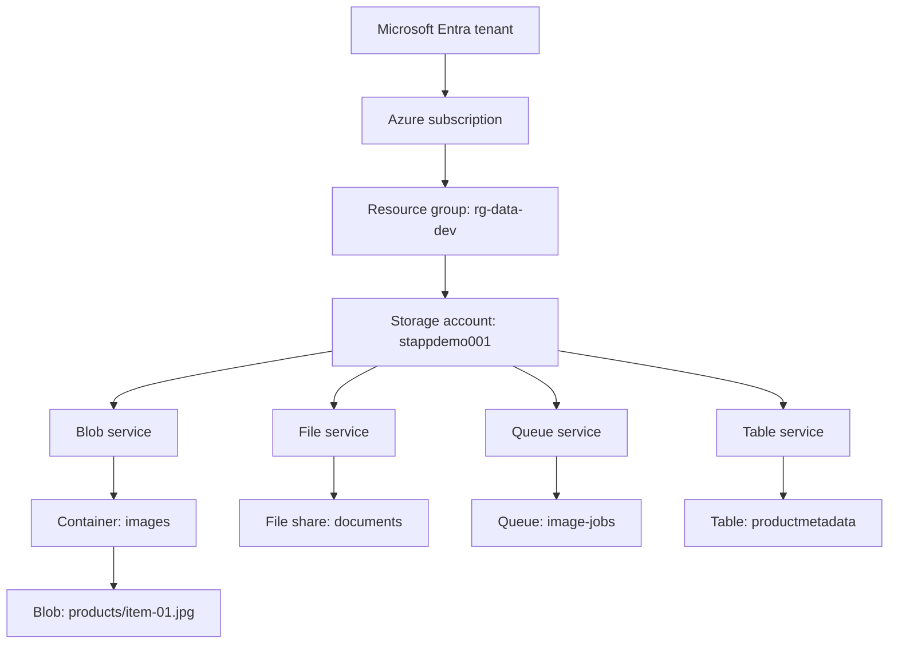
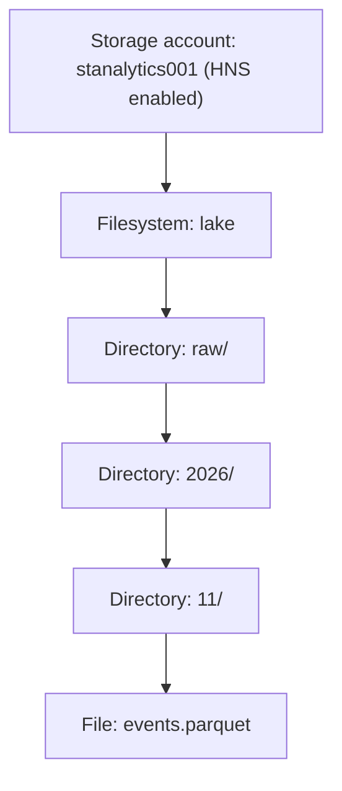
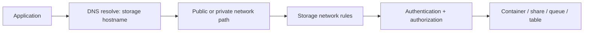
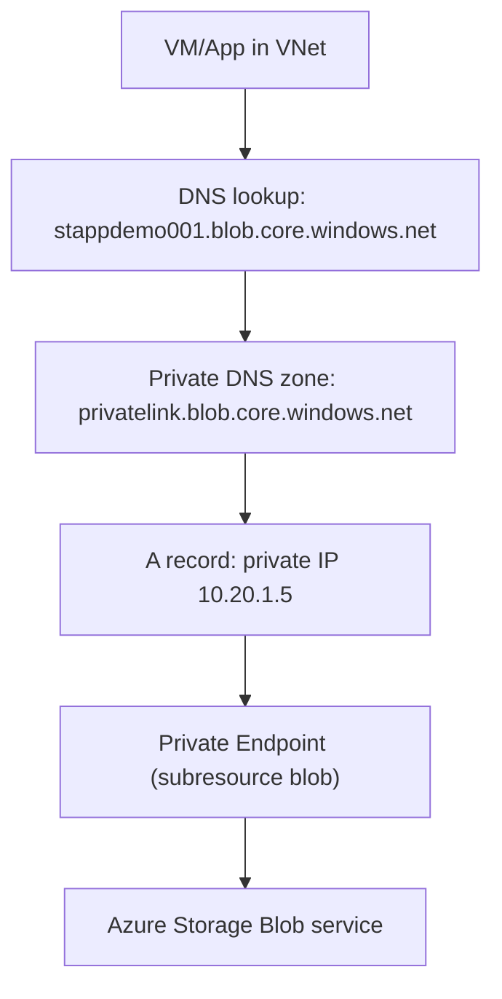
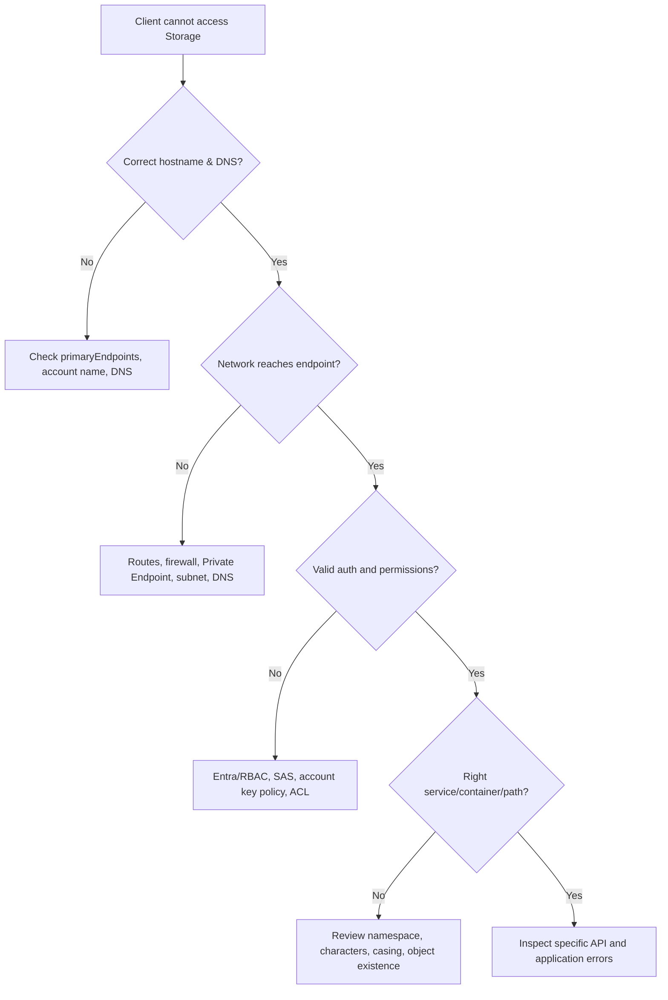

# Storage Accounts, Endpoints, and Namespaces

A development team wants to store product images, an application needs to share files over SMB, and an analytics platform must read millions of files using a data lake protocol. All three needs can use services under **Azure Storage**, yet their resource organization, access addresses, and object naming differ. To deploy properly, you need a solid grasp of **storage accounts**, **service endpoints**, and **namespaces**.

This lesson belongs to the **Azure Storage Fundamentals** chapter of the `CLOUD_PROVIDERS_AZURE` module. Along the Azure journey from subscriptions, resource groups, and Microsoft Entra ID to virtual networks, compute services, storage, data, monitoring, security, and cost, these three concepts form the foundation for choosing where to store data, configuring applications, and restricting access.

## Learning Objectives

After this lesson, you will be able to:

- Explain what a storage account is and distinguish management resources in Azure Resource Manager from data accessed via storage endpoints.
- Read and distinguish endpoints for **Blob**, **Data Lake Storage Gen2 (DFS)**, **Azure Files**, **Queue**, **Table**, and static websites where supported.
- Understand storage account names, global naming scope, containers, file shares, queues, tables, and blob paths.
- Distinguish a **flat namespace** from a **hierarchical namespace (HNS)**, and understand how HNS affects directory organization and endpoints.
- Recognize public endpoints, private endpoints, private DNS, service endpoints, and how firewalls affect connectivity.
- Look up storage accounts, endpoints, HNS, and network configurations via the Azure Portal or Azure CLI.
- Establish secure access principles, troubleshoot common errors, and anticipate related cost components.

## 1. Big Picture: Where Does a Storage Account Sit?

A **storage account** is the top-level management resource of Azure Storage. It provides a **shared management and identity boundary** for the data storage services supported by that account, and holds configuration choices such as deployment region, account kind, redundancy level, security, and networking.

A storage account resides inside a **resource group** under a **subscription**. Meanwhile, the data inside the account (such as blobs or file shares) is accessed via the API/protocol of the corresponding storage service.



This diagram is a conceptual model: **not every storage account kind supports every service shown**. Specialized accounts have their own supported capabilities and limits. Azure Data Lake Storage Gen2 is a capability of Blob Storage with **hierarchical namespace** enabled, not a separate storage account that must be created alongside Blob.

### Two Operational Planes to Distinguish

| Plane | Primary Target | Task Examples | How It Is Managed |
|---|---|---|---|
| **Control plane** | `Microsoft.Storage/storageAccounts` resource | Create account, choose SKU, configure firewall, enable HNS at creation | Azure Resource Manager, Azure Portal, Bicep, ARM REST API |
| **Data plane** | Blob/container, file/share, queue/message, table/entity | Upload blob, read file, send message, query entity | Storage service endpoints and APIs/protocols |

Someone with the `Reader` role on a resource group can read metadata of a storage account, but **cannot automatically read blob contents**. Granting permission to view resource configuration is different from granting permission to access data. Separating the control plane from the data plane prevents security mistakes from the start.

## 2. Building Blocks of a Storage Account

When creating an account, you make several decisions with long-term impact:

| Property | Meaning | Examples / Notes |
|---|---|---|
| **Account name** | DNS identifier name of the storage account | `stappdemo001`, must follow naming rules |
| **Subscription and resource group** | Governance, billing, RBAC, and lifecycle boundary | `rg-data-dev` in the application subscription |
| **Region** | Primary location of data/resources | `southeastasia`; consider latency and data residency |
| **Kind** | Account type, determining supported services/features | `StorageV2` is standard for new workloads |
| **Performance tier** | Performance capabilities and storage model | Standard or an appropriate Premium tier |
| **Redundancy** | How Azure maintains data replicas | LRS, ZRS, GRS, GZRS, and read-access secondary variants |
| **Networking** | How clients reach endpoints | Public endpoint, firewall, private endpoint |
| **Security** | TLS, HTTPS requirement, authorization, encryption keys | Microsoft Entra ID, RBAC, encryption at rest |
| **Hierarchical namespace** | How Blob organizes objects into hierarchical directories | Important to consider when designing ADLS Gen2 |

### Account Kind: Choose Right Before Creating

- **General-purpose v2 (`StorageV2`):** the standard choice for Blob, Files, Queue, and Table services along with modern features. Actual supported services/features still depend on the SKU, configuration, and per-service limits.
- **Premium block blob account (`BlockBlobStorage`):** geared toward block blob workloads demanding high performance; cannot arbitrarily substitute for all service types in StorageV2.
- **Premium file share account (`FileStorage`):** serves supported Azure Files scenarios with specialized performance demands.
- **Legacy account kinds:** may still exist in older systems, but should not be chosen for new workloads without a clear compatibility reason.

Not every configuration change can be reversed easily. In particular, the decision to use **hierarchical namespace** and the choice of account kind must be confirmed against workloads, features, and migration plans before creating production data.

### Redundancy Options

- **LRS:** maintains multiple replicas within a single datacenter in the region.
- **ZRS:** distributes replicas across availability zones within a supported region.
- **GRS:** adds asynchronous replication to a supported paired secondary region.
- **GZRS:** combines multi-zone replicas in the primary region with asynchronous replication to the secondary region.
- **RA-GRS/RA-GZRS:** adds read access to the secondary region in supported modes.

**Redundancy is not equivalent to application backups.** Replicating a blob that was just accidentally deleted or overwritten may not rescue the desired version. You must also evaluate soft delete, versioning, backups, retention, and recovery methods appropriate for each service.

## 3. Storage Account Names and Namespace Scope

The storage account name forms part of the endpoint addresses. For standard accounts in the Azure public cloud, the name must:

1. Be **3 to 24 characters** long.
2. Contain only **lowercase Latin letters `a-z` and digits `0-9`**.
3. Contain no hyphens, periods, spaces, or uppercase letters.
4. Be **unique across the Azure Storage naming namespace in the respective cloud**, not merely unique within your resource group or subscription.

Examples:

| Proposed Name | Syntactically Valid? | Remarks |
|---|---|---|
| `stappdev001` | Yes | Good example; still must check availability |
| `storageproddata2026` | Yes | May already be taken by another organization |
| `st-app-prod` | No | Contains hyphens |
| `StorageProd` | No | Contains uppercase letters |
| `sa` | No | Shorter than 3 characters |
| `storage_account` | No | Contains an underscore |

A **syntactically valid** name is not guaranteed to be **available**. Check before creating with the Azure CLI:

```bash
az storage account check-name \
  --name "stappdemo001" \
  --output json
```

Read the `nameAvailable` property along with `reason` or `message` if present. An unavailable name may belong to another account or be subject to name reuse restrictions.

**A globally unique account name does not mean the data is public.** Anyone who knows the endpoint address still has to pass network access controls and authentication/authorization to read non-public resources.

### Namespaces of Objects Inside an Account

A storage account has distinct **sub-namespaces** per service:

| Object | Scope Within Which the Name Is Defined | Example |
|---|---|---|
| Storage account | Service-level namespace in the respective cloud | `stappdemo001` |
| Blob container | Account's Blob service | `images` |
| Blob name | Inside a container | `products/2026/item.jpg` |
| File share | Account's File service | `documents` |
| Azure Files directory/file | Inside a file share | `reports/november.xlsx` |
| Queue | Account's Queue service | `image-jobs` |
| Table | Account's Table service | `productmetadata` |
| Table entity | By table key pair | `PartitionKey` and `RowKey` |

Length rules, allowed character sets, and case sensitivity **are not identical across all object types**. For example, container names generally follow lowercase DNS-like conventions; blob names may contain characters and path separators as defined by Blob Storage. Blob names are case-sensitive; do not assume `Item.jpg` and `item.jpg` are the same blob.

This directly impacts identifier key design. Two containers with the same name can exist in **two different storage accounts**, whereas the same account cannot have two containers with the same name.

## 4. What Is an Endpoint?

An **endpoint** is the address a client uses to communicate with **a Storage service** over a supported API or protocol. An account can have multiple endpoints, each serving a specific service or purpose.

For example, account `stappdemo001` in the Azure public cloud typically has endpoints shaped like:

| Service | Illustrative Endpoint | Purpose |
|---|---|---|
| **Blob** | `https://stappdemo001.blob.core.windows.net` | Containers and Blob objects |
| **Data Lake Storage Gen2 / DFS** | `https://stappdemo001.dfs.core.windows.net` | ADLS Gen2 filesystem and directory operations when HNS is enabled |
| **Azure Files** | `https://stappdemo001.file.core.windows.net` | Azure Files REST API; SMB uses the same host via SMB protocol |
| **Queue** | `https://stappdemo001.queue.core.windows.net` | Queues and messages |
| **Table** | `https://stappdemo001.table.core.windows.net` | Tables and entities |
| **Static website** | `web` endpoint assigned by Azure when enabled | Serving static websites via static website hosting |

**These are common endpoint patterns, not strings you should manually concatenate in every scenario.** Domain names can differ between the Azure public cloud and sovereign clouds. Some accounts/DNS options support DNS-zone endpoint types whose hostnames differ from the pattern above. Furthermore, the account kind/features determine whether a service has an active endpoint.

**The most reliable approach is to read the endpoints returned by Azure** under **Storage account → Endpoints** in the Portal or in the `primaryEndpoints` property via Azure CLI/ARM API.

### Blob Endpoint and an Object's URL

Suppose you have a container `images` and a blob named `products/item-01.jpg`:

```text
Blob service endpoint:
https://stappdemo001.blob.core.windows.net

Container:
https://stappdemo001.blob.core.windows.net/images

Specific blob:
https://stappdemo001.blob.core.windows.net/images/products/item-01.jpg
```

Breaking down the components:

- `https://`: HTTPS protocol.
- `stappdemo001`: storage account name.
- `blob.core.windows.net`: Blob service hostname in the illustrative endpoint pattern.
- `images`: container name belonging to the account.
- `products/item-01.jpg`: blob name, which may include `/` characters to represent logical structure.

A URL is only an **address**. If the blob/container is private, access without a valid token, role, or SAS can still be denied. Never confuse a "guessable" URL with a "publicly readable" resource.

### Other Addresses Not to Confuse with Data Endpoints

**Resource ID** in Azure Resource Manager:

```text
/subscriptions/<subscription-id>/resourceGroups/rg-data-dev/providers/Microsoft.Storage/storageAccounts/stappdemo001
```

A **Resource ID** identifies and manages the account on the control plane. It is not a URL used to download blobs.

A **Connection string** is a connection configuration that may include the hostname and credentials, such as an account key. It is not synonymous with an endpoint and can be a **secret**. Do not commit connection strings containing keys into repositories, logs, tickets, or public documents.

A **SAS URL** is a resource URL appended with query parameters containing permissions, expiration, and a signature. The SAS signature portion is sensitive information that can grant access; do not print full SAS URLs into logs or share them like ordinary links.

## 5. Distinguishing Blob, Files, Queue, and Table by Endpoint

### Blob Storage: Objects and Unstructured Data

Blob fits images, videos, document files, backups, logs, analytics data, or application content. Data is stored as **blobs inside containers**. Blob names can include folder-like prefixes:

```text
storage account: stappdemo001
  container: raw-data
    blob: 2026/11/20/events-0001.json
    blob: 2026/11/20/events-0002.json
    blob: 2026/11/21/events-0001.json
```

These blobs can still share a single Blob endpoint; the container and path are components following the hostname.

### Azure Files: File Shares and File-Sharing Protocols

Azure Files provides file shares supported for SMB and in certain scenarios NFS; NFS availability depends on the SKU/share type and specific network/feature conditions. For Azure Files REST:

```text
https://stappdemo001.file.core.windows.net/documents/finance/report.xlsx
```

For SMB on Windows, the UNC path typically looks like:

```text
\\stappdemo001.file.core.windows.net\documents
```

A UNC address uses the SMB protocol and is **not** opened like an HTTP URL. An SMB connection path typically requires TCP port `445` and an appropriate authentication mechanism; corporate firewalls or ISPs may block this port. Having a private endpoint and proper DNS does not automatically open firewalls or grant permissions to the file share.

### Queue Storage: Message Queuing

Queue Storage handles **sending and receiving messages** for simple asynchronous systems. For instance, an image upload service pushes a message into the `image-jobs` queue, and a worker reads and processes it.

```text
https://stappdemo001.queue.core.windows.net/image-jobs
```

This is the queue endpoint for calling the Queue Storage REST API or SDK, not an HTTP endpoint for browsers to publicly view a list of messages. Queue Storage has its own model for storing, receiving, and deleting messages; do not equate it with Azure Service Bus when advanced messaging features are required.

### Table Storage: Entity-Style Data

Table Storage provides a NoSQL model keyed by `PartitionKey` and `RowKey`. A table might be named `productmetadata` and accessed via:

```text
https://stappdemo001.table.core.windows.net
```

This is a dedicated data model and API, not SQL Database, and does not natively support SQL joins, relational schemas, or SQL's transactional model.

### Static Website Hosting

Some storage accounts support storing static website files in Blob Storage and publishing them through a **static website** endpoint (`primaryEndpoints.web` property). This feature differs from accessing containers via the Blob endpoint. If a website needs a custom domain with HTTPS, WAF, or edge distribution, an appropriate component such as Front Door is usually added depending on the design; do not assume all dedicated web capabilities are built straight into Storage.

## 6. Flat Namespace vs. Hierarchical Namespace (HNS)

The two most important data organization models in Blob Storage:

### Flat Namespace: `/` in Blob Names Is a Logical Prefix

In an account without hierarchical namespace enabled, "folders" are typically **interpretations of blob names** using prefixes/delimiters. For example:

```text
container: logs
blob name: production/2026/11/20/app.log
```

There is not necessarily an **independent directory object** named `production` or `2026`. SDKs and tools can display them as a folder tree, yet that is simply grouping objects by name.

Consequence: operations such as renaming a directory or moving an entire data tree are not atomic metadata operations on a real directory by default. Depending on the API/SDK, an application may have to logically copy/rename and delete objects blob by blob.

### Hierarchical Namespace: Directories Are Part of a Hierarchy

**Azure Data Lake Storage Gen2 (ADLS Gen2)** lets you enable **hierarchical namespace** on a compatible storage account. Data is then organized through filesystems (corresponding to containers) with hierarchical directory and file objects, supporting path-management operations tailored for data analytics.



Common benefits:

- Directory operations such as rename/move via the HNS mechanism suit workloads processing large volumes of files.
- Path-based permission models can combine **Azure RBAC** and **POSIX-style ACLs** on filesystems/directories/files via ADLS Gen2 mechanisms.
- Tools like data analytics services can use the **DFS endpoint** and Data Lake APIs for filesystem operations.

**HNS does not merely change what URIs look like.** It affects supported features, APIs, and data access behavior. Do not enable or convert a production account simply out of a desire to "have neat folders"; you must evaluate Blob API compatibility, storage features, limits, and an actual migration plan.

### How Do the Blob Endpoint and DFS Endpoint Access the Same Data?

Suppose account `stanalytics001` has HNS enabled, filesystem/container `lake`, and file `raw/2026/11/events.parquet`:

```text
Blob API (subject to supported operations/features):
https://stanalytics001.blob.core.windows.net/lake/raw/2026/11/events.parquet

DFS/Data Lake API:
https://stanalytics001.dfs.core.windows.net/lake/raw/2026/11/events.parquet
```

The two hostnames are **two service interfaces to the same data inside an HNS-enabled account**—Azure does not create two independent copies of the file. DFS exposes filesystem/hierarchical operations; the Blob API can still be suitable for blob access within supported capabilities.

| Criterion | Flat Namespace | Hierarchical Namespace |
|---|---|---|
| Object organization | Blob names with prefixes | Structured filesystems and directories |
| "Folders" | Typically prefix-based display | Directory objects and path operations |
| Typical endpoints | Blob | Blob and DFS, depending on API |
| Path-level permissions | Uses appropriate Blob access mechanisms | Adds POSIX-style ACL capabilities for ADLS Gen2 |
| Typical workloads | Images, documents, static files, general object storage | Data lakes, ETL pipelines, large-scale analytics |
| Considerations | Object-style rename/move behavior | Feature compatibility, HNS selection, and conversion prerequisites |

## 7. DNS and Network Access Points: An Endpoint Does Not Mean Public Access

With a public endpoint, a name like `stappdemo001.blob.core.windows.net` normally resolves via public DNS to Azure service infrastructure. However, the fact that **DNS resolves** says nothing about whether a request will be permitted.

A request can pass through multiple checks:

1. The client resolves the hostname to an IP.
2. Network/firewall appliances allow connections to the endpoint.
3. Storage account **network rules** determine whether the source is allowed over the configured access path.
4. The service authenticates the identity/token/SAS/key using a supported mechanism.
5. The service authorizes access to the container, blob, share, queue, or table.



### Public Endpoint and Firewall

An account can retain its public endpoint while configuring **Storage firewall/network rules** to allow only approved networks and sources. A "selected networks" policy does not turn the service hostname into a private hostname; it restricts **who is allowed to reach it** over the network path.

Possible configurations include:

- Enabling public network access and allowing sources per configuration.
- Restricting public network access with network rules.
- Disabling public network access when the design permits connectivity only via appropriate private endpoints.

Do not equate "a resource has a public DNS name" with "Blob contents have anonymous public access enabled." Network controls, authentication, and container public access settings are distinct mechanisms.

### Service Endpoint: VNet Reaching the Service Over the Public Endpoint

A **Virtual Network service endpoint** gives an Azure subnet an identity for access-control purposes to supported Azure services—including Storage—over the Azure service network path using VNet-based firewall rules. The Storage endpoint name remains the public service hostname.

A service endpoint **does not assign a private IP to the storage account**. It differs from a Private Endpoint. Regional, subscription, and service limits as well as network rule syntax must be verified against actual capabilities.

### Private Endpoint: Accessing via a Private IP Inside a VNet

An **Azure Private Endpoint** creates a network interface with a **private IP** in a chosen subnet, linked to a subresource/storage service of the account via Azure Private Link. Applications in networks with proper routing and DNS can reach the data endpoint via that private IP.



In a common setup:

- The application **continues to use the original hostname** `stappdemo001.blob.core.windows.net` to call the API and validate TLS against the proper name.
- DNS for the source network is designed to resolve requests to the **private IP** through the proper record chain, typically involving a private DNS zone `privatelink.blob.core.windows.net`.
- Public DNS may hold a CNAME pointing to the `privatelink` name, while the **private DNS zone** supplies the A record to the private IP for linked networks with properly configured resolvers/forwarding.
- Clients outside the network may resolve differently or be blocked by policy; test from the **exact source network**, especially from on-premises over VPN/ExpressRoute.

**Never rewrite the application URL to `https://10.20.1.5/...`**. Doing so breaks hostname/TLS validation, reduces IP portability, and bypasses platform DNS mechanisms.

### Private Endpoints Are Per Subresource

A private endpoint for Blob **does not automatically guarantee** that File, Queue, Table, or DFS traffic travels over a private IP. Services needing private connectivity generally require an appropriate private endpoint for each **subresource**:

| Subresource | Common Private DNS Zone |
|---|---|
| `blob` | `privatelink.blob.core.windows.net` |
| `dfs` | `privatelink.dfs.core.windows.net` |
| `file` | `privatelink.file.core.windows.net` |
| `queue` | `privatelink.queue.core.windows.net` |
| `table` | `privatelink.table.core.windows.net` |

For **ADLS Gen2**, many workflows use both the Blob API and DFS API or involve redirects between APIs. When Private Link is required, you typically must evaluate **both `blob` and `dfs` private endpoints** along with their DNS zones. Missing one endpoint can cause some operations to succeed while others fail. Do not assume every workload needs only a single endpoint.

**Private Link does not replace RBAC/SAS/ACLs.** A client that can reach the private IP must still be authorized to read/write data.

## 8. Namespaces and Permissions: Who Is Allowed to Read Data?

Choosing an endpoint only solves **addressing and network routing**. To read data, an application needs the corresponding authentication/authorization mechanism.

### Microsoft Entra ID and Azure RBAC

For Blob/ADLS, **Microsoft Entra ID** and **Azure RBAC data-plane roles** are the preferred approach when supported by the workload and SDK:

- `Storage Blob Data Reader`: read Blob data within the assigned scope.
- `Storage Blob Data Contributor`: read/write Blob data within the permitted scope.
- `Storage Blob Data Owner`: elevated data permissions per role definition; grant only when genuinely needed.

Roles can be assigned at the subscription, resource group, storage account, or container scope as supported. Assign at the **narrowest scope** that meets business needs. With ADLS Gen2 HNS, **ACLs** can add granular path-level permissions; examine both RBAC and ACL models rather than checking only one side.

### Shared Key and SAS

- **Account key / Shared Key:** broad privileges across the relevant service in the account; avoid direct use in applications when a stronger identity mechanism exists.
- **Shared access signature (SAS):** grants scoped permissions by resource, operation, time window, and supported conditions. A SAS is a sensitive credential; protect it like a secret.
- **User delegation SAS:** for Blob Storage, SAS tokens can be generated via Entra ID delegation in supported scenarios, which is generally preferable to signing with an account key.

Policies governing Shared Key allowance, SAS types, token lifetimes, and disabling shared keys should be evaluated per service/feature. Do not assume every Azure Storage service shares the exact same authentication model.

### Azure Files Has Its Own Requirements

Azure Files over SMB typically combines share permissions and filesystem/identity permissions according to the supported authentication option, or an account-key model for certain needs. The `Storage Blob Data Contributor` role **does not** automatically grant access to an SMB share. Read the exact Azure Files, SMB/NFS protocol, and identity source documentation you choose.

### HTTPS Is Not Optional in Secure Deployments

Prefer **HTTPS/TLS** for REST endpoints. Storage accounts have settings requiring secure transfer and a minimum TLS version. For SMB/NFS, security mechanisms and transport encryption support depend on the protocol, client OS, and service capabilities. Never resolve authentication errors by disabling TLS verification or broadly sharing account keys.

## 9. Inspecting Storage Accounts and Endpoints with Azure CLI

The examples below assume you already have access to **resource group `rg-data-dev`** and storage account **`stappdemo001`**. Substitute names for your actual environment. Commands in this section are primarily for **reading state**, not creating new resources or accessing unauthorized private data.

### 9.1 Confirm Subscription and List Accounts

```bash
az login
az account set --subscription "<subscription-id>"

az account show \
  --query "{subscription:id,tenant:tenantId,name:name}" \
  --output json

az storage account list \
  --resource-group "rg-data-dev" \
  --query "[].{name:name,kind:kind,location:location,sku:sku.name}" \
  --output table
```

If an account is not found, verify the right subscription and resource group before creating a duplicate account.

### 9.2 Retrieve Actual Endpoints

```bash
az storage account show \
  --resource-group "rg-data-dev" \
  --name "stappdemo001" \
  --query "{name:name,id:id,kind:kind,location:location,primaryEndpoints:primaryEndpoints}" \
  --output json
```

You can also query only the Blob endpoint:

```bash
az storage account show \
  --resource-group "rg-data-dev" \
  --name "stappdemo001" \
  --query "primaryEndpoints.blob" \
  --output tsv
```

Example abbreviated output structure (illustrative values):

```json
{
  "name": "stappdemo001",
  "primaryEndpoints": {
    "blob": "https://stappdemo001.blob.core.windows.net/",
    "dfs": "https://stappdemo001.dfs.core.windows.net/",
    "file": "https://stappdemo001.file.core.windows.net/",
    "queue": "https://stappdemo001.queue.core.windows.net/",
    "table": "https://stappdemo001.table.core.windows.net/"
  }
}
```

**This is not a mandatory list for every account.** Null values, missing endpoints, or hostnames differing from this pattern must be interpreted according to account kind, HNS, cloud, and actual resource capabilities.

### 9.3 Check HNS, Transport Security, and Network Settings

```bash
az storage account show \
  --resource-group "rg-data-dev" \
  --name "stappdemo001" \
  --query "{hns:isHnsEnabled,httpsOnly:enableHttpsTrafficOnly,minTls:minimumTlsVersion,publicNetworkAccess:publicNetworkAccess,networkRules:networkRuleSet}" \
  --output json
```

The `isHnsEnabled` field indicates the hierarchical namespace setting in management metadata. Network-related fields indicate whether the account allows public access or sets a default action/exceptions, but **do not prove by themselves that a client in a specific network can connect**. You must combine DNS, private endpoints, routes, and data permissions.

### 9.4 List Blob Containers Using Entra ID

If your signed-in account has been granted an appropriate data role:

```bash
az storage container list \
  --account-name "stappdemo001" \
  --auth-mode login \
  --query "[].name" \
  --output table

az storage blob list \
  --account-name "stappdemo001" \
  --container-name "images" \
  --auth-mode login \
  --query "[].{name:name,size:properties.contentLength}" \
  --output table
```

`--auth-mode login` specifies using Entra ID credentials via the mechanism supported by the Azure CLI. If it returns `AuthorizationPermissionMismatch` or a permission error, check the data-plane role and scope. **Do not switch to an account key** just to make the command run.

### 9.5 Inspect Filesystems in an HNS Account

For an HNS-enabled account and an identity with appropriate permissions:

```bash
az storage fs list \
  --account-name "stanalytics001" \
  --auth-mode login \
  --output table
```

The `az storage fs` command group is for Data Lake Gen2. If the account does not have HNS enabled, re-check the service model before trying to operate on it like a filesystem. For production scripts, prefer retrieving real endpoints via API/SDK and handling errors explicitly instead of concatenating hostnames manually.

## 10. Hands-On Exercise: Designing and Inspecting an Account

Suppose the `inventory-api` application team needs to store product images and JSON logs. They want an account in a region close to the backend, with TLS, access via managed identity, and anonymous blob access disabled. The exercise has two parts: discovery/planning and, **only in an authorized sandbox**, creating test resources.

### Part A — Pre-Creation Survey

1. Choose the target subscription, resource group, and region.
2. Pick a valid account name and check availability using `az storage account check-name`.
3. Select `StorageV2` for general-purpose Blob data and redundancy matching availability needs.
4. Sketch the namespace: `images` and `logs` as two containers; each blob named by application and date.
5. Specify that the application accesses the **Blob endpoint**, not Table/Queue/File endpoints.
6. Decide between a public endpoint with firewall rules or a private endpoint, and document DNS resolution from where the application runs.
7. Define the data role for the managed identity and policies for key/SAS management.

### Part B — Create a Test Account (Optional)

Example for users authorized to create resources in a sandbox:

```bash
az group create \
  --name "rg-storage-lab" \
  --location "southeastasia"

az storage account create \
  --resource-group "rg-storage-lab" \
  --name "<unique-lowercase-account-name>" \
  --location "southeastasia" \
  --sku "Standard_LRS" \
  --kind "StorageV2" \
  --https-only true \
  --min-tls-version "TLS1_2" \
  --allow-blob-public-access false
```

The illustrative command configures several secure defaults, yet **has not restricted public network access** nor configured private endpoints, RBAC, or comprehensive policies. When moving to real environments, apply your organization's network, identity, and encryption policies. Creating accounts/data can incur costs.

Verify endpoints using the `az storage account show` command from Section 9.2. Only when the user or workload has been granted **Storage Blob Data Contributor** at the appropriate scope should you create a container with Entra ID:

```bash
az storage container create \
  --account-name "<unique-lowercase-account-name>" \
  --name "images" \
  --auth-mode login \
  --output json
```

If you hit an authorization error, wait for the role assignment to propagate and re-verify permissions rather than pasting an access key into a shared terminal. After finishing the lab, confirm the account holds no data that must be kept, verify the resource group contains only test resources, and clean up per procedure; do not delete the entire resource group if it holds other people's resources.

### Part C — Analyze URL and Access Controls

Suppose a blob is `images/products/shoes-001.jpg`. Write down:

```text
Account:   <account-name>
Service:   Blob
Container: images
Blob name: products/shoes-001.jpg
Blob URL:  https://<blob-endpoint-host>/images/products/shoes-001.jpg
```

Then answer: does the hostname used on a private network need to change? With standard Private Link, **the application keeps using the original hostname**, while DNS inside the network resolves that hostname to the private IP.

## 11. Real-World Design Scenarios

### A. Web Application Storing Images and Report Exports

**Recommendation:** a `StorageV2` account with Blob service, containers split by data sensitivity and permissions, e.g., `public-assets` and `private-reports`. However, do not enable anonymous public access simply because a container name includes the word "public." If public image delivery via CDN/edge is required, also evaluate Azure Front Door and origin access policies.

**Checklist items:** blob naming, MIME types, cache-control, CORS if browsers call directly, RBAC for the backend, short-lived SAS when temporary access is needed, and lifecycle rules to move infrequently accessed blobs to an appropriate access tier.

### B. Windows Application Needing an SMB Shared Folder

**Recommendation:** Azure Files with an appropriate share rather than treating a Blob container as an SMB drive. The data endpoint may be `file.core.windows.net`, while UNC mounts use SMB.

**Checklist items:** port 445, DNS/private endpoint, share and NTFS permissions where applicable, identity-based authentication, and features/limits of the Azure Files share type.

### C. Analytics Data Lake with Many Directories and ETL

**Recommendation:** an **ADLS Gen2-compatible storage account with HNS enabled** before ingesting data. Use filesystems `raw`, `curated`, and `analytics`; ETL tools use the DFS API and appropriate path permissions.

**Checklist items:** HNS compatibility, Blob/DFS private endpoints when using Private Link, RBAC and ACLs, partition paths, rename behavior, logging, and transaction/data costs.

### D. Backend Needing a Queue for Asynchronous Work

**Recommendation:** Queue Storage when the requirement is a simple message queue and service limits suffice. Workers use the Queue endpoint, not the Blob endpoint, to exchange messages. If transactions, ordering, sessions, or advanced messaging workflows are required, evaluate a dedicated messaging service before deciding.

### E. System with Strict Private Networking Requirements

**Recommendation:** a Private Endpoint for each subresource used by the workload, private DNS zones linked to VNets, resolvers/forwarders configured for hybrid environments, and restricted public network access by design.

**Checklist items:** DNS resolution tested from the exact environment running the app; NSGs/routes, private endpoint connection state, DNS for both `blob` and `dfs` if using ADLS; and still assigning appropriate data-plane permissions.

## 12. Common Errors and Fault Isolation

| Symptom | Possible Cause | How to Check |
|---|---|---|
| Cannot create account due to `StorageAccountAlreadyTaken` | Name is already taken in the account naming namespace | `az storage account check-name`, pick a valid new name |
| Hostname fails to resolve | Wrong account name, suffix, service endpoint, or DNS | Read `primaryEndpoints`, check with `nslookup` |
| FQDN still returns public IP after creating Private Endpoint | Incorrect private DNS zone / A record / VNet link / forwarding | Test DNS from the source, check private endpoint status |
| Blob works but DFS fails | Missing private endpoint/DNS for `dfs`, or mismatched HNS/permission/API | Check `isHnsEnabled`, both `blob` and `dfs` |
| API returns `403` | Invalid token/SAS/RBAC/ACL, firewall, or Shared Key restricted | Check specific Storage error code, permissions, and network rules |
| API returns `404` | Wrong container, blob path, casing, or object does not exist | Verify exact account/service/namespace and object name |
| Azure Files fails to mount over SMB | TCP 445 blocked, wrong DNS, insufficient auth/share permissions | Check TCP 445, UNC path, DNS/Private Endpoint, and identity |
| Has Reader role yet cannot read blobs | Only holds control-plane permissions | Verify `Storage Blob Data Reader` or higher per business need |
| URI constructed with `blob.core.windows.net` pattern fails | Account uses a different DNS endpoint type or different cloud | Read the `primaryEndpoints` property from the real resource |
| SAS URL works in testing but fails in production | Clock skew, expiry, permissions, token scope, key rotation | Check token lifecycle and identity strategy |

### Layered Troubleshooting Workflow



Read the **HTTP status along with the error code** and request ID returned by Azure Storage whenever possible; a `403` or `404` code alone is insufficient to pinpoint the cause. Never broaden permissions or disable the firewall just because of a "connection failure" before identifying the failing layer.

## 13. Security, Monitoring, and Cost

### Security Control Checklist

1. **Identity:** prefer Microsoft Entra ID/managed identities with data-plane permissions scoped to the resource and task.
2. **Networking:** expose only required access paths, use private endpoints when the architecture requires it, and test DNS from the real source.
3. **Data:** avoid anonymous public access unless approved for public content; encrypt data at rest and in transit per service capabilities.
4. **Secrets:** minimize reliance on account keys, never log SAS/connection strings, and maintain a rotation or revocation process.
5. **Resilience:** combine redundancy with versioning, soft delete, or backups according to feature support, data type, and RPO/RTO.
6. **Observability:** track storage metrics, transaction latency, availability, error codes, capacity, and diagnostic logs as needed.

### Costs Driven by Account Configuration

Typical cost sources include:

- Stored capacity across hot/cool/cold/archive tiers per supported service type.
- Volume and type of read/write/list operations, queries, or data retrievals.
- Redundancy, access tiers, and data retrieval fees, particularly on cooler storage tiers.
- Data transfer across regions, out to the Internet, or through content delivery services.
- Private endpoints/Private Link, logging, log retention, and monitoring if enabled.
- Snapshots, versioning, soft delete, and backups potentially retaining data longer than expected.

Do not select redundancy, tiers, or HNS solely based on per-GB capacity price. A workload with heavy small operations or frequent retrievals from cooler tiers can cost more than anticipated. Use Cost Management, metrics, and workload profiles to estimate total cost.

## 14. Self-Check Questions

**Question 1.** Is a storage account a control-plane resource or a single Blob?

**Answer:** A storage account is a control-plane management resource providing a shared configuration boundary for supported storage services. A Blob is a data object belonging to the Blob service inside the account.

**Question 2.** Can two accounts in two different resource groups share the same name?

**Answer:** No, if they belong to the same storage account naming namespace of that cloud. Account names must be globally unique within that namespace, not just unique within a resource group.

**Question 3.** Does the name `photos/2026/item.jpg` in a flat namespace necessarily contain real directory objects?

**Answer:** No. `/` is typically a delimiter in the blob name for prefix-based presentation. With HNS, directories are real components in a hierarchical namespace under ADLS Gen2 mechanisms.

**Question 4.** Should an application using the Blob API call the `file.core.windows.net` endpoint or `blob.core.windows.net`?

**Answer:** Use the account's actual Blob endpoint, typically following the `blob.core.windows.net` pattern in the Azure public cloud. The File endpoint is for Azure Files.

**Question 5.** Why might a user still get `403` even though the Blob hostname resolves to an IP?

**Answer:** DNS only determines the path to the endpoint. Network rules, tokens, SAS, RBAC, ACLs, or other policies can still deny access.

**Question 6.** After creating a private endpoint for `blob`, do DFS and SMB operations automatically go private too?

**Answer:** No. Private endpoints map to supported subresources. DFS and File must be evaluated and configured with their own endpoints/DNS according to the workload.

**Question 7.** Does the `Reader` role on a resource group allow downloading Blob contents?

**Answer:** Not by default. `Reader` primarily grants control-plane permissions; you need a corresponding data-plane role such as `Storage Blob Data Reader` or another valid authorization mechanism.

**Question 8.** Why should you fetch endpoints from `primaryEndpoints` instead of concatenating strings?

**Answer:** Because domain suffixes depend on the cloud, account kind, features, and DNS endpoint type. Azure returns the exact endpoints the application should use.

**Question 9.** When designing a data lake with frequent directory operations, which feature should you evaluate?

**Answer:** ADLS Gen2 with hierarchical namespace, combined with the DFS API, RBAC, and ACLs where appropriate. Compatibility and limits must be evaluated before deciding.

**Question 10.** Does GRS replace soft delete, backups, or versioning?

**Answer:** No. GRS primarily maintains replicas to improve resilience against outages per service mechanisms; accidental deletions/overwrites still require appropriate retention and recovery measures.

## Summary

A **storage account** is the management point for configuration, DNS identity, and storage policies in Azure. **Endpoints** indicate whether an application connects to Blob, Files, Queue, Table, DFS, or static website services; data addresses must be read from the actual account configuration. **Namespaces** govern naming and structure for accounts, containers, shares, queues, tables, blob paths, or directories in ADLS Gen2.

When deploying systems, identify the data type and required API, choose the appropriate account kind/HNS setting, retrieve the exact endpoint, verify DNS and network paths, and then grant least-privilege data-plane permissions. This approach makes Azure Storage easier to scale, more secure, easier to troubleshoot, and simpler to track costs across the application lifecycle.
