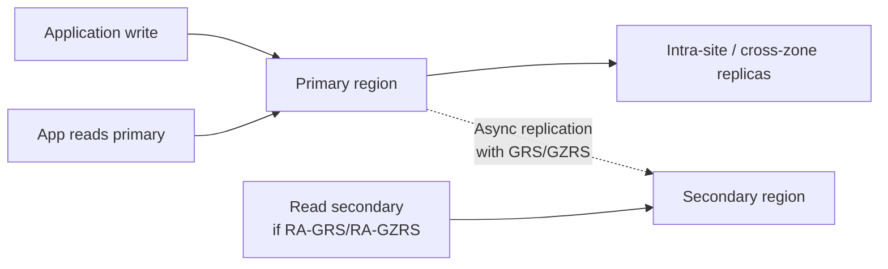
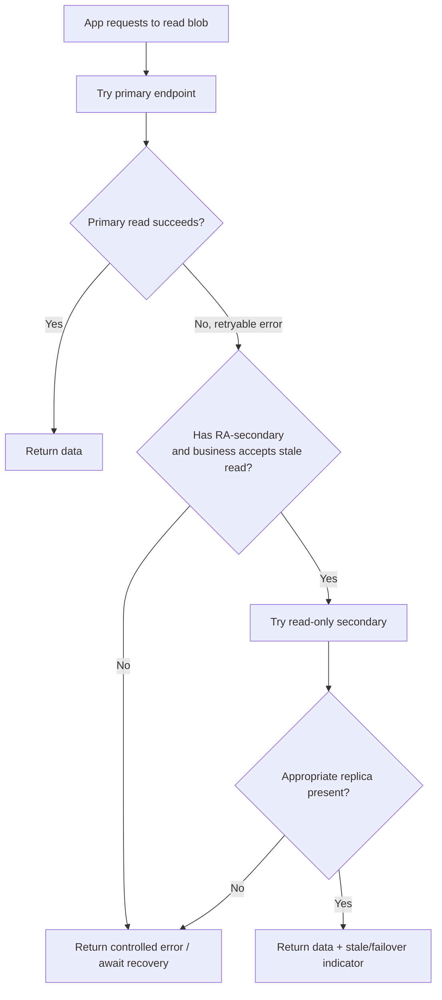
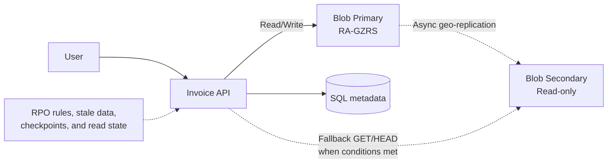
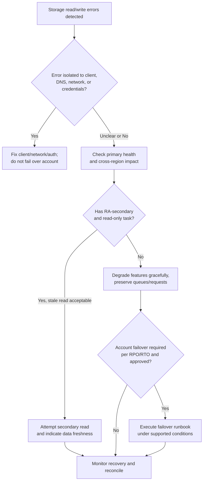

# Designing Data Durability and Read Availability During Outages

When an e-commerce application stores invoices on Azure Blob Storage, there are at least two distinct questions: **will the written data still exist after a failure?** and **can the application still read that data right while the service is experiencing an outage?** A system with multiple data replicas does not necessarily continue serving read requests when an entire region goes down; conversely, a fallback read endpoint may be operational yet not have received all of the latest writes.

This lesson belongs to the **Azure Storage Fundamentals** chapter of the **CLOUD_PROVIDERS_AZURE** module. The module explores Microsoft Azure from subscriptions, resource groups, and Entra ID to virtual networks, compute, storage, and data; it also guides deployment, monitoring, protection, and cost control for application architectures. This lesson centers on Azure Storage to design durability, availability, and read capability across component, availability zone, or full region failures.

After this lesson, you will be able to:

- Distinguish data durability (*durability*), availability (*availability*), read availability during outages, RPO, and RTO.
- Explain LRS, ZRS, GRS, RA-GRS, GZRS, and RA-GZRS, along with the limits of synchronous/asynchronous replication.
- Select a redundancy model based on failure scope and data read requirements.
- Design controlled reads from the secondary endpoint, accepting eventual consistency where appropriate.
- Distinguish **replication** from **backups, versioning, soft delete, and immutability**.
- Build testing approaches, failover transition plans, and operational cost controls.

## 1. Four Concepts to Keep Separate

| Concept | Question to Answer | Invoice Example |
|---|---|---|
| **Durability** | Is successfully written data preserved across hardware/infrastructure faults? | The blob still exists even if a storage device fails |
| **Availability** | Can the service serve requests during the required window? | Does the app receive responses when calling the Blob Storage read API? |
| **RPO — Recovery Point Objective** | What is the maximum acceptable data loss when recovering from a disaster? | The business tolerates losing at most 15 minutes of new writes |
| **RTO — Recovery Time Objective** | What is the maximum acceptable downtime to restore the service? | Restore accessibility within 60 minutes |

RPO and RTO are **targets set by the business**, not automatic guarantees offered by every Azure Storage SKU. A highly durable service can still lose accessibility during a network or regional outage. A secondary-read configuration can improve read continuity during an outage, yet does not guarantee all recently written primary data is present.

### 1.1. RPO and RTO on a Timeline

```text
----- successful writes -----|---- outage ----|----- recovery ---->
                             T0               T1
                    ^
             last data point
             present on recovery replica

Actual RPO: T0 - timestamp of the last recoverable data
Actual RTO: T1 - T0
```

For instance, if the primary region goes down at 10:00 and the secondary only has data up to 09:54, the write gap is **6 minutes**. If the application only reaches the replacement system at 10:35, the outage lasted **35 minutes**. This is a hypothetical example to visualize RPO/RTO, **not an Azure commitment**.

### 1.2. Classify Failure Modes Before Choosing a Solution

- **Storage device/node failure:** local fault where the service should keep preserving and serving data.
- **Availability zone outage:** loss of an independent infrastructure area in a region; requires zone-resilient design.
- **Full region outage:** requires data and serving endpoints in another region, typically with operational switchover.
- **Loss of network connectivity, DNS, or permissions:** data may remain durable while clients cannot reach it.
- **Accidental deletion/modification, ransomware, application bugs:** corrupted data can replicate to every copy; requires version-based or independent recovery layers.

**Principle:** design storage redundancy for infrastructure faults, while recovery from deleted/overwritten data requires additional protection layers.

## 2. How Does Azure Storage Replicate Data?

In Azure Storage, the storage account's **redundancy** choice determines how data is replicated across infrastructure units, availability zones, and/or regions. Common options:

| Type | Replicas in Primary Region | Replicas in Secondary Region | Read from Secondary Before Failover? | Key Characteristics |
|---|---|---|---|---|
| **LRS** — Locally Redundant Storage | Multiple synchronous copies within one storage location in the region | No | No | Protects against local hardware faults; smallest fault boundary |
| **ZRS** — Zone-Redundant Storage | Synchronous replicas across availability zones in the region | No | No | Protects against a supported single-zone outage |
| **GRS** — Geo-Redundant Storage | Locally replicated like LRS | Yes; asynchronous replication to another region | No, unless failover is performed | Increases durability in regional disasters without exposing a default secondary read endpoint |
| **RA-GRS** — Read-Access GRS | Same as GRS | Yes; asynchronous | **Yes** | Allows reading secondary replica, with potential data lag |
| **GZRS** — Geo-Zone-Redundant Storage | Synchronous across zones like ZRS | Yes; asynchronous | No, unless failover is performed | Combines primary zone protection with a backup region |
| **RA-GZRS** — Read-Access GZRS | Same as GZRS | Yes; asynchronous | **Yes** | Combines zone protection, regional backup, and a secondary read endpoint |

With geo-redundant configurations, primary data is typically written under the local replication model first, then copied **asynchronously** to the secondary region. Thus, data reported as written in primary **is not guaranteed to exist** in secondary at the exact same moment.

> Service scope, account kind, region, and conversion paths between redundancy types carry specific support conditions. This table is a foundational model—especially useful for Blob Storage; do not assume all features or options are available for every Azure Files, Queue, Table, or specialized SKU account.

### 2.1. Replica Diagram



**LRS/ZRS** have no geo-replication path in the diagram. **GRS/GZRS** have a geo-replica but normally do not let clients read secondary prior to failover. **RA-GRS/RA-GZRS** add read-only access to the supported secondary endpoint.

### 2.2. Synchronous vs. Asynchronous Replication

**Synchronous replication** within LRS/ZRS boundaries lets Azure acknowledge a write operation once primary durability requirements are satisfied. **Asynchronous replication** from primary to secondary avoids cross-region latency penalties on writes, but introduces the risk that recent data is un-replicated if primary is lost.

If the business requires **RPO of 0 across a total regional loss**, choosing GRS/GZRS alone cannot fulfill that commitment. You must design at the application/data layer with transactional synchronization, multi-target write acknowledgments, or specialized architectures aligned with cost and performance; verify the practical limits of each approach.

## 3. Choosing Redundancy by Failure Scope

Start from the business problem rather than defaulting every resource to the highest SKU.

| Business Requirement | Options to Consider | What Remains Unresolved |
|---|---|---|
| Temporary, easily recreated data; cost priority | LRS | Does not survive zone/region loss like higher options |
| App needs availability zone fault tolerance in one region | ZRS | Full region outages require another strategy |
| Must keep a copy in another region; can tolerate downtime until failover | GRS or GZRS | Secondary cannot be read directly prior to failover |
| Read replicated data even when primary suffers severe errors | RA-GRS or RA-GZRS | Secondary may lag; does not serve writes prior to switchover |
| Want both primary zone protection and secondary geo-read endpoint | RA-GZRS | Still has RPO from async replication and switchover workflow |
| Need recovery when users delete or overwrite data | Soft delete, versioning, backup, immutability | Replication does not replace logical recovery measures |

**Selection example:** an invoicing system wants to stay up when an availability zone fails and still serve older invoices during a regional outage. If the account/region supports it, **RA-GZRS** is worth considering. However, invoices created moments before the outage may not exist on secondary yet; the application must explicitly define how to handle that case.

## 4. Reading Data from Secondary: What Actually Happens?

For Blob Storage using **RA-GRS** or **RA-GZRS**, Azure provides a secondary access point with the `-secondary` suffix. For example:

```text
Primary:
https://stordersdemo.blob.core.windows.net

Read-only secondary:
https://stordersdemo-secondary.blob.core.windows.net
```

These are illustrative endpoints for **Blob**. Endpoints for File, Queue, Table, or other services have distinct naming, read capabilities, and limits; confirm features for the service you use.

### 4.1. Secondary Is Not a Second Primary

- The secondary is **read-only** under normal RA operation prior to failover; apps cannot issue PUT/DELETE there like on primary.
- The geo-replica updates **eventually consistently**, so it can lag behind primary.
- A blob just written successfully to primary may return `404 Not Found` on secondary because replication hasn't caught up.
- An updated or deleted blob may still appear with its **older version/state** on secondary while changes are in flight.
- Having a secondary read endpoint does not automatically mean SDKs and every application will fail over to it when primary errors out. You must configure clients, libraries, retry policies, and business handling appropriately.
- Authentication, network access, firewalls, and DNS must still be designed for the read path. Having an endpoint does not mean a principal has read permissions.

### 4.2. Strongly Consistent Reads or Tolerating Stale Data?

Classify APIs by data freshness requirements:

| Task | Can Read from Potentially Stale Secondary? | Reason |
|---|---|---|
| Viewing marketing images, long-published documents | Usually yes | Data changes rarely and is not tied to immediate transactions |
| Downloading an issued, immutable invoice from yesterday | Yes, if verified as replicated | Business value needs accurate content, not necessarily live primary reads |
| Viewing an invoice issued seconds ago | Needs verification | Secondary may return 404 or an older version |
| Checking inventory to finalize an order | Should not blindly use stale data | Discrepancies can cause overselling |
| Reading payment status before confirming a transaction | Should not without business consistency checks | Can lead to false confirmations or duplicate processing |

**Key principle:** for data requiring immediate read-after-write consistency (*read-your-writes*), do not silently switch to an asynchronous secondary and treat the result as current. If primary fails, the API can inform users that status cannot be temporarily confirmed instead of displaying inaccurate data.

### 4.3. Fallback Read Flow



Applications must distinguish **network/transient errors** from **401/403 permission errors**, **404 due to pending sync**, and **business data errors**. Never fall back to secondary for every status code; a 403 must never be used to bypass security policies. Many Azure Storage SDKs offer supported retry mechanisms and secondary endpoint options; how secondary reads and retry conditions are enabled depends on language, SDK version, and client options.

### 4.4. Last Sync Time and RPO Limits

Azure provides **geo-replication** status for supported storage accounts, including **Last Sync Time** when available. This indicates replication progress to the secondary and helps evaluate what data may have replicated.

Example reasoning:

```text
Primary outage timestamp:        16:00 UTC
Recorded Last Sync Time:         15:52 UTC
Gap at measurement time:         8 minutes
```

This suggests a window of data after the sync timestamp may not have reached secondary. It is **not** proof that every blob after that timestamp is lost or that lag is always exactly eight minutes; operational decisions require cross-checking write logs, IDs/ETags, app checkpoints, and actual replication health. Timestamps must specify clear time zones.

Never treat Last Sync Time as a fixed RPO guarantee for asynchronous geo-replication. Under heavy write bursts, network issues, or regional outages, lag can fluctuate.

## 5. Regional Failover and Write Recovery

**Reading from secondary before failover** and **promoting secondary to primary** are two distinct actions.

- **Secondary reads on RA-GRS/RA-GZRS:** the application only gets read access on secondary while primary remains the write target; read contents may lag.
- **Account failover:** promotes the secondary region to become the storage account's primary via Azure-supported mechanisms. Once complete, the logical primary endpoint routes to the promoted region and apps can resume writes per service capabilities.
- **Microsoft-managed failover:** may be initiated by Microsoft during declared disasters; do not assume it triggers instantaneously or on every brief outage.
- **Customer-managed failover:** administrators can proactively initiate it when the account/redundancy type supports it, requiring sufficient authorization, prerequisite checks, and impact sign-off.

### 5.1. Why Does Failover Require an Operational Decision?

Geo-failover can result in **losing un-replicated writes**. Do not treat it as risk-free simply because GRS is enabled. Assess:

1. Is the connectivity loss scoped to the app, DNS, private endpoint, availability zone, or the entire region?
2. What is the secondary's current replication status and Last Sync Time?
3. What are the business RPO/RTO targets? Is losing the newest writes acceptable?
4. Are dependent services (Azure SQL, Key Vault, queues, APIs, Entra ID/networking) still operational and do they have compatible DR plans?
5. Post-failover, does the app have permissions, DNS, private connectivity, firewalls, and access controls ready in the new region?
6. Who approves, communicates with customers, and performs post-recovery data reconciliation?

During failover, there may be a transition window where endpoints do not serve normally. After failover, review the account's resulting replication model and how to re-establish geo-redundancy per operational documentation/runbooks; do not assume both regions immediately retain their prior roles and redundancy levels.

### 5.2. Do Not Equate Failover with Backup/Restore

If a user accidentally deletes a blob and that deletion replicates, switching regions will **not restore** the blob. Similarly, ransomware-encrypted data or bad overwrites can replicate to the secondary. You need data-level recovery procedures, not just infrastructure failover.

## 6. Protecting Against Logical Errors: Soft Delete, Versioning, Immutability

| Mechanism | Primary Problem Solved | Limits or Notes |
|---|---|---|
| **Blob soft delete** | Recover deleted blobs within a retention period | Does not replace independent backups; configure appropriate retention |
| **Container soft delete** | Recover deleted containers within a configured window | Separate from blob soft delete; must be enabled and tested separately |
| **Blob versioning** | Retains previous versions when a blob is overwritten/modified | Adds capacity cost; supported conditionally by account kind and features |
| **Point-in-time restore** | Restores a set of blobs to an earlier timestamp where supported | Not supported on every account; has platform prerequisites and limits |
| **Immutable storage / WORM** | Prevents edits/deletions for a retention period, fitting compliance needs | Must design retention/legal hold and admin roles carefully; may block early deletion |
| **Independent backup/restore** | Recovers data from copies under DR/retention policies | Verify backup schedules, recovery points, locations, permissions, and restore tests |

These features can interact and carry specific support conditions (for instance, Blob versioning and certain restore capabilities are restricted with hierarchical namespace or specific account kinds). Before enabling, verify workload compatibility and storage/cost impacts.

### 6.1. Why Design Multiple Layers?

Suppose an application stores critical contracts:

- **ZRS or RA-GZRS** protects against certain infrastructure failures.
- **Blob versioning** recovers content prior to overwrites.
- **Soft delete** allows recovery from accidental deletion within a retention window.
- **Immutability** prevents unauthorized alteration of legally retained documents.
- **Backups** or policy-governed independent copies enable recovery when risks exceed routine replication.

You do not need to enable every feature on every container. Classify data, state retention goals, legitimate deletion needs, retention duration, and recovery expectations, then select matching protection levels.

## 7. Real-World Scenario Design: Invoicing Platform

Assume the application consists of:

- Frontend and API on App Service in the primary region.
- Blob Storage holding invoice PDFs.
- Azure SQL storing invoice metadata, ownership, and payment status.
- API managed identity reading/writing Blob via Entra ID and Azure RBAC.
- Application Insights/Log Analytics monitoring.

**Illustrative business requirements:**

- Issued invoices must be stored long-term without arbitrary modification.
- An availability zone outage must not lose invoice data.
- When the entire primary region is disrupted, customers can still download invoices **that have finished replicating**, even if issuing new invoices temporarily pauses.
- A newly issued invoice not yet on secondary must not be reported as "permanently nonexistent."

### 7.1. Solution Diagram



This design assumes the region and service support **RA-GZRS**. Note that Blob Storage and Azure SQL **do not automatically form a cross-region synchronous transaction** simply because Blob has geo-replication. DR plans for SQL, API, secrets, DNS, and networking must be designed separately yet coordinated.

### 7.2. Read API Classification

| Business Endpoint | Policy When Primary Is Healthy | When Primary Is Disrupted |
|---|---|---|
| `GET /invoices/{id}/pdf` for older replicated invoices | Read Blob primary | Can read secondary if version/checkpoint matches |
| `GET /invoices/{id}/pdf` for newly created invoices | Read Blob primary | Report "temporarily unable to verify new data" if absent on secondary |
| `POST /invoices` create new invoice | Write primary + metadata per workflow | Pause or use separately designed DR write mechanism |
| `GET /invoices/{id}/status` | Read authoritative app state source | Do not claim "paid/issued" from stale metadata unless consistency conditions are met |

When switching to secondary, return clear status to the client or tag telemetry indicating data may be stale, especially in UIs showing "last updated." Never expose URLs containing SAS/keys during source fallback.

### 7.3. Designing a Freshness Verification Mechanism

For issued immutable documents, the application can:

1. Upon successful upload, record `invoice_id`, `blob_name`, `ETag/version_id` (if supported), and issuance status in metadata.
2. Track replication progress via supported mechanisms/telemetry and allow fallback only for documents the business permits reading from secondary.
3. When using secondary, verify the retrieved blob has the **expected version**/business attributes; do not treat HTTP 200 alone as proof that all metadata is synchronized.
4. If secondary returns `404` while primary previously held the data, treat it as **undetermined/syncing** where appropriate; do not automatically delete the invoice record from the database.
5. During recovery, compare discrepancies across systems and run reconciliation to avoid duplicate invoice issuance or double payment requests.

Azure Storage provides ETags/conditional requests for update checks and optimistic concurrency. Combining ETags/version IDs with replication, SDKs, and business logic must be tested; do not assume a primary "write succeeded" response confirms the secondary replica is ready.

## 8. Hands-On: Inspecting Azure Storage Configuration with CLI

The following commands are **read-only operations** used to gather evidence on redundancy and Blob configuration. Replace example names with real accounts and sign in via Azure CLI with resource read permissions. Do not alter SKUs or trigger failover during this check.

Confirm the active subscription:

```bash
az account show \
  --query "{subscription:name,subscriptionId:id,tenant:tenantId}" \
  -o table
```

Inspect account kind, SKU, primary/secondary regions, and location status:

```bash
RG="rg-orders-prod"
ACCOUNT="stordersdemo"

az storage account show \
  --resource-group "$RG" \
  --name "$ACCOUNT" \
  --query "{name:name,kind:kind,sku:sku.name,primaryLocation:primaryLocation,secondaryLocation:secondaryLocation,primaryStatus:statusOfPrimary,secondaryStatus:statusOfSecondary}" \
  -o json
```

Read `sku.name` to distinguish `Standard_LRS`, `Standard_ZRS`, `Standard_GRS`, `Standard_RAGRS`, `Standard_GZRS`, and `Standard_RAGZRS` where supported. If `secondaryLocation` has no value, do not assume the account has a geo-replica.

For geo-replicated accounts and supported Azure CLI/API versions, inspect replication statistics:

```bash
az storage account show \
  --resource-group "$RG" \
  --name "$ACCOUNT" \
  --expand geoReplicationStats \
  --query "geoReplicationStats" \
  -o json
```

In geo-replication statistics, note `status` and `lastSyncTime` when present. Some accounts, SKUs, states, or API versions may not return these fields; do not interpret missing data as successful replication.

If the account supports Blob service properties, inspect logical protection settings:

```bash
az storage account blob-service-properties show \
  --resource-group "$RG" \
  --account-name "$ACCOUNT" \
  --query "{deleteRetentionPolicy:deleteRetentionPolicy,containerDeleteRetentionPolicy:containerDeleteRetentionPolicy,isVersioningEnabled:isVersioningEnabled}" \
  -o json
```

The goal is collecting **configuration**, not verifying restore capability. To confirm data is recoverable, conduct scoped read/restore drills with proper approvals.

### 8.1. Verifying the Secondary Read Endpoint

In an account with RA-geo redundancy, an application can query the secondary Blob endpoint:

```text
GET https://stordersdemo-secondary.blob.core.windows.net/invoices/invoice-001.pdf
Authorization: Bearer <access-token-for-Azure-Storage>
```

The example depicts an **HTTP request**, not a literal shell command. Azure Storage returns data only when the token/credential is valid and access permissions plus network policies allow it. A request may receive `404` if the blob has not replicated yet; a `403` may stem from permissions, firewall, or credentials and should not automatically be treated as data loss.

Test both while primary is healthy and in an approved fault-simulation environment. Never place real tokens in documentation, source code, publicly shared URLs, or logs.

## 9. Building an Outage Response Runbook

### 9.1. Detection and Triage

Collect:

- Alerts and error timestamps in API/Storage, 5xx rates, timeouts, latency, and authentication errors.
- Account health, primary/secondary locations, geo-replication status, and Last Sync Time if available.
- DNS, private endpoint, firewall, and managed identity/role assignment errors.
- In-flight operations: uploads, deletes, background jobs, and SQL metadata transactions.

First distinguish **application connectivity loss** from **actual Storage region unavailability**. Failing over an account when only a DNS resolver is broken can cause worse damage than the initial incident.

### 9.2. Deciding the Response Path



When using **customer-managed failover**, the runbook needs explicit approvals, designated owners, trigger criteria, un-replicated data impact notes, cross-system coordination steps, and verification checks. Never treat failover as an automatic SDK retry strategy.

### 9.3. Minimum Recovery Steps

1. Pinpoint **where the failure lies**: client, network, zone, primary region, or another component.
2. Communicate impact scope: read/write capabilities and data lists that may not yet exist on secondary.
3. Where appropriate, route **permitted read requests** to secondary; never route write requests to a read-only endpoint.
4. If account failover is needed, verify RPO/RTO, Last Sync Time, account type, service conditions, and approvals.
5. After recovery, run health checks across APIs, DNS, IAM, private connectivity, and read/write functions.
6. Reconcile invoice IDs, metadata, ETags/versions, and background jobs; handle missing/duplicate documents per business procedure.
7. Restore post-failover redundancy per design, update dashboards/runbooks, and conduct a post-incident review.

## 10. Monitoring and Measurement

| Metric / Signal | Purpose |
|---|---|
| Storage/API availability, success rate, 5xx, latency | Detect accessibility degradation |
| Timeouts, retry counts, circuit-breaker state | See if clients face transient or sustained failures |
| Primary/secondary endpoint read success | Verify read health per endpoint |
| Geo-replication status / Last Sync Time when available | Observe replica lag risks |
| `404` rate on secondary for blobs already on primary | Detect un-replicated data or path/naming bugs |
| Blob versions, restore tests, backup recovery points | Verify recovery capability against logical faults |
| Read-fallback frequency/count, failover duration | Measure real RTO and user-experience impact |
| Storage, transaction, data transfer, and replica costs | Control costs of the chosen redundancy model |

Azure Monitor, Storage metrics, diagnostic logs, Application Insights, and alerting rules can assist depending on configuration. Never rely solely on a service's "Healthy" badge to conclude users can read data; run an authorized, safely scoped **synthetic read** to validate the end-to-end flow.

## 11. Cost, Security, and Operational Limits

- **Broader redundancy generally costs more for storage.** Secondary reads and cross-region transactions/egress can generate additional charges; check rate cards by region/SKU and real workload.
- **Keeping multiple versions and soft delete increases capacity.** Design retention/lifecycle management aligned with retention obligations to avoid keeping unnecessary data.
- **Secondary endpoints do not relax security requirements.** Enforce HTTPS, Entra ID/data roles, restricted Shared Key/SAS, firewalls/private connectivity where supported, and access monitoring.
- **Private networking, DNS, and identity must work on the fallback path.** Secondary read failures may stem from network/permission misconfigurations rather than replication.
- **Services have differing support levels.** Do not take a Blob Storage table and force it verbatim onto Azure Files or Managed Disks. Verify service type, account kind, region, geo-replication support, and failover procedures.
- **Applications must handle consistency.** GRS/RA-GRS do not provide synchronous distributed transactions across Blob, SQL, Queue, and payment systems.

### 11.1. Pre-Production Design Checklist

- [ ] Identified which data is immutable and which requires immediate read-after-write.
- [ ] Documented failure scenarios: hardware, zone, region, accidental delete, overwrite, network outage.
- [ ] Defined RPO and RTO per business flow, not just a single number for the entire system.
- [ ] Selected redundancy actually supported by the account/region/service; verified configuration.
- [ ] Checked whether secondary reads are needed and whether eventual consistency is acceptable.
- [ ] Designed access control, firewall, DNS, and private endpoints for both primary and secondary paths where used.
- [ ] Enabled appropriate logical-error protection/backups; rehearsed restores.
- [ ] Authored runbook: who decides failover, criteria, and reconciliation steps.
- [ ] Rehearsed controlled failover/failback and measured actual RTO/RPO.
- [ ] Configured alerts, dashboards, owners, and cost forecasts by SKU/volume.

## 12. Self-Check Questions

1. Why can a Storage Account with high data durability still experience read-serving outages?
2. How do LRS and ZRS differ in replication scope? Does either automatically protect against an entire region outage?
3. How do GRS and RA-GRS differ regarding secondary read capability **before** failover?
4. Does RA-GZRS guarantee the newest write on primary is immediately available on secondary? Explain asynchronous replication.
5. An API receives `404` from secondary for a blob just written successfully to primary. Can you conclude the blob was deleted?
6. If primary fails, why should an application fall back to secondary only for endpoints that tolerate stale data?
7. Distinguish reading secondary while primary is unavailable from executing an account failover to restore write capability in the backup region.
8. Why can geo-replication not replace blob versioning, soft delete, or backups when users accidentally delete data?
9. After failover, why must Blob data be reconciled against Azure SQL metadata and payment operations?
10. Name three signals that help distinguish network/DNS/credential errors from storage infrastructure outages.

## Conclusion

Designing Azure Storage requires separating **data durability**, **accessibility**, and **data freshness**. LRS protects against local faults; ZRS spreads replicas across zones; GRS/GZRS add asynchronous replicas in another region; RA-GRS/RA-GZRS further allow **secondary reads** within eventual-consistency limits. A secondary read endpoint neither replaces a writable primary nor implies all recent data has replicated. Failover is a recovery decision carrying RPO/RTO risks that must be approved and tested. Pair redundancy choices with soft delete, versioning, immutability, backups, data permissions, network controls, and reconciliation runbooks so your Azure system stays both durable and appropriately readable during outages.
