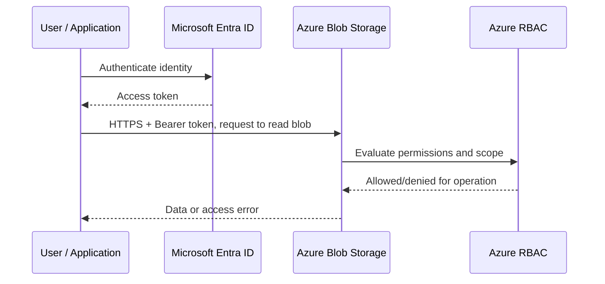

# Authorizing Azure Storage with Microsoft Entra ID

An application on Azure might store images in Blob Storage, read messages from Azure Queue Storage, or use a file share for internal tasks. A simple yet risky approach is placing a **storage account key** in the application configuration: keys usually grant very broad data access, and sharing a key makes it difficult to tell who performed an operation. **Microsoft Entra ID** combined with **Azure Role-Based Access Control (Azure RBAC)** lets you grant permissions to a specific identity, at the right scope, aligned with job requirements.

In the **CLOUD_PROVIDERS_AZURE** module, you explore Microsoft Azure from subscriptions, resource groups, and Microsoft Entra ID to virtual networks, compute, storage, data, monitoring, security, and cost. This lesson belongs to the **Azure Storage Fundamentals** chapter and focuses on authorizing Storage data access using Microsoft Entra ID identities, how to implement it for users and applications, and the limitations to know when moving to production.

## 1. Learning Objectives

After this lesson, you will be able to:

- Explain the difference between **authentication with Microsoft Entra ID** and **authorization with Azure RBAC**.
- Distinguish the **management plane** from the **data plane** in Azure Storage.
- Select appropriate data-access roles for Azure Blob Storage, Queue Storage, Table Storage, and relevant Azure Files scenarios.
- Assign roles at the right scope—storage account or blob container—and understand role inheritance.
- Test access via the Azure portal and Azure CLI using `--auth-mode login`.
- Use **managed identities** and the Azure SDK so applications access blobs without storing account keys.
- Recognize the impact of Shared Key, SAS, private networking, ACLs, and `401`/`403` errors.
- Design least-privilege permissions, verify effective access, and troubleshoot access failures.

## 2. Two Separate Steps: Authentication and Authorization

**Authentication** answers the question: *Who is the identity sending the request?* A user or application obtains a token from Microsoft Entra ID after authenticating via an appropriate method.

**Authorization** answers the question: *Which actions on which data is that identity allowed to perform?* For Storage services that support Entra ID integration, Azure Storage evaluates claims in the token alongside role assignments and applicable access controls for the request.

For example: a user named Lan signs into the Azure portal successfully. Lan holds the Azure RBAC **Reader** role on the storage account, so she can view account properties, yet viewing file contents inside a blob container can still be denied because Lan has not been assigned a data role such as **Storage Blob Data Reader**.



The diagram illustrates a logical relationship. The service may use synchronized or cached authorization information rather than sending a live query to the RBAC system for every single request. **Holding a valid token does not mean having permission to read/write all Storage data.**

### Identities That Can Be Granted Access

| Principal | Example | Suitable Scenario |
|---|---|---|
| User | Operations engineer signed into Azure portal/CLI | Investigating incidents, reading data per job role |
| Microsoft Entra group | `grp-storage-auditors` | Granting the same role to multiple people by group |
| Service principal | Identity of a registered application | System integrations or running apps where managed identity is unsupported |
| Managed identity | Azure-managed identity for VMs, App Service, Functions | Azure-hosted apps accessing Storage without storing passwords/service principal secrets |

Managed identities include **system-assigned** (lifecycle tied to the resource) and **user-assigned** (standalone identity resource attachable to multiple workloads). Both can receive Azure RBAC assignments at an appropriate Storage scope. Assign roles to the **principal/object ID of the managed identity**, not based on the application's hostname or IP.

## 3. Distinguishing the Management Plane and Data Plane

Azure Storage has two categories of operations requiring distinct permissions:

- **Management plane (control plane):** creating/deleting storage accounts, viewing configuration, enabling private networking, adjusting redundancy, configuring lifecycle rules, or changing account settings via Azure Resource Manager.
- **Data plane:** reading/writing/deleting blobs, sending/receiving queue messages, querying Table entities, or accessing file contents in service-supported models.

| Task | Permission Layer to Check | Role Example |
|---|---|---|
| View storage account properties | Management-plane Azure RBAC | Reader |
| Create or modify storage account configuration | Management-plane Azure RBAC | Contributor at an appropriate scope |
| Read-only blob access via Microsoft Entra authorization | Blob data-plane Azure RBAC | Storage Blob Data Reader |
| Upload, modify, or delete blobs | Blob data-plane Azure RBAC | Storage Blob Data Contributor |
| Send queue messages | Queue data-plane Azure RBAC | Storage Queue Data Message Sender |
| Read table entities | Table data-plane Azure RBAC | Storage Table Data Reader |

**General-purpose Azure RBAC roles such as Owner, Contributor, and Reader on a storage account do not automatically grant `DataActions` for reading/writing blobs via Microsoft Entra authorization.** However, some management-plane roles include permissions for operations like `listKeys`. If a user can retrieve an account key and Shared Key remains enabled, they could use the key to access data with broader privileges than their data role. Therefore, the absence of Blob Data Reader should not be treated as proof that a user has zero paths to access data.

### Role Definitions and Permission Semantics

An Azure RBAC role definition contains action groups:

- `Actions` / `NotActions` for **management-plane** operations.
- `DataActions` / `NotDataActions` for supported **data-plane** operations.

Azure RBAC uses a **role assignment** combining:

1. **Security principal** — who gets the permission.
2. **Role definition** — what they can do.
3. **Scope** — where the permission takes effect.

Custom roles can be created when built-in roles do not satisfy least privilege; inspect the actual `DataActions` rather than inferring permissions from the role name alone.

## 4. Common Data Roles per Storage Service

### 4.1. Azure Blob Storage

| Role | Typical Data Permissions | Scenario |
|---|---|---|
| **Storage Blob Data Reader** | Read/list blobs within assigned scope | Apps downloading files or staff inspecting data |
| **Storage Blob Data Contributor** | Read, create, update, delete blobs per role permissions | Apps processing and uploading files |
| **Storage Blob Data Owner** | Elevated Blob data rights plus POSIX ACL management in supported contexts | Data administrators genuinely needing to modify ACLs |

The name **Storage Blob Data Owner** is not equivalent to **Azure RBAC Owner** on a subscription. The data role pertains primarily to blobs and certain ACL administration tasks; **assigning Azure RBAC roles to others** still requires the appropriate role-assignment management permissions.

### 4.2. Azure Queue Storage

Relevant roles include **Storage Queue Data Reader**, **Storage Queue Data Contributor**, **Storage Queue Data Message Sender**, and **Storage Queue Data Message Processor**.

For example, an app that only pushes messages onto a queue should consider **Storage Queue Data Message Sender**; a worker that receives and processes messages should consider **Storage Queue Data Message Processor**. There is no need to grant Contributor across the whole storage account if the task only needs specialized message operations.

### 4.3. Azure Table Storage

Table Storage includes roles such as **Storage Table Data Reader** and **Storage Table Data Contributor** for accessing Table entities under supported Microsoft Entra authorization models. Check the Table documentation and SDK/API before choosing the authentication mechanism and actual scope.

### 4.4. Azure Files: A Model Requiring Separate Verification

For **Azure Files over SMB**, identity-based authorization typically requires:

1. Configuring an Azure Files-supported **identity-based authentication** method (e.g., an appropriate Kerberos/identity source for the environment).
2. Granting **share-level permissions** via an appropriate role, such as **Storage File Data SMB Share Reader** or **Storage File Data SMB Share Contributor**.
3. Checking **NTFS ACLs** on directories and files, along with network/SMB connectivity prerequisites.

Assigning Blob Data Reader alone **does not grant access to an SMB file share**. Azure Files supports different authentication capabilities across SMB, REST API, and NFS; do not mechanically apply the Blob OAuth flow to every protocol.

## 5. Scope: Where to Assign Permissions and How Inheritance Works

In Azure RBAC, permissions assigned at a parent scope generally apply to child resources. For a storage account and blob container, visualize it as:

```text
Management group
  └── Subscription
       └── Resource group
            └── Storage account: stordersprod01
                 └── Blob container: invoices
                      └── Blob: 2026/11/receipt.pdf
```

| Role Assignment Scope | Effect on Blob Storage |
|---|---|
| Subscription | Covers storage accounts belonging to that subscription |
| Resource group | Covers all storage accounts in the resource group |
| Storage account | Covers containers and blobs inside the account |
| Blob container | Data permissions apply to the selected container |

**Example:** an app only needs to read documents in the `invoices` container. Assigning **Storage Blob Data Reader** at the **container** level is narrower in scope than assigning it on the entire storage account. Assigning roles at the subscription level can inadvertently expose data across many unrelated resources.

**Key point:** Blob Azure RBAC role assignments are typically scoped at the **storage account or container level**; you cannot simply pick an arbitrary individual blob or folder path inside a flat container and expect an RBAC scope for it. If you need granular directory/file-level controls in Azure Data Lake Storage Gen2, evaluate **hierarchical namespace and POSIX-style ACLs**; ACLs carry their own rules and prerequisites.

### When Using Hierarchical Namespace (Azure Data Lake Storage Gen2)

On a storage account with **hierarchical namespace (HNS)** enabled, ACLs can govern access at the directory/file level when applications use supported authentication and APIs. Data-plane RBAC permissions are evaluated **first**; if RBAC already permits the operation, ACLs do not act as a deny layer revoking that RBAC permission. If RBAC does not grant sufficient permission, ACLs may be evaluated to authorize access according to HNS rules.

Therefore, if you want ACLs to govern reads on a specific directory, avoid granting overly broad **Storage Blob Data Contributor** at the storage account level to that same identity. ACL-based access also typically requires traverse (execute) permissions on parent directories along the path hierarchy.

## 6. Hands-On: Authorizing Blob Access via the Azure Portal

**Context:** auditors need to read PDF files in the `invoices` container of storage account `stordersprod01`, without being allowed to upload, modify, or delete files. The organization created a Microsoft Entra group `grp-storage-auditors`.

### Step 1: Prepare the Resource and Group

1. Sign in to the [Azure portal](https://portal.azure.com/) with an account permitted to view resources.
2. Confirm the right **tenant, subscription, and resource group**.
3. Open storage account `stordersprod01`, go to **Data storage → Containers**, and select `invoices`.
4. Confirm the members of `grp-storage-auditors` in Microsoft Entra ID.
5. Confirm the administrator assigning the role has permission to create role assignments at that scope, such as **Owner**, **User Access Administrator**, or **Role Based Access Control Administrator** per organizational delegation rules.

**Do not attempt role assignment using an account that only holds standard Reader or Contributor without role-assignment write permissions.** Someone allowed to edit Storage configuration is not automatically allowed to grant IAM permissions to others.

### Step 2: Assign the Role at the Container

1. Inside the `invoices` container blade, open **Access control (IAM)** (or navigate to IAM at the supported scope from the storage account).
2. Click **Add role assignment**.
3. Select the **Storage Blob Data Reader** role.
4. Select `grp-storage-auditors` as the member, checking the exact group object ID if multiple groups share similar display names.
5. Review **Scope**, **Role**, **Member**, and any applicable conditions shown by the portal.
6. Confirm creation of the role assignment.

New role assignments can take time to take effect on the data plane due to propagation and caching. Avoid concluding it failed immediately after saving.

### Step 3: Verify Effective Access

1. Using a test account that is a valid member of the group, sign back in or refresh sessions/tokens as needed.
2. Attempt to **list and read blobs** in `invoices` using Microsoft Entra authorization.
3. Attempt to upload/delete in a test environment if permitted; the Reader role should deny these write actions.
4. Attempt to read another container without a role assignment to confirm permission boundaries, provided the identity has no other inherited roles.
5. Check Access control (IAM) and relevant logs if results differ from expectations.

**Azure portal note:** to navigate from a storage account down to a container in the portal, users often need **management-plane** read access such as Reader in addition to the data role. If a user holds a data-plane role yet the portal blocks browsing the resource, check ARM read permissions and the selected authentication method. Tools calling the Blob endpoint directly with OAuth can succeed with the right data-plane role without needing portal navigation permissions.

## 7. Azure CLI Example: Creating a Role Assignment and Reading Blobs by Identity

The example uses **Bash/Azure Cloud Shell**. `<...>` values are placeholders; replace them with details for the environment you manage. Commands that create role assignments modify permissions in Azure, so run them only when authorized.

### Step 1: Verify Tenant and Subscription

```bash
az login
az account set --subscription "<subscription-id>"
az account show --query "{tenant:tenantId,subscription:id}" --output table
```

### Step 2: Identify the Storage Account and Container Scope

```bash
RESOURCE_GROUP="rg-storage-prod"
STORAGE_ACCOUNT="stordersprod01"
CONTAINER="invoices"

# Retrieve actual ID from Azure Resource Manager
STORAGE_ID=$(az storage account show \
  --resource-group "$RESOURCE_GROUP" \
  --name "$STORAGE_ACCOUNT" \
  --query id --output tsv)

# Blob container management scope in Azure RBAC
CONTAINER_SCOPE="$STORAGE_ID/blobServices/default/containers/$CONTAINER"

echo "$CONTAINER_SCOPE"
```

This scope path represents the blob container's resource ID, **not** the `https://...blob.core.windows.net` data URL. If you lack permission to view the storage account or the account/container name is wrong, fix that before continuing.

### Step 3: Assign Read Permission to the Microsoft Entra Group

Assume you have the **object ID** of `grp-storage-auditors`. Using the object ID avoids ambiguity with duplicate display names:

```bash
GROUP_OBJECT_ID="<entra-group-object-id>"

az role assignment create \
  --assignee-object-id "$GROUP_OBJECT_ID" \
  --assignee-principal-type Group \
  --role "Storage Blob Data Reader" \
  --scope "$CONTAINER_SCOPE"

# View direct and inherited role assignments at the container scope
az role assignment list \
  --scope "$CONTAINER_SCOPE" \
  --include-inherited \
  --output table
```

The user running `az role assignment create` must hold permission to manage role assignments, not merely Blob data read/write rights. The role assignment targets the group; maintaining group membership is handled separately in Microsoft Entra ID.

### Step 4: Read Blobs Using Microsoft Entra ID

Sign in to the CLI with the authorized account, then pass **`--auth-mode login`** so the CLI uses Microsoft Entra credentials instead of automatically fetching an account key:

```bash
az login
az account set --subscription "<subscription-id>"

az storage blob list \
  --account-name "stordersprod01" \
  --container-name "invoices" \
  --auth-mode login \
  --output table

# Run only when blob guide.pdf actually exists and read access is granted
az storage blob download \
  --account-name "stordersprod01" \
  --container-name "invoices" \
  --name "guide.pdf" \
  --file "./guide.pdf" \
  --auth-mode login
```

If the CLI holds multiple accounts or tenants, verify that the active signed-in identity is indeed the authorized principal. A valid role assignment will not help if the CLI acquires a token for a different user.

### Step 5: Verify Write Permission If Needed

An application uploading files needs a write role such as **Storage Blob Data Contributor** at an appropriate scope. The example below is a **data-write** operation that should only be run in a lab container:

```bash
# Prepare ./sample.txt beforehand on the machine running the command
az storage blob upload \
  --account-name "<storage-account-name>" \
  --container-name "<lab-container-name>" \
  --name "sample.txt" \
  --file "./sample.txt" \
  --auth-mode login \
  --overwrite false
```

When testing *least privilege*, use a dedicated container and sample file so production data is never modified.

## 8. Accessing Blobs from Applications via Managed Identity

**Problem:** an API running on Azure App Service needs to download images from the `product-images` container. Storing an account key in app settings risks leaking it through logs, configuration copies, or pipelines. Using a **managed identity**, Azure manages the workload's identity and the application obtains tokens without storing passwords or service principal secrets.

### Implementation Workflow

1. Enable a **System assigned managed identity** on App Service (or attach a user-assigned managed identity per design).
2. Note the **principal/object ID** of the managed identity.
3. On the storage account or `product-images` container, assign **Storage Blob Data Reader** to that principal.
4. Ensure Storage firewalls, private endpoints, and DNS allow App Service to reach the Blob endpoint under the active architecture.
5. In the application, use the Azure Identity SDK to acquire tokens and the Storage SDK to read blobs.
6. Test in the real runtime environment, because a developer's local identity differs from the managed identity on Azure.

### Java Example with the Azure SDK

This snippet illustrates reading text blob contents using the **`azure-identity`** and **`azure-storage-blob`** libraries. Add the corresponding dependencies to your application build and select an organizationally supported SDK version.

```java
import com.azure.identity.DefaultAzureCredential;
import com.azure.identity.DefaultAzureCredentialBuilder;
import com.azure.storage.blob.BlobClient;
import com.azure.storage.blob.BlobServiceClient;
import com.azure.storage.blob.BlobServiceClientBuilder;

public class ReadBlobWithEntraId {
    public static void main(String[] args) {
        String storageAccount = "stordersprod01";
        String containerName = "product-images";
        String blobName = "readme.txt";

        DefaultAzureCredential credential =
                new DefaultAzureCredentialBuilder().build();

        BlobServiceClient blobServiceClient = new BlobServiceClientBuilder()
                .endpoint("https://" + storageAccount + ".blob.core.windows.net/")
                .credential(credential)
                .buildClient();

        BlobClient blobClient = blobServiceClient
                .getBlobContainerClient(containerName)
                .getBlobClient(blobName);

        String content = blobClient.downloadContent().toString();
        System.out.println(content);
    }
}
```

**Notes on the example:** `readme.txt` must already exist as text data; this is not how binary/image files are handled in production. Never print sensitive data to logs. `DefaultAzureCredential` can pick up a developer's local identity when running locally and a managed identity when running on Azure; the credential chain depends on environment/SDK configuration, so verify which principal is actually used. With a user-assigned managed identity, configure the specific client ID in the SDK to avoid picking the wrong identity.

### Why Is Managed Identity Better Than Manually Stored Credentials?

- Eliminates embedding storage account keys or long-lived client secrets in source code.
- Grants exact roles and scopes per application.
- Permissions can be revoked by removing the role assignment, with clean lifecycle management.
- Easier to audit because each workload has a distinct principal.

Managed identity **does not solve every security problem**: if an attacker achieves code execution inside the app, they can abuse whatever permissions that identity holds. You still need tight permissions, network protection, app patching, and access monitoring.

## 9. Other Access Mechanisms: Shared Key, SAS, Anonymous Access

Microsoft Entra ID is not the only way to reach Azure Storage data. Understand the remaining mechanisms to assess effective access.

| Mechanism | Authentication/Authorization Method | Risks or Limitations |
|---|---|---|
| **Microsoft Entra ID + Azure RBAC** | OAuth tokens and data-plane roles at the target scope | Requires supported identity, roles, networking, and API/SDK |
| **Shared Key** | Uses storage account key to sign requests | Broad privileges, hard to attribute actions to individuals; key must be tightly protected |
| **Service SAS / Account SAS** | SAS token signed with an account key | Requires managing scope, permissions, expiry, and protecting the signing key |
| **User delegation SAS (Blob)** | SAS signed with a user delegation key obtained via Microsoft Entra ID | Time-limited, requires permission to request a delegation key and obeys service limits |
| **Anonymous blob read** | Public reads if allowed by account/container policy | Requires no Entra token; must be disabled for non-public data |

**User delegation SAS** is useful when an app must issue time-limited Blob access URLs without sharing an account key. However, permission to generate a user delegation key has its own requirements and typically involves a **storage-account-level scope**. Rights to create a SAS, use a SAS, and the permission/lifetime limits of the SAS must be evaluated separately.

### Should You Disable Shared Key?

For Blob/Queue workloads fully migrated to Entra ID and compatible methods, organizations can consider configuring **Shared Key authorization to be disallowed** on the storage account. Doing so can break existing apps or account-key-signed SAS tokens; inventory dependencies, test thoroughly, and prepare a rollback plan before enforcing it. Impact and support for this setting vary across services/protocols; do not generalize all Blob/Queue behavior to Azure Files or Table.

**Never store account keys, active SAS URLs, access tokens, or secrets in Git, logs, screenshots, or public tickets.** A SAS URL is effectively a credential within its granted scope and lifetime.

## 10. Data Permissions Do Not Replace Network Controls

Even when a principal holds **Storage Blob Data Reader**, requests can still fail if the storage account blocks connections from the current source.

Layers to inspect:

- **Public network access:** does the storage account allow or deny traffic via the public endpoint?
- **Storage firewall/network rules:** is the source IP, VNet, or network rule within the allowed set?
- **Private endpoint:** does the application route through the right VNet, routing tables, and private DNS zone?
- **DNS:** does `<account>.blob.core.windows.net` resolve properly for the public/private endpoint model?
- **TLS/HTTPS:** is the client using compliant HTTPS/TLS?
- **Role assignment:** does the principal have the right `DataActions` at the container/account scope?
- **Data type:** Azure Files SMB and ADLS Gen2 ACLs impose their own additional prerequisites.

Never resolve a 403 error by immediately turning on **Allow access from all networks** or granting subscription-wide Owner. Isolate whether the failure comes from **authentication**, **authorization**, **firewall/DNS**, or the **API operation** before modifying configuration.

## 11. Troubleshooting Common Errors with Microsoft Entra ID

| Symptom | Possible Cause | How to Resolve |
|---|---|---|
| HTTP `401 Unauthorized` or `AuthenticationFailed` | Missing token, wrong audience, expired, wrong tenant, or wrong identity | Check token source, endpoint, tenant, expiration, and SDK |
| HTTP `403` with `AuthorizationPermissionMismatch` | Role/scope does not permit the data action | Inspect role `DataActions`, principal, scope, and inherited roles |
| HTTP `403` due to firewall or network restriction | Connection source is not permitted | Check public access, private endpoints, DNS, firewall, and routing |
| Portal shows the account yet cannot view blobs | Holds ARM read access without a data role; portal uses another auth mode | Grant Blob Data Reader at the right scope and check `Authentication method` |
| CLI unexpectedly asks for account key or hits `listKeys` error | Did not select login auth or tool fell back to key auth | Pass `--auth-mode login`, verify the signed-in account |
| Role just assigned yet still returns 403 | Role assignment not yet propagated or client holds stale token/cache | Wait for propagation, re-authenticate/refresh token, and retry |
| Managed identity works locally, fails on Azure | Local principal differs from Azure managed identity | Check principalId, role assigned to the exact managed identity, and SDK settings |
| ADLS Gen2 denied on a subpath | Missing ACL/traverse permission or missing appropriate data role | Check RBAC first, then ACLs across every parent directory |
| Azure Files SMB denied | Missing share-level RBAC, NTFS ACL, Kerberos, or connectivity path | Check Azure Files identity model and each permission layer |
| Receives `404 BlobNotFound` | Container/blob name does not exist, wrong casing, or another control | Verify exact resource names and check error details/logs before concluding |

**Diagnosis should start with four questions:**

1. **Who?** Which user/group/service principal/managed identity is actually acquiring the token? Which object ID and tenant?
2. **Doing what?** Read, list, upload, delete, set ACL, or manage the account? Is the action management plane or data plane?
3. **Where?** Which storage account, container, queue, table, file share, or HNS path? At which scope was the role assigned?
4. **Over which path?** Public endpoint, firewall, private endpoint, DNS, SDK/API, and which authentication mechanism?

When escalating for support, record the **UTC timestamp**, status/error code, request ID, endpoint, principal (without credentials), and reproduction steps. Logs should never include customer data or bearer tokens.

## 12. Secure Authorization Principles in Production

**Apply least privilege by action and scope.** An app reading images only needs Storage Blob Data Reader on the images container; an app receiving messages only needs the corresponding queue role. Avoid granting Data Contributor, Data Owner, or subscription-wide permissions unnecessarily.

**Prefer groups and managed identities.** Assign permissions to staff groups by job function; assign permissions to each workload's managed identity. For prod/dev environments, use separate principals and scopes to prevent cross-environment access.

**Restrict role-assignment privileges.** Only approved personnel with role-assignment management permissions should add new roles. Azure RBAC Owner or equivalent roles should be protected by identity policies and PIM where feasible.

**Audit remaining keys and SAS tokens.** Identities holding `listKeys` or broad SAS-issuing capability can create a data-access path outside direct RBAC roles. Track and rotate keys on schedule without breaking key-dependent apps before assessing impact.

**Enable auditing and activity tracking.** Azure Activity Log records management-plane changes; data-plane access logs must be configured separately according to Storage/Azure Monitor capabilities and cost. Do not assume Activity Log captures every blob read. Choose retention, workspaces, alerts, and investigation workflows per security requirements.

**Combine defense-in-depth layers.** Pair Azure RBAC with network rules, private endpoints, TLS, encryption, appropriate backups/soft delete/versioning, and data governance. Correct RBAC does not replace safeguards against accidental deletion or data loss.

### Sample Authorization Matrix

A retail system has three workloads using storage account `stordersprod01`:

| Identity | Data Needed | Recommended Role and Scope |
|---|---|---|
| Invoice API managed identity | Upload and read PDFs in `invoices` | Storage Blob Data Contributor on `invoices` container |
| Website managed identity | Read-only images in `product-images` | Storage Blob Data Reader on `product-images` container |
| Audit team group | Read-only invoice PDFs | Storage Blob Data Reader on `invoices` container |
| Message-processing worker | Receive/process messages in `jobs` | Storage Queue Data Message Processor at the right queue scope |
| Platform team | Manage storage account settings | Sufficient management-plane role, separated from data-access roles |

This matrix is a starting point. For each service and operation (for instance, whether uploading also requires listing or creating containers), test in practice to verify whether built-in roles and scopes suffice, then trim or add permissions with clear justification.

## 13. Practice Exercises

### Exercise A: Grant Container Read-Only Access

In an authorized lab environment:

1. Prepare a storage account, a `training-docs` container, and a few sample blobs containing no real data.
2. Create a Microsoft Entra group or use a test identity.
3. Assign **Storage Blob Data Reader** on the `training-docs` container.
4. Sign in with the test identity and run `az storage blob list --auth-mode login` to list objects.
5. Attempt to upload a sample file into the lab container. Why must this request be denied when no other write permission exists?
6. Inspect inherited role assignments to verify you have not inadvertently granted broader data access.
7. Revoke the role assignment after the exercise per lab procedures, verifying access ceases after the necessary propagation window.

### Exercise B: Distinguish Azure RBAC and Storage Account Keys

An engineer holds the **Contributor** role on the resource group containing a storage account, without **Storage Blob Data Reader**, yet can still read blobs using a tool configured with an account key. Explain why.

**Hint:** management-plane roles may permit fetching keys. While Shared Key remains allowed, the key grants broad data access independent of the principal's Blob Data Reader role during reads.

### Exercise C: Managed Identity Receives HTTP 403

An API on App Service has a managed identity assigned **Storage Blob Data Reader** on the images container, yet blob read requests still fail with HTTP 403. Outline the verification sequence.

**Hint:** confirm the exact principalId granted the role, right container/scope, that the app's token belongs to the expected identity, role propagation completed, exact endpoint URL, and that firewall/private endpoint/DNS permit connectivity; inspect Storage's detailed error code before altering permissions.

## 14. Pre-Production Checklist

- [ ] Chosen a Microsoft Entra authorization method supported by the Storage service and API/protocol.
- [ ] Confirmed target user/group/service principal/managed identity with exact tenant and object ID.
- [ ] Identified specific data operations and built-in/custom roles with matching `DataActions`.
- [ ] Assigned roles at minimum scope: account, container, or data-type-supported scope.
- [ ] Separated management-plane Reader/Contributor/Owner from Storage data roles.
- [ ] Reviewed inherited permissions, group-based roles, and role-assignment management permissions.
- [ ] Application uses managed identity/SDK where feasible, with no account keys embedded in code.
- [ ] Audited Shared Key, SAS, anonymous access, `listKeys`, and alternative access paths.
- [ ] Verified firewalls, public network access, private endpoints, DNS, and TLS.
- [ ] If using ADLS Gen2/Azure Files, checked ACLs, share-level permissions, and corresponding protocols.
- [ ] Tested read/write/delete behavior against expected permissions in a safe environment.
- [ ] Configured logs, alerts, role review schedules, and revocation workflows for staff/workload changes.

## Conclusion

Authorizing Azure Storage with Microsoft Entra ID lets organizations know **which identity** is requesting data and control **which actions are allowed** at **which scope** via Azure RBAC. To deploy safely, separate storage account administration from data access, choose the right roles for Blob/Queue/Table or Azure Files' distinct model, favor managed identities, reduce reliance on Shared Key, and check both networking and ACLs when needed. Authorization is only complete when permissions are tested, monitored, and reviewed throughout the application's lifecycle.
