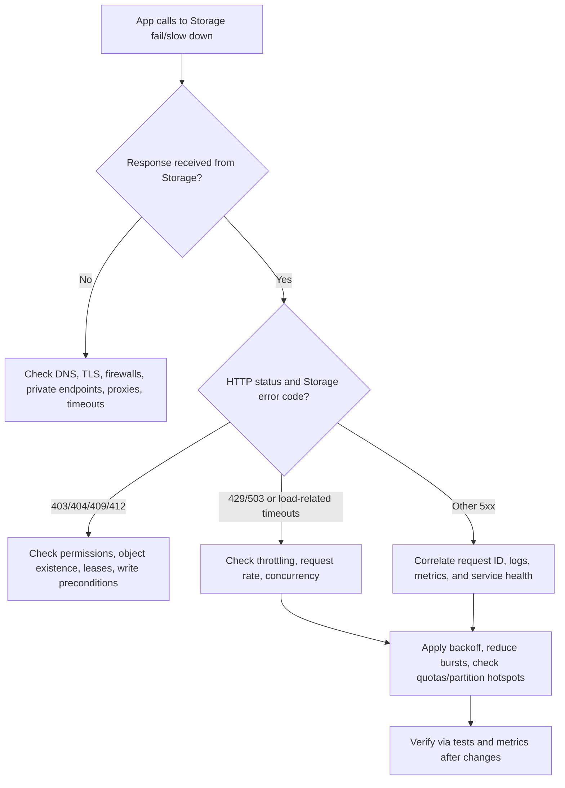

# Monitoring Capacity, Requests, and Throughput Limits

An application may store very little data yet still fail by sending too many requests to Azure Storage. Conversely, a system with millions of blobs may handle few requests while capacity grows rapidly, driving up costs and risks of exceeding budgets. Therefore, operating Storage requires tracking **capacity**, **request/transaction counts**, **data throughput**, **latency**, and **errors/throttling** simultaneously.

This lesson belongs to the **Azure Storage Fundamentals** chapter in the **CLOUD_PROVIDERS_AZURE** module. The principles below support deploying, monitoring, and controlling costs of Azure applications, focusing on Azure Storage accounts and services such as **Blob, Azure Files, Queue, and Table**. Metric names, limits, and observability capabilities vary by service, storage account kind, tier, region, and deployment time. Azure Managed Disks have their own disk/VM metric systems and limits; do not apply Storage account metric tables directly onto Managed Disks.

## 1. Learning Objectives

After this lesson, you will be able to:

1. Distinguish used capacity, projected capacity, request rate, throughput, IOPS, and latency.
2. Select the right Azure Monitor metrics to observe storage workloads and understand each metric's measurement scope.
3. Analyze HTTP errors, throttling, and conditions approaching throughput limits.
4. Use the Azure Portal, Azure CLI, and Log Analytics to inspect request, data, and error trends.
5. Design alerts for capacity growth, failed requests, latency, and performance degradation.
6. Apply retries with backoff, connection reuse, load distribution, and data lifecycle optimization.
7. Connect technical metrics with storage costs and application availability requirements.

## 2. Four Key Perspectives on Storage

| Metric Area | Question to Answer | Common Units |
|---|---|---|
| **Capacity** | How much data is stored? How fast is it growing? | GiB, TiB, bytes |
| **Request rate / Transactions** | How many read, write, list, or delete operations occur per second or minute? | requests/s, requests/min |
| **Throughput / Data rate** | How much data enters and leaves the service each second? | MiB/s, MB/s, Gbit/s |
| **Latency and reliability** | How long does a request take, and how many fail or get throttled? | ms, p95/p99, %, error count |

These indicators are related yet **not interchangeable**:

- Two apps both handling 1,000 requests/s can consume vastly different bandwidth: one fetches blobs of a few KiB, while the other fetches objects of several MiB.
- An account holding 10 TiB of data may see very few requests; an account with only 100 GiB can still hit request-rate pressure.
- Throughput measured in bytes/second differs from I/O operations per second. A single large-block read can transfer plenty of data in just a few requests.
- A latency spike can originate from networking, SDKs, DNS, the application, storage limits, or dependent services; looking at latency alone is insufficient for diagnosis.

### Scenario Example

An image-hosting service stores 2 million small images and continuously calls `GetBlob` to serve a website. Request counts can be very high even though total capacity is relatively small. A backup job, by contrast, writes a few massive files; requests/s may be lower while written bytes and bandwidth run high.

Hence, an effective dashboard must display capacity, request count, ingress/egress bytes, latency, and errors together.

## 3. Measurement Layers: Storage Account, Service, and Application

Azure Monitor exposes metrics at distinct resource scopes.

| Scope | Data Examples | What It Is Used For |
|---|---|---|
| **Storage account** | Used Capacity, aggregated requests and data flows at supported scopes | Understanding overall account usage and trends |
| **Blob service / File service / Queue service / Table service** | Service-specific metrics, requests, and capacity where provided by the service | Identifying which service drives the bulk of load and cost |
| **Client/application** | Real API call duration, retry counts, timeouts, p95/p99, business request volume | Measuring app experience and isolating non-Storage faults |
| **Operations system** | Azure Monitor alerts, diagnostic logs, budgets, and billing | Detecting incidents, investigating, and controlling spend |

Not every metric appears at every level. For instance, **UsedCapacity** is commonly viewed at the Storage account level, while certain blob capacity metrics are published under the **Blob service** sub-resource. Inspect metric definitions at the exact resource ID before building automated queries.

**Azure Monitor Metrics** store time-aggregated numerical series. **Resource logs** supply finer-grained request events/metadata once diagnostic settings are enabled. **Activity Log** primarily records control-plane changes, such as updating Storage account settings; it does not replace data-plane logs for individual blob reads/writes.

## 4. Tracking Capacity: UsedCapacity, BlobCapacity, and Growth Trends

Capacity is the volume of stored data at a point in time. Key metrics to watch:

- `UsedCapacity`: used capacity at the Storage account level per the corresponding metric definition.
- `BlobCapacity`: blob capacity at the Blob service scope where provided for the account.
- `BlobCount`: number of blobs, revealing whether the system holds many small objects or fewer large objects.
- Capacity metrics or reports specific to Azure Files, Queue, and Table: verify per service rather than assuming identical names and visibility as Blob.

Capacity metrics typically **do not update in real time at one-minute resolution**. Capacity data may be computed and refreshed less frequently than request metrics. When reconciling capacity after a large deletion, account for update lag as well as data retained by protection features.

### Capacity Is More Than Just "Visible Files"

For Blob Storage, the following features affect stored volume and cost:

- Active blobs in hot, cool, cold, or archive tiers where supported.
- **Blob versioning**: multiple retained versions of the same object.
- **Snapshots**: point-in-time captures of data.
- **Soft delete**: logically deleted data still within its retention window.
- **Object replication, backups, or other copies**: can generate additional stored data in target accounts.
- **Metadata and overhead**: how systems account for capacity or billing does not always equal a simple sum of visible file sizes.

For example, an operator deletes 500 GiB of blobs while soft delete retains them for the configured retention period. Capacity and charges may not drop immediately afterward. Do not issue more delete commands before verifying retention settings and metrics.

### Capacity Growth Rate

You can approximate:

```text
Average growth (GiB/day)
  = [Ending UsedCapacity - Starting UsedCapacity] / number of days

Remaining days before operational threshold
  ≈ [planned threshold - current capacity] / average growth rate
```

This is a **simple projection**, not a fixed technical limit for every Storage account. Growth rates can shift with seasonality, backup schedules, data lifecycles, or product campaigns. If growth is negative or zero, handle the days-remaining formula separately.

Use 7/30/90-day charts to spot abnormal growth. Break down usage by container, prefix, tier, owner, or data type using inventory reports, application telemetry, or suitable analytics tools; total Storage account metrics alone do not reveal which objects consume the space.

## 5. Requests, Transactions, and Operation Frequency

Azure Storage's `Transactions` metric counts operations/requests per the resource and service definition. A request may be a read, write, list, metadata query, delete, or other operation depending on API and service type.

When viewing Transactions, split by available dimensions—such as **API name/operation** or **response type**—to separate healthy traffic from failed requests. Exact dimension names and values can differ by metric and service.

### Calculating Request Rate

If within a 5-minute window the Transactions metric totals 60,000 requests, the average request rate is:

```text
60,000 requests / (5 × 60 seconds) = 200 requests/s
```

This is a **5-minute window average**. A 5-second burst could spike far higher; charts averaging over 5 or 15 minutes can mask peaks. When hunting throttling, pick a fine enough granularity and cross-check application logs.

### Do Not Equate Transactions with Billable Operations

Transaction counts in metrics do not necessarily match billing units one-for-one. Billing depends on operation type, tier, account kind, success/failure status, pricing rules, and services used. Use **Cost Management** to reconcile actual spend instead of arbitrarily multiplying Transactions by a single flat unit price.

### When Requests Spike Unexpectedly

Identify:

1. **Which API increased?** `GetBlob`, `PutBlob`, `ListBlobs`, Queue, or File operations?
2. **Which workload is sending them?** Web app, batch job, backup, sync tool, crawler?
3. **Is the spike driven by real users or a retry loop?**
4. **Are source addresses, identities, and user agents** in logs legitimate?
5. **Did response types** shift toward errors/throttling?
6. Did the spike coincide with a deployment or configuration change?

For example, a process repeatedly listing an entire container to check whether one file exists generates massive unnecessary requests. Designing direct object lookups or maintaining an appropriate index cuts both request volume and cost.

## 6. Throughput: Ingress, Egress, and Rate Limits

Azure Storage exposes data-volume metrics:

- `Ingress`: data entering the storage service at the metric scope.
- `Egress`: data leaving the storage service at the metric scope.

Metrics usually report aggregated **bytes** over a time interval. To convert to average throughput:

```text
MiB/s = Total bytes in interval / 1,048,576 / seconds

Mbit/s = Total bytes in interval × 8 / 1,000,000 / seconds
```

**MiB** uses binary units (1 MiB = 1,048,576 bytes), while **MB** and **Mbit** use decimal units. Always verify units when comparing dashboards, quota docs, and data-transfer pricing.

### Read and Write Throughput Differ

A data upload pipeline primarily drives up `Ingress`. A website serving images to millions of users drives up `Egress` and read requests. For mixed workloads, inspect each direction separately because limits and pricing may differ.

Do not confuse `Egress` in Storage metrics with billable **Internet egress** on your invoice. Routing path, region, caching, Private Endpoints, service type, and pricing rules determine actual transfer charges.

### Why High Available Bandwidth Does Not Always Feel Fast

Application performance depends simultaneously on:

- Per-request latency.
- Client and server concurrency.
- Object, chunk, and request sizes.
- TCP/TLS connection counts and connection pooling.
- Network path from workload to Storage region, proxies/firewalls, and connection latency.
- Limits of the Storage account, service, partition, or specific blob/file.
- Application CPU, RAM, I/O, and processing code.

A client downloading files sequentially one by one may achieve low throughput even when Storage has ample headroom. Conversely, a client firing too many concurrent requests can saturate limits and trigger errors.

## 7. Latency: Server Latency and End-to-End Latency

Azure Monitor provides success latency metrics such as:

- `SuccessServerLatency`: time the Storage service takes to process a successful request within server measurement boundaries.
- `SuccessE2ELatency`: end-to-end latency from the Storage service's perspective for successful requests, which can include components outside pure server processing time.

These metrics are **not synonymous** with total user wait time in a browser or end-to-end application business processing time. Clients also incur DNS, TLS handshakes, proxies, thread queuing, serialization, retries, and application-layer data processing.

### Reading the Signals

| Symptom | Likely Investigation Area |
|---|---|
| Both server latency and E2E latency rise | Service load, heavy operations, throttling, or workload shift |
| E2E latency spikes while server latency stays flat | Network/client, transfer overhead, request queuing, or factors outside server processing |
| Average metrics look normal yet users see slowness | Short bursts, tail latency, retries, or one affected region/subset of requests |
| Only one API is slow | Access pattern, payload size, hotspot, or specific operation |

Aggregated metrics commonly use **Average**; p95/p99 SLOs should additionally be measured in the application or from granular logs. Never label an Average as p95. When comparing metrics, align time range, scope, API, and units.

## 8. Throughput Limits and Quotas to Understand

Azure Storage publishes **scalability targets and service limits**: targets/limits at the account, service, object/partition, or resource-type level. Exact figures depend on:

- Storage account kind and performance tier (standard/premium).
- Blob, Files, Queue, Table, and specific features.
- Region, redundancy, service version, and account configuration.
- Request patterns: operation counts, sizes, concurrency, read/write ratio.
- File share size, share type, VM/client size, and network limits when using Azure Files.
- Custom limits or quotas approved specifically for a subscription/account.

No single `requests/s` or `MiB/s` number applies universally to **every** Azure Storage account. When capacity planning, read the scalability targets and quotas for your exact service and check which limits permit quota increase requests.

### Three Common Limit Tiers

1. **Account/service level:** aggregate request rate, bandwidth, or resource counts across the whole account/service.
2. **Object/partition level:** an overly concentrated blob, partition key, file share, or path can become a hotspot even when account totals remain well below target.
3. **Client/network level:** apps, VMs, SDKs, links, proxies, or NAT hitting ceilings before Storage does.

For example, many workers updating the same blob or partition key can hit contention and rising latency while account-wide Transactions stay modest. Inspect per-API/per-object request telemetry or logs to spot **hotspots**.

### Scalability Targets Are Not Per-Request SLAs

Published targets generally represent scaling capabilities under suitable conditions; they do not guarantee fixed latency for every individual request. Sudden traffic spikes, skewed key distributions, or external network issues can still cause errors. Test realistic workloads, leave headroom, and monitor errors as usage approaches limits.

## 9. Throttling: Recognizing and Distinguishing It from Other Errors

When traffic exceeds serving capacity at a given moment, Azure Storage may rate-limit requests (**throttling**). Depending on service and scenario, signs include:

- HTTP **503 Service Unavailable**, e.g., error code `ServerBusy`.
- HTTP **500**, in some scenarios carrying `OperationTimeout` related to load processing; a 500 does not automatically prove a quota breach.
- HTTP **429 Too Many Requests** on services/APIs supporting that status code.
- Timeouts or rising client latency when too many concurrent requests are issued.

Inspect **HTTP status, Storage error code, message, timestamp, and request ID**. Do not lump every 4xx or 5xx into throttling:

| Outcome | What to Verify |
|---|---|
| `403` | Usually missing permissions, invalid SAS/credentials, network policy, or access denial |
| `404` | Object does not exist, wrong container/path, or access condition |
| `409` | State/operation conflict, lease, or service condition |
| `412` | ETag or precondition mismatch |
| `429` / `503` | Likely rate limiting or service busy; read the exact error code |
| `500` | Server error/timeout; analyze logs and request patterns further |

In logs and Storage REST responses, `x-ms-request-id` correlates with the service-side request; `x-ms-client-request-id` can be supplied by the app to trace the same request across layers. Never log shared keys, SAS tokens, or authorization headers during investigations.

### Throttling Differs from Exhausted Capacity

Growing capacity does not cause throttling by itself if usage remains within limits and valid patterns. An account with abundant free capacity can still be throttled by hammering a single hotspot. Conversely, when an account or service hits a capacity/quota ceiling, write failures occur under a different mechanism than throughput throttling. Read the exact error code to fix the true cause.

## 10. Quick Inspection in the Azure Portal

In the **Azure Portal**, open the Storage account you want to monitor:

1. Select **Monitoring > Metrics** (or the corresponding Metrics blade in the interface).
2. Choose the right **scope**: the Storage account or a child service like Blob service when the target metric lives there.
3. Select metrics such as `UsedCapacity`, `Transactions`, `Ingress`, `Egress`, `SuccessE2ELatency`, or `SuccessServerLatency` where supported.
4. Set appropriate **time range**, **time granularity**, and **aggregation**. For Transactions and byte counts over an interval, Total is usually helpful; for latency, inspect Average and pair with application telemetry for percentiles.
5. Use **Split by dimension** if the metric exposes `ResponseType`, `ApiName`, or other relevant dimensions.
6. Compare identical windows before/after deployments, backups, or traffic campaigns.
7. Pin charts to a dashboard and configure alert rules for continuously monitored indicators.

Beyond Metrics, the Azure Portal may offer **Insights** for Storage observability. Blade names and metric availability vary across portal experiences and services. If a metric appears missing, check resource scope, account kind, and metric units first before concluding Storage is inactive.

### Minimum Suggested Dashboard

| Chart | Window | What to Look For |
|---|---|---|
| UsedCapacity / BlobCapacity | 30–90 days | Stored volume and growth rate |
| Transactions by API/ResponseType | 1 hour, 24 hours, 7 days | Peaks and failed requests |
| Ingress/Egress | 1 hour and 24 hours | Bandwidth bursts, load trends |
| SuccessServerLatency and SuccessE2ELatency | 1–24 hours | Abnormal latency increases |
| Availability / service errors | 1–24 hours | Responsiveness, 5xx trends |
| Application: p95/p99, retries, timeouts | 1–24 hours | Real impact on the workload |

Do not rely exclusively on daily averages; include per-minute or shorter-window charts when diagnosing bursts/throttling.

## 11. Querying Metrics with Azure CLI

Azure CLI works well for inventorying resources, inspecting metrics, and integrating into operations scripts. The examples below target **Bash/Azure Cloud Shell (Bash)** using placeholders. Read commands do not modify the Storage account.

### Step 1 — Confirm Environment

~~~bash
az account show \
  --query "{subscription:name, id:id, tenant:tenantId}" \
  --output table
~~~

When selecting a subscription:

~~~bash
az account set --subscription "<SUBSCRIPTION_ID>"
~~~

Declare test resource variables:

~~~bash
RG="rg-storage-lab"
ACCOUNT="storagelabexample"

STORAGE_ID=$(az storage account show \
  --resource-group "$RG" \
  --name "$ACCOUNT" \
  --query id \
  --output tsv)
~~~

The account name must be a real account in an authorized subscription. `az storage account show` requires management-plane read permissions; viewing metrics also requires appropriate Azure Monitor permissions.

### Step 2 — Inspect Metric Definitions

~~~bash
az monitor metrics list-definitions \
  --resource "$STORAGE_ID" \
  --output table
~~~

This reveals supported metric names, units, aggregations, time grains, and dimensions at the **exact scope**. If you need Blob service metrics, check definitions against the child service resource ID:

~~~bash
BLOB_SERVICE_ID="$STORAGE_ID/blobServices/default"

az monitor metrics list-definitions \
  --resource "$BLOB_SERVICE_ID" \
  --output table
~~~

Capacity or service-specific metrics may appear only on the child resource. Never query a metric name that does not exist at a scope and assume its value is zero.

### Step 3 — Query Transactions

~~~bash
az monitor metrics list \
  --resource "$STORAGE_ID" \
  --metric "Transactions" \
  --interval PT1M \
  --aggregation Total \
  --output json
~~~

This queries an aggregated metric at a supported scope. If a metric or time grain is unsupported for your account kind, pick values listed in metric definitions. Default time ranges and outputs can vary by CLI/config; for trend analysis, pass explicit `--start-time` and `--end-time` in an Azure Monitor-supported format.

### Step 4 — Query Ingress/Egress and Capacity

~~~bash
az monitor metrics list \
  --resource "$STORAGE_ID" \
  --metric "Ingress,Egress" \
  --aggregation Total \
  --output json
~~~

Query capacity using the scope and aggregation indicated by metric definitions; for example:

~~~bash
az monitor metrics list \
  --resource "$STORAGE_ID" \
  --metric "UsedCapacity" \
  --output json
~~~

In some Azure CLI versions and resource types, multi-metric lists require specific list syntax. If querying multiple metrics fails, query each metric individually and check `az monitor metrics list --help`.

### Interpreting Results Correctly

JSON output typically includes metric name, unit, time series, timestamps, and requested aggregations. For `Transactions`, each per-minute Total data point is the sum of requests in that minute, **not requests/s**. Divide by the interval's seconds to obtain request rate.

Never print shared keys or SAS tokens when inspecting metrics. Azure Monitor sits on the management/monitoring plane; operators with Azure permissions do not pass secret-bearing connection strings to read metrics.

## 12. Diagnostic Logs and Log Analytics

Metrics provide the big picture. When you need to know **which API failed, which caller was affected, and when requests were denied**, enable diagnostic settings for the relevant Storage service and send resource logs to Log Analytics, Event Hubs, or an organizationally approved target Storage account.

For Blob service, log categories are commonly organized by operation group:

- **StorageRead**: read operations.
- **StorageWrite**: write operations.
- **StorageDelete**: delete operations.

Other services have corresponding log categories and schemas. When selecting **resource-specific tables**, Blob logs may appear in `StorageBlobLogs`. With legacy settings or other destinations, data may land in `AzureDiagnostics` or another service table. Verify actual tables and columns in your workspace before running specific queries.

### KQL Example: Counting Requests by Operation

Once data lands in `StorageBlobLogs`:

~~~kusto
StorageBlobLogs
| where TimeGenerated > ago(1h)
| summarize Requests = count()
    by bin(TimeGenerated, 5m), OperationName
| order by TimeGenerated asc
~~~

This query shows Blob activity by operation every 5 minutes over the past hour. You can add groupings by status code, duration, and client once you verify available column names.

### KQL Example: Sampling Error Logs for Investigation

~~~kusto
StorageBlobLogs
| where TimeGenerated > ago(1h)
| take 20
~~~

The purpose is to **verify schema** and columns such as status, error code, request ID, duration, or operation before writing production error filters. Exact column names and data types depend on diagnostic log configuration.

**Log security:** request URIs or query strings can occasionally contain sensitive details such as SAS tokens, object names, or customer identifiers. Restrict log read access, audit sensitive-field collection/redaction, and manage retention and storage costs. Never write authorization values or secrets into application telemetry.

**Cost:** diagnostic logs are not free by default; shipping and retaining logs in Log Analytics, Storage, or external systems incurs charges. Enable only needed log categories with an appropriate retention plan.

## 13. Designing Pragmatic Alerts

Good alerts tie to a concrete operations action. An elevated metric is not always an outage, and a single threshold applied across every workload creates alert fatigue.

| Scenario | Suggested Signal | Action |
|---|---|---|
| Abnormal capacity growth | UsedCapacity/BlobCapacity rises sharply daily or nears operational threshold | Inspect containers/prefixes, versions, snapshots, and lifecycle policies |
| Rising failed requests | 5xx/throttling rate or logged errors rise above baseline | Inspect APIs, workloads, retries, and scalability targets |
| Throughput nearing limits | Sustained high Ingress/Egress combined with latency or errors | Check headroom, load distribution, account kind, and scaling options |
| Rising app latency | SDK/app p95/p99 breaches SLO | Compare server vs. E2E latency, network, request patterns, and retries |
| Unusual request spike | Transactions jump abruptly by API | Check batch jobs, loops, crawlers, or retry storms |
| Rising spend | Cost Management forecast / budget alert | Review capacity by tier, transactions, and data transfer |

### Configuring a Metric Alert in the Portal

1. Open the Storage account or service resource hosting the metric.
2. Go to **Alerts > Create alert rule**.
3. Pick the right **signal** metric, time aggregation, threshold condition, and evaluation frequency.
4. Add dimension filters if supported by the metric to avoid mixing successful traffic with errors.
5. Attach an **Action Group** to notify or trigger an organizationally approved workflow.
6. Document owner, severity, runbook link, and alert verification steps.
7. Test the alert in a non-production environment, then tune thresholds against baselines.

Capacity metrics update more slowly than request metrics and do not suit minute-by-minute alerting expectations. For sudden capacity surges requiring rapid reaction, pair with application telemetry or supplemental inventory processes.

### SLOs and Error Budgets

Instead of merely alerting on "Transactions > 10,000," tie alerts to application goals. For example:

- Percentage of Storage requests succeeding over a defined window.
- App-observed p95 blob download time staying within the product-approved threshold.
- Background jobs completing on schedule despite transient retries.
- Sufficient capacity headroom remaining for peak business periods.

An SLO needs a clear denominator, valid-request definition, observation window, and owner. Alerts should avoid overreacting to a handful of isolated errors during very low traffic while never missing sustained failures on critical paths.

## 14. Reducing Requests and Optimizing Throughput

When dashboards show heavy pressure, examine the workload before defaulting to upgrading the account.

### Optimize Access Patterns

- Pick the right API for the job: avoid listing millions of blobs to check for one known object.
- For large files, tune chunk sizes, parallelism, and staging aligned with the SDK/service.
- Reuse HTTP clients/SDK clients to leverage connection pooling.
- Avoid opening a new connection per request unnecessarily.
- Cache hot read data at the application/CDN layer where data semantics allow.
- Cut unnecessary metadata reads or use supported batch mechanisms where available.
- Spread load across hot objects/partitions and design blob/key naming around real workload distribution.

### Retries with Exponential Backoff and Jitter

During transient faults, controlled retries help workloads recover. However, **immediate retries across thousands of clients** worsen congestion.

Illustrative backoff rule:

~~~text
attempt = 0, 1, 2, ...
delay ≈ min(maxDelay, baseDelay × 2^attempt) + randomJitter
stop when exceeding maxAttempts or deadline
~~~

When implementing:

1. Prefer built-in retry policies in the **Azure Storage SDK**, which understand Storage error classes and recommended behaviors.
2. Enforce bounded retry attempts, timeouts/deadlines, and exponential backoff with jitter.
3. Retry only **likely transient errors**; never infinitely retry 403s or malformed requests.
4. For writes, verify **idempotency** and behavior when the server executes a request whose response never reaches the client. ETags, `If-Match` conditions, object naming, and overwrite strategy govern safe handling.
5. Cap concurrency to what the workload supports and ramp gradually based on metrics rather than blindly raising thread counts.
6. Emit retry counts and error codes to application telemetry—never secrets.

### When Should You Scale?

If sustained pressure stems from genuine demand, evaluate:

- Appropriate account kind/tier or dedicated performance options.
- Splitting workloads across multiple Storage accounts when distinct load, permission, and quota boundaries are needed.
- Refactoring access patterns, partitioning, or object distribution.
- Adding caching/CDN for public content.
- Tuning request sizes and controlled concurrency.
- Checking limits at VMs, NICs, NAT Gateways, firewalls, or network links.
- Engaging support regarding quota/scalability target increases where permitted.

Do not split Storage accounts casually: splitting data changes URIs, credentials, RBAC, lifecycle policies, networking, backups, application configs, and monitoring.

## 15. Incident Analysis Example: Error Spike at Peak Load

A thumbnail-generation app reads images from Blob Storage. After scaling from 20 to 100 workers, dashboards show:

- Transactions jumped several-fold.
- Egress increased, yet remained below the account's target bandwidth by design.
- Some requests return `503` with a Storage error code indicating server busy.
- p95 thumbnail processing time increased.
- Worker CPU is not maxed out.

**How to analyze:**

1. Correlate worker scale-out timestamps with the onset of request/error spikes.
2. Filter Transactions by API/response if supported; check detailed logs to pinpoint objects, paths, and request IDs.
3. Check whether workers are concurrently hammering a few hot blobs or partitions.
4. Inspect SDK retries, timeouts, and per-worker concurrency; 100 workers × 100 concurrent requests creates a huge burst.
5. Apply backoff, reduce per-worker concurrency, and load-test incrementally.
6. If repeatedly reading identical content, consider caching or partitioning work cleanly.
7. After changes, verify 503 errors drop, p95 recovers, and useful throughput improves.

The key is **finding the real bottleneck**. Modest Egress does not rule out a hot blob/partition; conversely, high Transactions alone do not prove the entire Storage account exceeded its limit.

## 16. Capacity and Cost Analysis Example

A team stores reports, images, and data exports in Blob Storage. UsedCapacity grows steadily, yet the team looks only at active blob counts. After a few months, costs surge.

**Investigation process:**

1. Plot monthly trends of `UsedCapacity` and `BlobCapacity`.
2. Inspect `BlobCount`, version counts, snapshots, soft-deleted blobs, and lifecycle rule status.
3. Categorize data by owner, container, prefix, age, and access frequency using inventory tools or authorized telemetry.
4. Identify data retained for compliance; never delete backups or legal-hold data merely to cut bills.
5. Evaluate lifecycle management transitions to appropriate tiers, version/snapshot retention windows, and approved deletion policies.
6. Weigh capacity savings against transaction, retrieval, and early-deletion fees plus tier constraints.
7. Monitor capacity metrics and Cost Management afterward to confirm expected savings.

**Why don't capacity metrics and bills match identically?** Metrics measure technical state at a scope and point in time; billing also reflects billing rules, redundancy copy counts, tiers, operations, data transfer, and rate cards. Always use both side by side.

## 17. Separating Storage Faults from Application and Network Faults

A helpful diagnostic flow classifies by layer:



A failed request can still increment Transactions without completing useful business work. Never track only "requests sent"; track useful completed operations and total application processing time.

For Storage behind a Private Endpoint, verify DNS resolves to the private IP, effective routes, and NSGs/firewalls along the target path. Network drops can occur before a request ever reaches Azure Storage, in which case Storage-side metrics will not record that request at all.

## 18. Hands-On: A Meaningful Storage Dashboard

**Scenario:** an application stores user files in Blob Storage. The system sees weekly load spikes and needs a dashboard to catch failed requests, abnormal capacity growth, and approaches to throughput limits.

### Preparation

- A test Storage account inside an authorized subscription.
- Permissions to read Azure Monitor metrics at the account and child service scopes.
- A test container or sample data containing no sensitive information.
- If practicing Log Analytics, resources and permissions to enable diagnostic settings plus budget for ingestion/retention.

### Tasks

1. Confirm the right subscription and Storage account before collecting metrics.
2. Use Azure Monitor Metrics to chart `UsedCapacity` over 30 days and note the trend. Explain capacity refresh-frequency limitations.
3. Chart per-minute `Transactions` and compare against the same window one day earlier.
4. Use appropriate dimensions, if available, to separate successful requests from error groups.
5. Chart `Ingress` and `Egress`; calculate average MiB/s over a 5-minute window.
6. Compare `SuccessServerLatency` and `SuccessE2ELatency` during traffic ramp-up.
7. Check metric definitions via CLI and explain why certain metrics exist only on child service scopes.
8. Configure a test metric alert for abnormal request volume or errors with an approved Action Group.
9. If permitted, enable diagnostic logs on Blob service and run a KQL query counting requests by `OperationName`.
10. Draft a response procedure when encountering 503/ServerBusy: check error code, lower concurrency, apply backoff, and re-measure.
11. Propose one cost-reduction improvement: valid download caching, lifecycle policies, or eliminating redundant list/read calls.
12. Clean up alerts/logging and test data per procedure to avoid unnecessary ongoing costs.

### Self-Check Questions

**Question 1.** Why can 100 GiB of data still trigger throttling while 10 TiB of data runs with few errors?

**Question 2.** A Transactions metric reports a Total of 18,000 over 60 seconds. What is the average request rate? Can you deduce the peak instantaneous request burst from that number?

**Question 3.** Why is `UsedCapacity` unsuitable for minute-by-minute alerting on sudden changes?

**Question 4.** If `SuccessE2ELatency` climbs while `SuccessServerLatency` stays flat, what do you investigate?

**Question 5.** When encountering HTTP 503, should you increase thread counts and retry immediately? Why or why not?

**Question 6.** Why can metric request counts not be used directly to compute an exact Azure Storage invoice?

**Question 7.** Does deleting a blob with multiple versions and soft delete enabled guarantee billable capacity drops immediately?

**Completion criteria:** you can read and compare capacity, requests, throughput, and latency; spot throttling signals; use Azure Monitor/CLI/logs; and propose alerts and application rate controls grounded in measured telemetry.

## Conclusion

To operate Azure Storage reliably, observe **capacity, Transactions, Ingress/Egress, latency, and errors** together. Each metric explains a distinct dimension: capacity supports data and cost planning, Transactions reflects operation intensity, throughput measures bytes transferred, while latency and HTTP errors gauge service quality.

When load climbs, **verify metric scope, check quotas for the exact Storage type, break down requests by API and error code, and tune concurrency/retries systematically** before concluding resources must be upgraded. Combining Azure Monitor, diagnostic logs, application telemetry, and Cost Management lets you design Azure workloads with strong performance alongside predictable costs and operational risk.
