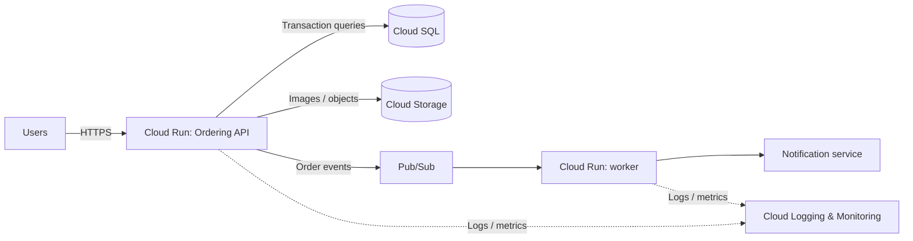

# Service Categories and the Shared Responsibility Model on GCP

> **Chapter:** Google Cloud Overview  
> **Module:** CLOUD_PROVIDERS_GCP  
> **Scope:** Explore Google Cloud from project organization, IAM, and VPC to Compute Engine, GKE, Cloud Run, storage services, and databases. Through deployment scenarios, learners learn how to choose services, protect resources, automate releases, and monitor reliability alongside cost.

When deploying an application to Google Cloud Platform (GCP), two questions must be answered in parallel: **which services should be used** and **who is responsible for operating and protecting which parts of the system**. A service with more management by Google can reduce server maintenance, but it does not automatically solve issues such as misconfigured permissions, vulnerable source code, publicly exposed sensitive data, or budget overruns.

## Learning Objectives

After this lesson, you will be able to:

1. Identify the main service categories of Google Cloud and select appropriate services for common requirements.
2. Distinguish foundational resources such as organization, folder, project, region, and zone from application runtime services.
3. Explain the **shared responsibility** model between Google Cloud and the customer, even when using fully managed services.
4. Compare operational responsibilities when using Compute Engine, GKE, and Cloud Run.
5. Identify baseline controls for IAM, networking, data, monitoring, and cost in a practical architecture.

## 1. Overall Map of Google Cloud

Google Cloud provides infrastructure and managed services to build, deploy, connect, secure, and observe applications. Before choosing virtual machines or databases, you need to understand **who owns the resources, where they live, and which policies govern them**.

### 1.1. Resource Management Hierarchy

Resources are typically organized according to the following hierarchy:

```text
Organization (organization, if present)
  └── Folder (resource grouping, if present)
        └── Project (administrative and service usage boundary)
              ├── Compute Engine / GKE / Cloud Run
              ├── VPC, subnet, firewall rule
              ├── Cloud Storage / Cloud SQL / BigQuery
              └── Other resources, APIs, and configurations
```

- **Organization:** the root governance node for an enterprise; enables broad policy and permission enforcement.
- **Folder:** groups projects by business unit, environment, or policy; folders are optional.
- **Project:** the fundamental unit for creating and managing resources, enabling APIs, assigning permissions, tracking quotas, and linking to a billing account. A project has an identifier (project ID); avoid sharing a single project across all environments when clear separation of permissions and costs is required.
- **IAM (Identity and Access Management):** defines *which principal* (user, group, service account, etc.) has *which permissions* on *which resource*. Permissions can be inherited from higher levels in the hierarchy.
- **Organization Policy:** enforces governance constraints at the organization, folder, or project level—for example, restricting certain resource configuration options.

**Distinction from deployment locations:** some resources are global; many services let you choose a **region** (geographic area) or **zone** (deployment location within a region). Selecting a region/zone affects latency, fault tolerance, data storage location, service availability, and cost. Do not assume all services deploy with the exact same regional scope mechanism.

### 1.2. Core Service Categories

| Category | Representative Services | When to Use? |
|---|---|---|
| **Governance, identity, cost** | Resource Manager, IAM, Organization Policy, Cloud Billing | Separating environments, controlling who can do what, managing budgets and policies |
| **Networking and connectivity** | Virtual Private Cloud (VPC), Cloud Load Balancing, Cloud DNS, Cloud NAT, Cloud VPN, Cloud Interconnect | Creating logical private networks, routing, traffic distribution, connecting from the Internet or on-premises |
| **Compute and application execution** | Compute Engine, Google Kubernetes Engine (GKE), Cloud Run, App Engine | Running VMs, containers, web apps/APIs, or background tasks |
| **File and object storage** | Cloud Storage, Persistent Disk, Filestore | Storing objects, attaching disks to VMs, sharing files via file protocols |
| **Databases and analytics** | Cloud SQL, AlloyDB, Spanner, Firestore, Bigtable, BigQuery, Memorystore | Transactional data, documents, large-scale data, analytical warehouses, or in-memory caching |
| **Integration and data processing** | Pub/Sub, Cloud Tasks, Workflows, Dataflow | Publishing events, queuing tasks, multi-step orchestration, stream/batch processing |
| **Security** | Cloud KMS, Secret Manager, Security Command Center, Cloud Armor | Key management, secrets, risk detection, and protecting applications against certain attack types |
| **Deployment and observability** | Cloud Build, Artifact Registry, Cloud Deploy, Cloud Logging, Cloud Monitoring, Cloud Trace | Building/releasing, managing artifacts, collecting logs, tracking metrics, and tracing |
| **AI and machine learning** | Vertex AI | Developing, deploying, and operating AI/ML solutions when required by the use case |

The list above is a **functional map**, not an exhaustive catalog. A real-world system typically combines services from multiple categories.

### 1.3. Choosing Services by Problem Type

**Application execution:**

- **Compute Engine:** virtual machines (VMs), suitable when you need control over the operating system, system software, processes, or host-level network configuration. In exchange, the operations team handles much of the guest OS and application management.
- **GKE:** running containers with Kubernetes, suitable when you already have orchestration needs such as multiple services, scheduling, deployment policies, and Kubernetes-based scaling. **GKE Standard** gives greater control over node pools; **GKE Autopilot** reduces node infrastructure management while still requiring proper application and Kubernetes configuration management.
- **Cloud Run:** running containers or functions on a managed platform; suitable for web/APIs and workloads packageable in the Cloud Run model. Google manages most of the execution infrastructure; customers still control code, configuration, identities, and access permissions.
- **App Engine:** a managed application deployment platform, useful when its runtime model and service constraints match the application.

**Storage and data:**

- **Cloud Storage** is for objects such as images, exported data copies, and uploaded files; it is not a POSIX disk directly mounted the way VMs use block disks.
- **Persistent Disk** provides block storage for suitable workloads, typically attached to VMs; **Filestore** provides a managed file storage service.
- **Cloud SQL** is a familiar choice for managed relational databases (e.g., PostgreSQL, MySQL, SQL Server). The application team must still design schemas, queries, access permissions, backup/restore strategies, and capacity.
- **Spanner** suits relational systems requiring strong scalability and distributed operation; it should not be chosen merely because it is a more "premium" service than Cloud SQL.
- **Firestore** serves the document database model; **Bigtable** serves large-scale key/column-family data workloads; **Memorystore** supports in-memory caching.
- **BigQuery** is a data analytics platform and is not normally used as the primary OLTP database for a web application.

**Connecting components:** **Pub/Sub** suits publish/subscribe event distribution; **Cloud Tasks** suits queuing tasks and controlling worker invocations; **Workflows** orchestrates multiple service calls in a sequence; **Dataflow** processes batch or streaming data.

There is no single best service for every system. Compare OS control needs, team skills, data shapes, consistency requirements, scalability, latency, availability, compliance, and **total operational cost**.

## 2. Shared Responsibility Model: Who Protects What?

In the cloud model, **Google Cloud** is responsible for securing and operating the infrastructure within the scope of the services it provides; the **customer** is responsible for data, identities, applications, access permissions, and configurations under their control. The exact split **varies by service** and deployment method.

You can keep this clear with two questions:

1. **Security of the cloud:** who protects the data centers, hardware, underlying infrastructure, and provider-managed service components?
2. **Security in the cloud:** who decides what data is uploaded, who gets access, how the application processes data, and how security settings are enabled?

### 2.1. Practical Responsibility Matrix

| Layer or Activity | Google Cloud's Primary Responsibility | Customer's Primary Responsibility |
|---|---|---|
| **Data centers, hardware, physical infrastructure** | Physical protection, maintenance, and operation of service infrastructure hardware | Choosing services/regions appropriate for the organization's requirements |
| **Virtualization infrastructure and managed platforms** | Operating underlying components within service boundaries | Selecting service tiers and configuring provided options; for VMs, managing the guest OS |
| **Data** | Providing storage mechanisms, infrastructure protection, and service security features | Classifying data, deciding content and access permissions, retention/deletion, policy-aligned encryption, and appropriate backup/restore |
| **IAM and service accounts** | Providing IAM, authentication, and platform policy enforcement mechanisms | Granting least privilege, controlling accounts/permissions, preventing credential exposure, and conducting periodic reviews |
| **Networking** | Operating the service's underlying network infrastructure | Designing VPCs/subnets, firewall rules, routing paths, public/private exposure, and traffic protection per each service's capabilities |
| **Source code and dependencies** | Managing the Google-provided runtime in managed services | Writing secure code, fixing application bugs, managing self-built dependencies/images, and remediating vulnerabilities |
| **OS and patching** | Managing Google's host OS and service-managed runtimes/hosts | For Compute Engine: managing the guest OS. For GKE: node/workload duties vary between Standard and Autopilot. For Cloud Run: managing application code, dependencies, and images |
| **Availability and recovery** | Providing service-level reliability and HA/backup capabilities within product scope | Designing fault tolerance, selecting HA configurations, setting RTO/RPO targets, testing recovery, and responding to incidents |
| **Monitoring and cost** | Providing telemetry, logs/metrics, and service billing mechanisms | Setting alerts, analyzing logs, managing quotas/costs, optimizing resources, and responding |
| **Compliance** | Providing certifications, documentation, and commitments applicable to the platform/services | Determining specific legal obligations, configuring properly, managing data, and gathering control evidence |

**Note:** this is a conceptual matrix for reasoning; contracts, product documentation, and specific configurations define the exact boundaries. Google Cloud compliance certifications **do not automatically** make a customer's application compliant with all legal requirements.

### 2.2. Responsibility Shifts by Management Level

| Example | What Does Google Cloud Manage Most? | What Must the Customer Still Do? |
|---|---|---|
| **Compute Engine (VM/IaaS)** | Physical infrastructure, host, and virtualization foundation layer | Choose images, harden/patch the guest OS, software, firewall, IAM, data, backups, and monitoring |
| **GKE Standard** | Managed Kubernetes control plane and service-owned infrastructure components | Manage node pools according to configuration/upgrade modes, workloads, images, Kubernetes RBAC, network policies, secrets, data, and releases |
| **GKE Autopilot** | Node infrastructure management and many Kubernetes cluster operational tasks | Manage manifests, workloads, policies/permissions, images, security configuration, data, quotas, and costs |
| **Cloud Run (serverless)** | Underlying servers, orchestration, and execution environment per service contract | Write/fix code, build secure images, assign service accounts, control ingress/authorization, configure secrets, data, and monitoring |
| **Cloud SQL (managed database)** | Managed DB infrastructure and service-level operational tasks | Grant permissions, network access, schemas, queries, application-side updates, HA/backup configuration, and restore testing |

Reducing infrastructure management effort **does not mean** handing over access policy decisions or code quality to Google. Even though Cloud Run scales automatically, an application can still leak data if an endpoint lacks authentication.

### 2.3. Three Types of Controls Often Misunderstood

- **Provider-implemented controls:** e.g., physical protection of data centers; customers primarily evaluate commitments and service scope.
- **Customer-implemented controls:** e.g., IAM restrictions, data classification, public endpoint configuration, API protection, and fixing code vulnerabilities.
- **Shared controls:** e.g., Google provides Cloud KMS, logging, backup mechanisms, and HA infrastructure, while the customer decides how to use them, key management permissions, retention policies, and recovery drills.

Google Cloud also emphasizes the **shared fate** approach (working together toward strong security outcomes): the provider helps customers fulfill their responsibilities through recommended architectures, secure defaults, and protective tooling. This concept **does not eliminate** the customer's configuration and governance responsibilities.

## 3. From Abstract Responsibility to Security Decisions

### Scenario A: Cloud Storage Data Accidentally Made Public

A development team stores internal documents in a bucket and grants read permissions to an overly broad principal. Google may still protect the storage infrastructure as designed, but **customer-granted read permissions** allow unintended access to the data.

**Remediation:** apply least-privilege IAM, prefer public access prevention mechanisms where appropriate, audit bucket/object configurations, and monitor permission changes. Encryption at rest does not replace access control.

### Scenario B: Compute Engine VM Left Unpatched for Too Long

An application on a VM suffers from a vulnerability in the guest OS or installed software packages. Google operates the host and infrastructure, while maintaining the VM's guest OS, images, and dependencies is the responsibility of the application administration team.

**Remediation:** maintain a patching schedule, use trusted images, restrict administrative ports, follow the principle of not exposing services to the Internet unnecessarily, and monitor security advisories.

### Scenario C: Cloud Run with an Overly Permissive Service Account

Application code contains a bug allowing unauthorized API calls. If Cloud Run uses a service account with project-wide admin permissions, the blast radius can spread across many resources even though Google manages the execution platform.

**Remediation:** assign a dedicated service account per workload, grant only the necessary roles on the exact target resources, restrict endpoint invocation permissions, use Secret Manager where appropriate, and scan dependencies.

### Scenario D: Managed Database That Cannot Be Restored

Cloud SQL reduces database infrastructure administration. However, an application bug deleting data, a faulty migration, or a backup retention period that fails to meet requirements can prevent the service from recovering in time.

**Remediation:** define RPO (maximum acceptable data loss) and RTO (target recovery time), select backup/HA options to match requirements, test restores, and govern migrations.

## 4. Architecture Example: Deploying an Ordering System

Suppose you need to deploy an ordering API that stores transaction details, accepts product images, and processes confirmation emails asynchronously. The team has limited operations staff so it prefers managed services, while requiring strict control over identity, data, and cost.



This is a **logical diagram**: Cloud SQL connectivity settings, network paths, Pub/Sub triggers, authentication, and the specific email-sending service must be designed during implementation.

| Deployment Decision | Service | Customer Responsibilities to Remember |
|---|---|---|
| Containerized API and worker | Cloud Run | Source code, images/dependencies, invoke permissions, ingress, appropriate scaling/concurrency, and service accounts |
| Relational order data | Cloud SQL | Schema and migrations, DB accounts, secure connectivity, backup/restore, and storage capacity control |
| Product images | Cloud Storage | Buckets, read/write permissions, object lifecycle, and public access policies |
| Post-order processing events | Pub/Sub | Message design, handling duplicates, retries, idempotency, and publish/subscribe permissions |
| Access governance | IAM and Secret Manager | Least privilege, separate identity per workload, never hardcode credentials in source code |
| System observability | Logging, Monitoring, Cloud Billing | Tracking errors, latency, traffic, resource utilization, and budgets |

A sensible deployment workflow:

1. **Project organization:** separate dev/prod environments according to policy; assign IAM by functional group. Link a billing account and configure budgets/alerts.
2. **Access flow design:** determine which endpoints are public, which connections to databases and object storage need protection, and which services are allowed to call which services. Use VPCs and private connectivity when the architecture calls for them.
3. **Packaging and release:** build images, store them in Artifact Registry, automate checks, and deploy with Cloud Build/Cloud Deploy or an equivalent pipeline. Avoid placing secrets in images or repositories.
4. **Permission setup:** API, worker, and deployment pipelines use dedicated identities; grant read/write permissions only on required resources. Evaluate end-user data access permissions.
5. **Recovery assurance:** design backup/restore for Cloud SQL, recovery strategies when queues/workers fail, and deployment rollback procedures.
6. **Observability and tuning:** monitor HTTP error rates, response latency, queued message backlog, DB connections, resource usage, and budgets; set alerts on user-impacting thresholds.

Cloud Run and Cloud SQL reduce OS and infrastructure management burdens, but **security and reliability outcomes** still depend heavily on the decisions above.

## 5. Hands-On: Identifying Responsibilities in a Project

You can start inspecting a project you have access to with a few Google Cloud CLI commands:

```bash
# List currently enabled APIs/services
gcloud services list --enabled --project=PROJECT_ID

# View the IAM policy at the project level
gcloud projects get-iam-policy PROJECT_ID

# List VPC firewall rules in the project
gcloud compute firewall-rules list --project=PROJECT_ID
```

These commands are **read-only**; replace `PROJECT_ID` with an actual project ID and authenticate with an identity that has view permissions. Seeing no issues in these three outputs **does not mean** the entire system is secure: you also need to inspect IAM at other levels, resource-level policies, service connections, and application configurations.

During your review, ask yourself:

- Which environments and data types does this project contain? Who holds administrative permissions? Can resources be separated to reduce blast radius?
- Which APIs and workloads are running? Are unused resources still incurring costs or expanding the attack surface?
- Do each service account's permissions match actual needs? Are there long-lived credentials or overly broad roles?
- Are network flows, public entry points, and data access paths controlled?
- Have retention periods, backups, restore procedures, incident alerts, and budgets been defined?

## 6. Principles for Service Selection and Operational Design

| Question | Decision Guidance |
|---|---|
| Do you need control over the guest OS or system software? | Consider Compute Engine; accept responsibility for OS maintenance |
| Does the system already require Kubernetes and custom orchestration? | Consider GKE; compare Standard and Autopilot based on node control needs |
| API/container with minimal infrastructure management needs? | Consider Cloud Run; you must still design authorization, IAM, images, and scaling |
| Is the data objects, shared files, or block disks? | Distinguish Cloud Storage, Filestore, and Persistent Disk before choosing |
| Does the data require relational transactions or mainly analytics? | Distinguish Cloud SQL/Spanner from BigQuery; verify scaling and consistency needs |
| Does background processing require events or task queues? | Distinguish Pub/Sub, Cloud Tasks, and Workflows by interaction pattern and retries |
| What are the uptime and data residency requirements? | Design region/zone, HA, backups, RTO/RPO, and compliance per each service's capabilities |
| Who monitors quality and billing? | Set up Cloud Monitoring, Logging, budgets, alerts, and response procedures |

**Cost:** service pricing typically depends on more than CPU or storage size; you must also account for data transfer traffic, API call counts, runtime duration, standby resources, and product-specific usage. Budgets and alerts help catch issues early, but budget alerts alone do not automatically stop charges from accruing.

**Reliability:** managed services can offer high-availability mechanisms, but the application must still choose appropriate configurations, handle errors, implement sensible retries, control side effects on retry, and practice recovery drills. You cannot assume an architecture is HA just because it uses a managed service.

**Security:** start with least privilege, workload isolation, connection controls, safe secret handling, dependency updates, audit log management, and data policies. Avoid assuming that resources inside a VPC are accessible only from a private network by default: each service has different connectivity mechanisms and access endpoints.

## 7. Self-Check Questions

**Question 1.** An application on Compute Engine is exploited through a vulnerability in a library installed by the development team. Who holds primary responsibility for remediating it?  
**Suggested answer:** the customer, because libraries and application code fall within the layers they manage. Google protects the infrastructure layers operated by Google within the service scope.

**Question 2.** Does moving an API from a VM to Cloud Run eliminate the need to manage IAM and audit secrets?  
**Suggested answer:** no. Google manages more of the execution infrastructure, while access permissions, secrets, and source code remain under the customer's control.

**Question 3.** A website needs to store product images and SQL order transactions. Should you choose the same data service for both?  
**Suggested answer:** usually separate Cloud Storage for objects and a suitable SQL database such as Cloud SQL for transactions; the final decision depends on scale and actual requirements.

**Question 4.** Why are recovery drills still necessary even with Cloud SQL backups enabled?  
**Suggested answer:** backups are only useful if the recovery procedure meets RPO/RTO targets and has been verified against the system's data, permissions, and deployment workflow.

**Question 5.** A team enables a Cloud Billing budget alert and assumes spending cannot exceed the budget amount. Is that assumption correct?  
**Suggested answer:** no. Alerts provide signals to respond and adjust; additional limits, automation, or appropriate operational policies are needed if strict cost enforcement is desired.

## Key Takeaways

- **Service categories** answer *what capabilities the system needs*; **operational models** answer *how much of the infrastructure the engineering team wants to manage*.
- **Project, IAM, VPC, region/zone, and billing** are foundational decisions to make before deploying workloads.
- **Shared responsibility changes by service**: moving from VMs to Kubernetes to serverless means Google manages progressively more infrastructure layers, while customers are always responsible for their data, identities, source code, and chosen configurations.
- **Managed services do not automatically yield a secure, highly available, or cost-optimized architecture**. Those goals must be intentionally designed, measured, and tested.
