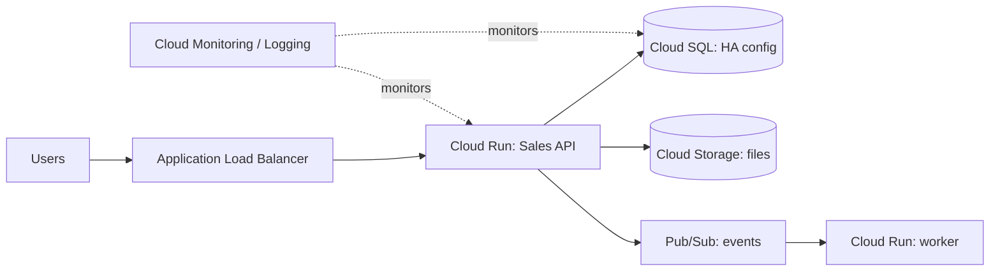

# Google Cloud Well-Architected Framework

## 1. Why Do We Need an Architecture Review Framework?

An application that runs on Google Cloud is not automatically a well-designed system. An API can satisfy functional requirements while still carrying risks when deploying a new version, losing an availability zone, holding overly broad permissions, facing sudden traffic spikes, or incurring unexpected costs.

The **Google Cloud Well-Architected Framework** is a set of principles, recommendations, and design questions that help architects, developers, operations teams, and managers **design, evaluate, and improve workloads on Google Cloud**. This framework also applies when migrating systems from private data centers or operating hybrid cloud and multicloud environments.

In the Google Cloud learning journey, the framework connects pieces that are often studied separately: **Organization, Folder, Project, IAM, VPC, Compute Engine, GKE, Cloud Run, Cloud Storage, databases, CI/CD, monitoring, and cost management**. Instead of asking only “which service should we use?”, we also ask “why does it fit the workload’s business, operational, and risk goals?”

After this lesson, learners will be able to:

- Explain the six pillars of the Well-Architected Framework and how they complement or trade off against one another.
- Translate business requirements into technical targets: security, SLO, RTO, RPO, latency, and budget.
- Recommend Google Cloud service choices suited to an application's characteristics.
- Run an evidence-based architecture review and create a prioritized improvement plan.

> **Scope:** The framework is guidance for decision-making and continuous improvement; it is not an automatic certification that an architecture is “compliant,” nor does it replace legal requirements, security policies, or specific service level agreements.

## 2. Structure: Six Pillars and Cross-Pillar Perspectives

According to current Google Cloud Well-Architected Framework documentation (2026), recommendations are organized into **six pillars**:

| Pillar | Central Question | Examples of Desired Outcomes |
| --- | --- | --- |
| **Operational excellence** | How do we deploy, operate, respond to incidents, and improve in a controlled way? | CI/CD pipelines, system observability, runbooks, and incident response processes |
| **Security, privacy, and compliance** | Who can access resources and data, how, and within what scope? | Least-privilege IAM, environment separation, secret protection, and auditing |
| **Reliability** | Does the system serve expectations during failures and recover reliably? | Clear SLOs, appropriate redundancy, tested recovery |
| **Cost optimization** | Does cloud spend match the business value delivered? | Cost allocation, budgets, right-sizing resources |
| **Performance optimization** | Does the system meet traffic and latency targets efficiently? | Measuring p95/p99, load testing, scaling, and fixing bottlenecks |
| **Sustainability** | Can we reduce the workload's resource consumption and environmental impact? | Improving utilization efficiency, storage optimization, tracking carbon footprint |

Sustainability was expanded into a full pillar in 2026. Some older docs or diagrams may list only five pillars; when reviewing an architecture, check against the current Google Cloud documentation version in effect.

In addition to the pillars, Google Cloud provides **perspectives**: lenses that apply cross-pillar recommendations to a specific workload type or industry, such as **AI/ML** and **financial services**. Perspectives do not replace pillars; they add domain-specific requirements, such as AI model governance or data residency constraints in financial services.

## 3. Deep Dive into Each Pillar

### 3.1. Operational excellence – Designed to Be Operable

The goal is to turn day-to-day operations into **measurable, repeatable, and continuously improvable** processes. A well-operated system does not depend on a single engineer's memory.

Practical decisions:

1. **Standardize environments:** separate Projects or Folders for development, staging, and production; manage infrastructure with Terraform or an equivalent IaC tool.
2. **Automate releases:** build, test, store images in Artifact Registry, and deploy in a controlled manner with Cloud Build, Cloud Deploy, or an appropriate pipeline.
3. **Make the system observable:** centralize logs, metrics, and traces via Cloud Logging, Cloud Monitoring, and Cloud Trace; set alerts based on user impact.
4. **Incident readiness:** establish on-call rotations, recovery guides (runbooks), rollback procedures, notification channels, and blameless postmortems.
5. **Change management:** validate configurations, require approvals for critical changes, roll out progressively, and verify after release.

For example: when a new Cloud Run revision increases the HTTP 5xx error rate, the dashboard must show errors rising from the deployment timestamp; operations can shift traffic back to a stable revision and document the root cause. Collecting logs alone without alerts, clear owners, and handling instructions is not enough.

**Review evidence:** deployment pipelines, change history, SLO dashboards, alert policies, runbooks, and incident records.

### 3.2. Security, privacy, and compliance – Secure by Design

Google Cloud secures the underlying infrastructure, while customers remain responsible for **workload configuration, access permissions, applications, and data** under the shared responsibility model. Controls must be designed upfront, tested in pipelines, and reviewed whenever the system changes.

| Protection Layer | Implementation Guidance | Things to Check |
| --- | --- | --- |
| **Organization and governance** | Organization → Folder → Project; Organization Policy for organization-wide guardrails | Are production projects isolated? Are any resources outside the governance hierarchy? |
| **Identity and access** | Cloud IAM with least privilege; dedicated service account per workload; Workload Identity Federation where appropriate | Are overly broad roles granted? Are unnecessary long-lived service account keys used? |
| **Network and access perimeter** | VPC, subnets, firewall policies, private connectivity where needed; Cloud Armor at supported entry points | Are inbound/outbound flows documented and properly restricted? |
| **Secrets and encryption** | Secret Manager; Cloud KMS when customer key control is required; TLS | Are secrets placed in images, source code, or public config variables? |
| **Data and compliance** | Data classification; retention, deletion, and storage location policies; audit logs | Does it meet personal data and data residency rules? |
| **Detection and investigation** | Cloud Audit Logs, Security Command Center, and alert handling workflows | Is someone accountable when misconfigurations or data leaks are detected? |

**IAM note:** permissions applied at Organization/Folder/Project levels can be inherited down to resources. Therefore, inspect the **effective permissions** of a principal, not just policies attached directly to individual services. Broad roles like Owner/Editor should only be used when truly necessary and tightly controlled.

**Networking note:** a VPC does not automatically block all public access, and Cloud Run does not automatically route over private networking just because a project contains a VPC. You must inspect ingress, egress, database connection mechanisms, IAM, and actual firewall rules. VPC Service Controls helps mitigate data exfiltration risks for supported services; it does not replace firewalls or IAM.

### 3.3. Reliability – Designing for Failure and Recovery

Reliability is a system's ability to perform its intended function consistently under defined conditions. Design assuming **some component will fail**, then define what service level must be maintained and what recovery time is acceptable.

Foundational concepts:

| Term | Meaning | Example |
| --- | --- | --- |
| **SLI** – Service Level Indicator | Metric measuring actual service quality | Request success rate, p95 latency |
| **SLO** – Service Level Objective | Internal target set on an SLI over a time window | At least 99.9% of valid requests succeed per 30 days |
| **SLA** – Service Level Agreement | Contractual service commitment, possibly with remedies | A provider's SLA is an input, not automatically your application's SLO |
| **RTO** – Recovery Time Objective | Target maximum time to restore service after an outage | Restore the ordering flow within 30 minutes |
| **RPO** – Recovery Point Objective | Time-based maximum data loss a business accepts | Lose at most 5 minutes of data after an incident |
| **Error budget** | Allowable deviation from an SLO, balancing stability and change velocity | With a 99.9% success SLO, at most 0.1% of valid requests may fail in the window |

Suppose there are 1,000,000 valid requests in 30 days; a 99.9% success SLO equals a **maximum budget of 1,000 failed requests** under this measurement. If the SLI measures uptime instead of requests, the budget math differs. Do not use this internal figure to infer a legal SLA.

Key practices:

- **Identify failure domains:** distinguish container, VM, zone, and full-region failures. Cloud SQL **High Availability within a single region** handles zonal failures, but does not provide recovery if the entire region goes down.
- **Use intentional redundancy:** configure multiple instances/zones where the workload needs it; combine health checks, load balancing, scaling, and appropriate failover mechanisms. End-to-end availability must account for all dependencies.
- **Design separate data recovery:** backups, restore testing, point-in-time recovery where supported, and disaster recovery strategies aligned with RPO/RTO. HA replicas do not replace backups against accidental deletion or data corruption.
- **Fault tolerance at the application layer:** timeouts, retries with backoff, idempotency, circuit breakers, queues to absorb spikes, and graceful degradation.
- **Rehearse and learn from incidents:** simulate zone loss, database disconnection, and bad deployments; record actual RTO/RPO and refine scenarios.

For example, offloading confirmation emails to Pub/Sub and an asynchronous worker prevents email provider slowdowns from stalling the API. Still, the event handler must be **idempotent**, because message redelivery can trigger duplicate processing.

### 3.4. Cost optimization – Aligning Spend with Value

Cost optimization means choosing spend levels aligned with **business value and quality requirements**, rather than cutting resources at all costs.

- **Create spend visibility:** Cloud Billing reports, budgets, appropriate cost labels/tags, and billing export to BigQuery to analyze by environment, team, and product.
- **Measure unit economics:** for example, cost per 1,000 successful orders, per active user, or per GB processed. As transaction volume grows, total cost may rise while unit cost decreases.
- **Right-size provisioning:** use recommenders, VM right-sizing, autoscaling, shutting down idle test resources, and storage lifecycle policies.
- **Choose pricing models that fit load:** compare Cloud Run, GKE, and Compute Engine; evaluate committed use discounts for steady workloads meeting eligibility terms.
- **Review periodically:** costs shift with traffic, deployment region, cross-region data transfer, log volume, and redundancy settings.

An **alert-only budget** monitors thresholds but **does not automatically stop spending**. Some services may support spend caps with specific scopes and limits; do not assume every workload or project has automatic cost cutoffs. When applying hard caps to eligible services, weigh the risk of application downtime.

**Review evidence:** cost reports by workload, budgets and alert recipients, actual utilization vs. provisioned capacity, and cost forecasts after scaling.

### 3.5. Performance optimization – Optimizing the Real Bottleneck

Performance must be viewed from the user experience and the full processing chain, not just server CPU usage.

1. **Choose metrics:** throughput (requests/second), p50/p95/p99 latency, error rate, queue processing time, and database connection limits.
2. **Design representative load:** test normal load, peak hours, sudden bursts, and scenarios where a dependency slows down.
3. **Measure before optimizing:** use Cloud Monitoring, Cloud Trace, application logs, profilers, or database analysis tools to pinpoint bottlenecks.
4. **Optimize layer by layer:** caching, Cloud CDN for suitable content, SQL indexes and queries, batching, connection pooling, async processing, and selecting regions close to users.
5. **Select compute capacity:** Cloud Run suits many stateless request/event container apps; GKE suits deeper Kubernetes orchestration needs; Compute Engine helps when VM control is needed or apps are hard to containerize.

For example: adding more Cloud Run instances may not improve p95 if Cloud SQL has already hit its connection limit. Observe both query duration and connection pooling before deciding to increase instances, tune concurrency, add caching, or redesign the data layer.

**Caution:** benchmark results are only meaningful when request types, test datasets, traffic patterns, client locations, and resource specs are clearly documented. A nice average latency can hide a terrible p99.

### 3.6. Sustainability – Resource Efficiency and Environmental Impact

Sustainability requires examining energy, resource usage, data lifecycles, and environmental impact of workloads. Many resource-saving choices also cut costs and boost efficiency, though **regulatory, latency, or reliability requirements must never be compromised**.

Improvement directions:

- Select regions considering low-carbon energy sources **alongside** data residency, resilience, and user proximity.
- Right-size VMs, improve GKE utilization, and apply autoscaling and scale-to-zero on supporting services like Cloud Run when appropriate.
- Eliminate wasteful processing: efficient algorithms, sensible caching, data compression and lifecycle rules; purge expired duplicates or low-value logs per retention policy.
- Track trends with tools like **Google Cloud Carbon Footprint**; understand these are estimates interpreted within their scope and methodology, not direct per-request measurements.
- Set measurable targets and iterate periodically with designated owners.

For example: purging expired temporary data and moving infrequently accessed data to an appropriate storage class can reduce both resource usage and cost. Factor in retrieval fees, restore times, and retention rules before making changes.

## 4. How Do the Pillars Interact?

No single service choice is strictly optimal across all six pillars. A strong review clearly states **conditions, benefits, trade-offs, and accepted decisions**.

| Decision | Benefit | Trade-offs and Conditions to Consider |
| --- | --- | --- |
| Multi-region deployment | Can reduce impact when a single region fails | Higher cost, data complexity, synchronization, and failover testing |
| Increasing replicas / minimum instances | Can reduce cold starts and add redundancy | Higher cost and idle resource consumption |
| Using Cloud Run instead of self-managed VMs | Reduces server admin, autoscales with requests | Must consider container constraints, execution timeouts, concurrency, connections, and pricing |
| Using private connections and egress control | Shrinks attack surface, controls data flows | Higher network design effort and potential data transfer costs |
| Retaining detailed logs long-term | Helpful for investigations, observability, and compliance | Incurs storage cost; requires limiting sensitive data and setting retention |
| Placing databases close to customers | Cuts latency for a user segment | May conflict with data residency, regional availability, and carbon goals |

Therefore, instead of asking “is Cloud Run or GKE better?”, start with requirements. For a stateless API with variable traffic and a small team, Cloud Run is usually the first option to evaluate. If the app needs deep Kubernetes customization, a unified cluster environment, or specialized platform components, GKE may fit better. For software tied to a specific OS or VM setup, Compute Engine can be the practical choice. The final choice must pass security, SLO, performance, and cost checks for that specific workload.

## 5. Practical Scenario: E-Commerce Platform on Google Cloud

Suppose a development team operates an online retail application with these requirements:

- Customers are in Vietnam; peak hours bring traffic many times higher than normal.
- Cart and checkout APIs require low latency; transactions must be recorded consistently.
- Personal data, payment details, and application keys must never leak.
- Target SLO of 99.9% success over 30 days; the business sets RTO at 30 minutes and RPO at 5 minutes for the ordering flow, which must be verified through drills.
- Small operations team wanting automated deployments and cost visibility.

A **conditional reference architecture** might look like this:



The diagram shows logical relationships only, **not a complete networking and recovery blueprint**. In real implementation, you must set up a serverless NEG if using an Application Load Balancer with Cloud Run; configure IAM, ingress, Cloud SQL connectivity, network policies, and event authentication per design. Labeling a resource “HA” also never replaces actual data recovery testing.

Evaluating this architecture against each pillar:

| Pillar | Decisions and How to Verify |
| --- | --- |
| Operational excellence | Build images and deploy via pipeline; dashboards for error rate, p95, queue backlog; rollbacks and runbooks in place |
| Security | Separate prod and nonprod projects, dedicated service accounts, least-privilege IAM, Secret Manager, Cloud SQL reachable only via controlled paths |
| Reliability | Regional Cloud SQL HA, backups and PITR if suitable; retries/idempotency; DB failure and restore drills to measure actual RTO/RPO |
| Cost | Track Cloud Run, Cloud SQL, network, storage, and logging spend; budget alerts; evaluate min instances against demand |
| Performance | Load-test checkout, measure p95/p99, watch SQL connection pool, optimize queries, and offload non-critical tasks asynchronously |
| Sustainability | Scale with load, object/log lifecycles, monitor Carbon Footprint trends, avoid leaving test resources running indefinitely |

**Incident scenario 1 – faulty deployment:** a new API version spikes 5xx errors. SLO alerts fire; operations shifts traffic back to the stable revision and records the timeline. This simultaneously tests observability, change management, and reliability.

**Incident scenario 2 – zone outage:** if Cloud SQL HA is properly configured and failover works, the database fails over to a standby zone within the same region. The application still must handle dropped connections and retry safely. Live testing shows whether the RTO target holds.

**Incident scenario 3 – data loss from human error:** HA does not protect against an accidental delete that has already replicated. Backups/PITR, restore procedures, tightly controlled restore permissions, and RPO drills are required.

If the business requires continuity even if an **entire region** goes offline, the single-region architecture above is insufficient; you must re-evaluate multi-region designs, replication, routing/failover, data consistency, and additional costs.

## 6. Architecture Review Process You Can Apply Immediately

### Step 1: Define the Workload and Boundaries

List users, critical transactions, external dependencies, sensitive data, and environments. Mark boundaries across Organization, Folder, Project, VPC, region, and zone. Having a data flow diagram prevents overlooking IAM rules, network paths, or dependencies.

### Step 2: Turn Expectations into Measurable Targets

Pick a few priority metrics: request success SLO, checkout p95, RTO/RPO for transactional data, monthly spend limits, and data residency rules. Assign an **owner** to each metric. Clearly separate verified targets from aspirational goals.

Example capturing initial requirements in YAML (this is an **internal documentation template**, not a Google Cloud configuration schema):

```yaml
workload: checkout-api
owner: commerce-platform
environment: production
primary_region: asia-southeast1
business_critical_flow: "Order confirmation"
objectives:
  request_success_slo_30d: ">= 99.9%"
  latency_p95_ms: 500
  rto_minutes: 30
  rpo_minutes: 5
  monthly_budget_usd: 1500
constraints:
  - "Protect customer data"
  - "Verify data storage locations against requirements"
evidence:
  dashboards: "Not yet filled"
  recovery_drill: "Not yet executed"
```

The numbers in this example are **practice assumptions**, not commitments or default recommendations for every system.

### Step 3: Inventory and Gather Evidence

Collect deployment diagrams, IAM policies, service configs, release history, test results, dashboards, billing reports, backup records, and restore results. A few **read-only** commands can inspect configurations once authenticated with appropriate permissions:

```bash
gcloud projects describe PROJECT_ID
gcloud projects get-iam-policy PROJECT_ID --format=json
gcloud run services describe SERVICE_NAME --region=REGION --project=PROJECT_ID
gcloud sql instances describe INSTANCE_NAME --project=PROJECT_ID
```

These commands only reveal part of the configuration picture; evaluating inherited permissions requires checking Folder/Organization policies, and SLOs must rely on actual monitoring telemetry.

### Step 4: Evaluate All Six Pillars with Explicit Evidence

Each finding should follow this structure: **current state → risk to objective → evidence → proposed action → owner → due date**. For example: “Cloud SQL lacks a scheduled restore drill; 30-minute RTO is unproven; recommend restoring to a test environment and timing it, owned by the SRE team before the next major release.”

You can use an internal priority scale like:

- **P0:** risk of severe data loss, data exposure, or failure of a critical business function.
- **P1:** missing recovery, observability, or cost controls with high potential impact, even if no incident has occurred yet.
- **P2:** opportunities to improve performance, operational experience, or sustainability.

This P0/P1/P2 scale is just an example for planning, **not an official Google Cloud score**.

### Step 5: Execute, Verify, Reassess

Prioritize high-impact, measurable changes. For each action, capture **before/after** numbers: p95, error rate, recovery minutes, unit cost, or idle capacity. Run periodic load and recovery tests; feed findings into the engineering backlog. Re-review whenever major architecture changes, new compliance rules, or significant traffic shifts occur.

## 7. Common Misconceptions

| Misconception | Accurate Understanding |
| --- | --- |
| “Running managed services makes it automatically well-architected” | Managed services reduce infrastructure administration, but configuration, permissions, application logic, data, and operational targets still require design. |
| “Cloud SQL HA always protects against region outages” | Single-region HA primarily protects against zonal failures within a region; multi-region recovery requires additional design. |
| “Having backups guarantees meeting RPO/RTO” | Only restore test results and drills under realistic conditions prove the target can be met. |
| “Setting a budget stops spending at the threshold” | Alert budgets do not automatically halt spend; spend caps apply only to eligible services under specific conditions. |
| “Giving service accounts broad permissions makes operations easier” | Broad permissions increase blast radius if credentials leak or a workload is compromised. |
| “Optimizing CPU equals optimizing performance” | Bottlenecks may lie in databases, networking, transaction locks, queues, or downstream service latency. |
| “Well-Architected is only checked once before go-live” | Traffic, technology, costs, and business requirements evolve; reviews must be continuous. |

## 8. Short Checklist for a Design or Review Session

- [ ] Documented business goals, system diagram, data flows, deployment regions, and dependencies.
- [ ] Defined Organization/Folder/Project structure, resource owners, IAM policies, and secret management.
- [ ] Established SLIs/SLOs, dashboards, alerts, runbooks, and rollback/incident response procedures.
- [ ] Covered failure scenarios by VM/container, zone, region, and data loss; tested restores against required RPO/RTO.
- [ ] Performed performance testing under representative load, observing p95/p99 and database bottlenecks.
- [ ] Tracked costs per workload, set budget alerts, and established a right-sizing plan.
- [ ] Planned resource efficiency improvements, data lifecycles, and environmental impact tracking.
- [ ] Assigned every finding a priority, evidence, owner, and verification criteria for completion.

## 9. Official Documentation for Further Reference

The framework evolves over time, so consult the primary recommendations and service documentation at the time you make implementation decisions:

1. [Google Cloud Well-Architected Framework – overview](https://docs.cloud.google.com/architecture/framework)
2. [Operational excellence](https://docs.cloud.google.com/architecture/framework/operational-excellence)
3. [Security, privacy, and compliance](https://docs.cloud.google.com/architecture/framework/security)
4. [Reliability](https://docs.cloud.google.com/architecture/framework/reliability)
5. [Cost optimization](https://docs.cloud.google.com/architecture/framework/cost-optimization)
6. [Performance optimization](https://docs.cloud.google.com/architecture/framework/performance-optimization)
7. [Sustainability](https://docs.cloud.google.com/architecture/framework/sustainability)
8. [What's new in the Well-Architected Framework](https://docs.cloud.google.com/architecture/framework/whats-new)

**Core takeaway:** good architecture is judged by the outcomes a workload delivers to users and the business. Define goals first, choose services second, measure with real data, and improve across all six pillars.
