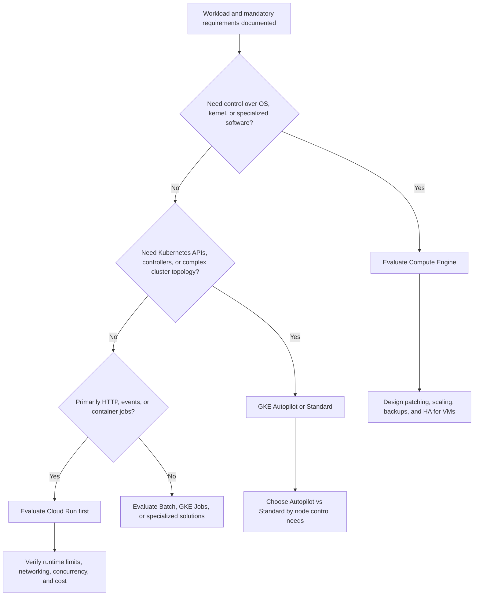
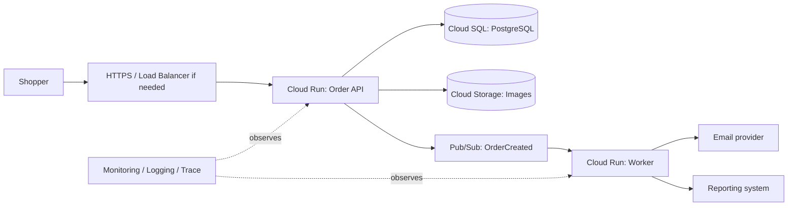

# Requirements-Driven Mindset for Selecting GCP Services

A sound architecture on Google Cloud (GCP) does not begin with “which service is the most powerful?”—it starts with “what must the system achieve, what constraints apply, and how much can the team operate?” The same application can run on Compute Engine, Google Kubernetes Engine (GKE), or Cloud Run; the right choice depends on load characteristics, required control, operational skills, and total cost.

This lesson belongs to the `CLOUD_PROVIDERS_GCP` module. The decisions below tie together organization/project structure, IAM, VPCs, Compute Engine, GKE, Cloud Run, storage, databases, release automation, reliability monitoring, and cost into an explainable, verifiable service-selection process.

## 1. Shifting Perspective: From Service Names to Requirements

Before opening the product catalog, describe the **workload** (the unit of work the system performs) and its **constraints**. An order-intake API, an image-processing job, a data analytics pipeline, and a legacy application running on Windows have vastly different needs, even if all are casually called “backend.”

### Six Question Groups to Answer

| Group | Questions to Clarify | Examples of Verifiable Answers |
| --- | --- | --- |
| Function and load pattern | Synchronous requests, event handling, scheduled jobs, or large-scale data processing? | HTTPS API, async post-order tasks, nightly reports |
| Scale and variability | Average/peak load, job duration, growth rate, concurrency level? | Normally 40 requests/sec, peaks 8x higher for 15 minutes |
| Data | Relational or document, what transactions, what queries, size, and retention lifecycle? | Orders need SQL transactions; images are objects; daily aggregate reports |
| Reliability | Availability/latency SLOs, RTO and RPO, zone/region fault tolerance? | 99.9%/month SLO; API p95 under 400 ms; max 15-minute RPO |
| Security and geography | Who has access, where data lives, private or public connectivity, audit requirements? | Internal service using IAM; data must stay in approved regions |
| Operations and cost | SRE skills, release cadence, budget, fixed vs. variable costs? | Small team wanting continuous deployment and minimal server administration |

The numbers above are requirement examples only, **not default commitments** of any service. Distinguish:

- **Mandatory requirements:** e.g., data residency, specialized protocols, mandatory OS, RPO/RTO bounds. Options failing these must be disqualified before scoring.
- **Optimizable goals:** e.g., lower cost, faster scaling, less administrative overhead. These goals are traded off once mandatory requirements are satisfied.
- **Assumptions to verify:** e.g., “low traffic,” “simple transactions,” “tolerable retries.” Record them as measurable assumptions, never as permanent truths.

## 2. Viewing Architecture Through Layers of Responsibility

Instead of hunting for one service that solves everything, split the system into layers. Each layer answers a different question.

| Decision Layer | Question | GCP Services Commonly Considered |
| --- | --- | --- |
| Resource organization | Who owns environments, permissions, and billing? | Organization, Folder, Project, Cloud Billing, IAM, Organization Policy |
| Application execution | Running HTTP services, containers, VMs, jobs, or clusters? | Cloud Run, GKE, Compute Engine, App Engine, Cloud Run jobs, Batch |
| Business data | SQL transactions, documents, objects, cache, or analytics? | Cloud SQL, Spanner, Firestore, Cloud Storage, Memorystore, BigQuery |
| Connectivity and integration | Synchronous calls, rate-controlled task dispatch, or event publishing? | Cloud Load Balancing, Pub/Sub, Cloud Tasks, Eventarc, Workflows |
| Networking and access | Where does traffic flow and where are trust boundaries? | VPC, subnets, firewalls, Cloud NAT, Cloud Armor, IAM |
| Lifecycle and operations | How are builds, releases, observability, recovery, and costs managed? | Cloud Build, Artifact Registry, Cloud Deploy, Cloud Monitoring, Cloud Logging, Cloud Trace, Billing budgets |

**Principle:** Pick services based on desired system behavior, then verify product constraints such as supported regions, quotas, connection limits, backup capabilities, and pricing models. A service list only builds a candidate set; it does not replace architectural judgment.

## 3. Deciding Where to Run the Application

### 3.1. Start with the Lowest Operational Overhead That Meets Requirements



| Option | Suitable When | Trade-offs to Accept or Verify |
| --- | --- | --- |
| **Cloud Run services** | HTTP/gRPC APIs, webhooks, containerized services scaling with traffic; team wants to focus on code | Runtimes can be created/destroyed dynamically; durable state must live outside instances. Check request limits, concurrency, cold starts, DB connections, and min instances configuration. |
| **Cloud Run jobs** | Bounded batch jobs with a start and end, scheduled or triggered tasks | Not a continuously listening web server; must design retries, timeouts, outputs, and re-run safety. |
| **GKE Autopilot** | Multiple container workloads needing Kubernetes objects/APIs with reduced node management | Requires understanding Kubernetes operations; verify resource constraints/configs and total cost. |
| **GKE Standard** | Need control over node pools, specialized machines, deep cluster configuration | Increases responsibility for upgrades, security, capacity, and cluster operations. |
| **Compute Engine** | Legacy software, specialized OS or agents, custom VMs, setups incompatible with managed models | Self-manage images, patching, instance config, autoscaling, backups, and many HA components. |
| **App Engine** | Applications matching App Engine's runtime and deployment model, especially existing systems | Must verify runtime limits, scaling behavior, and long-term roadmap before choosing for new systems. |

Cloud Run functions (the newer generation of functions built on Cloud Run) are worth considering for small, standalone event handlers. If you already have a fully containerized application, Cloud Run services generally provide more consistent packaging. Being “serverless” does not eliminate connection limits, latency, or responsibility for application error handling.

### 3.2. Questions That Separate Cloud Run, GKE, and VMs

1. Are Kubernetes CRDs, operators, DaemonSets, or custom controllers strictly required? If yes, evaluate GKE.
2. Do you need OS/kernel access, a VM-bound license, or software that cannot yet be containerized? If yes, evaluate Compute Engine.
3. Can the workload process requests/jobs independently, keep state in databases/object storage, and tolerate instance replacement? If yes, Cloud Run is a strong candidate.
4. Is baseline traffic continuous or bursty? Model pricing using realistic profiles: requests, vCPU/RAM, minimum instances, cluster/VM resources, idle time, and networking costs.
5. Can the team staff 24/7 cluster on-call? Operational complexity is a real engineering cost, even when raw infrastructure bills appear low.

Never assume **microservices = Kubernetes** or **serverless = always cheaper**. A small system can easily run multiple Cloud Run services; conversely, a steady workload with high utilization should be price-compared against reserved/steady-capacity options.

## 4. Choosing Storage by How Data Is Used

### 4.1. Ask About Data Operations Before Database Brand

| Dominant Need | Good Starting Point | When to Re-evaluate |
| --- | --- | --- |
| SQL transactions, joins, constraints, relational data | **Cloud SQL** (PostgreSQL/MySQL/SQL Server) | Growth exceeds single-instance limits, complex sharding, massive distribution, or multi-region needs |
| Large-scale relational transactions with distributed architecture | **Spanner** | At small scale, complexity and cost may not yet be justified |
| JSON documents, document-oriented access, client/web/mobile | **Firestore** | If most business logic requires complex joins and relational reporting, re-evaluate the data model |
| Files, images, videos, backups, object data | **Cloud Storage** | If the app needs a POSIX shared filesystem or block device, look at Filestore or Persistent Disk/Hyperdisk |
| Large-scale analytics, aggregate queries, BI/warehouse | **BigQuery** | Never use as the transactional database for individual purchase requests |
| Caching, short-lived sessions, ultra-low-latency access | **Memorystore** | Source-of-truth data must still live durably in a proper store; account for cache misses and evictions |

Three questions decide a great deal: **how is data written, how is it read, and how consistent must it be?** For example, an ordering system typically needs transactions to write orders and line items together; product images live as objects; transaction data is exported to BigQuery for trend analysis. Never force a single database to perform all three roles.

Especially with Cloud SQL, check connection counts when the application autoscales instances, and configure connection pooling, backups, point-in-time recovery (if supported by configuration), and high availability (HA). **HA does not equal a disaster recovery (DR) strategy:** intra-region failover, restoring deleted data, and recovering from a full region outage are distinct problems.

### 4.2. Choosing Communication Patterns Between Components

| Communication Pattern | Suitable Tool | How to Think About It |
| --- | --- | --- |
| Request needing an immediate response | HTTPS/gRPC via Cloud Run, GKE, or load balancer | Synchronous response; set timeouts and handle dependency failures |
| Events needing delivery to one or more independent consumers | **Pub/Sub**; Eventarc can route supported events | Producer emits events, consumers process independently; accept duplicate delivery and design idempotency |
| Dispatching an HTTP task to a worker needing rate/retry control | **Cloud Tasks** | Great for sending emails, syncing single orders, or calling rate-limited external APIs |
| Conditional multi-step sequences needing orchestration | **Workflows** | Coordinate calls and handle branches/errors without building a custom orchestrator |
| Time/schedule-based triggers | **Cloud Scheduler** | Trigger a Cloud Run job, endpoint, or workflow on schedule; not a replacement for workers |
| Large-scale batch/stream data transformation and analytics | **Dataflow** | Data processing pipelines; not a general-purpose message queue |

Pub/Sub typically operates with *at-least-once* delivery; consumers must tolerate processing the same message multiple times. Cloud Tasks can also retry: **never treat retries as proof a task executes only once**. For operations like creating orders or charging payments, use idempotency keys, transactions, or unique constraints to prevent duplicate side effects.

## 5. Organizational, Network, and Access Boundaries Are Part of the Choice

Picking compute or a database only answers “where does it run?” You must also answer **who can use the resources** and **which boundaries traffic crosses**.

- **Organization → Folder → Project:** organize governance permissions and policies; use projects to separate environments, teams, or billing scopes where appropriate. Establish labels, permissions, quotas, and budget alerts from the start.
- **IAM:** grant least privilege to individual service accounts per workload; avoid sharing one overly broad identity across all services. Prefer workload-attached identities/Workload Identity Federation over long-lived service account keys.
- **VPC and subnets:** VPCs have global scope while subnets have regional scope; design paths between workloads, databases, and external systems. Inspect firewalls and egress routes rather than assuming “inside the cloud” means automatically private.
- **Ingress:** apply application-layer/IAM authentication appropriate to callers; public apps may require Application Load Balancer, Cloud Armor, and TLS. Never expose services or databases publicly without a business reason.
- **Egress:** workloads in private networks may need Cloud NAT; Cloud Run offers appropriate VPC egress options. Distinguish accessing Google APIs from accessing private resources and the Internet.
- **Secrets and encryption:** store secrets in Secret Manager and manage keys in Cloud KMS when required; audit secret read access and rotation lifecycles. Never embed passwords in container images, config files committed to git, or public Terraform state files.

Managed services still follow the **shared responsibility** model: the provider operates part of the infrastructure; engineering teams remain responsible for IAM configuration, data classification, source code, accounts, policies, and monitoring.

## 6. End-to-End Example: Online Ordering Platform

### 6.1. Problem Statement and Initial Decisions

A small team deploys an ordering application for a single market. Users log in, place orders, upload product images, and receive confirmation emails. The API sees campaign-driven traffic spikes; order data requires transactions, while reports do not need second-by-second real-time freshness. Illustrative targets: 99.9%/month SLO, API p95 under 400 ms, low operational overhead, and resilience if one zone fails.

An initial approach could be:

| Component | Decision | Rationale and Notes |
| --- | --- | --- |
| Order-intake API | Cloud Run service running application container | Scales with traffic; no cluster management. Tune concurrency and max instances to match database capacity. |
| Order data | Cloud SQL for PostgreSQL with HA and RPO-aligned backups | Relational transactions and constraints; must test connection pools, failover, and actual recovery. |
| Product images | Cloud Storage | Durable objects rather than ephemeral container filesystems. Design upload/download permissions and lifecycle rules. |
| Post-order events | Pub/Sub and a Cloud Run consumer | Decouples email sending and analytics from request latency. Consumer must be idempotent. |
| Calling rate-limited email provider | Cloud Tasks (if per-task rate limiting/retries are needed) | Can replace or complement Pub/Sub depending on semantics; do not blindly deploy both just because a queue exists. |
| Secrets and permissions | Dedicated IAM service accounts, Secret Manager | Reduces access scope and centralizes credential management. |
| Operations | Cloud Monitoring, Logging, Trace, Cloud Build/Artifact Registry | Measures SLIs, detects errors, and delivers traceable images. |



This diagram is a **logical architecture for discussion**, not a complete production configuration blueprint. Adding a load balancer is optional depending on routing, security, and domain requirements; a Cloud Run service also provides its own HTTPS endpoint. The “Reporting system” block must be made concrete (e.g., exporting into BigQuery) once actual update cadence and query needs are defined.

### 6.2. A Reliable Processing Flow

1. The API authenticates the caller, validates inputs, and creates the order inside a SQL transaction.
2. The API returns a response once critical data is committed. Secondary tasks like sending emails run asynchronously so they do not inflate request latency.
3. The worker receives the message, checks a business/idempotency key, executes the task, and records the result. On transient external failures, the system performs bounded retries and handles undeliverable messages.
4. If the requirement is **never drop an event after a transaction**, do not simply `COMMIT` then `publish`, because the process could crash between the two operations. Consider the **transactional outbox** pattern: write the order and an event record in the same transaction; a separate publisher forwards events from the outbox to Pub/Sub with retries and deduplication against duplicate side effects.

### 6.3. When Should Decisions Change?

- If services require Kubernetes operators, sidecars, or custom scheduling and the team accepts operating a cluster, consider moving part of the workload to GKE.
- If an application is a legacy software suite tied to an OS/VM environment, you can deploy initially on Compute Engine and plan modernization later.
- If the database needs distributed relational transactions at a scale and geographic spread beyond Cloud SQL's current design bounds, evaluate Spanner with targeted testing.
- If the focus shifts to analyzing terabytes of logs/transactions, use BigQuery for analytics and keep the transactional database dedicated to the ordering flow.

These are decisions driven by **changing requirements**, not switching services just because another product is newer.

## 7. Reliability Must Be Designed and Measured

A managed service does not create an HA system by itself. Reliability comes from application design, data architecture, dependency handling, monitoring, and recovery drills combined.

| Guarantee Needed | Decisions Required | How to Verify |
| --- | --- | --- |
| Availability | SLO and error budget; separate app errors from dependency errors | Dashboard of valid request success rate over the chosen window |
| Latency | p50/p95/p99 targets and per-call timeout limits | Load test at peak traffic; watch latency and saturation |
| Fault tolerance | Retries with backoff, timeouts, circuit breakers where appropriate, idempotency | Chaos/failure tests on consumers and downstream APIs |
| Data recovery | Backups, PITR if available, RPO, RTO, and backup storage location | Restore drills into a verification environment measuring time and data loss |
| Zone/region outages | Zonal HA, multi-region only if truly required | Failover drills and verifying actual behavior limits of each service |
| System observability | Structured logs, metrics, traces, SLI-based alerts | Alerts have owners and runbooks; verify signals suffice for diagnosis |

A system with two instances sharing a single non-HA database still has a single point of failure. Conversely, designing multi-region from day one can inflate costs, data complexity, and operational risk. Match redundancy levels to RTO/RPO and the real business cost of downtime.

## 8. Release Automation, Cost, and Quotas Are Architectural Criteria Too

### 8.1. Minimal Deployment Lifecycle

A standard flow: store source code and infrastructure configuration under version control → CI runs required checks → build containers with Cloud Build → store images in Artifact Registry → deploy with Cloud Deploy or an equivalent pipeline → monitor post-deploy metrics and keep a rollback plan ready. Terraform can manage project resources, IAM, VPCs, Cloud Run, databases, and policies in a reviewable way.

Never treat a single successful deploy as production-ready. Define who/what is authorized to release, manage secrets, validate database migrations, check backward compatibility, and test version rollbacks.

### 8.2. Comparing Total Cost, Not Just Sticker Price

| Cost Category | Example Drivers | Questions to Measure |
| --- | --- | --- |
| Compute | vCPU, RAM, runtime duration, min instances, idle nodes/VMs | How do traffic and utilization vary by hour? |
| Data | Storage volume, backups, replication, queries, or bytes scanned | Read/write frequency, retention period, right storage class? |
| Networking | Internet egress, inter-region transfers, or separately billed network services | Are large datasets moving across regions? |
| Operations | On-call staffing, upgrades, incident handling, deployment hours | How much cluster/VM admin can the team handle while still hitting SLOs? |
| Observability and support | Log ingestion/retention, metrics, traces, and add-on services | Are log filters, retention, and alert thresholds tuned? |

Follow a disciplined cost loop: estimate with the Google Cloud Pricing Calculator → benchmark with production-like data → inspect actual billing by project/label → adjust sizing and retention. **Cloud Billing budgets primarily alert; never assume they act as an automatic kill switch for all spend.** Set appropriate quotas, budget alerts, and permissions over resource creation.

## 9. Documenting Decisions So Other Teams Can Review Them

Use a concise Architecture Decision Record (ADR) for every major decision:

```text
Decision: Compute for Order API
Mandatory requirements: HTTPS API, SQL transactions, approved deployment region
Expected SLO and load: 99.9%/month; p95 < 400 ms; peak load 8x baseline
Options: Cloud Run / GKE Autopilot / Compute Engine
Selected: Cloud Run (initial phase)
Rationale: Stateless HTTP container; variable scaling needs; small operations team
Conditions to hold: DB connection pool, IAM, scale limits, load tests, backup/restore
Risks: Cold starts, connection surges when scaling instances, Cloud SQL dependency
Review triggers: Missed p95/SLO, budget overrun, need for cluster features
Owner and review date: [owner], [date]
```

You can score options against criteria such as **mandatory fit, operations, cost, flexibility, and migration risk** with team-agreed weights. Never use a total weighted score to justify an option that violates a mandatory constraint; eliminate that option first.

### Common Mistakes

1. **Picking a service first and retrofitting requirements:** creates unnecessarily complex architectures.
2. **Using one data store for everything:** storing files in SQL or using an analytical warehouse as a transactional database.
3. **Confusing managed services with zero operations:** neglecting IAM, backups, quotas, metrics, and recovery responsibility.
4. **Benchmarking components in isolation:** forgetting network latency, DB connections, retry amplification, and downstream fault tolerance.
5. **Equating HA with backup/DR:** leaves you unable to recover from accidental deletions, logic bugs, or regional outages.
6. **Ignoring data transfer and idle resource costs:** low compute estimates turn into surprisingly high actual bills.
7. **Auto-retrying without idempotency:** causes duplicate orders or double payments.

## 10. Exercises to Apply the Mindset

**Scenario A — Image Upload API:** An application accepts user-uploaded images, stores the originals, generates thumbnails within seconds or minutes, and returns result URLs. Propose the HTTP ingestion service, file storage, and asynchronous task mechanism. If multiple independent consumers care about the upload event, does your choice change?

**Scenario B — Legacy System:** An internal accounting tool must run on a vendor-supported Windows version, with steady load and infrequent changes. Should Cloud Run, GKE, or Compute Engine be evaluated first? What operational/security practices must be added?

**Scenario C — Order Analytics:** An enterprise has a transactional SQL database and wants to analyze several years of order history with heavy aggregate queries. Should heavy reports run directly on the transactional database? Propose a pipeline to move data to an analytics store and weigh data freshness requirements.

When answering for yourself, write out **requirements → candidate services → risks/trade-offs → verification metrics**. This mindset remains reusable even as the GCP service catalog evolves.
