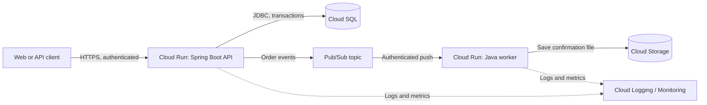

# GCP Learning Roadmap for Java Developers

## 1. Why Should Java Developers Learn Google Cloud?

A Java application that runs smoothly on a personal laptop only solves the coding part. When deploying to real users, the development team must also answer: where does the application run, who is allowed to call the API, where is data stored, how are versions updated, how do we handle sudden traffic spikes, detect incidents, and control costs?

**Google Cloud Platform (GCP)** provides services to solve those problems. With a Spring Boot application, a developer can start with **Cloud Run** to host the API, **Cloud SQL** for relational data, **Cloud Storage** for files, and **Pub/Sub** for exchanging events, then use **Cloud Build**, **Artifact Registry**, **Cloud Monitoring**, and **Cloud Logging** to operate the application systematically.

This lesson outlines a roadmap from GCP fundamentals to deploying a Java system with security, scalability, and cost tracking. The emphasis is on **knowing when to pick which service** and **being able to deploy, test, and operate** a Java application yourself; you do not need to memorize every GCP service before building your first project.

### Learning Outcomes

After completing this roadmap, learners will be able to:

1. Organize resources using **organizations, folders, and projects**, and understand **regions, zones, billing, quotas**, and IAM permissions.
2. Distinguish **Cloud Run, Compute Engine, and GKE** and select a suitable runtime model for a Java application.
3. Connect Spring Boot with **Cloud SQL, Cloud Storage, Firestore**, or **Pub/Sub** according to data characteristics and processing flows.
4. Use **service accounts** and **Application Default Credentials (ADC)**, manage secrets, and restrict network access.
5. Build a **build → test → release → observe → recover** workflow with reproducible infrastructure configuration.
6. Evaluate systems by **reliability, security, performance, and cost** rather than merely checking whether the API returns HTTP 200.

## 2. Prerequisites and Practice Environment

You should know Java, Maven or Gradle, REST/HTTP, JSON, Git, basic SQL, and how Spring Boot starts up. Familiarity with Docker, Linux, and TCP/IP networking helps accelerate learning, though these can be picked up along the way.

Preparation:

- A dedicated **Google Cloud project** for learning, with **billing** enabled if hands-on labs use billable services; set a **budget and alerts** before creating resources. A budget is a monitoring/alerting mechanism and **does not automatically cap or stop all spending**.
- Appropriate permissions to enable APIs, create resources, and assign service accounts in the sandbox project. Under an organization, organization policies may restrict certain actions.
- A JDK supported by your Spring Boot version (e.g., **Java 21 LTS**), Maven/Gradle, Git, the Google Cloud CLI (**`gcloud`**), and an IDE.
- A small Spring Boot application with a health-check endpoint, at least one test, and environment-variable configuration.

**Practice rule:** separate learning projects from real environments; name resources clearly; pick a region near users that meets data residency needs; clean up unused resources after each lab.

## 3. Map of Essential GCP Concepts

### 3.1. Resource Organization and Permissions

The typical hierarchy is **organization → folder → project → resource**. A project is the practical boundary for enabling APIs, managing groups of resources, linking billing, tracking quotas, and assigning permissions. A region is a geographic deployment area; a zone is an independent deployment location within a region (a concept heavily used for VMs and clusters).

**IAM** answers three questions: *who* (principal), *can do what* (role/permission), and *on which resource* (resource). Distinguish:

- **Developer identity**: used to access test environments according to granted permissions.
- **Release identity**: permitted to build, push artifacts to a registry, and deploy revisions.
- **Application runtime identity (runtime service account)**: permitted to read/write only the specific services it genuinely needs.

Never embed service account keys in source code or container images. When running on GCP, prefer attaching a **service account** to the workload; when developing locally, Google Cloud client libraries can obtain credentials via **ADC**. Having a valid identity **does not mean** that identity automatically has permission to access a resource.

### 3.2. Networking and Request Paths

A **VPC** is a logical private network; a VPC's subnets belong to a single region. Learn components in order: IP addressing, subnets, and routes → firewall rules → ingress/egress → service connectivity and private environment links → DNS/load balancing when genuinely needed.

With Cloud Run, separate two concerns: **who is authorized to invoke the service** (authentication/authorization, IAM, or an appropriate API protection layer) and **which network paths are allowed to reach the service** (ingress). If the app calls internal resources inside a VPC, study **Direct VPC egress** or **Serverless VPC Access** per current architecture guidance; do not assume all traffic from Cloud Run routes through a VPC by default.

### 3.3. Choosing Where to Run a Java Application

| Need | Initial Choice | When to Consider |
| --- | --- | --- |
| Spring Boot REST API, webhooks, HTTP handlers, stateless containers | **Cloud Run** | Want to focus on coding, simple deployments, scaling with load |
| One-off or scheduled tasks, not serving continuous HTTP traffic | **Cloud Run Jobs** paired with appropriate schedule/trigger | Batch jobs, data imports, maintenance tasks |
| Control over OS, background daemons, VM environment, or legacy software | **Compute Engine** | Need deeper VM management and system-level configuration |
| Multiple services on Kubernetes needing orchestration and cluster operations | **Google Kubernetes Engine (GKE)** | Team has Kubernetes capability and needs specific cluster features |

**Tip:** start with Cloud Run for pure-HTTP Spring Boot apps; move to Compute Engine or GKE when you have **specific technical requirements**, not merely because user counts grow. Under every model, verify CPU, memory, instance limits, timeouts, networking, and graceful shutdown behavior.

### 3.4. Choosing Where to Store Data

| Data Shape or Problem | Service | What to Learn Alongside the Service |
| --- | --- | --- |
| Transactions, tables, foreign keys, SQL queries | **Cloud SQL** (PostgreSQL/MySQL/SQL Server as needed) | Connection pooling, migrations, backups, HA, secure connectivity |
| NoSQL documents/objects, key lookups and queries fitting a document model | **Firestore** | Collection/document design, indexes, transactions, per-operation cost |
| Images, attachments, exported reports, object data | **Cloud Storage** | Buckets, objects, IAM, lifecycle rules, storage classes, signed URLs |
| Large-scale data analytics, reporting queries | **BigQuery** | Datasets/tables, partitioning, storage and query costs |
| Low-latency caching | **Memorystore** | TTL, consistency, cache miss handling, and availability |

Do not use object storage as a transactional database, and do not pick BigQuery for every OLTP application query.

## 4. Proposed Roadmap: 8 Phases

The durations below serve as a guide for learners investing **5–8 hours/week**; those experienced with DevOps can move faster. Every phase requires a **verifiable deliverable**.

| Phase | Suggested Duration | Focus | Deliverable After Learning |
| --- | --- | --- | --- |
| 1. Cloud foundations | Week 1 | Projects, regions, billing, APIs, CLI, quotas | Sandbox project, budget, resource inventory |
| 2. IAM and VPC | Week 2 | Principals, roles, service accounts, networking, ingress/egress | Minimal permission and network diagram |
| 3. Running Spring Boot | Week 3 | Containers, Cloud Run; comparing Compute Engine/GKE | Java API reachable via configured authentication |
| 4. Data | Weeks 4–5 | Cloud SQL, Storage, Firestore; migrations | API persisting data and files, with connection failure tests |
| 5. Asynchronous messaging | Week 6 | Pub/Sub, retries, idempotency, dead-letter topics | Producer/consumer handling events safely |
| 6. Release automation | Week 7 | Cloud Build, Artifact Registry, IaC, rollouts | Pipeline building and releasing versions |
| 7. Operations | Week 8 | Logging, Monitoring, Trace, IAM, secrets, cost | Dashboards, alerts, runbook, cost report |
| 8. Capstone project | Weeks 9–10 (optional) | Assembling a complete small system | Demo, architecture diagram, operations docs |

### Phase 1 — Google Cloud Foundations

**What to understand:** a single application may use multiple services, all governed under a project; individual APIs may need enabling before use; billing and quotas directly affect what you can run. Learn to navigate **APIs & Services**, **IAM**, **Billing**, **Quotas**, and **Cloud Asset Inventory** in the Console.

**Hands-on lab:**

1. Create/select a learning project and link billing per granted permissions.
2. Pick a default region matching user location and data rules, such as `asia-southeast1` (Singapore); clearly distinguish a region from a zone.
3. Set a budget/spend alert, apply labels to resources, and note where to view billing breakdowns.
4. Install `gcloud`, sign in with an authorized account, and select your project via `gcloud config set project YOUR_PROJECT_ID`.

**Pass criteria:** you can explain how a project differs from an organization, how a region differs from a zone, and where to inspect billing/quotas when an operation fails.

### Phase 2 — IAM, Service Accounts, and VPC

**What to understand:** the **least privilege** principle, permission inheritance across the resource hierarchy, the role of runtime service accounts, and IAM for Cloud Run and Cloud Storage. For networking, distinguish **inbound** requests to a service from **outbound** connections leaving a service.

**Hands-on lab:** create a runtime service account for your learning app and grant it access to only the required bucket or data service with the narrowest possible scope. Sketch the path `client → Cloud Run → Cloud SQL/Cloud Storage`, marking authentication checkpoints and network hops. Observe the difference between **missing permissions** (403) and **unreachable network** (timeout); those are two distinct failure layers.

**Pass criteria:** no JSON key stored in the repository, you know where to attach a service account to a workload, and you can explain why a request is denied.

### Phase 3 — Packaging and Deploying Spring Boot

**What to understand:** Cloud Run executes a **revision** of a containerized app and supports environment config, instance autoscaling, timeouts, and concurrency; the app must listen on the platform-provided port and must not rely on local filesystem state between requests.

**Hands-on lab:**

1. Write a Spring Boot API with `GET /hello` and a dedicated health endpoint.
2. Run tests and launch the app locally.
3. Build using a suitable method (source deployment/buildpacks or Dockerfile) and deploy to Cloud Run.
4. Read revision logs; modify the API response, deploy a new revision, and practice rolling back to the stable revision.
5. Increase concurrent requests and observe latency, memory, and instance count to understand scaling settings.

Minimal source code example in a Spring Boot project with the web dependency:

```java
package dev.example.gcp;

import java.util.Map;
import org.springframework.boot.SpringApplication;
import org.springframework.boot.autoconfigure.SpringBootApplication;
import org.springframework.web.bind.annotation.GetMapping;
import org.springframework.web.bind.annotation.RestController;

@SpringBootApplication
public class DemoApplication {
    public static void main(String[] args) {
        SpringApplication.run(DemoApplication.class, args);
    }
}

@RestController
class HelloController {
    @GetMapping("/hello")
    public Map<String, String> hello() {
        return Map.of("message", "Hello from Java on Google Cloud");
    }
}
```

From the root directory of a project that builds and passes tests cleanly, an illustrative deployment flow is:

```shell
gcloud config set project YOUR_PROJECT_ID
gcloud services enable run.googleapis.com cloudbuild.googleapis.com artifactregistry.googleapis.com
gcloud run deploy java-learning-api --source . --region asia-southeast1 --no-allow-unauthenticated
gcloud run services describe java-learning-api --region asia-southeast1 --format="value(status.url)"
```

These commands require a billing-enabled project and appropriate permissions; build/deploy permissions also depend on organization policies. In this example, the service **requires authentication**, so opening the URL in a normal browser may return 403. You can test using authenticated testing tools in the Console or a client sending an **identity token** for a principal authorized to invoke Cloud Run. If using a Dockerfile, make sure the app listens on the `PORT` environment variable; with Spring Boot, `server.port=${PORT:8080}` is commonly set in configuration.

**Pass criteria:** you can explain the flow source → image → revision → endpoint, inspect logs, and execute a rollback to a previous revision.

### Phase 4 — Connecting Data for Java

**Cloud SQL:** start with PostgreSQL and Spring Data JPA/JDBC if already comfortable with SQL. Use Flyway or Liquibase for migrations; size the connection pool (e.g., HikariCP) to fit total instances and DB connection limits. On Cloud Run, study the **Cloud SQL Java Connector** or GCP-supported connection methods alongside IAM, networking, TLS, and secret usage. Never push usernames/passwords to Git.

**Cloud Storage:** use when the application manages files. Java has an official client library; the SDK can discover ADC automatically while specific access is governed via IAM.

```java
import com.google.cloud.storage.BlobId;
import com.google.cloud.storage.BlobInfo;
import com.google.cloud.storage.Storage;
import com.google.cloud.storage.StorageOptions;

public class FileStore {
    private final Storage storage =
            StorageOptions.getDefaultInstance().getService();

    public void upload(String bucket, String objectName, byte[] data) {
        BlobInfo blob = BlobInfo.newBuilder(BlobId.of(bucket, objectName)).build();
        storage.create(blob, data);
    }
}
```

This example requires adding the `google-cloud-storage` dependency per your project's dependency management and granting write permission on **the exact target bucket** to the runtime service account. For a production API, validate file size/type, object naming, access controls, and data lifecycles. Never use the container's local filesystem as durable storage.

**Firestore:** build a small exercise comparing document queries against SQL. Inspect indexes, data modeling patterns, required consistency, and costs per read/write operation.

**Hands-on lab:** build `POST /documents` to save metadata in Cloud SQL and the file in Cloud Storage; add input validation, rollback or compensating cleanup if one step fails, and access permission tests.

**Pass criteria:** you can pick a data store based on query patterns, understand secure connections, and ensure data survives when application instances are replaced.

### Phase 5 — Asynchronous Communication with Pub/Sub

**What to understand:** publishers send messages to a **topic**; subscribers receive them via a **subscription**. Delivery can happen more than once, so handlers must be **idempotent** (repeated processing causes no incorrect side effects). Grasp **acknowledgments, retries, ordering when required, dead-letter topics**, and the implications of partial processing failures.

In Java, use the Pub/Sub client library to publish messages after business state changes. The receiver can be a Cloud Run service with an **authenticated push subscription** or another suitable event-processing architecture. Include `eventId` and `schemaVersion` in payloads/attributes to support deduplication and schema evolution.

**Hands-on lab:** `POST /orders` creates an order and emits an `order.created` event; a worker writes a confirmation record or updates status. Intentionally resend the same event to verify idempotency; simulate transient errors to observe retries and dead-letter handling.

**Pass criteria:** you can explain why “message published successfully” does not prove business processing finished, and propose a strategy to avoid losing events between a DB transaction and publishing (such as **transactional outbox** when strong guarantees are needed).

### Phase 6 — CI/CD and Reproducible Infrastructure

**What to understand:** separate **build** from **deploy**, store images in **Artifact Registry**, run tests before release, and keep build/deploy identities separate from runtime identities. Learn **Cloud Build** for pipelines and **Cloud Deploy** when you need multi-environment promotion and approvals.

**Hands-on lab:**

1. Pipeline runs unit tests → builds app/image → pushes image to the registry.
2. Deploy image to a staging Cloud Run environment; verify endpoints and post-deploy logs.
3. Use **Terraform** or a suitable IaC tool to define at least the service account, Cloud Run service, permissions, and related resources; separate configuration variables by environment.
4. Practice rolling back revisions/traffic and document the rollback decision criteria.

**Pass criteria:** someone else can use your docs, configuration, and granted permissions to recreate the environment without clicking through dozens of Console screens manually.

### Phase 7 — Security, Observability, and Cost Optimization

**Observability:** emit structured logs with request IDs/correlation IDs and proper severity levels; inspect **Cloud Logging**, build dashboards in **Cloud Monitoring**, and use **Cloud Trace** or OpenTelemetry for critical call paths. Configure alerts for error rates, latency, and resource saturation. Define simple **SLIs/SLOs**, such as valid request success rate and p95 latency.

**Security:** store passwords/secrets in **Secret Manager**, apply least-privilege IAM, verify ingress and Cloud Run invoker permissions, update Java dependencies, restrict DB/bucket access, and capture critical actions in audit logs where needed. Never log secrets or sensitive data.

**Java performance:** pay attention to JVM startup time, heap sizing, garbage collection, Cloud Run concurrency, max DB connections across instances, timeouts, bounded retries, and graceful shutdown periods. Raising concurrency can reduce instance count but increase memory/connection contention; measure rather than guess.

**Cost:** track Cloud Run CPU/memory/runtime duration and instance count, Cloud SQL baseline cost even during low traffic, Cloud Storage capacity and operations, Pub/Sub, logs, network egress, and lingering artifacts. Use budgets, labels, and Billing reports to spot anomalies; tear down test environments when idle.

**Hands-on lab:** create a dashboard for your API, alert on rising error rates, trigger an intentional fault, and trace back from request ID to logs/traces. Write a runbook listing symptoms, verification steps, recovery steps, and cost checks.

**Pass criteria:** you can explain an incident using telemetry and execute clear remediation/rollback steps.

### Phase 8 — Capstone Project: Order Service on GCP

Suggested small system demonstrating both synchronous and asynchronous flows:



**Functional requirements:**

- `POST /orders` creates an order and returns the order ID; `GET /orders/{id}` retrieves status.
- Orders live in Cloud SQL; order processing messages flow through Pub/Sub; the worker handles duplicates safely.
- The worker creates an object in Cloud Storage; the API or users only read objects per granted permissions.
- Include error handling, retries, dead-letter routing, and a way to reconcile order state.

**Operational requirements:** use separate service accounts for API and worker; manage secrets properly; include a release pipeline, migrations, tests, dashboards, alerts, a budget, and rollback instructions. Every resource must have a teardown path once the lesson ends.

Deliverable documentation should include an **architecture diagram**, service selection rationale, an IAM matrix (principal → role → resource), request/data flow diagrams, deployment steps, test results, operational metrics, and estimated cost drivers. You can build a minimal version with just Cloud Run + Cloud SQL first, then add Pub/Sub and Storage to avoid expanding scope too early.

## 5. Choosing Services for Real-World Problems

Never start from a product list. Start from business attributes, then choose runtime model, data store, and operations:

| Design Question | Signals to Look For | Initial Direction |
| --- | --- | --- |
| Does the API serve HTTP requests and scale with load? | Stateless, no need to manage VMs/clusters | Spring Boot on Cloud Run |
| Must the app control the OS, daemons, or specialized environments? | Requires OS-level access or VM resources | Evaluate Compute Engine |
| Are there many workloads needing Kubernetes orchestration? | K8s requirements and cluster operations capability | Evaluate GKE |
| Does data require ACID, relations, and SQL queries? | Transactions, joins, well-defined schema | Cloud SQL |
| Are there images, reports, or large files? | Immutable or versioned objects | Cloud Storage |
| Long-running tasks or decoupled processing lifecycles? | No need to block the HTTP caller for completion | Pub/Sub + worker or Cloud Run Jobs depending on task type |
| Need monitoring and incident diagnostics? | Distributed errors, fluctuating latency | Logging + Monitoring + tracing |
| Need regular releases and clean recovery? | Multiple versions/environments | CI/CD + versioned artifacts + IaC |

Example: “Users upload an invoice and receive a confirmation email.” The Java endpoint can write metadata to Cloud SQL, upload the file to Cloud Storage, and publish an event via Pub/Sub so a worker handles the next steps. Avoid holding an HTTP request open while waiting for all downstream tasks to finish.

## 6. Common Mistakes by Java Developers New to GCP

1. **Granting overly broad permissions:** assigning Owner/Editor to a runtime service account expands the blast radius if credentials leak. Grant permissions strictly by target resource and required actions.
2. **Using static keys:** committing JSON keys to Git or baking them into images makes rotation hard and invites leaks. Prefer workload identities and ADC; for external CI outside GCP, explore Workload Identity Federation.
3. **Storing data inside containers:** Cloud Run can replace instances; the local filesystem is not durable storage. Move state to a DB or object storage.
4. **Opening unbounded DB connections:** Cloud Run autoscales instances; combined connection pools can exhaust Cloud SQL limits. Calculate `instances × pool size` and load-test.
5. **Assuming Pub/Sub delivers strictly once:** retries or redeliveries can produce duplicate events. Design idempotency, retries, and dead-letter handling from the start.
6. **Confusing IAM with networking:** a 403 from missing permissions is not the same as a timeout from network routing; inspect each layer before changing settings.
7. **Watching only error logs:** a system can still be slow, expensive, or dropping messages with very few ERROR logs. Use metrics, traces, and alerts on business indicators.
8. **Forgetting to clean up resources:** databases, IP addresses, artifacts, and logs can keep generating charges long after you stop sending requests.

## 7. Self-Assessment Checklist After the Roadmap

Check off an item only when backed by evidence in your sandbox project or written documentation:

- [ ] I can distinguish projects, regions, zones, billing, and quotas, and know where to inspect costs.
- [ ] I can explain and verify permissions for human users, release identities, and runtime service accounts.
- [ ] I have deployed a Spring Boot REST API to Cloud Run and accessed it using the configured authentication mechanism.
- [ ] I know when Compute Engine or GKE is needed and can justify choosing them over Cloud Run.
- [ ] I have integrated at least one data store, backups/migrations, and a secure secret management approach.
- [ ] I have used Pub/Sub for an asynchronous task and handled retries and duplicate events.
- [ ] I have a build/test/deploy pipeline, versioned artifacts, a rollback procedure, and reproducible infrastructure configuration.
- [ ] I monitor latency, errors, logs, and cost, and have alerts plus a runbook for an incident scenario.

If an item is still unmet, revisit the phase with the corresponding **hands-on lab**. You do not need to memorize every service name: the most valuable skill is **asking the right questions about data, permissions, networking, operations, and cost**, then proving your choices with a working Java application.
