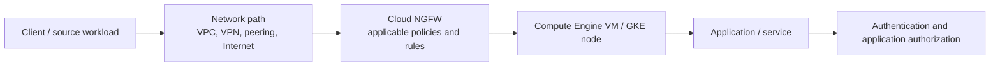
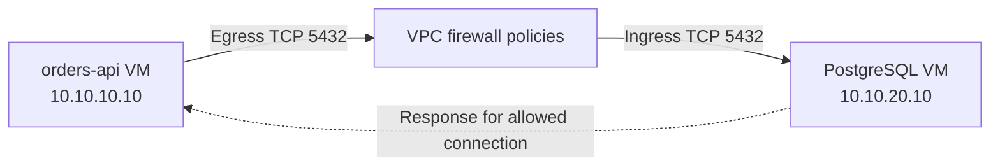
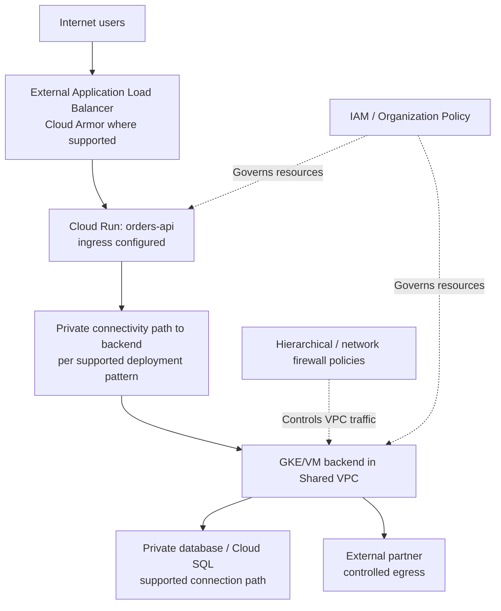

# Cloud NGFW and Advanced Traffic Controls on Google Cloud

In Google Cloud, having an appropriate IAM role **does not mean** network connections to an application are open. Conversely, a VM with TCP port 443 open in the firewall does not guarantee the application behind it authenticates callers. Administrators must combine **identity permissions, network paths, and traffic filtering policies** to protect each resource layer.

**Cloud Next Generation Firewall (Cloud NGFW)** is Google Cloud's suite of network firewall capabilities: ranging from connection filtering by address, protocol, and port to centralized policy management, advanced matching criteria, and threat prevention mechanisms where supported by configuration and feature tier. This lesson belongs to the **Network Security and Access** chapter of the `CLOUD_PROVIDERS_GCP` module; the knowledge applies when organizing projects/IAM/VPCs, deploying Compute Engine, GKE, Cloud Run, storage systems, and databases, as well as automating releases and monitoring reliability and cost.

The practical goal is to be able to answer: **Which traffic is allowed from which source to which destination, why is it allowed or blocked, and who has permission to change that rule?**

## 1. Learning Objectives

After this lesson, you will be able to:

1. Explain the role of **Cloud NGFW** relative to IAM, Cloud Armor, Cloud IDS, VPC, Cloud NAT, and application-level controls.
2. Distinguish **VPC firewall rules**, **hierarchical firewall policies**, and **global/regional network firewall policies**, along with the impact scope of each mechanism.
3. Understand parameters such as **ingress/egress, source/destination, protocol/port, priority, action, target, and logging**.
4. Identify advanced capabilities such as **FQDN filtering, Threat Intelligence, geo-based filtering, address groups, intrusion prevention, and TLS inspection**, along with their prerequisites.
5. Design **least-privilege** rules for Compute Engine/GKE in a VPC, connections to backends/databases, and outbound Internet traffic.
6. Analyze connection denials using **Connectivity Tests, Firewall Rules Logging, Firewall Insights, VPC Flow Logs**, and policy details.
7. Establish an auditable change workflow: survey → design → test → deploy → monitor → revoke exceptions.

## 2. Which Layer Does Cloud NGFW Protect?

VPC firewalls evaluate connections using network metadata and criteria supported by the rule type/feature. For Compute Engine VMs, rules are enforced distributively at the network infrastructure layer; you do not have to install a manual firewall appliance on each VM to use VPC firewalls.



The diagram depicts traffic entering a VM/GKE backend via a VPC; serverless systems and managed services follow their own access models. Cloud NGFW does not replace all other control layers:

| Component | Key question | Boundary to remember |
| --- | --- | --- |
| **Cloud NGFW / VPC firewall** | Is this packet or connection allowed to enter/leave the VPC resource? | Does not authenticate HTTP users or enforce SQL privileges. |
| **IAM** | Which principal is permitted to manage resources or call Google Cloud APIs? | Holding an IAM role does not automatically open network ports on a VM. |
| **Cloud Armor** | Should supported HTTP(S) requests/traffic pass through a protection point like a load balancer? | WAF/rate limiting at integration points, not an L3/L4 firewall rule on every VM. |
| **Cloud IDS** | Does observed traffic exhibit intrusion signatures? | Primarily for detection/analysis per configuration; do not confuse with prevention in Cloud NGFW Enterprise. |
| **Cloud NAT** | Which source address does a private VM use for outbound connections? | NAT does not automatically allow traffic blocked by an egress firewall. |
| **Application / database** | Is the caller or DB account permitted to read/modify data? | Firewall is only one layer before application authentication/authorization. |

**Example:** A rule allowing an application VM to reach Cloud SQL on the proper port does not mean the database password is valid, IAM database authentication is configured properly, or the query is authorized. Network, identity, and data permissions must all be satisfied simultaneously.

## 3. Cloud NGFW Editions and Advanced Capabilities

Cloud NGFW is typically structured into **tiers/editions** such as **Essentials, Standard, and Enterprise**. Exact capabilities, regional availability, supported firewall policy types, prerequisites, and pricing vary by service and over time; always verify against the official feature comparison table during deployment.

| Capability group | Role | What to verify |
| --- | --- | --- |
| **Stateful L3/L4 filtering** | Allow/deny connections by IP, protocol, port, traffic direction, and target. | Policy scope, matching rules, evaluation order, and default rules. |
| **Centralized policy management** | Use hierarchical/network firewall policies to standardize controls across Org/Folder/VPC. | Resource holding the policy, associations, IAM permissions, and child-project impact. |
| **FQDN filtering** | Use domain names in egress rules where supported by the feature. | Name resolution behavior, matching limits, DNS setup, and required feature tier. |
| **Threat Intelligence** | Use product-provided threat address lists/data to help block traffic. | Available feed lists, update cadence, and false-positive impact. |
| **Geo-based filtering / address groups** | Use source/destination geography or address groups to keep rules concise. | Support scope, accuracy, and object management permissions. |
| **Intrusion prevention (IPS)** | Inspect traffic to detect and block attack patterns per Cloud NGFW Enterprise config. | Security profile, endpoint/association, region, and traffic steering/inspection method. |
| **TLS inspection** | Enable inspection of supported TLS traffic payloads when enabled and configured properly. | PKI/certificates, encrypted scope, privacy, application type, and performance. |

A helpful mental model:

- **Essentials:** start with foundational firewall functions and L3/L4 network policies.
- **Standard:** evaluate advanced filtering criteria such as domains, Threat Intelligence, and shared address objects supported in Standard.
- **Enterprise:** evaluate intrusion inspection/prevention; TLS inspection introduces additional configuration requirements and constraints.

This is a selection guide, **not a guarantee that every feature in the table is available for every rule type, region, or backend**. An organization should select based on **use case, deployment scope, and actual feature tier**, rather than edition name alone.

## 4. Firewall Policy Types on Google Cloud

Cloud NGFW offers multiple policy enforcement mechanisms. What matters is **where the policy is stored and where it takes effect**.

| Type | Management/enforcement scope | Common use case |
| --- | --- | --- |
| **Hierarchical firewall policy** | Organization/Folder; attached to a hierarchy node and affects networks/resources beneath that scope. | Organization-wide security baselines, restricting admin services, pushing policies down to projects. |
| **Global network firewall policy** | VPC network and VPC-attached resources across global scope where supported. | Shared policy across a multi-region VPC network. |
| **Regional network firewall policy** | VPC network within the corresponding region. | Region-specific filtering requirements and regionally supported features. |
| **VPC firewall rules** | Traditional firewall rules in the project owning the VPC network. | Ingress/egress allow/deny for VMs/endpoints with compatible VPC config. |
| **Implied rules** | Fallback VPC rules when no other matching rule decides. | VPCs default to **deny ingress** and **allow egress** at the implied rule layer. |

A VPC is a **global** resource while subnets are **regional**. In Shared VPC, the network and firewall rules/policies attached to the host network are typically controlled by the **host project/network team**; VMs in service projects are governed by those rules when using shared subnets. You cannot assume a service project independently controls its firewall merely because its applications run there.

### 4.1. Evaluation Order and Stopping Points

When a packet is evaluated, the system checks **effective** policies in the order defined by Google Cloud; broadly speaking, hierarchical policies provide upper-level control, followed by network firewall policy layers and VPC firewall rules, and finally implied rules. **The exact ordering among network policy types, exceptions, and actions should be verified against current policy evaluation documentation**.

Within a rule set supporting priority:

- **Lower priority numbers** are evaluated before higher numbers.
- **`ALLOW` / `DENY`** typically renders a decision for traffic matching the rule's criteria within that layer.
- **`goto_next` / `GO_TO_NEXT`** (in policy types that support it) delegates evaluation to subsequent policy layers; it does not equate to allowing the connection.
- If a rule **does not match**, the evaluator continues checking other rules per system logic.
- Default ingress/egress rules apply only after no effective rule decides otherwise per VPC mechanics.

There is no rule that "project rules always beat folder rules," nor should a VPC allow rule be expected to override a **deny in a higher-precedence policy layer**.

### 4.2. Example Model: Organization-Wide Guardrail

Suppose the Organization wants to block direct administrative connections from the Internet to VMs:

```text
Organization: example.com
├── Hierarchical firewall policy:
│   ├── rule A: restrict inbound SSH/RDP from public sources
│   └── rule B: continue evaluating network policies for other traffic
└── Folder: workloads
    ├── Project: orders-dev  → VPC / VM
    └── Project: orders-prod → VPC / VM
```

Application teams may have permission to add an ingress allow TCP 22 in their VPC, but if a matching **hierarchical deny** already applies earlier, the VPC allow cannot nullify the organization policy. When administrative access is needed, design **IAP TCP forwarding, VPN, bastions, or controlled access paths** instead of opening `0.0.0.0/0:22`.

**Note:** for a guardrail to take effect, you must **create the policy, rules, and proper associations**. Simply naming a policy "organization security" without associating it to the right node or matching the traffic will not enforce any boundary.

## 5. Structure and Semantics of a Firewall Rule

A rule typically relies on the following fields (depending on policy type):

| Field | Question answered | Example |
| --- | --- | --- |
| **Direction** | Is traffic entering (`INGRESS`) or leaving (`EGRESS`) the target resource? | Ingress from API gateway to VM. |
| **Action** | If matched, allow, deny, or invoke a supported advanced action? | `ALLOW`, `DENY`, or inspection action when configured. |
| **Priority** | Is this rule considered before/after other rules in the layer? | `1000` takes precedence over `2000`. |
| **Match** | Which protocol, port, source/destination IP, and conditional criteria? | `tcp:443` from `10.20.0.0/16`. |
| **Target** | Which VMs/endpoints are subject to the rule? | VMs with a matching tag, or other firewall-supported targets. |
| **Logging** | Should connections matching the rule be logged for investigation? | Enable Firewall Rules Logging on critical rules. |
| **Scope / association** | Which Organization, Folder, VPC, or region does the policy belong to? | Regional policy attached to network in `asia-southeast1`. |

### 5.1. Ingress and Egress from the VM's Perspective

**Ingress** is traffic **entering** the network interface of the firewall-protected resource. **Egress** is traffic **leaving** that resource. In a flow from an application VM to a database VM in the same VPC:

1. App VM initiates a TCP connection: requires matching **egress** on the source side.
2. Database VM receives the connection: requires matching **ingress** on the destination side.
3. Because VPC firewalls are **stateful**, return packets belonging to an already-allowed connection are typically handled via connection state tracking; you do not need to open all ephemeral ports in the reverse direction just for replies.

Do not overgeneralize stateful behavior to assume **new** connections in the reverse direction are allowed. If the database actively initiates a separate new connection back to the application, that is a distinct flow requiring its own matching policy.



This example shows a database running on a **Compute Engine VM**. For the **Cloud SQL managed service**, private IP paths, connectors/Auth Proxy, IAM, and service-specific controls must also be accounted for; do not treat Cloud SQL like an ordinary VM to which you can attach arbitrary VPC target tags.

### 5.2. Target and Source: IP Ranges, Network Tags, Service Accounts

VPC firewall rules can use criteria such as:

- **Source/destination IP ranges** depending on direction and rule type.
- **Network tags** attached to VMs, commonly used to select target or source VMs per rule capability.
- **Service accounts** attached to VMs, which can be supported as source/target criteria in corresponding rule types.
- **Secure tags (Resource Manager tags)** in supported **firewall policies**, where tag management permissions are governed by IAM.

**Network tags and secure tags are different.** Network tags are Compute Engine VM attributes; if someone has permission to edit network tags on a VM, changing tags can alter firewall scope. Secure tags use Resource Manager tags with IAM controlling who can bind/use tags per configuration, suited for environments requiring strict separation of duties.

You cannot assume a selector supported in a **network firewall policy** uses the exact same syntax or works in a traditional **VPC firewall rule**. When authoring policies, verify the rule type, traffic direction, and compatible selectors.

### 5.3. Implied Rules and the Default Egress Problem

If no explicit rule decides a connection otherwise, a VPC has implied rules:

- **Ingress is denied by default**.
- **Egress is allowed by default**.

Thus "creating no ingress rules" generally aligns with not exposing VMs directly. However, "creating no egress rules" **does not mean outbound traffic is blocked**. A **deny-by-default egress** model requires explicit deny policies with proper priority order alongside necessary allow rules for DNS, updates, APIs, monitoring, Google Cloud services, or external dependencies.

When adding egress denies, evaluate **control-plane and operational flows**. Blocking the wrong path can prevent workloads from pulling images, shipping metrics/logs, authenticating workload identity, or reaching databases.

## 6. Advanced Capabilities: Applying Them to Specific Use Cases

### 6.1. FQDN Filtering

In some cases, VMs must call external service endpoints by domain name—such as `api.partner.example`—without security teams opening all Internet destination IPs. Cloud NGFW **FQDN filtering** (where supported by policy type/tier) allows domain criteria in egress rules.

Points to verify:

1. Does the domain have multiple A/AAAA records, DNS caching, or IPs that rotate over time?
2. How does the policy resolve FQDN/DNS information and update target IP sets per product design?
3. Is matching needed at the **HTTP path/URL** level? FQDN filtering **is not equivalent to a WAF/HTTP proxy inspecting every URL**.
4. Is the workload's DNS setup compatible with FQDN filtering, split-horizon DNS, or private zones?
5. Does the feature operate in the target deployment location for the actual traffic/protocol?

If a policy only allows `api.partner.example`, do not assume it permits every subdomain or every endpoint behind a partner's CDN. Test matching accuracy and IP-rotation behavior.

### 6.2. Threat Intelligence and Geolocation

**Threat Intelligence** feeds can help detect/block source or destination addresses classified as risky, using Google Cloud-provided lists and supported policy mechanisms. Filtering by **IP geolocation** can assist certain traffic governance decisions.

However:

- Threat feeds can have **false positives** or miss newly emerging malicious addresses.
- IP geolocation is an inference from IP databases, **not proof of physical location or user identity**.
- Traffic traversing VPNs, proxies, or CDNs can change the observed IP relative to the end device.
- Neither replaces user authentication, IAM authorization, or application-level request validation.

For public HTTP(S) services, country-based access filtering or WAF rules are often better placed in **Cloud Armor** at supported load balancers. Choose the enforcement layer matching the traffic path rather than stacking rules by guesswork.

### 6.3. Address Groups: Managing Large Lists

**Address groups** help manage shared lists of addresses/CIDRs across compatible policies. For instance, a `partner-networks` group can represent a set of partner CIDRs reused across multiple rules.

The benefit is updating the list in one place and avoiding duplicated CIDRs across rules. The risk is that **modifying one address group can affect multiple policies simultaneously**. Therefore, require clear ownership, review workflows, change history, and impact testing.

### 6.4. Intrusion Prevention in Cloud NGFW Enterprise

Cloud NGFW Enterprise adds **intrusion prevention** through traffic inspection components and **security profiles** when configured according to service documentation. This goes deeper than IP/port filtering: the goal is detecting and blocking malicious traffic patterns using supported signatures/rules.

To deploy effectively, operations teams must determine:

- Which traffic is **routed through the inspection point**; which directions and regions are supported.
- The **security profile group**, detect/prevent modes, and required endpoints/associations.
- Whether applications use TLS encryption; if payload inspection is desired, whether **TLS inspection** is required per supported architecture.
- **False positives**, latency, throughput, privacy controls, and fail-open/fail-closed behavior if inspection components become unavailable per actual design.
- Pricing model and quotas for inspection components.

**Simply owning the Enterprise tier does not mean every packet in the VPC is automatically IPS-inspected.** You must configure policies/rules, security profiles, and actually steer supported traffic paths. Workloads bypassing inspection or using unsupported protocols require alternative controls.

### 6.5. TLS Inspection: Additional Security and Operational Responsibilities

When inspecting **TLS** traffic with a supported solution, the system must handle certificates and trust appropriately to inspect payload contents. This is a significant architectural change that can break clients using certificate pinning or mTLS, add latency, and require strict access controls over decrypted content.

Before enabling:

1. Verify supported services, protocols, directions, regions, and TLS versions.
2. Design the PKI/certificate authority and distribute trust to managed clients in scope.
3. Identify traffic that must **bypass inspection** due to privacy policies or compatibility.
4. Assess impact on performance, reliability, observability, and cost.
5. Establish a canary rollout, TLS error monitoring, and a rollback path.

Do not view TLS inspection as a blanket license to inspect every encrypted Internet connection. It is only appropriate within product-supported boundaries and where the organization holds operational and governance authority.

## 7. Sample Architecture: Protecting Orders Production

Suppose an Orders system consists of:

- **Project `net-host-prod`** containing Shared VPC `prod-vpc`.
- **Project `orders-prod`** containing GKE/Compute Engine workloads attached to the Shared VPC, plus a Cloud Run service.
- Cloud Run service `orders-api` exposed over public HTTPS via an Application Load Balancer by design.
- A VM/GKE workload needing access to a private database service and an external partner endpoint.
- Security team managing org-level guardrails, Network team managing VPC firewall policies, and App team managing code/deployments.



**Diagram limitation:** Cloud Run is a serverless product, not a VM accepting arbitrary network tags. For Cloud Run, you must separately design ingress/egress, VPC connectivity, and authentication. VPC firewall rules govern flows traversing the VPC and resources they support; **you do not enforce VPC ingress rules directly onto Cloud Run's public endpoint**.

### 7.1. Allowed and Denied Flow Matrix

| Flow | Desired decision | Primary control layer | Notes |
| --- | --- | --- | --- |
| Internet → public ALB HTTPS | Allow per edge policy | LB/Cloud Armor/TLS | Expose only necessary public entry points. |
| Internet → VM app SSH port | Deny by default | Hierarchical/VPC firewall | Administer via protected channels, never open SSH to the Internet. |
| Load balancer/proxy/health checker → VM backend | Allow required sources/ports | VPC firewall, health check config | Required ranges depend on LB type; never guess CIDRs. |
| GKE/VM app → private database TCP 5432 | Allow from valid source | Source egress + DB ingress if VM-based, plus DB controls | For Cloud SQL, check connector/VPC/IAM/database auth. |
| Workload → partner `api.partner.example` | Allow valid destination only | Egress policy/FQDN where supported | Verify DNS, addresses, and port needs. |
| Workload → arbitrary Internet addresses | Deny if egress policy requires | Egress guardrail | Ensure exceptions for APIs/telemetry before denying. |
| Dev developer → production data | Prohibited | IAM + network + DB controls | Firewalls cannot replace identity governance. |
| Internet API call → private Cloud Run service | Only via approved ingress path | Cloud Run ingress/IAM, LB/network | Never rely solely on a VPC firewall rule to protect a public endpoint. |

### 7.2. Which Level Should Hold Each Policy?

1. **Organization/Folder:** guardrails for clearly prohibited protocols/patterns across the branch, exception workflow, and accountable owners.
2. **Host project / VPC:** network policies for the Shared VPC, shared across workloads and regions by design.
3. **Application team:** proposes flows for its services using concrete source/destination/port specs, peer-reviewed and codified in infrastructure-as-code.
4. **Application/IAM:** request authentication, secrets, service accounts, database identities, and application logging.

A policy applied across the entire Organization has a **huge blast radius**. A deny rule missing critical exceptions can disrupt production workloads across many projects; therefore testing, impact assessment, and rollback must precede wide rollout.

## 8. Hands-On: Designing Scoped Ingress/Egress Rules

In a lab example, two VMs sit in the same VPC `prod-vpc`:

```text
Network: prod-vpc
App subnet: 10.10.10.0/24
DB subnet:  10.10.20.0/24
App VM:     10.10.10.10  (network tag: orders-app)
DB VM:      10.10.20.10  (network tag: orders-db)
Requirement: only the App VM may connect over TCP 5432 to the DB VM
```

### 8.1. Visualizing Rules Before Running Commands

| Rule | Direction / target | Match | Action |
| --- | --- | --- | --- |
| `allow-orders-db` | INGRESS, VMs with tag `orders-db` | Source `10.10.10.10/32`, TCP `5432` | ALLOW |
| `deny-public-admin` (upper policy, example) | INGRESS, VMs in scope | Public sources as required; TCP `22,3389` | DENY |
| Egress restriction (if required) | EGRESS, app VM group | Only listed destinations/services via suitable policy | Ordered ALLOW + DENY |

This rule only illustrates the **ingress** path to the database VM. If an **egress deny** exists on the app side, you must also permit egress TCP `5432` to the database at the right scope. If GKE secondary Pod ranges or dynamic backend IPs are involved, a static `/32` source may be unsuitable; select identity/tag/range criteria supported by the architecture.

### 8.2. Sample `gcloud` Command for a Traditional VPC Firewall Rule

**The following command creates a live rule if run.** Execute it only in a lab or under an approved change ticket, and only when authorized to manage the VPC's firewall.

```bash
HOST_PROJECT="net-host-prod"
NETWORK="prod-vpc"

# Allow the database VM (tag orders-db) to receive PostgreSQL only from the illustrative app VM
gcloud compute firewall-rules create allow-orders-db \
  --project="$HOST_PROJECT" \
  --network="$NETWORK" \
  --direction=INGRESS \
  --priority=1000 \
  --action=ALLOW \
  --rules=tcp:5432 \
  --source-ranges=10.10.10.10/32 \
  --target-tags=orders-db \
  --enable-logging
```

This command uses **VPC firewall rules**; it does not create hierarchical/network firewall policies or enable Threat Intelligence/IPS. The `orders-db` tag must be attached to the exact destination VM, and the source IP must reflect any NAT/proxy translation if present. If a higher-layer network/firewall policy already denies it, this rule may have no effect on the connection.

Never use `--source-ranges=0.0.0.0/0` as a quick fix for a PostgreSQL error. Nor is a private IP a substitute for database authentication: database users, permissions, and other security controls remain essential.

### 8.3. Inspecting via Read-Only Commands

```bash
# List existing rules in the project owning the VPC
gcloud compute firewall-rules list \
  --project="$HOST_PROJECT"

# Describe the created rule in detail
gcloud compute firewall-rules describe allow-orders-db \
  --project="$HOST_PROJECT" \
  --format=yaml

# Inspect the network used by the VM
gcloud compute networks describe "$NETWORK" \
  --project="$HOST_PROJECT" \
  --format=yaml

# Inspect a VM's network interface, network tags, and service accounts
gcloud compute instances describe DB_VM_NAME \
  --zone=asia-southeast1-a \
  --project=orders-prod \
  --format="yaml(networkInterfaces,tags,serviceAccounts)"
```

Machine names, tags, zones, and projects here are illustrative examples. **Listing VPC firewall rules does not give the full picture of all hierarchical/network firewall policies that may apply.** You must also inspect policies and associations at Organization, Folder, VPC, and region levels in Google Cloud Console or the corresponding APIs/commands.

### 8.4. Removing the Example Rule When No Longer Needed

If the rule was created in a lab and needs to be rolled back:

```bash
gcloud compute firewall-rules delete allow-orders-db \
  --project="$HOST_PROJECT"
```

This is a **real deletion**. Run it only after confirming the rule belongs to the lab exercise and no other workload depends on it. When managing via Terraform or IaC tools, update the source code and run the deployment pipeline to avoid configuration drift.

## 9. Advanced Rules and Practical Adoption Patterns

### 9.1. Restricting Egress by Destination Instead of Opening the Entire Internet

Suppose a batch job on a VM only needs to send HTTPS requests to one partner API. Rather than leaving outbound traffic unrestricted:

1. Inventory real egress dependencies: DNS, Google APIs, package repositories, registries, telemetry, and the partner endpoint.
2. Choose rules or policies supporting IPs, FQDN/Threat Intelligence, and required match criteria.
3. Allow essential flows **before** activating a broad egress deny.
4. Test on dev/staging workloads, measuring DNS/TLS/API errors and checking firewall logs.
5. Expand gradually per VM group or resource branch, keeping a rollback plan ready.

**Avoid confusion:** Cloud NAT only translates source addresses for outbound connections; having NAT does not mean the egress firewall permits the traffic. Using Private Google Access or Private Service Connect changes how Google Cloud services are reached, and those paths also require appropriate network policy design.

### 9.2. Using Centralized Policies for Production Environments

At the `prod` Folder, the security team may standardize:

- Prohibiting direct SSH/RDP from the Internet to VMs.
- Permitting only approved administrative channels.
- Blocking high-risk destinations using Threat Intelligence lists where supported.
- Restricting outbound connections to approved corporate networks or required FQDN lists.
- Logging high-risk rules thoroughly while controlling log costs.

Not every item above needs to live in **a single** hierarchical firewall policy. Advanced features only work in the **supported policy type, tier, and scope**. Combine upper-level guardrails with network firewall policies applied directly to the VPC.

### 9.3. Protecting Backend Traffic Behind a Load Balancer

Common pattern: an external Application Load Balancer receives HTTPS traffic from the Internet and forwards it to a Compute Engine MIG or GKE backend. In this setup:

- A **public frontend** does not mean each backend VM should have a public IP.
- Backend ingress firewalls must permit the exact **health check and proxy source addresses or Google Cloud-documented ranges** for the **load balancer type** in use.
- Never copy CIDRs from another product onto your current LB; health check/proxy ranges differ across global vs. regional, proxy vs. passthrough, and backend types.
- Layer 7 request filtering can use Cloud Armor where supported by the load balancer; VPC firewalls remain responsible for protecting the backend VMs.

If health checks report unhealthy after tightening firewalls, inspect the **health check ingress path** before changing the application. Opening `0.0.0.0/0` to all backend ports to "make it healthy" fixes the wrong symptom and widens the attack surface.

## 10. Testing Connectivity and Diagnosing Firewalls

A `connection timed out`, `no route to host`, or TCP reset error does not necessarily point to Cloud NGFW. The exact same symptom can stem from DNS, routing, firewalls, VPC peering, NAT, proxies, an application not listening on the port, database authentication, or service health.

### 10.1. Ordered Investigation Workflow

1. **Define the flow:** source VM/service, actual source IP, destination, protocol/port, region, VPC/network interface.
2. **Verify the network path:** routing, DNS, subnets, peering/VPN/Interconnect, and deployed connectivity mechanisms.
3. **Locate effective policies:** hierarchical policies, network firewall policies, VPC rules, implied rules; check associations, priority, targets, and match criteria.
4. **Inspect logs/traces:** Firewall Rules Logging, Connectivity Tests, VPC Flow Logs, and corresponding application logs.
5. **Check the backend:** is the service listening on the port, health checks, TLS, IAM, database credentials, quotas, and service status.
6. **Apply the minimal change:** fix the rule at the right tier, IP/protocol/target; test and verify both allowed and denied flows.

### 10.2. Connectivity Tests

**Network Intelligence Center Connectivity Tests** analyzes the configured network path between source and destination, helping pinpoint issues like routes or firewall rules blocking traffic within the supported model.

When using it:

- Provide the exact source/destination, protocol/port, and VPC scope.
- Read the simulation/trace output to inspect the configured network path.
- Understand that a static analysis **does not guarantee the application is healthy**, what DNS just resolved to, or that the backend accepts requests.
- For certain paths, static analysis may need complementary runtime validation/tooling.

For example, a test from VM `orders-app` to `10.10.20.10:5432` might reveal a firewall policy deny or missing route. Yet network-layer reachability does not replace testing authentication with a PostgreSQL client.

### 10.3. Firewall Rules Logging, Firewall Insights, and VPC Flow Logs

| Tool | When to use | Keep in mind |
| --- | --- | --- |
| **Firewall Rules Logging** | Record connections/flows matching rules with logging enabled within supported scope. | Incurs log costs; not every packet emits a record and implied rules have logging limits. |
| **Firewall Insights** | Evaluate rule usage, identify unused rules, overly broad scope, or governance issues per feature capabilities. | "No hits seen in the observation window" does not prove a rule is safe to delete. |
| **VPC Flow Logs** | View sampled/aggregated traffic telemetry at interfaces/subnets per supported config. | Sampled/aggregated data, not necessarily a record of every packet; does not replace firewall decision traces. |
| **Connectivity Tests** | Investigate paths, routes, and policies blocking connectivity. | Model results must be paired with live testing during incident triage. |
| **Cloud Logging / Monitoring** | Centralize logs, alert on rules/services, track block trends or anomalies. | Requires choosing proper log sinks, retention, metrics, and budgets. |

**Log analysis example:** after rolling out an egress deny in Folder `prod`, blocked TCP 443 attempts to a software update endpoint surge. Operations identifies it as a missed legitimate dependency, adds an appropriately scoped exception, and verifies malicious flows remain blocked.

Do not turn off logging the moment an error stops: observe over a reasonable cycle to catch infrequent jobs such as weekly backups or month-end audits.

### 10.4. Frequently Overlooked Root Causes

| Symptom | Possibility | How to verify |
| --- | --- | --- |
| VPC allow rule looks right yet connection is blocked | Higher-precedence hierarchical/network policy deny took effect first. | Inspect all policies and associations across VPC/Folder/Org. |
| One VM connects while another cannot | Different target tag, service account, region, subnet, or network interface. | Compare metadata and policy matches of both VMs. |
| Backend turns unhealthy after enabling firewall | Health check/proxy sources were blocked. | Check the LB type and its documented source ranges. |
| App cannot reach Google APIs after egress deny | Missing rules for services, DNS, Private Google Access/PSC, or proxy. | Trace actual call path and required dependencies. |
| Public Cloud Run still reached directly despite strict VM firewall | Cloud Run ingress/auth is independent of VM firewalls. | Inspect Cloud Run ingress/IAM, ALB, and exposed endpoints. |
| TCP connects but HTTP returns `403` | IAM or application authentication/authorization. | Inspect HTTP error, principal, token, and service policy. |
| No logs appear for a rule | Rule didn't match, logging disabled, wrong log filter, or unsupported mechanism. | Check config and logging behavior, not just a single log query. |
| Changing a network tag alters traffic | Tag acts as a firewall target/source selector. | Audit VM metadata history and tag-edit permissions. |

## 11. Operating Cloud NGFW with Change Management

### 11.1. Port-Opening Request Template

Before adding an allow rule, the application team should provide:

| Field | Example |
| --- | --- |
| Owner | Orders team / on-call lead |
| Environment / VPC | `prod` / `prod-vpc` |
| Source | App VM `10.10.10.10` or supported principal/tag |
| Destination | DB VM `10.10.20.10` |
| Protocol / port | TCP 5432 |
| Direction | App egress and DB ingress, per effective policies |
| Purpose | Application connecting to internal PostgreSQL |
| Duration | Permanent or explicit expiration date for temporary access |
| Approver | Network/Security owner per impact scope |
| Test evidence | Connectivity Tests, health checks, app tests, logs |
| Rollback plan | Rule/commit/plan to restore if issues arise |

Never accept "open everything so the system works" as approval justification. Every rule should have a **clear purpose, owner, and narrowest source/destination scope**.

### 11.2. Automation and Drift Control

As VPCs and projects grow, manually managing firewalls in the Console leads to forgotten rules. With **Terraform or an IaC tool**, you should:

1. Manage policies and associations as versioned configuration.
2. Review changes via pull requests with Security/Network owners.
3. Flag high-risk expansions: `0.0.0.0/0`, all protocols, all ports, unusual priorities.
4. Roll out to canary/staging before broad-impact policies.
5. Compare **live** policies against state/plan to catch out-of-band manual edits.
6. Archive test results and rollback paths.

In Shared VPC, the **host project** IaC module may need coordination with applications in **service projects**. Never grant organization-wide permissions to every pipeline merely to edit one rule for a single workload.

### 11.3. Exceptions and Administrative Permissions

Organization-level block policies may need exceptions for specialized admin or backup workloads. Exceptions must:

- Have a documented justification and expiration date unless permanent.
- Apply only to the exact required resources/sources/destinations.
- Be approved at the **appropriate level** owning the policy.
- Be verified not to disable guardrails across an entire branch.

**IAM for firewall administrators** is distinct from **network connectivity permissions**. A developer lacking IAM permissions to edit Firewall Policies can still use the network according to existing rules; a Network Admin who can edit policies is not automatically granted application access to the database.

## 12. Cost, Reliability, and Limits of Advanced Controls

Cloud NGFW Essentials, Standard, and Enterprise have different pricing and feature models; components such as Enterprise intrusion prevention, firewall endpoints, logging, and traffic inspection processing can increase costs depending on configuration and current pricing.

When choosing controls, weigh:

- **Policy/rule count and scope:** resources, quotas/limits, and manageability.
- **Traffic volume and inspection:** throughput, latency, egress, and overhead for TLS/IPS if used.
- **Cloud Logging:** data volume, retention, sinks, and storage/query costs.
- **High availability and regionality:** whether inspection/endpoint components are available in the region and how failures behave.
- **Operational complexity:** who triages false positives, tunes security profiles, and approves exceptions.
- **Backend reliability:** allowing a connection through the firewall does not guarantee the backend has capacity or the database is healthy.

Do not turn on every advanced feature for all traffic without requirements and metrics. Prioritize from your threat model: identify sensitive data, entry vectors, exploitable traffic, and existing controls, then invest proportionally.

## 13. Practice Exercises with Answers

### Exercise 1: An Allow Rule Appears "Ineffective"

An application team creates a VPC ingress allow for TCP 22 from `0.0.0.0/0` to SSH into a VM, yet connections are still rejected. Previously, Security applied a hierarchical firewall deny for inbound SSH from the Internet.

**Question:** Why doesn't the new rule open the connection? How should this be handled?

**Answer:** An active deny at a higher policy layer can block the connection before the VPC allow rule is reached. Check policy evaluation/associations, then use an approved admin path such as IAP TCP forwarding or VPN. Never remove organization guardrails merely to open arbitrary SSH.

### Exercise 2: Enabling Egress Deny Breaks GKE/VM Workloads

After enabling an egress deny policy, workloads cannot pull container images or emit telemetry.

**Question:** What data must be gathered before fixing it?

**Answer:** Identify the actual source, destination/DNS, port, VPC, registry/monitoring endpoint types, policy priority, and logs of blocked connections. Add scoped allows for legitimate dependencies, test in a narrow scope, and confirm unauthorized flows remain denied. Never open the entire Internet indefinitely just to make errors disappear.

### Exercise 3: Cloud Run Accessed Directly Despite Strict VM Firewalls

A public Cloud Run service has a direct endpoint. Security blocked direct ingress to backend VMs in a private VPC, yet an external user still reaches Cloud Run via its default URL.

**Question:** Why? Which mechanisms apply?

**Answer:** Cloud Run's managed endpoint is not a VM interface directly governed by those VPC firewall rules. Configure **Cloud Run ingress**, IAM authentication, application authorization, and ALB/Cloud Armor entry points per supported architecture; also evaluate VPC connectivity for outbound calls to private resources.

### Exercise 4: Choosing Controls Against Malicious Destinations

A backend VM must call HTTPS on a partner API and must not connect freely to known risky addresses.

**Question:** Which layers should be used?

**Answer:** Combine narrow egress policies and evaluate **FQDN filtering**, **Threat Intelligence**, or address groups per supported edition/policy; enable logging and monitor DNS/IP list changes. If blocking attack payloads on supported flows is needed, evaluate **Cloud NGFW Enterprise IPS** alongside inspection/TLS prerequisites; do not treat an IP denylist as the sole control.

### Exercise 5: Cannot Find Logs for a Rule

A VM cannot reach a database. VPC firewall rule `allow-db` has logging enabled, yet Cloud Logging has no records for it.

**Question:** Can you conclude the firewall allowed it and the database is broken?

**Answer:** **No.** Traffic may never have arrived, routing/DNS may be wrong, the rule may not match target/source, another policy may have blocked earlier, logging/filters may be misconfigured, or logging may not record every packet. Check Connectivity Tests, policy evaluation, actual IPs, and application logs before concluding.

### Exercise 6: Network Tag or Secure Tag?

A development team has permission to edit network tags on their own VMs. Security wants a selector permitting only approved VMs to reach sensitive resources.

**Question:** What is the risk of network tags, and how do you mitigate it?

**Answer:** If developers can self-assign a tag used in an allow rule, they can make their VMs match a rule Security intended as an approval gate. Evaluate **secure tags with IAM governance over tag bindings**, or supported identity/scope selectors, backed by code review and the right policy type.

## 14. Production Pre-Deployment Checklist

- [ ] Mapped traffic flows: **source → destination → protocol/port → region/VPC**.
- [ ] Separated VM/GKE traffic governed by VPC firewalls from Cloud Run/Cloud SQL managed access controls.
- [ ] Checked **hierarchical, global/regional network policies, VPC rules, and implied rules** in the target scope.
- [ ] Verified every allow rule has an owner, purpose, and the narrowest possible source/destination.
- [ ] Established clear exceptions, testing, and rollback plans for high-level policies.
- [ ] Eliminated unnecessary public admin ports, especially SSH/RDP.
- [ ] Reviewed **default egress** and dependencies for DNS/Google APIs/registries/telemetry.
- [ ] Confirmed prerequisites for FQDN/Threat Intelligence/IPS/TLS inspection by edition and region.
- [ ] Enabled logging and aligned retention/cost with risk level.
- [ ] Tested flows that must be allowed **and** flows that must be denied, not just a single health check.
- [ ] Assigned owners for managing tags, address groups, security profiles, and policy-edit permissions.
- [ ] Reviewed impact on Shared VPC, load balancer health checks, Cloud NAT, Cloud SQL, GKE, and Cloud Run.
- [ ] Planned for quotas, system limits, inspection/logging costs, and post-deployment monitoring.

## 15. Key Takeaways

**Cloud NGFW is essential for governing network paths, but only effective when policies sit at the right tier and match the right flows.** Secure design starts with knowing source, destination, protocol/port, VPC boundaries, and which resources are actually in scope.

- **Ingress/egress, allow/deny, priority, target, and policy scope** must be mastered before adopting advanced features.
- **Hierarchical/network firewall policies** enable centralized governance; **VPC firewall rules** serve traditional scenarios. Always inspect all policy layers rather than a single rule.
- **Default ingress deny** does not imply **default egress deny**. When outbound control is needed, design explicit egress policies and protect critical dependencies.
- **FQDN filtering, Threat Intelligence, geo filtering, address groups, and Enterprise IPS/TLS inspection** add value when matched to supported tiers, policies, regions, and traffic paths.
- **Firewalls differ from IAM, Cloud Armor, Cloud IDS, and application controls.** No single layer replaces authentication, logging, and system observability.
- Execute changes with **least privilege, IaC, peer review, logging, testing, and rollback**, especially for Organization-level guardrails or Shared VPCs.

### Official Google Cloud References

- [Cloud NGFW overview](https://cloud.google.com/firewall/docs/about-firewalls)
- [Cloud NGFW tiers and capabilities](https://cloud.google.com/firewall/docs/cloud-ngfw-overview)
- [VPC firewall rules](https://cloud.google.com/firewall/docs/firewalls)
- [Firewall policies](https://cloud.google.com/firewall/docs/firewall-policies-overview)
- [Firewall policy evaluation order](https://cloud.google.com/firewall/docs/firewall-policy-evaluation-order)
- [Cloud NGFW threat prevention](https://cloud.google.com/firewall/docs/threat-prevention-overview)
- [Firewall Rules Logging](https://cloud.google.com/logging/docs/using-logging/firewall-rules)
- [Connectivity Tests overview](https://cloud.google.com/network-intelligence-center/docs/connectivity-tests/concepts/overview)
- [Firewall Insights](https://cloud.google.com/network-intelligence-center/docs/firewall-insights/concepts/overview)
