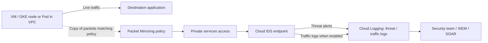
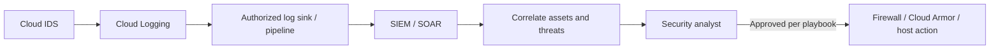

# Cloud IDS and Network Intrusion Detection

> **Chapter:** Network Security and Access  
> **Module:** CLOUD_PROVIDERS_GCP  
> **Module scope:** Explore Google Cloud from project organization, IAM, and VPC to Compute Engine, GKE, Cloud Run, storage services, and databases. Through deployment scenarios, learners gain the skills to choose services, protect resources, automate releases, and monitor reliability and cost.

When an application runs on Compute Engine or Google Kubernetes Engine (GKE), defensive controls such as VPC firewalls, IAM, and application authentication help **limit permitted actions**. However, operations teams also need to know **which traffic shows anomalous or malicious indicators**—such as vulnerability exploits, communication with malware command-and-control servers, or lateral movement between hosts in the network.

**Cloud Intrusion Detection System (Cloud IDS)** is a managed network intrusion detection service on Google Cloud powered by Palo Alto Networks threat detection technology. Cloud IDS receives **a copy of network traffic** from Packet Mirroring, analyzes it, and generates **threat alerts/logs** when suspicious indicators appear. The service supports observing both **north–south** traffic (between the internal network and external networks) and **east–west** traffic (between internal workloads).

**Most important limitation:** Cloud IDS is a **detection and alerting system (IDS)**, not an **inline prevention mechanism (IPS)**. An alert appearing **does not mean** a request was blocked, an infected host was isolated, or the system automatically remediated itself.

## Learning Objectives

After this lesson, you will be able to:

1. Explain the role of Cloud IDS in Google Cloud's defense-in-depth model and distinguish IDS from IPS, Cloud NGFW, Cloud Armor, firewalls, and VPC Flow Logs.
2. Describe the **workload → Packet Mirroring → Cloud IDS endpoint → Cloud Logging → response workflow** path.
3. Understand **zonal IDS endpoints**, monitored regions, private services access, IAM, severity levels, and visibility limits for encrypted traffic.
4. Select subnets/VMs, ingress/egress, and Packet Mirroring filters to control detection scope and cost.
5. Inspect resources via Console/`gcloud`, read threat logs, and verify an existing monitoring configuration.
6. Design a triage, investigation, and coordinated response workflow when suspicious activity is detected without causing arbitrary outages.
7. Clean up lab-dedicated Packet Mirroring policies and IDS endpoints in the right order without affecting shared resources.

## 1. Where Does Cloud IDS Sit in the Network Architecture?

Cloud IDS operates as an **out-of-band** observability component: it inspects a **copy** of selected packets rather than sitting inline in the data path deciding whether to allow or drop each packet.



The diagram intentionally separates **live traffic** from **mirrored traffic**:

- Application data continues to the destination following existing routes, firewalls, and network design.
- Packet Mirroring selects traffic from supported VMs or sources and **copies** it to the Cloud IDS collector.
- The Cloud IDS endpoint analyzes the mirrored copy and writes findings to the corresponding log streams.
- The security team uses logs to verify severity, trace the source, and decide whether to block or isolate using **other tools** when needed.

Cloud IDS fits when you need to detect exploits, spyware, malware, command-and-control, or anomalous activity on VM/GKE networks; it **does not replace** OS patching, IAM controls, firewalls, encryption, or application monitoring.

## 2. Core Concepts

| Concept | Meaning | Important notes |
|---|---|---|
| **IDS endpoint** | Cloud IDS resource analyzing copied traffic | **Zonal** resource, but can monitor sources across zones in the **same region** |
| **Packet Mirroring** | Copies selected traffic to a collector | Having an endpoint without an attached mirroring policy yields no traffic to analyze |
| **Private services access** | Private connection between customer VPC and Google-managed service network | Requires Service Networking API, allocated IP range, and proper private connection |
| **Severity** | Minimum threat threshold reported | `INFORMATIONAL`, `LOW`, `MEDIUM`, `HIGH`, `CRITICAL` |
| **Threat signature** | Pattern/indicator used to identify suspicious behavior | Updated as a managed service; false positives and false negatives still occur |
| **Threat log** | Alert log for detected threats | Used for triage and response coordination |
| **Traffic log** | Details about observed sessions/flows | Can generate high log volume; consider permissions and cost |
| **Mirrored bytes** | Metric showing volume of replicated traffic | Used to verify whether the policy is actually mirroring source traffic |
| **Threat exception** | Configuration to suppress specific noisy threat IDs with justification | Never disable broadly without review; per-endpoint limits apply |

### 2.1. Endpoints Are Zonal, Yet Monitoring Scope Is Regional

A Cloud IDS endpoint is created in a specific **zone**, such as `asia-southeast1-a`. However, that endpoint can process traffic from other zones **within the same `asia-southeast1` region** if the Packet Mirroring policy selects supported sources.

Example:

```text
VPC: app-vpc
Region: asia-southeast1
    ├── Zone a: web-vm-1
    ├── Zone b: api-vm-2
    └── Cloud IDS endpoint in zone a
           └── Receives mirrored traffic from sources in this region

Region: asia-east1
    └── Other VMs require a suitable endpoint/policy in this region
```

**Do not assume an endpoint in Singapore automatically monitors VMs in other regions.** Each region requires its own endpoint and Packet Mirroring plan; multiple endpoints within a single region may be needed when traffic volume is high or monitoring scopes are split.

Per product guidance, each endpoint has a nominal inspection capacity of up to **5 Gbps**; plan for multiple endpoints when monitored traffic exceeds that level. Burst capacity should not be treated as guaranteed sustained capacity. Verify quotas, limits, and availability at deployment time.

### 2.2. North–South and East–West

| Traffic flow | Example | Detection value |
|---|---|---|
| **North–south** | VM receives Internet connections via a frontend; VM connects outbound to external hosts | External exploit attempts, spyware, or C2 communication |
| **East–west** | App VM calls database VM; GKE nodes/Pods exchange traffic | Indicators of lateral movement or anomalous internal connections |
| **Hybrid** | GCP workloads communicate with on-premises servers over VPN/Interconnect | Supports monitoring traffic segments traversing mirror-capable sources |

Being described as "hybrid network monitoring" **does not mean** Cloud IDS can inspect every packet inside on-premises networks. You still must determine **which traffic traverses VMs/subnets eligible for mirroring**, which regions have endpoints, and service constraints.

## 3. How Cloud IDS Differs from Firewalls, Cloud Armor, and Logging Tools

| Tool | Primary role | Automatically blocks traffic per configured action? |
|---|---|---|
| **VPC firewall / Cloud NGFW** | Evaluates and enforces network rules; can control traffic | **Yes**, per policy/rule and product capabilities |
| **Cloud Armor** | Layer 7 protection for supported backends/load balancers; policies, WAF, DDoS mitigation | **Yes**, when policy is configured to deny or handle traffic |
| **Cloud IDS** | Analyzes copies of network packets to detect threats | **No**; detects and alerts, does not perform inline blocking |
| **VPC Flow Logs** | Observes metadata of network flows within supported scope | **No**; records activity, not an IDS signature engine |
| **Cloud Logging / SIEM** | Collects, searches, and correlates security events | **Not by default**; can integrate with custom-built automation |
| **Endpoint Detection and Response (EDR)** | Observes processes, files, and host behavior if an agent is deployed | Depends on EDR; Cloud IDS does not replace host telemetry |

**Example:** a system receives suspicious requests. Cloud Armor can reject requests violating rules before they reach the backend. Cloud IDS can detect exploit indicators in **mirrored and inspectable traffic** and emit logs. EDR and application logs help confirm whether a process actually executed anomalously.

To build defense in depth, correlate multiple telemetry sources rather than expecting a single product to block, detect, investigate, and recover from every attack type.

## 4. Cloud IDS Deployment Architecture

### 4.1. Four Required Components

A configuration capable of processing traffic requires:

1. **Workload VPC** containing the sources to mirror, such as subnets holding VMs or GKE nodes.
2. **Private services access** with a valid RFC 1918 range and connection to service networking; the service provisions Google-managed infrastructure to receive mirrored traffic.
3. **Cloud IDS endpoint** in an appropriate zone, configured with severity and in ready state.
4. **Packet Mirroring policy** pointing to the **collector forwarding rule** provided by the endpoint and selecting desired traffic sources.

Creating an endpoint alone **does not** automatically monitor the entire VPC. Creating a Packet Mirroring policy pointing to the wrong collector also fails to produce expected threat alerts.

### 4.2. Private Services Access Is Not Private Service Connect

Cloud IDS requires **private services access**. During setup, administrators:

- Enable `servicenetworking.googleapis.com` and related APIs.
- Allocate an RFC 1918 private IPv4 range dedicated to service networking.
- Create or update a **private connection** between the VPC and the service networking producer.
- Verify the CIDR **does not overlap** with subnets, connected VPCs, or ranges allocated to other services.

If the VPC already uses private services access for another service, never delete or overwrite the active connection. Cloud IDS requires an allocated IP range per documentation; updating the connection must preserve ranges still in use. **Private services access** here differs from **Private Service Connect**, even though their names are easily confused.

### 4.3. Why Is a Packet Mirroring Policy Needed?

A Packet Mirroring policy specifies:

- **Which sources are mirrored:** matching subnets, instances, or network tags. A single policy can select multiple sources.
- **Which region:** the policy and source subnets/VMs must match the endpoint's region.
- **Where copies go:** the collector forwarding rule associated with the IDS endpoint.
- **Which traffic is selected:** filters by protocol, CIDR, and ingress/egress direction among supported options.
- **Whether the policy is active:** policies can be enabled/disabled operationally.

Example:

```text
Project: lab-security-project
VPC: lab-vpc
Region: asia-southeast1
  Subnet: app-subnet
    VM api-lab-1 (selected traffic)
    VM db-lab-1  (excluded from selection)

Cloud IDS:
  Endpoint: ids-lab-1 (zone asia-southeast1-a)
  Packet Mirroring: mirror-api-lab
  Source: VM or network tag of api-lab-1
  Filter: only traffic requested for inspection
  Destination: endpoint forwarding rule of ids-lab-1
```

Selecting an **entire subnet** mirrors both existing and newly created VMs in that subnet, expanding scope and cost. For small labs, prefer targeting specific VMs/tags and relevant traffic.

### 4.4. Avoiding Monitoring Policy Conflicts

- A VM/packet falling under multiple overlapping Packet Mirroring policies does not mean every policy receives an independent copy; check Packet Mirroring limits.
- When **Cloud NGFW Layer 7 inspection policies** overlap traffic with Cloud IDS endpoint policies, Cloud NGFW's L7 handling can take **precedence**, preventing that traffic from being mirrored to Cloud IDS.
- Therefore, "having an endpoint and a policy" is **not enough** to prove all desired traffic is being analyzed.

## 5. Alert Classification and Evaluation

Cloud IDS uses Palo Alto Networks detection technology, including exploit detection and spyware/command-and-control signatures. Signatures are updated automatically as a managed service; operators do not manually install IDS engines on every VM.

### 5.1. Selecting the Minimum Severity Level

| Severity | Interpretation for triage | Operational response |
|---|---|---|
| **CRITICAL** | Particularly severe risk indicator per engine classification | Prioritize investigation, verify impact, and escalate immediately per runbook |
| **HIGH** | Significant threat needing prompt inspection | Analyze asset, source–destination, and exploit traces |
| **MEDIUM** | Noteworthy signal needing additional context | Correlate with host, application, and IAM logs |
| **LOW** | Less severe signal or lower likelihood of immediate impact | Monitor, group related events, tune noise carefully |
| **INFORMATIONAL** | Notable activity without direct threat indication | Useful for coverage surveys; increases log volume and triage load |

When creating an endpoint, `--severity` sets the **minimum threshold** to report. For example, `MEDIUM` captures medium and above, whereas `INFORMATIONAL` provides the widest visibility per the classification system. **Severity is not a probability score of "confirmed compromise"**; even a CRITICAL alert requires contextual verification.

### 5.2. Threat IDs and Exceptions

Alerts can include **threat ID, signature name, category, severity, source/destination, and timestamp**. For signatures causing persistent false positives, you can configure **threat exceptions** on the endpoint after analysis and approval.

Avoid:

- Disabling broad groups of signatures just to make a dashboard "green."
- Suppressing all alerts from a subnet simply because they occur frequently.
- Treating a threat exception as a fix for firewall misconfigurations or data exposure.

Document **why the exception is safe**, who approved it, affected resources, and its review expiration date. Cloud IDS enforces a limit on exceptions per endpoint; check current quotas/limits during operations.

## 6. What Cloud IDS Can and Cannot Observe

### 6.1. Encrypted Traffic

Packet Mirroring copies **raw packets**. When payloads are encrypted with TLS/HTTPS/HTTP2, IDS **does not automatically decrypt application content** merely by seeing packets. Consequently, an exploit inside an HTTPS payload may not be detected by HTTP payload inspection signatures.

Example:

```text
Client --- HTTPS ---> External Application Load Balancer
                         |
                         +--- HTTPS ---> Backend VM
                                           |
                                           +-- Packet mirroring: still TLS encrypted

Client --- HTTPS ---> External Application Load Balancer
                         |
                         +--- HTTP  ----> Backend VM
                                           |
                                           +-- Packet mirroring: HTTP payload observable
```

The second example only illustrates payload visibility; **it is not a recommendation to downgrade HTTPS between the ALB and backend** so IDS can read plaintext. In sensitive environments, preserve encryption requirements and pair with ALB logs, Cloud Armor, application logs, EDR, and approved inspection controls for coverage.

### 6.2. Workload Types and Network Paths

Cloud IDS works with traffic mirrored from supported Compute Engine/GKE sources. Some scenarios lie outside those paths:

- Requests traversing only a fully managed service with no VM/subnet mirror source per applicable mechanics.
- Data obscured by encrypted protocols.
- Traffic not matching configured subnet, instance/tag, protocol, CIDR, or direction filters.
- Traffic in regions/zones lacking an appropriate policy.
- Certain traffic over Private Service Connect or link-local addresses subject to Packet Mirroring limits.

**Conclusion:** "seeing no alerts" does not prove "there are no attacks"; first confirm **mirroring coverage**, traffic reaching the endpoint, inspectable/unencrypted visibility, and matching signatures.

### 6.3. Is There Bandwidth or Latency Impact?

Cloud IDS does not sit inline blocking requests; nonetheless, Packet Mirroring configuration and processed traffic volume still consume resources and require planning—including **endpoint capacity, mirrored volume, log volume, and cost**. Do not plan deployments assuming "mirroring is resource-free because it only copies packets."

## 7. Preparing for Safe Hands-On Practice

**Recommended approach for learners:** inspect **read-only** an existing Cloud IDS endpoint and Packet Mirroring policy authorized by your operations team. Creating a new endpoint incurs **hourly charges** even before any threat alerts appear, plus variable charges per volume analyzed. Without authorization/budget, do not create endpoints.

If executing the full workflow, use only a **sandbox project** and **dedicated VPC** with owner approval:

| Parameter | Illustrative example |
|---|---|
| Project | `my-gcp-security-lab` |
| Monitored VPC | `lab-vpc` |
| Subnet with test VMs | `app-subnet` |
| Region | `asia-southeast1` |
| Endpoint zone | `asia-southeast1-a` |
| IDS endpoint | `ids-lab-1` |
| Mirroring policy | `mirror-app-lab` |
| Minimum severity | `MEDIUM` or level approved by security team |
| Private services access range | Dedicated non-overlapping RFC 1918 range approved by network owner |

These names **do not create resources**; substitute real names in any live commands. Never modify production networks, routes, security policies, or shared private services access connections.

### 7.1. Checking Permissions and APIs

Relevant roles may include:

- `roles/ids.viewer`: view Cloud IDS endpoints within granted scope.
- `roles/ids.admin`: manage IDS endpoints; grant only to actual service administrators.
- `roles/compute.packetMirroringUser`: supports attaching Packet Mirroring policies as required.
- `roles/logging.viewer`: view relevant logs during investigations (some logs may require deeper permissions or policies).
- Permissions to configure Service Networking, VPC, and IAM if setting up **private services access**.

**Do not assume** a project owner automatically has permission to alter private services access, Packet Mirroring, or organization-wide firewalls. Shared VPCs and organization policies may require roles on the host project.

Relevant APIs include Cloud IDS API (`ids.googleapis.com`), Service Networking API (`servicenetworking.googleapis.com`), and Compute Engine API (`compute.googleapis.com`). Before enabling them, confirm they are not already enabled and that you are authorized to make changes.

### 7.2. Pre-Flight Inspection Using Read-Only Commands

In Cloud Shell or an authenticated Bash terminal:

```bash
PROJECT_ID="my-gcp-security-lab"
NETWORK_NAME="lab-vpc"
REGION="asia-southeast1"
ZONE="asia-southeast1-a"
ENDPOINT_NAME="ids-lab-1"
POLICY_NAME="mirror-app-lab"
SUBNET_NAME="app-subnet"

# Check active identity, project, and VPC before changing any config
gcloud auth list --filter="status:ACTIVE"
gcloud projects describe "$PROJECT_ID" \
  --format="table(projectId,name,lifecycleState)"
gcloud compute networks describe "$NETWORK_NAME" \
  --project="$PROJECT_ID"

# Inspect existing IDS endpoints and Packet Mirroring policies
gcloud ids endpoints list --project="$PROJECT_ID"
gcloud compute packet-mirrorings list --project="$PROJECT_ID"
```

If `ids endpoints list` returns permission denied or API not enabled, **do not proceed to creation commands** until verifying identity/roles and ownership. These read-only commands do not prove traffic is currently being mirrored until you inspect the endpoint, policy, and activity metrics.

## 8. Console Deployment: Controlled Steps

In an authorized sandbox project, the workflow typically involves:

### Step 1 — Prepare Private Services Access

1. Inspect the VPC and region to monitor, existing CIDRs, and active service networking connections.
2. Enable required APIs **if** authorized.
3. Reserve a **non-overlapping** RFC 1918 range dedicated to Cloud IDS.
4. Create the private services access connection or update the existing one **without replacing ranges serving other systems**.
5. Confirm components are ready before creating the endpoint.

This modifies network structure. Never experiment on a VPC serving Cloud SQL or multiple services unless you own the IP plan and private service connections.

### Step 2 — Create the Cloud IDS Endpoint

1. Open **Cloud IDS → IDS Endpoints** in Google Cloud Console.
2. Click **Create endpoint**.
3. Name the endpoint, and select the VPC, region, and target **zone**.
4. Choose the **minimum threat severity**. For learning environments, prefer the level requested by security; `INFORMATIONAL` widens coverage but increases noise.
5. Review settings and create the endpoint. Provisioning can take several minutes; do not treat it as ready until the status indicates so.

### Step 3 — Attach a Packet Mirroring Policy

1. On the endpoint, select **Attach** or navigate to **Packet Mirroring**.
2. Set the policy name and the **correct region** matching both sources and endpoint.
3. Select **specific subnets/instances/tags** aligned with the test goal.
4. Configure CIDR, protocol, and traffic direction filters. To observe both directions, ensure the policy captures **ingress and egress** per the corresponding option.
5. Confirm **collector** points to the forwarding rule created by the Cloud IDS endpoint and the policy status is **Enabled**.
6. Save, read back the configuration, and monitor mirrored traffic metrics.

Avoid selecting "Mirror all traffic" across a large subnet just to see if alerts fire: that sharply increases analyzed volume, cost, and sensitive security data recorded.

### Step 4 — Verify Operation

1. Endpoint is in **READY** or equivalent operational state.
2. Policy appears under **Attached policies**, is Enabled, and targets the right sources.
3. VMs in the mirrored subnet report **Mirrored Bytes** when matching traffic flows.
4. Cloud IDS/Cloud Logging displays threat logs if traffic contains detectable signatures; **having no threat logs can still be completely normal**.
5. Audit administrative action logs and alert routing for the operations team.

Never generate live exploit traffic or attack systems to "force" an alert. If signature validation is required by the organization, follow approved security testing procedures on isolated resources.

## 9. gcloud Example: Endpoint and Mirroring Policy

These are **sample commands that create real resources**; **do not run them** without verifying billing, IAM, private services access, VPC, and ownership. The foundational lesson can end at the read-only and Cloud Logging sections without creating a new endpoint.

### 9.1. Enable APIs When Authorized

```bash
# Run only in a sandbox project when APIs are not yet enabled and you are authorized
gcloud services enable \
  ids.googleapis.com \
  servicenetworking.googleapis.com \
  compute.googleapis.com \
  --project="$PROJECT_ID"
```

### 9.2. Private Services Access: Reference Example

Suppose the network team chose range name `ids-private-range` and verified CIDR `10.200.0.0/16` does not overlap subnets, hybrid networks, or other service networking ranges. **Do not reuse this CIDR blindly without checking your IP plan**.

```bash
RANGE_NAME="ids-private-range"

# Read existing service networking connections before making changes
gcloud services vpc-peerings list \
  --network="$NETWORK_NAME" \
  --project="$PROJECT_ID"

# Example: reserve a global range only when the IP plan permits
gcloud compute addresses create "$RANGE_NAME" \
  --global \
  --purpose=VPC_PEERING \
  --prefix-length=16 \
  --addresses=10.200.0.0 \
  --network="$NETWORK_NAME" \
  --project="$PROJECT_ID"
```

If **no private connection exists yet**, the command below illustrates connecting:

```bash
gcloud services vpc-peerings connect \
  --service=servicenetworking.googleapis.com \
  --ranges="$RANGE_NAME" \
  --network="$NETWORK_NAME" \
  --project="$PROJECT_ID"
```

**If a private connection already exists, do not re-run `connect` and do not overwrite the list of allocated ranges.** Inventory existing ranges in use and follow the Service Networking **update** procedure to preserve other services. This change affects network infrastructure and may need to be performed by a network administrator.

### 9.3. Create the Cloud IDS Endpoint

```bash
gcloud ids endpoints create "$ENDPOINT_NAME" \
  --project="$PROJECT_ID" \
  --network="$NETWORK_NAME" \
  --zone="$ZONE" \
  --severity=MEDIUM \
  --description="IDS endpoint for authorized learning lab"

# Verify endpoint details, state, and collector
gcloud ids endpoints describe "$ENDPOINT_NAME" \
  --zone="$ZONE" \
  --project="$PROJECT_ID"
```

The `create` command may return while the operation continues asynchronously. Proceed to the next step only after the endpoint is ready and exposes the **`endpointForwardingRule`** field. If creation fails, inspect private services access, permissions, quotas, IP ranges, and region/zone status.

### 9.4. Create the Packet Mirroring Policy

In the IDS endpoint `describe` output, locate **endpoint forwarding rule**. Copy the exact collector URL/path into the variable below; never substitute an ordinary internal IP or construct the URL manually:

```bash
# Replace with the real endpointForwardingRule value from describe output
COLLECTOR_RULE="projects/PROJECT_ID/regions/REGION/forwardingRules/COLLECTOR_RULE"

# Create only after verifying subnet/region and collector are accurate
gcloud compute packet-mirrorings create "$POLICY_NAME" \
  --project="$PROJECT_ID" \
  --region="$REGION" \
  --collector-ilb="$COLLECTOR_RULE" \
  --network="$NETWORK_NAME" \
  --mirrored-subnets="$SUBNET_NAME" \
  --filter-direction=both

# Review sources, collector, filters, and enabled state of the policy
gcloud compute packet-mirrorings describe "$POLICY_NAME" \
  --region="$REGION" \
  --project="$PROJECT_ID"
```

The example mirrors all of `app-subnet` to keep parameters simple. In production environments, use narrower **mirrored instances/tags or filters** where supported to avoid capturing unnecessary flows and inflating costs. Check exact flags and limits for your `gcloud` version before applying.

### 9.5. Verify After Creation

```bash
# Inspect Cloud IDS endpoint
gcloud ids endpoints describe "$ENDPOINT_NAME" \
  --zone="$ZONE" \
  --project="$PROJECT_ID" \
  --format="yaml(name,network,createTime,state,severity,endpointForwardingRule)"

# Inspect Packet Mirroring in the corresponding region
gcloud compute packet-mirrorings list --project="$PROJECT_ID"
gcloud compute packet-mirrorings describe "$POLICY_NAME" \
  --region="$REGION" \
  --project="$PROJECT_ID"
```

**Configuration succeeds** when the endpoint is ready, the policy is enabled, the collector is accurate, and mirrored sources belong to the intended subnet/region. **Operation succeeds** when telemetry confirms real traffic is being mirrored; this still does not guarantee every possible attack will be caught.

## 10. Reading Threat Logs and Traffic Logs

### 10.1. Threat Logs

Cloud IDS sends detected threat details to **Cloud Logging**. Useful fields include:

| Log field | Investigation meaning |
|---|---|
| `jsonPayload.threat_id` | Signature/threat identifier for lookup and correlation |
| `jsonPayload.name` | Event or threat name |
| `jsonPayload.alert_severity` | Severity: `CRITICAL`, `HIGH`, `MEDIUM`, `LOW`, or `INFORMATIONAL` |
| `jsonPayload.source_ip_address` | Source IP observed at the mirror point |
| `jsonPayload.destination_ip_address` | Destination IP observed |
| `jsonPayload.source_port` / `destination_port` | Ports, when included in the log |
| `jsonPayload.application` | Application/protocol classification by the engine |
| `jsonPayload.direction` | Traffic direction per log metadata |
| `jsonPayload.alert_time` | Detection timestamp |
| `resource.labels.id` | Cloud IDS endpoint name associated with the log |

Open **Logging → Logs Explorer** in the project hosting Cloud IDS and try an example filter:

```text
logName="projects/PROJECT_ID/logs/ids.googleapis.com%2Fthreat"
resource.type="ids.googleapis.com/Endpoint"
jsonPayload.alert_severity=("HIGH" OR "CRITICAL")
```

Replace `PROJECT_ID` with the real project. This filter focuses on HIGH/CRITICAL alerts; when testing configuration, remove the severity condition to see lower severities. If no results appear, check the time range, project, log viewing permissions, severity setting, and Packet Mirroring activity before assuming the service is broken.

### 10.2. Traffic Logs

Traffic logs provide network metadata such as source–destination, ports, protocol, duration, and bytes/packets for observed sessions. They help analyze **coverage** and traffic trends even without signature alerts.

However, enabling traffic logging can generate **high log volume**, impacting Cloud Logging cost, retention, and privacy. Enable it only with a clear operational goal, and design retention and log access per organizational policy.

### 10.3. Interpreting Context Behind a Load Balancer

When traffic passes through a Google Cloud load balancer, the source IP in a threat log may be a **Google Front End (GFE) proxy address** rather than the end client IP. Therefore, to identify the actual requester, correlate **load balancer request logs, valid contextual HTTP headers, timestamps, trace IDs**, and application logs.

Never accuse a GFE address of being an attacker based solely on the source IP in a Cloud IDS log entry.

### 10.4. Configuration Change Audit Logs

Cloud Audit Logs for `ids.googleapis.com` help identify who **created, updated, or deleted endpoints**. This differs from threat logs: audit logs track **who changed configuration**, whereas threat logs reflect **what was detected in network traffic**.

Example query:

```text
protoPayload.serviceName="ids.googleapis.com"
```

Visibility into each audit log type depends on IAM and audit logging configuration, especially for Data Access audit logs.

## 11. Workflow for Handling a Security Alert

Suppose Cloud IDS detects a `HIGH`-severity alert involving an application VM. A responsible triage workflow:

1. **Identify the event:** collect `threat_id`, signature, source/destination, port, timestamp, and IDS endpoint.
2. **Assess confidence:** inspect the actual traffic type mirrored, encryption level, recurrence, signature history, and false-positive likelihood.
3. **Identify the asset:** map IP and timestamp to the VM, node/Pod, application, VPC, service account, and workload owner.
4. **Correlate evidence:** check VPC Flow Logs, Cloud Logging, load balancer logs, EDR, access/application logs, and IAM changes.
5. **Assess impact:** was there unauthorized access, sensitive actions, or data impact, or merely a probe rejected by the application?
6. **Choose action:** per approved playbooks, update firewall/Cloud Armor, restrict accounts, block paths, or isolate the workload if risk warrants it.
7. **Preserve evidence and recover:** retain logs/snapshots per policy, patch vulnerabilities, and verify application health.
8. **Learn from the incident:** tune mirroring coverage, alert rules, ownership, SLOs, and monitoring costs.

**Never automatically delete VMs, shut down projects, or block entire IP ranges on a single alert** without checking source, confidence, and blast radius. IPS/firewall actions and SOAR automation must be explicitly designed with approvals, loop guards, and rollback capability.

### 11.1. Integrating SIEM/SOAR

When an organization requires centralized workflows, logs can be exported or routed from Cloud Logging to SIEM/SOAR systems or pipelines via Google Cloud-supported mechanisms. Automation workflows can create tickets, enrich asset metadata, correlate related alerts, and present actions to an on-call security analyst for approval.



Automated systems must include deduplication, credential protection, and least-privilege execution permissions. Never dump raw logs containing sensitive addresses or payloads into unapproved chat channels.

## 12. Optimizing Cost and Coverage

Cloud IDS has two primary cost components:

1. **Hourly charge per provisioned/running IDS endpoint**.
2. **Variable charge per volume of traffic analyzed**.

Cloud Logging, log storage, exports, and related products may incur separate charges. Thus "leaving an endpoint running idle" still incurs cost even when zero alerts fire.

### 12.1. Choosing Mirroring Scope Intentionally

| Scope | Benefit | Trade-off |
|---|---|---|
| **Entire subnet** | Broad coverage, less chance of missing new VMs in subnet | Can be expensive; harder to prioritize noise |
| **Specific VM group or tag** | Focuses cleanly on critical applications | Requires governance over tags, VM lifecycle, and new sources |
| **Specific CIDRs/protocols only** | Reduces analyzed data and log volume | May miss unexpected behavior outside filter scope |
| **Ingress or egress only** | Fits targeted monitoring goals | Blind to the opposite direction unless monitored elsewhere |
| **Separate endpoints per region** | Aligns with regional boundaries and capacity | Increases endpoint count and fixed hourly cost |

No single filter fits every system. Security teams must weigh **threats to detect, data sensitivity zones, expected throughput, and acceptable cost**, then measure mirrored bytes and detection effectiveness.

### 12.2. Setting Budgets

Before production rollout:

- Estimate endpoint count, runtime hours, and GB mirrored/inspected under realistic load.
- Review Cloud IDS and Cloud Logging pricing at deployment time.
- Configure **Cloud Billing budgets and alerts** on the appropriate project. Remember budget alerts do not automatically stop spend.
- Label/tag endpoints and policies with owner metadata consistently for cost attribution.
- Periodically audit endpoints with no active mirror sources, overloaded endpoints, and overly broad traffic filters.

Never hardcode stale pricing figures from old docs into operational plans; rates, discounts, and currency depend on current pricing and billing accounts.

## 13. Real-World Scenarios

### Scenario A — Detecting C2 Communication from a VM

A team runs data-processing VMs in a VPC; one VM suddenly opens repeated outbound connections to a suspicious host. Cloud IDS detects a matching signature and writes a threat log.

**Response:** trace the VM by IP + timestamp, inspect EDR/processes and application logs, audit its identity/service account, and verify actual compromise. If confirmed, responders apply firewall/NGFW rules and approved host-isolation procedures. Cloud IDS **does not block** that connection automatically.

### Scenario B — Lateral Movement Activity

An application VM starts connecting to multiple VMs in the same subnet on unusual ports. Because Packet Mirroring captures east–west traffic from the source VM, Cloud IDS can detect matching signatures.

**Response:** cross-check deployment schedules and internal jobs, VPC Flow Logs, firewall logs, machine owners, and signatures. Never assume every east–west connection is malicious without evaluating workload context and timing.

### Scenario C — HTTPS Behind an Application Load Balancer

Backend VMs use HTTPS from the ALB to the backend. Mirroring at the VM sees TLS packets, so Cloud IDS cannot decrypt HTTP payloads. Seeing no alert for a suspicious application request does not necessarily mean Cloud IDS failed.

**Response:** keep required encryption intact, and combine Cloud Armor policies, ALB request logging, and application/EDR telemetry for visibility; adjust observation points only if architecture permits and with formal approval.

### Scenario D — Multi-Region Deployment and Unexpected Cost

A team deploys an endpoint in a Singapore zone while expecting it to capture mirrored subnets in another region, and leaves extra unattached endpoints running. The setup misses intended coverage while still accruing hourly endpoint charges.

**Response:** check source/endpoint regions, policy collectors, and mirrored bytes; redesign endpoints per region and clean up unused standalone endpoints with owner sign-off.

## 14. Cleaning Up Lab Resources in the Right Order

**Perform this only on endpoints and policies you created for the lab, after verifying they are no longer serving assigned monitoring.** Deleting monitoring resources reduces security coverage; never remove production endpoints or shared policies to cut costs without approval.

### 14.1. Inventory Resources Before Deletion

```bash
printf 'Project: %s\nRegion: %s\nZone: %s\nEndpoint: %s\nPolicy: %s\n' \
  "$PROJECT_ID" "$REGION" "$ZONE" "$ENDPOINT_NAME" "$POLICY_NAME"

# Inspect endpoint and related policy
gcloud ids endpoints describe "$ENDPOINT_NAME" \
  --zone="$ZONE" --project="$PROJECT_ID"
gcloud compute packet-mirrorings describe "$POLICY_NAME" \
  --region="$REGION" --project="$PROJECT_ID"
```

### 14.2. Delete the Packet Mirroring Policy First

```bash
# Run only after confirming this policy belongs to the lab and coverage is no longer needed
gcloud compute packet-mirrorings delete "$POLICY_NAME" \
  --region="$REGION" \
  --project="$PROJECT_ID"
```

### 14.3. Delete the Endpoint No Longer Serving Monitoring

```bash
# Delete only the lab-dedicated Cloud IDS endpoint
gcloud ids endpoints delete "$ENDPOINT_NAME" \
  --zone="$ZONE" \
  --project="$PROJECT_ID"
```

Because Cloud IDS bills per endpoint hour, **the endpoint itself must be deleted** when the lab ends to stop hourly charges; deleting the Packet Mirroring policy **alone** does not stop endpoint billing.

### 14.4. Do Not Break Shared Private Services Access

If you created a **dedicated VPC_PEERING range and private services connection strictly for the lab**, check:

1. Is Cloud SQL or any other service using that connection or range?
2. Are any IDS endpoints still present in the VPC or project?
3. Have existing connection ranges been inventoried and approved for removal by the network owner?

If any dependency exists, **leave it intact** and hand it back to the network owner. Never delete `servicenetworking.googleapis.com`, shared private connections, firewalls, or production VPCs as part of lab cleanup.

### 14.5. Readback and Billing Check

```bash
gcloud ids endpoints list --project="$PROJECT_ID"
gcloud compute packet-mirrorings list --project="$PROJECT_ID"
```

Confirm the lab endpoint/policy are gone, update handoff notes, and check Cloud Billing. Billing data can lag, so never rely on an un-updated report to conclude all charges are zero.

## 15. Common Errors and Diagnostics

| Symptom | Possible cause | Resolution |
|---|---|---|
| Cannot create endpoint | Incomplete private services access, invalid/overlapping range, or missing quota/permissions | Check Service Networking, RFC 1918 range, peering, IAM, and API status |
| Endpoint stuck not ready | Provisioning still in progress or initial precondition failed | Check operation status and error logs; do not attach policies before READY |
| Endpoint READY but no threat logs | No mirroring policy attached, policy disabled, traffic mismatch, or no signature hits | Inspect attached policies, mirrored bytes, and coverage |
| Policy points to wrong collector | Did not use the IDS endpoint's actual `endpointForwardingRule` | Retrieve value from endpoint describe and verify matching region |
| Cannot mirror VM in another region | Endpoint/policy and source are not in the same supported region | Deploy endpoint/policy in the corresponding region per design |
| Mirrored bytes is 0 | No traffic, VM outside scope, or overly narrow filter | Verify sources/tags/subnets/direction/filters and live traffic |
| Only partial traffic seen | Overlapping Packet Mirroring policies, L7 inspection precedence, or unsupported source | Review policies, NGFW L7, traffic paths, and service limits |
| HTTPS attack yields no payload alert | Cloud IDS does not decrypt TLS payloads | Supplement with Cloud Armor, ALB logs, app logs/EDR |
| Alert shows Google Front End IP as source | Backend sits behind ALB; source IP at mirror point is the proxy | Correlate request logs and timestamps; never blame GFE as attacker |
| Excessive LOW-severity alerts | Scope/severity too broad or noisy signature | Triage, raise severity threshold if needed, or add approved exceptions |
| Cannot view threat logs | Missing Logs Viewer role or wrong project/time range selected | Verify Cloud Logging IAM, filter, and time window |
| IDS costs jump sharply | Mirroring large subnets, many endpoints, or excessive logging | Audit policies/ranges, analyze traffic, narrow valid scope |
| Policy deleted yet endpoint charges continue | Endpoint still exists | Check endpoint list and delete unneeded endpoints |

## 16. Self-Check Questions

**1. Does Cloud IDS automatically block traffic when it detects a HIGH signature?**  
**Answer:** No. Cloud IDS generates alerts. Blocking, isolation, or recovery requires separate tools and procedures.

**2. If you create an IDS endpoint without a Packet Mirroring policy, is the whole VPC monitored?**  
**Answer:** No. The endpoint must receive mirrored traffic via an appropriate policy.

**3. Can an endpoint in `asia-southeast1-a` observe a VM in `asia-southeast1-b`?**  
**Answer:** Yes, when the VM and endpoint are in the same region and the Packet Mirroring policy meets requirements; it is not automatic.

**4. Can one endpoint in `asia-southeast1` monitor all subnets in `us-central1`?**  
**Answer:** No under Cloud IDS's standard regional model. You need an appropriate endpoint/policy in each monitored region.

**5. Does severity `MEDIUM` mean only MEDIUM alerts are logged, excluding HIGH/CRITICAL?**  
**Answer:** No. It is a **minimum threshold**; higher severities are still reported.

**6. Why does seeing no alerts on HTTPS traffic not prove the application is safe?**  
**Answer:** Payloads may be encrypted, traffic may not be mirrored, or traffic may not match signatures. Additional telemetry and controls are needed.

**7. What is the role of private services access in Cloud IDS?**  
**Answer:** It establishes the private connectivity required between the customer VPC and Google-managed IDS infrastructure to deliver mirrored traffic.

**8. Why should you not select "Mirror all traffic" across an entire production VPC just to test the service?**  
**Answer:** It increases per-GB processing cost, expands observed data exposure, and raises operational risk; scope targets and filters first.

**9. Does deleting the Packet Mirroring policy stop all Cloud IDS charges?**  
**Answer:** No, not if the endpoint still exists; manage the endpoint lifecycle and verify billing.

**10. When a threat log shows a GFE IP, should GFE be treated as the attacker?**  
**Answer:** No. Correlate load balancer request logs, application traces, and proxy paths to trace the true client source.

## Key Takeaways

- **Cloud IDS detects, rather than blocks:** mirrored traffic is analyzed out-of-band, and alerts must be acted upon by accountable operators or response systems.
- **Both an endpoint and a Packet Mirroring policy are required**, alongside properly configured private services access, IAM, region, traffic sources, and collector.
- **Endpoints are zonal, monitoring scope is regional**; choose sources/directions/filters intentionally and check mirrored bytes to verify real coverage.
- **Threat logs differ from traffic logs and audit logs**; each answers different investigative questions and carries its own limitations.
- **TLS encryption limits payload inspection**; combine with Cloud Armor, Cloud NGFW, EDR, application logs, and foundational security controls.
- **Hourly endpoint charges and per-GB traffic charges** must be budgeted. At lab end, delete lab-owned policies and endpoints, while **never breaking shared network connections**.

## Official References

- [Google Cloud — Cloud IDS overview](https://cloud.google.com/intrusion-detection-system/docs/overview)
- [Google Cloud — Configure Cloud IDS](https://cloud.google.com/intrusion-detection-system/docs/configuring-ids)
- [Google Cloud — Best practices for Cloud IDS](https://cloud.google.com/intrusion-detection-system/docs/best-practice)
- [Google Cloud — Cloud IDS logging](https://cloud.google.com/intrusion-detection-system/docs/logging)
- [Google Cloud — Troubleshoot Cloud IDS](https://cloud.google.com/intrusion-detection-system/docs/troubleshooting)
- [Google Cloud — Use Packet Mirroring](https://cloud.google.com/vpc/docs/using-packet-mirroring)
- [Google Cloud — Cloud IDS pricing](https://cloud.google.com/security/products/intrusion-detection-system#pricing)
