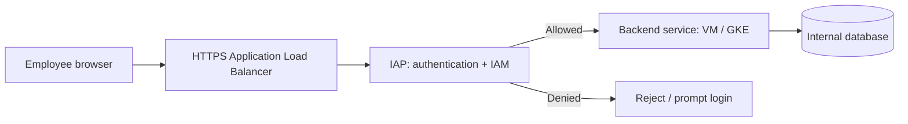
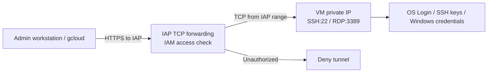
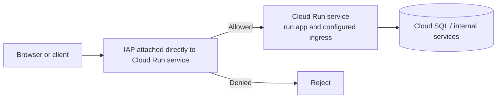

# Identity-Aware Proxy for Applications and TCP Forwarding

## 1. The Problem: Not Every Resource Should Be Exposed on the Public Internet

In a Google Cloud environment, many applications are intended solely for employees or administrators: order management portals, internal dashboards, service admin UIs, database VMs, and troubleshooting bastions. Relying solely on publishing IPs, opening ports, or allowlisting an office IP range breaks down when staff work remotely, change networks, or have an account compromised.

**Identity-Aware Proxy (IAP)** is an **identity- and context-aware** access control layer placed in front of supported resources. Rather than requiring users to come from a specific IP address, IAP authenticates identity and checks IAM permissions before forwarding requests to an application or opening a TCP tunnel.

Within the **CLOUD_PROVIDERS_GCP** module, IAP connects topics across **Organization/Project, IAM, VPC, Compute Engine, GKE, Cloud Run**, application deployment, and security monitoring. Understanding IAP helps engineering teams establish controlled operational access paths, reduce the need for public IPs on VMs, and shrink the attack surface.

After this lesson, you will be able to:

1. Distinguish **IAP for web applications** from **IAP TCP forwarding**.
2. Design authentication and authorization enforcement points for HTTP(S), SSH, RDP, and custom TCP.
3. Use IAM roles such as `roles/iap.httpsResourceAccessor`, `roles/iap.tunnelResourceAccessor`, and OS-level permissions independently from IAP.
4. Understand how IAP integrates with **Application Load Balancer**, **Cloud Run**, Compute Engine, and VPC/hybrid architectures.
5. Practice `gcloud compute ssh --tunnel-through-iap` and `gcloud compute start-iap-tunnel`.
6. Prevent mistakes such as **direct backend bypass**, overly broad firewall rules, trusting unverified headers, and over-privileged tunnel grants.
7. Troubleshoot access failures using IAM, audit logs, connectivity checks, operational procedures, and cost tracking.

> **Note:** Project IDs, domains, VMs, addresses, and emails in this lesson are **illustrative examples**. Commands that create firewall rules or modify IAM have security impact and must only be executed with proper authorization and approval workflows. For production, verify features, prerequisites, and syntax against current documentation.

## 2. The Zero Trust Model and Where IAP Fits

Under a **Zero Trust** approach, a request is not trusted merely because it originates from an internal network. Access must be tied to identity, context, and policy on a specific resource.

IAP has two primary usage modes:

| Usage mode | Typical resources | Connection type | What does IAP check? |
| --- | --- | --- | --- |
| **IAP-secured web applications** | Apps behind HTTPS Application Load Balancer, App Engine, or Cloud Run directly where supported | HTTP(S) | Caller identity and IAM/web access conditions |
| **IAP TCP forwarding** | Compute Engine VMs, and other TCP targets via supported features | SSH (TCP/22), RDP (TCP/3389), other admin TCP ports | Permission to open a tunnel to the target resource and port; IAM context |

Both modes share the spirit of **identity-aware access**, yet they **do not share the same backend configuration, network flow, or IAM roles**.

### Which Protection Layers Does IAP Not Replace?

- **Application authentication and business authorization:** IAP lets a principal reach the application, but the application still decides which orders they can view or which settings they can edit.
- **OS-level permissions:** permission to open an SSH tunnel does not grant a Linux login; permission to tunnel RDP does not grant a Windows account.
- **Firewalls and VPC:** IAP TCP needs a network path to the VM; IAP web needs controls blocking paths that bypass IAP.
- **TLS and data protection:** IAP secures the connection to IAP, but sensitive data still requires encryption at rest, data transfer rules, and application security.
- **MFA, Context-Aware Access, and monitoring:** IAP can work alongside these controls; enabling IAP alone does not complete an entire security strategy.

**Principle:** IAP protects **paths routed through IAP**. If another path reaches the same application or VM without passing through IAP, users can **bypass** this check.

## 3. Web Application Access Flow Through IAP

Suppose an employee visits `https://admin.example.com`, deployed on Compute Engine or GKE behind an **HTTPS Application Load Balancer** with IAP:



Logical steps:

1. Client connects over HTTPS to the load balancer frontend.
2. IAP verifies identity or redirects the user through the login flow when needed.
3. IAP evaluates whether the principal is allowed to access the **IAP-secured web resource** per IAM policy and any configured conditions.
4. Once permitted, the request proceeds to the backend; IAP can pass identity metadata to the application via IAP-managed headers.
5. The application enforces its own **business authorization**.

### Defining IAM Resource Scope

The **IAP-secured Web App User** role:

```text
roles/iap.httpsResourceAccessor
```

This role permits access to **IAP-protected web resources** within the effective IAM binding scope. It **does not grant** project admin roles, SSH access, or permission to alter IAP settings.

Depending on the product, policies can be attached at the project level or on a specific IAP resource (e.g., a backend service or Cloud Run service where supported). **Prefer the narrowest scope** needed rather than granting access across the entire project.

## 4. IAP TCP Forwarding Flow

IAP TCP forwarding lets an authorized client open a **TCP tunnel** to a VM without requiring an external IP on the VM.



Unlike IAP web, this is a **tunnel for a raw TCP byte stream**, not an HTTP reverse proxy handling cookies or URL paths.

### Key Points

- **TCP, not UDP:** IAP TCP forwarding fits SSH, RDP, and TCP-based admin services; it is not an equivalent solution for tunneling UDP.
- **Works with private IPs:** target VMs need no external IP, reducing the attack surface.
- **Firewalls are still mandatory:** the IP range used by IAP must be permitted to reach the target port.
- **IAP only gates the tunnel:** the underlying service still requires its own protocol authentication/authorization.
- **Not a bulk data transfer tool:** IAP TCP forwarding is built primarily for administrative access; product documentation outlines limits and potential bandwidth controls.
- **Does not automatically block direct paths:** if the VM still has a public IP and SSH open from anywhere, others can still connect directly bypassing IAP.

## 5. Comparing IAP Web and TCP Forwarding

| Criterion | IAP for web apps | IAP TCP forwarding |
| --- | --- | --- |
| Target | HTTP(S) applications | TCP sockets on VMs/supported targets |
| Examples | Dashboards, admin portals, internal web UIs | SSH, RDP, TCP admin consoles |
| User experience | Browser/login, HTTP requests | `gcloud compute ssh`, local port tunnel, RDP client |
| Access role | `roles/iap.httpsResourceAccessor` | `roles/iap.tunnelResourceAccessor` |
| Additional permissions | Business authorization, backend invocation where applicable | OS Login/SSH key or Windows credentials, VM view permissions |
| Backend connection | Via IAP web mechanism and integrated product | IAP TCP source range to VM/target |
| Firewall focus | Prevent bypassing IAP; configure valid ingress | Allow admin ports only from IAP and approved sources |
| Access layer | HTTP(S) | TCP transport |
| Port control | Not used to grant individual access to TCP/22 | Supports IAM Conditions on `destination.port` |
| User identity at app | Headers/JWT can be forwarded by IAP to backend | IAP does not convert the user into an account inside the protocol |

## 6. IAM and Separation of Duties

| Group / principal | Typical permissions | Purpose |
| --- | --- | --- |
| Portal users | `roles/iap.httpsResourceAccessor` on the exact web resource | Access application via IAP |
| VM admins using tunnels | `roles/iap.tunnelResourceAccessor` | Allowed to establish tunnels |
| Linux login admins | `roles/compute.osLogin` or `roles/compute.osAdminLogin` when OS Login is enabled | OS login permission |
| VM config admins | Appropriate Compute role, e.g., `roles/compute.instanceAdmin.v1` when required by job | Administer Compute Engine resources |
| Principals acting with VM service account | `roles/iam.serviceAccountUser` when needed | Use service account identity per IAM rules |
| IAP policy admins | `roles/iap.admin` or appropriate policy admin role per product | Configure and manage IAP permissions |
| Firewall admins | Appropriate network/security admin role | Open exact path from IAP to backend |

The roles in this table are not a bundle to grant uniformly to everyone. `gcloud compute ssh` documentation lists required VM/project read permissions; OS Login and metadata-based SSH keys carry different OS-level permission models.

### Two Permission Layers in IAP TCP

An operator holding `roles/iap.tunnelResourceAccessor` without OS Login permission can successfully **open a tunnel** and still **fail to log in via SSH**. Conversely, an operator holding `roles/compute.osLogin` without IAP tunnel access fails **before** ever reaching the OS layer.

### Two Permission Layers in IAP Web

An employee permitted to reach a web portal through IAP is not automatically allowed to:

- View sensitive database tables inside the system.
- Modify IAM in the Google Cloud project.
- Call internal APIs from another environment.

**Being able to sign in** and **being authorized to perform business actions** are two separate decisions. Avoid applying IAP roles at the project level if applications serve different user groups.

## 7. Protecting Web Apps via HTTPS Application Load Balancer

This pattern fits applications running on **Compute Engine, GKE, or load-balancer-supported backends**, where the organization wants to protect one or more backend services with IAP.

### Step 1: Choose the Protection Point

Identify the HTTPS frontend, URL map, backend service, and application resources. IAP is enabled on the **appropriate backend service**, not simply toggled on an IP or forwarding rule.

Example:

```text
https://admin.example.com
        │
        ▼
External HTTPS Application Load Balancer
        │ backend service: admin-backend
        ▼
IAP-secured backend service
        │
        ▼
Managed instance group / GKE workload
```

### Step 2: Configure IAP on the Backend

In Google Cloud Console, navigate to **Identity-Aware Proxy** or the **Application Load Balancer** backend config, pick the backend service to protect, and enable IAP following the product's OAuth setup flow.

For configurations using a custom OAuth client with CLI support, commands look like:

```bash
# Example configuration change:
# requires the backend service and OAuth client to already exist validly.
gcloud compute backend-services update BACKEND_SERVICE_NAME \
  --global \
  --iap=enabled,oauth2-client-id=OAUTH_CLIENT_ID,oauth2-client-secret=OAUTH_CLIENT_SECRET \
  --project=PROJECT_ID
```

**Never commit an OAuth client secret directly into source control, public tickets, or shell history.** Use approved secret management and configuration delivery mechanisms. Some setups use a **Google-managed OAuth client**, so follow instructions specific to your resource type instead of copying this command verbatim.

### Step 3: Grant Web User Access

Create an IAM binding for `roles/iap.httpsResourceAccessor` for the authorized group using the portal. You can attach access conditions via **Access Context Manager** where supported and after reviewing organization policies.

Example: only `commerce-admins@example.com` can enter the admin UI; public customers never receive that role.

### Step 4: Prevent Backend Bypass

IAP only checks traffic **flowing through the IAP enforcement point**. If the backend exposes an independent public endpoint allowing direct access, close or restrict that path:

- For VMs, avoid unnecessary public IPs/ingress; restrict firewalls to load balancer and health check sources.
- For GKE, audit Services, Ingress/Gateway, external IPs, and alternate paths to backends.
- For Cloud Run used as a load balancer backend, restrict ingress appropriately or disable the default URL per supported architecture.
- In all cases, keep application auth/authorization intact and verify the signed IAP JWT if consuming IAP-provided identity.

### Cloud CDN Note

**Cloud CDN and IAP are incompatible when enabled on the same backend service per external Application Load Balancer IAP documentation.** If a backend needs public CDN caching alongside IAP-authenticated sections, separate the architecture/paths appropriately; do not expect both features to combine on the same backend.

## 8. Enabling IAP Directly on Cloud Run

Cloud Run supports **IAP directly on the service**. This differs from the older architecture that required placing IAP on a load balancer.



### Advantages

- Protects **all ingress paths** to the Cloud Run service, including the default `run.app` URL and load-balanced flows.
- Eliminates needing a load balancer solely to get an IAP enforcement point for a simple Cloud Run service.
- Manages IAP permissions per principal or group.

### Important Limitation

**Do not configure IAP simultaneously on both the load balancer and the Cloud Run service itself.** Pick **a single IAP enforcement point** for that path per Cloud Run documentation. When migrating approaches, audit policies, service agents, and ingress paths to avoid accidental blocks or bypass gaps.

### CLI Configuration Sample

Suppose service `admin-portal` is deployed in region `asia-southeast1`, project `acme-prod-001`.

```bash
# Service-mutating operation; run only when approved
gcloud run services update admin-portal \
  --region=asia-southeast1 \
  --project=acme-prod-001 \
  --iap
```

IAP needs permission to invoke the Cloud Run service. When configuring via `gcloud`, documentation requires granting the **IAP service agent** `roles/run.invoker` on the service. Identity format:

```text
service-PROJECT_NUMBER@gcp-sa-iap.iam.gserviceaccount.com
```

Example (substitute real `PROJECT_NUMBER` and service):

```bash
# Mutates Cloud Run service IAM:
gcloud run services add-iam-policy-binding admin-portal \
  --region=asia-southeast1 \
  --project=acme-prod-001 \
  --member=serviceAccount:service-PROJECT_NUMBER@gcp-sa-iap.iam.gserviceaccount.com \
  --role=roles/run.invoker
```

When enabling IAP via the **Cloud Run Console**, the invoker binding for the IAP service agent is typically configured automatically in the guided workflow. Never grant public `allUsers` access to fix an invoker error without understanding why.

### Inspecting Configuration and IAP Policy

```bash
# Read-only: IAP status on the Cloud Run service
gcloud run services describe admin-portal \
  --region=asia-southeast1 \
  --project=acme-prod-001

# Read-only: IAM policy granting IAP web access to the Cloud Run service
gcloud iap web get-iam-policy \
  --resource-type=cloud-run \
  --service=admin-portal \
  --region=asia-southeast1 \
  --project=acme-prod-001
```

In the `describe` output, check for **Iap Enabled: true**. For the user group needing access, bind `roles/iap.httpsResourceAccessor` on the corresponding IAP resource.

```bash
# Example granting web access: IAM change after approval
gcloud iap web add-iam-policy-binding \
  --resource-type=cloud-run \
  --service=admin-portal \
  --region=asia-southeast1 \
  --project=acme-prod-001 \
  --member=group:commerce-admins@example.com \
  --role=roles/iap.httpsResourceAccessor
```

**Note:** the service agent invoker role allows IAP to invoke Cloud Run, whereas `httpsResourceAccessor` specifies **which users** IAP permits through. These are two distinct bindings and do not substitute for one another.

### OAuth and External Users

A Google-managed OAuth client typically suits users **inside the Organization**. When serving users **outside the Organization** or projects not inside an Organization, a **custom OAuth client** and additional setup steps may be needed; initial setup sometimes must be performed via the Console. Consult current docs rather than assuming external emails will immediately work.

## 9. Protecting Application Identity via IAP Signed Headers

Once IAP web authenticates a user, the application can receive identity information via HTTP headers. However, **never blindly trust an email header in a request** if the application could be reached outside IAP.

### Signed and Unsigned Headers

| Header | Meaning | How to handle |
| --- | --- | --- |
| `x-goog-authenticated-user-email` | Email info forwarded by IAP on requests passing through IAP | Do not treat as strong proof unless certain all requests traverse IAP |
| `x-goog-authenticated-user-id` | User identifier from IAP | Still vulnerable to spoofing on bypass paths |
| `x-goog-iap-jwt-assertion` | JWT signed by IAP | Verify **signature, issuer, audience, and expiration** before trusting |

An attacker can forge raw headers if they reach the backend directly outside IAP. IAP strips/overwrites client-supplied headers on requests going through IAP, but **unprotected backend paths** must still be locked down.

### JWT Verification Workflow

Applications should use a trusted JWT library to:

1. Read `x-goog-iap-jwt-assertion`.
2. Verify the signature using IAP's published **public keys**, never hardcoding a single key.
3. Enforce the expected signing algorithm, e.g., **ES256** per IAP signed headers docs.
4. Verify `iss` equals `https://cloud.google.com/iap`.
5. Verify `aud` matches the exact **protected IAP resource**, whose audience format depends on backend type.
6. Validate `exp`, `iat`, and time constraints per library and policy.
7. Extract identity from verified claims before making business authorization decisions.

Pseudocode example, **not a complete security implementation**:

```text
token = request.header["x-goog-iap-jwt-assertion"]
claims = verify_with_iap_public_keys(
    token,
    expected_algorithm="ES256",
    expected_issuer="https://cloud.google.com/iap",
    expected_audience=RESOURCE_AUDIENCE,
    validate_expiration=true
)

if claims invalid:
    reject(401)

identity = claims["sub"]
authorize_business_action(identity, requested_action, resource)
```

**Never roll your own JWT decoder by Base64-parsing claims without verification.** Use a real signature-verifying library, and obtain the audience format from docs matching **App Engine, Compute Engine backend service, or Cloud Run**. Never copy a staging audience string into production.

## 10. Preparing IAP TCP Forwarding on Compute Engine

Scenario: VM `ops-vm-01` in project `acme-prod-001`, zone `asia-southeast1-a`, has only a **private IP** and is used for internal administration.

### Prerequisites Before Connecting

1. Project has Compute Engine API, IAP API, and billing enabled per product requirements.
2. VM is running with a listener on SSH TCP/22 (or RDP TCP/3389 / another TCP service).
3. Client has `gcloud` or an IAP TCP-capable tool, signed in as the right principal.
4. Principal holds **IAP tunnel** permission on the target resource, plus required VM read permissions.
5. Firewall in the **VPC owning the VM's subnet** allows ingress from the IAP TCP range to the target port.
6. VM has an OS account/OS Login or appropriate service authentication configured.

### IAP TCP Source Ranges

For IPv4, the source range designated in Google Cloud documentation for IAP TCP forwarding is:

```text
35.235.240.0/20
```

For IPv6, documentation also publishes:

```text
2600:2d00:1:7::/64
```

Never open a port from `0.0.0.0/0` just because a connection failed. Restrict to the **exact port and exact backends** using firewall target tags or service accounts where supported. The IAP range controls **packet network source**, whereas **who may use IAP** is governed separately by IAM.

### Firewall Rule Example

Suppose the VM carries network tag `iap-admin-ssh` and resides in VPC `corp-prod` inside host project `acme-network-prod`:

```bash
# Firewall mutation: run only when approved
gcloud compute firewall-rules create allow-ssh-from-iap \
  --project=acme-network-prod \
  --network=corp-prod \
  --direction=INGRESS \
  --action=ALLOW \
  --rules=tcp:22 \
  --source-ranges=35.235.240.0/20 \
  --target-tags=iap-admin-ssh
```

Without Shared VPC, the project holding the firewall is usually the project owning the VPC. With Shared VPC, VMs reside in **service projects** while network firewalls are typically managed in the **host project**. The rule creator must have permission to modify firewalls in the right scope.

**Crucial check:** Adding this new rule does not revoke other ingress rules. If `default-allow-ssh` for `0.0.0.0/0` exists or the VM has a public IP with open SSH, direct access can still bypass IAP.

## 11. Connecting via SSH Through IAP

For VMs without a public IP, `gcloud compute ssh` may automatically choose an IAP tunnel. However, to ensure every SSH connection routes through IAP, **specify `--tunnel-through-iap` explicitly**:

```bash
gcloud compute ssh ops-vm-01 \
  --project=acme-prod-001 \
  --zone=asia-southeast1-a \
  --tunnel-through-iap
```

When a VM has an external IP, `gcloud compute ssh` **may connect directly over the external IP if this flag is omitted**. Therefore, when testing IAP policies, always verify the exact connection path taken.

### Distinguishing Two Common Errors

- **Tunnel rejected by IAP:** check `roles/iap.tunnelResourceAccessor`, IAM Conditions, VM/zone/project, and principal permissions.
- **Tunnel opens yet SSH fails:** check OS Login/SSH keys, sshd, Linux user account, firewall port 22, metadata, and VM logs.

Role `roles/iap.tunnelResourceAccessor` does not replace `roles/compute.osLogin` or equivalent SSH roles. When using **OS Login**, grant the appropriate level (`osLogin` or `osAdminLogin`), review sudo needs, and avoid shared accounts lacking auditability.

### Read-Only Diagnostic Commands

```bash
# Confirm active gcloud principal
gcloud auth list

# Inspect VM and network interfaces
gcloud compute instances describe ops-vm-01 \
  --project=acme-prod-001 \
  --zone=asia-southeast1-a \
  --format="yaml(name,status,networkInterfaces,metadata)"

# Check relevant ingress firewall rules in host project
gcloud compute firewall-rules list \
  --project=acme-network-prod \
  --filter="network:corp-prod"
```

Never print or share access tokens, SSH private keys, or sensitive metadata in public logs.

## 12. Using start-iap-tunnel for RDP and Custom TCP

`gcloud compute start-iap-tunnel` opens a **local TCP port** and forwards traffic through IAP to a port on the target VM.

### 12.1. RDP to a Windows VM

Windows VM `win-admin-01` has no public IP, with RDP listening on port 3389:

```bash
gcloud compute start-iap-tunnel win-admin-01 3389 \
  --project=acme-prod-001 \
  --zone=asia-southeast1-a \
  --local-host-port=localhost:13389
```

Once the command reports it is listening on `localhost:13389`, keep that terminal running and connect your Remote Desktop client to:

```text
localhost:13389
```

Traffic from the RDP client enters the local port, travels over HTTPS to IAP, and continues to TCP/3389 on the VM. **IAP does not supply Windows passwords**: users still need valid Windows accounts/credentials.

Binding the local port on an interface other than `localhost` risks exposing your tunnel to other machines. Prefer local loopback; do not share tunnels over LAN without dedicated security controls.

### 12.2. Other Administrative TCP Services

Suppose a VM runs an internal management UI on TCP/8443:

```bash
gcloud compute start-iap-tunnel ops-vm-01 8443 \
  --project=acme-prod-001 \
  --zone=asia-southeast1-a \
  --local-host-port=localhost:18443
```

Local clients can connect to `localhost:18443`. If the target service requires TLS with a specific hostname, configure the client with the **proper hostname/certificate verification** rather than disabling TLS verification merely because the IAP tunnel is encrypted.

**A TCP tunnel is not database query authorization.** For MySQL/PostgreSQL, users still need database credentials, network/SSL settings, and database privileges. Never use IAP tunnels as a general-purpose transport for high-volume business traffic.

### 12.3. Windows PowerShell

In PowerShell, you can enter the entire command on a single line:

```powershell
gcloud compute start-iap-tunnel win-admin-01 3389 --project=acme-prod-001 --zone=asia-southeast1-a --local-host-port=localhost:13389
```

The `\` line-continuation character used in the Bash examples above is not PowerShell's line-continuation operator.

## 13. IAM Conditions by Port or Context

Instead of letting administrators open tunnels to **any TCP port**, you can attach **IAM Conditions** to `roles/iap.tunnelResourceAccessor`.

Example condition:

```cel
destination.port == 22
```

Meaning: the tunnel grant only applies when the **destination port** equals 22. This governs **IAP TCP access**, not firewall configuration.

Stricter condition example:

```cel
destination.port == 22 &&
destination.ip == "10.20.10.15"
```

You can combine this with **Access Context Manager access levels** when configured by the organization and supported by the product. Conditions referencing `request.auth.access_levels` should only be used after creating and governing the corresponding Access Levels.

### Conditions and Limitations

- IAM Conditions constrain **the specific binding**, without automatically removing broader grants inherited from parent scopes or other resources.
- Tunnel IAM policies must be attached to the **IAP tunnel resource** at the right scope; attaching at the wrong level can grant overly broad access or have no effect.
- Port conditions do not block firewall ingress from other network sources.
- Conditioning on destination IP must account for private IP changes, multiple NICs, or VM replacement.
- Users still need login permissions at the OS or application layer.

When changing IAM, run both **positive tests** (valid principal reaches the right port) and **negative tests** (cannot reach other ports or out-of-scope VMs).

## 14. IAP in GKE, Cloud Run, and Hybrid Architectures

### 14.1. GKE and Internal Admin Portals

A GKE cluster can serve web apps via an HTTPS Application Load Balancer. IAP protects **supported web backends**, depending on Ingress/Gateway type, BackendConfig, and product integration.

Points to analyze:

1. Which Kubernetes resource does the LB map to the backend service?
2. Is IAP enabled on the right backend?
3. Is there another Service of type LoadBalancer, another Ingress, or a public endpoint bypassing directly to the app?
4. Do end users hold `httpsResourceAccessor`?
5. Does the app verify the JWT/IAP identity and enforce business authorization?

Do not assume a single project-level IAM binding automatically protects every Pod or Kubernetes Service. And never treat IAP TCP forwarding as a substitute for **Kubernetes RBAC** or control-plane governance.

### 14.2. Cloud Run

If you only need to protect a single Cloud Run service with IAP, **IAP directly on Cloud Run** is usually the simplest choice. If you need richer frontend networking such as centralized HTTPS host/path routing, consider an **Application Load Balancer** and enable IAP **either** there **or** on Cloud Run per supported patterns.

Pay special attention to push events or machine-to-machine calls: once IAP is enabled, calls using another service auth mechanism (such as Pub/Sub push to an endpoint) may require redesigning or separating endpoints. Never assume an OIDC/JWT token calling Cloud Run directly will automatically pass IAP.

### 14.3. On-Premises Resources via Hybrid Connectivity

IAP TCP forwarding supports **tunnel destination groups** for private IPs/FQDNs outside Compute Engine, including on-premises targets connected to Google Cloud via **Cloud VPN or Cloud Interconnect**. This differs from standard VM-name tunneling:

- You must configure a **destination group**, region, and network per product docs.
- Routes and firewalls must allow both forward traffic and return paths from IAP ranges.
- For destinations over VPN/Interconnect, plan advertisement of **35.235.240.0/20** so return traffic traverses the proper hybrid path.
- IAM permissions are evaluated on the target/tunnel destination group, not only on a Compute Engine instance.

Do not take a VM-only config and apply it directly to on-premises hosts; consult **IAP TCP forwarding by hostname/IP** documentation to design properly.

## 15. Preventing Bypass and Protecting Production

### Technical Checklist

1. **Minimize public exposure:** administer VMs via private IP/IAP; do not expose SSH/RDP directly from the Internet unnecessarily.
2. **Directional firewalls:** permit IAP TCP only from required source ranges and ports, with explicit denies/cleanup of overly broad rules.
3. **Minimal IAM scope:** grant IAP web/tunnel roles on specific resources or auditable groups; add port or access-level conditions where fitting.
4. **Backend authentication:** enforce OS Login/MFA, Windows credentials, app sessions/roles, and JWT verification when using IAP identity.
5. **Close bypass paths:** restrict public URLs, secondary ingresses, and extra load balancers; audit DNS and unadvertised endpoints.
6. **Protect change permissions:** review IAP Admin/Policy Admin, Security Admin, and ingress/load-balancer modification roles.
7. **Observability:** monitor Cloud Audit Logs, IAP access logs, and resource metrics; watch for repeated denials or unusual grants.
8. **Incident plan:** define who is authorized to remediate IAM and networking if IAP or user identity fails.

### Do Not "Hotfix" by Widening All Permissions

If IAP blocks an SSH connection, granting `roles/owner` or opening `tcp:22` to `0.0.0.0/0` may restore access while destroying the architecture's security intent. The right approach is identifying **which layer is denying**: identity, IAP tunnel IAM, OS Login, firewall, listener, or routing.

## 16. Troubleshooting IAP Web and TCP Forwarding

| Symptom | Possible cause | How to check |
| --- | --- | --- |
| Web app loops to login page repeatedly | Cookie/session issue, OAuth config, browser policy, wrong account | Inspect IAP configuration, browser flow, OAuth client, and account |
| Web returns 403 after sign-in | Missing `httpsResourceAccessor`, IAM Condition, Access Level mismatch | Read IAP IAM policy on the exact resource and inspect conditions |
| Web is reachable via another path despite IAP enabled | Direct backend URL/public IP/ingress left open | Audit all ingress paths and firewalls; verify JWT in application |
| Cloud Run has IAP enabled yet access fails | IAP service agent lacks `run.invoker` or user lacks role | Check Cloud Run describe/IAM and IAP web IAM policy |
| Cloud Run stops handling Pub/Sub push as before | Machine-to-machine flow fails IAP check | Review caller architecture, tokens, and separate endpoints |
| `gcloud compute ssh` skips IAP | VM has external IP so gcloud connects directly | Add `--tunnel-through-iap` and verify connection logs |
| SSH reports permission denied before connecting | Principal lacks `tunnelResourceAccessor`, VM read access, or condition fails | Check account, project/zone, IAP IAM, and IAM Conditions |
| IAP tunnel opens but SSH login fails | OS Login/SSH key/sshd mismatch | Check OS permissions, account, sshd, and VM logs |
| RDP tunnel opens but client cannot enter Windows | RDP listener, Windows firewall, credentials, wrong local port | Check port 3389, Windows settings, and tunnel listener |
| Tunnel times out | Missing ingress firewall from `35.235.240.0/20`, routing/VM listener down | Inspect VPC firewall, routes, VM status, port, and health |
| Local tunnel opens but app throws TLS error | Certificate does not match hostname `localhost` | Keep TLS verification intact; configure proper hostname mapping |
| IAP hybrid tunnel fails to reach on-premises host | Destination group, Cloud Router IAP range advertisement, or firewall wrong | Inspect hybrid routing, return path, and destination group IAM |
| Access denied immediately after role change | Propagation delay, group membership/condition update | Read effective IAM, audit logs, and retry after policy settles |

### Layer-by-Layer Investigation Order

```text
Principal and gcloud/browser account
       ↓
IAP IAM policy + Conditions/Access Levels
       ↓
IAP web resource or TCP tunnel destination
       ↓
Ingress/Firewall/VPC routing
       ↓
Backend VM / Cloud Run / GKE
       ↓
OS Login / RDP account / application authorization
```

Never conclude "IAP is broken" from a single HTTP 403 or failed SSH attempt. Determine **at which layer** the request failed and **which principal** actually ran. IAM and configuration propagation delays can briefly produce inconsistent results immediately after edits.

## 17. Monitoring, Auditing, Reliability, and Cost

### 17.1. Cloud Audit Logs and Access Investigation

Track IAP configuration edits, IAM grants/revocations, tunnel opens, and web accesses via **Cloud Audit Logs** provided by the product. Some access events fall under **Data Access logs** and may require explicit enablement; do not assume every event is logged free and enabled by default.

Useful signals:

- Unusual spikes in users denied by IAP.
- New accounts granted `httpsResourceAccessor` or `tunnelResourceAccessor` on production projects.
- Unexpected changes to SSH/RDP firewalls or Cloud Run ingress.
- Direct backend connections appearing outside architectural design.
- Tunnel setup latency, timeouts, and failure rates after an IAM update.

### 17.2. Reliability and User Experience

IAP adds a checkpoint on the access path. For critical portals, measure from the user's perspective: login success rate, page load latency, 403/5xx errors, backend responsiveness, and access-recovery procedures. For SSH/RDP administration, maintain a runbook in case the identity provider, client network, or IAP experiences an outage.

Avoid creating **over-privileged, unauditable break-glass accounts**. Any emergency access mechanism, if required, must be pre-approved, protected by MFA/additional controls, logged, and revoked after the incident.

### 17.3. Cost

Do not treat IAP as "zero cost." Total cost can include:

- IAP charges for web or TCP usage per current pricing terms/conditions.
- HTTPS Application Load Balancer, forwarding rules, data processing, and network egress if deploying an LB.
- Compute Engine, Cloud Run, GKE, VM disks, and backend databases.
- Cloud Logging/Monitoring and associated networking components.

Check **Cloud Billing Pricing/SKUs** for your billing account, region, and deployment time. For a low-traffic internal app, compare cost and features between **direct IAP on Cloud Run** and **IAP via a load balancer**, alongside reliability and HTTP routing needs.

## 18. Practice Exercises and Self-Assessment Scenarios

### Exercise 1: Identify the Right IAP Mode

Given three requirements:

1. Only the operations team accesses `https://internal-admin.example.com` via browser.
2. Support staff need SSH to VMs without public IPs.
3. Windows admins need RDP to VMs without exposing TCP/3389 to the Internet.

**Suggested answer:** (1) IAP-secured web application; (2) IAP TCP forwarding + OS Login/SSH; (3) IAP TCP forwarding + RDP credentials. Web roles differ from tunnel roles.

### Exercise 2: Analyze Effective Permissions

An operator has `roles/iap.tunnelResourceAccessor` on a VM and the firewall allows port 22 from IAP, but they have not been granted OS Login.

- Can the tunnel be established?
- Will SSH login necessarily succeed?
- Which extra permission is needed, where, and under what principle?

**Hint:** The IAP tunnel can succeed if other prerequisites are met, yet OS Login will still deny login. Grant the appropriate OS-level role as needed—never project-wide Owner.

### Exercise 3: Read Cloud Run Config Without Modifying Resources

On an authorized project and service:

```bash
gcloud run services describe SERVICE_NAME \
  --region=REGION \
  --project=PROJECT_ID

gcloud iap web get-iam-policy \
  --resource-type=cloud-run \
  --service=SERVICE_NAME \
  --region=REGION \
  --project=PROJECT_ID
```

Check whether IAP is enabled, which principals hold `httpsResourceAccessor`, whether the IAP service agent holds `run.invoker`, and whether an LB also has IAP enabled on the same service.

### Exercise 4: Test an SSH Tunnel Properly

Only on a lab VM you are authorized to access:

```bash
gcloud compute ssh VM_NAME \
  --zone=ZONE \
  --project=PROJECT_ID \
  --tunnel-through-iap
```

If it fails, classify by **IAP IAM**, **Compute/OS Login permissions**, **firewall from IAP**, or **VM listener**. Do not alter IAM/firewalls before identifying the root cause and confirming authorization.

### Exercise 5: Close a Bypass Path

An admin portal is protected by IAP at an HTTPS load balancer, yet the GKE Pod is also reachable via another public IP. Design the remediation:

1. Disable or restrict unnecessary public ingress to the Pod/Service.
2. Grant IAP web permissions to the right group.
3. Verify identity via signed JWT inside the application where appropriate.
4. Test the authorized path and attempt direct access to prove bypass is impossible.

### Exercise 6: Port-Based IAM Condition

Support needs SSH port 22 but must not tunnel to database port 5432. Write the CEL condition and explain why it is insufficient if the VM still exposes the database port directly to another source.

**Sample answer:**

```cel
destination.port == 22
```

The condition only restricts **grants through IAP TCP**; firewalls and database controls are still required to protect other access paths.

## 19. Pre-Deployment Checklist for IAP

- [ ] Clearly identified **HTTP(S)** app vs. **TCP** resource; selected the right IAP mode.
- [ ] Mapped all ingress paths completely; no uncontrolled bypass paths remain.
- [ ] IAP IAM policy grants access to the right group, right resource, and with appropriate conditions.
- [ ] IAP web users hold `roles/iap.httpsResourceAccessor`, not VM admin by default.
- [ ] IAP TCP users hold `roles/iap.tunnelResourceAccessor` on the required VM/destination.
- [ ] For SSH/RDP, verified **OS Login/Windows credentials** and supporting Compute permissions.
- [ ] IAP TCP firewall allows only `35.235.240.0/20`, target ports, and backends; no unneeded Internet SSH/RDP exposed.
- [ ] Cloud Run IAP is enabled at **a single point only**, not simultaneously on both LB and Cloud Run.
- [ ] IAP service agent holds `run.invoker` when Cloud Run configuration requires it.
- [ ] OAuth client and external-to-Organization users configured per current guidance.
- [ ] Application enforces business authorization and verifies signed JWT headers if consuming IAP identity.
- [ ] Machine-to-machine flows, Pub/Sub push, or webhooks accounted for before enabling IAP.
- [ ] Audit logs, monitoring, positive/negative tests, and recovery runbooks in place.
- [ ] Estimated costs for IAP, LB, networking, logs, and workloads.

## 20. Official Google Cloud Documentation

1. [Identity-Aware Proxy overview](https://cloud.google.com/iap/docs/concepts-overview)
2. [IAP – Securing web applications](https://cloud.google.com/iap/docs/enabling-cloud-run)
3. [Configure IAP for Cloud Run directly](https://cloud.google.com/run/docs/securing/identity-aware-proxy-cloud-run)
4. [Set up an external Application Load Balancer with IAP](https://cloud.google.com/iap/docs/load-balancer-howto)
5. [IAP – TCP forwarding overview](https://cloud.google.com/iap/docs/tcp-forwarding-overview)
6. [Use IAP for TCP forwarding](https://cloud.google.com/iap/docs/using-tcp-forwarding)
7. [IAP TCP forwarding by hostname or IP](https://cloud.google.com/iap/docs/tcp-by-host)
8. [IAP – Signed headers and JWT verification](https://cloud.google.com/iap/docs/signed-headers-howto)
9. [IAM roles and permissions for IAP](https://cloud.google.com/iam/docs/roles-permissions/iap)
10. [Compute Engine – OS Login](https://cloud.google.com/compute/docs/oslogin)
11. [gcloud compute ssh](https://cloud.google.com/sdk/gcloud/reference/compute/ssh)
12. [gcloud compute start-iap-tunnel](https://cloud.google.com/sdk/gcloud/reference/compute/start-iap-tunnel)
13. [Cloud Audit Logs](https://cloud.google.com/logging/docs/audit)

**Conclusion:** IAP is an **identity and access enforcement checkpoint**, not a complete firewall or business authorization system. For **web apps**, protect HTTP(S) flows and block backend bypass paths; for **TCP forwarding**, coordinate IAM, firewalls, private IPs, and OS login permissions. A secure configuration must always verify both **paths that should be allowed** and **paths that must be denied**.
