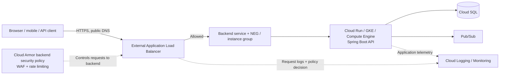
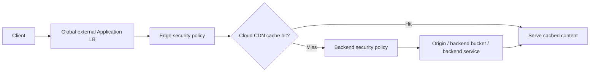

# Cloud Armor WAF, Rate Limiting, and DDoS Protection

## 1. The Problem: Protecting a Java API Before Requests Reach the Backend

A **Spring Boot** application running on **Cloud Run**, **Google Kubernetes Engine (GKE)**, or **Compute Engine** can serve millions of requests from the Internet. Not every request is legitimate traffic: some attempt **SQL injection (SQLi)**, **cross-site scripting (XSS)**, endpoint scanning, credential stuffing, or high-volume floods aimed at exhausting resources.

If every request reaches the JVM directly, the application wastes CPU, database connections, threads, and memory processing suspicious traffic. **Google Cloud Armor** enforces security policies at Google Cloud's load balancing/edge layer for supported configurations. Three capability groups are particularly important:

- **Web Application Firewall (WAF):** detects attack patterns in HTTP(S) requests using preconfigured rules based on the **OWASP Core Rule Set (CRS)** and custom expressions.
- **Rate limiting:** controls request rates by IP address or other keys; uses **throttling** or **rate-based bans** to mitigate abuse, bots, and traffic spikes.
- **DDoS defense:** leverages Google Cloud's global edge network to mitigate certain resource-exhaustion attacks; supplemented by network-level protection modes or adaptive detection where supported by product tier.

Within the **Network Security and Access** chapter of the **CLOUD_PROVIDERS_GCP** module, this lesson connects Cloud Armor with project/IAM organization, VPC, Cloud Load Balancing, Cloud Run/GKE/Compute Engine, reliability monitoring, deployment automation, and cost control. **Cloud Armor is one layer of defense**, not a replacement for authorization, secure coding, database permissions, TLS, or Java application security testing.

### Learning Objectives

After this lesson, you will be able to:

1. Identify where a **security policy** sits in the request path to a Java backend and cases where traffic could bypass protection.
2. Distinguish **backend security policies**, **edge security policies** for Cloud CDN, and **network edge security policies**.
3. Configure **rule priority**, **match conditions**, **actions**, **preview mode**, preconfigured WAF, custom rules, and exclusions.
4. Design **throttle** and **rate-based ban** rules matched to real traffic patterns; understand rate-limiting limits across multi-region and multi-backend setups.
5. Explain the differences between **Layer 3/4 DDoS**, **Layer 7 DDoS**, **Adaptive Protection**, and application-level controls.
6. Practice with `gcloud` on a **test load balancer**, enable logging, monitor false positives, and test safe rollouts and rollbacks.

## 2. Where Does Cloud Armor Sit in GCP Architecture?

### 2.1. Typical Architecture: HTTPS Load Balancer in Front of Spring Boot

Suppose the public endpoint is `https://api.example.com`. Users connect via an **external Application Load Balancer**; Cloud Armor evaluates requests against the policy attached to the backend service before forwarding requests to **Cloud Run via a serverless NEG**, a GKE backend, or a VM backend.



**Important:** Cloud Armor protects traffic **that actually traverses a supported enforcement point**. If another URL hits Cloud Run directly, a VM's public IP, or a load balancer without a policy, those requests can **bypass** the policy. Attaching a policy to one backend service does not protect every endpoint in the project.

### 2.2. Three Protection Layers to Distinguish

| Layer | Tools/capabilities | Question to answer |
| --- | --- | --- |
| **Network/transport (L3/L4)** | Network DDoS protection, firewalls, VPC, external passthrough Network Load Balancers | Is there a volumetric/protocol attack against an IP, port, or network infrastructure? |
| **HTTP application edge (L7)** | Cloud Armor security policies, WAF, custom CEL, rate limiting, bot management | Does the HTTP request carry malicious patterns, abnormal request rates, or an unapproved source? |
| **Backend business logic** | Spring Security, IAM/IAP where applicable, input validation, prepared statements, per-account quotas | Is the authenticated user authorized to act on this resource? Is the transaction valid? |

**Cloud Armor does not know business rules like "user A may only view A's orders."** Even after a request passes the WAF, Spring Security and the data layer must enforce authorization on every resource.

### 2.3. Cloud Armor Applies at Different Load Balancing Layers

| Policy type | Primary attachment point | Effects/limits to remember |
| --- | --- | --- |
| **Backend security policy** | Backend service of a supported load balancer | WAF, IP/geolocation filtering, CEL, rate limiting; with Cloud CDN, primarily evaluates requests reaching the backend/cache misses |
| **Edge security policy** | Cloud CDN-enabled backend service or backend bucket per LB type support | Evaluates requests **before serving from CDN cache**; has a different feature scope than backend policies |
| **Network edge security policy** | Supported network/L3–L4 endpoints via network edge service | Related to Advanced Network DDoS protection and certain network filtering capabilities per endpoint/tier |

Never assume every policy type supports every WAF expression, rate-limit key, action, or load balancer type. Check the **support matrix by Application/Network Load Balancer type, global/regional, and backend service/bucket** before deploying. The examples below illustrate a **global external Application Load Balancer with a backend security policy**, not a regional internal ALB or network edge policy.

## 3. Security Policies and Rule Evaluation

### 3.1. Priority, Match, and Action

Each rule typically has a **priority**, **match condition**, and **action**. Within a policy, **lower priority numbers are evaluated first**. Once a request matches an applicable rule, Cloud Armor applies that action; lower-priority rules (higher numbers) do not continue executing automatically.

```text
Priority 100    Deny a verified malicious IP source
Priority 500    Check SQLi using preconfigured WAF (deny, initially preview)
Priority 600    Check XSS using preconfigured WAF (deny, initially preview)
Priority 1000   Throttle /api/auth/** endpoint by IP
Priority 2147483647  Default rule (verify action; can be changed allow/deny)
```

This is an **illustrative ordering**. An overly broad `allow` rule at priority 50 can prevent requests from ever reaching the WAF at priority 500. Conversely, a low-numbered deny rule can block legitimate users before rate-limiting rules are evaluated. When designing, examine **actual evaluation order and conditions**, not just rule count.

Available actions include `allow`, `deny(403)`, `deny(404)`, `deny(502)`, `redirect`, `throttle`, and `rate-based-ban`, depending on policy type and conditions. For rate limiting, **429 Too Many Requests** usually communicates client throttling most clearly.

### 3.2. Basic Matching and CEL Expressions

Two common match modes:

- **Basic:** compares source IP against one or more CIDRs; suitable for allowing/blocking managed IP ranges.
- **Advanced:** uses **Common Expression Language (CEL)** syntax to evaluate `origin.ip`, `origin.region_code`, `request.path`, headers, query parameters, or preconfigured WAF functions among supported attributes.

Example expression:

```cel
inIpRange(origin.ip, '198.51.100.0/24')
```

`198.51.100.0/24` is a **TEST-NET-2 documentation range** and must not be used to block real users as if it were a threat feed. A path-filtering expression:

```cel
request.path.startsWith('/api/auth/')
```

Avoid relying on arbitrary client-supplied HTTP headers as trusted identity signals. If using `X-Forwarded-For`, understand proxy chains and how source IP is determined; **spoofed headers** can break rate limits or allowlists.

### 3.3. Preview Mode for Safe Testing

Cloud Armor supports **preview mode**: a rule is still evaluated and its hypothetical outcome is logged, but **its action is not enforced**. This is operationally mandatory when enabling WAF or tightening rate limits on APIs serving live customers.

Recommended workflow: add rule in preview → enable/check request logs → observe matched requests, endpoints, and false positives → tune sensitivity/exclusions/thresholds → test with a control group → switch to enforce in a change window → monitor with rollback ready.

**Preview is not "lightweight protection."** A deny rule in preview **does not block** malicious traffic; keep existing protective layers in place.

## 4. WAF and the OWASP Core Rule Set

### 4.1. What Are Preconfigured WAF Rules?

Cloud Armor includes preconfigured WAF rule sets based on the **OWASP ModSecurity Core Rule Set (CRS)**. Each rule group contains multiple signatures detecting suspicious traffic patterns. For example:

| Group | Target risk | What Java teams must test |
| --- | --- | --- |
| **SQL injection (SQLi)** | Payloads resembling SQL manipulation | Filter/search endpoints, parameterized queries, valid inputs with special characters |
| **Cross-site scripting (XSS)** | Script-injection patterns | Rich-text, comments, templates/HTML rendering |
| **Local/remote file inclusion** | Attempts to force the app to load unintended resources | Download/path routing, file parameters |
| **Remote code execution (RCE)** | Strings indicating command-execution exploits | JSON text, upload filenames, log fields |
| **Scanner/protocol anomalies** | Endpoint scanning or malformed requests | Monitoring probes, QA/SRE test traffic |
| **Java-specific attack signatures** | Attack patterns relevant to Java platforms | Input logging, serialized payloads, framework middleware |

At documentation reference time, Google Cloud provides **OWASP CRS 4.22** rule sets such as `sqli-v422-stable` and `xss-v422-stable`. Signature set names and versions update over time; check the [preconfigured WAF rules list](https://cloud.google.com/armor/docs/waf-rules) when creating policies. Cloud Armor also offers **managed rules** with `stable`/`canary` version channels, which differ slightly from manually enabling individual preconfigured WAF sets.

### 4.2. Expression Examples and Sensitivity

```cel
evaluatePreconfiguredWaf('sqli-v422-stable', {'sensitivity': 1})
```

The `sensitivity` parameter selects which signatures are active by sensitivity level (typically 1 through 4; level 0 is used when opting in only specific signatures). Higher sensitivity catches more payload variants while increasing **false-positive** risk. Never start by setting "level 4 and deny everything" on a production API without prior observation.

A similar rule for XSS:

```cel
evaluatePreconfiguredWaf('xss-v422-stable', {'sensitivity': 1})
```

Many Java applications accept JSON/GraphQL request bodies; Cloud Armor offers **JSON body parsing options** and supported content parsers. Enabling Content-Type-aware parsing can reduce false positives caused by JSON structural characters being scanned as a single raw string. Check capabilities and syntax in [Request body content parsing](https://cloud.google.com/armor/docs/content-parsing).

### 4.3. Body Inspection Limits: Do Not Treat WAF as an Unlimited Parser

Cloud Armor inspects **only up to the leading portion of a request body**, with configurable limits of **8, 16, 32, 48, or 64 KiB**, up to a **64 KiB** maximum. Always check the **configured inspection limit** on your policy rather than assuming one size across all environments. Payloads beyond that limit **are not fully inspected by the WAF**. Certain Content-Types/encodings may not be structurally parsed—such as compressed payloads or multipart forms—so Cloud Armor may inspect raw bytes instead.

For APIs accepting large file uploads or big JSON payloads, enforce **request size limits at the application/proxy**, validate schemas/bodies, and bound inputs. Never rely on a simple `Content-Length` header expression alone to block all large requests: some clients use chunked transfer encoding or alternate framing.

### 4.4. Tuning and False Positives

A false positive occurs when a legitimate request matches a WAF signature and risks being rejected. Examples include a user searching a string with single quotes, submitting HTML snippets in a technical article, or sending unusual JSON strings. To remediate:

1. Use logs to identify the **rule ID/signature**, path, content-type, and affected traffic volume.
2. Cross-check with business functionality to confirm the traffic is genuinely legitimate.
3. Lower sensitivity, **opt out a specific signature**, or configure a narrow **request field exclusion** if needed.
4. Keep the rule in preview and re-run both benign and attack regression cases before enforcing.
5. Avoid overly broad IP/path `allow` rules just to silence one signature, which can bypass multiple security layers.

For WAF rules with **request field exclusions**, Google Cloud enforces specific action/evaluation constraints; read [WAF rule tuning](https://cloud.google.com/armor/docs/rule-tuning) before configuring. WAF and Java input validation complement each other, yet **prepared statements, output encoding, and application authorization remain mandatory**.

## 5. Rate Limiting: Throttle or Rate-Based Ban?

### 5.1. Two Distinct Strategies

| Criterion | `throttle` | `rate-based-ban` |
| --- | --- | --- |
| Purpose | Cap excess traffic while still letting compliant requests through | Temporarily block requests from an offending client key for a ban duration |
| When threshold exceeded | `exceed-action` applied to requests over the limit | `exceed-action` plus ban state per config; subsequent requests can be blocked for the ban duration |
| Best fit | Public APIs, sudden spikes with many legitimate users | Sustained/confirmed abuse, repeated attacks |
| Risk | Legitimate users over threshold receive HTTP 429 | Many users sharing an IP get impacted longer when one user triggers a ban |
| Metrics to watch | Requests/s, 429s, latency, exceed rate | Ban count, ban duration, rate of legitimate traffic blocked |

For both strategies, the **conform action** is typically `allow` when requests stay within threshold. The `exceed action` is typically `deny-429` or another supported response. Never assume `rate-based-ban` is universally "stronger security"; for mobile users behind shared carrier-grade NAT (CGNAT) IPs, banning one IP can lock out a very large population.

### 5.2. Rate-Limiting Keys Determine Who Shares a Quota

| Key | Advantage | Risk / context |
| --- | --- | --- |
| **IP** | Easy to configure, no app code changes | NAT/CGNAT, shared corporate proxies → many users share one key |
| **ALL** | Caps total traffic matching the rule | Does not distinguish clients; easily blocks all legitimate users |
| **HTTP-PATH** | Limits per path | One path may serve many users; dynamic endpoints risk high cardinality |
| **HTTP-HEADER / HTTP-COOKIE** | Groups requests by token/header when appropriate | Client-supplied headers/cookies can be **spoofed or rotated continuously** |
| **XFF-IP / user-ip** | Attempts to extract source IP across intermediate proxies | Requires trusted proxy/header configuration to prevent spoofing |
| **JA3/JA4 fingerprint** | Classifies TLS client traits where supported | Many legitimate users share identical fingerprints; requires testing |

Never use `User-Agent` or arbitrary browser-sent cookies as the sole security key against intentional abuse. For APIs requiring limits **per account, API key, service plan, or tenant**, enforce **quotas in the backend or API Gateway/Apigee** bound to authenticated identity; Cloud Armor rate limits do not replace transactional per-account quotas.

### 5.3. Thresholds Apply Per Backend and Region, Not as a Strict Global Quota

Cloud Armor enforces rate limiting per protected **backend service** and **traffic-processing region** per supported model. For instance, if a policy attaches to two backends, a 1,000 requests/minute threshold **does not mean the whole project allows only 1,000 requests/minute total**. In multi-region setups, the same key can be tracked independently across regions, allowing total requests reaching backends to exceed what you might expect.

When a requirement strictly states "Customer A gets at most 500 transactions/day system-wide," implement a **business quota** in a component with centralized state or transaction checks rather than deriving business quotas from Cloud Armor.

### 5.4. Sizing Thresholds from Real Traffic

Suppose `POST /api/auth/login` receives 20,000 requests/hour, while legitimate users typically send only a few requests/minute per IP. A team might start testing with **120 requests / 60 seconds / IP** in preview on that endpoint, then tune based on:

- actual request distribution per IP and by country/ISP;
- volume of HTTP 429s, latency, auth errors, and customer support tickets;
- mobile/SDK retry behavior and shared-proxy user density;
- maximum backend capacity during a regional failover or autoscaling lag;
- how rate limiting is enforced per backend/region.

The **120 / 60 seconds** number is **strictly an illustrative learning example**, not a universal recommendation for every login API.

## 6. DDoS: Network-Layer vs. Application-Layer

### 6.1. Layer 3/4 DDoS

Network/transport attacks such as floods target **IP addresses and protocols** to saturate connectivity. Google Cloud enables **Standard Network DDoS protection** by default on supported endpoints, including VMs with public IPs, protocol forwarding, and regional external passthrough Network Load Balancers. The standard tier helps preserve infrastructure stability by dropping excessive volumetric traffic, yet **lacks deep signature detection or selective mitigation** provided by advanced network protection.

**Advanced Network DDoS protection** requires **Cloud Armor Enterprise** enrollment and regional configuration using a **network edge security policy** and network edge security service. This is completely distinct from an HTTP(S) LB WAF and carries its own eligibility constraints (e.g., limitations with Dynamic NIC VMs). Never attach a backend WAF policy and assume it provides network-level protection across all ports of a VM's public IP.

### 6.2. Layer 7 DDoS

L7 DDoS/HTTP floods send high request volumes or force a Java backend into expensive work, sometimes without obvious SQLi/XSS payloads. With an external Application Load Balancer, Cloud Armor **L7 policies**, rate limits, IP/threat intelligence controls, bot management, and adaptive features help shed suspicious requests before they hit backends.

However, if a botnet distributes traffic across many IPs each staying below threshold, **per-IP rate limiting** may fall short; combine traffic anomaly detection, behavioral analysis, supported Cloud Armor features, and application-level controls. A WAF cannot automatically distinguish every valid HTTP request from a coordinated attack.

### 6.3. Adaptive Protection, Bot Management, and reCAPTCHA

- **Adaptive Protection** monitors traffic, detects anomalous L7 patterns per service tier/capabilities, and can suggest or help deploy mitigation rules. Do not assume every alert automatically becomes an enforced rule; verify auto-deploy mechanics and required permissions.
- **Bot management** and **reCAPTCHA** integrations can help distinguish bots from humans or issue challenges on specific flows, depending on version and product tier.
- **Threat intelligence** helps match risky IP groups; availability and usage terms vary by tier/feature.

Always check [Cloud Armor Enterprise/feature availability](https://cloud.google.com/armor/docs/armor-enterprise-overview), per-policy limits, and [Pricing](https://cloud.google.com/armor/pricing)—never assume every capability is free or enabled in every project.

## 7. Cloud Armor and Cloud CDN: Block Before Cache or Only on Cache Miss?

A frontend may serve **static assets via Cloud CDN** and dynamic APIs via Cloud Run/GKE:



Per [Cloud Armor and Cloud CDN integration](https://cloud.google.com/armor/docs/integrating-cloud-armor), an **edge security policy** can filter requests **before a cache hit** on supported backends. A **backend security policy** on a Cloud CDN-enabled backend service generally only applies when a request actually travels to the backend—such as dynamic requests or **cache misses/bypasses**.

Consequence: attaching a WAF/backend policy and still seeing many CDN requests served from cache **is not necessarily a bug**; check which policy layer is attached where. When protecting a Cloud Storage backend bucket serving images, examine **edge policies** and their feature limits. Do not assume "every policy applies everywhere" equally across cached assets and dynamic APIs.

For sensitive data, prioritize **not caching responses containing private information**, setting proper `Cache-Control` headers, and enforcing authentication/authorization. Cloud Armor cannot fix a caching design that leaks private responses.

## 8. Cloud Run, GKE, and VMs: Preventing Paths That Bypass Cloud Armor

### 8.1. Cloud Run with Serverless NEG

A common architecture is **global external Application Load Balancer → serverless NEG → Cloud Run**. The backend security policy attaches to the LB's **backend service**. However, if the service keeps its **default `run.app` URL** open to the Internet, clients can call Cloud Run directly **bypassing the LB**.

Required mitigation: configure **Cloud Run ingress = `internal-and-cloud-load-balancing`** per current docs, or equivalent ingress restrictions so external requests must traverse the load balancer. Also verify caller authentication, serverless NEG routing, and allowed internal paths; for private APIs, never rely solely on WAF.

### 8.2. GKE

The GKE Ingress or Gateway controller can **own and reconcile** the backend service and its security policy attachment. When using **GKE Ingress BackendConfig**, reference the security policy via the `BackendConfig` field rather than manually editing controller-managed resources; otherwise, the next reconciliation loop may overwrite your changes.

Conceptual `BackendConfig` example:

```yaml
apiVersion: cloud.google.com/v1
kind: BackendConfig
metadata:
  name: java-api-backendconfig
spec:
  securityPolicy:
    name: java-api-armor
```

You must also add annotations on the Kubernetes Service and configure the Ingress per GKE docs; **this YAML snippet only shows BackendConfig**, not a complete manifest that provisions a load balancer on its own. With the Gateway controller, policy referencing differs; check the exact controller/version. Also audit **Service type**, ingress routes, NetworkPolicy, and any direct NodePort/LoadBalancer IP exposure to prevent bypass.

### 8.3. Compute Engine VMs

When VMs serve as backends for an **external Application Load Balancer** with a Cloud Armor policy, ensure those VMs **do not expose another public frontend outside the policy's scope** or permissive firewall rules allowing bypass. VPC firewalls on VMs remain an essential layer, while Cloud Armor WAF enforces at the load balancer.

For VMs with public IPs or a **regional external passthrough Network Load Balancer**, network-level DDoS protection differs from Cloud Armor L7 backend WAF. Verify the load balancer type, endpoint, and protection tier before claiming a setup "has WAF."

## 9. gcloud Practice: Creating a Backend Security Policy with WAF and Throttling

**Context:** the learning project already has a **global external Application Load Balancer**, a **global backend service** named `EXISTING_GLOBAL_BACKEND_SERVICE` routing to Spring Boot, and a dedicated frontend DNS. Run the commands below only in an **authorized test environment**, after checking costs and limits. **Never apply new rate limits or WAF deny rules directly to production** without testing in preview first.

### Step 1 — Check Project, API, and IAM

Common roles: **Compute Security Admin** (`roles/compute.securityAdmin`) to manage policies, and **Compute Network Admin** (`roles/compute.networkAdmin`) or equivalent to attach policies to backend services. Do not grant Project Owner to the entire team just to practice.

```bash
gcloud config set project YOUR_PROJECT_ID
gcloud services enable compute.googleapis.com

# Verify the real backend service before attaching:
gcloud compute backend-services list --global
gcloud compute backend-services describe EXISTING_GLOBAL_BACKEND_SERVICE --global
```

For **regional backend services**, `--region` flags and compatible policy types differ; do not use `--global` on regional resources. For GKE, remember the controller may manage the backend service.

### Step 2 — Create the Backend Policy

```bash
gcloud compute security-policies create java-api-armor \
  --type=CLOUD_ARMOR \
  --description="WAF and rate protection for Java API lab"

# A new policy includes a default rule; explicitly set it to allow for this public API lab.
# If default-deny is required, build your allowlist before attaching.
gcloud compute security-policies rules update 2147483647 \
  --security-policy=java-api-armor \
  --action=allow

gcloud compute security-policies describe java-api-armor
```

Every policy has a **default rule** (priority 2147483647). Per current documentation, the **default action on a newly created policy is deny**; hence this public API example **explicitly switches it to allow** before attaching to the backend. In environments permitting only specific sources, you can leave default-deny intact, provided you create the allowlist before attaching. **Never accidentally block all legitimate requests.**

### Step 3 — Add Preconfigured SQLi and XSS Rules in Preview

```bash
gcloud compute security-policies rules create 500 \
  --security-policy=java-api-armor \
  --description="SQLi CRS 4.22 stable (preview)" \
  --expression="evaluatePreconfiguredWaf('sqli-v422-stable', {'sensitivity': 1})" \
  --action=deny-403 \
  --preview

gcloud compute security-policies rules create 600 \
  --security-policy=java-api-armor \
  --description="XSS CRS 4.22 stable (preview)" \
  --expression="evaluatePreconfiguredWaf('xss-v422-stable', {'sensitivity': 1})" \
  --action=deny-403 \
  --preview
```

These are **illustrative rule sets and sensitivity levels**. After enabling logs, send **authorized** benign requests and controlled lab test patterns to verify which rules match; never scan or send attack payloads to systems outside authorized scope.

### Step 4 — Add Throttling for the Login Endpoint

```bash
gcloud compute security-policies rules create 1000 \
  --security-policy=java-api-armor \
  --description="Login endpoint per-IP throttle (preview)" \
  --expression="request.path.startsWith('/api/auth/')" \
  --action=throttle \
  --rate-limit-threshold-count=120 \
  --rate-limit-threshold-interval-sec=60 \
  --conform-action=allow \
  --exceed-action=deny-429 \
  --enforce-on-key=IP \
  --preview
```

This rule **matches only paths starting with `/api/auth/`**. If your live API uses `/login`, `/oauth/token`, or rewrites paths before the backend, update the expression. When many users sit behind NAT, evaluate another key/threshold; clients should also implement **client backoff** upon receiving HTTP 429.

### Step 5 — Attach the Policy to the Backend Service

```bash
gcloud compute backend-services update EXISTING_GLOBAL_BACKEND_SERVICE \
  --security-policy=java-api-armor \
  --global

gcloud compute backend-services describe EXISTING_GLOBAL_BACKEND_SERVICE \
  --global

gcloud compute security-policies describe java-api-armor
```

The policy applies to the **attached backend service** and does not automatically protect other backends in the same URL map. Check any existing policy and change history before updating, because attaching a policy **replaces** the policy previously protecting that backend. Updates take propagation time; do not rely on a single immediate test to conclude a rule isn't working.

### Step 6 — Enable Logging and Inspect Preview

For a global external Application Load Balancer, Cloud Armor request logs are part of **load balancing request logging**. Logging on a backend service is often **disabled by default**; to see matched rules, enable logging for the supported LB type:

```bash
gcloud compute backend-services update EXISTING_GLOBAL_BACKEND_SERVICE \
  --enable-logging \
  --logging-sample-rate=1.0 \
  --global
```

`1.0` is full sampling for short-term labs/investigations and **can increase log costs**; production usually uses lower sampling and tuned retention. In **Cloud Logging → Logs Explorer**, filter by backend/load balancer and inspect fields like `jsonPayload.previewSecurityPolicy`, `jsonPayload.enforcedSecurityPolicy`, `jsonPayload.statusDetails`, and `httpRequest.status` (schema varies by LB type). In preview, **requests are not blocked by previewed rules**, yet logs record which rule would have matched.

Only after analyzing logs and confirming acceptable false-positive levels in the lab should you switch rules to enforce one by one (e.g., clearing **Preview** in Console or updating via supported CLI flags). As each rule rolls out, monitor **403/429s, latency, 5xxs, per-endpoint volume, and customer impact**, ready to revert to preview.

### Step 7 — Extending with Rate-Based Ban (Do Not Enable Globally for All Clients)

Illustrative rule for **temporary ban after exceeding threshold** by IP:

```bash
gcloud compute security-policies rules create 1100 \
  --security-policy=java-api-armor \
  --description="Aggressive login abuse ban (preview)" \
  --expression="request.path.startsWith('/api/auth/')" \
  --action=rate-based-ban \
  --rate-limit-threshold-count=300 \
  --rate-limit-threshold-interval-sec=60 \
  --ban-duration-sec=300 \
  --conform-action=allow \
  --exceed-action=deny-429 \
  --enforce-on-key=IP \
  --preview
```

**Priority warning:** the throttle rule at priority `1000` already matches `/api/auth/`, so the ban rule at priority `1100` **may never be evaluated for the same request**. These two examples are **comparison options to pick one strategy**, not instructions to enable both in that order expecting them to stack. When testing bans, redesign priorities/match expressions or test in a separate lab policy. Per current documentation, you cannot switch an existing rule's action directly from **rate-based ban → throttle** via an in-place update; plan rollback with controlled rule/policy swaps.

### Step 8 — Controlled Rollback

Before modifying a policy, record the **previous security policy and backend configuration**. On unintended impact, switch the offending rule back to **preview** or restore the **previous policy** on the backend service, then verify via logs. Never immediately delete an entire policy if multiple backends share it. When using Terraform/IaC, update the source definitions and review the plan so reconciliation doesn't overwrite a manual rollback.

## 10. Real-World Java Scenario: Protecting an Orders API

Suppose the system exposes:

- `GET /api/catalog`: public, CDN-cacheable, high traffic with low backend compute cost.
- `POST /api/auth/login`: login endpoint vulnerable to credential stuffing.
- `POST /api/orders`: order creation, requires authentication and **duplicate protection**.
- `POST /api/orders/import`: large JSON/upload; WAF cannot inspect unlimited sizes.
- `GET /api/admin/reports`: admin-only, expensive CPU/DB queries.

| Endpoint | Protection at Cloud Armor/LB | Protection at Java/business layer |
| --- | --- | --- |
| `GET /api/catalog` | Baseline WAF, edge policy/CDN if suitable, abuse capping | Properly scoped cache keys and public data only |
| `POST /api/auth/login` | Rate limiting with appropriate key, bot signals where supported, WAF | MFA, cautious account lockout, login auditing, per-account credential-stuffing defense |
| `POST /api/orders` | Tuned SQLi/XSS WAF, edge rate limit per risk profile | Spring Security authorization, input validation, idempotency key, transactions |
| `POST /api/orders/import` | Header/path/body inspection within limits, request size limits at proper tier | Streaming, upload limits, CSV/JSON validation, virus/file scanning if needed |
| `GET /api/admin/reports` | IP restrictions if appropriate, heightened observability/abuse throttling | Role-based access control, audit who reads reports, sensitive data handling |

### 10.1. Spring Boot Example: Structured Overload Response

Cloud Armor can return HTTP 429 **before the request reaches the controller**. If the application also enforces per-account/tenant business quotas, return HTTP 429 with structured guidance for client backoff. A Java example for **application-level quota logic** (unrelated to Cloud Armor's pre-backend enforcement):

```java
package dev.example.orders.api;

import org.springframework.http.HttpStatus;
import org.springframework.http.ResponseEntity;
import org.springframework.web.bind.annotation.ExceptionHandler;
import org.springframework.web.bind.annotation.RestControllerAdvice;

import java.util.Map;

@RestControllerAdvice
public class ApiRateLimitAdvice {
    @ExceptionHandler(AccountQuotaExceededException.class)
    public ResponseEntity<Map<String, String>> quotaExceeded(
            AccountQuotaExceededException ex) {
        return ResponseEntity.status(HttpStatus.TOO_MANY_REQUESTS)
                .header("Retry-After", "60")
                .body(Map.of(
                        "code", "ACCOUNT_QUOTA_EXCEEDED",
                        "message", "Too many requests for this account"));
    }
}

// Define the business exception in a separate application source file:
class AccountQuotaExceededException extends RuntimeException {}
```

`Retry-After: 60` is purely illustrative; match it to real quota mechanics and never leak secrets in error bodies. **This advice will not handle 429s returned directly by Cloud Armor**, since those requests are rejected before Spring Boot. Therefore, to distinguish the two 429 sources, compare LB request logs with Java application logs.

### 10.2. Java Clients Must Retry Responsibly

When mobile apps or other Spring Boot services call protected APIs, configure **connect/read timeouts**, exponential backoff with jitter for safe requests, and honor `Retry-After` when present. Never blindly retry `POST /api/orders` without an **idempotency key** or state check, as retries can create duplicate orders and amplify traffic spikes.

### 10.3. WAF Does Not Fix SQL Injection Vulnerabilities

A SQL query built via string concatenation in the Java backend remains vulnerable even if Cloud Armor blocks certain signature payloads. Always use **parameterized queries**, proper ORM/JDBC practices, input validation, and least-privilege DB permissions; WAF is **defense-in-depth**, not a replacement for code review or SAST/DAST.

## 11. Observability, False-Positive Detection, and Incident Response

### 11.1. Three Signal Sources to Correlate

| Source | Fields/metrics to inspect | Question answered |
| --- | --- | --- |
| **Cloud Armor / LB logs** | Policy, rule priority, `previewSecurityPolicy`, `enforcedSecurityPolicy`, outcome, statusDetails | Was the request blocked/previewed at the edge or did it reach the backend? |
| **Cloud Monitoring** | Request count, blocked/allowed, previewed requests, rate-limit decisions, latency | Is there a spike by endpoint/IP/region? Did 403/429s rise? |
| **Spring Boot/GKE/Cloud Run logs** | Business errors, authenticated principal, DB latency, exceptions, CPU/thread pool | Is the WAF failing requests or is the backend itself erroring? |

Useful Cloud Logging filters:

```text
jsonPayload.statusDetails="denied_by_security_policy"

jsonPayload.enforcedSecurityPolicy.outcome="DENY"
```

For previewed rules, inspect `jsonPayload.previewSecurityPolicy` and compare against enforced rules. Exact fields vary by policy/LB type; verify against real records rather than assuming identical schemas everywhere. **Logging sampling** records only a fraction of traffic; never extrapolate total blocked requests solely by counting sampled log lines.

### 11.2. When WAF Causes 403s for Legitimate Users

1. Identify which **frontend/load balancer/backend** and security policy processed the request.
2. Check **matched rule priority**, WAF rule set/signature, path, content-type, and request encoding.
3. Verify legitimate traffic with business owners and authorized tests rather than immediately disabling the entire WAF on first complaint.
4. Temporarily move the **suspect rule to preview** if needed to restore service, keeping remaining rules active and marking the event.
5. Tune sensitivity or exclude the exact field/signature, run regression tests, and gradually re-enforce.

In multi-region or multi-backend systems, pinpoint exactly where false positives occur. Sharing one policy across APIs and static content can cause a change for one endpoint to impact another.

### 11.3. During an HTTP Flood

Concise SRE workflow:

- Determine whether it is **L3/L4 or L7**, which endpoint is saturated, and whether any bypass path exists.
- Inspect request rates, HTTP statuses, geographic distribution, bot fingerprints, and backend saturation.
- For L7, evaluate WAF/rate limiting/bans/adaptive suggestions with authorized tooling; **never ban entire IP blocks or countries solely due to high request volume**.
- If an endpoint outside the LB is targeted, assess network-level architecture and Advanced Network DDoS if available, or close bypass paths.
- Record rule changes, timestamps, mitigation impact, false positives, and cost. Afterward, tune SLOs, rate thresholds, autoscaling, and caching.

**Never load-test or flood-test against production environments.** Run bounded load tests in lab environments in compliance with Google Cloud and organizational policies.

## 12. Terraform/IaC, Permissions, and Rollout

Cloud Armor policies can be declared in **Terraform**, attached to backend services per fields supported by the provider and LB type. The goal is avoiding manual policy edits that drift from declarative infrastructure.

For a Java development project:

1. Separate policy config files by environment and application; review prod policies via pull requests.
2. Grant **least privilege** to pipelines rather than owner; separate who edits policies from who edits backend attachments if organizational separation of duties requires it.
3. Roll out WAF/limit rules in **preview** first; base thresholds on real traffic telemetry rather than copied examples.
4. Attach policies to the right backend service in IaC; for **GKE Ingress**, update via `BackendConfig`/controller rather than risking reconciliation overwrites.
5. Configure observability, run authorized positive/negative tests, and keep a rollback plan.
6. Manage policies cohesively alongside DNS, TLS Certificate Manager, Cloud Load Balancing, backend routing, Cloud Run ingress, and VPC firewalls.

### Short Terraform Skeleton for a Backend Policy

```hcl
resource "google_compute_security_policy" "java_api" {
  name        = "java-api-armor"
  description = "Policy for Java API behind external ALB"
  type        = "CLOUD_ARMOR"

  rule {
    action   = "allow"
    priority = 2147483647
    match {
      versioned_expr = "SRC_IPS_V1"
      config {
        src_ip_ranges = ["*"]
      }
    }
    description = "Default allow"
  }
}
```

This is only a **default policy skeleton**, omitting preconfigured WAF rules, throttling, backend service attachment, API enablement, and provider/version blocks. A complete Terraform implementation adds rules per current provider schema, checks quotas/tiers, and ensures **no two tools** mutate the same policy concurrently. If a policy is already attached to a backend, import state or design a migration to avoid unexpected replacements.

## 13. Cost, Quotas, and Design Limits

### 13.1. What Costs Are Involved?

Cloud Armor bills for **security policies, rules, requests**, and **Cloud Armor Enterprise** tiers depending on features and deployment model. Additional charges apply for **External Application Load Balancer, Cloud CDN, Cloud Logging/Monitoring, Cloud Run/GKE/Compute Engine**, and data transfer.

Never apply a guessed flat price like "WAF costs X USD per request" across all architectures. Use [Cloud Armor pricing](https://cloud.google.com/armor/pricing), [Cloud Billing Reports](https://cloud.google.com/billing/docs), and live SKU tables to calculate spend. Raising log sampling to 100% during a traffic spike can incur substantial log ingestion/storage costs; balance investigative detail with retention and budgets.

### 13.2. Key Limits to Remember

- **Rule counts/quotas**, policy/backend attachments, and total CEL complexity depend on quotas and feature tiers.
- **WAF request body inspection caps at 64 KiB** per documented behavior; Java code must still validate full payloads.
- **Rate limits are not strict global per-account quotas** when traffic spans multiple regions/backends.
- **Propagation takes time:** rule updates should not be judged solely by an immediate single request.
- **Capabilities vary by policy type, LB, and tier:** you cannot copy a global backend policy onto network edge expecting identical features.
- **Preview does not block traffic;** enforce rules after validation for real protection.
- **Bypass paths:** endpoints outside the load balancer or alternate public backends bypass Cloud Armor entirely for that traffic.

## 14. Tiered Practice Exercises

### Exercise A — Trace the Request Path (Basic)

Draw the architecture `Client → external Application LB → Cloud Armor backend security policy → Spring Boot on Cloud Run`. Include the **default `run.app` URL** and explain why ingress must be restricted so Internet users cannot bypass the LB. Identify where TLS certificates, IAM/Spring Security, and SQL validation operate.

### Exercise B — WAF in Preview (Intermediate)

In an authorized lab project, create a policy and enable SQLi/XSS WAF (`sqli-v422-stable`/`xss-v422-stable`) at sensitivity 1 in **preview**. Attach the policy to a test backend and enable suitable logging sampling. Send normal requests, followed by an organization-approved security test suite. Inspect matched rules and propose tuning adjustments before enforcing.

### Exercise C — Rate Limiting for Login (Intermediate)

Suppose `POST /api/auth/login` receives traffic from mobile clients, shared corporate IPs, and CI tests. Propose a **per-IP throttle**, compare it with **rate-based ban**, and note NAT risks. Design a bounded test to observe HTTP 429, then cross-check Spring Boot logs to prove requests were rejected at the LB.

### Exercise D — DDoS and Cloud CDN (Advanced)

An e-commerce site serves static assets via CDN and ordering APIs via Cloud Run. During a flash sale, heavy requests hit image caches simultaneously alongside bots hammering login. Design an **edge security policy** for supported cache scope, a **backend security policy** for APIs, and per-account auth controls in Java. Explain how cache hits bypass backend policies.

### Exercise E — Incident/Rollback Runbook

After enabling WAF, `POST /api/orders/import` begins returning unexpected 403s. Write a runbook: locate policy/rule signature → inspect request body parsing and inspection limits → move the specific rule to preview → confirm 403 source → tune/test → re-enforce. Include alerts, policy-edit permissions, and logging cost impact.

### Checklist

- [ ] I know Cloud Armor protects traffic traversing **supported load balancers/endpoints**, not the entire project by default.
- [ ] I distinguish backend, edge, and network edge security policies.
- [ ] I understand priority: lower numbers evaluate first; the default rule sits last.
- [ ] I can author basic CEL rules, use preconfigured WAF rules, and test in preview before enforcing.
- [ ] I check false positives, WAF sensitivity, JSON parsing, and body inspection limits.
- [ ] I distinguish throttle from rate-based ban, and understand rate-limiting keys and NAT impacts.
- [ ] I do not use Cloud Armor rate limits as a substitute for per-account business quotas.
- [ ] I understand Standard/Advanced Network DDoS and L7 Adaptive Protection within supported tiers.
- [ ] I lock down **bypass paths** to Cloud Run/GKE/VMs and attach policies via the proper controller/IaC.
- [ ] I know how to inspect Cloud Logging/Monitoring and distinguish edge 403/429s from Java 4xx/5xxs.
- [ ] I have a rollout/rollback process and cost estimates for policies, rules, requests, and logging.

**Conclusion:** Cloud Armor blocks a portion of malicious traffic right at the edge, yet real value comes from **matching policy types to the right load balancers, structuring rule priorities cleanly, sizing rate limits from live traffic, monitoring false positives, and maintaining rollback-ready change processes**. A Java application on GCP is strongest when Cloud Armor works alongside IAM, VPC firewalls, Cloud Load Balancing, TLS, Spring Security, safe SQL practices, and reliability observability.

## 15. Official Google Cloud References

- [Google Cloud Armor overview](https://cloud.google.com/armor/docs/overview)
- [Cloud Armor security policy overview and rule evaluation](https://cloud.google.com/armor/docs/security-policy-overview)
- [Create and view Cloud Armor security policies](https://cloud.google.com/armor/docs/create-security-policies)
- [Create security policy rules, expressions, and preview](https://cloud.google.com/armor/docs/create-security-policy-rules)
- [Preconfigured WAF rules / OWASP CRS](https://cloud.google.com/armor/docs/waf-rules)
- [Configure preconfigured WAF rules](https://cloud.google.com/armor/docs/configure-waf)
- [WAF rule tuning and exclusions](https://cloud.google.com/armor/docs/rule-tuning)
- [Rate limiting overview](https://cloud.google.com/armor/docs/rate-limiting-overview)
- [Configure rate limiting with gcloud](https://cloud.google.com/armor/docs/configure-rate-limiting)
- [Cloud Armor and Cloud CDN/Cloud Run integration](https://cloud.google.com/armor/docs/integrating-cloud-armor)
- [Advanced network DDoS protection](https://cloud.google.com/armor/docs/advanced-network-ddos)
- [Cloud Armor request logging](https://cloud.google.com/armor/docs/request-logging)
- [Monitoring Cloud Armor security policies](https://cloud.google.com/armor/docs/monitoring)
- [Cloud Armor pricing](https://cloud.google.com/armor/pricing)
