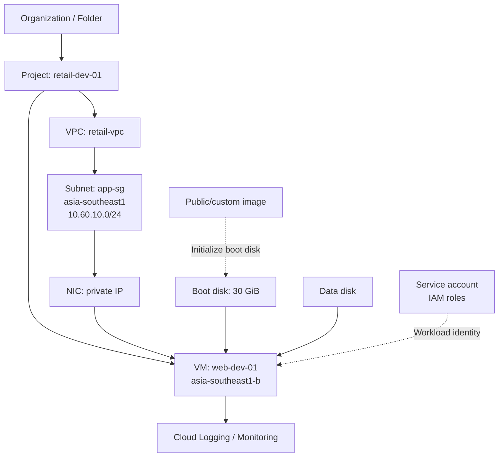
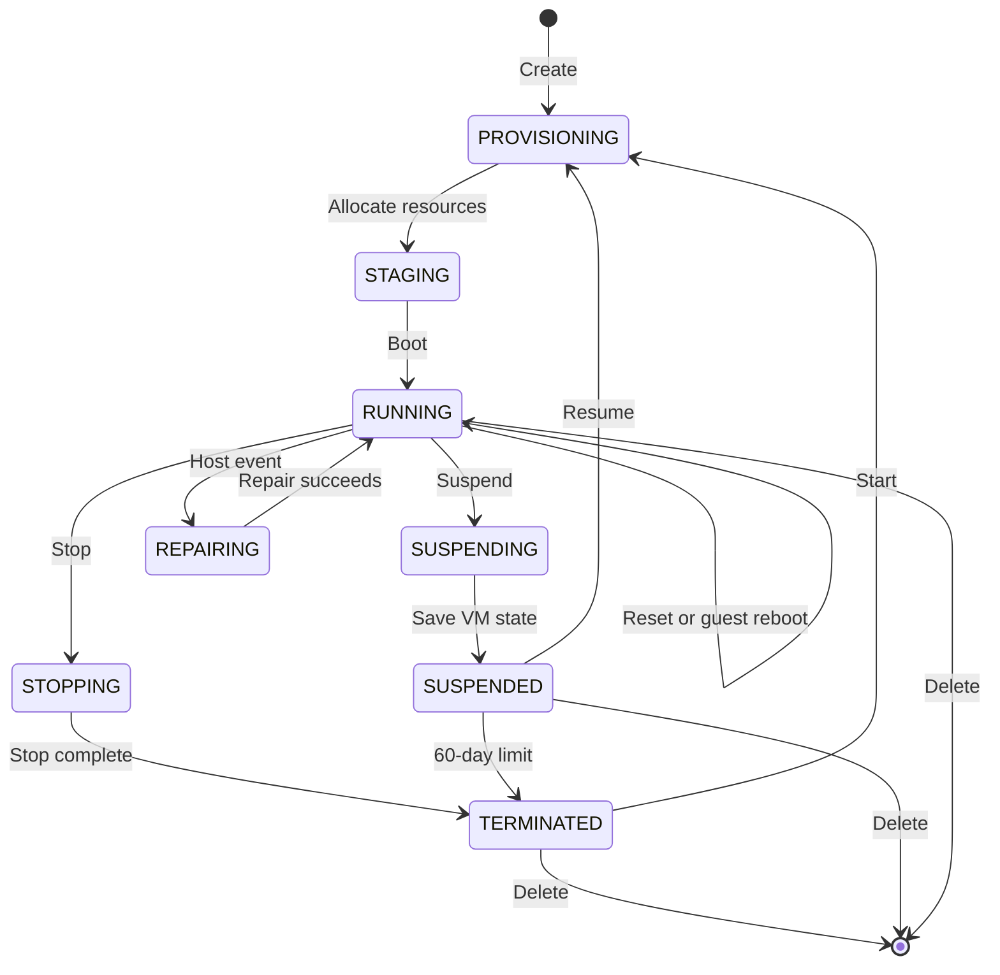
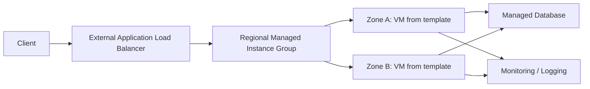

# Compute Engine Architecture and VM Lifecycle

**Google Compute Engine** provides computing capacity under the Infrastructure as a Service (IaaS) model: users create and operate **virtual machines (VMs)** on Google Cloud infrastructure, choosing the operating system, machine type, disk resources, networking, identity, and how physical host events are handled. Unlike Cloud Run or GKE Autopilot, VM operators typically carry more responsibility for OS configuration, patching, application processes, and capacity management.

In the **CLOUD_PROVIDERS_GCP** module, understanding Compute Engine is foundational for choosing between VMs, GKE, and Cloud Run, designing IAM/VPC, attaching storage, automating releases, and evaluating reliability and cost. This lesson belongs to the **Compute Engine** chapter, moving from the architecture of a single VM to **the lifecycle of creating, starting, running, stopping, suspending, resuming, resetting, and deleting**; then expanding to managed instance groups and safe production operations.

> All project names, subnets, service accounts, VMs, and status outputs in this lesson are **illustrative examples**, not provisioned resources. Commands that may incur charges or cause disruption are clearly marked; run them only in authorized projects.

## Learning Objectives

After this lesson, you will be able to:

1. Identify the components of a VM: **project, zone, machine type, image, boot/data disk, VPC NIC, IP, service account, and metadata**.
2. Distinguish between **image, snapshot, disk, instance template, VM instance, and managed instance group (MIG)**.
3. Explain the key states in the VM lifecycle and the differences between **stop, suspend, reset, restart, reboot, and delete**.
4. Choose operational actions based on data durability, recovery time, IP addresses, resource reallocation capability, and cost.
5. Create, inspect, update state, and clean up VMs using the Google Cloud console or `gcloud`, with awareness of IAM and impact.
6. Design secure VMs with **least privilege, OS Login, Shielded VM, firewalls, and backups**, while distinguishing single-VM fault tolerance from multi-zone MIGs.
7. Troubleshoot issues where a VM fails to start, an application is unreachable, or costs continue to accrue after stopping a VM.

## 1. Where Does Compute Engine Sit in Google Cloud Architecture?

A **VM instance** is a compute resource placed in **a single zone** of Google Cloud, belonging to **a single project**. It uses a machine type to define CPU and RAM; attaches at least one boot disk to run the operating system; and has one or more network interfaces (NICs) connected to appropriate VPCs/subnets.



### Scope of Each Resource

| Component | Typical Scope | Role |
| --- | --- | --- |
| **Project** | A unique project ID | Owns VMs, IAM, APIs, quotas, and billing |
| **Region** | E.g. `asia-southeast1` | Geographic location for subnets, regional services, and data residency requirements |
| **Zone** | E.g. `asia-southeast1-b` | Where a VM is scheduled; a zonal outage can affect VMs in that zone |
| **VPC network** | Global within a project | Logical network, routes, firewalls, and hybrid connectivity |
| **Subnet** | Regional | Internal IP range attached to VM NICs |
| **VM instance** | Zonal | CPU, RAM, OS, NIC, boot process, and metadata |
| **Boot/data Persistent Disk** | Usually zonal; regional variants exist | Persistent data storage independent of RAM |
| **Machine image / custom image** | Depends on image type and resource scope | Create or restore system configurations |
| **Instance template** | Global or regional, depending on type | Configuration template for creating similar VMs |
| **Managed instance group** | Zonal or regional | Manages a fleet of VMs, updates, autoscaling, and autohealing |

A VM name is not an IP address and is not enough to identify a resource globally: operations require at least **project + zone + instance name**. Example REST path:

```text
projects/retail-dev-01/zones/asia-southeast1-b/instances/web-dev-01
```

A VM's zone is not inferred from its subnet's region: a regional subnet can be used by multiple VMs in different zones within the same region.

## 2. Building Blocks of a VM

### 2.1 Machine Series and Machine Type

**Machine series** group hardware generations and performance characteristics; **machine types** define vCPU/RAM counts and sometimes constraints on accelerators, disks, or CPU architecture. For example, `e2-medium` is suitable for a basic lab exercise, but is not the optimal configuration for every application.

Choose machine types based on **workload profile**, not by name:

- Lightweight web/API: CPU, RAM, and actual concurrency.
- Batch processing: total CPU-hours, tolerance for interruption, and schedule.
- Memory-intensive: RAM-to-vCPU ratio and in-memory caching requirements.
- GPU/HPC: accelerators, GPU count, bandwidth, and zonal availability.
- Database: IOPS/throughput, RAM, CPU, backup, and HA; consider managed services like Cloud SQL before self-managing.

Not all machine types are **available in every region/zone**. Some selections require specific quotas or resource reservation conditions.

### 2.2 Image, Boot Disk, and Data Disk

- **Public image:** OS images provided by Google or partners, such as Debian/Ubuntu/Windows Server.
- **Custom image:** standardized images managed by a team to create consistent boot disks.
- **Boot disk:** the volume containing the OS, with an auto-delete attribute when the VM is deleted.
- **Data disk:** additional attached volumes for application data, separated from the boot disk when needed.
- **Snapshot:** a point-in-time backup of disk data using the snapshots mechanism; used to restore disks, not a backup of RAM.
- **Machine image:** a mechanism to store VM configuration along with disk contents where supported; should not be equated with a plain OS image.

For most VMs, the boot disk defaults to **`autoDelete=true`**. This means **deleting a VM can also delete its boot disk**, unless the policy has been changed to retain it. Data disks are handled according to the `autoDelete` setting of each attachment. Therefore, **check the disk deletion policy before running a delete command**.

### 2.3 Persistent Disk, Hyperdisk, and Local SSD

| Type | Characteristics | Lifecycle Implications |
| --- | --- | --- |
| **Persistent Disk** | Durable block storage managed by Google | Can be retained on stop; deletion depends on `autoDelete` |
| **Hyperdisk** | Block storage with configurable performance options by type | Continues to incur provisioned storage/performance charges per SKU |
| **Local SSD** | Host-attached low-latency storage without the durability of persistent disks | Many stop/delete events cause data loss; certain **preserve Local SSD** workflows have limitations and Preview status |

**Never store unique, non-reproducible data on a Local SSD.** Before stopping/deleting or migrating a VM, back up/copy data to durable storage and verify the exact Local SSD type supported by the machine.

### 2.4 VPC, IP, Firewall, and VM Ingress

Each NIC connects to a VPC/subnet and has an **internal IP**; an external IP is optional. Omitting an external IP generally reduces direct exposure, though workloads needing outbound Internet access may require **Cloud NAT**, a proxy, or a dedicated egress path by design.

**VPC firewalls** and firewall policies control inbound/outbound traffic. Having an external IP on a VM **does not guarantee** that SSH/HTTP from the Internet can reach it; conversely, a VM without an external IP can still be accessed over SSH via **IAP TCP forwarding**, hybrid connectivity, or a controlled bastion.

### 2.5 Service Account and Metadata

The service account attached to a VM defines the workload identity used to call Google Cloud APIs via the **metadata server** and short-lived credentials. Use a dedicated service account, grant least-privilege IAM roles on the exact target resources, and avoid storing long-lived JSON private keys inside the VM.

**Metadata** holds parameters such as startup scripts, tags, or configuration values. The metadata server is not a secure place to store arbitrary passwords/API keys; when secrets are needed, use Secret Manager or an equivalent secrets management mechanism.

## 3. The VM Lifecycle as a State Machine

Creating a VM does not jump directly to `RUNNING`. Compute Engine sequentially allocates resources, sets up the environment, and boots the guest OS. Common states include:



The diagram is a **simplified model** and does not include every intermediate step and condition. Beyond the illustrated states, Compute Engine also has:

- **`PENDING`:** Certain Flex-start VMs/TPUs may wait for capacity before entering `PROVISIONING`.
- **`PENDING_STOP`:** VMs configured with graceful shutdown may pass through a pending stop state.
- **`REPAIRING`:** Compute Engine is handling certain infrastructure/host errors; during this time the VM is unavailable.

State transitions are not always initiated by the user: **host maintenance, host errors, scheduled operations, or provisioning models** can trigger changes. <u>The `RUNNING` state indicates the VM has started running/booting; it does not guarantee the application inside is healthy.</u>

### State Reference and Recommended Actions

| State | What Is Happening | Appropriate Action |
| --- | --- | --- |
| `PROVISIONING` | Allocating resources in the zone | Wait; if prolonged, check quotas, capacity, and operation logs |
| `STAGING` | Preparing the VM for boot | Check image, startup script, and boot progress |
| `RUNNING` | VM is booting or active | Check health/readiness, CPU, disk, and logs |
| `PENDING_STOP` | Graceful shutdown when configured | Monitor shutdown scripts and timeout limits |
| `STOPPING` | Guest OS/VM is stopping | Avoid conflicting actions and wait for completion |
| `TERMINATED` | VM is **stopped**, but the VM resource still exists | Can be started or deleted depending on intent |
| `SUSPENDING` | Saving RAM/device state to storage | Wait; do not treat the application as available |
| `SUSPENDED` | VM is suspended, retaining supported state | Resume before the retention limit; check state storage charges |
| `REPAIRING` | Google is repairing an infrastructure error | Monitor status and automatic recovery |

**`TERMINATED` is different from `DELETED`.** A stopped VM still retains its name, metadata, and preserved disks; a deleted VM no longer exists as an instance that can be started again. To run it again after deletion, you must **create a new VM**, optionally using preserved disks/snapshots/images if retained beforehand.

## 4. How Do Stop, Suspend, Reset, Restart, and Delete Differ?

A wrong operational decision can lose data in RAM, release an external IP, or delete the boot disk. Use the following table to select the right operation:

| Action | Post-Completion State | RAM / Processes | Persistent Disks | Primary Impact |
| --- | --- | --- | --- | --- |
| **Stop** | `TERMINATED` | RAM contents and processes are not retained | Preserved per configuration | Stops CPU execution, retains VM config; can be started again |
| **Start** | `RUNNING` after provisioning/staging | Fresh OS boot, services start | Reattaches preserved disks | May fail if the zone lacks capacity |
| **Suspend** | `SUSPENDED` | Saves supported RAM and device/application state | Remains attached and continues billing | Suitable when you need to resume work within the allowed window |
| **Resume** | `RUNNING` after provisioning/staging | Restores suspended state | Continues using disks | Requires zonal capacity; not guaranteed zero downtime |
| **Reset** | Remains `RUNNING` in Compute Engine state | RAM lost, **ungraceful** reboot | Disks are not auto-deleted, but risk of filesystem corruption | Use only when the guest OS is unresponsive and safe options are exhausted |
| **Reboot inside guest OS** | Typically stays `RUNNING` | OS restarts gracefully | Disks remain intact | Appropriate for normal OS restarts |
| **Delete** | VM resource removed | Processes/RAM lost | Boot/data disks follow `autoDelete`; Local SSD deleted | Data may be unrecoverable without backups |

### 4.1 Stop Does Not Mean "Free"

Once stopped successfully, the VM enters `TERMINATED` and **no longer incurs standard VM compute charges for vCPU/RAM**. However, persistent disks, snapshots, reserved static IPs, reservations, and other resources **may continue to incur charges**. Actual billing depends on product/SKU/terms.

An **ephemeral external IP** is normally **released** on stop; when started again, the VM may receive a different external IP if it still requests an external IP. If an application must keep a fixed address, use a **static IP** and evaluate its associated cost.

**Warning:** Stopping releases CPU/RAM back to the zone. On restart, allocation **may fail if the zone lacks capacity**; a reservation or zone migration plan may be needed.

### 4.2 Suspend Differs from Stop by Preserving Memory State

Suspend saves guest OS memory and supported device/application state for later resumption. According to Compute Engine documentation, a VM can remain **`SUSPENDED` for up to 60 days**; after that, it automatically transitions to `TERMINATED` and **no longer retains that RAM/device/application state**.

The cost while suspended is **not zero**: charges apply for storing the memory state as well as attached resources like persistent disks and static IPs. Certain VM types, OSes, and accelerators do not support suspend. For critical applications, prioritize data consistency and backups rather than treating suspend as a snapshot or DR mechanism.

### 4.3 Reset Is a Last Resort for Unresponsive VMs

Reset is akin to cutting power and turning it back on: it bypasses graceful shutdown. The OS may require filesystem recovery, and uncommitted transactions or unflushed data can be lost. If guest OS connectivity is still available, use a normal reboot or service restart and collect logs first.

### 4.4 Delete Is a Destructive Resource Operation

Before deleting:

1. Verify the project, zone, instance name, and owner.
2. Check **`autoDelete` on each attached disk**, especially the boot disk.
3. Take any required snapshots/backups or machine images; test the restore procedure.
4. Check external static IPs, disks, snapshots, load balancer backends/instance groups, DNS, monitoring, and automation referencing the VM.
5. Confirm traffic has been drained or the application stopped cleanly with no in-flight requests.
6. After deletion, verify which resources still exist and whether they continue incurring charges.

**Never treat `gcloud compute instances delete` as a temporary stop.**

## 5. Planning Before Creating a VM

A sound configuration answers questions across multiple layers:

| Layer | Question | Example Decision |
| --- | --- | --- |
| **Project** | Dev or prod? Who pays and owns it? | `retail-dev-01`, label `environment=dev` |
| **Location** | Latency, availability, data residency, quota? | Region `asia-southeast1`, appropriate zone |
| **Compute** | CPU/RAM, CPU type, burst/steady-state, GPU? | `e2-medium` for test environment |
| **OS/image** | Standardized image and security updates? | Managed Debian image family |
| **Storage** | Boot/data, IOPS, backup, auto-delete? | Boot pd-balanced 30 GiB; backup required |
| **Network** | Subnet, internal/external IP, route/egress? | Private subnet, no external IP |
| **Identity** | Which APIs does the workload need to call? | Dedicated service account, least-privilege IAM |
| **Access** | How is SSH/RDP reached and by whom? | OS Login and IAP where appropriate |
| **Availability** | Does a single VM meet the SLO? | Production needs MIG/load balancer or other HA |
| **Operations** | Logs, metrics, startup script, patching, alerts? | Ops Agent, health check, maintenance window |
| **Cost** | Runtime hours, storage, network, licenses, discounts? | Dev budget and off-hours auto-stop |

If the requirement is simply an autoscaling containerized HTTP API, compare **Cloud Run** before self-managing VMs. If Kubernetes ecosystem and orchestration are needed, consider **GKE**. Compute Engine fits when you need control over the OS, system configuration, legacy software, long-running workloads, or specific hardware characteristics.

## 6. Project Preparation and IAM Permissions

To create a VM, you need:

- The **Compute Engine API** `compute.googleapis.com` enabled on the project.
- Appropriate billing configured on the project for paid resources and sufficient quotas available.
- The executing identity granted appropriate permissions, e.g., `compute.instances.create`; selecting a subnet may require `compute.subnetworks.use`, and selecting an image may require `compute.images.useReadOnly`.
- When attaching a **service account to the VM**, the creator identity needs `iam.serviceAccounts.actAs` on the target service account (commonly included in `roles/iam.serviceAccountUser`).
- Organization policies, firewall rules, and VPC configurations allowing the intended setup.

The predefined role `roles/compute.instanceAdmin.v1` is commonly used for VM administration, but it **does not automatically include every permission** on subnets, images in other projects, or service accounts. For production, grant the smallest appropriate scope and enforce an approval workflow.

### Configuring Workload Identity

A VM may run an application that needs to read objects from Cloud Storage. Attach a service account that only has read permissions on the required bucket/repository, rather than embedding user credentials or assigning `roles/editor` to the VM. **OAuth access scopes** on the VM can also restrict Google API calls: when using the broad `cloud-platform` scope, IAM still enforces and limits effective permissions.

### Securing OS Access

Prefer **OS Login** for SSH where supported by the organization, managing access via IAM and required controls. Use **IAP TCP forwarding** to access VMs without public IPs. Enforce least privilege for SSH users, never share private keys, and enable **Shielded VM** (Secure Boot/vTPM/integrity monitoring where supported by the OS and configuration).

## 7. Creating a VM via Google Cloud Console

Example deployment of a development VM to run an internal process:

1. Open [VM instances in the Google Cloud Console](https://console.cloud.google.com/compute/instances) and verify the **project**.
2. Click **Create instance**.
3. Name it `web-dev-01`, select the **region/zone**, and choose a machine family/type sized for the load.
4. Choose the **boot disk image, disk type, size**, and retain/delete policy upon instance deletion.
5. Select the **VPC/subnet** and internal IP; consider **disabling external IP** if Internet access is not needed.
6. Under Security, select a **least-privilege service account**, enable Shielded VM/OS Login where supported, and avoid placing secrets in metadata.
7. Configure labels and startup scripts/automation if needed; review the CPU, disk, and network cost estimate.
8. Click Create; wait for the `RUNNING` state, then verify **OS boot, health/endpoints, and logs**.

The Console can generate equivalent CLI/Terraform snippets from your configuration. Review them before moving them into IaC; do not copy a configuration with open public SSH/HTTP directly to production without proper firewall and IAM controls.

## 8. Hands-On with Google Cloud CLI

The commands below are divided into **read-only** and **resource-mutating**. Replace the example values before use; do not run against production without approval.

### 8.1 Inspecting Context and Listing Instances (Read-Only)

```bash
PROJECT_ID="retail-dev-01"
ZONE="asia-southeast1-b"
VM_NAME="web-dev-01"

# Active identity and default project may differ from your target project.
gcloud auth list
gcloud config get-value project

# List existing instances.
gcloud compute instances list --project="$PROJECT_ID"

# Inspect configuration, status, and attached disks of a specific VM.
gcloud compute instances describe "$VM_NAME" \
  --project="$PROJECT_ID" \
  --zone="$ZONE" \
  --format="yaml(name,status,machineType,disks,networkInterfaces,serviceAccounts)"
```

For resource URL fields like `machineType`, the value may be a full path; avoid comparing display names using brittle string slicing.

### 8.2 Creating a VM (Mutating, May Incur Charges)

The example below assumes the VPC/subnet and service account **already exist**. The VM receives no external IP, suitable for a private environment with internal access already in place:

```bash
gcloud compute instances create web-dev-01 \
  --project="retail-dev-01" \
  --zone="asia-southeast1-b" \
  --machine-type="e2-medium" \
  --image-family="debian-12" \
  --image-project="debian-cloud" \
  --boot-disk-size="30GB" \
  --boot-disk-type="pd-balanced" \
  --subnet="app-sg" \
  --no-address \
  --service-account="vm-web-dev@retail-dev-01.iam.gserviceaccount.com" \
  --scopes="cloud-platform" \
  --labels="environment=dev,team=retail"
```

After running, verify **the VM status and guest OS boot progress**. Having no external IP means `apt update` or downloading packages from the Internet may require **Cloud NAT** or an appropriate egress path; VM creation success does not prove the workload installed cleanly.

### 8.3 Stopping and Starting (State Changes)

```bash
# Safe stop: does not delete the VM.
gcloud compute instances stop web-dev-01 \
  --project="retail-dev-01" \
  --zone="asia-southeast1-b"

# Once in TERMINATED state, it can be started again.
gcloud compute instances start web-dev-01 \
  --project="retail-dev-01" \
  --zone="asia-southeast1-b"
```

Certain instances with Local SSDs or graceful shutdown settings have special flags/constraints; do not run default stop commands on workloads storing unique data on Local SSDs. When stopping a VM with complex application state, **quiesce the application, flush disks, and back up** beforehand.

### 8.4 Suspending and Resuming (Use Only When Supported)

```bash
# Suspend a RUNNING VM that supports suspend.
gcloud compute instances suspend web-dev-01 \
  --project="retail-dev-01" \
  --zone="asia-southeast1-b"

# Resume before the max limit and when the zone has sufficient capacity.
gcloud compute instances resume web-dev-01 \
  --project="retail-dev-01" \
  --zone="asia-southeast1-b"
```

Use `describe` before and after the operation to confirm `SUSPENDED` / `RUNNING`. Do not assume suspend works with GPUs, Confidential VMs, every OS, or every disk type; check current machine restrictions.

### 8.5 Resetting (Risk of Data Loss)

```bash
# Use only when the VM is unresponsive and approved.
gcloud compute instances reset web-dev-01 \
  --project="retail-dev-01" \
  --zone="asia-southeast1-b"
```

The reset command does not perform a graceful OS shutdown. Never use reset as a routine application restart method. If SSH still works, consider `sudo systemctl restart SERVICE` or `sudo reboot` inside the OS after reviewing service availability.

### 8.6 Checking Disks Before Deleting a VM

```bash
# Inspect attached disks and autoDelete — READ-ONLY.
gcloud compute instances describe web-dev-01 \
  --project="retail-dev-01" \
  --zone="asia-southeast1-b" \
  --format="yaml(disks)"
```

The VM deletion command below may **automatically delete the boot disk** and make data unrecoverable if no backup exists:

```bash
# EXECUTE ONLY AFTER CONFIRMING BACKUPS, DISK POLICIES, AND DELETION AUTHORIZATION.
gcloud compute instances delete web-dev-01 \
  --project="retail-dev-01" \
  --zone="asia-southeast1-b"
```

If you need to retain the boot disk, inspect and update `autoDelete` via the proper procedure before deleting, or prepare a separate copy/snapshot. Never assume all attached resources are cleaned up upon VM deletion—or conversely, that all are kept.

## 9. Lifecycle of Data, IP Addresses, and Identity

Focus on **what outlives or dies with the VM**:

| Resource/State | On Stop | On Suspend | On Reset | On Delete |
| --- | --- | --- | --- | --- |
| **RAM and processes** | Not retained | Saved via suspend mechanism where supported | RAM lost, ungraceful reboot | Lost |
| **Boot Persistent Disk** | Normally retained | Retained | Retained | Follows `autoDelete`, defaults to delete |
| **Data Persistent Disk/Hyperdisk** | Retained | Retained | Retained | Follows attachment `autoDelete` |
| **Local SSD** | Risk of loss; preserve is limited/Preview | Only on supported configurations | Disk data may remain but risk of corruption | Deleted |
| **Internal IP** | VM retains supported config/IP | Retains supported config/IP | Retained | No longer attached to VM |
| **Ephemeral external IP** | Normally released | Released | Normally retained | Released |
| **Static external IP** | Can be retained, still billed per terms | Can be retained, still billed | Retained | Check reserved address status and clean up separately |
| **Service account/metadata** | VM attachment config remains | Config retained | Config retained | VM gone; service account is a separate resource |

The `TERMINATED` state **does not delete the VM**. Conversely, **service accounts, snapshots, or static IPs** do not necessarily disappear when a VM is deleted, so inventory management is essential to avoid orphaned billing and unused permissions.

## 10. Designing for Reliability: One VM Is Not an HA Architecture

A VM is placed in a single **zone**. If that zone suffers an outage or the guest OS fails, an application on a single VM may miss its SLO. Compute Engine provides **live migration** and **automatic restart** depending on VM type and scheduling policy, but these do not guarantee continuous application availability or self-healing when an application process crashes.

### 10.1 Distinguishing Recovery Mechanisms

| Mechanism | Detection/Handling | Limitations |
| --- | --- | --- |
| **Automatic restart** | Restarts the VM after certain host failures per scheduling policy | Does not resolve application-level bugs |
| **Live migration** | Moves a running VM during eligible maintenance to reduce disruption | Not supported by all VM types/accelerators; application design still matters |
| **Managed instance group (MIG)** | Maintains desired VM count, supports autohealing and rolling updates | Requires instance template, health check, and state design |
| **Regional MIG** | Distributes instances across multiple zones in a region | Does not replace cross-region DR |
| **External/Internal Load Balancer** | Routes traffic to healthy backends per configuration | Does not back up data stored on VMs |
| **Snapshot/backup** | Retains data for restoration | Does not provide zero downtime on its own |

### 10.2 Instance Templates and MIGs

An **instance template** describes a machine configuration including machine type, disk image, network, metadata, and service account. A **managed instance group** uses a template to create uniform instances and can:

- self-heal unhealthy instances via **recreation** based on health checks;
- **autoscale** based on metrics/load and supported policies;
- roll out new template versions, rolling updates, and rollbacks systematically;
- run in **a single zone** or **multiple zones in a region**, depending on the MIG type.

**Warning about state:** When an instance in a MIG is recreated, data stored solely on the local filesystem without a state-preservation policy can be lost. Stateless applications are the simplest fit; **stateful MIGs** offer mechanisms to preserve disks/metadata, but must be configured deliberately. For production databases, consider Cloud SQL or an appropriate HA/backup architecture rather than relying on a MIG alone.

### 10.3 A Reference Topology for a Web API



Applications should store state in a **managed database/object storage or durable shared storage** rather than solely in one VM's RAM/local disk. Configure load balancer health checks and rollouts properly to minimize disruption when replacing VMs.

## 11. VM Host Events, Scheduling, and Automated Behavior

A VM's state can change due to:

1. **Users/IaC:** stop, start, suspend, reset, delete, or changing machine type.
2. **OS/application:** guest reboot, kernel panic, unresponsive process, shutdown script.
3. **Google host events:** physical host maintenance, host failure, live migration, or restart where applicable.
4. **Capacity/scheduling:** insufficient capacity during start/resume; Spot VMs risk preemption when Google reclaims resources.
5. **Automation:** scheduled start/stop, autoscaler/MIG, maintenance workflows, or deployment pipelines.

When configuring **Spot VMs**, do not treat provisioned instances as permanent: they can be reclaimed per product policy. Batch jobs should support checkpointing/idempotent retries, persist outputs durably, and handle preemption retries.

Settings like `automaticRestart` and `onHostMaintenance` control certain behaviors during host events, but must be chosen according to VM type, accelerators, and support matrix. Do not enable a setting just because it says "restart" and treat it as an HA solution.

## 12. Cost Across the VM Lifecycle

Compute Engine bills based on resources and **usage state**, not just the number of VM rows in the console. Components to estimate:

| Item | When It Applies | Notes |
| --- | --- | --- |
| **vCPU/RAM** | VM is in a billable compute state, usually `RUNNING` | Machine type, region, duration, pricing model |
| **Guest OS license** | Depends on OS and state, especially Windows/SQL Server | May differ from CPU billing; check SKU |
| **Persistent Disk/Hyperdisk** | As long as the disk exists, even when VM is stopped | Capacity and provisioned performance |
| **Local SSD / suspend state storage** | Depends on VM type, suspend/stop mode, and storage used | Do not assume suspend is free |
| **Snapshots/images** | Retained resources | Retention and data growth |
| **Static/external IP** | Depends on address state and IP type | Reserved IPs may incur charges |
| **Network egress/NAT/LB** | When network traffic and infrastructure are used | Region, direction, GB volume, SKU |
| **Logging/Monitoring** | Based on ingested data and retention policies | Log retention, sampling, alerting |

### 12.1 Simple Calculation

Two development VMs running **8 hours/day × 22 days/month**, assuming a self-chosen exercise compute rate of **0.10 USD/VM-hour**:

```text
Runtime per VM       = 8 × 22 = 176 hours/month
Total VM-hours       = 2 × 176 = 352 VM-hours
Assumed compute cost = 352 × 0.10 = 35.20 USD/month
```

The **35.20 USD figure is purely illustrative**, not a Google Cloud price quote. Disks, snapshots, IPs, egress, licenses, and other charges still apply. Use the [Google Cloud Pricing Calculator](https://cloud.google.com/products/calculator) to select **machine type, region, runtime hours, and persistent resources**.

### 12.2 Should You Auto-Stop VMs Outside Working Hours?

For **stateless** dev/test environments, scheduled stop/start can save compute costs. However, verify:

- Does the app store data in RAM or Local SSD?
- Will an ephemeral external IP change break DNS, allowlists, or integrations?
- Is there enough capacity to restart in the zone?
- Are scheduled backups, CI jobs, batch tasks, or health checks running off-hours?
- Disks and static IPs still cost money; set budget alerts and audit orphaned resources.

For production requiring uptime, **do not apply stop schedules** solely to save money if it violates SLOs. Optimize via right-sizing, autoscaling, Spot VMs for suitable workloads, or managed services where appropriate.

## 13. Automating VM Configuration with Infrastructure as Code

Manually created VMs are prone to **configuration drift**: differing images, tags, service accounts, or firewalls between dev and prod. With IaC, operators review changes and version configurations.

Minimal Terraform example — **assumes VPC, subnet, and service account already exist**:

```hcl
variable "project_id" {
  type = string
}

variable "zone" {
  type = string
}

resource "google_compute_instance" "web_dev" {
  project      = var.project_id
  zone         = var.zone
  name         = "web-dev-01"
  machine_type = "e2-medium"

  boot_disk {
    initialize_params {
      image = "debian-cloud/debian-12"
      size  = 30
      type  = "pd-balanced"
    }
    auto_delete = true
  }

  network_interface {
    subnetwork = "app-sg"
    # Omitting access_config -> no external IP assigned.
  }

  service_account {
    email  = "vm-web-dev@retail-dev-01.iam.gserviceaccount.com"
    scopes = ["cloud-platform"]
  }

  labels = {
    environment = "dev"
    team        = "retail"
  }
}
```

This is an **academic snippet** without a Terraform provider/backend, IAM roles, or subnet lookup. In practice, specify the subnet/Shared VPC project accurately, use modules and remote state, review auto-delete policies, and **never place secrets in startup scripts, Terraform state, or metadata**.

**Terraform destroy destroys the corresponding VM** and may delete its boot disk per policy — **unlike stop**. Before every apply/destroy, inspect the plan, project, zone, disks, and recovery strategy.

## 14. Data Protection, Backups, and Changing Machine Types

### 14.1 Do Not Rely on an Existing Disk as a Backup

A Persistent Disk that survives a stop **is not an independent backup**. Accidental disk deletion, encryption/ransomware, or logical corruption can still destroy the sole copy. Implement:

- snapshot schedules and retention aligned with RPO/RTO;
- application-aware backups for databases (where appropriate);
- restore testing, not just checking that backup jobs succeeded;
- strict permissions on deleting snapshots/disks plus auditing;
- multi-zone/multi-region design if SLO/DR requires it.

### 14.2 Changing Machine Type

Many machine changes require **stopping the VM first**, selecting a compatible machine type, and starting it again. Changes may be constrained by CPU architecture, disk type, GPU, zonal capacity, and quotas. Example workflow:

```text
Check load -> announce maintenance -> back up
  -> stop VM -> change machine type -> start
  -> verify application/latency/cost -> update IaC
```

If downtime is unacceptable, build a VM-replacement/rolling-update model with a load balancer rather than expecting single-VM resizes to be disruption-free.

### 14.3 Startup/Shutdown Scripts

Startup scripts can bootstrap applications or install agents at boot, but they must be **idempotent**: re-running them must not corrupt data or duplicate configuration. Shutdown scripts should handle graceful stop within supported timeouts and must not be the sole data protection mechanism.

Best practice is to store configurations/artifacts in source control with secure pipelines, inspect logs, reduce dependency on downloading packages directly from the Internet at boot, and use immutable images or instance templates for large-scale rollouts.

## 15. Real-World Scenario: API VM Stopped and Failed to Restart

A team runs an internal API on VM `orders-api-01` in `retail-dev-01`. To save costs, ops stops the VM every night, but the next morning the start job fails with an error stating **the selected machine type cannot be allocated**.

### Layered Investigation

**Step 1 — Verify if the VM still exists.** Run `instances describe`. If the state is `TERMINATED`, the VM is **stopped**, not deleted.

**Step 2 — Read the actual operation/error.** Inspect Compute Engine operations, Cloud Audit Logs, and error messages. If it is a capacity, quota, or policy error, do not treat it as an OS issue.

**Step 3 — Cross-check configuration.** Review zone, machine type, GPU/Local SSD, reservation, quota, and maintenance/scheduling settings.

**Step 4 — Recovery options.** If an appropriate capacity reservation exists, use it per procedure. Otherwise, consider an alternative machine type or zone while ensuring disk/network, data, and application compatibility. Moving to another zone **is not simply changing the `--zone` flag on the old VM**; it may require snapshots/images, disk replication, or service-supported migration.

**Step 5 — Verify the application.** Once `RUNNING`, check startup logs, service health, database connectivity, internal DNS, IAM, and external dependencies. `RUNNING` does not guarantee HTTP returns 200.

**Step 6 — Fix the architecture.** If continuity is required, move to a MIG/regional HA or a managed service; if this is dev/test, review schedules and capacity reservation mechanisms within budget.

### When IP Preservation Matters

If a VM uses an **ephemeral external IP** for a partner allowlist, stop/start can change the IP and cause partner APIs to reject requests. Architectural takeaway: never use ephemeral IPs as stable identifiers. Use static IPs, load balancers, or appropriate DNS, while controlling IP permissions and costs.

## 16. Diagnosing VM State Issues

| Symptom | Likely Causes to Check | Recommended Action |
| --- | --- | --- |
| VM stuck in `PROVISIONING` | Quota, zonal capacity, machine type, reservation | Check operation status and error messages |
| VM `RUNNING` but SSH fails | Firewall, routes, external/internal IP, OS Login/IAP, SSH daemon | Verify access path and OS logs |
| VM `RUNNING` but app returns 5xx | Startup script, process, disk full, dependency, port | Check serial console, Ops Agent/logs, and health |
| Still billed after stopping VM | Persistent Disk, static IP, snapshots, reservations, suspend storage | Review Cloud Billing SKUs and attached resources |
| Starting `TERMINATED` VM fails | Insufficient capacity/quota, image/disk, policy | Inspect operation, quotas, and zone availability |
| Suspend rejected | VM not `RUNNING`, unsupported OS/VM type, accelerator/Local SSD | Check suspend limitations and current state |
| Suspended over 60 days | Auto-transitioned to `TERMINATED`, RAM state lost | Start as a fresh boot; do not expect session resume |
| Reset causes app data corruption | Ungraceful shutdown, filesystem recovery | Verify consistency; restore from backup if needed |
| VM deleted, boot disk gone | `autoDelete=true` | Locate backups/snapshots; check audit logs |
| MIG autohealing "wipes" local data | Instance recreated on stateful workload | Design external state or appropriate stateful MIG |
| External IP changed after stop/start | Ephemeral external IP was released | Use static IP/Load Balancer; update architecture |
| Machine type change fails | Stop required, machine/zone/disk constraints | Check compatibility and follow maintenance plan |

### How to Inspect Status and Root Cause (Read-Only)

```bash
PROJECT_ID="retail-dev-01"
ZONE="asia-southeast1-b"
VM_NAME="orders-api-01"

# VM status and configuration.
gcloud compute instances describe "$VM_NAME" \
  --project="$PROJECT_ID" --zone="$ZONE" \
  --format="yaml(name,status,machineType,disks,networkInterfaces,scheduling)"

# List operations related to the zone.
gcloud compute operations list \
  --project="$PROJECT_ID" \
  --filter="zone:($ZONE)" \
  --limit=20

# View project quotas and limits (output format may vary).
gcloud compute project-info describe \
  --project="$PROJECT_ID"
```

When analyzing boot issues, inspect **serial port output** if permitted and compliant with data policies:

```bash
gcloud compute instances get-serial-port-output "$VM_NAME" \
  --project="$PROJECT_ID" \
  --zone="$ZONE"
```

Serial output may contain sensitive data from startup scripts or the OS; never post raw logs publicly. Combine Cloud Logging/Monitoring and audit logs with proper permissions to correlate user actions, host events, and application behavior.

## 17. Controlled VM Operations Runbook

### Before the Operation

- Identify project, zone, instance name, owner, application, and maintenance window.
- Verify current status, machine type, boot/data disks, `autoDelete`, Local SSDs, and IPs.
- Confirm impact on load balancers, databases, DNS, users, and SLOs.
- Check IAM permissions of the executing identity; do not over-provision permissions.
- Ensure backups/snapshots and restore procedures are tested.
- Obtain approvals and a rollback plan for production.

### During the Operation

- Use explicit `gcloud ... --project=... --zone=...`; record the operation ID.
- Perform graceful shutdown or traffic draining if disruption is possible.
- Avoid simultaneous out-of-band console edits and IaC changes.
- Wait for the expected final state; do not stop at "API request accepted".
- Verify disks, IPs, health, and preserved data after the task.

### After the Operation

- Check the **application**, not just VM status; verify DNS, database, metrics, and endpoints.
- Review audit logs, IAM changes, and costs of remaining resources.
- Update CMDB/asset inventory, runbooks, IaC, and tickets.
- If a VM was deleted or migrated, audit orphaned disks, static IPs, snapshots, reservations, and alerts.

## 18. Common Misconceptions

| Misconception | Accurate Understanding |
| --- | --- |
| "A `TERMINATED` VM means the VM was deleted" | The VM is only **stopped** and can be started again if capacity allows |
| "A `RUNNING` VM means the app is healthy" | The OS may still be booting or the application may be failing |
| "Stopping a VM eliminates all charges" | Disks, static IPs, snapshots, and other resources may still incur fees |
| "Suspend is the same as stop" | Suspend preserves supported RAM/device state, incurs storage fees, and has a 60-day limit |
| "Reset is a safe reboot" | Reset is ungraceful and risks data corruption |
| "Deleting a VM does not delete data" | Boot disks usually default to `autoDelete=true`; verify every disk |
| "A VM resides in a region" | A VM is **zonal**, a subnet is regional, and a VPC is global |
| "Having an external IP means Internet/SSH access works" | Firewalls, routes, and policies still govern connectivity |
| "The VM's service account is the SSH login user" | Workload identity and OS Login/IAM SSH are separate mechanisms |
| "One VM with auto-restart meets HA" | Multi-zone SLOs require replication, load balancing/MIG, or another HA design |
| "MIGs always preserve local instance data" | Autohealing/recreation can lose local state without preservation policies |
| "Changing `--zone` moves the VM to another zone" | Requires a proper migration/recreation process for disks, networking, and data |

## 19. Self-Check Exercises

### Exercise 1 — Identify Scope

A VM is placed in `asia-southeast1-b`, subnet `app-sg` in `asia-southeast1`, and VPC `retail-vpc`. Distinguish the scope of the zone, region, and VPC.

<details>
<summary>Answer hint</summary>

The VM is a zonal resource in `asia-southeast1-b`; the subnet is regional in `asia-southeast1`; the VPC is a project-level global resource. A regional subnet can be used by VMs across multiple zones within the same region.
</details>

### Exercise 2 — Stop or Suspend?

A dev machine runs a heavy IDE whose environment takes a long time to initialize and needs to keep the session for 12 hours. Should you consider stop or suspend? What should you check?

<details>
<summary>Answer hint</summary>

You can consider **suspend** to retain memory/application state if supported by the VM/OS; check the 60-day limit, state storage fees, and resume capability when the zone has capacity. If RAM/session preservation is unnecessary, **stop** is simpler and avoids suspend state storage fees.
</details>

### Exercise 3 — Stop vs. Delete

VM `web-01` is stopped, in `TERMINATED` state. The team wants to run it again tomorrow. Do they need to create a new VM? What happens if they run delete?

<details>
<summary>Answer hint</summary>

No new VM is needed: use `gcloud compute instances start` when the zone has capacity. If **deleted**, the instance is gone; it must be recreated from an image/snapshot/preserved disk, and the boot disk may have been deleted per `autoDelete`.
</details>

### Exercise 4 — Calculate Runtime Hours

Three VMs run 8 hours/day for 20 days/month. What is the total VM-hours? At an assumed rate of 0.12 USD/VM-hour, what is the illustrative compute charge?

<details>
<summary>Answer</summary>

Total VM-hours = 3 × 8 × 20 = **480 VM-hours**. Assumed compute charge = 480 × 0.12 = **57.60 USD**. This is not a Google Cloud price quote and excludes disks, IPs, networking, or licenses.
</details>

### Exercise 5 — Avoid Data Loss on Delete

A VM has a 50 GiB boot disk and a 500 GiB data disk. List at least four checks to perform before deleting it.

<details>
<summary>Answer hint</summary>

Check `autoDelete` on each disk, take required snapshots/backups and test restore, confirm which disks must be retained, verify traffic/owner and approval, check static IPs/Load Balancers, verify the exact project/zone, and audit remaining billable resources after deletion.
</details>

### Exercise 6 — Running but HTTP Fails

A VM reports `RUNNING`, yet requests to `https://api.example.com` fail. List at least six layers to check.

<details>
<summary>Answer hint</summary>

DNS → load balancer/backend health → routes/VPC/firewalls → internal/external IP/IAP → application process and listening port → OS boot/startup logs → database dependencies → TLS certificates → application errors and metrics. `RUNNING` is not an HTTP health indicator.
</details>

### Exercise 7 — HA and Data

Why does placing a single VM in zone A with automatic restart enabled fail to guarantee high website availability during a prolonged zone A outage?

<details>
<summary>Answer hint</summary>

Automatic restart cannot keep the VM serving if the entire zone is unavailable. At minimum, you need a multi-zone architecture such as a **regional MIG + load balancer**, health checks, and durable external storage outside a single VM; you must also define SLOs, backups, and a DR strategy.
</details>

### Exercise 8 — Permission to Attach a Service Account

A user can create a VM but is denied when attaching `vm-web-dev@retail-dev-01.iam.gserviceaccount.com`. Which permission should typically be checked?

<details>
<summary>Answer hint</summary>

`iam.serviceAccounts.actAs` on the target service account, typically granted via `roles/iam.serviceAccountUser`. They also need Compute Engine permissions, corresponding subnet/image permissions, and organizational policy allowance. Do not assign `roles/editor` to bypass the error.
</details>

## 20. Pre-Release VM Checklist

- [ ] Selected the right project, region, zone, VPC/subnet, and non-overlapping IP range.
- [ ] Right-sized machine type; verified quotas and capacity for start/restart.
- [ ] Image/OS has an update plan, contains no secrets, and is appropriately hardened.
- [ ] Boot/data disks, `autoDelete`, snapshots/backups, and restore procedures are defined.
- [ ] Local SSDs (if any) only hold reproducible data or have a valid preserve/backup plan.
- [ ] External IP assigned only if needed; firewalls, OS Login/IAP, and least-privilege service account verified.
- [ ] Logging, metrics, alerts, health checks, and true application readiness verification are in place.
- [ ] Impact of stop/suspend/reset/delete is understood, especially on RAM, IPs, and disks.
- [ ] For production, evaluated SLA, MIG/multi-zone, load balancing, and state storage location.
- [ ] IaC, versioned startup config, rollback plan, owner, and change approval are in place.
- [ ] Estimated CPU/RAM, disks, network, snapshots, IPs, licenses, and stopped-VM residual costs.
- [ ] Operational runbook, backup schedule, and restore testing are established.

## Official Documentation References

- [Compute Engine overview](https://cloud.google.com/compute/docs/overview): VM model, architecture, and capabilities.
- [Compute Engine instance lifecycle](https://cloud.google.com/compute/docs/instances/instance-lifecycle): states `PENDING`, `PROVISIONING`, `STAGING`, `RUNNING`, `PENDING_STOP`, `STOPPING`, `TERMINATED`, `SUSPENDING`, `SUSPENDED`, `REPAIRING`.
- [Create and start an instance](https://cloud.google.com/compute/docs/instances/create-start-instance): creating VMs via Console/CLI/REST and required permissions.
- [Stop or restart an instance](https://cloud.google.com/compute/docs/instances/stop-start-instance): stop, start, billing, and capacity risks.
- [Suspend or resume an instance](https://cloud.google.com/compute/docs/instances/suspend-resume-instance): RAM state, 60-day limit, and support conditions.
- [Suspend, stop, or reset instances](https://cloud.google.com/compute/docs/instances/suspend-stop-reset-instances-overview): comparison table of stop/suspend/reset.
- [View disk details and auto-delete](https://cloud.google.com/compute/docs/disks/view-disk-details): how to inspect disk deletion policies.
- [Modify Persistent Disk or Hyperdisk settings](https://cloud.google.com/compute/docs/disks/modify-persistent-disk): adjusting disks and `autoDelete`.
- [Instance groups](https://cloud.google.com/compute/docs/instance-groups): regional/zonal MIGs, autohealing, rolling updates, and stateful workloads.
- [VM instance pricing](https://cloud.google.com/compute/vm-instance-pricing): compute usage and pricing by machine type.
- [Compute Engine IAM roles](https://cloud.google.com/compute/docs/access/iam): permissions to create/manage VMs and related resources.
- [Cloud Monitoring for Compute Engine](https://cloud.google.com/monitoring/docs/monitoring-compute-engine): VM metrics and observability.
- [Google Cloud Pricing Calculator](https://cloud.google.com/products/calculator): estimating costs by configuration and runtime hours.
